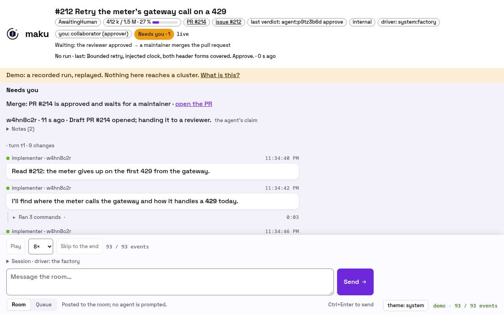
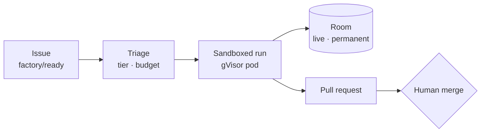

# agent-platform

**Run coding agents on your Kubernetes cluster without trusting them.**

- **Sandboxed:** every run is an isolated pod holding only short-lived, scoped credentials, inside a budget it cannot raise.
- **Supervised:** approvals, steering and the merge gate sit outside the sandbox, with humans.
- **On the record:** every run streams into a room that nobody can rewrite, the agent included.

<a href="https://smana.github.io/agent-platform/">
  <picture>
    <source media="(prefers-color-scheme: dark)" srcset="docs/assets/room-dark.png">
    
  </picture>
</a>

**[Watch a run in the live demo →](https://smana.github.io/agent-platform/)** · [How it works](#how-it-works) · [What's a room?](#whats-a-room)

## What's a room?

A room is a flight recorder and a group chat for one piece of agent work. While the run is live,
you watch every step, steer the agent, and approve what it may not do alone. Afterwards the room
stays: an ordered, redacted record that nobody can edit, which you audit, fork from any message, or
hand to the next run.

Why you can trust that record:

- **Append-only.** The broker's database role can insert and read events, never update or delete
  them ([the room log](docs/room-log.md#the-guarantees)).
- **Redacted first.** Secrets are detected and removed before an event is stored, logged or
  counted ([security](docs/security.md)).
- **Attributed.** Every event carries an identity the broker stamped from a verified credential,
  never one the sender claimed ([principals](docs/security.md)).

## How it works



1. **Issue.** A maintainer labels an issue `factory/ready`. The same label from anyone else starts nothing.
2. **Triage.** The factory picks the task's template and its tier, which sets the model, the deadline and the token budget, once.
3. **Sandboxed run.** Each agent runs in its own gVisor pod behind a default-deny network policy, with short-lived credentials minted for that run alone.
4. **Room.** The run streams every step into its room: live while it works, kept after it ends.
5. **Pull request.** The implementer run opens the pull request on an `agent/<task>` branch, and a reviewer run gives its verdict.
6. **Human merge.** A maintainer merges. Only a low-risk class the config marks `live` merges itself, after every check holds; a `shadow` class is decided the same way and never merged.

## Who it's for

For platform teams who want coding agents on their cluster, under their own rules.

Not yet for: a laptop tool or a hosted service.

## Status

v0.15.2, in daily use on one cloud for one public repository, with the merge gate in shadow. It
runs today on [cloud-native-ref](https://github.com/Smana/cloud-native-ref); a portable install for
any Kubernetes cluster is the next milestone. What is proven live and what comes next is on the
platform's [status page](https://github.com/Smana/cloud-native-ref/blob/main/website/content/docs/platform/ai-platform/status.md).

## Start here

| You are | Start at |
|---|---|
| New here | [Concepts](docs/concepts.md), then [Architecture](docs/architecture.md) |
| A maintainer with a factory issue or PR | [The factory](docs/factory.md) |
| A developer who wants the CLI | [roomctl](docs/roomctl.md) |
| Operating a cluster | [Integration](docs/integration.md), then [Operations](docs/operations.md) |
| Changing the code | [AGENTS.md](AGENTS.md), then [Development](docs/development.md) |

Every page is indexed in [docs/](docs/README.md). The binaries, images, ports and release
mechanics are in [Architecture](docs/architecture.md#binaries-images-and-releases).

## Develop

```bash
mise install    # Go, golangci-lint, task, govulncheck, pinned in mise.toml
task check      # every gate CI runs (see AGENTS.md)
```

Store tests use testcontainers, so they need a running Docker daemon.

CI also runs CodeQL on every PR and weekly, and OpenSSF Scorecard weekly on `main`. Report
vulnerabilities privately: see [SECURITY.md](SECURITY.md).

## License

Apache-2.0
