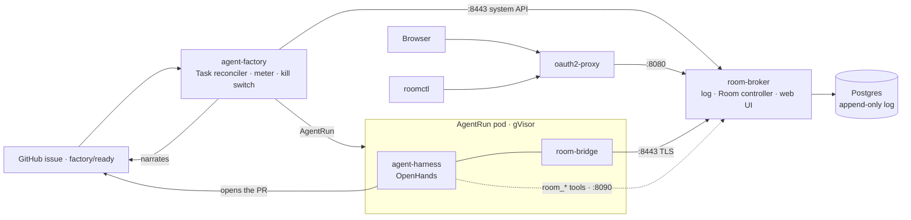

# agent-platform

**agent-platform** runs coding agents under human oversight and keeps the record. Label a GitHub
issue `factory/ready` and **agent-factory** triages it, starts sandboxed agent runs that open the pull
request, narrates each step on the issue and stops at its budget. Every run streams into a
**collaboration room**: an append-only, redacted Postgres log that outlives the pod, which
you watch, steer, approve and fork in the web UI, or watch, post, queue and fork from `roomctl` in a terminal. Four binaries in one
repo (`room-broker`, `room-bridge`, `agent-factory`, `roomctl`) plus the `agent-harness` image,
released together and pinned by digest. Built for one maintainer's Kubernetes platform
([cloud-native-ref](https://github.com/Smana/cloud-native-ref)); the core carries no platform
constants.

| Why | In one line | More |
|---|---|---|
| A factory | Work you do not want to babysit, sandboxed, reviewed and budgeted, under its own identity | [the platform's agents overview](https://github.com/Smana/cloud-native-ref/blob/main/website/content/docs/platform/ai-platform/agents/_index.md) |
| A room | The transcript, handoffs and decisions outlive the sandbox, and nobody can rewrite them | [docs/room-log.md](docs/room-log.md) |
| Humans in the loop | Approvals, steering and the merge gate sit outside the sandbox; the agent is not a trusted component | [docs/security.md](docs/security.md) |

**Status:** v0.11.0, in daily use on one cloud for one public repository, with the merge gate in
shadow. What is proven live and what comes next is on the platform's
[status page](https://github.com/Smana/cloud-native-ref/blob/main/website/content/docs/platform/ai-platform/status.md).

| You are | Start at |
|---|---|
| New here | [Concepts](docs/concepts.md), then [Architecture](docs/architecture.md) |
| A maintainer with a factory issue or PR | [The factory](docs/factory.md) |
| A developer who wants the CLI | [roomctl](docs/roomctl.md) |
| Operating a cluster | [Integration](docs/integration.md), then [Operations](docs/operations.md) |
| Changing the code | [AGENTS.md](AGENTS.md), then [Development](docs/development.md) |

Every page is indexed in [docs/](docs/README.md). The programme's sub-project codes, where you meet
them in the specs: SP2 is the rooms, SP3 the factory.

## Architecture



| Port | Binary | Who calls it |
|---|---|---|
| `:8080` | room-broker | Humans in the web UI and `roomctl`, both through oauth2-proxy |
| `:8443` | room-broker | `room-bridge` in each run pod; system callers (the factory) |
| `:8090` | room-broker | The agents' `room_*` tools through the agent gateway (agent-router) |
| `:9090` | room-broker | Metrics and probes |
| `:8082` | agent-factory | `POST /v1/runs`, plaintext inside the mesh: the broker's `start_run` |
| `:8080` | agent-factory | `POST /intake/runlore` |
| `:9090` | agent-factory | Metrics and probes |

## Binaries and images

| Binary | Runs as | Image |
|---|---|---|
| `room-broker` | Stateless service in `agent-system`; owns the `Room` CRD (`agents.ogenki.io/v1alpha1`) | `ghcr.io/smana/room-broker` |
| `room-bridge` | Native sidecar in every `AgentRun` pod that names a room; relays harness events, carries the room token | `ghcr.io/smana/room-bridge` |
| `agent-factory` | The factory's orchestrator in `agent-system`, two replicas, one leading; owns the `Task` CRD; chart `oci://ghcr.io/smana/charts/agent-factory` | `ghcr.io/smana/agent-factory` |
| `agent-harness` | Main container of every `AgentRun` pod: OpenHands agent-server plus `agent-run`, the git credential helper, `gh` with the PR footer and the trailer hook ([`images/agent-harness`](images/agent-harness/README.md)) | `ghcr.io/smana/agent-harness` |
| `roomctl` | A developer's CLI: list, follow, post, queue and fork rooms; `roomctl skill install` writes the factory-handoff Agent Skill for local coding agents; `roomctl token` for scripts. Never steers or approves: those stay in the web UI | Release assets `roomctl-{linux,darwin}-{amd64,arm64}` + `roomctl.sha256`; before a release, `go build ./cmd/roomctl` |

Every image is multi-arch (`linux/amd64`, `linux/arm64`). The Go ones are static binaries on distroless `nonroot`; the harness is OpenHands' Python image, run as uid 10001.

```bash
roomctl configure --url https://rooms.<domain>                       # the broker serves the issuer and ids; roomctl doctor checks VPN, CA, login, GitHub
roomctl login                                                        # device flow, in any browser
roomctl rooms --needs-me                                             # issue, title, task, PR per room; --repo, --mine, --json
roomctl status 3kq7x2ma                                              # phase, needs you, notes; --json, --after seq:N
roomctl watch 3kq7x2ma
roomctl post 3kq7x2ma --queue "address L42"
roomctl fork 3kq7x2ma --at 42 --role implementer --egress pypi --note "try uv"
roomctl skill install                                                # .agents/skills/factory-handoff in this repo
```

## Releases

| Trigger | Tag | Workflow |
|---|---|---|
| Each push to a PR from this repo | `v<next-patch>-pr<N>.<sha8>`, `<sha8>` = the PR **head** | `ci.yaml` → `prerelease` |
| The same push, the factory chart | `<next-patch>-pr<N>.g<sha8>` (the `g` keeps it semver) | `ci.yaml` → `chart-prerelease` |
| A `v*` git tag | the tag, e.g. `v0.11.0` | `release.yaml` |

Never `latest`. Consumers pin by digest. Every pushed image carries SLSA provenance (`mode=max`) and
an SBOM as attestations, and a keyless cosign signature on its digest:

```bash
cosign verify ghcr.io/smana/room-broker@sha256:<digest> \
  --certificate-oidc-issuer https://token.actions.githubusercontent.com \
  --certificate-identity-regexp '^https://github\.com/Smana/agent-platform/\.github/workflows/release\.yaml@refs/tags/v'
```

That accepts released images only. PR pre-releases are not release-grade (they run unreviewed branch
code): see [verifying an image](docs/security.md#supply-chain) for their variant.

## Where it plugs in

| Repo | Consumes |
|---|---|
| [cloud-native-ref](https://github.com/Smana/cloud-native-ref) | Deploys the broker (`App` claim), its CNPG database `xplane-rooms`, the `Room` CRD, RBAC and network policies |
| [crossplane-configuration](https://github.com/Smana/crossplane-configuration) | The `AgentRun` composition injects the `room-bridge` sidecar and its room token |

Design: [collaboration rooms](https://github.com/Smana/cloud-native-ref/blob/main/docs/superpowers/specs/2026-09-23-agent-collaboration-rooms-design.md),
part of the [Agent Factory programme](https://github.com/Smana/cloud-native-ref/blob/main/docs/superpowers/specs/2026-09-23-agent-factory-design.md).

## Develop

```bash
mise install    # Go, golangci-lint, task, govulncheck, pinned in mise.toml
task check      # every gate CI runs (see AGENTS.md)
```

Store tests use testcontainers, so they need a running Docker daemon.

CI also runs CodeQL on every PR and weekly, and OpenSSF Scorecard weekly on `main`. Report
vulnerabilities privately: see [SECURITY.md](SECURITY.md).

## License

Apache-2.0
