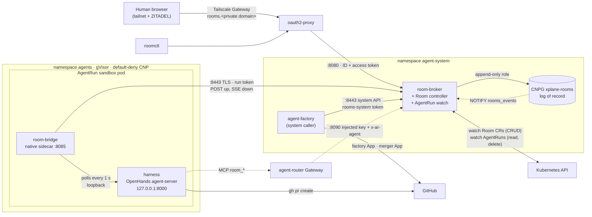
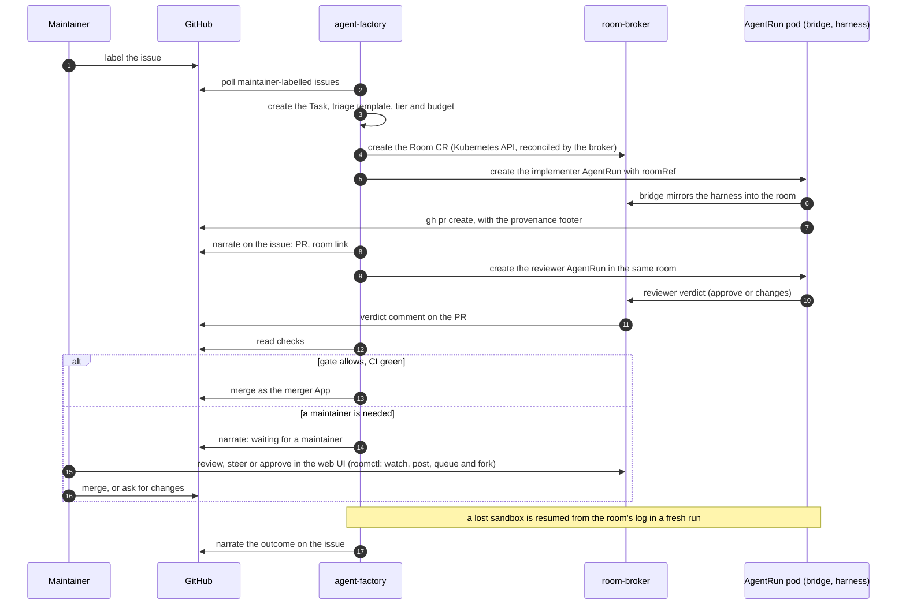
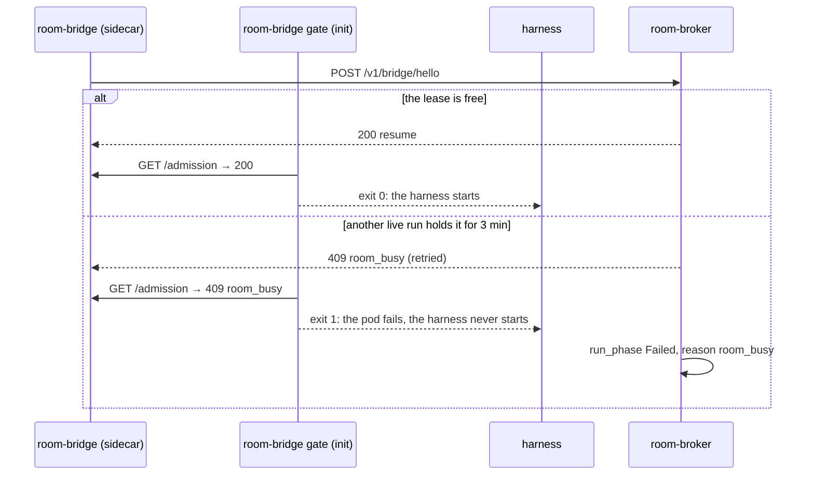

# Architecture

Four binaries and one image. **`agent-factory`** turns a labelled GitHub issue into a narrated run
and merges the result through its gate. **`room-broker`** is the log of record: it owns the `Room`
CRD, authenticates every writer, redacts and sequences events, and stores each room's log in
Postgres. **`room-bridge`** is a native sidecar in every `AgentRun` pod that names a room: it polls
the harness on loopback and pushes its events to the broker over TLS on `:8443`. **`roomctl`** is
the terminal client for people. **`agent-harness`** is the image the run executes in (OpenHands
agent-server, `gh`, the pull-request footer). Nothing dials into a sandbox: every connection from
the `agents` namespace is one the pod opens.

## Components

| Component | Runs | Does |
|---|---|---|
| `agent-factory` | Deployment in `agent-system`, two replicas, one leading; chart `charts/agent-factory` | Reconciles the `Task` CRD, polls maintainer-labelled issues, answers `POST /v1/runs` on `:8082` (plaintext inside the mesh), meters each run, narrates on the issue, runs the merge gate |
| `room-broker` | Deployment `room-broker` in `agent-system`, from an `App` claim; two replicas with a PDB | The log of record, the Room controller, the `:8443`, `:8080`, `:8090` and `:9090` listeners, the retention job (`room-broker retention`) |
| `room-bridge` | Native sidecar (`restartPolicy: Always`) after `identity-proxy`, in every run pod with `spec.roomRef` | Mirrors the harness into the room; carries steering, interrupts and decisions back over one SSE stream |
| `agent-harness` | The run container of the `AgentRun` pod | The agent itself; it opens the pull request with `gh pr create` and the provenance footer (`images/agent-harness/pr_footer.py`). In the test-first flow it also runs the tester's red check and signed contract push, and holds an implementer to the contract with the `pre-commit` hook and `test-contract hold` ([README](../images/agent-harness/README.md#the-test-first-tester)) |
| Room controller | Inside the broker, reconciling `Room` CRs | Creates the room's log row and its first event, projects `status`, runs the finalizer that seals the log |
| `AgentRun` watch | Inside the broker, on every replica | Admits bridges of live runs only, drops a run's connections when it ends, records joins, phases and end reasons |
| Log store | CNPG `SQLInstance xplane-rooms`, database `rooms` | Append-only events, one gapless `seq` per room |
| `Room` CRD | `agents.ogenki.io/v1alpha1`, namespaced | The room's policy and projected status ([reference](concepts.md#reference-the-room-crd)) |
| `Task` CRD | `charts/agent-factory`, shipped with the factory | One issue's state machine, from `Received` to `Done` ([factory](factory.md)) |
| Fan-out | Postgres `LISTEN`/`NOTIFY` on channel `rooms_events`, one listener connection per replica | Every append notifies `"<room> <last_seq>"` in its own transaction, so only committed events are announced. Each replica reads a notified room once for all its viewers, and polls every second while its listener is down ([connection budget](#connection-budget)) |
| Web UI | Embedded in the broker (`web/`, TypeScript), behind oauth2-proxy | Watch a room, post, steer, approve, fork, invite and close |
| `roomctl` | A CLI on a developer's machine | Watch, post, queue and fork from a terminal; never steer or approve |

## Trust boundaries



| Boundary | Crossed by | Control |
|---|---|---|
| Sandbox → broker | The bridge's `POST` and SSE on `:8443` | TLS; an audience-bound run token checked offline, then a live `AgentRun` watch; the run CNP opens this egress only when `roomRef` is set; the bridge lease admits one run per room |
| Harness → bridge | Nothing: the bridge calls the harness, on loopback | The harness never holds the room token: only the bridge container mounts it |
| Human → broker | oauth2-proxy → `:8080`, for the web UI and `roomctl` alike | ZITADEL SSO, agent groups, re-validated ID and access tokens; the web UI adds an `Origin` check and a `SameSite=Strict` cookie, `roomctl` sends a bearer token |
| Agent tools → broker | `agent-router` → `:8090` | The gateway authenticates the run and injects a key; the broker derives the run from `x-ar-agent` and its role from the `AgentRun`, never from a header |
| System callers → broker | `:8443` system API | Audience `rooms-system`, and `sub` in an explicit allowlist |
| Factory → GitHub | The factory App and the merger App, each a key in `agents-secrets` | The factory merges only as the merger App, squash, at the head it decided on. The repository's ruleset blocks a plain merge; the merger App and a repository admin bypass it |
| Broker → database | Postgres `:5432` | The `rooms_broker` role: append and read events; no update or delete |
| Broker → Kubernetes | The API server | Read and delete `AgentRun`s, never create; CRUD on `Room`s; no cluster-admin |

## One task's life

A maintainer labels an issue; the factory opens a room, starts runs in it, narrates on the issue
and merges when the gate allows. The pull request is opened by the run, not by the factory.



| Step | What happens | Detail |
|---|---|---|
| 1. Label | A maintainer labels the issue | [factory](factory.md) |
| 2. Implementer run | The factory starts a run in a new room; the run opens the pull request | [concepts](concepts.md) |
| 3. Reviewer verdict | A reviewer run in the same room reads the diff and records a verdict | [room log](room-log.md) |
| 4. CI | The factory waits for the required checks | [factory](factory.md) |
| 5. Wait for a maintainer | Outside the auto-merge classes the task is `AwaitingHuman` | [factory](factory.md) |
| 6. Review and revise | A person steers in the room, or requests changes on the pull request (queued as the room's message); the next run starts from the brief | [concepts](concepts.md) |
| 7. Resume a lost sandbox | The next run rebuilds its context from the log | [room log](room-log.md) |
| 8. Approve and merge | The merger App merges, or a maintainer does | [security](security.md) |

A second run whose bridge says hello while the first is live gets `409 room_busy`, and the broker
appends `state_changed{kind: limit, reason: concurrent_run}`. The lease holds the work, not only
the log: `room-bridge gate`, an init container between the bridge and the harness, starts the
harness only once the bridge holds the lease. A room still busy after 3 minutes fails the pod
before the harness runs, and the run ends `room_busy`.



## Replicas and the leader

Any replica serves any room. The broker's replicas elect one leader through a Kubernetes lease named
`room-broker`; the factory's through `agent-factory.agents.ogenki.io`.

| Work | Who does it | Why |
|---|---|---|
| Serve bridges, the system API, humans and tools | Every broker replica | Stateless; the database serialises writers per room |
| Cut a run's connections when it ends | Every broker replica | Each holds its own connections |
| Append run lifecycle events (`participant`, `run_phase`) | The broker leader | Every step has a fixed idempotency key, so a new leader replays without writing twice |
| Project `Room.status` | The broker leader, every 15 s and on phase changes | One status write per event would load the API server |
| Post verdicts to GitHub | The broker leader, sweeping every 15 s | One comment per verdict, marked so a new leader never posts twice |
| Expire a lapsed human driver's lease, back to the room's system holder | The broker leader, sweeping every 30 s | Each change is keyed on its epoch and re-checks the lapse under the room's row lock, so a new leader never moves a token twice |
| Deliver new events to viewers | Every broker replica, for its own viewers | Each `LISTEN`s once; notifications coalesce per room, so one read serves every viewer |
| Poll issues, reconcile `Task`s, sweep the stop object | The factory leader | One poller means one snapshot and one deduplication |
| Meter runs and tasks | The factory leader | One reading of the usage query per interval |
| Narrate on issues (the outbox) | The factory leader | At least once, so a comment carries a marker and is never posted twice |
| Probe GitHub, serve `POST /v1/runs`, `:9090` metrics | Every factory replica | A follower must report its own view of GitHub and answer requests |

### Connection budget

About 30 of the database's 100 connections (PostgreSQL's default `max_connections`). There is no
PgBouncer, so `LISTEN` holds a plain session.

| Holder | Connections |
|---|---|
| Two replicas: a pool of 8 (`pool_max_conns`, overridable in the URL) plus 1 listener each | 18 |
| A third pod during a rolling update | 9 |
| The daily retention job | up to 8, in practice 1 |
| The Atlas operator's migrations | 1–2 |

## Nothing is lost while the sandbox lives

The harness keeps its own event store, so a broker or database outage delays the log without losing
events.

| Failure | Behaviour |
|---|---|
| Broker unreachable at start | The bridge retries `hello` with backoff up to 5 s, forever. The sandbox never stops for it |
| Broker or database down mid-run | The bridge buffers up to 8 MiB, then stops polling (back-pressure) and resumes from the log's cursor. Past the cap it still answers what the policy decides alone (allow, deny); a step that needs a human waits, unasked, until the buffer drains, rather than being rejected for the outage |
| Bridge restarted | `hello` returns the last stored cursor; re-sent items are dropped by their idempotency key |
| Harness cold start (agent-server ~85 s under gVisor) | A failed harness read waits at most 2 poll intervals until the harness first answers, then at most 10 |
| Conversation ends | Each status change reads the harness log to its end at once, before agent-run stops agent-server |
| Pod terminating | The bridge reads what the log has left to its end, if the harness is still up, and flushes within 25 s of the 30 s grace period |
| Room sealed (`410`) | The bridge stops mirroring |
| A run ends or is revoked | Its connections are dropped on the watch event, not at a later token check |

A replayed harness event keeps its key: event *i* owns item keys `4i … 4i+3` (at most four log items
per harness event). One known limit: if the harness skips an event file it cannot read,
a restarted bridge can miss that event or re-append later ones under new keys.

## Code layout

The code follows Go conventions and a clean architecture modelled on
[RunLore](https://github.com/Smana/runlore). [AGENTS.md](../AGENTS.md) owns the full standard; five
rules shape the tree.

| Rule | In practice |
|---|---|
| Packages split by domain or pipeline stage, never by layer | `envelope`, `redact`, `store`, `authn`, `runwatch`, `roomctrl`, `bridgeapi`, `bridge`, `policy`, `fanout`, `humanapi`, `mcp`: no `service/`, `repository/` or `handler/` |
| `cmd/<bin>` stays thin | `cmd/room-broker`, `cmd/room-bridge`, `cmd/roomctl` and `cmd/agent-factory` parse arguments and dispatch; the wiring lives in `internal/app` |
| Interfaces are declared on the consumer side | A package asks for the few methods it calls (the bridge API's `Log`, the controller's `Store`) instead of importing a wide type |
| The store is the only SQL adapter | Nothing outside `internal/store` writes SQL, the retention job's `DELETE`s included |
| One egress client | Every outbound HTTP call goes through `internal/httpx`; a lint rule bans the bare `net/http` helpers elsewhere |

Broker, bridge and CLI, by pipeline stage:

| Package | Stage |
|---|---|
| `cmd/room-broker` | `serve` and `retention` subcommands |
| `cmd/room-bridge` | The sidecar binary |
| `cmd/run-controller` | The AgentRun controller binary |
| `cmd/roomctl`, `internal/roomctl` | The human CLI and its client; `roomctl mcp`, the stdio relay to `/mcp` |
| `internal/roomctl/skill` | The embedded factory-handoff Agent Skill (MCP first, shell fallback), released with roomctl; `roomctl setup` and `skill install` write it, `skill.Version` reads its stamp for the doctor's `skill` drift check |
| `internal/app` | Wiring per binary, the only importer of every adapter |
| `internal/config` | The broker's config file: strict decode, defaults, validation |
| `internal/logging` | A binary's `*slog.Logger`: JSON or text, level by env |
| `internal/version` | Build version stamped by `-ldflags` |
| `internal/httpx` | The one audited egress client: timeouts, a redirect cap, no credential header across hosts |
| `internal/bridge` | The sidecar: harness adapter over loopback, event mapping, status, uploader, SSE consumer |
| `internal/wire` | Bridge and browser frames: the types both ends of a connection share |
| `internal/authn` | Offline JWT verification for runs, system callers and humans; principal mapping |
| `internal/envelope` | Event types, payload builders, validation, limits |
| `internal/redact` | Secret detection over every JSON string of a payload |
| `internal/store` (+ `migrations/`) | Append, range, cursors, seal; the only package that speaks SQL |
| `api/v1alpha1` | The `Room` types and deepcopy; the CRD is generated into `config/crd/` |
| `internal/runwatch` | The `AgentRun` informer: liveness, membership, run events, end reason |
| `internal/roomctrl` | The `Room` reconciler: row, first event, finalizer, status projection |
| `internal/bridgeapi` | `:8443`: hello, events, SSE stream, system API, approvals |
| `internal/mcp` | `:8090` MCP server, the `room_*` tools |
| `internal/mcpwire` | The JSON-RPC wire both MCP servers share: one message in, one answer out |
| `internal/github`, `internal/verdictpost` | The factory App client; the leader's verdict comments |
| `internal/brief`, `internal/runrequest` | The fenced brief; manifest and factory run requesters |
| `internal/prpattern` | A repository's pull-request URL patterns, compiled once per repository in a bounded cache |
| `internal/fanout` | LISTEN/NOTIFY hub: coalesced per-room reads, a 1 s poll while the listener is down |
| `internal/policy` | The permission matrix |
| `internal/summary` | The pure fold of a room's log into `summary/v1`, the one object the room page and `roomctl status` render |
| `internal/ghidentity`, `internal/repoaccess` | A member's GitHub login from their ZITADEL link; whether it may read a room's repository, cached, failing closed |
| `internal/humanapi` + `ui/dist/` | `:8080` WebSocket, room list, actions, embedded UI; `POST /mcp`, the humans' MCP server |
| `web/` | TypeScript UI and its vitest suite |
| `internal/metrics` | The metric set and the Prometheus exporter room-broker serves |

The factory, by the same stages. Its wiring is `internal/app/factory.go`.

| Stage | Package | Contract |
|---|---|---|
| Entry | `cmd/agent-factory` | The binary; `FACTORY_CONFIG`, `POD_NAMESPACE` |
| Entry | `internal/factory/config` | The factory's config file: strict decode, defaults, validation, its hash |
| Intake | `internal/factory/intake` | The issue poller: maintainer labels, snapshots, dedup, stop labels |
| Intake | `internal/factory/sanitize`, `internal/factory/taskid` | Untrusted text defused to a fixpoint; task names and ids |
| Tasks | `api/factory/v1alpha1` | The `Task` types and deepcopy; CRD generated into `config/crd/` |
| Tasks | `internal/factory/triage`, `internal/factory/reconciler` | Template, tier and budget; the `Task` state machine |
| Tasks | `internal/factory/runs`, `internal/factory/killswitch` | The `AgentRun` claim; the stop object |
| Out | `internal/factory/forge`, `internal/factory/narrate` | GitHub as the factory App (`internal/factory/forge/forgetest`: its test-only fake); narration, at least once |
| Out | `internal/factory/rooms` | The broker's system API over TLS |
| Ops | `internal/factory/meter`, `internal/factory/fmetrics`, `internal/factory/tracing` | The run meter; the metrics; one root span per task |
| API | `internal/factory/api` | `POST /v1/runs` |

## Where each piece lives

| Resource | Namespace | Defined in | Built from |
|---|---|---|---|
| `agent-factory` Deployment, Service, PDB, RBAC and config | `agent-system` | `charts/agent-factory` here | Image `ghcr.io/smana/agent-factory`, this repo |
| `Task` CRD | cluster; CRs in `agent-system` | `charts/agent-factory`, a copy of `config/crd/` | `api/factory/v1alpha1` here |
| `agent-platform` chart | broker, run controller, `Room` and `AgentRun` CRDs, runs namespace | `charts/agent-platform` here | The umbrella for a cluster without cloud-native-ref; the laptop profile is the [quickstart](quickstart.md). The broker runs `human.mode: local` and `runIssuers[].mode: tokenreview` there ([integration](integration.md#the-brokers-configuration)); `room-broker migrate` is its schema init container |
| Factory secrets: `agent-factory-github`, `agent-factory-merger`, `openbao-ca`, `agent-factory-oidc`, `agent-factory-intake` | `agent-system` | Mounted per the [chart README](../charts/agent-factory/README.md), which names each secret's source | The platform's secret store |
| `room-broker` Deployment and Service (`App` claim `room-broker`) | `agent-system` | [cloud-native-ref](https://github.com/Smana/cloud-native-ref) `infrastructure/base/room-broker/` | Image `ghcr.io/smana/room-broker`, this repo |
| `Room` CRD | cluster; CRs in `agent-system` | Vendored by cloud-native-ref as `crd-rooms.yaml` | `api/v1alpha1`, `config/crd/` here |
| `SQLInstance xplane-rooms` (CNPG) | `agent-system` | cloud-native-ref | Composition in [crossplane-configuration](https://github.com/Smana/crossplane-configuration); migrations `internal/store/migrations/` here |
| Retention CronJob `room-broker-retention` | `agent-system` | cloud-native-ref | The broker image, `retention` subcommand |
| `Certificate room-broker-tls` | `agent-system` | cloud-native-ref | cert-manager, ClusterIssuer `openbao` |
| `room-bridge` sidecar and its `room-token` volume | `agents` | crossplane-configuration's `AgentRun` composition | Image `ghcr.io/smana/room-bridge`, this repo |
| `agent-harness` image | `agents` | crossplane-configuration's `AgentRun` composition | `images/agent-harness`, this repo |
| Secret `room-broker-ca` | `agents` | cloud-native-ref ExternalSecret | The platform's private CA |
| CNPs, `VMServiceScrape`, `VMRule` | `agent-system`, `observability` | cloud-native-ref | — |
| oauth2-proxy, `HTTPRoute` | `agent-system` | cloud-native-ref | — |
| `agent-router` MCPRoute backend for `:8090` | `agent-system` | cloud-native-ref | — |

[Integration](integration.md) lists what each consumer carries and pins.

## Binaries, images and releases

### Ports

| Port | Binary | Who calls it |
|---|---|---|
| `:8080` | room-broker | Humans in the web UI and `roomctl`, both through oauth2-proxy |
| `:8443` | room-broker | `room-bridge` in each run pod; system callers (the factory) |
| `:8090` | room-broker | The agents' `room_*` tools through the agent gateway (agent-router) |
| `:9090` | room-broker | Metrics and probes |
| `:8082` | agent-factory | `POST /v1/runs`, plaintext inside the mesh: the broker's `start_run` |
| `:8080` | agent-factory | `POST /intake/runlore` |
| `:9090` | agent-factory | Metrics and probes |
| `:9090` | run-controller | Metrics |
| `:9091` | run-controller | Probes (`/healthz`, `/readyz`) |

### Binaries and images

| Binary | Runs as | Image |
|---|---|---|
| `room-broker` | Stateless service in `agent-system`; owns the `Room` CRD (`agents.ogenki.io/v1alpha1`) | `ghcr.io/smana/room-broker` |
| `room-bridge` | Native sidecar in every `AgentRun` pod that names a room; relays harness events, carries the room token | `ghcr.io/smana/room-bridge` |
| `agent-factory` | The factory's orchestrator in `agent-system`, two replicas, one leading; owns the `Task` CRD; chart `oci://ghcr.io/smana/charts/agent-factory` | `ghcr.io/smana/agent-factory` |
| `agent-harness` | Main container of every `AgentRun` pod: OpenHands agent-server plus `agent-run`, the git credential helper, `gh` with the PR footer and the trailer hook ([`images/agent-harness`](../images/agent-harness/README.md)) | `ghcr.io/smana/agent-harness` |
| `run-controller` | A Deployment, on clusters without cloud-native-ref's Crossplane runtime; reconciles `agents.ogenki.io` AgentRuns into gVisor pods | `ghcr.io/smana/run-controller` |
| `roomctl` | A developer's CLI: list, follow, post, queue and fork rooms; `roomctl skill install` writes the factory-handoff Agent Skill for local coding agents; `roomctl token` for scripts. Never steers or approves: those stay in the web UI | Release assets `roomctl-{linux,darwin}-{amd64,arm64}` + `roomctl.sha256`; before a release, `go build ./cmd/roomctl` |

Every image is multi-arch (`linux/amd64`, `linux/arm64`). The Go ones are static binaries on distroless `nonroot`; the harness is OpenHands' Python image, run as uid 10001.

```bash
roomctl configure --url https://rooms.<domain>                       # the broker serves the issuer and ids; roomctl doctor checks VPN, CA, login, GitHub
roomctl login                                                        # device flow, in any browser
roomctl rooms --needs-me                                             # issue, title, task, PR per room; --repo, --mine, --json
roomctl status 3kq7x2ma                                              # phase, needs you, notes; --json, --after seq:N
roomctl watch 3kq7x2ma
roomctl post 3kq7x2ma --queue "address L42"
roomctl fork 3kq7x2ma --at 42 --role implementer --egress pypi --note "try uv"
roomctl skill install                                                # .agents/skills/factory-handoff in this repo
```

### Releases

| Trigger | Tag | Workflow |
|---|---|---|
| Each push to a PR from this repo | `v<next-patch>-pr<N>.<sha8>`, `<sha8>` = the PR **head** | `ci.yaml` → `prerelease` |
| The same push, the factory chart | `<next-patch>-pr<N>.g<sha8>` (the `g` keeps it semver) | `ci.yaml` → `chart-prerelease` |
| A `v*` git tag | the tag, e.g. `v0.11.0` | `release.yaml` |

Never `latest`. Consumers pin by digest. Every pushed image carries SLSA provenance (`mode=max`) and
an SBOM as attestations, and a keyless cosign signature on its digest:

```bash
cosign verify ghcr.io/smana/room-broker@sha256:<digest> \
  --certificate-oidc-issuer https://token.actions.githubusercontent.com \
  --certificate-identity-regexp '^https://github\.com/Smana/(agent-platform|maku)/\.github/workflows/release\.yaml@refs/tags/v'
```

Releases before v0.30.0 carry the `Smana/agent-platform` identity, hence both names in the
regexp. That accepts released images only. PR pre-releases are not release-grade (they run
unreviewed branch code): see [verifying an image](security.md#supply-chain) for their variant.

### Where it plugs in

| Repo | Consumes |
|---|---|
| [cloud-native-ref](https://github.com/Smana/cloud-native-ref) | Deploys the broker (`App` claim), its CNPG database `xplane-rooms`, the `Room` CRD, RBAC and network policies |
| [crossplane-configuration](https://github.com/Smana/crossplane-configuration) | The `AgentRun` composition injects the `room-bridge` sidecar and its room token |

Design: [collaboration rooms](https://github.com/Smana/cloud-native-ref/blob/main/docs/superpowers/specs/2026-09-23-agent-collaboration-rooms-design.md),
part of the [Agent Factory programme](https://github.com/Smana/cloud-native-ref/blob/main/docs/superpowers/specs/2026-09-23-agent-factory-design.md).

The programme's sub-project codes, where you meet them in the specs: SP2 is the rooms, SP3 the factory.
