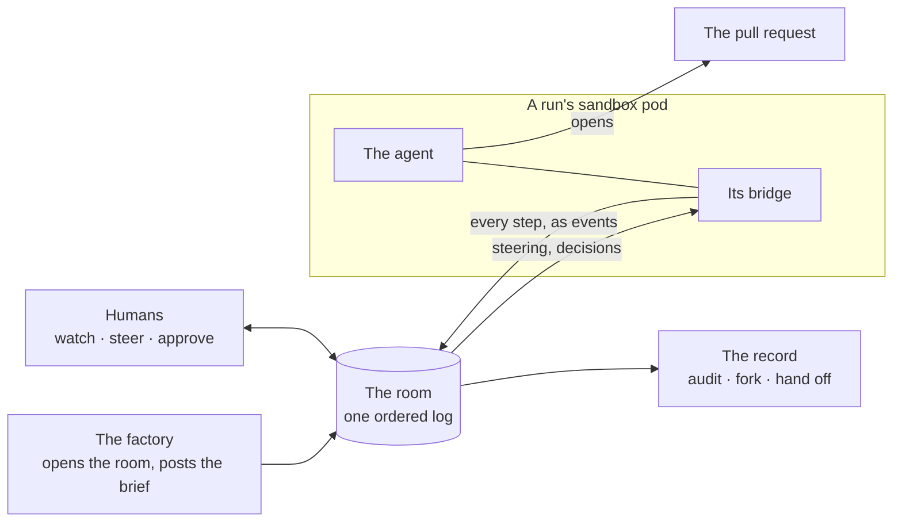
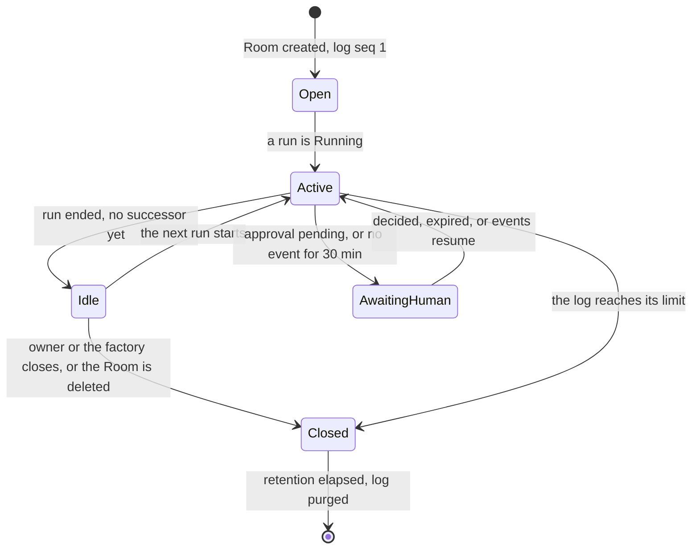

# Concepts

A room is a flight recorder and a group chat for one piece of agent work. While the run is live,
you watch every step, steer the agent, and approve what it may not do alone. Afterwards the room
stays: an ordered, redacted record that nobody can edit, which you audit, fork from any message, or
hand to the next run. For example, you see the agent's `git push` wait for approval, approve it
from the room, and a month later read exactly who approved what.

## In one picture



Everything that happens in a room is an event in its log, with a gapless sequence number that only
the broker assigns. The rest of this page names the parts.

## Glossary

### The factory

| Term | Meaning | Where it lives |
|---|---|---|
| **Task** | One labelled issue's journey: a `Task` CR the intake creates, with its room, runs, PR and end, narrated on the issue | `Task` CR (`maku.ogenki.io`), kept by `internal/factory/reconciler` |
| **Trigger** | What starts or stops a task: the labels `factory/ready`, `factory/stop` and `factory/revert`; `/factory retry`; the control issue; a schedule; a RunLore finding | Issue labels and comments; `control` and each repository's `schedules` in the factory config |
| **Tier** | `light`, `standard`, `frontier`: a run's model, deadline and budget, chosen once per task. The model is a logical name on the agent gateway (`tier-light`, `tier-standard`, `tier-frontier`). Rooms do not carry or change it: escalating a task means a new run, never a switch inside one | `tiers` in the factory config; `AgentRun.spec.model` |
| **Template** | `solo`, `pair`, `trio`, `investigate`: which roles run in which order | The `Task` CRD's template enum |
| **Merge gate** | Which agent PRs may merge themselves: only low-risk classes, green CI, policy-bot's check. Each class is live, shadow (decided like a live one, never armed) or off | `merge` and `classes` in the factory config |
| **Kill switch** | The stop ConfigMap `agent-factory-stop` or the control issue's `factory/stop`: intake pauses, every run is revoked | `internal/factory/killswitch` |
| **Narration** | The factory's comments on the issue and PR, at least once each, from an outbox | `internal/factory/narrate` |
| **Needs you** | What waits for a viewer: an approval they may decide, a hold their driving causes, a PR waiting for their merge | `needsYou` in the summary |
| **Summary** | The deterministic fold of a room's log that the room page and `maku status` render (`summary/v1`) | `internal/summary` |
| **Progress note** | A run's one-line claim about where it is, at most 280 characters, one a minute | `room_progress` ([API](api.md)); a `message{kind: progress}` event |

### Rooms and runs

| Term | Meaning | Where it lives |
|---|---|---|
| **Room** | One session: its policy (owner, driver, members, approvals, retention, data class) and its log. Rooms are runtime objects, created by the factory, the broker or the owner, never committed to Git | `Room` CR (`maku.ogenki.io/v1alpha1`) in `agent-system`, named with a C2 id (8 lowercase base32 characters; [reference](#reference-the-room-crd)); its log in Postgres |
| **Run** | One agent, one role, one task, one branch, with a deadline. It joins a room by naming it in `spec.roomRef`. One run is `Running` per room at a time | `AgentRun` claim (`cloud.ogenki.io`) in `agents` |
| **Harness** | The agent loop inside the sandbox: the OpenHands agent-server on `127.0.0.1:8000` | The run's pod |
| **Bridge** | `maku-bridge`, a native sidecar (container `room-bridge`) in every run pod that has a `roomRef`. It polls the harness and pushes its events to the broker; it carries steering, interrupts and decisions back | The run's pod, namespace `agents` |
| **Broker** | `maku-broker`, the stateless service (Deployment and Service `room-broker`, an identity that keeps its pre-maku name, see [naming](naming.md#technical-names)) that owns rooms: it authenticates writers, redacts, sequences and stores events, and serves them | `agent-system` |
| **Participant** | Anyone in a room: a human, a run, or a system component, each named by its principal (next row). Joining and leaving are `participant` events | The log |
| **Principal** | A canonical identity: `agent:<runId>`, `human:<zitadel sub>` or `system:<component>`. The broker stamps it on every event from the authenticated credential | Every event's `actor.id` |
| **C2 id** | 8 characters of lowercase unpadded base32, `[a-z2-7]{8}`. Room, run and task ids share the format, so `agent/<id>` branches match the merge gate | Names of rooms and runs |
| **Run role** | What a run may do: `implementer`, `reviewer`, `tester` or `triager`. A policy input, not an identity | `AgentRun.spec.role`; an agent event's `actor.role` |
| **Room role** | What a human may do in a room: `watcher` < `collaborator` < `owner`, cumulative. **Approver** is a separate flag | `Room.spec.members` |
| **Driver** | The one principal allowed to steer or interrupt the running run. A token that moves with *give*, *request* and *take*; each change bumps `driverEpoch`, which fences races | `rooms.driver`, `driver_epoch`; `driver` events |
| **Message delivery** | `none` (chat, delivered to nobody), `queued` (FIFO, goes into the next run's brief) or `steering` (injected into the running run now, driver only) | `message` payload |
| **Handoff** | A run hands *work* to the next role, with the commit it stopped at. The next run starts from that commit. Not a change of driver | `handoff` event |
| **Verdict** | A reviewer's or tester's `approve` or `changes`, recorded as `message{kind: review_verdict}`. The broker also posts it on the pull request as one comment | The log; the PR |
| **Brief** | The fenced, bounded text the next run starts from: the last handoff and verdict, plus the queued messages, quoted as untrusted data | Built by the broker (`internal/brief`) |
| **Approval** | A human decision on a pending harness action. Oversight, not a security boundary: a run's capabilities are fixed at creation. The first valid decision wins | `approval_requested`, `approval_decided` |
| **Fork** | A new room copied from a prefix of another, events `1..N` with their `seq`, owned and driven by whoever forked it, with the messages still queued at that point. A fork asks by default: its owner gets `approvals.profile: attended` (the source's `ttl`, `fourEyes` and non-loosening overrides carry over), even from an unattended factory room; `maku fork --approvals unattended` keeps an unattended source's policy, and a fork is never weaker than its source | New `Room` annotated `agents.ogenki.io/forked-from: <room>@<seq>`; `state_changed{forked_from}` |
| **Step** | An agent's message and the tool calls it ran next, shown as one collapsible line on the room page | The room page; built from `message`, `tool_call` and `tool_result` events |
| **Call line** | One tool call in a step: its command, its status, and its output behind the toggle | The room page; one `tool_call` and its `tool_result` |

### The log

| Term | Meaning | Where it lives |
|---|---|---|
| **Envelope** | The frozen v1 shape of every log entry: `v, id, seq, roomId, runId, actor, type, causedBy, origin, ts, redactions, payload` | [Event envelope](event-envelope.md) |
| **seq** | The per-room sequence number: gapless from 1, assigned by the broker under the room's row lock | `events.seq`, `rooms.last_seq` |
| **Origin** | Who produced an event: `harness` (mirrored from a run), `client` (a human, a system caller, a room tool) or `broker` | Every event |
| **Idempotency key** | `(roomId, originClient, originSeq)`: a writer's own sequence number. A replayed key returns the stored event and appends nothing | `events` unique index |
| **Seal** | The last event of a room. After it, nothing can append. A room seals when it closes or fills up (100 000 events or 256 MiB), and sealing starts its retention clock | `rooms.sealed`, `closed_at` |
| **Retention** | How long a closed room's log is kept: `spec.retention`, `<n>d`, default `90d`. A daily job (`maku-broker retention`) deletes expired sealed rooms | `rooms.retention` |
| **Bridge lease** | Which run's bridge holds the room. A second live run's bridge is refused `409 room_busy`. The lease also fences writes: a displaced bridge cannot append | `rooms.bridge_run` (`bridge_seen_at` is no longer written; a later migration drops it) |
| **Data class** | `public` or `internal`: which model backends a run may reach. A room's runs inherit its class; an internal room's verdict comment carries no summary. Fixed at creation | `Room.spec.dataClass` |
| **Redaction** | Replacing a detected secret with `[REDACTED:<rule>]` before the event is stored, and listing the rule in `redactions` | The broker |
| **End reason** | Why a run ended: `agent_finished`, `agent_error`, `agent_stuck`, `deadline`, `pod_lost`, `room_busy` (the room refused the run, which never started), `judge_impossible`, `stalled`, `not_met` (the loop policy ended a failed implementer run: the bridge's `harness_end`, read before the harness status), `revoked`, `deleted`, `budget-run`, or a `BudgetExhausted` run's `agents.ogenki.io/revoked` annotation. That annotation is free text, so it is redacted, then cut to 64 bytes. The `AgentRun` only ever says `Failed`; the room says why | `state_changed{run_phase}` |

## A room's phases

The broker projects `status.phase` from the log and the room's runs every 15 s.



`AwaitingHuman` comes from a pending approval or from a stall. Deleting a
`Room` runs the finalizer `maku.ogenki.io/room-log`, which deletes the room's runs and seals the
log. The log keeps its own retention clock after the CR is gone.

## Who does what

| Actor | Creates | Reads | Writes into the log |
|---|---|---|---|
| The factory | `Room` CRs and every `AgentRun` (the only creator) | `GET /v1/rooms/{id}/events`, `GET /v1/rooms/{id}/queue` | `message{kind: task_state}`, the task's snapshot first; `state_changed{kind: task}`, the task's facts for the room summary (`POST /v1/rooms/{id}/task`); a maintainer's review as a queued `chat` (`POST /v1/rooms/{id}/queue`, stream `review`), consumed by the run whose brief quoted it |
| A run | nothing | `room_read` | its harness events through the bridge; `room_post`, `room_handoff`, `room_verdict` |
| A human | rooms from the UI, forks | the web UI, `maku` | messages, driver actions, decisions |
| The broker | the `Room`s a human asks for, new or forked; **never** an `AgentRun` | everything | room and run lifecycle, seals, limits, verdict outcomes |

A maintainer's review reaches the next run once queued: the factory re-reads the pull request
just before that run starts, so a review submitted while the task waits joins it, and a review
already dismissed is skipped. A review dismissed after it was queued still drives that run, since
the system API cannot remove a queued message.

The full permission matrix is in [Security](security.md#authorization).

## Reference: the Room CRD

`Room` (`maku.ogenki.io/v1alpha1`), namespaced, with a `status` subresource
(`api/v1alpha1`, generated into `config/crd/maku.ogenki.io_rooms.yaml`). `kubectl get rooms`
prints `Phase`, `Driver`, `Seq`, `Pending` and `Class`.

**Name.** A CEL rule requires a C2 id: `self.metadata.name.matches('^[a-z2-7]{8}$')`, message
"a Room is named with a C2 id: 8 characters of [a-z2-7]".

| `spec` field | Type | Required | Default | Validation | Meaning |
|---|---|---|---|---|---|
| `owner` | string | yes | — | `^(human:[A-Za-z0-9@._-]+\|system:[a-z0-9-]+)$`, at most 261 characters | Who owns the room. 261 = OIDC's 255-character `sub` plus `human:` |
| `driver` | string | yes | — | Same as `owner` | The initial driver-token holder; afterwards the log decides |
| `members` | list, map keyed by `principal` | no | — | At most 20 | Humans only; runs join through their own `spec.roomRef` |
| `members[].principal` | string | yes | — | `^human:[A-Za-z0-9@._-]+$`, at most 261 characters | |
| `members[].role` | string | yes | — | `watcher`, `collaborator`, `owner` | Cumulative room role |
| `members[].approver` | bool | no | `false` | — | The approver flag |
| `approvals` | object | no | `{}` | — | Present even when omitted, so its own defaults apply |
| `approvals.profile` | string | no | `attended` | `attended`, `unattended` | `attended`: `forge.pr`, `forge.other` and `mcp.write` ask a human, denied after 30 min. `unattended`: no human by default, so `forge.pr` is allowed and `forge.other`, `mcp.write` and `egress.new` are denied outright; a class overridden to `human` waits `approvals.ttl`, then is denied |
| `approvals.overrides` | map | no | — | Keys: `forge.push`, `forge.pr`, `forge.other`, `mcp.write`, `shell.high`; values: `allow`, `deny`, `human` | Per-class override of the profile |
| `approvals.ttl` | string | no | `4h` | `^[1-9][0-9]{0,3}(m\|h)$` (at most 9999h) | Auto-deny delay for an unattended approval |
| `approvals.fourEyes` | bool | no | `false` | — | The approver must not have prompted the turn |
| `retention` | string | no | `90d` | `^[1-9][0-9]{0,3}d$` | How long the sealed log is kept; immutable |
| `dataClass` | string | **yes** | — | `public`, `internal`; immutable | Runs requested for this room inherit it |
| `repository` | string | no | `Smana/cloud-native-ref` | `^[A-Za-z0-9-]+/[A-Za-z0-9._-]+$` | The repository its runs work on |

| `status` field | Type | Meaning |
|---|---|---|
| `phase` | string | `Open`, `Active`, `Idle`, `AwaitingHuman` or `Closed` ([below](#a-rooms-phases)) |
| `lastSeq` | integer | The log's high-water mark |
| `driver` | string | The current driver-token holder |
| `driverEpoch` | integer | Bumped on every driver change |
| `pendingApprovals` | integer | Undecided approvals |
| `observedGeneration` | integer | The `spec` generation last projected |

The broker's leader writes `status` from the log. A minimal room:

```yaml
apiVersion: maku.ogenki.io/v1alpha1
kind: Room
metadata: {name: 3kq7x2ma, namespace: agent-system}
spec: {owner: "system:factory", driver: "system:factory", dataClass: public}
```
