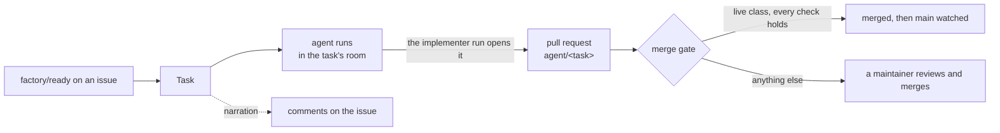
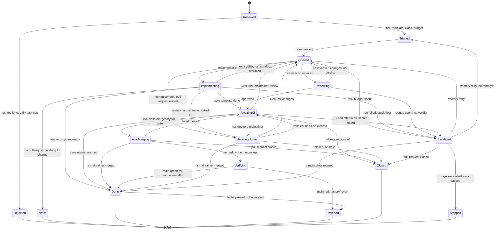
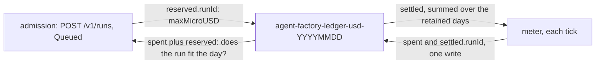
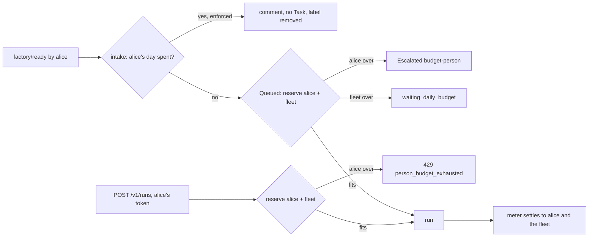
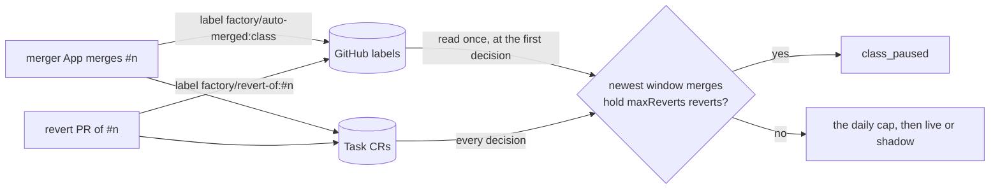

# The factory

A maintainer labels an issue; the factory turns it into a task, runs agents on it in sandboxes,
narrates each step on the issue, and stops at its budget. The agent run opens the pull request;
the factory watches it through CI and its merge gate. Humans steer through GitHub reviews and
comments, or from the task's room. Only low-risk classes the config marks `live` merge
themselves; a `shadow` class is decided the same way and never merged. cloud-native-ref's
config runs two classes (`docs-links`, `revert`) in shadow.



## Triggers

Every label below is read once a minute (`poll.issues`). A label a non-maintainer applied starts
nothing; maintainers are the `maintainers` list in the [config](#the-config-file), compared
without case.

| Trigger | Effect | Who |
|---|---|---|
| Label `factory/ready` (`triggerLabel` in the config) on an issue | A Task is created from a sanitised snapshot of the issue's title and body, with the sha256 of the text as labelled; the label is then removed. A pull request carrying it is ignored. Re-labelling the issue later starts a new task, and supersedes (stops) an escalated one | A maintainer |
| Label `factory/stop` on the issue or its pull request | The running task stops within a poll: its runs are revoked and deleted, the task ends `Stopped`. The label is removed once it hit a task; with no task running it stays, so a task started later stops at once. Anyone else's is removed and answered | A maintainer |
| Label `factory/revert` on an auto-merged pull request, within `merge.revertWindow` | The factory opens a revert pull request through the merger App and the task ends `Reverted`; the class counts the revert towards its [breaker](#the-merge-gate). A human merge is never reverted | A maintainer |
| Label `class:<name>` on the issue, before triage | Predicts the task's merge class, when `<name>` is a class in the config other than `revert` | A maintainer |
| Comment `/factory retry` alone on a line, on an escalated task's issue or pull request | A fresh run; see [Escalation](#escalation-reminders-and-stale-tasks) | A maintainer with `write` on the repository |
| A **Request changes** review on the task's pull request | Queued in the room; the next implementer run revises on the same branch with the review in its brief, then the pull request goes straight back to the maintainer | A maintainer |
| Label `factory/stop` on the control issue (`control.issue`), or the `agent-factory-stop` ConfigMap | Every task stops, intake pauses; see [The kill switch](#the-kill-switch) | A maintainer, an operator |
| A schedule (`schedules[]`) | A task per cron slot (5 fields, UTC), once, when the slot is under an hour old. With `probe: renovate-red`, only when an open pull request by `probeAuthor` (default `renovate[bot]`) older than 24 h has a red check (read through the merger App); up to five join the text. With `probe: dead-links` (the class declares `oracle.probe: dead-links`), only while the class is `shadow` or `live` and no earlier task of the schedule is open: the factory reads the `findings` artifact of the newest two completed `oracle.workflow` runs on `main` that a schedule or a maintainer started, keeps what both report, that the class may change, that has a Wayback `archive` (without one the oracle could never accept a fix, so the probe drops it), and that is still a link target in that file on `main`, and carries them as the task's `spec.findings`. Both runs must report a finding as gone (404, 410 or an unresolved name); a 429, 5xx or timeout in either is no finding. Findings past `oracle.maxFindings` are dropped, keeping the first in file-then-URL order. Malformed or out-of-shape findings start no task: they are logged and counted as an intake error. A run pair is weighed once, not every minute | The factory itself |
| `POST /intake/runlore` | An `investigate` task from a RunLore finding, and a public issue labelled `factory/proposed` that links the room; see [the API](#the-factorys-api) | RunLore |

A `factory/ready` the factory will not act on is answered once on the issue and removed:

| Reason | Means |
|---|---|
| `unauthorised_labeller` | The latest label is not a maintainer's |
| `edited_after_label` | The title or body changed after the label: re-apply it |
| `task_active` | A task for this issue is still running |
| `unsanitisable` | The text could not be made safe for an agent to read: simplify its markup |

The factory also writes labels of its own:

| Label | On | Means |
|---|---|---|
| `factory/class:<class>` | The task's pull request, once found | The class triage predicted |
| `factory/stale` | A pull request it closed | No maintainer activity for 14 days |
| `factory/orphaned` | An open `agent/<id>` pull request whose task no longer exists (a cluster rebuild) | Human-only from now on; re-label the issue `factory/ready` to start again. Nothing is ever adopted from it |
| `factory/proposed` | An issue the RunLore intake opened | A finding under investigation |

## A task's life

A task's phase is in `kubectl get tasks` and in its room's summary. Any open phase goes to
`Stopped` on `factory/stop`, the kill switch or a superseding `factory/ready`.



`Rejected`, `NoOp`, `Done`, `Reverted`, `Closed` and `Stopped` are final; a pull request merged or
closed by hand ends the task from any phase that watches it. `Merged` is in the CRD's enum but no
transition sets it: an auto-merge goes from `AutoMerging` to `Verifying`. A task counts against
`caps.activeTasks` while it is `Implementing`, `Reviewing`, `AwaitingCI`, `AutoMerging` or
`Verifying`.

### When the factory waits for you

The room page and `roomctl status` show the reason and the next step below; the factory's issue
comments use the same words.

**Queued:** the next run waits. Next step, unless the row says otherwise: nothing to do, the run
starts once the room and the factory are free.

| Reason | Why |
|---|---|
| `waiting_run_slot` | Every one of `caps.concurrentRuns` factory runs is live |
| `waiting_active_tasks` | `caps.activeTasks` tasks are active |
| `waiting_review_wip` | `caps.awaitingHumanWIP` tasks already wait on a maintainer; only a task's first run of a class that is not live waits for this |
| `waiting_daily_budget` | `budgets.factoryDailyUSD` is spent. It resumes after 00:00 UTC |
| `waiting_meter_blind` | The meter cannot read usage, so the daily cap cannot be checked |
| `waiting_room_log` | The room's log is not open on the broker yet |
| `waiting_broker_permission` | The broker does not let the factory write to rooms yet |
| `waiting_human_driver` | A person drives the room. Next step: hand the driver back, or let the lease lapse |
| `waiting_room_busy` | Another run in the room is still going. Next step: end it, or wait for it |
| `rereview_verdict_stale` | The head moved after the approval, so a new review run is queued |

**AwaitingCI:** the merge gate reads the pull request. Next step: nothing to do.

| Reason | Why |
|---|---|
| `ci_pending` | A required check (`merge.requiredChecks`) has not finished |
| `ci_rerun` | A cancelled required check was re-run (at most `merge.checkReruns` per head) |
| `reentered_policy` | Back from a `policy_pending` or `policy_absent` hand-off: policy-bot now passes the head it was handed off at |
| `reentered_head_reported` | Back from a `head_unreported` hand-off: the room now reports the head as a commit of the task's run |
| `reentered_ci_green` | Back from a `ci_cancelled` hand-off: the required checks are now green on the same head |
| `head_moved` | A commit landed after the decision; the new head is decided again |

**AwaitingHuman:** the pull request is a maintainer's. Next step, unless the row says otherwise:
a maintainer reviews and merges it. The repository's ruleset blocks a plain merge, so a maintainer
with admin ticks "bypass rules" on the pull request, or runs
`gh pr merge <n> --squash --admin --repo <owner/name>`; the comment names the exact command. A
**Request changes** review sends the task back for a revision instead.

| Reason | Why |
|---|---|
| *(none)* | A revision a maintainer asked for is pushed |
| `merge_gate_off` | No class is live or in shadow, so the factory does not gate the pull request |
| `policy_pending` | policy-bot's `policy-bot: main` status needs a maintainer's approval |
| `policy_absent` | policy-bot has not evaluated the pull request, or the status is not from `merge.policyBotLogin` |
| `maintainer_approved` | A maintainer approved it: a human merges it |
| `gate_path` | It touches a gate path, so an agent can never merge it; a human re-authors the change |
| `not_mergeable` | GitHub refused the merge as the pull request stands |
| `not_agent_authored` | The pull request is not from `agentsLogin` |
| `class_mismatch` | The predicted class is neither live nor shadow (such as `review`), or its `diffShape` does not hold (`docs-links` and `revert` diffs change only link targets) |
| `file_not_allowed` | It changes a file outside its class's allowed files |
| `file_protected` | It changes a file its class protects |
| `file_added_or_deleted` | Any change but a content modification: an add, delete, rename, copy or mode-only change, which its class does not allow |
| `patch_too_large` | It changes more files or lines than its class allows |
| `holdout_red` | A holdout check its class requires failed, was cancelled, neutral or skipped, or was not posted by GitHub Actions; also when the pull request has more than 100 checks, since some are unread |
| `holdout_pending` | A holdout check its class requires has not passed yet |
| `oracle_finding_open` | A finding of the task is still a link target in the head, was not one on the base, or the task has no findings |
| `oracle_unrequested` | The head moves a link target no finding asked to move, or moves one anywhere but the exact snapshot its finding gave |
| `no_approving_verdict` | The template has a reviewer and its verdict is not approve |
| `head_unreported` | The room never reported the current head as a commit of the task's run |
| `verdict_stale` | The approval was for an older head. Next step: review the current head, or the factory asks for a new review |
| `foreign_trailer` | The head commit's `Agent-Run` trailer names another task's run |
| `human_commit_in_pr` | It holds a commit no run of the task pushed, so the factory neither fixes nor merges on top of it |
| `class_paused` | The class's breaker tripped after reverts |
| `auto_merge_cap` | `merge.autoMergesPerDay` is reached |
| `not_owned` | The repository's `.github/agent-factory.yaml` does not name this factory ([the fence](#the-ownership-fence)) |
| `shadow_would_arm` | Every check holds and the class is in shadow. Next step: merge or close it |
| `ci_cancelled` | A required check was cancelled and re-running it did not settle it |

A holdout's workflow file must be a gate path (policy-bot's gate paths cover it), otherwise a pull
request can edit the workflow and post SUCCESS itself; the host's gate-coverage check enforces it.
A diff of 100 files or more is `patch_too_large` without being read.

The gate compares GitHub logins (`agentsLogin`, `factoryLogin`, `merge.policyBotLogin`,
`merge.mergerLogin`) case-insensitively, as GitHub does.

`policy_pending`, `policy_absent`, `head_unreported` and `ci_cancelled` go back to the merge gate by
themselves when their input clears, on the same head and with no maintainer review or comment
since, up to three times per task.

**Escalated:** the factory could not finish. Next step, unless the row says otherwise: a
maintainer comments `/factory retry` on the issue, or pushes to the branch. The comment mentions
every maintainer.

| Reason | Why |
|---|---|
| `stuck` | The run showed no room activity for 10 minutes |
| `deadline` | The run hit its wall-clock limit (`tiers.<tier>.runMinutes`) |
| `agent_error`, `agent_stuck` | The agent stopped on an error, or said it was stuck |
| `judge_impossible`, `stalled`, `not_met` | Under the [loop policy](#the-config-file) (`loops`): the completion judge found the task impossible, the run made no commit within its step limit, or the judge still found the acceptance checks unmet after the last continuation. The issue gets the category; the judge's text stays in the room |
| `pod_lost`, `Disrupted`, `PodLost`, `PodFailed` | The sandbox failed or was lost and was not resumed. A sandbox lost to its node is resumed by itself, up to `resume.maxPerTask` times |
| `resumes_exhausted`, `resume_budget` | The sandbox was lost again, and no resume or no budget is left |
| `run_unschedulable` | The cluster did not admit the run within `caps.maxPendingMinutes` |
| `loop_unsupported` | The class has a `loops` row, but the cluster refused the run claim's `spec.loop` (its AgentRun schema predates the loop policy). No run started and none is retried: roll out crossplane-configuration with `spec.loop` first ([operations](operations.md)) |
| `run_lost`, `deleted` | The run disappeared, or its claim was deleted |
| `revoked` | The run was stopped by hand |
| `budget-run` | The run spent its run cap |
| `budget-principal` | The factory's daily budget in dollars is spent |
| `budget-fleet` | The agent gateway's fleet-wide token budget is spent |
| `failed` or another run phase, lowercased | The run ended without a more specific reason from the room or the meter |
| `budget-task` | The task cap has no room for another whole run |
| `budget-person` | [Per-person caps](#per-person-caps): the day of the person the next run is charged to is spent; the comment names them. A maintainer's `/factory retry` charges the retrier instead |
| `ci_red` | CI stayed red after `merge.fixRuns` fix runs; the comment names the failing checks |
| `secret_scan_red` | The secret scan (`merge.leakScanCheck`) found a live credential. Next step: a maintainer revokes the key and closes the pull request; the factory does not retry |
| `review_rounds_exhausted` | The reviewer still asked for changes after `maxReviewRounds`; its last verdict is posted on the pull request |
| `no_verdict` | The last review run ended without a verdict the factory can act on, with no round left |
| `room_log_unreadable` | The room's log, which holds the verdict, could not be read |
| `foreign_room` | A room of the task's name exists and is not the factory's |

A task ends with one of these:

| Phase | Reasons |
|---|---|
| `Done` | `merged` (by a maintainer), `merged_verified` (auto-merged, main green for `merge.verifyFor`), `proposal_ready` (a triager's proposal: open a new issue with the text you approve and label it) |
| `NoOp` | `no_pr` (the run opened no pull request), `no_action` (the triager found nothing to change). Add detail and re-apply `factory/ready` |
| `Rejected` | `text_too_long` (over `caps.maxTextBytes`), `daily_task_cap` (`caps.tasksPerDay`). Fix it and re-apply `factory/ready` |
| `Closed` | `pr_closed`, `stale` |
| `Stopped` | `stopped_by_label`, `stopped_by_annotation`, `superseded`, `kill_switch`, `escalation_expired` |
| `Reverted` | `main_red`, `revert_requested` |

## Narration

The factory App comments on the task's issue, or on its pull request when it has none: a run's
start (id, branch, budget, the room link, how to stop it), the pull request, each revision, CI fix
and resume, each hand-off with its reason and the merge command, and the end with the tokens used.
Each comment carries a hidden marker and is posted at least once and never twice, from an outbox
written with the transition that caused it. Comments hold the factory's own words and ids, never
text a user wrote. The task's room gets the issue snapshot as its first `task_state` message, then
the task's facts (phase, reason, current run, budget, issue and pull request), which the room page
and `roomctl status` show.

## Triage: tiers, templates, classes

Triage runs once, in `Received`. A classifier (`triage.classifierURL`) picks the tier; an error or
a timeout falls back to `standard` and never blocks. `triage.controlPercent` of tasks run at
`frontier` whatever it says.

| Tier | Holds (`tiers.<tier>`) |
|---|---|
| `light`, `standard`, `frontier` | `model` (a gateway logical name: `agent-default`, `tier-light`, `tier-standard`, `tier-frontier`), `runMinutes` (1–480), `runTokens` (1–5,000,000), `taskTokens` (at least `runTokens`), and `runUSD`, `taskUSD` |

A template is a team: its roles (`implementer`, `reviewer`, `tester`, `triager`) run one after
another on one branch, and only the implementer writes. `templates.<name>.roles` and
`maxReviewRounds` are config; the four names are fixed by the CRD.

| Template | Picked when |
|---|---|
| `investigate` | The task came from RunLore; its data class is forced to `internal` |
| `solo` | A class with an `oracle` (such as `dead-links`), always at `light`, without the classifier; otherwise class `docs-links`, tier below `frontier` |
| `pair` | Class `docs-links` at `frontier`, or any other class below `frontier` |
| `trio` | Any other class at `frontier` |

A template whose only role is `triager` proposes and never writes: its proposal stays in the room
until a maintainer publishes it as a new issue. The reviewer runs on the other tier than the
implementer: `standard` after `frontier`, `frontier` otherwise. It takes that tier's caps and, unless
the template sets `reviewerModel`, its model: `pair: {roles: [implementer, reviewer], reviewerModel:
tier-frontier}` reviews every `pair` task on `tier-frontier` whatever the implementer's tier.

A class is the kind of change a task is predicted to make, from the issue's `class:<name>` label,
a schedule's `class`, or else `review`. `classes` must declare `docs-links` and `revert`; `review`
is implicit and never declared. Each class is `live` (auto-merges), `shadow` (decided, never
merged), or neither (a label only).

## Budgets

The run meter revokes a run at its run cap (`budget-run`). Before every run, the task cap must
still hold one whole run: if not, the task escalates as `budget-task` when `budgets.enforceTask`
is set (the default), and is only counted when it is not. A run lost to its sandbox is resumed
only within the cap, whatever `enforceTask` says.

With `meter.prices` set, both caps are in USD, so a cache read costs its own rate rather than a
full input token. A tier that omits `runUSD` or `taskUSD` then caps at its token cap counted at
$1.70 per million: the `standard` tier's 1.5 M and 3 M tokens become $2.55 and $5.10. Without
prices both caps stay in tokens.

| Setting | Effect |
|---|---|
| `meter.prices.<model>: {input, cacheRead, cacheWrite?, output, source?, checkedAt?}` | USD per million tokens, keyed by the model that served the tokens (`glm-5.3`, `claude-opus-5-5`) when `meter.query` groups by `gen_ai_request_model`, else by the tier's logical model. `cacheWrite` defaults to `input`. Each price must be positive. `source` (an `https://` URL) and `checkedAt` (`YYYY-MM-DD`) say where and when the row was read: checked when set, never priced |
| `tiers.<tier>.runUSD`, `tiers.<tier>.taskUSD` | The tier's caps in USD; `taskUSD` may not be below `runUSD`. Keyed by logical model, a tier with either set and no price for its model fails the rollout: an unpriced run would cost $0 |
| `meter.query` | Must group by `gen_ai_token_type` (`input`, `cached_input`, `cache_creation_input`, `output`), or no run can be priced and every run is capped in tokens. Grouped by `gen_ai_request_model` too, each model is priced at its own rate |

Grouping by served model is what makes a logical name safe to price: the same claim's
`agent-default` is GLM-5.3 on one gateway listener and Claude Opus on another, about ten times
dearer. A run's cost is the sum over the models that served it of
`(input − cached_input − cache_creation_input) × input + cached_input × cacheRead + cache_creation_input × cacheWrite + output × output`,
divided by 10⁶; a series without `gen_ai_request_model` is priced by the claim's logical model.
Every gateway path the platform runs counts the cache tokens inside `input`: agentgateway 1.6's
Chat Completions to Messages translation, streamed or not, and Z.ai's `prompt_tokens`. A model
whose `input` is below `cached_input + cache_creation_input` comes from a gateway that leaves them
out: it is priced with all of `input` as fresh, and
`agent_factory_meter_input_excludes_cache_runs_total{model}` counts the run.
A run served by a model with no price is never $0: it is held to its token caps, and
`agent_factory_meter_unpriced_model_runs_total{model}` names the model.

At GLM-5.3's prices ($1.40 / $0.26 / $4.40):

- **Run cap.** Implementer runs of 1.54–1.69 M tokens cost $0.58–0.70, well under $2.55. The same
  volume with no cache hit costs $2.30–2.49, so the cap stops an uncached run near 1.8 M tokens.
- **Task cap.** A `pair` task of 4.7 M tokens at 95 % cache reads costs $1.78 of its $5.10.
  Uncached, the same task costs $6.77.

A task falls back to `taskTokens` while any of its runs is unpriced (`runs[].unpriced`) or has
tokens and no cost: a cost is never counted as $0. The gateway's per-run bucket (B1, 5 M) charges
a priced call its price in reference tokens, from the same `meter.prices`, and an unpriced one its
raw tokens; the meter names a gateway 429 `budget-run` (`gateway-ceiling`) when the run's spend in
that unit reaches 5 M, and `budget-fleet` below it. The metrics for each cap are in
[Operations](operations.md#budget-signals).

### Daily budgets

The fleet's day (`budgets.factoryDailyUSD`, $42.50) and each human's (`budgets.humanDailyUSD`,
$8.50) are in USD: OD-10's 25 M and 5 M tokens at $1.70 per million, with a cache read counted at
its own rate. A file that still writes the token days (`budgets.factoryDaily`,
`budgets.humanDaily`, `budgets.perPerson.dailyTokens`) loads in this release: each is ignored and
named in a startup warning with the key to use, and the next release refuses it.

One ConfigMap per UTC day, `agent-factory-ledger-usd-<YYYYMMDD>`, holds the days in micro-USD:

| Key | Holds | Written by |
|---|---|---|
| `spent` | Principal → micro-USD charged that day | The meter |
| `reserved.<runId>` | `{principal, person?, room?, maxMicroUSD}`, dropped when the run ends | Admission |
| `settled.<runId>` | The micro-USD charged to that run that day, in the same write as `spent`; on the first day a run taken as already charged at the switch (below) is next charged, it also holds that spend (a run whose early days were pruned is lifted the same way), which `spent` never counts | The meter |



Admission refuses (enforced) or counts (shadow) a run whose reservation does not fit beside the
day's spend and reservations: a task run reserves its `runUSD`, or its `runTokens` at $1.70 per
million on a tier capped in tokens, and a `POST /v1/runs` its `maxTokens` at $1.70 per million.

Each tick the meter charges a run's priced increase, or its token increase at $1.70 per million
when the run cannot be priced (never $0), to every key the run is charged to and to its
`settled.<runId>`, in one write. A meter that first sees a run, a new leader included, reads what
the ledgers settled for it and starts it there. A write that reports an error may have landed all
the same: the next tick reads that day's `settled.<runId>` to learn how much did, and charges only
the rest. A run is charged once across a failover, a ledger that cannot be read, a failed write,
landed or not, and midnight, with four bounded exceptions:

- A gateway counter reset before a new leader's first reading, once the counters have passed what
  was settled, loses what the run spent before the reset: an under-count.
- A run whose served model loses its price after such a reset and failover is charged its tokens
  at $1.70 per million on top of what was settled: an over-count.
- A write the apiserver reports as failed (a 504) that commits only after the next tick read that
  day's ledger back is charged twice: an over-count of that tick's charges. It is narrow within a
  day, as the failed write carries the ledger's old `resourceVersion` and conflicts once any later
  write lands; across midnight it stays open longer, as yesterday's ledger may get no later write.
  Nothing else guards it.
- A lifted run's late spend not yet in a ledger at a failover (the leader's write was lost, or it
  died before its next tick) is not charged: an under-count bounded by the reading lag at a run's
  end.

The meter deletes the ledgers after 35 days, and the token ledgers `agent-factory-ledger-<YYYYMMDD>`
they replaced the same way. A run the meter first sees ended, with its usage annotated, is taken as
charged for what it has spent so far when nothing is settled for it, or when it began before the
oldest retained ledger: that spend was charged in the token ledgers, or partly in a day since
deleted. The meter keeps that amount pending and writes it into the run's `settled.<runId>` with
the run's next charge, so a new leader after a failover does not charge it again. Only that first
sighting is judged so: what the run's later readings add is charged. So
the day of the switch to USD starts at $0: runs that ended before it are not charged again, and runs
in flight are charged their whole cost.

### Per-person caps

Off by default (`budgets.perPerson.enabled: false`): every run is admitted exactly as before.
On, each run is charged to the person who caused it **and** to the fleet (`system:factory`), in
one ledger entry, so no run holds one reservation without the other.

| Run | Charged to |
|---|---|
| A labelled task's first run and its automatic follow-ups | The labeller, `github:<login>` |
| A task's runs after a `/factory retry` | The maintainer who typed it (`status.retriedBy`) |
| `POST /v1/runs` by a human | Their GitHub login through their ZITADEL link; with no link, their own `human:<sub>` |
| A schedule's or RunLore's task, a system caller's API run | The fleet alone, as before |

Each run record keeps its person in `status.runs[].chargedTo`, and the claim in
`agents.ogenki.io/charged-to`: the meter settles the run's cost to the fleet and to that person,
never to the token's `human:<sub>`, so one person has one ledger key whichever path they use. Logins
are lowercased.



| Setting | Effect |
|---|---|
| `budgets.perPerson.enabled` | Charge the person beside the fleet. Alone it only counts: a run past a person's day is admitted and counted as `budget-principal-shadow{principal}` |
| `budgets.perPerson.dailyUSD` | Every person's day, in USD. Default: `humanDailyUSD` |
| `budgets.enforcePrincipal` | With `enabled`, refuse: intake comments and drops the label, Queued escalates `budget-person`, the API answers `429 person_budget_exhausted`, and the meter revokes a live run once its person's day is spent (`budget-principal`). The fleet's day keeps its wait |

The person's day is in USD, like the fleet's ([Daily budgets](#daily-budgets)). Turning it on: set
`enabled` and watch `budget-principal-shadow{principal}` for a week, then set `enforcePrincipal`.

## The merge gate

Once a task is ready, the gate reads the pull request in `AwaitingCI` and checks, in order;
every "no" goes to a human. Row 12 is read last, only when the others would merge or post a
shadow decision. With no class `live` or `shadow` it reads nothing and hands off as
`merge_gate_off`.

| # | Check | If it fails |
|---|---|---|
| 1 | The secret scan (`merge.leakScanCheck`) is not red | Escalated, `secret_scan_red` |
| 2a | The repository is this factory's ([the fence](#the-ownership-fence)) | `not_owned` |
| 2 | Every `merge.requiredChecks` is green | Red: a fix run, up to `merge.fixRuns`, then `ci_red`. Cancelled: re-run, up to `merge.checkReruns`. Pending: wait |
| 3 | `policy-bot: main` is green, posted by `merge.policyBotLogin` | `policy_absent`, `policy_pending`, `gate_path` |
| 4 | The author is `agentsLogin`, and no maintainer approved it | `not_agent_authored`, `maintainer_approved` |
| 5 | The class is `live` or `shadow` | `class_mismatch` |
| 6 | The template's reviewer approved, the room reported the head, and every approval is of that head | `no_approving_verdict`, `head_unreported`, `verdict_stale` |
| 7 | The head's `Agent-Run` trailer names one of the task's runs | `foreign_trailer` |
| 8 | The class's declared conditions, in this order: `allowedFiles`, `protectedFiles`, `modifyOnly`, `maxPatchFiles`, `maxModifiedLines` (GitHub's counts), `diffShape` (`links-only`: link targets only, each staying relative, on its https host, or moving to web.archive.org; built into `docs-links` and `revert`), `holdoutChecks` (SUCCESS from GitHub Actions), `oracle` (the task's `spec.findings` no longer link targets in the head, and every finding was a link target on the base and none is on the head, and no target moved but to the exact snapshot its finding gave) | `file_not_allowed`, `file_protected`, `file_added_or_deleted`, `patch_too_large`, `class_mismatch`, `holdout_red`, `oracle_finding_open`, `oracle_unrequested`; a pending holdout waits as `holdout_pending` |
| 9 | The class's breaker has not tripped | `class_paused` |
| 10 | Under `merge.autoMergesPerDay` today, and under the class's `maxPerDay` | `auto_merge_cap` |
| 11 | The class is `live` | `shadow_would_arm`: the decision is posted, nothing is merged |
| 12 | Every push to the branch was the agents App's | `human_commit_in_pr` |

A condition on the diff (row 8's file conditions and shape) is decided on GitHub's own file list,
read only when every other row would merge or post a shadow decision. Two rules are stricter than
policy-bot's own matching. `allowedFiles` patterns must start with `^` and end with `$`
(the config refuses others) and are matched against the whole path, as `^(?:pattern)$`;
`protectedFiles` patterns are unanchored, so one matches anywhere in a path. A `holdoutChecks`
entry passes only when every run of that name was posted by GitHub Actions with the raw conclusion
`SUCCESS`: a skipped or neutral job (an `if:` or `paths:` filter) refuses as `holdout_red`, since
it checked nothing. A holdout check that is not reported yet, or still running, holds the task as
`holdout_pending`; one that never reports leaves the task waiting (issue #182).

When every check holds on a live class, the merger App merges the decided head; GitHub refuses
the merge if the head moved, and the new head is decided again. The task then watches
`merge.verifyChecks` on the merge commit for `merge.verifyFor`: red reverts, green ends `Done`. A
maintainer's `factory/revert` within `merge.revertWindow` reverts too. The revert pull request
auto-merges only while the `revert` class is live; otherwise a maintainer merges it.

The breaker: a class whose newest `merge.breaker.window` merges hold `merge.breaker.maxReverts`
reverts goes back to human review, whatever the config. Maintainers' merges of that class refill
the window, so clean ones lift it. Each revert is announced on the control issue.

The breaker and the daily cap read their merges from the Tasks and from GitHub, so a rebuild that
loses every Task keeps a demoted class demoted. The merger App labels what it merged
`factory/auto-merged:<class>` and its revert pull request `factory/revert-of:#<n>`. The factory
reads those labels at its first decision and keeps them for the process's life. Until that read
succeeds, the gate decides nothing. Only auto-merges carry a label, so maintainers' merges from
before a rebuild do not refill the window: a demotion can only last longer. A failed label write
is logged and retried while the factory still reads that pull request; it never holds up the
merge or the revert. The labels need `issues: write` on the merger App, which the factory asks
for only while a class is `live`.



A shadow decision's comment carries the head it judged (`event=would-arm-<n> head=<sha>`).
`scripts/shadow-merge-tally.sh --class docs-links` counts the pull requests a maintainer then
merged at that head: the gate's evidence that the class would have merged nothing a human would
not. Comments from before the head was recorded never count.

## Oracle classes

A class with an `oracle` (`dead-links` is the first) has a detector, a GitHub Actions workflow on
`main`, that says what is wrong; the gate proves the pull request fixed exactly that and nothing
else.

**The detector.** `oracle.workflow` must upload an artifact named `findings` holding
`findings.json` on every run, `[]` when nothing is dead. A run without it is an error (the probe
retries every tick and starts nothing), not a clean run. Each entry is `{file, line, url, status}`
with an optional `archive`, a `web.archive.org` snapshot of that same URL. `status` is `404`,
`410` or `nxdomain` for a finding; anything else (403, 429, 5xx, a timeout) is never one.

**The probe.** It reads the newest two completed runs of the workflow on `main` that a schedule or
a maintainer's `workflow_dispatch` started (a pull request's run, or another actor's dispatch, is
skipped); both must have succeeded. A finding needs two consecutive runs: it is kept only when both
report the same file and URL with a gone status. It must also be allowed (`allowedFiles`, not
`protectedFiles`, `https`) and still a link target in that file on `main`. A finding is dropped,
not refused, for: a path the class may not change, an `http` URL, a URL no longer a link target
on `main`, or no `archive` (the oracle allows a move only to the finding's exact snapshot, so a
finding without one can never pass and is not given to an agent; when none is left there is no task
and the run pair is saved). Findings past `oracle.maxFindings` are dropped, keeping the first in file-then-URL
order; once the task is closed, a later run pair picks up what remains. A malformed entry anywhere in a run, even one
past the cap, refuses the whole run: it starts no task, is logged and counted as an intake error.
A run pair is weighed once; a maintainer's re-run of a run (a new attempt) is weighed again.

**The task.** Its text is rendered from the validated paths and URLs and fixed words only, never
free text from the artifact, and its `spec.findings` carry `{file, url, archive}`. The text stops at `caps.maxTextBytes`: findings that would pass it are left out whole and picked up by a later run pair. The template is
`solo` at `light`, with no classifier call and no reviewer.

**The gate.** The `oracle` condition holds when every finding was a link target in its file on the
base and none is on the head, and every other link target the head moved is a finding's, moved to
exactly the `archive` that finding gave. A move to a page on the same host, or to any other
snapshot, is `oracle_unrequested`; the probe has already dropped findings with no `archive`. A finding still on the head is
`oracle_finding_open`. `holdoutChecks` and `diffShape: links-only` hold the rest of the diff.

The merger App's token must read `actions` (runs and artifacts). Artifact downloads redirect to
`productionresultssa*.blob.core.windows.net`, which the factory's egress must allow.

## Escalation, reminders and stale tasks

A maintainer's review reaches the next run once queued: the factory re-reads the pull request just
before that run starts, so a review submitted while the task waits joins it, and a review already
dismissed is skipped. A review dismissed after it was queued still drives that run.

| Input | Effect |
|---|---|
| A maintainer's comment with `/factory retry` alone on a line, outside a code fence, on an escalated task's issue or pull request, posted after it escalated (up to a minute before, by the factory's clock, still counts: GitHub's clock and the factory's may differ) | A fresh run through `Queued` and its caps, within 5 minutes (escalated tasks are polled every 5 minutes). Edited comments, and anyone else's (a maintainer without `write` on the task's repository included), are ignored without an answer; when GitHub does not answer, the command waits for the next poll. After `review_rounds_exhausted` or `no_verdict` the rounds stay spent: the retry buys one revision and one review |
| No maintainer activity on an `AwaitingHuman` pull request for 48 h: no review, no comment on it or on the issue, no push without an `Agent-Run` trailer | One reminder mentioning the maintainers, per quiet spell. A spell never restarts earlier than one already reminded. An approved pull request's reminder says it waits for a merge |
| The same for 14 days, at least 24 h after that reminder, and the latest maintainer review is not an approval | The pull request is labelled `factory/stale` and closed, and the task ends `Closed` (`stale`). An approved pull request is never closed. A refused close takes the label off again |
| An escalated task with no retry for `caps.escalatedHours` (default 168, `0` for no limit) | The task ends `Stopped` (`escalation_expired`) and says so; its pull request is left as it is. A task whose room a person drives never expires while they drive, and a retry already asked for wins |

## The kill switch

The stop object is the ConfigMap `agent-factory-stop` in the factory's namespace, deliberately not
in Git so Flux never reverts it; its content is ignored. While it exists:

- every open task ends `Stopped` (`kill_switch`), its runs revoked and deleted;
- every live `AgentRun` in `agents` is revoked and deleted every 15 seconds, human-requested ones
  included;
- intake pauses: no new task from labels, schedules or RunLore (`503 factory_stopped`), and
  `POST /v1/runs` answers `503 kill_switch`. `factory/stop` and `factory/revert` labels are still
  honoured.

A maintainer engages it with `factory/stop` on the control issue (`control.issue`): each poll
creates the object, annotated `agents.ogenki.io/stop-source: control-issue`, and the poll that sees
the label admits no new task in that same pass. Removing the label deletes the object, but only an
object the poller made. An operator's stop must be a fresh object, which
the label never lifts:

```bash
kubectl create configmap agent-factory-stop -n <factory namespace>
```

`kubectl apply` over an object the control issue made keeps its annotation, so removing the label
lifts it. One task stops with the annotation `agents.ogenki.io/stop: "true"` on its Task.

## Reference

### The Task CRD

`tasks.agents.ogenki.io/v1alpha1`, namespaced, created by the factory at runtime and never
committed to Git. Its name is an 8-character id (`[a-z2-7]{8}`) derived from the source's key, so
creating it twice is the dedup. Source: `api/factory/v1alpha1/task_types.go`.

| Field | Meaning |
|---|---|
| `spec.source.kind` | `issue`, `runlore` or `schedule` |
| `spec.source.ref` | `owner/name#n`, `<alert>/<resource>`, or the schedule's name |
| `spec.source.key` | The idempotency key the name derives from |
| `spec.source.requestedBy` | `github:<login>`, `system:runlore` or `system:scheduler` |
| `spec.source.trust` | `untrusted` text is fenced as data for the agent; `trusted` (schedules) is not |
| `spec.source.contentSHA256` | sha256 of the text as labelled |
| `spec.repository` | `owner/name` |
| `spec.issue` | The issue the factory narrates on; 0 for none |
| `spec.issueAuthor` | The issue's author, for the room list's "mine" filter |
| `spec.text` | The sanitised snapshot; admission caps it at `caps.maxTextBytes` |
| `spec.dataClass` | `public` or `internal`; every run of the task gets it |
| `spec.predictedClass` | The merge class triage predicted. Intent, not authority: only the gate merges |
| `spec.template` | `solo`, `pair`, `trio` or `investigate` |
| `spec.budget` | `tier`, `model`, `runTokens` (≤ 5,000,000), `taskTokens`, `runMinutes` (≤ 480), `runMicroUSD`, `taskMicroUSD` (0: the token caps) |
| `spec.loop` | `stallSteps`, `continuations`, `judgeModel` (empty: no judge): the class's `loops` row, resolved at triage; every implementer run of the task gets it as `spec.loop`. Unset: the loop is off |
| `status.phase`, `status.reason`, `status.phaseSince` | The phase above, why, and since when |
| `status.classification` | The classifier's `tier`, `confidence`, `classifier`, `fallback` (`none`, `default`, `static`), `shadow` verdicts, `control` (forced to `frontier`) and `fit` (scored at the end) |
| `status.runs[]` | Each run: `id`, `role`, `trigger` (`initial`, `review`, `human`, `ci`, `retry`, `resume`), `round`, `phase`, `reason`, `verdict`, `tokens`, `costMicroUSD`, `unpriced`, `startSeq`, `headSHA`, `started`, `finished`, and `provenance`, what it ran on: `factoryVersion` (the claim's CREATE-only `agents.ogenki.io/factory-version`), `compositionRevision` (the claim's `spec.crossplane.compositionRevisionRef.name`), `harnessImage` (the claim's `status.harnessImage`, the harness container's `imageID`) and `servedModels` (the meter's `gen_ai_request_model`, at most 8, each at most 64 characters: a longer name is skipped, never truncated). Each is written once, as it becomes known; empty means unknown. A run created before the upgrade (its claim has no factory version) stays empty, and a value over the CRD's bound is not recorded |
| `status.roomRef` | The task's room, named like the task |
| `status.pullRequest` | `number`, `url`, `nodeID`, `headSHA`, `mergeCommitSHA`, `mergedBy`, `autoMerged`, `armedAt`, `mergedAt`, `revertNumber`, `author`, `reviewers` |
| `status.usage` | `tokens` and `costMicroUSD` summed over the runs; never drops |
| `status.usageSettled` | The meter's late readings had their window and the total is final |
| `status.reviewRounds`, `status.fixRuns`, `status.retries`, `status.resumes` | Counters behind `maxReviewRounds`, `merge.fixRuns`, `/factory retry` and `resume.maxPerTask` |
| `status.checkReruns`, `status.checkRerunsHead` | Re-runs of cancelled checks, per head |
| `status.gateReentries` | Returns from a transient hand-off to the gate (at most 3) |
| `status.verdict` | The last review's effective verdict: `approve`, `changes` or `none` |
| `status.narrated`, `status.outbox` | Keys of the comments posted; comments still owed |
| `status.roomSeq`, `status.facts` | The task's message sequence in its room; the facts last written there |
| `status.nextTrigger`, `status.nextRole` | Why the next run exists; the verifier it is for |
| `status.handled` | GitHub review and comment ids already acted on |
| `status.configHash` | The config that triaged the task |
| `status.lastActivity` | The running run's last room event, for stuck detection |
| `status.trace` | The task's root span ids |

| Metadata | Meaning |
|---|---|
| Annotation `agents.ogenki.io/stop` | Stop this task: `true` by hand, `label` from `factory/stop`, `superseded` by a new `factory/ready` |
| Annotation `agents.ogenki.io/revert` | A maintainer's `factory/revert` |
| Label `agents.ogenki.io/issue` | The issue number |
| Label `agents.ogenki.io/source-key` | Groups a RunLore finding's tasks |

### The config file

YAML, the chart's `config` value, rendered to `/etc/agent-factory/config/config.yaml`. Unknown keys
fail the start, every problem is reported at once, and the file is a gate path: only a
human-authored pull request changes it. Source: `internal/factory/config/config.go`.

| Key | Holds | Default |
|---|---|---|
| `factory` | This factory's name, a DNS label such as `aws-0`: a repository is acted on only while its `.github/agent-factory.yaml` gives it | Required |
| `repositories` | At most 8 entries, one per repository, names unique (case-insensitive); see the entry table below | Required |
| `control` | `{repository, issue}`: the issue whose `factory/stop` is the global stop, on a listed repository | `issue` 0: none |
| `factoryLogin`, `agentsLogin` | The factory App's login (narration) and the agents App's (pull requests) | Required |
| `roomsURL` | `https://<host>` of the rooms UI, linked in comments | Required |
| `broker` | `url` (https only), `caFile`, `tokenFile` | Required |
| `github` | `appIDFile`, `privateKeyFile`; `mergerAppIDFile`, `mergerKeyFile` (both or neither; required once a class is live or shadow) | Required |
| `poll` | `issues`, `tasks`, `meter`: durations such as `"60s"` | Required, positive |
| `defaults` | `template`, `tier`, `dataClass`, `predictedClass` | Required |
| `triage` | `classifierURL`, `controlPercent` (0–100) | Required |
| `tiers` | Exactly `light`, `standard`, `frontier`; see [Triage](#triage-tiers-templates-classes) | `runUSD`, `taskUSD` from the token caps when `meter.prices` is set |
| `templates` | `<name>: {roles, maxReviewRounds, reviewerModel}`; every template but a lone `triager` has an `implementer`; `reviewerModel` (a gateway logical name) needs a `reviewer` role | Required; `reviewerModel` unset: the other tier's model |
| `caps` | `activeTasks`, `concurrentRuns`, `tasksPerDay`, `maxTextBytes` (≤ 14336), `awaitingHumanWIP`, `maxPendingMinutes` (5–480), `escalatedHours` | `maxPendingMinutes` 30, `escalatedHours` 168 |
| `budgets` | `enforceTask`, `enforcePrincipal`, `factoryDailyUSD`, `humanDailyUSD` ([daily budgets](#daily-budgets)), `perPerson: {enabled, dailyUSD}` ([per-person caps](#per-person-caps)), each day positive. The token days `factoryDaily`, `humanDaily` and `perPerson.dailyTokens` load in this release only, ignored, each named in a startup warning | `enforceTask` true, `factoryDailyUSD` 42.50, `humanDailyUSD` 8.50, `perPerson.enabled` false, `perPerson.dailyUSD` `humanDailyUSD` |
| `resume` | `maxPerTask` (1–5) | 2 |
| `meter` | `url`, `query`, `logsURL`, `throttleQuery`, `prices` | Required but `prices` |
| `tracing` | `otlpEndpoint`, `host:port` | Empty: tracing off |
| `api` | `listen` (the chart's `api` port is `:8082`), `humanIssuer`, `humanJWKS`, `clientIDFiles`; `groups: {admin, member}`, the two groups the API admits; `systemIssuer`, `systemJWKS` (both or neither), `systemPrincipals`; `systemRepositories: {<principal>: [owner/name]}`, the listed repositories each system principal may start runs on; `access: {readerFile, ttl}`, the ZITADEL reader that resolves a human caller to their GitHub login (`ttl` at most 5m) | Required but `groups`, `access` and the system keys; `groups` defaults to `agents-admin` and `agents-member`, the broker's values. Without `access` every human run is refused |
| `runlore` | `listen`, `tokenFile`, `minConfidence` (0–1], `dailyCap`; `repository`, the listed repository its issues and tasks go to | Required but `repository`, which defaults to the first entry |
| `sandbox` | `suspend: {enabled}`: a run `POST /v1/runs` starts in an attended room gets `spec.suspendable: true`, which lets the room broker suspend it while its approval waits on an idle room (the broker's `suspend` config). Fixed on the claim at create | `enabled` false |
| `loops` | `<class>: {stallSteps (1–500), continuations (0–5), judge (an alias or none)}`, keyed by a declared class, `review` or `default` (every class without a row). A row is read whole, never merged with `default`'s; it switches the class's [loop policy](https://github.com/Smana/ai-native-ref/blob/main/docs/superpowers/specs/2026-10-21-loops-and-teams-design.md) on when it sets any of the three, and an unset one is 80, 2 or `tier-light`. Needs cloud-native-ref's `AgentRun` (`runs` left at its default) | None: every run as before |

Each `repositories` entry:

| Key | Holds | Default |
|---|---|---|
| `name` | `owner/name` | Required |
| `maintainers` | GitHub logins that may label, retry and review on this repository; never a bot | Required |
| `triggerLabel` | The start label, `factory/ready` | Required |
| `classes` | `<name>: {live, shadow, allowedFiles, protectedFiles, modifyOnly, maxPatchFiles, maxModifiedLines, diffShape, holdoutChecks, oracle: {probe: dead-links, workflow, maxFindings ≤ 16}, maxPerDay}`; `oracle` needs `holdoutChecks`, `diffShape: links-only`, `modifyOnly: true`, a non-empty `allowedFiles`, and, when `maxModifiedLines` is set, `maxModifiedLines >= 2 x oracle.maxFindings` (a retarget changes two lines); `live` and `shadow` never both; an absent condition is not checked; `allowedFiles` patterns anchored `^…$`; `docs-links` and `revert` required and hold `diffShape: links-only` built in; `review` never declared | Required |
| `merge` | `requiredChecks`, `verifyChecks`, `leakScanCheck` (in both lists), `policyBotLogin`, `mergerLogin` (bots), `autoMergesPerDay`, `fixRuns`, `checkReruns`, `verifyFor`, `revertWindow`, `breaker: {window, maxReverts}` | Required |
| `schedules` | `[{name, cron, class, text, dataClass?, probe?, probeAuthor?}]`; `probe` is `renovate-red` or `dead-links`, and `probeAuthor` the login whose open PRs it reads. `dead-links` needs its class to declare the oracle, finds nothing while the class is off or a task of the schedule is open, and reads the newest two runs of the oracle's workflow on `main`. Names are unique across every repository | None; `probeAuthor` defaults to `renovate[bot]` |

`api.repositories`, the run-request API's allowlist, is the entries' names.

**The legacy single-repository shape still loads**, for one minor release: top-level `repository`,
`maintainers`, `triggerLabel`, `controlIssue`, `classes`, `merge` and `schedules` read as a
one-entry `repositories` with `control` on that repository, and its `api.repositories` stays the
allowlist as written. A file mixing the two shapes fails the start.

**Each repository has its own GitHub connections**, the factory App's and the merger's, one pair
per entry; a repository either App is not installed on fails the start. Each entry has its own issue
poller, and a task only ever reads and writes its own repository through its own pair. The daily
auto-merge cap and the breaker count that repository's merges only.

#### The ownership fence

A repository is this factory's only while `.github/agent-factory.yaml` on its default branch names
it, so two clusters never take the same issue:

```yaml
# .github/agent-factory.yaml: make it a policy-bot gate path
factory: aws-0
```

Every replica reads each listed repository's file at start and every 5 minutes, with the factory
App. Absent, unparsable (anything but `factory: <name>`) or naming another factory, the repository
gets no trigger-label or revert intake, no orphan scan, no schedules, no RunLore issues
(`409 repository_not_owned`), no API runs (`409 repository_not_owned`) and no merges (gate step
`not_owned`, a human merges). Stop labels and the control issue still work. A read that fails keeps
the last answer for 15 minutes, then the repository counts as not owned until a read succeeds.
`agent_factory_repository_owned{repository}` shows the state.

#### Who may start work on a repository

| Path | Bound to | GitHub check |
|---|---|---|
| Trigger label | The poller's repository; the labeller in that entry's `maintainers` | The labeller has `write` or higher on it; no answer leaves the label for the next poll |
| `factory/revert` label | The labelled pull request's task, on the poller's repository | Same as the trigger label |
| `/factory retry` | The escalated task's repository; the commenter in that entry's `maintainers` | Same as the trigger label |
| Schedule | The entry that lists it | None: the config is the requester |
| RunLore | `runlore.repository` | None: the config chooses, not the caller |
| `POST /v1/runs`, roomless | `repository`, in the list | The human has `write` or higher on it, admins included; a system principal needs it in `api.systemRepositories` |
| `POST /v1/runs` with `roomRef` (broker `start_run`, a fork's runs) | The room's `spec.repository`, else `400 repository_differs_from_the_room` | As roomless |
| `POST /v1/runs` with `resumeBranch` | The branch's newest run's repository and its room's, else `400 repository_differs_from_the_branch` | As roomless |

The `write` check resolves the token's subject to the caller's GitHub login through their ZITADEL
link (`api.access.readerFile`), then asks GitHub with the factory App; both answers are cached for
`api.access.ttl`. A caller with no GitHub link, a lookup that fails, or a factory without
`api.access` is refused `403 repository_permission`. Metrics carry a `repository` label whose
values are the listed names only, anything else `other`.

### The factory's API

Both endpoints serve on every replica.

**`POST /v1/runs`**, on `api.listen` (the chart's `api` port, 8082, plaintext inside the mesh; the broker's `:8443` is the TLS listener): a person's or an allowlisted
system's run request. Source: `internal/factory/api/server.go`.

| | |
|---|---|
| Auth | `Authorization: Bearer`: a human's token from `api.humanIssuer`, issued to one of the `api.clientIDFiles` clients (the rooms UI's proxy or `roomctl`), and the human in one of the two groups `api.groups` names; or a token from `api.systemIssuer` for audience `agent-factory`, its subject in `api.systemPrincipals`. Internal data and the `triager` role are for admins only |
| Body | `role`, `repository` (in `api.repositories`, the listed repositories, spelled as listed), `baseRef` (default `main`), `task: {text \| url}` (one of them; a reviewer or tester needs a pull request URL), `dataClass`, `roomRef`, `model` (default `agent-default`), `maxTokens` (default 2,000,000), `egressProfiles` (`pypi`, `npm`, `golang`, `crates`; none for internal data), `resumeBranch`. The principal and the branch are never the body's |
| `Idempotency-Key` | The same key from the same caller within 24 h answers the first `201` with `Idempotent-Replayed: true` and creates nothing. Same key, different body: `422 idempotency_key_reused`. A key whose run another caller owns: `409 idempotency_key_collision`. Over 255 bytes: `400 bad_idempotency_key`. Two first requests with one key either side of 00:00 UTC make two runs |
| `201` | `{runId, branch}`: `agent/<roomRef>` in a room, else `agent/<runId>` |
| `400` | `bad_json`, a validation code (`bad_role`, `exactly_one_of_task_text_or_url`, …), `no_room`, `data_class_differs_from_the_room`, `repository_differs_from_the_room`, `repository_differs_from_the_branch` |
| `401`, `403` | `unauthenticated`; `not_permitted`, `repository_not_allowed`, `admin_only`, `task_branch`, `repository_permission` (no `write` on the repository, or it could not be verified) |
| `409`, `429` | `room_busy`, `branch_busy`, `run_busy`, `repository_not_owned` (the repository's fence names another factory, or none); `over_budget`, `person_budget_exhausted` (the caller's own day, [per-person caps](#per-person-caps)) |
| `503` | `kill_switch`, `runs_unavailable`, `rooms_unavailable`, `ledger_busy`, `meter_blind`, `create_failed`, `identity_unavailable` (per-person caps on, and the caller's GitHub link could not be read) |

**`POST /intake/runlore`**, on `runlore.listen` (the chart's `intake` port, 8080): a RunLore
finding. Source: `internal/factory/intake/runlore.go`.

| | |
|---|---|
| Auth | `Authorization: Bearer <token>`, compared with the file at `runlore.tokenFile`, re-read on every request |
| Body | `{title, verdict, confidence, alert_name, resource_ref, severity, cluster, text}`, at most 256 KiB; `alert_name` and `resource_ref` required |
| `201` | `{task, issue}`: a task and a public issue labelled `factory/proposed`. The issue names the alert, resource and room, never the finding |
| `200` | `{duplicate: true, task}`: a task for this alert and resource is still open |
| `202` | `{accepted: false, reason: below_threshold}`: the verdict is not `action_required` or `action_suggested`, or the confidence is under `runlore.minConfidence` |
| `400`, `401`, `429` | `bad_finding`; `unauthenticated`; `runlore_daily_cap` (`runlore.dailyCap` a UTC day) |
| `409` | `repository_not_owned`: `runlore.repository`'s fence does not name this factory |
| `503` | `intake_unconfigured` (the token file is missing or empty: the intake is off, never open), `factory_stopped`, `intake_failed` |
