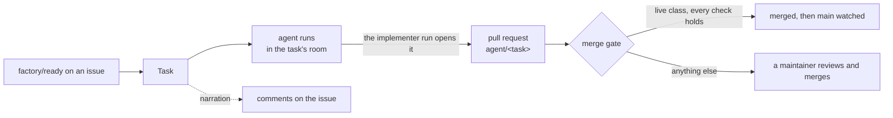
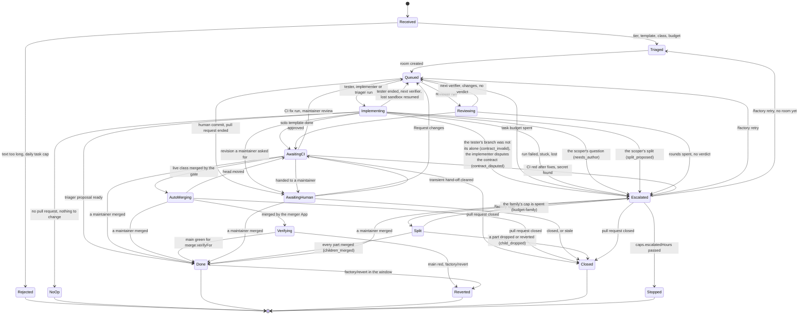
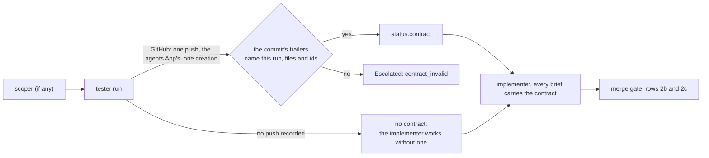
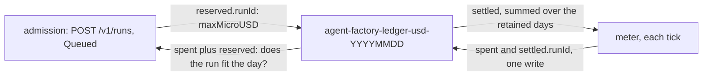
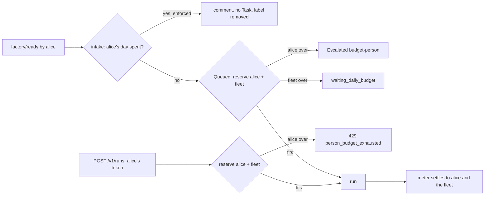
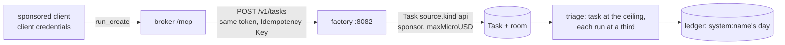
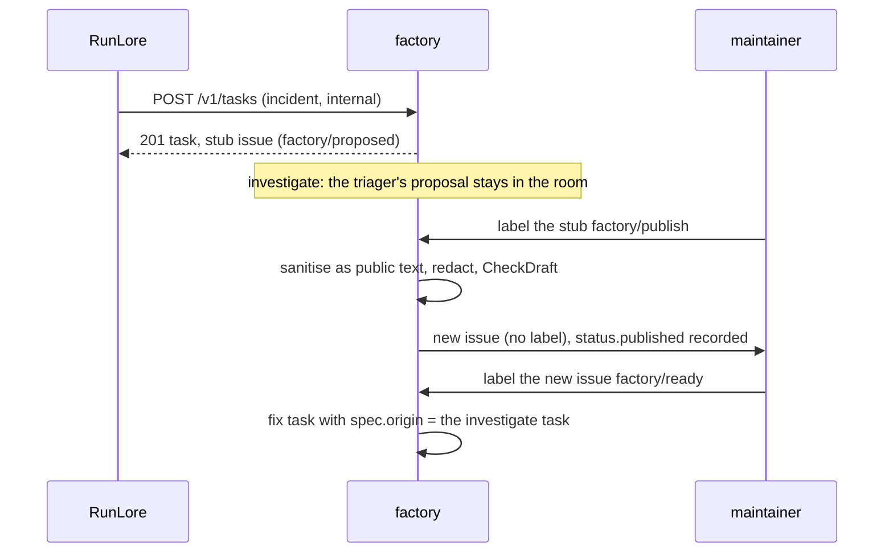
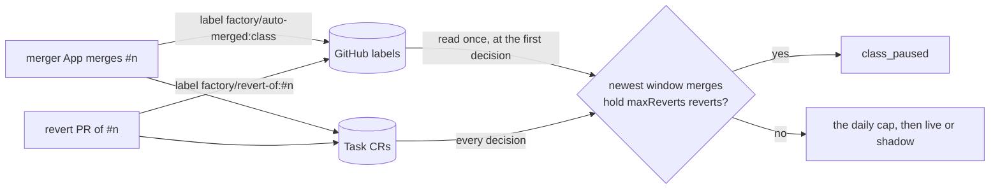

# The factory

A maintainer labels an issue; the factory turns it into a task, runs agents on it in sandboxes,
narrates each step on the issue, and stops at its budget. The agent run opens the pull request;
the factory watches it through CI and its merge gate. Humans steer through GitHub reviews and
comments, or from the task's room. Only low-risk classes the config marks `live` merge
themselves; a `shadow` class is decided the same way and never merged. cloud-native-ref's
config runs two classes (`docs-links`, `revert`) in shadow.



## Triggers

Every label below is read once a minute (`poll.issues`). A label a non-maintainer applied starts
nothing; maintainers are the `maintainers` list in the [config](#the-config-file), compared
without case.

| Trigger | Effect | Who |
|---|---|---|
| Label `factory/ready` (`triggerLabel` in the config) on an issue | A Task is created from a sanitised snapshot of the issue's title and body, with the sha256 of the text as labelled; the label is then removed. A pull request carrying it is ignored. Re-labelling the issue later starts a new task, and supersedes (stops) an escalated one | A maintainer |
| Label `factory/stop` on the issue or its pull request | The running task stops within a poll: its runs are revoked and deleted, the task ends `Stopped`. The label is removed once it hit a task; with no task running it stays, so a task started later stops at once. Anyone else's is removed and answered | A maintainer |
| Label `factory/revert` on an auto-merged pull request, within `merge.revertWindow` | The factory opens a revert pull request through the merger App and the task ends `Reverted`; the class counts the revert towards its [breaker](#the-merge-gate). A human merge is never reverted | A maintainer |
| Label `class:<name>` on the issue, before triage | Predicts the task's merge class, when `<name>` is a class in the config other than `revert` | A maintainer |
| Comment `/factory split` alone on a line, on the issue of a task escalated `split_proposed` | Approves the proposed [split](#splits); the commenter pays for every part. Read before `/factory retry` | A maintainer with `write` on the repository |
| Comment `/factory retry` alone on a line, on an escalated task's issue or pull request | A fresh run; see [Escalation](#escalation-reminders-and-stale-tasks) | A maintainer with `write` on the repository |
| A **Request changes** review on the task's pull request | Queued in the room; the next implementer run revises on the same branch with the review in its brief, then the pull request goes straight back to the maintainer | A maintainer |
| Label `factory/stop` on the control issue (`control.issue`), or the `agent-factory-stop` ConfigMap | Every task stops, intake pauses; see [The kill switch](#the-kill-switch) | A maintainer, an operator |
| A schedule (`schedules[]`) | A task per cron slot (5 fields, UTC), once, when the slot is under an hour old. With `probe: renovate-red`, only when an open pull request by `probeAuthor` (default `renovate[bot]`) older than 24 h has a red check (read through the merger App); up to five join the text. With `probe: dead-links` (the class declares `oracle.probe: dead-links`), only while the class is `shadow` or `live` and no earlier task of the schedule is open: the factory reads the `findings` artifact of the newest two completed `oracle.workflow` runs on `main` that a schedule or a maintainer started, keeps what both report, that the class may change, that has a Wayback `archive` (without one the oracle could never accept a fix, so the probe drops it), and that is still a link target in that file on `main`, and carries them as the task's `spec.findings`. Both runs must report a finding as gone (404, 410 or an unresolved name); a 429, 5xx or timeout in either is no finding. Findings past `oracle.maxFindings` are dropped, keeping the first in file-then-URL order. Malformed or out-of-shape findings start no task: they are logged and counted as an intake error. A run pair is weighed once, not every minute | The factory itself |
| `POST /intake/runlore` | An `investigate` task from a RunLore finding, and a public issue labelled `factory/proposed` that links the room; see [the API](#the-factorys-api) | RunLore |

A `factory/ready` the factory will not act on is answered once on the issue and removed:

| Reason | Means |
|---|---|
| `unauthorised_labeller` | The latest label is not a maintainer's |
| `edited_after_label` | The title or body changed after the label: re-apply it |
| `task_active` | A task for this issue is still running |
| `unsanitisable` | The text could not be made safe for an agent to read: simplify its markup |

The factory also writes labels of its own:

| Label | On | Means |
|---|---|---|
| `factory/class:<class>` | The task's pull request, once found | The class triage predicted |
| `factory/stale` | A pull request it closed | No maintainer activity for 14 days |
| `factory/orphaned` | An open `agent/<id>` pull request whose task no longer exists (a cluster rebuild) | Human-only from now on; re-label the issue `factory/ready` to start again. Nothing is ever adopted from it |
| `factory/needs-author` | The issue of a bounced task | Removed when the task leaves `Escalated` |
| `factory/proposed` | An issue the RunLore intake opened | A finding under investigation |
| `factory/split-proposed` | The issue of a task whose scoper proposes a split | Removed when the task leaves `Escalated` |
| `factory/child-of:#p` | A part's issue, applied by the factory when it opens it | The family's ledger: intake honours it only when the factory applied it |

## A task's life

A task's phase is in `kubectl get tasks` and in its room's summary. Any open phase goes to
`Stopped` on `factory/stop`, the kill switch or a superseding `factory/ready`.



`Rejected`, `NoOp`, `Done`, `Reverted`, `Closed` and `Stopped` are final; a pull request merged or
closed by hand ends the task from any phase that watches it. `Merged` is in the CRD's enum but no
transition sets it: an auto-merge goes from `AutoMerging` to `Verifying`. A task counts against
`caps.activeTasks` while it is `Implementing`, `Reviewing`, `AwaitingCI`, `AutoMerging` or
`Verifying`.

### The tester stage

A class with `testFirst: true` starts every public task with a **tester** run on `agent/<task>`,
after the scoper if there is one and before the implementer. The tester writes failing tests only
and never pushes: the harness checks that they fail on the current code, then pushes them as one
commit that carries `Agent-Contract`, `Agent-Run`, an `Agent-Contract-File` per test file and an
`Agent-Contract-Id` per test. It runs on the task's own model and caps, and on the task's own run
slot, like the implementer. An internal task never starts one.



The factory reads the contract from GitHub alone and trusts nothing about who pushed it: the
credential helper stays in the sandbox, so a push by the agents App may be the model's own, and
the room (a note, a handoff, a commit subject) decides nothing. It adopts a commit only when GitHub
records one branch creation by the agents App and the commit has the fixed subject
`test: the test contract`, trailers naming this run, and a single parent that is on the default
branch (an ancestor of its head: a parent the model crafted is not). Read at that parent, never at
the change, `.github/agent-checks.yaml`'s `tests.paths` must hold every file of the commit, none may
be under `tests.runner`, each must be a plain addition or edit (no delete, rename or copy), and the
`Agent-Contract-File` trailers must be exactly those files. Anything else (a second push, a push by
anyone else, a trailer naming another run) is `contract_invalid`. A contract of more than 50 files
or ids, or one longer than 512 bytes, is `contract_too_large`: the Task records at most that, and
never a truncated contract.

The tester's end note only names a category (`contract_ready`, `not_testable`, `contract_not_red`,
`contract_outside_tests`), a hint counted in `agent_factory_contracts_total`. With no push recorded
the task has no contract: a `contract_ready` note waits up to five minutes for GitHub to record the
push, and any other end (or a failed run) lets the implementer start without one. A lost sandbox
resumes the tester; a person's stop or an exhausted budget escalates as for any run.

That the tests are red on the base is not checked here. It stays proven at merge by the required
contract check (row 2b, `merge.contractCheck`): a forged or vacuous contract costs one implementer
run and then ends `ci_red` or with a maintainer.

Every implementer brief of a task with a contract carries it (the first, each revision, each CI
fix, a resumed run's): the commit, its files and up to 50 test ids between `CONTRACT-<nonce>` fence
lines, the rule that the pull request may not change them, and the dispute path. An implementer
that hands off to the `tester` role says the tests are wrong: the task escalates as
`contract_disputed`, with no dispute round.

The tester is not a verifier any more. A template that lists `tester` loads without it for one
release and logs a warning; `room_verdict` is the reviewer's alone, and the run API and the human
API refuse a `tester` run (`tester_is_factory_only`): the factory starts the test writer, never a
person.

### When the factory waits for you

The room page and `roomctl status` show the reason and the next step below; the factory's issue
comments use the same words.

**Queued:** the next run waits. Next step, unless the row says otherwise: nothing to do, the run
starts once the room and the factory are free.

| Reason | Why |
|---|---|
| `waiting_run_slot` | Every one of `caps.concurrentRuns` factory runs is live |
| `waiting_active_tasks` | `caps.activeTasks` tasks are active |
| `waiting_review_wip` | `caps.awaitingHumanWIP` tasks already wait on a maintainer; only a task's first run of a class that is not live waits for this |
| `waiting_daily_budget` | `budgets.factoryDailyUSD` is spent. It resumes after 00:00 UTC |
| `waiting_meter_blind` | The meter cannot read usage, so the daily cap cannot be checked |
| `waiting_room_log` | The room's log is not open on the broker yet |
| `waiting_broker_permission` | The broker does not let the factory write to rooms yet |
| `waiting_human_driver` | A person drives the room. Next step: hand the driver back, or let the lease lapse |
| `waiting_room_busy` | Another run in the room is still going. Next step: end it, or wait for it |
| `rereview_verdict_stale` | The head moved after the approval, so a new review run is queued |

**Implementing:** a tester run ended and GitHub has not recorded its push yet: nothing to do.

| Reason | Why |
|---|---|
| `contract_push_unrecorded` | The tester's harness said the contract was ready, and GitHub's activity does not show the push yet; the task waits up to five minutes, then goes on without a contract |

**Escalated** by the tester stage: a maintainer reads the room, then decides whether to retry
(`/factory retry`) or close it.

| Reason | Why |
|---|---|
| `contract_invalid` | The tester's branch was not the tester's alone (another login, a second push, a history too long to read) or its contract commit was malformed (trailers naming another run, no file or id, over 50 files or ids) |
| `contract_too_large` | The contract names more than 50 files or test ids, or a path or id over 512 bytes |
| `contract_disputed` | The implementer handed off to the `tester` role: it says the tests are wrong |

**AwaitingCI:** the merge gate reads the pull request. Next step: nothing to do.

| Reason | Why |
|---|---|
| `ci_pending` | A required check (`merge.requiredChecks`) has not finished |
| `ci_rerun` | A cancelled required check was re-run (at most `merge.checkReruns` per head) |
| `reentered_policy` | Back from a `policy_pending` or `policy_absent` hand-off: policy-bot now passes the head it was handed off at |
| `reentered_head_reported` | Back from a `head_unreported` hand-off: the room now reports the head as a commit of the task's run |
| `reentered_ci_green` | Back from a `ci_cancelled` hand-off: the required checks are now green on the same head |
| `head_moved` | A commit landed after the decision; the new head is decided again |
| `contract_unread` | The factory has not yet read which files changed since the test contract (row 2c) |

**AwaitingHuman:** the pull request is a maintainer's. Next step, unless the row says otherwise:
a maintainer reviews and merges it. The repository's ruleset blocks a plain merge, so a maintainer
with admin ticks "bypass rules" on the pull request, or runs
`gh pr merge <n> --squash --admin --repo <owner/name>`; the comment names the exact command. A
**Request changes** review sends the task back for a revision instead.

| Reason | Why |
|---|---|
| *(none)* | A revision a maintainer asked for is pushed |
| `merge_gate_off` | No class is live or in shadow, so the factory does not gate the pull request |
| `policy_pending` | policy-bot's `policy-bot: main` status needs a maintainer's approval |
| `policy_absent` | policy-bot has not evaluated the pull request, or the status is not from `merge.policyBotLogin` |
| `maintainer_approved` | A maintainer approved it: a human merges it |
| `gate_path` | It touches a gate path, so an agent can never merge it; a human re-authors the change |
| `steering_path` | Steering is on for some class and the pull request changes a [steering note](#steering); a human merges it |
| `not_mergeable` | GitHub refused the merge as the pull request stands |
| `not_agent_authored` | The pull request is not from `agentsLogin` |
| `class_unarmed` | The predicted class is neither live nor shadow (such as `docs` or `review`): the factory does not merge it, a maintainer reviews and merges it. Not counted in `agent_factory_class_mismatch_total` |
| `class_mismatch` | The predicted class's `diffShape` does not hold (`docs-links` and `revert` diffs change only link targets) |
| `file_not_allowed` | It changes a file outside its class's allowed files |
| `file_protected` | It changes a file its class protects |
| `file_added_or_deleted` | Any change but a content modification: an add, delete, rename, copy or mode-only change, which its class does not allow |
| `patch_too_large` | It changes more files or lines than its class allows |
| `holdout_red` | A holdout check its class requires failed, was cancelled, neutral or skipped, or was not posted by GitHub Actions; also when the pull request has more than 100 checks, since some are unread |
| `holdout_pending` | A holdout check its class requires has not passed yet |
| `oracle_finding_open` | A finding of the task is still a link target in the head, was not one on the base, or the task has no findings |
| `oracle_unrequested` | The head moves a link target no finding asked to move, or moves one anywhere but the exact snapshot its finding gave |
| `no_approving_verdict` | The template has a reviewer and its verdict is not approve |
| `head_unreported` | The room never reported the current head as a commit of the task's run |
| `verdict_stale` | The approval was for an older head. Next step: review the current head, or the factory asks for a new review |
| `foreign_trailer` | The head commit's `Agent-Run` trailer names another task's run |
| `human_commit_in_pr` | It holds a commit no run of the task pushed, so the factory neither fixes nor merges on top of it |
| `closes_parent` | A part's pull request body closes its parent issue; the parent closes with its last part, so edit the body and merge it yourself |
| `class_paused` | The class's breaker tripped: reverts, and with `maxFollowUps` set follow-up fixes and regressions, among its newest merges |
| `ledger_truncated` | A merge-ledger read filled its page of 100 and its oldest pull request is still inside the breaker window or today, so the ledger may under-count; nothing arms. A maintainer decides |
| `ci_wait_expired` | The pull request waited `merge.awaitingCIFor` in `AwaitingCI` and a required check never reported. The message names the checks. A maintainer decides |
| `auto_merge_cap` | `merge.autoMergesPerDay` is reached |
| `not_owned` | The repository's `.github/agent-factory.yaml` does not name this factory ([the fence](#the-ownership-fence)) |
| `shadow_would_arm` | Every check holds and the class is in shadow. Next step: merge or close it |
| `ci_cancelled` | A required check was cancelled and re-running it did not settle it |
| `contract_check_unset` | The task has a contract but `merge.contractCheck` is no longer set: nothing proves it, so a maintainer decides |
| `contract_modified` | The pull request changes a test the tester wrote as the task's contract (row 2c): a maintainer reads the change, then merges it or sends the task back |

A holdout's workflow file must be a gate path (policy-bot's gate paths cover it), otherwise a pull
request can edit the workflow and post SUCCESS itself; the host's gate-coverage check enforces it.
A diff of 100 files or more is `patch_too_large` without being read.

The gate compares GitHub logins (`agentsLogin`, `factoryLogin`, `merge.policyBotLogin`,
`merge.mergerLogin`) case-insensitively, as GitHub does.

`policy_pending`, `policy_absent`, `head_unreported` and `ci_cancelled` go back to the merge gate by
themselves when their input clears, on the same head and with no maintainer review or comment
since, up to three times per task.

**Escalated:** the factory could not finish. Next step, unless the row says otherwise: a
maintainer comments `/factory retry` on the issue, or pushes to the branch. The comment mentions
every maintainer.

| Reason | Why |
|---|---|
| `stuck` | The run showed no room activity for 10 minutes |
| `deadline` | The run hit its wall-clock limit (`tiers.<tier>.runMinutes`) |
| `agent_error`, `agent_stuck` | The agent stopped on an error, or said it was stuck |
| `judge_impossible`, `stalled`, `not_met` | Under the [loop policy](#the-config-file) (`loops`): the completion judge found the task impossible, the run made no commit within its step limit, or the judge still found the acceptance checks unmet after the last continuation. The issue gets the category; the judge's text stays in the room |
| `pod_lost`, `Disrupted`, `PodLost`, `PodFailed` | The sandbox failed or was lost and was not resumed. A sandbox lost to its node is resumed by itself, up to `resume.maxPerTask` times |
| `resumes_exhausted`, `resume_budget` | The sandbox was lost again, and no resume or no budget is left |
| `run_unschedulable` | The cluster did not admit the run within `caps.maxPendingMinutes` |
| `loop_unsupported` | The class has a `loops` row, `search: true` or `checks: true`, but the cluster refused the run claim's `spec.loop` (its AgentRun schema predates the loop policy, `loop.checks` or `loop.search`). No run started and none is retried: roll out crossplane-configuration with `spec.loop` (and `loop.checks`, `loop.search`) first ([operations](operations.md)) |
| `run_lost`, `deleted` | The run disappeared, or its claim was deleted |
| `revoked` | The run was stopped by hand |
| `budget-run` | The run spent its run cap |
| `needs_author` | The scoper asked the issue's author one question: the issue gets it (a public task's, quoted) and the label `factory/needs-author`. The author edits the issue and a maintainer re-applies `factory/ready` (a new task, scoped again), or a maintainer comments `/factory retry` (the task proceeds on the scoper's first assumption), or it expires |
| `split_proposed` | The scoper proposes to land the task as parts: the issue gets the plan and the label `factory/split-proposed`. A maintainer comments `/factory split` to approve it, or `/factory retry` to run the task whole (at the parent's own tier cap), or edits the issue and re-applies `factory/ready` (a new task, which supersedes this one), or it expires at `caps.escalatedHours` |
| `budget-family` | The family's cap (`spec.split.familyMicroUSD`) has no room for another whole run of the next part. `/factory retry` is ignored: the merged parts stay, so open the rest as a new issue; it expires at `caps.escalatedHours` |
| `budget-principal` | The factory's daily budget in dollars is spent |
| `budget-fleet` | The agent gateway's fleet-wide token budget is spent |
| `failed` or another run phase, lowercased | The run ended without a more specific reason from the room or the meter |
| `budget-task` | The task cap has no room for another whole run |
| `budget-person` | [Per-person caps](#per-person-caps): the day of the person the next run is charged to is spent; the comment names them. A maintainer's `/factory retry` charges the retrier instead |
| `ci_red` | CI stayed red after `merge.fixRuns` fix runs; the comment names the failing checks |
| `secret_scan_red` | The secret scan (`merge.leakScanCheck`) found a live credential. Next step: a maintainer revokes the key and closes the pull request; the factory does not retry |
| `review_rounds_exhausted` | The reviewer still asked for changes after `maxReviewRounds`; its last verdict is posted on the pull request |
| `no_verdict` | The last review run ended without a verdict the factory can act on, with no round left |
| `room_log_unreadable` | The room's log, which holds the verdict, could not be read |
| `foreign_room` | A room of the task's name exists and is not the factory's |

A task ends with one of these:

| Phase | Reasons |
|---|---|
| `Done` | `children_merged` (a split's last part merged), `merged` (by a maintainer), `merged_verified` (auto-merged, main green for `merge.verifyFor`), `proposal_ready` (a triager's proposal: label its issue `factory/publish`, read the new issue the factory files, then label that one `factory/ready`) |
| `NoOp` | `no_pr` (the run opened no pull request), `no_action` (the triager found nothing to change). Add detail and re-apply `factory/ready` |
| `Rejected` | `text_too_long` (over `caps.maxTextBytes`), `daily_task_cap` (`caps.tasksPerDay`). Fix it and re-apply `factory/ready` |
| `Closed` | `pr_closed`, `stale`, `child_dropped` (a part's issue closed unmerged, or a part reverted) |
| `Stopped` | `stopped_by_label`, `stopped_by_annotation`, `superseded`, `kill_switch`, `escalation_expired`, `family_dropped` (a part stopped because another part was dropped or reverted) |
| `Reverted` | `main_red`, `revert_requested` |

## Narration

The factory App comments on the task's issue, or on its pull request when it has none: a run's
start (id, branch, budget, the room link, how to stop it), the pull request, each revision, CI fix
and resume, each hand-off with its reason and the merge command, and the end with the tokens used.
Each comment carries a hidden marker and is posted at least once and never twice, from an outbox
written with the transition that caused it. Comments hold the factory's own words and ids, never
text a user wrote. The task's room gets the issue snapshot as its first `task_state` message, then
the task's facts (phase, reason, current run, the run history with each run's outcome, end and
dollars, token budget, dollar spend, issue and pull request), which the room page and `roomctl status`
show. The history keeps the last 20 runs, oldest first. A run's outcome is `succeeded`, `failed`,
`budget_exhausted`, `revoked`, `lost` (a disruption, a lost pod or a vanished claim) or `ended` (the
task ended or escalated with the run unfinished); it is empty while the run goes on. A run's dollars
and the task's spend are exact in the facts posted, but a tick of a running run never posts: the
spend steps by 10% of its cap, or $0.10 without one. A run the meter could not price reads $0, so a task mixing priced and unpriced runs shows a partial
dollar figure while its token cap binds: a known limit.

## Triage: tiers, templates, classes

Triage runs once, in `Received`. A classifier (`triage.classifierURL`) picks the tier; an error or
a timeout falls back to `standard` and never blocks. With `triage.classifierURL` unset, no
classifier is called: every task takes the static `standard` tier. `triage.controlPercent` of tasks run at
`frontier` whatever it says.

| Tier | Holds (`tiers.<tier>`) |
|---|---|
| `light`, `standard`, `frontier` | `model` (a gateway logical name: `agent-default`, `tier-light`, `tier-standard`, `tier-frontier`), `runMinutes` (1–480), `runTokens` (1–5,000,000), `taskTokens` (at least `runTokens`), and `runUSD`, `taskUSD` |

A template is a team: its roles (`implementer`, `reviewer`, `triager`) run one after
another on one branch, and only the implementer writes. `templates.<name>.roles` and
`maxReviewRounds` are config; the four names are fixed by the CRD.

| Template | Picked when |
|---|---|
| `investigate` | The task came from RunLore, by `/intake/runlore` or as an [internal principal](#internal-principals); its data class is forced to `internal` |
| `solo` | A class with an `oracle` (such as `dead-links`), always at `light`, without the classifier; otherwise class `docs-links`, tier below `frontier` |
| `pair` | Class `docs-links` at `frontier`, or any other class below `frontier` |
| `trio` | Any other class at `frontier` |

The `tester` role is the test writer of a `testFirst` class, started by the factory and never listed in
a template (see [the tester stage](#the-tester-stage)). A template that still lists it loads without
it, with a warning, for one release; `trio` is then the pair, and a later release refuses the file.

A template whose only role is `triager` proposes and never writes: its proposal stays in the room
until a maintainer publishes it as a new issue. The reviewer runs on the other tier than the
implementer: `standard` after `frontier`, `frontier` otherwise. It takes that tier's caps and, unless
the template sets `reviewerModel`, its model: `pair: {roles: [implementer, reviewer], reviewerModel:
tier-frontier}` reviews every `pair` task on `tier-frontier` whatever the implementer's tier.

A class is the kind of change a task is predicted to make, from the issue's `class:<name>` label,
a schedule's `class`, or else `review`. `classes` must declare `docs-links` and `revert`; `review`
is implicit, and declared only to give every other task `checks` and `testFirst` (it takes nothing else). Each class is `live` (auto-merges), `shadow` (decided, never
merged), or neither (a label only).

## Budgets

The run meter revokes a run at its run cap (`budget-run`). Before every run, the task cap must
still hold one whole run: if not, the task escalates as `budget-task` when `budgets.enforceTask`
is set (the default), and is only counted when it is not. A run lost to its sandbox is resumed
only within the cap, whatever `enforceTask` says.

With `meter.prices` set, both caps are in USD, so a cache read costs its own rate rather than a
full input token. A tier that omits `runUSD` or `taskUSD` then caps at its token cap counted at
$1.70 per million: the `standard` tier's 1.5 M and 3 M tokens become $2.55 and $5.10. Without
prices both caps stay in tokens.

| Setting | Effect |
|---|---|
| `meter.prices.<model>: {input, cacheRead, cacheWrite?, output, source?, checkedAt?}` | USD per million tokens, keyed by the model that served the tokens (`glm-5.3`, `claude-opus-5-5`) when `meter.query` groups by `gen_ai_request_model`, else by the tier's logical model. `cacheWrite` defaults to `input`. Each price must be positive. `source` (an `https://` URL) and `checkedAt` (`YYYY-MM-DD`) say where and when the row was read: checked when set, never priced |
| `tiers.<tier>.runUSD`, `tiers.<tier>.taskUSD` | The tier's caps in USD; `taskUSD` may not be below `runUSD`. Keyed by logical model, a tier with either set and no price for its model fails the rollout: an unpriced run would cost $0 |
| `meter.query` | Must group by `gen_ai_token_type` (`input`, `cached_input`, `cache_creation_input`, `output`), or no run can be priced and every run is capped in tokens. Grouped by `gen_ai_request_model` too, each model is priced at its own rate |

Grouping by served model is what makes a logical name safe to price: the same claim's
`agent-default` is GLM-5.3 on one gateway listener and Claude Opus on another, about ten times
dearer. A run's cost is the sum over the models that served it of
`(input − cached_input − cache_creation_input) × input + cached_input × cacheRead + cache_creation_input × cacheWrite + output × output`,
divided by 10⁶; a series without `gen_ai_request_model` is priced by the claim's logical model.
Every gateway path the platform runs counts the cache tokens inside `input`: agentgateway 1.6's
Chat Completions to Messages translation, streamed or not, and Z.ai's `prompt_tokens`. A model
whose `input` is below `cached_input + cache_creation_input` comes from a gateway that leaves them
out: it is priced with all of `input` as fresh, and
`agent_factory_meter_input_excludes_cache_runs_total{model}` counts the run.
A run served by a model with no price is never $0: it is held to its token caps, and
`agent_factory_meter_unpriced_model_runs_total{model}` names the model.

At GLM-5.3's prices ($1.40 / $0.26 / $4.40):

- **Run cap.** Implementer runs of 1.54–1.69 M tokens cost $0.58–0.70, well under $2.55. The same
  volume with no cache hit costs $2.30–2.49, so the cap stops an uncached run near 1.8 M tokens.
- **Task cap.** A `pair` task of 4.7 M tokens at 95 % cache reads costs $1.78 of its $5.10.
  Uncached, the same task costs $6.77.

A task falls back to `taskTokens` while any of its runs is unpriced (`runs[].unpriced`) or has
tokens and no cost: a cost is never counted as $0. The gateway's per-run bucket (B1, 5 M) charges
a priced call its price in reference tokens, from the same `meter.prices`, and an unpriced one its
raw tokens; the meter names a gateway 429 `budget-run` (`gateway-ceiling`) when the run's spend in
that unit reaches 5 M, and `budget-fleet` below it. The metrics for each cap are in
[Operations](operations.md#budget-signals).

### Daily budgets

The fleet's day (`budgets.factoryDailyUSD`, $42.50) and each human's (`budgets.humanDailyUSD`,
$8.50) are in USD: OD-10's 25 M and 5 M tokens at $1.70 per million, with a cache read counted at
its own rate. A file that still writes the token days (`budgets.factoryDaily`,
`budgets.humanDaily`, `budgets.perPerson.dailyTokens`) loads in this release: each is ignored and
named in a startup warning with the key to use, and the next release refuses it.

One ConfigMap per UTC day, `agent-factory-ledger-usd-<YYYYMMDD>`, holds the days in micro-USD:

| Key | Holds | Written by |
|---|---|---|
| `spent` | Principal → micro-USD charged that day | The meter |
| `reserved.<runId>` | `{principal, person?, room?, maxMicroUSD}`, dropped when the run ends | Admission |
| `settled.<runId>` | The micro-USD charged to that run that day, in the same write as `spent`; on the first day a run taken as already charged at the switch (below) is next charged, it also holds that spend (a run whose early days were pruned is lifted the same way), which `spent` never counts | The meter |



Admission refuses (enforced) or counts (shadow) a run whose reservation does not fit beside the
day's spend and reservations: a task run reserves its `runUSD`, or its `runTokens` at $1.70 per
million on a tier capped in tokens, and a `POST /v1/runs` its `maxTokens` at $1.70 per million.

Each tick the meter charges a run's priced increase, or its token increase at $1.70 per million
when the run cannot be priced (never $0), to every key the run is charged to and to its
`settled.<runId>`, in one write. A meter that first sees a run, a new leader included, reads what
the ledgers settled for it and starts it there. A write that reports an error may have landed all
the same: the next tick reads that day's `settled.<runId>` to learn how much did, and charges only
the rest. A write judged lost can still commit later, a 504 that commits after the next tick read
the ledger back: the meter keeps the run's entry as that read saw it and reads it again on each
attempt of its own write, taking any gain off what it adds. A new leader does the same against
the entries it learned, for a write its predecessor lost. That write carries the ledger's new
`resourceVersion`, so a late one conflicts; across midnight the meter first updates the failed
write's ledger to the same end, and a new leader does so for the days its first read of the run
showed, today's, and, in the first ten minutes of a day, the day before
([#166](https://github.com/Smana/maku/issues/166)). A run is charged once across a
failover, a ledger that cannot be read, a failed write, landed or not, and midnight, with three
bounded exceptions:

- A gateway counter reset before a new leader's first reading, once the counters have passed what
  was settled, loses what the run spent before the reset: an under-count.
- A run whose served model loses its price after such a reset and failover is charged its tokens
  at $1.70 per million on top of what was settled: an over-count.
- A lifted run's late spend not yet in a ledger at a failover (the leader's write was lost, or it
  died before its next tick) is not charged: an under-count bounded by the reading lag at a run's
  end.

The meter deletes the ledgers after 35 days, and the token ledgers `agent-factory-ledger-<YYYYMMDD>`
they replaced the same way. A run the meter first sees ended, with its usage annotated, is taken as
charged for what it has spent so far when nothing is settled for it, or when it began before the
oldest retained ledger: that spend was charged in the token ledgers, or partly in a day since
deleted. The meter keeps that amount pending and writes it into the run's `settled.<runId>` with
the run's next charge, so a new leader after a failover does not charge it again. Only that first
sighting is judged so: what the run's later readings add is charged. So
the day of the switch to USD starts at $0: runs that ended before it are not charged again, and runs
in flight are charged their whole cost.

### Per-person caps

Off by default (`budgets.perPerson.enabled: false`): every run is admitted exactly as before.
On, each run is charged to the person who caused it **and** to the fleet (`system:factory`), in
one ledger entry, so no run holds one reservation without the other.

| Run | Charged to |
|---|---|
| A labelled task's first run and its automatic follow-ups | The labeller, `github:<login>` |
| A task's runs after a `/factory retry` | The maintainer who typed it (`status.retriedBy`) |
| `POST /v1/runs` by a human | Their GitHub login through their ZITADEL link; with no link, their own `human:<sub>` |
| A schedule's or RunLore's task, a system caller's API run | The fleet alone, as before |

Each run record keeps its person in `status.runs[].chargedTo`, and the claim in
`agents.ogenki.io/charged-to`: the meter settles the run's cost to the fleet and to that person,
never to the token's `human:<sub>`, so one person has one ledger key whichever path they use. Logins
are lowercased.



| Setting | Effect |
|---|---|
| `budgets.perPerson.enabled` | Charge the person beside the fleet. Alone it only counts: a run past a person's day is admitted and counted as `budget-principal-shadow{principal}` |
| `budgets.perPerson.dailyUSD` | Every person's day, in USD. Default: `humanDailyUSD` |
| `budgets.enforcePrincipal` | With `enabled`, refuse: intake comments and drops the label, Queued escalates `budget-person`, the API answers `429 person_budget_exhausted`, and the meter revokes a live run once its person's day is spent (`budget-principal`). The fleet's day keeps its wait |

The person's day is in USD, like the fleet's ([Daily budgets](#daily-budgets)). Turning it on: set
`enabled` and watch `budget-principal-shadow{principal}` for a week, then set `enforcePrincipal`.

## Sponsored principals

Off by default: with no `api.sponsored`, `POST /v1/tasks` is `404` and the broker lists no
`run_create`. A machine starts factory work only as a **sponsored principal**: a ZITADEL machine
user that the config binds to a maintainer, with a day in dollars and a ceiling on every request.
Its request becomes a `Task` of `spec.source.kind: api`, which triage, the gate and narration then
treat as any other. Source: `internal/factory/api/tasks.go`.



`api.sponsored` is a list; each entry holds:

| Key | Holds |
|---|---|
| `name` | A DNS label. The principal is `system:<name>`, the ledger key and `requestedBy`. Never `factory`, `runlore`, `scheduler`, `room-broker` or `policy`, nor a name in `api.systemPrincipals`; unique |
| `clientIDFile` | The file holding the principal's ZITADEL client id, read at each use (the host's sync rewrites it when ids change). It must name a **machine (client-credentials) client**: every subject of that client becomes `system:<name>`, so a client with human subjects would admit them all as the principal. Unique across entries, and never the web UI's or `roomctl`'s client |
| `sponsor` | A GitHub login, the maintainer accountable for the principal. It must be in `maintainers` of every repository in `repositories` |
| `repositories` | The listed repositories the principal may use, spelled as listed; at least one |
| `dailyUSD` | The principal's day, in (0, `budgets.factoryDailyUSD`] |
| `maxCostUSD` | The largest `max_cost` one request may ask for, in (0, `dailyUSD`] |
| `maxOpenTasks` | How many of its tasks may be open at once. Default 3. A **soft cap**: it is counted before the Task is created, so a burst of N concurrent distinct requests can open up to cap+N-1 tasks |
| `onBehalfOf.slack` | `{"<team id>/<user id>": <maintainer login>}`: a request naming `slack:<team>/<user>` is sponsored by that maintainer instead. An unknown user is `not_linked`, a login outside `maintainers` is `not_a_maintainer` |
| `onBehalfOf.slackLinks` | `true`: a Slack user `onBehalfOf.slack` does not list is looked up in the broker's [self-serve link](slack.md#self-serve-link) records (`GET /v1/links/slack` on `:8443`, as `system:factory`). The link names a ZITADEL account, never a login: the factory resolves the account's **current** GitHub login through `api.access`, then holds it to `maintainers` as any sponsor. No link, an inactive account or no GitHub link is `not_linked`; a lookup that fails is `503 link_unverified`. **The config wins**: a user listed in `onBehalfOf.slack` is never looked up. Needs `api.access`; refused on an internal principal |

`api.projectIDFile` is required whenever `api.sponsored` is set: it names the file holding the
ZITADEL project id, and the client's token must carry it in its audience, or the token is refused.
`api.sponsored` also needs `meter.prices`: a ceiling in dollars is meaningless on unpriced runs, and
without prices the intake answers `503 meter_unpriced`. The chart mounts both files from
`sponsoredSecret` ([chart](../charts/maku-factory/README.md)). Config load checks every row above
and admission checks the sponsor again.

**The request.** `max_cost` is mandatory, in USD: at least $0.01, at most the principal's
`maxCostUSD` and at most the largest `taskUSD` among the tiers. It is stored as `spec.maxMicroUSD`,
which the CRD makes immutable. Class, tier, template, auto-merge and egress are never the caller's:
unknown fields are refused, and `dataClass` is `public` only. The sponsor and `onBehalfOf` come from
the config and the link map, never from the caller. [The endpoint](api.md#post-v1tasks)
lists the refusals.

**The ceiling's split.** Triage caps the task at `min(tier taskUSD, max_cost)` and each run at a
third of `max_cost` (`min(tier runUSD, max_cost / 3)`), the meter holding each run to its own cap.
Tokens follow at the reference rate ($1.70 per million), so a run that cannot be priced keeps a
ceiling too.

**An api task is never split.** The scoper offers no split to a task with a ceiling: its children
would each carry their own and escape it.

**A titled task waits for its issue.** The factory detects a titled api task by its text starting with
`# `, and waits up to 2 minutes for the issue the intake files just after creating the Task. An
untitled text that itself starts with `# ` is mistaken for one and waits the same 2 minutes before
it proceeds. Known; nothing is lost but the wait.

**Who pays.** An api task's runs are charged to `system:<name>` beside the fleet, whether
`budgets.perPerson` is on or off, and the principal's day is `dailyUSD`. A maintainer's
`/factory retry` moves the payer to the retrier, as for any task: they pay as the retrier, with
their own day. With per-person caps off (`budgets.perPerson`), a retried api task's runs are
charged to the fleet only: nobody's day applies, but the task's ceiling still holds.

**What bounds the day.** The intake checks the principal's day (spent plus reserved, plus the
request's whole `max_cost`) and answers `429 principal_budget_exhausted`, but that check is
**advisory**: nothing is reserved at intake. The hard limit is the run-time reservation under
`system:<name>`, which is enforced whatever `budgets.enforcePrincipal` says, together with each
run's ceiling/3 cap held by the meter. A later run refused for the day escalates the Task
(`budget-person`), possibly with a pull request already open.

**If a principal leaves the config.** Its live runs are no longer held to its day (the day comes
from the declaration), and a task that needs a new run escalates `principal_unknown`. Remove a
principal only once its tasks have ended.

**The issue.** With a `title`, the factory files the issue itself with the factory App (no label: the
Task exists already), the body ending with a footer naming the sponsor and the principal;
`spec.issueAuthor` is the sponsor. Without a `title` the Task has no issue, as a schedule's has
none. Text from a machine goes through the hidden-character strip, the draft rules (with a title)
and the redactor, and the Task's `spec.text` is `untrusted`.


### Internal principals

Off by default: `api.internalPrincipals` is empty. An internal principal is a sponsored principal
that may carry **internal** data: RunLore, one known caller, declared beside the others in its own
list, so a sponsored principal never loosens to `internal`. It reuses the sponsored path end to end
(the ZITADEL authenticator, the `api` source kind, the ceilings, `maxOpenTasks`, the day); what
differs is decided in one place each. Source: `internal/factory/api/internal.go`.

An entry holds a sponsored principal's keys (`name`, `clientIDFile`, `sponsor`, `repositories`,
`dailyUSD`, `maxCostUSD`, `maxOpenTasks`; `onBehalfOf` is **refused**) and:

| Key | Holds |
|---|---|
| `minConfidence` | In (0, 1]: a finding below it is `202 below_threshold` |
| `dailyTasks` | At least 1: tasks of the principal created this UTC day, any kind, so the retiring `/intake/runlore`'s count while both run |
| `verification` | Reserved for the verdict endpoint; no effect yet |

The name `runlore` is allowed on an internal principal only. Names and client id files are unique
across `api.sponsored`, `api.internalPrincipals` and `api.systemPrincipals`.

Its task is `source.kind: api`, `requestedBy: system:<name>`, `dataClass: internal`, with the
request's `maxCostUSD`. Triage forces `investigate` for any task whose `requestedBy` is an internal
principal, never from the body. The gates run in this order: the request's own checks, the verdict
and `minConfidence` (`202`), the dedup (`200`; a duplicate is answered before the caps, so a replay
never reads as a refusal), `dailyTasks`, `maxOpenTasks`, the day. The dedup key is
`api:<name>:<Idempotency-Key>`; the task name carries a generation, so a key whose task ended starts
a new one. The public issue is the same stub `/intake/runlore` files, from the same code
(`internal/factory/finding`).



**`factory/publish`.** The issue poller (leader only) reads it on the stub issue of an `investigate`
task. Only the last label event's actor counts, through the same maintainer and write checks as
`factory/ready`; anyone else's is answered `unauthorised_labeller` and removed. The proposal is the
last handoff to `implementer` that the task's triager run recorded itself. Its first line is the
title and the rest the body, held to the issue template, then made inert (every link, bare URL,
address, @mention and issue reference becomes a code span, no HTML survives, no hidden character), then scanned by the redactor.
A refusal (`task_not_ended`, `no_proposal`, `invalid_draft`, `redacted`) is a comment on the stub and
the label removed; nothing is created. The factory files the issue **once per task**, with no trigger label (only a marker,
`factory/published-from:<task>`, which grants nothing and lets a retry after a crash find the issue
instead of filing a second): the maintainer reads it on GitHub and starts it with `factory/ready`, which is the second, money
spending decision.

**`spec.origin`.** The poller sets it on a new `factory/ready` task only when a task of the same
repository carries the label `agents.ogenki.io/published-issue: <n>` **and** its
`status.published.issue` is that issue. It is fixed at creation and never read from issue text, so
nothing a person or an agent writes can forge one. Every webhook event of the fix's room repeats it
(`origin`, [API](api.md#webhooks)); it rides the task facts, so the broker needs no new state.

## The merge gate

Once a task is ready, the gate reads the pull request in `AwaitingCI` and checks, in order;
every "no" goes to a human. Row 12 is read last, only when the others would merge or post a
shadow decision. With no class `live` or `shadow` it reads nothing and hands off as
`merge_gate_off`.

| # | Check | If it fails |
|---|---|---|
| 1 | The secret scan (`merge.leakScanCheck`) is not red | Escalated, `secret_scan_red` |
| 2a | The repository is this factory's ([the fence](#the-ownership-fence)) | `not_owned` |
| 2 | Every `merge.requiredChecks` is green | Red: a fix run, up to `merge.fixRuns`, then `ci_red`. Cancelled: re-run, up to `merge.checkReruns`. Pending: wait |
| 2b | A task with a contract: `merge.contractCheck` is green too, as a required check. On a task without one the job only reports | As row 2: red is a fix run, pending waits |
| 2c | A task with a contract: no contract file changed since the tester's commit (GitHub's compare of that commit and the head; a head that is not its descendant, such as after a rebase, or more than 100 commits from it, counts every contract file as changed). Read once CI is green | Unread: wait, `contract_unread`. Changed: `contract_modified`, never a fix run |
| 3 | `policy-bot: main` is green, posted by `merge.policyBotLogin` | `policy_absent`, `policy_pending`, `gate_path` |
| 4 | The author is `agentsLogin`, and no maintainer approved it | `not_agent_authored`, `maintainer_approved` |
| 5 | The class is `live` or `shadow` | `class_unarmed` |
| 6 | The template's reviewer approved, the room reported the head, and every approval is of that head | `no_approving_verdict`, `head_unreported`, `verdict_stale` |
| 7 | The head's `Agent-Run` trailer names one of the task's runs | `foreign_trailer` |
| 8 | The class's declared conditions, in this order: `allowedFiles`, `protectedFiles`, `modifyOnly`, `maxPatchFiles`, `maxModifiedLines` (GitHub's counts), `diffShape` (`links-only`: link targets only, each staying relative, on its https host, or moving to web.archive.org; built into `docs-links` and `revert`), or `semver-patch` and `semver-minor` for an [adopted class](#adopted-classes) (computed from the diff), `holdoutChecks` (SUCCESS from GitHub Actions), `oracle` (the task's `spec.findings` no longer link targets in the head, and every finding was a link target on the base and none is on the head, and no target moved but to the exact snapshot its finding gave) | `file_not_allowed`, `file_protected`, `file_added_or_deleted`, `patch_too_large`, `class_mismatch`, `holdout_red`, `oracle_finding_open`, `oracle_unrequested`; a pending holdout waits as `holdout_pending` |
| 9 | The class's breaker has not tripped | `class_paused` |
| 10 | Under `merge.autoMergesPerDay` today, and under the class's `maxPerDay` | `auto_merge_cap` |
| 11 | The class is `live` | `shadow_would_arm`: the decision is posted, nothing is merged |
| 12 | Every push to the branch was the agents App's | `human_commit_in_pr` |

A condition on the diff (row 8's file conditions and shape) is decided on GitHub's own file list,
read only when every other row would merge or post a shadow decision. Two rules are stricter than
policy-bot's own matching. `allowedFiles` patterns must start with `^` and end with `$`
(the config refuses others) and are matched against the whole path, as `^(?:pattern)$`;
`protectedFiles` patterns are unanchored, so one matches anywhere in a path. A `holdoutChecks`
entry passes only when every run of that name was posted by GitHub Actions with the raw conclusion
`SUCCESS`: a skipped or neutral job (an `if:` or `paths:` filter) refuses as `holdout_red`, since
it checked nothing. A holdout check that is not reported yet, or still running, holds the task as
`holdout_pending`; one that never reports leaves the task waiting (issue #182).

When every check holds on a live class, the merger App merges the decided head; GitHub refuses
the merge if the head moved, and the new head is decided again. The task then watches
`merge.verifyChecks` on the merge commit for `merge.verifyFor`: red reverts, green ends `Done`. A
maintainer's `factory/revert` within `merge.revertWindow` reverts too. The revert pull request
auto-merges only while the `revert` class is live; otherwise a maintainer merges it.

The breaker: a class whose newest `merge.breaker.window` merges hold `merge.breaker.maxReverts`
reverts goes back to human review, whatever the config. Maintainers' merges of that class refill
the window, so clean ones lift it. Each revert is announced on the control issue.

The breaker and the daily cap read their merges from the Tasks and from GitHub, so a rebuild that
loses every Task keeps a demoted class demoted. The merger App labels what it merged
`factory/auto-merged:<class>` and its revert pull request `factory/revert-of:#<n>`. The factory
reads those labels at its first decision and keeps them for the process's life. Until that read
succeeds, the gate decides nothing. Only auto-merges carry a label, so maintainers' merges from
before a rebuild do not refill the window: a demotion can only last longer. A failed label write
is logged and retried while the factory still reads that pull request; it never holds up the
merge or the revert. The labels need `issues: write` on the merger App, which the factory asks
for only while a class is `live`.



A shadow decision's comment carries the head it judged (`event=would-arm-<n> head=<sha>`).
`scripts/shadow-merge-tally.sh --class docs-links` counts the pull requests a maintainer then
merged at that head: the gate's evidence that the class would have merged nothing a human would
not. Comments from before the head was recorded never count.

### Adopted classes

A class that declares `author.adopt` takes another author's pull requests, Renovate's, instead of
the agents App's. The factory authors no bump: an adopt poller turns an eligible open pull request
into a Task with no run, and the same [merge gate](#the-merge-gate) decides and merges it like any
class. Everything here is off by default: a class that declares no `author.adopt` behaves as before,
and an adopted class adopts nothing until it is `shadow` or `live`. The first state is `shadow`:
Renovate keeps merging, the factory records its decision and monitors the merge.

```yaml
classes:
  deps-patch:
    shadow: true
    author: {adopt: {logins: ["renovate[bot]"], branches: ["^renovate/"]}}
    diffShape: semver-patch
    releaseAgeCheck: renovate/stability-days
    modifyOnly: true
    allowedFiles: ['^(apps|flux|infrastructure|observability|security|tooling)/.+\.ya?ml$']
    maxPatchFiles: 3
    maxModifiedLines: 10
    maxPerDay: 2
  deps-minor: {shadow: true, author: {adopt: {logins: ["renovate[bot]"], branches: ["^renovate/"]}}, diffShape: semver-minor, modifyOnly: true, allowedFiles: ['…']}
```

| Key | Holds |
|---|---|
| `author.adopt.logins` | The adopted authors. Each ends in `[bot]` (a human login is refused at start) |
| `author.adopt.branches` | Head branch prefixes: `^` and a literal prefix, as `^renovate/`. The leading `^` is required, and any other regexp character is refused (the prefix is matched as written) |
| `diffShape` | `semver-patch` or `semver-minor`, required with `author.adopt` and with `modifyOnly: true`. `semver-minor` is `shadow` only: the config refuses it `live` |
| `releaseAgeCheck` | The commit status that holds the release age, posted by an adopted login (Renovate's `renovate/stability-days`). Needs `author.adopt` |

**The poller.** A leader-only loop, once a minute, off unless a class adopts and is `shadow` or
`live` (a class that is off adopts nothing). On a repository the factory owns, it lists the open
pull requests and adopts one only when it is into `main`, from the same repository (never a fork),
by an adopted login on an adopted branch, and its diff, computed by the factory, matches the shape of a class and keeps that class's file conditions (`allowedFiles`, `protectedFiles`, `modifyOnly`, `maxPatchFiles`, `maxModifiedLines`: the gate's own functions), so a pull request outside the fence is never bound to the class, whatever its shape. A list that
fails or fills its page, or a diff that cannot be read, adopts nothing and is retried. At most 10
adopted Tasks are open per repository and class, the rest wait for one to end. The Task is named from its key,
`adopt:<repository>#<number>`, so there is never a second Task for one key, across a restart or after
the first ended. Adopted Tasks fill none of the factory's caps (`caps.tasksPerDay`, `caps.activeTasks`,
`caps.awaitingHumanWIP`), and their `Payer()` is empty: they run no agent and cost nothing.

**The shapes.** The diff is judged on the files' contents at the pinned head, never on Renovate's
labels or title. `semver-patch` and `semver-minor` (package `semverdiff`) are strict:

- every changed file is modified and has as many lines on both sides; only version tokens change,
  and the text between them is byte-identical;
- a version token is any `v?MAJOR.MINOR.PATCH`, optionally `-pre` or `+build`: so the class's
  `allowedFiles` is what bounds what is adopted and passed (any three-number token in an allowed file counts);
- at least one version moves. `semver-patch`: each moved version keeps MAJOR.MINOR and raises PATCH.
  `semver-minor`: each keeps MAJOR and raises MINOR, or keeps MINOR and raises PATCH;
- a digest may change only when attached to the moved version (`<ver>@sha256:`); any other digest on
  the line is byte-identical. A digest-only update is refused;
- refused as well: control characters (C0, DEL, C1; a tab is fine), leading zeros, a `v` prefix that
  appears or disappears, a pre-release or build suffix, a changed trailing newline, an unchanged file.
  A lockfile fails by construction.

**The gate in author mode.** Rows 4 to 7 change for an adopted class, the rest read as for any class:

| Check | If it fails |
|---|---|
| The pull request is from the repository itself | `fork_pull_request` |
| Its author is an adopted login, on an adopted branch | `not_adopted_author`, `branch_not_allowed` |
| No repository member's `CHANGES_REQUESTED` stands | `changes_requested` |
| Every commit's author is an adopted login, and every push to the branch was one's | `human_commit_in_pr`, `push_unrecorded` (`adoption_unread`: the decision ran without the read) |
| `diffShape` holds on the diff the factory computed at the pinned head | `class_mismatch` |
| `releaseAgeCheck` is `SUCCESS`, posted by an adopted login | `release_age_pending` waits; `release_age_red` |

The veto is a repository member's or collaborator's: a review counts only when GitHub's
`authorAssociation` is `OWNER`, `MEMBER` or `COLLABORATOR`, so a stranger's review (anyone can submit
one on a public repository) parks nothing. It is fail-closed on what it cannot place: it also holds
when the review list was cut at GitHub's page, on a review whose author GitHub no longer shows (a
"ghost") or whose association it did not say, and on a dismissed `CHANGES_REQUESTED` whose author's
association qualifies. Only the same reviewer's later `APPROVED` lifts it. On a host that dismisses
stale approvals on push, a member's approval that gets dismissed therefore becomes a permanent veto
of that pull request; it fails closed, and a maintainer takes the pull request.
A review list cut by more than 20 reviews (the page read) still vetoes, so 21 stranger reviews park
the pull request: fail-closed, and a maintainer takes it. The filter relies on `authorAssociation`:
on an organisation-owned repository, a token that cannot see a private member's membership may read
them as `CONTRIBUTOR`, which drops their veto. An adopted class is meant for a user-owned repository,
or for a token that can read organisation membership. An
adopted pull request has no agent run, so `changes_requested` is never a revision brief. There is no
reviewer verdict, room report or `Agent-Run` trailer to check (the agents author mode's rows); an
approval by a maintainer is `maintainer_approved`, as for any class.

The decision is made on the head the factory read, and the merge is pinned to it (`ExpectedHeadOid`):
GitHub refuses it if Renovate pushed since. A read error of the commit authors or the push record is retried on the next pass; a commit list cut at its page reads as `human_commit_in_pr`. `adoption_unread` only means the decision ran without the read, and it never passes: the gate fails closed.

**The lifecycle.** An adopted Task starts in `AwaitingCI` and never runs an agent. When the gate says no:

| Reason | What happens |
|---|---|
| `human_commit_in_pr`, `ci_red`, `release_age_red`, `push_unrecorded`, `policy_pending`, `policy_absent`, `ci_cancelled`, `ci_wait_expired` | Hands off to `AwaitingHuman`, and **re-enters on a new head**: Renovate's rebase or a fresh push is decided again whole, up to 3 times (`maxGateReentries`, counted) |
| `auto_merge_cap`, `class_paused` | Same: re-enters on a new head, counted. A `shadow` class meets them too (the cap and the pause bound its would-arm decisions as a live class's merges) and re-enters the same way |
| `shadow_would_arm` | The shadow decision: returns to `AwaitingCI` on Renovate's next head (`adopted_head_moved`), not counted, since it is no hand-off |
| Every other reason: `class_unarmed`, `class_mismatch`, `fork_pull_request`, `changes_requested`, `not_adopted_author`, `branch_not_allowed`, `file_not_allowed`, `file_protected`, `file_added_or_deleted`, `patch_too_large`, `not_mergeable`, a class that no longer adopts, and the like | Terminal: the Task stays handed off. A new head does not revive them. A closed or merged pull request ends the Task |

`push_unrecorded` is GitHub not having recorded the push of the head yet (its events lag a push):
the Task waits for it at most 10 minutes, then hands off. A push made during a long CI wait gets no
such grace. `ci_red` hands off instead of starting a fix run: a red Renovate branch is the
`renovate-red` schedule's job, not an agent's here. An adopted Task in `AwaitingHuman` never reminds
a maintainer and never stale-closes Renovate's pull request, which would fight Renovate. A shadow decision is narrated `would auto-merge:
`<class>`` with `head=<sha>` and no claim of a verdict: no agent reviewed the change.

**The tally.** `scripts/shadow-merge-tally.sh --class deps-patch --author app/renovate` counts, as
for any class, the pull requests merged at the head a would-arm comment judged
(`merged_unchanged`) against those merged after a push (`changed`). `--author` is who opened the
pull requests and defaults to `app/ogenki-agents`. For an adopted class `merged_unchanged` is
Renovate's own automerge of the judged head, not a maintainer's judgement, so what the tally shows
is how often the gate agreed with Renovate; the evidence for going live is `--outcomes`.

### The post-merge monitor

A class that declares `monitor` keeps every merge of its tasks under watch, whoever merged it:
the factory's own auto-merge, and a Renovate or maintainer merge made before the factory decided
(a merge made before the factory decides still ends the task `Done "merged"` and is monitored, so
the breaker counts outcomes of merges the factory never decided: a demotion can follow from one).
An adopted class is the exception: its merge is watched only when the gate recorded `shadow_would_arm`
or `arm` for the head that was merged. Renovate's automerge of a pull request the gate refused, or
never decided, is not labelled `factory/merged:<class>` and feeds neither the breaker nor the tally. Nothing
here ever reverts: main red within `verifyFor` still opens the revert (see above); the monitor only
records a verdict, labels, narrates and feeds the breaker.

An adopted class's own next bump is not a follow-up: a later merged pull request by one of the
class's adopted logins (Renovate's) is skipped when the monitor looks for fixes of a merge, since
Renovate keeps moving the same files.

```yaml
classes:
  dead-links:
    monitor:
      oracleRuns: 2          # scheduled detector runs that must not report the merged targets; needs an oracle
      flux: {source: flux-system/flux-system, within: 15m}   # a Flux GitRepository (an OCIRepository is not read), and how long after it first shows the merge
      verification: {within: 6h}   # optional: wait for an internal principal's verdict on the fix (see below)
      followUpWindow: 72h    # how long later merges are read for a fix of this one; the verdict is final after it
merge:
  awaitingCIFor: 6h          # bound AwaitingCI on a wait verdict; 0, the default, is no bound
  breaker: {window: 10, maxReverts: 1, maxFollowUps: 1}   # maxFollowUps 0, the default, counts none
```

`flux.source` must name a Flux **GitRepository** (`namespace/name`, the one that delivers the
repository to the factory's cluster); an OCIRepository is not read, so the signal would end
`inconclusive` (config validation checks only the format). `flux` needs the chart's `monitor.flux.enabled` (off by default). It renders the ClusterRole and
ClusterRoleBinding `agent-factory-flux-reader`: `get` on `gitrepositories`, `list` on
`kustomizations` and `helmreleases`, no `watch`, nothing else of the cluster. The reads are uncached.
Without it every read is refused and the signal ends `inconclusive`. `merge.breaker.maxFollowUps` must be between 0 and `window`.

**The signals.**

| Signal | Reads | Regression | Healthy |
|---|---|---|---|
| Main's CI | The `merge.verifyChecks` on the merge commit. An auto-merge's was already watched by the task, so it counts healthy | Red | Green once `verifyFor` has passed. Still pending after twice that: `inconclusive` |
| Detector (oracle) | Each scheduled run of the class's oracle workflow after the merge, oldest first, through the probe's readers | A run reports gone a target this merge wrote | `oracleRuns` clean runs. A run that failed or whose findings are refused: `inconclusive` |
| Flux | The `source` GitRepository (`get`), and the Kustomizations and HelmReleases of that source (`list`), on the factory's cluster | A Kustomization or HelmRelease of the source turned not Ready from the blame start (the source's fetch of the merge commit, or the merge's own time when the source was first seen already at a later commit) until `within` after the source was first seen holding it | The source holds the merge, `within` has passed since it applied it, nothing turned not Ready in the window. A source that never holds the merge within `within`, or is suspended: `inconclusive` |
| RunLore's verification | `status.monitor.verification`, recorded by [`POST /v1/tasks/{task}/verification`](api.md#post-v1taskstaskverification). Only for a merge whose `spec.origin` names a task of an internal principal with `verification: true` | `persisting` | `resolved`. No verdict `within` after the merge: `inconclusive` |
| Follow-ups | Pull requests merged after this one, within `followUpWindow`, that change lines this one introduced: GitHub's blame at the later pull request's own parent, overlapped with its patch | None: a follow-up is never a verdict, it is a bad outcome counted by the breaker | |

The verification signal is `monitor.verified`. `within` (1 minute up to `followUpWindow`) counts from the
merge. `persisting` is a `regression` at once: the factory labels the pull request, comments, counts it
for the breaker, and files one follow-up issue, labelled `factory/proposed`, titled
`RunLore: the fix in #<pr> did not hold (<alert>)` (recorded in `status.monitor.followUpIssue`, never
twice). It names the pull request, the alert and the origin room; the evidence stays on the origin
task. `agent_factory_monitor_verifications_total{class, verdict}` counts the verdicts read
(`resolved`, `persisting`, `none`).

The detector signal reads each scheduled run after the merge (or a maintainer's `workflow_dispatch`),
oldest first: one that reports gone a target this merge wrote (same file, and the snapshot it wrote
or the original URL) is a `regression`; a run that did not succeed (failed, cancelled, skipped, timed
out), or whose findings are refused, is `inconclusive`; `oracleRuns` clean runs are
`healthy`. Matching the original URL can also count an older occurrence of that URL in the same
file. A read that fails leaves it open, `inconclusive` after 72 h.

The Flux signal is `healthy` only when the source holds the merge commit, `within` has passed
since the source first showed it to the monitor (`status.monitor.applied`, its fetch time, an upper
bound on when the merge was applied), and no Kustomization or HelmRelease of that source turned not
Ready in that window: from `status.monitor.blameFrom` (the fetch time when the source showed the
merge commit itself, else the merge's own time) to `applied + within`. A later flap is never
blamed. The objects found not Ready are kept (the first five, `fluxBlamed`) and named in the
verdict comment. A reader error leaves the signal open (`inconclusive` at the window's end). Known
limits: a suspended source makes it `inconclusive` at any pass, and attribution is per source, not
per merge, so overlapping windows, or a later commit's failure inside the window, count against
every open merge of that source.

A follow-up read that fails or cannot say makes the verdict `inconclusive`, never `healthy`
(`followUpsUnread`): no blame for a file, an omitted patch, a truncated search or merged list
(`ErrMergedTruncated`), and a rebase merge of several commits, whose parent is not the base the
patch was written against. The factory reads a window's merges at most once per 10 minutes.

**The verdict** is the worst signal: `regression`, then `inconclusive`, then `healthy`. A signal
still open when the window ends counts `inconclusive`. A `regression` is posted at once and the
watch goes on to the end of the window to count follow-ups; any other verdict is posted when the
window ends. The comment ends `<!-- agent-factory … event=monitor-<n> verdict=<v> -->` and lists
what it read, with `follow_ups=N`. A regression, and each follow-up found, are also posted on the
control issue (under their own keys), when it lives on the task's repository.
`agent_factory_monitor_verdicts_total{class,verdict,repository}` counts each verdict once.

**The labels** the merger writes (it asks for `issues: write` while any class is `live` or has a
`monitor`):

| Label | On | Meaning |
|---|---|---|
| `factory/merged:<class>` | Every monitored merge, auto or not | The merge is in the class's ledger |
| `factory/follow-up-of:#<n>` | A later merged pull request | It fixed lines of #n: one bad outcome of #n (`outcome=follow_up`) |
| `factory/monitor:regression` | The monitored pull request | Its verdict was `regression`: a bad outcome |

**What demotes.** The breaker counts, among a class's newest `window` merges, reverts, follow-ups
and regressions: `maxReverts` of the first, or `maxFollowUps` of the others, send the class back
to human review (`class_paused`). A ledger read that fills its page of 100 with its oldest pull
request still inside the window or the day fails closed (`ledger_truncated`). These reads (the
regression and merged labels, a follow-up read per windowed merge, the truncation check) happen only
for a repository with a class that declares `monitor` or with `maxFollowUps > 0`; without either the
ledger reads what it always did. Only auto-merges
count toward `merge.autoMergesPerDay` and the class's `maxPerDay`; a maintainer's or Renovate's merge
is in the ledger for the breaker, not for the caps.

**Load and bounds.** Each watched task is read at most once per 10 minutes: `PullRequest`,
`CommitChecks` until main's signal is final, and one `MergedSince` per repository (shared by
every task of it). Each later pull request is read once per process (`PullFiles`, plus one blame
per file both changed), so a steady state costs about 2 GitHub calls per watched task per
10 minutes. A restart forgets the throttle and the caches and re-reads up to 100 pull requests and
their blames in one burst per repository. The caches hold derived line sets, never patches, and
drop an entry when the pull request it describes leaves the longest window.

### Calibration

Widen a class one step only when the evidence allows it. `scripts/shadow-merge-tally.sh --class
<class> --outcomes --since <date> --window <followUpWindow>` (whole hours, like `168h`) lists the class's merged pull requests
and their outcomes (reverted, follow-up fix, regression), leaves out the immature (merged less than
the window ago) and the inconclusive, and prints the Clopper-Pearson 95% upper bound on the rest:

```
merges=31 mature=30 conclusive=29 inconclusive=1 bad=0 reverted=0 follow_up=0 regression=0 bound=0.098… budget=0.10 widen=yes
```

The rule: widen one step only when `bound < budget` (0.10 by default; `--budget` changes it), by
the owner's config pull request citing the tally's output. Zero bad merges need 29 conclusive
ones, one needs 46, two need 61.

## Oracle classes

A class with an `oracle` (`dead-links` is the first) has a detector, a GitHub Actions workflow on
`main`, that says what is wrong; the gate proves the pull request fixed exactly that and nothing
else.

**The detector.** `oracle.workflow` must upload an artifact named `findings` holding
`findings.json` on every run, `[]` when nothing is dead. A run without it is an error (the probe
retries every tick and starts nothing), not a clean run. Each entry is `{file, line, url, status}`
with an optional `archive`, a `web.archive.org` snapshot of that same URL. `status` is `404`,
`410` or `nxdomain` for a finding; anything else (403, 429, 5xx, a timeout) is never one.

**The probe.** It reads the newest two completed runs of the workflow on `main` that a schedule or
a maintainer's `workflow_dispatch` started (a pull request's run, or another actor's dispatch, is
skipped); both must have succeeded. A finding needs two consecutive runs: it is kept only when both
report the same file and URL with a gone status. It must also be allowed (`allowedFiles`, not
`protectedFiles`, `https`) and still a link target in that file on `main`. A finding is dropped,
not refused, for: a path the class may not change, an `http` URL, a URL no longer a link target
on `main`, or no `archive` (the oracle allows a move only to the finding's exact snapshot, so a
finding without one can never pass and is not given to an agent; when none is left there is no task
and the run pair is saved). Findings past `oracle.maxFindings` are dropped, keeping the first in file-then-URL
order; once the task is closed, a later run pair picks up what remains. A malformed entry anywhere in a run, even one
past the cap, refuses the whole run: it starts no task, is logged and counted as an intake error.
A run pair is weighed once; a maintainer's re-run of a run (a new attempt) is weighed again.

**The task.** Its text is rendered from the validated paths and URLs and fixed words only, never
free text from the artifact, and its `spec.findings` carry `{file, url, archive}`. The text stops at `caps.maxTextBytes`: findings that would pass it are left out whole and picked up by a later run pair. The template is
`solo` at `light`, with no classifier call and no reviewer.

**The gate.** The `oracle` condition holds when every finding was a link target in its file on the
base and none is on the head, and every other link target the head moved is a finding's, moved to
exactly the `archive` that finding gave. A move to a page on the same host, or to any other
snapshot, is `oracle_unrequested`; the probe has already dropped findings with no `archive`. A finding still on the head is
`oracle_finding_open`. `holdoutChecks` and `diffShape: links-only` hold the rest of the diff.

The merger App's token must read `actions` (runs and artifacts). Artifact downloads redirect to
`productionresultssa*.blob.core.windows.net`, which the factory's egress must allow.

## Escalation, reminders and stale tasks

A maintainer's review reaches the next run once queued: the factory re-reads the pull request just
before that run starts, so a review submitted while the task waits joins it, and a review already
dismissed is skipped. A review dismissed after it was queued still drives that run.

| Input | Effect |
|---|---|
| A maintainer's comment with `/factory retry` alone on a line, outside a code fence, on an escalated task's issue or pull request, posted after it escalated (up to a minute before, by the factory's clock, still counts: GitHub's clock and the factory's may differ) | A fresh run through `Queued` and its caps, within 5 minutes (escalated tasks are polled every 5 minutes). Edited comments, and anyone else's (a maintainer without `write` on the task's repository included), are ignored without an answer; when GitHub does not answer, the command waits for the next poll. After `review_rounds_exhausted` or `no_verdict` the rounds stay spent: the retry buys one revision and one review |
| No maintainer activity on an `AwaitingHuman` pull request for 48 h: no review, no comment on it or on the issue, no push without an `Agent-Run` trailer | One reminder mentioning the maintainers, per quiet spell. A spell never restarts earlier than one already reminded. An approved pull request's reminder says it waits for a merge |
| The same for 14 days, at least 24 h after that reminder, and the latest maintainer review is not an approval | The pull request is labelled `factory/stale` and closed, and the task ends `Closed` (`stale`). An approved pull request is never closed. A refused close takes the label off again |
| An escalated task with no retry for `caps.escalatedHours` (default 168, `0` for no limit) | The task ends `Stopped` (`escalation_expired`) and says so; its pull request is left as it is. A task whose room a person drives never expires while they drive, and a retry already asked for wins |

## The kill switch

The stop object is the ConfigMap `agent-factory-stop` in the factory's namespace, deliberately not
in Git so Flux never reverts it; its content is ignored. While it exists:

- every open task ends `Stopped` (`kill_switch`), its runs revoked and deleted;
- every live `AgentRun` in `agents` is revoked and deleted every 15 seconds, human-requested ones
  included;
- intake pauses: no new task from labels, schedules or RunLore (`503 factory_stopped`), and
  `POST /v1/runs` answers `503 kill_switch`. `factory/stop` and `factory/revert` labels are still
  honoured.

A maintainer engages it with `factory/stop` on the control issue (`control.issue`): each poll
creates the object, annotated `agents.ogenki.io/stop-source: control-issue`, and the poll that sees
the label admits no new task in that same pass. Removing the label deletes the object, but only an
object the poller made. An operator's stop must be a fresh object, which
the label never lifts:

```bash
kubectl create configmap agent-factory-stop -n <factory namespace>
```

`kubectl apply` over an object the control issue made keeps its annotation, so removing the label
lifts it. One task stops with the annotation `agents.ogenki.io/stop: "true"` on its Task.

## Reference

### The Task CRD

`tasks.agents.ogenki.io/v1alpha1`, namespaced, created by the factory at runtime and never
committed to Git. Its name is an 8-character id (`[a-z2-7]{8}`) derived from the source's key, so
creating it twice is the dedup. Source: `api/factory/v1alpha1/task_types.go`.

| Field | Meaning |
|---|---|
| `spec.source.kind` | `issue`, `runlore`, `schedule` or `api` |
| `spec.source.ref` | `owner/name#n`, `<alert>/<resource>`, the schedule's name, or an `api` task's `ref` (default `api:<name>`) |
| `spec.source.key` | The idempotency key the name derives from |
| `spec.source.requestedBy` | `github:<login>`, `system:runlore`, `system:scheduler`, or `system:<name>` for a sponsored principal |
| `spec.source.sponsor` | `api` tasks only: `github:<login>`, the maintainer accountable for the request (immutable) |
| `spec.source.onBehalfOf` | `api` tasks only: `slack:<team>/<user>` when a link chose the sponsor |
| `spec.maxMicroUSD` | `api` tasks only: the request's `max_cost` ceiling in micro-USD, immutable; 0 for every other task. See [sponsored principals](#sponsored-principals) |
| `spec.source.trust` | `untrusted` text is fenced as data for the agent; `trusted` (schedules) is not |
| `spec.source.contentSHA256` | sha256 of the text as labelled |
| `spec.repository` | `owner/name` |
| `spec.issue` | The issue the factory narrates on; 0 for none |
| `spec.issueAuthor` | The issue's author, for the room list's "mine" filter |
| `spec.text` | The sanitised snapshot; admission caps it at `caps.maxTextBytes` |
| `spec.dataClass` | `public` or `internal`; every run of the task gets it |
| `spec.predictedClass` | The merge class triage predicted. Intent, not authority: only the gate merges |
| `spec.template` | `solo`, `pair`, `trio` or `investigate` |
| `spec.budget` | `tier`, `model`, `runTokens` (≤ 5,000,000), `taskTokens`, `runMinutes` (≤ 480), `runMicroUSD`, `taskMicroUSD` (0: the token caps) |
| `spec.loop` | `stallSteps`, `continuations`, `judgeModel` (empty: no judge): the class's `loops` row, resolved at triage; every implementer run of the task gets it as `spec.loop`. Unset: the loop is off |
| `spec.scopeMode` | `off`, `steering` or `scoper`: the class's `loops` row, fixed at triage. Empty: triaged before the field existed, read as `off`. An `investigate` task is always `off` |
| `spec.search` | `true` when the class's `loops` row sets `search`, fixed at triage; every implementer run of the task gets `spec.loop.search`. Omitted: off |
| `spec.steering` | `path`, `sha` (the git blob), `text`: the class's steering note on the default branch, read at triage; unset for none |
| `status.phase`, `status.reason`, `status.phaseSince` | The phase above, why, and since when |
| `status.classification` | The classifier's `tier`, `confidence`, `classifier`, `fallback` (`none`, `default`, `static`), `shadow` verdicts, `control` (forced to `frontier`) and `fit` (scored at the end) |
| `spec.split` | `maxChildren` (2–5), `familyMicroUSD`, `childTier`: set at triage on a task C7 rated `frontier` (any task, with `split.anyTier`) whose class has a `split` row. The family's cap lives here; the parent's `spec.budget` stays its tier's |
| `spec.parent` | On a part: `task`, `issue`, `index`, `of`. Fixed at creation. A part is requested by the approver and carries its parent's snapshot whole (`text`, `contentSHA256`) |
| `spec.scope` | On a part: its own scope (`state: ready`, `task`, `touches`, `leave`, `plan`, `assumptions`, `acceptance`), from the approved split. Never changes once set; a revision brief keeps it whole |
| `status.runs[]` | Each run: `id`, `role`, `trigger` (`initial`, `review`, `human`, `ci`, `retry`, `resume`), `round`, `phase`, `reason`, `verdict`, `tokens`, `costMicroUSD`, `unpriced`, `startSeq`, `headSHA`, `started`, `finished`, and `provenance`, what it ran on: `factoryVersion` (the claim's CREATE-only `agents.ogenki.io/factory-version`), `compositionRevision` (the claim's `spec.crossplane.compositionRevisionRef.name`), `harnessImage` (the claim's `status.harnessImage`, the harness container's `imageID`) and `servedModels` (the meter's `gen_ai_request_model`, at most 8, each at most 64 characters: a longer name is skipped, never truncated). Each is written once, as it becomes known; empty means unknown. A run created before the upgrade (its claim has no factory version) stays empty, and a value over the CRD's bound is not recorded |
| `status.roomRef` | The task's room, named like the task |
| `status.pullRequest` | `number`, `url`, `nodeID`, `headSHA`, `mergeCommitSHA`, `mergedBy`, `autoMerged`, `armedAt`, `mergedAt`, `revertNumber`, `author`, `reviewers` |
| `status.usage` | `tokens` and `costMicroUSD` summed over the runs; never drops |
| `status.usageSettled` | The meter's late readings had their window and the total is final |
| `status.reviewRounds`, `status.fixRuns`, `status.retries`, `status.resumes` | Counters behind `maxReviewRounds`, `merge.fixRuns`, `/factory retry` and `resume.maxPerTask` |
| `status.checkReruns`, `status.checkRerunsHead` | Re-runs of cancelled checks, per head |
| `status.gateReentries` | Returns from a transient hand-off to the gate (at most 3) |
| `status.verdict` | The last review's effective verdict: `approve`, `changes` or `none` |
| `status.narrated`, `status.outbox` | Keys of the comments posted; comments still owed |
| `status.roomSeq`, `status.facts` | The task's message sequence in its room; the facts last written there |
| `status.nextTrigger`, `status.nextRole` | Why the next run exists; the verifier it is for |
| `status.handled` | GitHub review and comment ids already acted on |
| `status.configHash` | The config that triaged the task |
| `status.contract` | `runId`, `commit` (40 hex), `files`, `ids` (1 to 50 each): the tester's commit as GitHub recorded it. Set once, when its push is read; every implementer run is held to it |
| `status.scope` | `state` (`ready`, `question`, `assumed`, `missing`, `failed`) and `seq` (the scope's handoff): the scoper's outcome, kept when the task stops |
| `status.split` | `state` (`proposed`, `approved`, `declined`, `superseded`, `expired`, `ignored`), `seq` (the split's handoff), `of`, `approvedBy` (`github:<login>`, every part's payer) and `children[]` (`index`, `issue`, `task`, `outcome`: `landed`, `dropped`, `reverted`) |
| `status.lastActivity` | The running run's last room event, for stuck detection |
| `status.trace` | The task's root span ids |

| Metadata | Meaning |
|---|---|
| Annotation `agents.ogenki.io/stop` | Stop this task: `true` by hand, `label` from `factory/stop`, `superseded` by a new `factory/ready`, `family_dropped` on a part whose family ended `Closed` |
| Annotation `agents.ogenki.io/revert` | A maintainer's `factory/revert` |
| Label `agents.ogenki.io/issue` | The issue number |
| Label `agents.ogenki.io/parent` | A part's parent task: how the factory lists a family and sums its spend. Only `spec.parent` counts as membership |
| Label `agents.ogenki.io/source-key` | Groups a RunLore finding's tasks |

### The config file

YAML, the chart's `config` value, rendered to `/etc/agent-factory/config/config.yaml`. Unknown keys
fail the start, every problem is reported at once, and the file is a gate path: only a
human-authored pull request changes it. Source: `internal/factory/config/config.go`.

| Key | Holds | Default |
|---|---|---|
| `factory` | This factory's name, a DNS label such as `aws-0`: a repository is acted on only while its `.github/agent-factory.yaml` gives it | Required |
| `repositories` | At most 8 entries, one per repository, names unique (case-insensitive); see the entry table below | Required |
| `control` | `{repository, issue}`: the issue whose `factory/stop` is the global stop, on a listed repository | `issue` 0: none |
| `factoryLogin`, `agentsLogin` | The factory App's login (narration) and the agents App's (pull requests) | Required |
| `roomsURL` | `https://<host>` of the rooms UI, linked in comments | Required |
| `broker` | `url` (https only), `caFile`, `tokenFile` | Required |
| `github` | `appIDFile`, `privateKeyFile`; `mergerAppIDFile`, `mergerKeyFile` (both or neither; required once a class is live or shadow) | Required |
| `poll` | `issues`, `tasks`, `meter`: durations such as `"60s"` | Required, positive |
| `defaults` | `template`, `tier`, `dataClass`, `predictedClass` | `dataClass` and `predictedClass` required; `template` and `tier` are read by nothing, optional, checked only when set |
| `triage` | `classifierURL`, `controlPercent` (0–100) | `controlPercent` required; `classifierURL` unset: no classifier call, every task takes the static `standard` tier |
| `tiers` | Exactly `light`, `standard`, `frontier`; see [Triage](#triage-tiers-templates-classes) | `runUSD`, `taskUSD` from the token caps when `meter.prices` is set |
| `templates` | `<name>: {roles, maxReviewRounds, reviewerModel}`; every template but a lone `triager` has an `implementer`; `reviewerModel` (a gateway logical name) needs a `reviewer` role | Required; `reviewerModel` unset: the other tier's model |
| `caps` | `activeTasks`, `concurrentRuns`, `tasksPerDay`, `maxTextBytes` (≤ 14336), `awaitingHumanWIP`, `maxPendingMinutes` (5–480), `escalatedHours` | `maxPendingMinutes` 30, `escalatedHours` 168 |
| `budgets` | `enforceTask`, `enforcePrincipal`, `factoryDailyUSD`, `humanDailyUSD` ([daily budgets](#daily-budgets)), `perPerson: {enabled, dailyUSD}` ([per-person caps](#per-person-caps)), each day positive. The token days `factoryDaily`, `humanDaily` and `perPerson.dailyTokens` load in this release only, ignored, each named in a startup warning | `enforceTask` true, `factoryDailyUSD` 42.50, `humanDailyUSD` 8.50, `perPerson.enabled` false, `perPerson.dailyUSD` `humanDailyUSD` |
| `resume` | `maxPerTask` (1–5) | 2 |
| `meter` | `url`, `query`, `logsURL`, `throttleQuery`, `prices` | Required but `prices` |
| `tracing` | `otlpEndpoint`, `host:port` | Empty: tracing off |
| `api` | `listen` (the chart's `api` port is `:8082`), `humanIssuer`, `humanJWKS`, `clientIDFiles`; `groups: {admin, member}`, the two groups the API admits; `systemIssuer`, `systemJWKS` (both or neither), `systemPrincipals`; `systemRepositories: {<principal>: [owner/name]}`, the listed repositories each system principal may start runs on; `access: {readerFile, ttl}`, the ZITADEL reader that resolves a human caller to their GitHub login (`ttl` at most 5m); `projectIDFile` and `sponsored`, see [sponsored principals](#sponsored-principals) | Required but `groups`, `access` and the system keys; `groups` defaults to `agents-admin` and `agents-member`, the broker's values. Without `access` every human run is refused |
| `runlore` | `listen`, `tokenFile`, `minConfidence` (0–1], `dailyCap`; `repository`, the listed repository its issues and tasks go to | Required but `repository`, which defaults to the first entry |
| `sandbox` | `suspend: {enabled}`: a run `POST /v1/runs` starts in an attended room gets `spec.suspendable: true`, which lets the room broker suspend it while its approval waits on an idle room (the broker's `suspend` config). Fixed on the claim at create | `enabled` false |
| `loops` | `<class>: {stallSteps (1–500), continuations (0–5), judge (an alias or none)}`, keyed by a declared class, `review` or `default` (every class without a row). A row is read whole, never merged with `default`'s (a row with only `scope` has no loop, even when `default` has one); it switches the class's [loop policy](https://github.com/Smana/ai-native-ref/blob/main/docs/superpowers/specs/2026-10-21-loops-and-teams-design.md) on when it sets any of the three, and an unset one is 80, 2 or `tier-light`; `scope` (`off`, `steering`, `scoper`; unset is `off`, and a bare `off` in YAML reads as `off`) picks the class's [steering](#steering) or [scoper](#the-scoper): never part of the loop, so `{scope: steering}` alone switches no loop on; `split` (`{maxChildren 2–5, familyUSD, childTier, anyTier}`; `familyUSD` defaults to four of the child tier's `taskUSD`, `childTier` to `standard`) is refused without `scope: scoper` on the same row, on `docs-links`, `revert` or an oracle class, and without `meter.prices`; it lets the scoper of a task C7 itself rated `frontier` propose [a split](#splits); `anyTier: true` (default `false`) offers it on every task of the class, whatever tier C7 rated it (needed where no classifier is deployed, so every task is `standard`). `search: true` offers the class's implementer runs the [search tool](../images/maku-harness/README.md) (`spec.loop.search`, which the harness reads as `AGENT_SEARCH=1`); like `scope`, it never switches the loop on, and a row is read whole, so a class row without `search` is off whatever `default` says. The room-bridge classes a bare `search` as the plain built-in only on a run given it, assuming MCP tools reach it prefixed (`server_tool`): an unprefixed MCP tool named `search` would also class plain (and the SDK refuses the duplicate tool name at start). Needs cloud-native-ref's `AgentRun` (`runs` left at its default) for the loop | None: every run as before |

Each `repositories` entry:

| Key | Holds | Default |
|---|---|---|
| `name` | `owner/name` | Required |
| `maintainers` | GitHub logins that may label, retry and review on this repository; never a bot | Required |
| `triggerLabel` | The start label, `factory/ready` | Required |
| `classes` | `<name>: {live, shadow, checks, testFirst, author: {adopt: {logins, branches}}, releaseAgeCheck, allowedFiles, protectedFiles, modifyOnly, maxPatchFiles, maxModifiedLines, diffShape, holdoutChecks, oracle: {probe: dead-links, workflow, maxFindings ≤ 16}, maxPerDay, monitor: {oracleRuns, flux: {source, within}, followUpWindow}}`; `oracle` needs `holdoutChecks`, `diffShape: links-only`, `modifyOnly: true`, a non-empty `allowedFiles`, and, when `maxModifiedLines` is set, `maxModifiedLines >= 2 x oracle.maxFindings` (a retarget changes two lines); `live` and `shadow` never both; `checks: true` runs the repository's checks on the class's public implementer and reviewer runs (`spec.loop.checks`); an absent condition is not checked; `allowedFiles` patterns anchored `^…$`; `author.adopt` and the semver shapes: see [adopted classes](#adopted-classes); `docs-links` and `revert` required and hold `diffShape: links-only` built in; `review` never declared | Required |
| `checks` | `{egress: [profiles]}`: what a check-enabled run requests beyond `github`, at most 4 of `pypi`, `npm`, `golang`, `crates`. The repository's `.github/agent-checks.yaml` never names egress | None: github only |
| `merge` | `requiredChecks`, `verifyChecks`, `leakScanCheck` (in both lists), `contractCheck` (the job that runs a task's test contract: not one of `requiredChecks`, and set whenever a class has `testFirst`), `policyBotLogin`, `mergerLogin` (bots), `autoMergesPerDay`, `fixRuns`, `checkReruns`, `verifyFor`, `revertWindow`, `awaitingCIFor`, `breaker: {window, maxReverts, maxFollowUps}` (`awaitingCIFor` and `maxFollowUps` optional, 0 is off) | Required |
| `schedules` | `[{name, cron, class, text, dataClass?, probe?, probeAuthor?}]`; `probe` is `renovate-red` or `dead-links`, and `probeAuthor` the login whose open PRs it reads. `dead-links` needs its class to declare the oracle, finds nothing while the class is off or a task of the schedule is open, and reads the newest two runs of the oracle's workflow on `main`. Names are unique across every repository | None; `probeAuthor` defaults to `renovate[bot]` |

`api.repositories`, the run-request API's allowlist, is the entries' names.

**The legacy single-repository shape still loads**, for one minor release: top-level `repository`,
`maintainers`, `triggerLabel`, `controlIssue`, `classes`, `merge` and `schedules` read as a
one-entry `repositories` with `control` on that repository, and its `api.repositories` stays the
allowlist as written. A file mixing the two shapes fails the start.

**Each repository has its own GitHub connections**, the factory App's and the merger's, one pair
per entry; a repository either App is not installed on fails the start. Each entry has its own issue
poller, and a task only ever reads and writes its own repository through its own pair. The daily
auto-merge cap and the breaker count that repository's merges only.

#### The ownership fence

A repository is this factory's only while `.github/agent-factory.yaml` on its default branch names
it, so two clusters never take the same issue:

```yaml
# .github/agent-factory.yaml: make it a policy-bot gate path
factory: aws-0
```

Every replica reads each listed repository's file at start and every 5 minutes, with the factory
App. Absent, unparsable (anything but `factory: <name>`) or naming another factory, the repository
gets no trigger-label or revert intake, no orphan scan, no schedules, no RunLore issues
(`409 repository_not_owned`), no API runs (`409 repository_not_owned`) and no merges (gate step
`not_owned`, a human merges). Stop labels and the control issue still work. A read that fails keeps
the last answer for 15 minutes, then the repository counts as not owned until a read succeeds.
`agent_factory_repository_owned{repository}` shows the state.

#### Who may start work on a repository

| Path | Bound to | GitHub check |
|---|---|---|
| Trigger label | The poller's repository; the labeller in that entry's `maintainers` | The labeller has `write` or higher on it; no answer leaves the label for the next poll |
| `factory/revert` label | The labelled pull request's task, on the poller's repository | Same as the trigger label |
| `/factory retry` | The escalated task's repository; the commenter in that entry's `maintainers` | Same as the trigger label |
| Schedule | The entry that lists it | None: the config is the requester |
| RunLore | `runlore.repository` | None: the config chooses, not the caller |
| `POST /v1/runs`, roomless | `repository`, in the list | The human has `write` or higher on it, admins included; a system principal needs it in `api.systemRepositories` |
| `POST /v1/runs` with `roomRef` (broker `start_run`, a fork's runs) | The room's `spec.repository`, else `400 repository_differs_from_the_room` | As roomless |
| `POST /v1/runs` with `resumeBranch` | The branch's newest run's repository and its room's, else `400 repository_differs_from_the_branch` | As roomless |

The `write` check resolves the token's subject to the caller's GitHub login through their ZITADEL
link (`api.access.readerFile`), then asks GitHub with the factory App; both answers are cached for
`api.access.ttl`. A caller with no GitHub link, a lookup that fails, or a factory without
`api.access` is refused `403 repository_permission`. Metrics carry a `repository` label whose
values are the listed names only, anything else `other`.

### Steering

A repository's maintainers may keep a note per class at `.github/agent-factory/steering/<class>.md`
(`review.md` for unlabelled issues): at most 2048 bytes, an optional `# ` title, at most three `## `
modules, one of them `## Verify` listing the checks that prove a change of the class, each with the
CI check that runs it. `## Leave alone` lists paths not to touch. Under `scope: steering` the factory
reads it on the default branch at triage, keeps it on `spec.steering`, posts it once in the room after
the snapshot and puts it, quoted between two fence lines as the maintainers' guidance (not the
factory's instructions), in every implementer brief. Control and invisible characters are refused. An
absent note is no steering; an invalid one is not used, counted and logged, and the task proceeds; a
read that fails is retried. A repository the factory does not own (or whose fence cache is stale) is
not read: the task proceeds unsteered and the read counts as `unowned`. While any class has steering on, the
factory reads the diff of every pull request it would arm and refuses one that changes (or renames
away) a path under `.github/agent-factory/steering/` as `steering_path`, handed to a human; with
every class `off` there is no extra read. The repository should also make that directory a
policy-bot gate path. A first brief that cannot hold the note and a 14 KiB snapshot
points at the snapshot in the room instead.

### The scoper

Under `scope: scoper`, a read-only `triager` run with a scoping brief goes first, at the light
tier's run caps, and hands the implementer a bounded task through `room_handoff`'s `scope`: the
change, the files, the paths to leave alone, a plan, its assumptions and its acceptance checks.
Every implementer brief carries it after the steering note. A scoper that leaves none starts the
implementer unscoped; a person's stop, an exhausted budget (task, payer, fleet or person), an unschedulable run
(`run_unschedulable`), no budget to resume it (`resume_budget`) or a deleted claim escalate as any run's. A question no
default answers bounces the task to the issue's author (`needs_author`); a task without an issue
takes the scoper's first assumption instead.

- **Read-only at the token level, on cloud-native-ref's AgentRun.** There the triager role maps to
  the host's octo-sts trust policy, which grants `contents: read` only: the run cannot push or open
  anything, whatever its brief says. The portable `agents.ogenki.io` AgentRun gives every role the
  same token, so `scope: scoper` is refused when `runs.group` names it (as the loop policy is).
- **The scope has one source.** The factory takes it only from the triager's handoff to the
  implementer, on the current scoper run, and validates it again (the broker stored it redacted).
  A scope on any other handoff is ignored, and the task proceeds unscoped (`missing`). It reaches
  implementer briefs fenced, as the scoper's claim, never as the factory's instructions.
- **The bounce posts one question.** The question and the scoper's first assumption go in one
  comment to the author (quoted for a public task, left in the room otherwise), with the label
  `factory/needs-author`. Only a maintainer ends the wait: a re-applied `factory/ready` (a new
  task, scoped again), or `/factory retry` from a maintainer with write access (the task proceeds
  on the assumption, state `assumed`, with no second scoper run). Otherwise it stops at
  `caps.escalatedHours` (`escalation_expired`). The author's own comments end nothing, and the
  room's owner sees the wait as an `answer` need.

## Splits

On a class whose `loops` row has `split`, the scoper of a task C7 itself rated `frontier` (a
control-forced `frontier` does not count) may hand off a split beside the whole task's scope: two to
`maxChildren` parts, each a scope in state `ready`, in the order they merge. A split the task was not
offered, that holds too many parts or that fails validation is ignored (`status.split.state:
ignored`, counted) and the task runs on its scope. Otherwise the factory comments the plan on the
issue, labels it `factory/split-proposed` and waits `Escalated`, `split_proposed`. No part exists
before a maintainer's `/factory split`.

`loops.<class>.split.anyTier: true` is the explicit opt-in to offer the split on every tier (splitter design SP1's option (b); the default stays (a), frontier only): the same row, caps and handoff, only the tier test is dropped. Use it where no classifier is deployed.

A task with a `spec.maxMicroUSD` (an api task) is never offered a split: see [sponsored principals](#sponsored-principals).

- **The approver pays.** `/factory split` needs `write` on the repository, is read before
  `/factory retry`, and charges the approver for every part: their day is checked first (spent and
  enforced, the command waits and they are told once). A part re-labelled later is paid by whoever
  re-labels it.
- **One part at a time.** The parent waits in `Split` and opens part 1, then part *k* + 1 only when
  part *k* is `Done`: an issue `Part k of N of #p`, labelled `factory/child-of:#p` and the parent's
  `class:`, linked as a sub-issue, and a task of its own on `agent/<part>`. A part carries the
  parent's snapshot exactly, class and steering, its own scope in `spec.scope`, runs `pair` at
  `childTier` (never a scoper), and goes through the class's merge gate. Its brief says "part k of N
  of #p", asks for `Fixes #<part>` only, and puts the part's checks first, so the completion judge
  reads the part's, not the whole issue's.
- **The family cap.** `spec.split.familyMicroUSD` bounds the parent's runs and every run of every part
  together; a part's cap is `min(childTier.taskUSD, what is left)`, and a run the meter could not
  price counts at the reference rate. The parent keeps its own tier's `taskMicroUSD`, so a declined
  split (`/factory retry`) runs the whole task at that cap, never more than it would cost whole. When
  what is left cannot hold one run of the next part the parent escalates `budget-family`.
- **The end.** The parent issue closes as completed and the task ends `Done`, `children_merged`, when
  the last part merges. A part's issue closed unmerged, or a part reverted, ends the parent `Closed`,
  `child_dropped`; every part still running is stopped, with the stop reason `family_dropped`, so it
  cannot merge on a tree without the part before it (a part whose pull request already merged finishes its verify watch). A part that escalates or stops, with its issue
  open, keeps the parent waiting until a maintainer re-labels (`factory/ready` on the part's issue:
  the new task rejoins the family because the factory applied the issue's child-of label, which no
  one else's label does) or closes it. A revert
  of a part is commented on the parent's issue once the parent closed, or while it waits on
  `budget-family` (the comment says the parent no longer counts the part as landed); a failure to
  write that comment never fails the revert. A part's pull request whose body closes the parent's
  issue (`Fixes`, `Closes`, `Resolves`) is never armed: it waits for a human, `closes_parent`.
- **Stopping.** `factory/stop` on the parent's issue, or the stop annotation on the parent, stops the parent and every part not yet ended.
  An approved parent never runs an implementer, and ignores `/factory retry`.
- **Tier fit** is unscored for a part and for a parent whose split was approved; the parent's room
  summary reads `running` while it is in `Split`.

### The factory's API

Both endpoints serve on every replica.

**`POST /v1/runs`**, on `api.listen` (the chart's `api` port, 8082, plaintext inside the mesh; the broker's `:8443` is the TLS listener): a person's or an allowlisted
system's run request. Source: `internal/factory/api/server.go`.

| | |
|---|---|
| Auth | `Authorization: Bearer`: a human's token from `api.humanIssuer`, issued to one of the `api.clientIDFiles` clients (the rooms UI's proxy or `roomctl`), and the human in one of the two groups `api.groups` names; or a token from `api.systemIssuer` for audience `agent-factory`, its subject in `api.systemPrincipals`. Internal data and the `triager` role are for admins only |
| Body | `role`, `repository` (in `api.repositories`, the listed repositories, spelled as listed), `baseRef` (default `main`), `task: {text \| url}` (one of them; a reviewer or tester needs a pull request URL), `dataClass`, `roomRef`, `model` (default `agent-default`), `maxTokens` (default 2,000,000), `egressProfiles` (`pypi`, `npm`, `golang`, `crates`; none for internal data), `resumeBranch`. The principal and the branch are never the body's |
| `Idempotency-Key` | The same key from the same caller within 24 h answers the first `201` with `Idempotent-Replayed: true` and creates nothing. Same key, different body: `422 idempotency_key_reused`. A key whose run another caller owns: `409 idempotency_key_collision`. Over 255 bytes: `400 bad_idempotency_key`. Two first requests with one key either side of 00:00 UTC make two runs |
| `201` | `{runId, branch}`: `agent/<roomRef>` in a room, else `agent/<runId>` |
| `400` | `bad_json`, a validation code (`bad_role`, `exactly_one_of_task_text_or_url`, …), `no_room`, `data_class_differs_from_the_room`, `repository_differs_from_the_room`, `repository_differs_from_the_branch` |
| `401`, `403` | `unauthenticated`; `not_permitted`, `repository_not_allowed`, `admin_only`, `task_branch`, `repository_permission` (no `write` on the repository, or it could not be verified) |
| `409`, `429` | `room_busy`, `branch_busy`, `run_busy`, `repository_not_owned` (the repository's fence names another factory, or none); `over_budget`, `person_budget_exhausted` (the caller's own day, [per-person caps](#per-person-caps)) |
| `503` | `kill_switch`, `runs_unavailable`, `rooms_unavailable`, `ledger_busy`, `meter_blind`, `create_failed`, `identity_unavailable` (per-person caps on, and the caller's GitHub link could not be read) |

**`POST /v1/tasks`**, on `api.listen`, registered only while `api.sponsored` or
`api.internalPrincipals` is non-empty (otherwise `404`): a sponsored or internal principal's task. [Sponsored principals](#sponsored-principals) is the model;
the broker's `run_create` is its client ([API](api.md#post-v1tasks)).

**`POST /intake/runlore`**, on `runlore.listen` (the chart's `intake` port, 8080): a RunLore
finding. Source: `internal/factory/intake/runlore.go`.

| | |
|---|---|
| Auth | `Authorization: Bearer <token>`, compared with the file at `runlore.tokenFile`, re-read on every request |
| Body | `{title, verdict, confidence, alert_name, resource_ref, severity, cluster, text}`, at most 256 KiB; `alert_name` and `resource_ref` required |
| `201` | `{task, issue}`: a task and a public issue labelled `factory/proposed`. The issue names the alert, resource and room, never the finding |
| `200` | `{duplicate: true, task}`: a task for this alert and resource is still open |
| `202` | `{accepted: false, reason: below_threshold}`: the verdict is not `action_required` or `action_suggested`, or the confidence is under `runlore.minConfidence` |
| `400`, `401`, `429` | `bad_finding`; `unauthenticated`; `runlore_daily_cap` (`runlore.dailyCap` a UTC day) |
| `409` | `repository_not_owned`: `runlore.repository`'s fence does not name this factory |
| `503` | `intake_unconfigured` (the token file is missing or empty: the intake is off, never open), `factory_stopped`, `intake_failed` |
