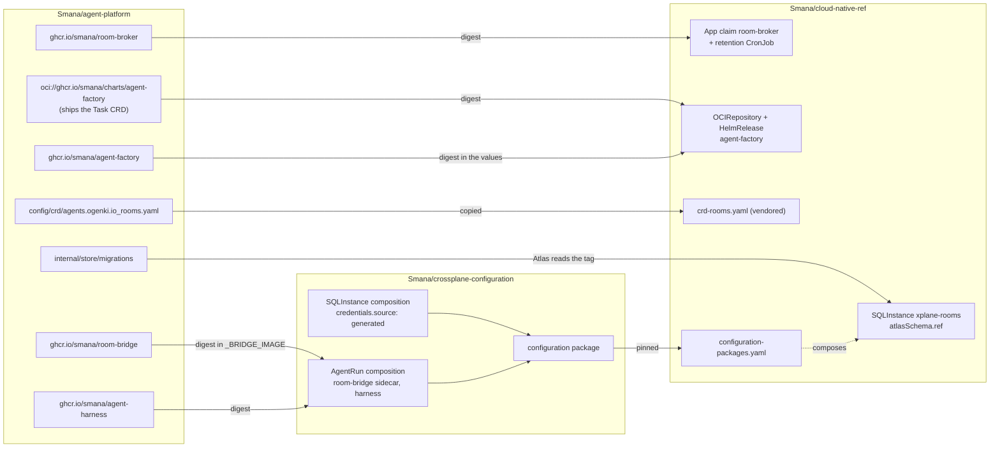

# Integration

This repository ships four images (`room-broker`, `room-bridge`, `agent-factory`, `agent-harness`),
the `agent-factory` chart, `roomctl`, two CRDs (`Room`, `Task`) and the log's migrations.
[cloud-native-ref](https://github.com/Smana/cloud-native-ref) deploys the broker, the factory chart,
the databases, the CRDs and the policies; [crossplane-configuration](https://github.com/Smana/crossplane-configuration)
adds the bridge to every `AgentRun` that names a room. Each consumer pins a build by digest: a
release, or a PR pre-release for an integration branch.

## What each repository carries

### cloud-native-ref

| Area | Carries |
|---|---|
| Rooms | The vendored `Room` CRD and its schema in the validation catalog; the broker's `App` claim, config, RBAC and CNP; two broker replicas; the retention CronJob; `Certificate room-broker-tls` and `ExternalSecret room-broker-ca`; `task agent:run -- --room` |
| Log database | `SQLInstance xplane-rooms` with generated credentials, its CNPG network policy and the log's recovery seed |
| Humans | ZITADEL roles `agents-admin`, `agents-member`, the `rooms-proxy` client and the `roomctl` native app; oauth2-proxy (bearer tokens accepted for `roomctl`); the `HTTPRoute` on the Tailscale Gateway |
| Agents | The `room-broker` backend on both MCPRoutes with its key and CNP; the factory App's key; egress to `api.github.com` |
| Factory | The `agent-factory` `OCIRepository` (`flux/sources/ocirepo-agent-factory.yaml`, cosign-verified) and `HelmRelease` with its values (`tooling/base/agent-factory/`) |
| Observability | The `VMServiceScrape` and the `VMRule`s, `RoomVerdictsNotReachingGitHub` and `RoomApprovalPendingTooLong` among them |
| Design records | ADR-0044 (session protocol), ADR-0049 (room client and human auth) |

Every child added to `clusters/aws-0-agent-platform/` has its twin in
`clusters/gcp-0-agent-platform/`. The whole set sits in the `agent-platform` Flux umbrella,
suspended by default.

### crossplane-configuration

| Area | Carries |
|---|---|
| `SQLInstance` | `spec.credentials.source: store \| generated` (default `store`) and login roles that own no database. In `generated` mode, a `Password` generator and an `ExternalSecret` per role, `refreshPolicy: CreatedOnce`, keys `username`, `password`, `uri`. It yields `xplane-rooms-cnpg-rooms` (owner), `xplane-rooms-cnpg-role-rooms-broker` and `xplane-rooms-cnpg-role-rooms-retention` |
| `AgentRun`, with `roomRef` | The `room-bridge` native sidecar after `identity-proxy`, and its [gate](#the-gate); a `room-token` projected volume (audience `room-broker`, 600 s) mounted by the bridge alone; the `room-broker-ca` mount; kubelet ingress on 8085; the constant `_BRIDGE_IMAGE`; `BRANCH` for the bridge |
| `AgentRun`, the harness | The room rules in the agent's `rules.md`; `ROOM_ID` and `TASK_URL` for the harness; the `agent-harness` pin that stamps the PR footer |

## Pins

| Consumer | Pins | From | Named |
|---|---|---|---|
| cloud-native-ref `infrastructure/base/room-broker/app.yaml` and `retention-cronjob.yaml` | The broker image, same digest in both | This repo's release | `v0.11.0@sha256:…` |
| cloud-native-ref `crd-rooms.yaml` | The `Room` CRD | `config/crd/`, or `crd-rooms.yaml` on the release; re-copied with every broker pin | — |
| cloud-native-ref `sqlinstance.yaml` `atlasSchema.ref` | The migrations | The broker image's release tag, so schema and binary match | `v0.11.0` |
| cloud-native-ref `flux/sources/ocirepo-agent-factory.yaml` | The factory chart, with the `Task` CRD | `oci://ghcr.io/smana/charts/agent-factory` | `0.11.0` plus its digest |
| cloud-native-ref `tooling/base/agent-factory/helm-values-configmap.yaml` `image.tag` | The factory image | This repo's release | `v0.11.0@sha256:…` |
| crossplane-configuration `apis/agentrun/kcl/main.k` `_BRIDGE_IMAGE` | The bridge image | This repo's release | `v0.11.0@sha256:…` |
| crossplane-configuration, the `AgentRun` composition | The harness image | This repo's release | `v0.11.0@sha256:…` |
| cloud-native-ref `configuration-packages.yaml` | The composition package | crossplane-configuration's release | Its release tag; a PR pre-release is `v<x.y.z>-pr<N>.<sha7>`, `<sha7>` = the PR's **synthetic merge commit**: copy it from the CI summary, never derive it |

For an integration branch, a PR of this repository publishes a pre-release of every image,
`v<next patch>-pr<N>.<sha8>@sha256:…`, and of the chart, `<next patch>-pr<N>.g<sha8>`, `<sha8>` the
PR head ([`ci.yaml`](../.github/workflows/ci.yaml)).

Rules that keep pins honest:

- **Digest, never tag alone.** Read the digest with
  `skopeo inspect --raw docker://<ref> | sha256sum`, or copy it from the CI job summary.
- **Verify before pinning**: [security](security.md#supply-chain) gives the cosign command.
- **Re-vendor the CRD and move `atlasSchema.ref` with every broker pin**, so the three never drift.
  The composition resolves a `v*` ref as a tag and anything else as a branch; this repository
  deletes a branch on merge, so a branch ref 404s once its PR merges.
- **Crossplane never upgrades an installed package dependency.** During a live check, patch the core
  package to the same pre-release by hand.

## Contracts

### The broker's configuration

One file, `ROOMS_CONFIG` (a ConfigMap, Flux-substituted). Parsing is strict: an unknown key or a
`subPattern` without exactly one capture group fails the rollout, not the first request. The broker
reads it once at start, so restart it after a change. A machine issuer whose JWKS the broker cannot
fetch at start fails the rollout too; the `human` issuer does not: until it answers, humans get
`401` and agents are unaffected.

| Key | Meaning |
|---|---|
| `publicURL` | `https://rooms.<private domain>`, used in links |
| `runIssuers[]` | `{issuer, jwksURL, subPattern}`. The cluster's OIDC issuer today; its JWKS URI is per cloud (`<issuer>/keys` on EKS, `<issuer>/jwks` on GKE) |
| `systemIssuer` | `{issuer, jwksURL}` for `rooms-system` tokens |
| `systemPrincipals` | `{: <principal>}`, e.g. `system:serviceaccount:agent-system:agent-factory: system:factory` |
| `human` | `{issuer, jwksURL, clientIDFile, roomctlClientIDFile, projectIDFile, origin, groups: {admin, member}}`. The ids are files read at use, because ZITADEL mints new ones on every build; the group names are literals |
| `human.access` | `{readerFile, ttl}`: room visibility follows GitHub ([room access](security.md#identities)). `readerFile` is the ZITADEL link reader's mounted secret, JSON `{"pat", "tokenId", "githubIdpId"}`, read at use; the PAT goes to `human.issuer`, which must then be `https://`. `ttl` caches each answer, default and maximum `5m`. Needs `ROOMS_GITHUB_APP_DIR`, or the broker refuses to start. Unset: only `agents-admin` sees rooms |
| `factoryURL` | The factory's run API, plaintext on the factory Service's `api` port: `http://agent-factory.agent-system.svc:8082`. It moves with the factory chart's port and its `api.listen`. Unset: `start_run` returns a manifest for the owner to apply |
| `tls` | `{certFile, keyFile}` of `:8443`; default `/etc/room-broker/tls/tls.{crt,key}`. Re-read when they change |

| Broker environment | Meaning |
|---|---|
| `ROOMS_CONFIG` | Path of the config file |
| `ROOMS_DATABASE_URL` | The `uri` of `xplane-rooms-cnpg-role-rooms-broker` (the retention job: `…-rooms-retention`) |
| `POD_NAMESPACE` | Where Rooms and the leader lease live |
| `LOG_FORMAT`, `LOG_LEVEL` | `json`, `info` (defaults); `text` and `debug` locally |
| `ROOMS_MCP_KEY` | The key the MCPRoute injects. Unset: `:8090` refuses every call |
| `ROOMS_GITHUB_APP_DIR` | The factory App's key volume (`app_id`, `private_key`; optional, `defaultMode: 0440` with the pod's `fsGroup`). Unset: no verdict is posted. Set but empty: verdicts wait, up to 24 h, for the key, and room access checks fail closed. Room access reads `GET /user/{id}` and `GET /repos/{o}/{r}/collaborators/{login}/permission` with it (`metadata: read`) |

### The bridge's environment

Set by the `AgentRun` composition.

| Variable | Value |
|---|---|
| `ROOM_ID`, `RUN_ID` | The run's `roomRef` and id |
| `CONVERSATION_ID` | The harness conversation: the `AgentRun`'s uid |
| `BROKER_URL` | `https://room-broker.agent-system.svc.cluster.local:8443` |
| `BROKER_CA_FILE` | `/etc/room-broker-ca/ca.crt` |
| `HARNESS_URL` | `http://127.0.0.1:8000` |
| `ROOM_TOKEN_FILE` | `/var/run/secrets/agents/room/token` |
| `EGRESS_PROFILES` | The run's egress profiles, comma-separated. The classifier reads them: a package install outside them is `egress.new` |
| `HEALTH_ADDR` | `:8085` (default): `/healthz` for kubelet only, and `POST /final-read` for the harness on loopback: the bridge reads the harness log to its end and mirrors it, then answers `{"events","unmirrored","sealed"}` within 3 s (`504` past it). `agent-run` calls it on SIGTERM before it stops agent-server. The bridge serves no metrics; the broker counts its stalls and stubs |
| `LOG_FORMAT`, `LOG_LEVEL` | `json`, `info` (defaults); `text` and `debug` locally |
| `FLUSH_GRACE` | How long the SIGTERM drain may take; `25s` (default), at most `28s`. Set it lower when the harness uses much of the pod's 30 s grace: the kubelet signals the sidecar only after the harness exits |
| `GOMEMLIMIT` | Unset: the binary sets `48MiB`, the soft heap limit its buffer budget is sized for inside the 64 Mi limit. A pod spec may set its own |
| `BRANCH` | The run's branch: the one push that is `forge.push`. Unset, every push is `forge.other` |
| `MCP_READ_ONLY_TOOLS` | The MCP tools that only read, comma-separated `<server>__<tool>` names (a tool the gateway calls `<server>_<tool>`, as agentgateway does, matches the same entry); the classifier lets them through as plain, and every other MCP tool is `mcp.write`. Unset, every MCP tool is `mcp.write`, the room tools included (fail closed), and the bridge logs a `WARN` at start. Set it in the composition before a bridge that reads it rolls out: an older bridge ignores it, a newer one without it classes every room tool call `mcp.write`, which an attended room sends to an approver and an unattended one denies |

The list the bridge carried built in before `MCP_READ_ONLY_TOOLS` existed, which the composition sets:

- `flux-operator-mcp`: `search_flux_docs`, `get_flux_instance`, `get_kubernetes_api_versions`, `get_kubernetes_resources`, `get_kubernetes_metrics`, `get_kubernetes_logs`
- `mcp-victoriametrics`: `documentation`, `query`, `query_range`, `metrics`, `metrics_metadata`, `labels`, `label_values`, `series`, `alerts`, `rules`, `explain_query`, `prettify_query`, `metric_statistics`, `tsdb_status`, `active_queries`, `top_queries`
- `mcp-victorialogs`: `documentation`, `query`, `hits`, `facets`, `field_names`, `field_values`, `stats_query`, `stats_query_range`, `streams`, `stream_ids`, `stream_field_names`, `stream_field_values`, `flags`
- `room-broker`: `room_read`, `room_post`, `room_progress`, `room_handoff`, `room_verdict` (the room tools only append to the room)

A name matches on its last `<server>__<tool>` pair, so a prefix the harness adds cannot hide the server.

Resources: requests 20m / 32Mi, limits 100m / 64Mi; read-only root filesystem, all capabilities
dropped.

### The gate

The composition adds `room-bridge gate`, the same image with the argument
`gate`, as a plain init container after the bridge and before the harness. It reads the bridge's
`/admission` on `127.0.0.1` at `HEALTH_ADDR`'s port, exits 0 once the bridge holds the room, and
exits 1 once the room refuses the run. The pod's `restartPolicy: Never` then fails the run before
the harness starts. Without the gate the lease only holds the log: a refused run still executes,
unrecorded, on the room's shared branch.

### What the broker reads from `AgentRun`

`spec.roomRef` (immutable), `spec.role`, `spec.principal`, `spec.branch`, `spec.budget.maxMinutes`,
`spec.dataClass`, `spec.egress.profiles`, `spec.repository`, `status.phase`, `status.startedAt`, the
annotation `agents.ogenki.io/revoked`, and `metadata.uid`. The run's CNP already opens egress to
`room-broker` on 8443, and DNS for its name, when `roomRef` is set.

### What the factory gets

| Contract | Where |
|---|---|
| Create a room | Create a `Room` CR with `spec.owner` and `spec.driver: system:factory` and the required `spec.dataClass` ([fields](concepts.md#reference-the-room-crd)) |
| Read a room | `GET /v1/rooms/{id}/events` on `:8443`, audience `rooms-system` ([API](api.md#get-v1roomsidevents)) |
| Report task state | `POST /v1/rooms/{id}/messages`, `kind: task_state` |
| Report task facts | `POST /v1/rooms/{id}/task`: phase, run, budget, issue and PR as `state_changed{kind: task}`, which the room summary and `Room.status.task` read ([API](api.md#post-v1roomsidtask)) |
| Queue a message for the next run | `POST /v1/rooms/{id}/queue`, listed by `GET` and consumed by `POST …/queue/consume` ([API](api.md#the-queue-routes)) |
| Verdicts and handoffs | `message{kind: review_verdict}` and `handoff` in the log; the verdict comment is the broker's, the factory never posts it again |
| Who drives | `Room.status.driver` and `driverEpoch`: the factory never advances a room while a `human:` holds the token |
| Run requests | `POST {factoryURL}/v1/runs` on the factory's `:8082` (plaintext) with `{role, repository, baseRef, task, dataClass, roomRef, egressProfiles?}`, the human's own access token as `Authorization: Bearer` (never an asserted `sub`), and `Idempotency-Key: <roomId>:<originClient>:<originSeq>`, the act's own key. The broker requests the run, then records it, so a client retrying a failed record sends the same key and gets the same run; a request without a key is refused before the call (`internal/runrequest`). How the factory answers a key, a replay and a refusal: [the factory's API](factory.md#the-factorys-api) |

### Starting a run in a room without the factory

With `factoryURL` unset, `start_run` returns the `AgentRun` claim for the owner to apply; its run id
is derived from the act's idempotency key alone (sha256), so applying a retry's claim twice makes
one run (`internal/runrequest`).

`task agent:run -- --room <roomId>` (cloud-native-ref) sets `spec.roomRef` and defaults
`spec.branch` to `agent/<roomId>`, since a human room's runs share one branch. An explicit
`--branch` wins; a room id that is not a valid room id is refused.
