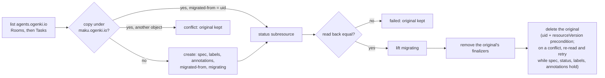

# Moving to the maku.ogenki.io group (v0.31.0)

v0.31.0 serves `Room`, `Task` and the quickstart's `AgentRun` under `maku.ogenki.io` only. Kubernetes
cannot serve one kind under two groups, so every live `Room` and `Task` is **copied** to the new group
by `maku-broker migrate-group`, once, in a quiet window. A room's log stays in Postgres under the
room's name, which the copy keeps: no event moves. Label and annotation keys keep their
`agents.ogenki.io/` prefix (other repositories select on them), and so does the factory's lease.

v0.31.0 also serves only the `maku_rooms_*` and `maku_factory_*` metric names, the broker-served
bridge counters `maku_rooms_bridge_*` included (the bridge itself serves no metrics). Dashboards and
rules must read those before the upgrade, and a config that still sets `metrics.makuNames` is
refused at startup: delete the key.

## How a copy is made



- Without `--apply` nothing is written: each object is listed as `would-copy` or `would-resume`.
- `maku.ogenki.io/migrating` keeps the Room controller and the factory off a copy until its status is
  written.
- Each object is reported on its own line; the command exits non-zero if any object conflicted or
  failed, and the original of every such object is kept.
- A re-run finishes what an earlier run left and finds nothing once every original is gone.
- `--from` and `--to` swapped moves everything back: that is the rollback once `--apply` has run,
  with the v0.31.0 controllers stopped first ([step 4](#4-dry-run-then-apply)).
- `AgentRun`s are not moved. The window has none active; a finished quickstart run goes with the old
  CRD at the end.

### The command

```text
maku-broker migrate-group --from <group> --to <group> [--namespace <ns>] [--apply]
```

It reads the cluster from `KUBECONFIG` only: one file with exactly one context. It never falls back
to `~/.kube/config` or to in-cluster credentials, and nothing goes on argv. Its lines go to stdout
(`LOG_FORMAT=text` for a terminal):

| Line | Carries |
|---|---|
| First, before any read | `msg="migrate-group target" context=<ctx> host=<API server host:port> apply=<true\|false>` |
| One per object | `msg=migrate-group kind=<Room\|Task> namespace=<ns> name=<name> outcome=<outcome>`, at `ERROR` with `err=` for `conflict` and `failed` |
| Last | `msg="migrate-group done" context= host= from= to= apply= migrated= resumed= wouldCopy= wouldResume= conflicts= failed=` |

Outcomes: `would-copy` and `would-resume` (dry run), `migrated` and `resumed` (`--apply`), `conflict`,
`failed`, and `not-served` for a kind the source group does not serve.

| Exit | When |
|---|---|
| `0` | every object `migrated`, `resumed`, `would-copy`, `would-resume` or `not-served` |
| `1` | any `conflict` or `failed` (`maku-broker migrate-group: N conflicts, M failed (above)`), or a refusal before anything is read: a bad flag or stray argument, invalid or equal groups, `KUBECONFIG is not set`, `KUBECONFIG names more than one file`, `kubeconfig <path> has N contexts`, or a kubeconfig that cannot be loaded |
| `2` | the logger could not be built (a bad `LOG_FORMAT` or `LOG_LEVEL`) |

## Before the window

Every command names the cluster: `CTX` is its kubeconfig context, and `K="kubectl --context $CTX"`.
Run the checks on each cluster.

| Check | Command | Expected |
|---|---|---|
| Dashboards and rules read `maku_*` only | `count(maku_rooms_build_info)` over `[24h]` in your metrics store | non-zero for 24 h |
| No open task | `$K get tasks.agents.ogenki.io -n agent-system -o json \| jq '[.items[] \| select(.status.phase as $p \| ["Rejected","NoOp","Done","Reverted","Closed","Stopped"] \| index($p) \| not)] \| length'` | `0`, or you accept that the kill switch ends each `Stopped` |
| The v0.31.0 pins are ready, not merged | your GitOps pull request | green |
| A binary from the tag | `git worktree add "$SCRATCH/maku-v0.31.0" v0.31.0 && (cd "$SCRATCH/maku-v0.31.0" && go build -o "$SCRATCH/maku-broker" ./cmd/maku-broker)` | `$SCRATCH/maku-broker` |
| A one-context kubeconfig | `kubectl config view --minify --flatten --context "$CTX" > "$SCRATCH/$CTX.kubeconfig" && chmod 600 "$SCRATCH/$CTX.kubeconfig"` | a file with one context, named `$CTX` |
| No `metrics.makuNames` in either config | `$K -n agent-system get configmap room-broker-config -o yaml \| grep -c makuNames`, and the factory's values in your GitOps tree | `0`; otherwise the pin pull request deletes it, since v0.31.0 refuses the key at startup |
| What owns the broker and the factory | your GitOps tree; on ai-native-ref: the Flux Kustomization `room-broker` (`flux-system`) ships the `App` `room-broker` (`apps.cloud.ogenki.io`, `agent-system`), which renders the Deployment; the `HelmRelease` `agent-factory` (`agent-system`) renders the factory | what [step 4's rollback](#4-dry-run-then-apply) pauses |

`$SCRATCH` is a private temporary directory (`mktemp -d`); delete it after the window. The
kubeconfig is a file, never a flag.

Inside the window, always name the group (`rooms.maku.ogenki.io`, `tasks.agents.ogenki.io`): while both
CRDs exist, `kubectl get rooms` picks one of them.

## The window

Run every step on each cluster, with `CTX` and `K` as above.

### 1. Engage the kill switch

```bash
$K create configmap agent-factory-stop -n agent-system
```

Every open task ends `Stopped`, every live run is revoked and deleted within 15 s, and intake answers
`503`. **Rollback:** `$K delete configmap agent-factory-stop -n agent-system`.

### 2. Wait for zero active runs

```bash
until [ "$($K get agentruns.cloud.ogenki.io -n agents -o json | jq '[.items[] | select((.status.phase // "") as $p | ["Succeeded","Failed","BudgetExhausted","Revoked"] | index($p) | not)] | length')" = 0 ]; do sleep 10; done
```

On the quickstart, use `agentruns.agents.ogenki.io`. Nothing is written. **Rollback:** step 1's.

### 3. Pin v0.31.0

Merge the pins, in one pull request:

- the factory chart and image; the chart's `Role` `agent-factory` moves to `maku.ogenki.io` with it;
- the broker's image (Deployment and retention job);
- the broker's RBAC, wherever the deployment keeps it (on ai-native-ref,
  `infrastructure/base/room-broker/rbac.yaml`, shipped by the Kustomization `room-broker`): the
  `Role` `room-broker` grants `rooms` (`get, list, watch, create, update`), `rooms/status` (`patch`)
  and `rooms/finalizers` (`update`) on **both** `agents.ogenki.io` and `maku.ogenki.io` until the old
  CRDs go, so a pin revert needs no RBAC change. Without the new group the v0.31.0 broker's informer
  is forbidden, its rollout can still complete, and no controller would own the copies;
- `metrics.makuNames` deleted from the broker's config and the factory's values, if either still
  sets it;
- the v0.31.0 Room CRD (`crd-rooms.yaml`, `rooms.maku.ogenki.io`) **added beside** the vendored old one,
never in its place: a CRD Flux stops shipping is pruned, and deleting a CRD deletes every `Room`
under it. The factory's `HelmRelease` (`crds: CreateReplace`) creates `tasks.maku.ogenki.io` and
leaves `tasks.agents.ogenki.io` in place. Wait for the rollout, then check what each identity may do:

```bash
$K get crd rooms.maku.ogenki.io tasks.maku.ogenki.io rooms.agents.ogenki.io tasks.agents.ogenki.io
$K -n agent-system rollout status deploy/room-broker --timeout=10m
$K -n agent-system rollout status deploy/agent-factory --timeout=10m
$K -n agent-system get deploy room-broker agent-factory -o jsonpath='{range .items[*]}{.spec.template.spec.containers[0].image}{"\n"}{end}'
B=system:serviceaccount:agent-system:room-broker F=system:serviceaccount:agent-system:agent-factory
$K auth can-i list rooms.maku.ogenki.io --as=$B -n agent-system
$K auth can-i patch rooms.maku.ogenki.io --subresource=status --as=$B -n agent-system
$K auth can-i update rooms.maku.ogenki.io --subresource=finalizers --as=$B -n agent-system
$K auth can-i list tasks.maku.ogenki.io --as=$F -n agent-system
$K auth can-i update tasks.maku.ogenki.io --subresource=status --as=$F -n agent-system
```

Expected: four CRDs, both rollouts complete, both images `…:v0.31.0@sha256:…`, and `yes` five times. No v0.30.x pod may be
left: an old broker would act on the originals as they are released. With a plain `helm upgrade`,
apply the CRDs first, since Helm never installs `crds/` on upgrade:
`helm show crds oci://ghcr.io/smana/charts/maku --version 0.31.0 | $K apply --server-side -f -`, and the
same for `maku-factory`.

The v0.31.0 controllers watch `maku.ogenki.io` only, so they leave the originals alone: the forward
run in step 4 has nothing to race, and the v0.30.x pods that watched `agents.ogenki.io` are gone
once the rollout completes.

**Rollback:** revert the pins. The v0.30.x pods return, and the empty `maku.ogenki.io` CRDs are
harmless. Once step 4's `--apply` has run, follow step 4's rollback instead.

### 4. Dry run, then apply

```bash
export KUBECONFIG="$SCRATCH/$CTX.kubeconfig" LOG_FORMAT=text
$SCRATCH/maku-broker migrate-group --from agents.ogenki.io --to maku.ogenki.io | tee "$SCRATCH/$CTX-dry.txt"
```

Read the first line before anything else: `msg="migrate-group target" context=$CTX host=<this cluster's
API server> apply=false`. A different context or host means the wrong file: stop. Then one
`outcome=would-copy` line per Room and Task, no `conflict`, no `not-served` (the old CRDs still
exist, so a `not-served` line means the wrong cluster or a pruned CRD: stop), and the totals line. Record the counts
(`wouldCopy=`, `wouldResume=`). Then:

```bash
$SCRATCH/maku-broker migrate-group --from agents.ogenki.io --to maku.ogenki.io --apply | tee "$SCRATCH/$CTX-apply.txt"
echo "exit=${PIPESTATUS[0]}"
```

Expected: the first line again names `$CTX` and the same host, with `apply=true`; `migrated=` plus
`resumed=` equals the dry run's `wouldCopy=` plus `wouldResume=`, `conflicts=0 failed=0`, `exit=0`. A
`failed` line names the object and the error; its original is kept. Fix the cause and run `--apply`
again: the re-run resumes what the first left.

**Rollback:** the reverse run, with the v0.31.0 controllers **stopped first**. v0.31.0 watches
`maku.ogenki.io`, the reverse run's `--from`: a running Room controller re-adds the
`maku.ogenki.io/room-log` finalizer as soon as the run removes it, and the factory reconciles the
Tasks, so the guarded deletes conflict. The run re-reads and retries a conflicted delete a few
times, while the original's spec, status, labels and annotations are still those it copied; a
controller that keeps writing outlasts the retries, and its objects end `failed`. The code has no pause
switch: pause what owns each Deployment, so nothing scales it back, then scale both to zero and
check that they stay there. On ai-native-ref:

```bash
flux --context "$CTX" suspend kustomization room-broker -n flux-system
flux --context "$CTX" suspend helmrelease agent-factory -n agent-system
$K -n agent-system annotate apps.cloud.ogenki.io room-broker crossplane.io/paused=true
$K -n agent-system scale deploy/room-broker deploy/agent-factory --replicas=0
zero() { $K -n agent-system get deploy room-broker agent-factory -o json |
  jq -e 'all(.items[]; .spec.replicas == 0 and (.status.replicas // 0) == 0 and (.status.readyReplicas // 0) == 0)' >/dev/null; }
until zero; do sleep 5; done
for d in room-broker agent-factory; do   # zero reads Deployment status; also wait out pods in their grace period
  sel=$($K -n agent-system get deploy "$d" -o go-template='{{range $k, $v := .spec.selector.matchLabels}}{{$k}}={{$v}},{{end}}')
  $K -n agent-system wait --for=delete pod -l "${sel%,}" --timeout=2m
done
```

The `App` is a Crossplane v2 namespaced composite that renders the Deployment itself, so pausing it
holds `replicas: 0`. Where the `App` is a claim (Crossplane v1), pause its composite too: `$K
annotate <kind>.cloud.ogenki.io "$($K -n agent-system get apps.cloud.ogenki.io room-broker -o
jsonpath='{.spec.resourceRef.name}')" crossplane.io/paused=true`, with the kind from
`spec.resourceRef.kind`. Wait a minute, run `zero` once more, then the reverse run:

```bash
zero && $SCRATCH/maku-broker migrate-group --from maku.ogenki.io --to agents.ogenki.io                     # dry run: read it
zero && $SCRATCH/maku-broker migrate-group --from maku.ogenki.io --to agents.ogenki.io --apply
$SCRATCH/maku-broker migrate-group --from maku.ogenki.io --to agents.ogenki.io                             # wouldCopy=0 wouldResume=0, no not-served
```

Then merge the pin revert, and only then lift the pauses, so Flux applies v0.30.x rather than
v0.31.0 again. Resume the Kustomization first and wait for it to be Ready: until Flux has applied the
revert, the `App` still names the v0.31.0 image, and unpausing it would bring a v0.31.0 broker back.
Flux's server-side apply leaves the `paused` annotation alone, so the `App` stays paused meanwhile:

```bash
flux --context "$CTX" resume kustomization room-broker -n flux-system     # waits until Ready
flux --context "$CTX" resume helmrelease agent-factory -n agent-system
$K -n agent-system annotate apps.cloud.ogenki.io room-broker crossplane.io/paused-
```

The v0.30.x pods return at their replica counts and take the originals back. The room pages and the
factory are down from the scale-down until then. Never `kubectl delete rooms.maku.ogenki.io` while
v0.31.0 runs: its finalizer seals the room's log.

### 5. Verify

| Check | Command | Expected |
|---|---|---|
| Nothing left to move | `$SCRATCH/maku-broker migrate-group --from agents.ogenki.io --to maku.ogenki.io` | `wouldCopy=0 wouldResume=0`, no `outcome=not-served` line, exit 0 |
| Rooms and Tasks under the new group | `$K get rooms.maku.ogenki.io,tasks.maku.ogenki.io -A --no-headers \| wc -l` | the dry run's count |
| No copy still guarded | `$K get rooms.maku.ogenki.io,tasks.maku.ogenki.io -A -o json \| jq '[.items[] \| select(.metadata.annotations["maku.ogenki.io/migrating"])] \| length'` | `0` |
| Every room page loads | open three rooms, a closed one included, at `https://rooms.<domain>/r/<id>` | the transcript, in full |
| The CLI answers | `maku status <room>` | the room's summary |
| The logs did not move | `SELECT count(*), max(seq) FROM events` ([SQL](operations.md#reading-the-log-with-sql)), before step 4 and now | equal |

**Rollback:** step 4's.

### 6. Release the kill switch

```bash
$K delete configmap agent-factory-stop -n agent-system
```

If the control issue engaged it, remove `factory/stop` there instead. **Rollback:** step 1's.

### 7. A test task end to end

Label a throwaway issue for the factory and watch it reach `Done`: a room, a run, a pull request. It
runs after the release because the kill switch stops every task. **Rollback:** engage the kill
switch, then step 4's.

## A day later: the old CRDs go

Delete them only once a fresh dry run (step 5's first check) finds nothing on every cluster:
`wouldCopy=0 wouldResume=0` and no `not-served` line. Deleting a CRD deletes every object still under it, and an object
carrying the old finalizer would hold the CRD's deletion forever.

```bash
$K get rooms.agents.ogenki.io,tasks.agents.ogenki.io -A --no-headers | wc -l        # 0
$K delete crd tasks.agents.ogenki.io                                              # Helm never deletes a chart's CRD
```

The Room CRD goes when your GitOps repository stops shipping it (Flux prunes it); with Helm alone,
`$K delete crd rooms.agents.ogenki.io agentruns.agents.ogenki.io`. Finished quickstart AgentRuns, and
their pods, go with it.

**Rollback after this point:** re-apply the old CRDs from v0.30.x
(`gh release download v0.30.0 -R Smana/maku -p crd-rooms.yaml -p crd-agentruns.yaml` and
`helm show crds oci://ghcr.io/smana/charts/maku-factory --version 0.30.0`, each through
`$K apply --server-side -f`), then engage the kill switch and follow step 4's rollback.
