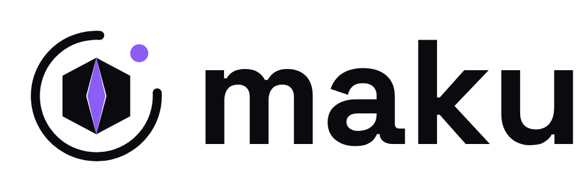

# Maku

**Maku is the selected product name, chosen 2026-10-27.** It is the Japanese word 幕 (まく, *maku*),
spelled in practical ASCII as `Maku`, and as `maku` where a command or a package name is wanted.

Maku — a controlled stage for delegated agent work.

This page records the name and the reasoning behind it. Repository, package, image, API and other
technical renames are separate work: nothing in the codebase changes because of this page.

## What the word means

幕 literally means a curtain; by extension it is also a tent or a screen. In the theatre the curtain
opens and closes the performance, and Japanese uses the everyday pair 開幕 (*kaimaku*, opening) and
閉幕 (*heimaku*, closing) for exactly that moment.

Maku does **not** literally mean room, security, control, delegation or audit. The product story
below is a metaphor, not a translation of the word.

Historical aside, deliberately kept out of the brand: 陣幕 (*jinmaku*) were the curtains around a
commander's field enclosure, and 幕府 (*bakufu*) carries the same encampment association. Samurai and
shogunate imagery is not part of the identity.

## Why the name fits the product

The promise is confident delegation, for developers, platform teams and security teams alike. One
task runs the whole way through: a maintainer delegates an issue; an agent works in an isolated
Kubernetes environment; humans watch and steer; a durable room keeps the run and its history; policy
decides what may leave and what may merge; and autonomy widens only as trust is earned.

| Product moment | The controlled-stage metaphor |
|---|---|
| A run starts | The curtain rises on a run |
| Execution | The agent performs, but only inside a deliberately bounded environment |
| Supervision | Humans watch and can step in — they are neither locked inside nor shut outside |
| Completion | The curtain falls; the room becomes a sealed, durable record |
| Merge | Only the work policy allows leaves the controlled space |

The intuition behind the earlier "room" language survives intact: a bounded operational space where
actions are controlled and observable. Maku expresses that as a stage — a defined performance space,
a run that is visible while it happens, and an opening and a closing you choose. It is not a literal
translation of *room*, and it carries no franchise reference, affiliation, endorsement or homage.

The technical truth is separate from the metaphor, and the metaphor never replaces it: the real
guarantees come from the sandbox, explicit capabilities, budgets, identities, policy and the merge
gate — not from the name, nor from the interface.

## Why it works as an open-source brand

- Short, ASCII-safe and CLI-friendly: `maku` is easy to type, say and search.
- Visually evocative, and it gives us opening/closing/stage vocabulary without displacing precise
  terms such as *room* and *merge gate*.
- Memorable for an international audience while remaining a genuine Japanese word.
- It points at controlled work that stays observable — not at surveillance, and not at unrestricted
  autonomy.

## Naming trade-offs accepted at selection

Recorded 2026-10-27. This is a collision screen, not legal clearance.

- **MAKU is an existing product.** [maku.net](https://maku.net) and
  [github.com/makunet](https://github.com/makunet) are an active Apache-2.0 Java/Vue low-code
  developer platform. It lives in a different ecosystem, so the risk is moderate discoverability
  confusion rather than direct competition.
- **Package names are partly taken.** [npm `maku`](https://www.npmjs.com/package/maku) is a dormant
  CLI package; [`maku` on crates.io](https://crates.io/crates/maku) is an active small 2D danmaku
  pattern-language crate. Exact natural names are therefore not all available.
- **Namespaces may need a compound.** Some GitHub user and organisation paths and some registries
  will require a qualified name. No availability is claimed here.
- **Generic search noise.** Non-technical Finnish uses such as food and taste share the string and
  will affect generic search results.
- **Still to do before a broad public launch:** a native-speaker nuance review, and formal
  trademark, domain and namespace checks. These are separate from the choice of name itself.

## Brand guardrails

- Do not claim that Maku literally means a controlled space.
- Do not use anime or other franchise references.
- Do not let theatrical wording stand in for exact security documentation.
- Keep the core story about delegation, supervision, evidence and graduated autonomy.

## Visual identity

The authoritative kit lives in [`assets/brand/`](assets/brand/README.md): source marks, PNG exports,
favicons and a social preview. Use those files as supplied; do not redraw or recolour them.

<picture>
  <source media="(prefers-color-scheme: dark)" srcset="assets/brand/png/maku-lockup-horizontal-dark.png">
  
</picture>

The web UI does not use this raster lockup: it draws the SVG mark next to real `maku` text.

### The mark

The Orbit hex is a split hexagon (the bounded stage) with a violet core (the run), inside a broken
orbit ring with a satellite dot at the opening. It is a visual metaphor like the rest of the name,
not a statement about guarantees.

- Do not rotate the mark; the orbit gap always sits top-right.
- Clearspace: at least half the mark's width on every side.
- Use the `dark` mark on Ink or Surface, and the `light` mark on Paper or white.
- Never recolour the core except in mono contexts.
- Below 24 px use the heavier-stroke `favicon/` versions, not the regular mark.

### Palette

| Token | Hex | Use |
|---|---|---|
| Ink | `#0A0A0F` | primary dark background |
| Surface | `#14141C` | cards and panels on Ink |
| Paper | `#F3F2FA` | light background; the mark on dark |
| Core | `#8B5CF6` | accent: the mark and decorative accents |
| Muted | `#9B9AAE` | secondary text on Ink |

Core is for the mark and decorative accents, not normal text on Paper or Surface. Muted is for
secondary text on Ink only, never on a light theme.

### Type

Wordmark: Space Grotesk 700, lowercase `maku`, tracking −3%. Body: Space Grotesk 400 for message prose, 500 for the UI chrome, or system sans.
