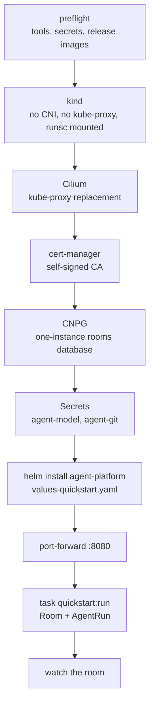

# Quickstart

**One command builds a local cluster and runs a sandboxed agent in a room, on a laptop, without
cloud-native-ref.** Read [what differs from production](#what-differs-from-production) before you
trust it with anything: the guarantees the README promises are not all there.

```bash
export MODEL_API_KEY=… GITHUB_TOKEN=… REPO=owner/throwaway
task quickstart                 # kind + Cilium + gVisor + cert-manager + CNPG + the chart
```

## Prerequisites

| Need | Detail |
|---|---|
| Platform | Linux with Docker (and the `buildx` plugin). macOS is untested (`sha512sum`, bash 3.2); Podman is untested. The live gVisor-in-kind proof is the `quickstart-e2e` CI job |
| Tools | `docker`, `kind`, `helm`, `kubectl`, `curl`, `git`, `openssl`, `envsubst`, `base32`, `yq` (mikefarah v4); `sha512sum` and `bzip2` for gVisor. `up.sh` checks the list first |
| `MODEL_API_KEY` | Anthropic by default; `MODEL` and `MODEL_BASE_URL` select any OpenAI-compatible endpoint, whose host joins the egress profile |
| `GITHUB_TOKEN`, `REPO` | A fine-grained PAT with Contents read/write on **one throwaway repository**, and that repository as `owner/name`. The repository needs a `main` branch with at least one commit |
| Images | The latest `Smana/agent-platform` release. From a `main` checkout, set `AP_VERSION` to a release whose images match the chart: until a release that contains the `agent-platform` chart and the run-controller image ships, the default fails at preflight. The GitHub API is rate-limited (60 requests/hour unauthenticated) |



The script is idempotent and pins every version it installs (`hack/quickstart/versions.env`); a second
`task quickstart` is a no-op. Cluster access is pinned to `.quickstart/kubeconfig`:
`export KUBECONFIG=$PWD/.quickstart/kubeconfig` in your own shell.

## Start a run

```bash
RUN_PROMPT='Fix a typo in the README' REPO=owner/throwaway task quickstart:run
```

Pass both variables in the environment, as above. `task … NAME=value` is wrong here: go-task runs
those values through Go templating (`{{ … }}` is mangled). `TASK` and `PROMPT` are not usable names:
go-task and zsh reserve them.

## Watch the room

```bash
export KUBECONFIG=$PWD/.quickstart/kubeconfig
kubectl -n agent-platform port-forward deploy/room-broker 8080:8080
```

Open exactly **http://localhost:8080**.

| Local mode | Consequence |
|---|---|
| The broker accepts only `publicURL`'s exact host | `127.0.0.1:8080` or another local port answers `403` |
| One user, `human:local`, admin and member | No login; the port-forward is the only way in |
| The web UI cannot start runs | Use `task quickstart:run` |
| `roomctl` is out of scope | Its setup endpoint shows placeholder ids |

## Tear down

`task quickstart:down` deletes the kind cluster.

## What differs from production

The README's guarantees link here. The room, the bridge, gVisor and default-deny egress are the
real thing; the rest is scaled down.

| Production (cloud-native-ref) | Quickstart |
|---|---|
| Model calls through the gateway, with a per-run token budget the agent cannot raise | Your API key is in the sandbox. No budget or meter: only `maxMinutes` |
| GitHub through octo-sts: a token scoped to the run, valid up to an hour | Your fine-grained PAT, valid until you revoke it. Scope it to one repository |
| ZITADEL login, roles, approvals by member | One local user, port-forward only |
| The Atlas operator migrates; TLS from OpenBao | The `migrate` init container; a self-signed CA |
| Agent `room_*` tools, warm sandboxes, suspend, Kueue, the factory | Absent |
| Each role gets a token scoped to what it may do (a reviewer cannot push) | Every role gets the same PAT, readable by the agent: the rules ("push only to your branch", "read-only") are instructions, not enforcement |
| The room, the bridge, gVisor, default-deny + FQDN egress | **Same** |

## Troubleshooting

| Symptom | Cause and fix |
|---|---|
| A run stays `Pending` | Read its `Ready` condition: `kubectl -n agents get agentrun <run> -o jsonpath='{.status.conditions}'`. `SecretMissing`: `agent-model` or `agent-git` is absent from `agents`. `CreateFailed`: the controller could not create the pod (read the condition message, then the controller's logs). `WaitingForGC`: an object of a previous run with the same name is still being garbage-collected; it clears by itself |
| A request from the agent times out | Egress is default-deny. `kubectl -n kube-system exec ds/cilium -- hubble observe --verdict DROPPED -n agents`, then widen the egress profile |
| Pods under gVisor have no network | gVisor needs Cilium's `socketLB.hostNamespaceOnly=true`; `up.sh` sets it. A hand-installed Cilium without it breaks run networking |
| `up.sh` fails at "release images" | No release holds the chart's images yet, or the API limit is hit. Set `AP_VERSION=<release tag>` |
| This machine cannot run gVisor | `ALLOW_UNSANDBOXED=1 task quickstart` runs agents under the default runtime. The environment is then **not sandboxed**: the agent's code runs as a plain container with your PAT and API key. Use it only on a machine you trust with that code. The controller sets the run's `Unsandboxed` condition, (no banner in the room yet) |
| `task quickstart:check` | Offline drift check of the scripts against the chart; no cluster needed |

## CI: `quickstart-e2e`

The job runs the whole path against a stub model. It needs two Actions secrets and skips without
them (fork PRs).

| Secret | Value |
|---|---|
| `QUICKSTART_REPO` | A throwaway `owner/name` with a `main` branch and at least one commit |
| `QUICKSTART_GITHUB_TOKEN` | A fine-grained PAT, Contents read/write on that repository |

For the chart's values and its caveats, see the [chart README](../charts/agent-platform/README.md).
