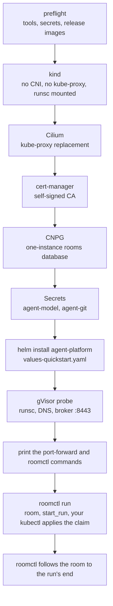

# Quickstart

**Two commands build a local cluster and run a sandboxed agent in a room, on a Linux machine with Docker,
without cloud-native-ref.** Until a release ships `roomctl run`, `task quickstart` needs `ROOMCTL=<path>`
or `AP_VERSION=<a release that has it>` (see the Images row below). Read [what differs from production](#what-differs-from-production) before you
trust it with anything: the guarantees the README promises are not all there.

```bash
export MODEL_API_KEY=… GITHUB_TOKEN=… REPO=owner/throwaway
task quickstart                 # kind + Cilium + gVisor + cert-manager + CNPG + the chart + roomctl
```

## Prerequisites

| Need | Detail |
|---|---|
| Platform | Linux with Docker (and the `buildx` plugin). `up.sh` stops on any other system and says why: gVisor in kind and a port-forward to a loopback-only listener are proven on Linux only (spike, 2026-10-27). Podman is untested |
| kubectl | Within one minor of the kind node (1.36-1.38 for 1.37): `up.sh` stops otherwise. `mise.toml` pins one: `mise install kubectl` |
| `LOCAL_PORT` | The port you forward to the broker, default 8080. The broker's `publicURL` follows it and it answers that port only, as `localhost`, `127.0.0.1` or `[::1]` |
| Tools | `docker`, `kind`, `helm`, `kubectl`, `curl`, `git`, `openssl`, `envsubst`, `yq` (mikefarah v4); `sha256sum` (roomctl), `sha512sum`, `bzip2` and `tar` (gVisor). `up.sh` stops at the first one missing |
| `MODEL_API_KEY` | Anthropic by default; `MODEL` and `MODEL_BASE_URL` select any OpenAI-compatible endpoint, whose host joins the egress profile. For an in-cluster model (`http://<svc>.<ns>.svc.<domain>:<port>`), the port must equal the Service's `targetPort`, and the run may then reach **every pod in the model's namespace on that port**: the rule selects the namespace, not the Service. Run the model in a namespace of its own |
| `GITHUB_TOKEN`, `REPO` | A fine-grained PAT with Contents read/write on **one throwaway repository**, and that repository as `owner/name`. The repository needs a `main` branch with at least one commit |
| Images | The latest `Smana/maku` release. From a `main` checkout, set `AP_VERSION` to a release whose images match the chart: until a release that contains the `agent-platform` chart and the run-controller image ships, the default fails at preflight. The GitHub API is rate-limited (60 requests/hour unauthenticated). `roomctl` comes from the same release (checksum-verified into `.quickstart/bin/`). `roomctl run` ships from the release after this change: until then set `AP_VERSION` to one that has it, or `ROOMCTL=<path>` to a build of this checkout |



The script is idempotent and pins every version it installs (`hack/quickstart/versions.env`); safe to
re-run: it upgrades the release to the latest one. Cluster access is pinned to `.quickstart/kubeconfig`:
`export KUBECONFIG=$PWD/.quickstart/kubeconfig` in your own shell.

## Start a run

In a second terminal, keep the broker forwarded (local mode answers this port only):

```bash
export KUBECONFIG=$PWD/.quickstart/kubeconfig
kubectl -n agent-platform port-forward deploy/room-broker 8080:8080
```

Then, in the first (`XDG_CONFIG_HOME` keeps roomctl's quickstart config apart from any other):

```bash
export KUBECONFIG=$PWD/.quickstart/kubeconfig XDG_CONFIG_HOME=$PWD/.quickstart/config PATH=$PWD/.quickstart/bin:$PATH
roomctl configure --url http://localhost:8080
roomctl run --repo owner/throwaway --task 'Fix a typo in the README'
```

`roomctl run` creates a room, queues your task for the run's brief, starts the run, applies the claim the
broker rendered with your own `kubectl`, and follows the room until the run ends: exit 0 when it
`Succeeded`. It stops at the first step that fails and names it. It is the quickstart's command only: on a
platform install the factory starts runs. The room page is **http://localhost:8080**.

| Local mode | Consequence |
|---|---|
| The broker answers `publicURL`'s port only | Forward that port (`LOCAL_PORT`); `localhost`, `127.0.0.1` and `[::1]` all work, any other host or port answers `403`; `roomctl configure` refuses a mismatched port and prints the fix |
| One user, `human:local`, admin and member | No login; the port-forward is the only way in |
| The room page's Start run shows the claim | It does not apply it: `roomctl run` does |
| `XDG_CONFIG_HOME=$PWD/.quickstart/config` | Keeps the quickstart's roomctl config apart from a production one |

## Tear down

`task quickstart:down` deletes the kind cluster.

## What differs from production

The README's guarantees link here. The room, the bridge, gVisor and default-deny egress are the
real thing; the rest is scaled down.

| Production (cloud-native-ref) | Quickstart |
|---|---|
| Model calls through the gateway, with a per-run token budget the agent cannot raise | Your API key is in the sandbox. No budget or meter: only `maxMinutes` |
| GitHub through octo-sts: a token scoped to the run, valid up to an hour | Your fine-grained PAT, valid until you revoke it. Scope it to one repository |
| ZITADEL login, roles, approvals by member | One local user, port-forward only |
| The Atlas operator migrates; TLS from OpenBao | The `migrate` init container; a self-signed CA |
| Agent `room_*` tools, warm sandboxes, suspend, Kueue, the factory | Absent |
| Each role gets a token scoped to what it may do (a reviewer cannot push) | Every role gets the same PAT, readable by the agent: the rules ("push only to your branch", "read-only") are instructions, not enforcement |
| The room, the bridge, gVisor, default-deny + FQDN egress | **Same** |

Two DSNs, two roles, and the init container is the one that owns the schema: `db.sh` creates
`rooms-owner-dsn` (`rooms_owner`) and `rooms-broker-dsn` (`rooms_broker`). The chart renders the
first as the `migrate` init container's `ROOMS_MIGRATION_DATABASE_URL` (`room-broker migrate` creates
every object as `rooms_owner`); the broker itself reads the second as `ROOMS_DATABASE_URL`, and its
role holds `SELECT, INSERT` on `events` only, so `serve` cannot alter the schema or delete history.

## Troubleshooting

| Symptom | Cause and fix |
|---|---|
| A run stays `Pending` | Read its `Ready` condition: `kubectl -n agents get agentrun <run> -o jsonpath='{.status.conditions}'`. `SecretMissing`: `agent-model` or `agent-git` is absent from `agents`. `CreateFailed`: the controller could not create the pod; the run stays `Pending` or ends `Failed` (read the condition message, then the controller's logs). `WaitingForGC`: an object of a previous run with the same name is still being garbage-collected; it clears by itself |
| A request from the agent times out | Egress is default-deny. `kubectl -n kube-system exec ds/cilium -c cilium-agent -- hubble observe --verdict DROPPED -n agents`, then widen the egress profile |
| Pods under gVisor have no network | gVisor needs Cilium's `socketLB.hostNamespaceOnly=true`; `up.sh` sets it. A hand-installed Cilium without it breaks run networking |
| `up.sh` fails at "release images" | No release holds the chart's images yet, or the API limit is hit. Set `AP_VERSION=<release tag>` |
| This machine cannot run gVisor | `ALLOW_UNSANDBOXED=1 task quickstart` runs agents under the default runtime. The environment is then **not sandboxed**: the agent's code runs as a plain container with your PAT and API key. Use it only on a machine you trust with that code. The controller sets the run's `Unsandboxed` condition and its room shows a `Not sandboxed` banner. Any value other than `1` stops `up.sh`. |
| `up.sh` stops at "gVisor probe" | It started a run-shaped pod under `runsc` and one check failed, named in the output: `dmesg` (runsc is not the runtime), `dns` (the broker's name does not resolve) or `tcp` (the ClusterIP is unreachable: Cilium `socketLB.hostNamespaceOnly`, or a network policy). Fix the cause, or `ALLOW_UNSANDBOXED=1` to skip the probe |
| `up.sh` stops at "kubectl ... cannot drive" | Your kubectl is more than one minor away from the kind node: `mise install kubectl`, or install a matching one |
| A browser or roomctl gets 403 | You forwarded another port than `publicURL`'s: forward `LOCAL_PORT`, or re-run `up.sh` with `LOCAL_PORT=<your port>` |
| `roomctl run` stops at `claim` | kubectl's own error is printed above it: usually `KUBECONFIG` is not `.quickstart/kubeconfig` |
| `task quickstart:check` | Offline drift check of the scripts and their helpers against the chart; no cluster needed |

## CI: `quickstart-e2e`

The job runs the whole path against a stub model: `up.sh`, a port-forward, `curl` checks of local mode through it, then `roomctl configure` and `roomctl run` to `Succeeded`, and a harness event in the room's log. It needs two Actions secrets and skips without
them (fork PRs), with a warning and a step summary saying nothing ran: a green skip proves nothing.

| Secret | Value |
|---|---|
| `QUICKSTART_REPO` | A throwaway `owner/name` with a `main` branch and at least one commit |
| `QUICKSTART_GITHUB_TOKEN` | A fine-grained PAT, Contents read on that repository (the stub model never pushes) |

For the chart's values and its caveats, see the [chart README](../charts/agent-platform/README.md).
