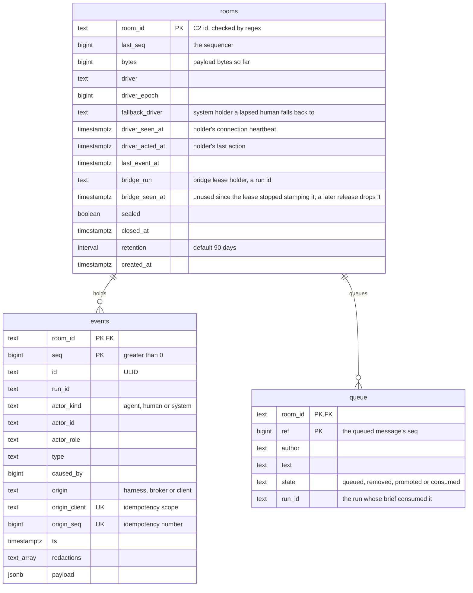
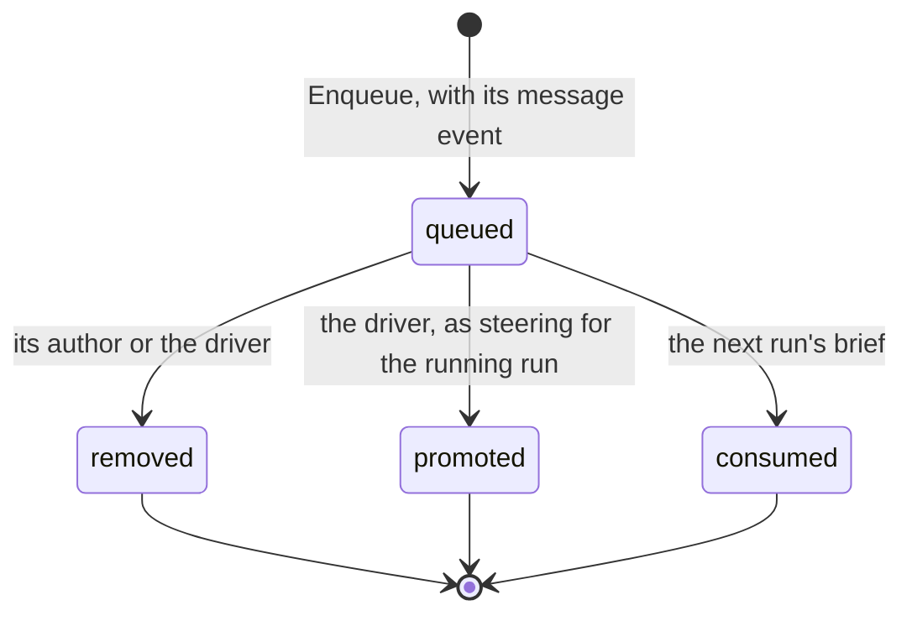
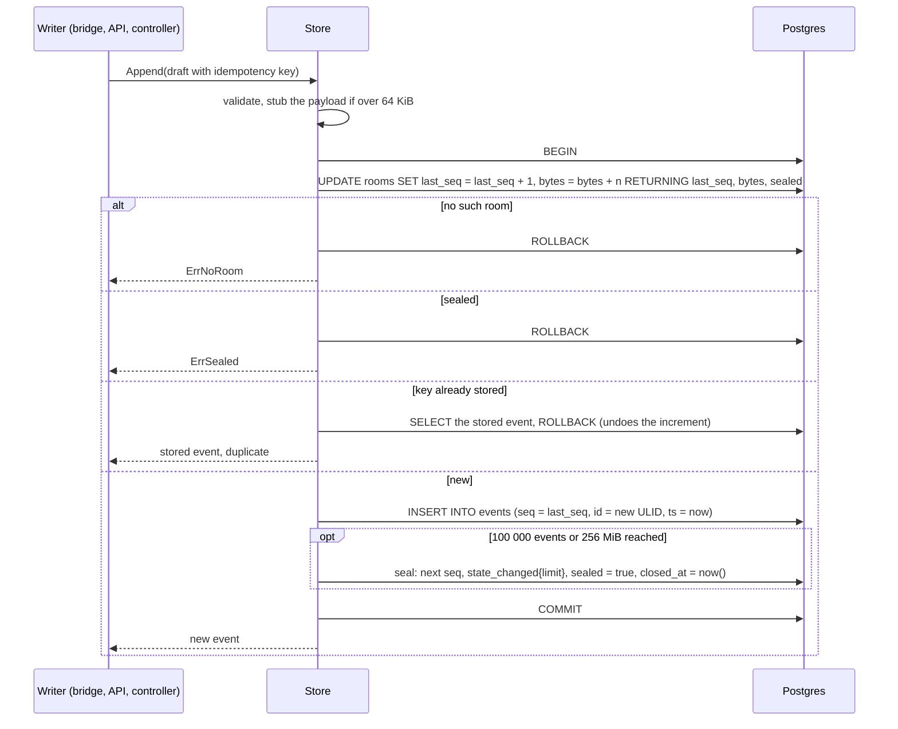

# The room log

The log is one PostgreSQL database, `rooms`, on the CNPG cluster of `SQLInstance xplane-rooms`. Two
tables hold it: `rooms`, one row per room that doubles as its sequencer, and `events`, the log
itself. The broker may append and read, never rewrite. The database enforces the guarantees below
(grants, a trigger and an insert check), so even a compromised broker cannot unseal a room, re-date
it into early deletion, or leave a gap.

## Schema



`events` has primary key `(room_id, seq)` and a unique key `(room_id, origin_client, origin_seq)`.
Later migrations add columns, tables and indexes (see [migrations](#migrations-with-atlas)).

### Roles

| Role | Created by | Can | Used by |
|---|---|---|---|
| `rooms_owner` | CNPG, from the `SQLInstance` claim; owns the database | Owns the schema. No `CREATEROLE` | The Atlas migration |
| `rooms_broker` | CNPG managed role, owning no database | `SELECT`, `INSERT` on `events`; `SELECT`, `INSERT` and a column-level `UPDATE` on `rooms`; `SELECT`, `INSERT` and an `UPDATE` of `state` and `run_id` only on `queue`; on `approvals`, an `UPDATE` of the close columns only | The broker |
| `rooms_retention` | CNPG managed role, owning no database | `DELETE` on `events`, `queue`, `approvals` and `rooms`; `SELECT` on `events.room_id`, `queue.room_id`, `approvals.room_id` and on the expiry columns of `rooms` only; both narrowed by row-level security to expired rooms | The retention job |

Each role's password is generated in the cluster by an External Secrets `Password` generator, never
seeded by hand, through the `SQLInstance`'s `credentials.source: generated`. The
broker's connection string arrives as the key `uri` of Secret `xplane-rooms-cnpg-role-rooms-broker`.

## The guarantees

The guarantees live in the database, not the broker: a bug or a compromise in the broker cannot
cross them.

| Guarantee | Enforced by | Proved by |
|---|---|---|
| The broker cannot change or delete an event | Grant: `rooms_broker` has only `SELECT`, `INSERT` on `events` | `TestBrokerRoleIsAppendOnly` (`42501 permission denied`) |
| `seq` is gapless per room, from 1 | Row lock: every append increments `rooms.last_seq` in the same transaction as its insert, and a rollback undoes the increment. A `BEFORE INSERT` check on `events` adds: `seq` must equal the room's `last_seq` | `TestAppendIsGapless`; `TestBrokerRoleIsAppendOnly` (`insert out of sequence`, `skip a seq`, `skip a seq behind a temporary table`) |
| An append is idempotent | Unique key `(room_id, origin_client, origin_seq)`, read under the row lock; a replay rolls back and returns the stored event | `TestAppendIsIdempotentAndStaysGapless` |
| Nothing appends to a sealed room | The store refuses under the row lock (`ErrSealed`, `410 sealed`). The database checks it too: the `events` insert check refuses a sealed room | `TestSealedRoomRefusesAppends`; `TestBrokerRoleIsAppendOnly` (`insert into a sealed room`, `advance a sealed room`) |
| A sealed room stays sealed | Trigger: a `rooms_owner`-owned `BEFORE UPDATE` trigger refuses `sealed` going from true to false | `TestBrokerRoleIsAppendOnly` (`reopen a sealed room`) |
| `closed_at` is set once, to the time of closing | The same trigger: `closed_at` may only move from null to `now()` | `TestBrokerRoleIsAppendOnly` (`backdate a close`, `close without sealing`, `move a close date`) |
| `retention` and `room_id` never change | The same trigger, behind the column grant, which already refuses the broker | `TestBrokerRoleIsAppendOnly` (`shorten retention`, `backdate and shorten together`: `42501`) |
| `last_seq` moves only by +1 | The same trigger | `TestBrokerRoleIsAppendOnly` (`jump last_seq`, `rewind last_seq`) |
| The broker updates only what it must move on `rooms` | Grant: a column-level `UPDATE` instead of the table-wide one, and no `FOR ALL` policy | `TestBrokerRoleIsAppendOnly` (`shorten retention`, `create a sealed room`, `delete a room`) |
| Retention deletes only sealed rooms closed longer ago than their retention | Row-level security on `rooms_retention`: `sealed` and `closed_at < now() - retention` | `TestRetentionDeletesOnlyExpiredSealedRooms`, `TestPurgeExpired` |
| Retention never reads a transcript | Grant: `rooms_retention` may `SELECT` only `events.room_id` and the expiry columns of `rooms` (`room_id`, `sealed`, `closed_at`, `retention`); its `SELECT` policies show only expired rooms | `TestRetentionRoleCannotReadTranscripts` (`42501`, and a live room's rows invisible) |
| The driver token moves only with its epoch, and on the record | A column grant on the driver columns; trigger `rooms_driver_fenced`: `driver_epoch` steps by one, `driver` and `fallback_driver` change only with it, never in a sealed room, and the fallback is the previous system holder; deferred `rooms_epoch_has_event`: each new epoch has its `driver` event, appended after the move and naming its `from` and `to`, by commit. The store fences a change on the expected epoch under the row lock (`ErrStaleEpoch`), and refuses a change to no principal or to the holder (`ErrInvalidDriver`) and a key stored for another event type (`ErrKeyConflict`) | `TestDriverChangeIsFenced`, `TestDriverChangeRefusesBadTargetsAndForeignKeys`; `TestBrokerRoleIsAppendOnly` (the `move the driver …` and `move the fallback …` cases) |
| A queued message is an event, and its text and author never change | Trigger `queue_is_its_event`: a row enters only with its queued message, by that event's actor and with its text, never in a sealed room; foreign key `(room_id, ref)` to `events (room_id, seq)`; `run_id` is a C2 id; the broker may `UPDATE` only `queue.state` and `queue.run_id` | `TestBrokerRoleIsAppendOnly` (`queue a message with no event`, `queue someone's message as another's`, `queue into a sealed room`; `rewrite a queued message`, `re-attribute a queued message`: `42501`) |
| A queued message moves once | The same trigger, and `SetQueued` (`ErrBadMove`): a row enters `queued`, naming no run, and moves out of it once, to `removed` (no run), `promoted` or `consumed` (naming the run); the diagram below | `TestQueueStateMachine`; `TestBrokerRoleIsAppendOnly` (`re-queue a queued message`, `consume without naming the run`, `move a removed message again`, `enter the queue as consumed`, `enter the queue naming a run`) |
| A brief's messages are consumed exactly when its run is on the record | `RecordRunRequest`: one transaction moves the quoted messages still queued to `consumed` and appends `state_changed{run_requested}` naming them; a replayed key moves nothing | `TestRecordRunRequest`, `TestRecordRunRequestRefusals` |
| A lease expires only from a lapsed human | `ExpireDriver` re-checks, under the row lock, that a human holds the token at the expected epoch, still disconnected over 2 min or idle over 15 min, and that the target is the fallback (`ErrNotLapsed`) | `TestExpireDriver` |
| A decision past its deadline never wins | `Decide` reads `expires_at <= now()` under the room's row lock, the lock every close takes, in the transaction that would record the decision: a late one closes the approval as `expired` and is `ErrApprovalExpired`. The 30 s sweep only closes what nobody tried to decide | `TestADecisionPastTheDeadlineIsRefused`, `TestALateDecisionNeverBeatsTheSweep` |
| A full room seals itself | The store: at 100 000 events or 256 MiB the append also writes the seal | `TestLimitSealsTheRoom` |
| An oversize payload keeps its slot | The store replaces a payload over 64 KiB with a stub | `TestOversizePayloadIsStubbed` |
| A value Postgres refuses keeps its slot | `IsDataError` spots SQLSTATE class 22; the API stores a stub instead | `TestNULIsADataError`, `TestARefusedPayloadBecomesAStub` |
| One bridge holds a room | The lease in the room's row, shared by every replica | `TestBridgeLeaseIsSharedAndExpires`, `TestTheLeaseHoldsAcrossReplicas`, `TestAQuietRunKeepsItsRoom` |
| A displaced bridge cannot append | Renewing the lease reports whether it is still held, and an append carries the expected `bridge_run`, checked under the row lock. `POST /v1/bridge/events` answers `409` when it is not held | `TestDisplacedBridgeIsFenced`, `TestADisplacedBridgeGets409AndWritesNothing`, `TestAnEmptyBatchRenewsTheLeaseFenced`, `TestAHeartbeatThatFindsTheLeaseGoneStops` |

The exact column list of the `UPDATE` grant and the trigger's error messages are in
`internal/store/migrations/20260927120000_rooms.sql`; this page describes their contract.

A queued message's row:



## Append

One transaction per event. The row lock on `rooms` serialises every writer of a room across every
broker replica, so `seq` is gapless without an application lock.



The caller redacts first: every payload passes through the redactor before `Append` (see
[security](security.md#redaction)).

## Sealing and closing

| Trigger | Final event | Effect |
|---|---|---|
| The `Room` CR is deleted (by hand, or by the factory once a task has ended): its finalizer deletes the room's runs, then closes the log | `state_changed{kind: room_phase, phase: Closed, reason: "room deleted"}` | `sealed = true`, `closed_at = now()`: the retention clock starts |
| The room reaches 100 000 events or 256 MiB | `state_changed{kind: limit, events, bytes}` | Same |
| The owner closes the room (the `close` action) | `state_changed{room_phase: Closed}` | Same |

The seal is itself an event, with the fixed key `broker:seal/1`, so it is appended at most once.
Closing a sealed room is a no-op. After the seal every append gets `ErrSealed`, and a bridge that
receives `410 sealed` stops mirroring.

## Retention

A daily CronJob, `room-broker-retention` (03:17, `concurrencyPolicy: Forbid`), runs
`maku-broker retention` as `rooms_retention`. It deletes the events, then the row, of every room
closed longer ago than its own retention, one room per transaction, each under its own
`statement_timeout` of 10 minutes (`SET LOCAL`; the broker's sessions keep 15 s). The purged room is
sealed and expired, so a long `DELETE` blocks no writer. The CronJob's `activeDeadlineSeconds`, if
set, must exceed those 10 minutes. Its `WHERE` clause repeats what row-level security already
enforces: the role cannot see, let alone delete, anything else.

| Setting | Value |
|---|---|
| `Room.spec.retention` | `<n>d`, 1 to 9999 days; default `90d`. Copied into `rooms.retention` when the row is created and never changed afterwards |
| Clock | Starts at `closed_at`, the seal |
| Sizing | About 4 MB per run; 20 runs a day for 90 days is about 7 GB on a 20 Gi volume. `RoomLogDiskFilling` fires at 80 % |
| Later tables | `queue` references `events`, so it is deleted first, before the events and the `rooms` row; readable by retention only as `room_id` of an expired room; `approvals` references `events` too and goes with it |

A forked room copies its source's events, at most 5,000 of them and 32 MiB, so a fork survives its source's purge.

## The bridge lease

One `Running` run per room is enforced where every replica can see it: in the room's row.

| Step | Rule |
|---|---|
| `hello` | `ClaimBridge` locks the row. Another run keeps the lease for as long as it is live in the `AgentRun` watch, however long since its bridge was seen, and also while this replica's watch has not synced yet and does not know it: a quiet or cut-off bridge may still have a harness at work. Otherwise the caller takes it |
| Refused | `409 room_busy`, and one `state_changed{kind: limit, reason: concurrent_run, running: <holder>}` |
| Renewal | Every batch the holder pushes checks that it still holds the lease: an unlocked `SELECT` on (room, run) in `TouchBridge`, nothing is stamped. Only an append checks under the row lock. A bridge with nothing to push for 30 s sends an empty batch, so a displaced bridge learns it within 30 s. Time alone never frees the lease |
| A run that ended | Frees the lease at once |
| A holder whose pod died | Blocks the room until its run ends: a lost pod ends the run `PodLost`, and a hung one ends at its deadline |
| Fencing | Each append checks, under the same row lock, that the caller's run still holds the lease; a displaced bridge gets `409` and appends nothing |

The broker cannot refuse to *create* a second run (it creates none), but no second run joins the
room while the first is live. The second run still spends tokens until someone deletes it.

The driver token uses the same pattern: every driver-only action carries `driverEpoch`,
and applies only if `UPDATE rooms … WHERE driver_epoch = $epoch` matches.

## Migrations with Atlas

| Item | Where |
|---|---|
| Migration files | `internal/store/migrations/<timestamp>_<name>.sql`, applied in name order |
| Integrity file | `internal/store/migrations/atlas.sum` |
| ConfigMap generator | `internal/store/migrations/kustomization.yaml` builds the ConfigMap `atlas-db-migrations`, the name the `SQLInstance` composition reads. Every migration file is listed there, with `atlas.sum` |
| Applied by | The Atlas operator in the cluster, connected as `rooms_owner`, from the claim's `atlasSchema: {url, ref, path: internal/store/migrations}` |
| `ref` | `main`, or a release tag `v*`. The composition resolves a `v*` ref as a tag and anything else as a branch; this repository deletes a branch on merge, so a branch ref 404s once its PR merges |

| Migration | Adds |
|---|---|
| `20260927120000_rooms.sql` | `rooms`, `events`, the grants and row-level security; the trigger, the insert check and the column grant behind the guarantees |
| `20260929120000_verdicts.sql` | The partial index `events_agent_verdicts`: agents' review verdicts, which the leader posts to GitHub; `CONCURRENTLY`, outside a transaction (`atlas:txmode none`) |
| `20261001120000_driver_queue.sql` | `rooms.driver_acted_at`, the broker's `UPDATE` grant on the driver columns, the epoch triggers, the `queue` table |
| `20261001130000_delivery_indexes.sql` | The partial indexes `events_deliveries` and `events_acks` a bridge stream reads; `CONCURRENTLY`, outside a transaction |
| `20261001140000_brief_index.sql` | The partial index `events_brief`: agent handoffs and review verdicts, run requests and participants, which `start_run` reads; `CONCURRENTLY`, outside a transaction |
| `20261005120000_approvals.sql` | The `approvals` table: a row is its `approval_requested` event and closes once, with its `approval_decided` (trigger `approvals_are_their_events`, deferred `approvals_decision_has_event`); the broker updates only the close columns |
| `20261005130000_approval_indexes.sql` | The partial indexes `approvals_pending`, `events_decisions`, `events_decision_acks` and `events_tool_results`; `CONCURRENTLY`, outside a transaction |
| `20261008120000_task_facts_index.sql` | The partial index `events_task_facts`: each room's latest `state_changed{kind: task}`, which the `Room` reconciler reads every pass; `CONCURRENTLY`, outside a transaction |

**`atlas.sum` must match the directory.** It is a checksum of every migration file and of their
order. Atlas refuses to apply a directory whose files do not match it, which catches a migration
edited after it was hashed, and two branches adding migrations out of order. After adding or editing
a file, regenerate it and validate:

```bash
atlas migrate hash --dir file://internal/store/migrations
atlas migrate validate --dir file://internal/store/migrations
```

Commit the new `atlas.sum` with the SQL. A migration that has run anywhere is never edited again:
add a new file.

The `GRANT`s name login roles that CNPG creates, not the migration (`rooms_owner` has no
`CREATEROLE`). Until CNPG has created them the migration fails, and the Atlas operator retries.
