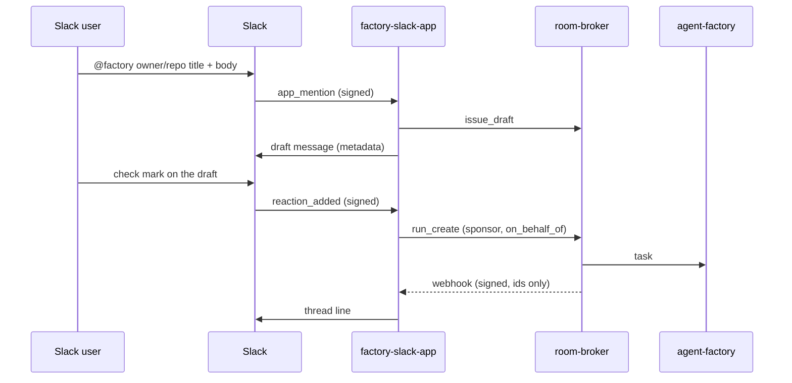

# The Slack App

`factory-slack-app` is the factory's Slack App: a mention in a thread drafts an issue, a maintainer's check mark files it and starts the work, and the broker's signed webhooks tell the same thread how it goes. Approvals and steering stay in the [web UI](web-ui.md). A question from the run is linked in the thread, never answered there.



## Manifest

The App is one workspace's: create it from this manifest, install it, and put the signing secret and the bot token in the secret store.

```json
{
  "display_information": { "name": "Factory" },
  "features": { "bot_user": { "display_name": "factory", "always_online": true } },
  "oauth_config": {
    "scopes": { "bot": ["app_mentions:read", "chat:write", "reactions:read", "channels:history", "groups:history", "users:read"] }
  },
  "settings": {
    "event_subscriptions": {
      "request_url": "https://factory-slack.<domain>/slack/events",
      "bot_events": ["app_mention", "reaction_added", "message.channels", "message.groups"]
    },
    "interactivity": { "is_enabled": false },
    "org_deploy_enabled": false,
    "socket_mode_enabled": false
  }
}
```

No interactivity and no slash command. `chat:write` also covers `chat.postEphemeral`, which the [self-serve link](#self-serve-link) answers with. `users:read` is optional: with it the link page names the Slack user by their display name (`users.info`), without it by their id only; an App created from an earlier copy adds it under OAuth & Permissions and reinstalls.

Draft editing needs the `message.channels` (and, for private channels, `message.groups`) bot events: an App created from an earlier copy of this manifest must add them under Event Subscriptions in the Slack console and reinstall. The scopes (`channels:history`, `groups:history`) are already there. Without the events, mentions and check marks work as before and replies are never seen.

## Config

`factory-slack-app --config <file>`, strictly decoded (an unknown key is refused).

| Key | Meaning |
|---|---|
| `teamID` | Required. The one workspace served; any other workspace's events are dropped |
| `channels` | Required, at least one: `<channel id>: {repositories: [owner/name], maxCostUSD}`. The repositories a draft there may name, and the `max_cost` a check mark there sends (at least 0.01) |
| `signingSecretFile`, `botTokenFile`, `webhookKeyFile`, `botUserIDFile` | Required mounted files; each must be readable and non-empty, and the webhook key must parse (one or two base64 lines of at least 32 bytes): the App refuses to start otherwise, naming the field and never the content |
| `clientIDFile`, `clientSecretFile`, `projectIDFile`, `issuerURL` | Required: the ZITADEL machine user's client, the project whose audience the token carries, and the issuer (an absolute `https` URL; `http` is accepted only for a loopback host, in tests). The three files are checked at start like the others |
| `brokerURL`, `roomsURL` | The broker's base URL, its human listener (`http://<svc>.<ns>.svc.cluster.local:8080`, no path: the App calls `<brokerURL>/mcp`), and the room pages' base URL |
| `namespace` | Where the `factory-slack-threads` ConfigMap lives |
| `eventsAddr` `:8080` | Slack's events, `POST /slack/events`: the public route |
| `webhooksAddr` `:8081` | The broker's webhooks, `POST /webhooks`: cluster only |
| `opsAddr` `:9090` | Metrics and the probes |

The App's token is a client-credentials grant with the project-audience scope (`openid` and `urn:zitadel:iam:org:project:id:<project id>:aud`). The factory serves a Slack user listed in its `onBehalfOf.slack`, or, with `onBehalfOf.slackLinks`, one who linked themselves ([self-serve link](#self-serve-link), [The factory](factory.md#sponsored-principals)).

The broker needs one `webhooks` entry for the App ([operations](operations.md#webhooks)):

```yaml
webhooks:
  - name: slack-app
    network: cluster
    url: http://<svc>.<ns>.svc.cluster.local:8081/webhooks
    events: [room.task_triaged, room.run_started, room.waiting_for_human, room.pr_opened, room.verdict_posted,
             room.merged, room.reverted, room.budget_reached, room.ended]
    repositories: [Smana/ai-native-ref]
    secretFile: /etc/webhook/key   # the key file the App mounts as webhookKeyFile
```

- `network: cluster`; the port `:8081` is mandatory and the path is exactly `/webhooks`.
- `events` are the nine above, by their full names: the broker refuses a short one. The App ignores `room.task_received` and `room.run_ended`.
- `repositories` is required.
- `secretFile` is the same key as the App's `webhookKeyFile`: one or two base64 lines, each at least 32 bytes decoded.

## Flows

**Draft.** A mention whose text starts with the App's own `<@bot>` is free text: the App composes the issue template itself, so nobody types headings (Slack's composer strips `##`, rewrites `- ` as `•` and sends on Enter). Write it like this:

```text
@factory [Smana/ai-native-ref] docs: runbook 18 never says where the key lives
The runbook names the factory's API but not where its key is stored.
Should: say which Secret holds it.
Acceptance: docs/runbooks/18.md gains one line naming the Secret.
```

- **Line 1** is `[<owner/repo>] <title>`; the brackets are optional, and in a channel that serves exactly one repository the repository is optional too. A title that has the factory's `<area>: <what>` shape (`docs: ...`, `fix(agents): ...`) is used as is. Otherwise the App prefixes `docs: ` when the text mentions a doc, runbook or README, else `chore: `: the two areas that never claim a behaviour change. The factory's title rule is not relaxed.
- **Further lines** become `## What is wrong`; with none, the title does.
- A line starting with `should:`, `expected:` or `want:` opens `## What it should be` (default: "As the title says.").
- A line starting with `acceptance:`, `acceptance check:`, `done when:` or `check:` opens `## Acceptance check`, up to the end of the message. Slack's decoration (`*`, `_`, `>`, `•`, `-`) before the keyword is ignored, and the keyword also counts glued to a sentence end (`...the API.Acceptance:`, or followed by a line break). `•` bullets become `- `. With no acceptance given the section says so, and the factory's scoper asks the author on the issue.
- A text that already holds the template's `## What is wrong` heading is passed as typed.

A one-line mention is a complete draft. A malformed line 1 (no repository where the channel serves several) is refused with a `Try:` line built from the user's own text (the channel's repository in front of it; with several repositories the first, plus the list), shown inert like every refusal. The composed issue is posted in the thread, so the check mark files what is shown. The broker's `issue_draft` judges it against the template and a refusal is posted back as is. A good draft is posted in the thread by the bot with metadata `{repo, title, body, sha256}`. When that metadata would exceed 8 KiB (well under Slack's cap) nothing is posted as a draft: the thread gets a short line saying the draft is too long to file from Slack, with none of its text, and the request counts as `too_large`.

**Edit.** A reply in the draft's thread by the Slack user who wrote the mention amends the pending draft, and the App posts the result as a new draft reply (the earlier one stays as history, and a ✅ on it is answered "react on the latest draft"). A reply is read as the mention's free text: `Title: …` replaces the title (the area prefix rule applies again), `Should: …` or `Expected: …` replaces "What it should be", `Acceptance: …`, `Done when: …` or `Check: …` replaces the acceptance check (several lines allowed), anything else is appended to "What is wrong". The draft goes through the broker's `issue_draft` again. A reply that is only a ✅ files the latest draft as a reaction does, and never edits. Other replies from anyone else, in a thread with no draft, after the draft is filed, or that start with a mention of the App are ignored without a word; a reply the broker refuses is answered "Change refused: …". At most 20 drafts per thread, each reply is capped at 4000 characters, and the draft stays under the metadata cap. The state is the draft message's metadata (`author`, `rev`), read back with `conversations.replies`; the App's "Filed" line carries a `factory_filed` metadata marker that ends editing. Nothing is stored beyond what the App kept already.

The draft is shown in Slack's mrkdwn (an intro line, then `*What is wrong*`, `*What it should be*` and `*Acceptance check*` on their own lines with the text below, and a hint to reply or ✅); the issue body keeps the `##` template.

**File.** A `white_check_mark` files the task only when all of these hold: the message is the thread's latest draft; the user is linked, in `onBehalfOf.slack` or by a [self-serve link](#self-serve-link) (and the linked login is a maintainer); the message is the bot's own draft, re-read from Slack (a `conversations.replies` call on the message `ts` with `limit=1`; the message's user is the bot's) with a matching hash; the channel is configured. The idempotency key is the thread (`<team>/<channel>/<thread_ts>`): a second check mark in the thread, on any revision, is a duplicate and files nothing. A thread too long to read (over 5 pages) fails closed: nothing is edited or filed. The App then calls `run_create` with `on_behalf_of: slack:<team>/<user>`, the draft, the channel's `maxCostUSD` and `ref: slack/<team>/<channel>/<thread_ts>`. The thread map records the room, and the Filed line names the sponsor (`Filed #12 for @dana, sponsored by GitHub @smana`), so a wrong link shows at its first use.

**No silent check mark.** Every refusal on the check-mark path (reaction or ✅ reply) is one thread line naming the reason and its fix, said once per draft, user and reason (in memory, like the event dedup), so re-adding the ✅ does not repeat it:

| Case | Line |
|---|---|
| The channel no longer lists the draft's repository | `Not filed: <repo> isn't served in this channel; ask an operator to add it to the channel's repositories.` |
| The channel is no longer served | `Not filed: this channel is no longer served; ask an operator to add it to the Slack App's channels.` |
| The draft's hash fails | `Not filed: this draft no longer matches its check; start a new one with a mention.` |
| A replaced draft, a thread too long | `react on the latest draft`; `start a new one with a mention` |
| `not_linked` | `Not filed: @u is not linked to a GitHub account here; mention me with link to link it, then react again.` |
| `not_a_maintainer` | `Not filed: @u's GitHub account is not a maintainer of <repo>; a maintainer must react.` |
| `repository_not_allowed`, `repository_not_owned` | `ask an operator to add it to the Slack App's repositories` |
| `principal_budget_exhausted` | `the Slack App's budget for today is spent; react again tomorrow` |
| Any other code | `Not filed: <the broker's refusal>` |

A passing failure (`kill_switch`, `principal_task_cap`, `link_unverified`, `ledger_unavailable`, `tasks_unavailable`, `intake_failed`, `meter_unpriced`, the factory or Slack unreachable) says to react again, each time. **Silent on purpose:** a ✅ on a message that is not the App's draft, a malformed id, the App's own user, a bot's event, another workspace, an event already seen, and a message Slack cannot return (no thread is known to answer in; logged and counted `error`).

### Self-serve link

A Slack user links themselves instead of waiting for an `onBehalfOf.slack` entry in git ([design](superpowers/specs/2026-10-28-slack-self-serve-link-design.md)):

1. `@factory link` in a served channel. The App calls the broker's `slack_link_code` with its team and user id (and display name, with `users:read`) and answers **ephemerally** (only that user sees it) with `https://rooms.<domain>/link/slack?code=<code>`: single use, 10 minutes, replacing their earlier code.
2. The user opens it, signs in to the rooms UI (ZITADEL), and sees `Link Slack user <name> (<id>) in workspace <team> to your account (GitHub: @login)?` with a warning to confirm only their own Slack user. **Link** posts the form; the broker records `slack(team/user) → the ZITADEL account`.
3. From then on their ✅ files sponsored by that account's **current** GitHub login, still held to the repository's maintainers: a link grants nothing a maintainer did not have.

`@factory unlink` removes the user's self-serve link (never a config entry); the page, opened without a code, lists the account's links with an Unlink button each. Refusals on the page: the code expired or was used, the code is for another workspace, the account has no GitHub link, or it holds 5 Slack users already. With the broker's `human.slackLink` off, both commands answer that self-serve linking is not turned on. `link` and `unlink` are the whole mention; a draft whose title holds the word is a draft.

Both sides must opt in: the broker's `human.slackLink` (principal, team, repository; [integration](integration.md)) and the factory's `onBehalfOf.slackLinks` ([The factory](factory.md#sponsored-principals)). A user in `onBehalfOf.slack` keeps that entry whatever they link: **the config wins**.

**Follow.** The broker's webhooks name a room; the App finds its thread in the map and posts a fixed line: the issue and PR numbers, the coarse state, a closed reason code and the room's URL (`<roomsURL>/r/<room>`).

## State

- The thread map is the ConfigMap `factory-slack-threads`, the only object the App's Role names. Entries older than 30 days are pruned on write, and the encoded map is bounded near 900 KiB (a ConfigMap holds 1 MiB).
- One replica. Slack events (on `event_id`) and webhooks (on `webhook-id`) are deduplicated in an in-memory LRU, so a restart can post one duplicate line. Two concurrent redeliveries of one id can both pass the check before either finishes (known race): the worst case is one duplicate thread line.
- A webhook key the App cannot read answers `503 no_key`. That is not a hold: the broker retries a receiver's non-2xx after 10s, 1m and 5m, then counts a failure, and three given-up deliveries disable the subscriber until its `generation` is bumped. A rotated or missing key, or a Slack outage that makes the App answer `502`, therefore loses those events and can disable the subscriber. **Recovery:** fix the key (or wait for Slack), bump `generation` on the broker's `webhooks` entry and restart the broker (a `webhooks` change applies only at restart); the events of the disabled window are not replayed, and a room's page still shows its state.
- Series: `factory_slack_requests_total{route, outcome}` (`events`, `webhooks`; the closed list is `drafted`, `edited`, `refused`, `filed`, `duplicate`, `posted`, `link`, `unlinked`, `ignored`, `bad_signature`, `no_key`, `too_large` and `error`).
- A refusal said once is remembered in memory (at most 4096): a restart can say it once more.
- `factory_slack_build_info{version}`: the running build, constant 1.

## What it never does

- Answer an approval, steer or stop a run, or read a thread reply as a command. It reads replies in a draft's thread for one purpose only: the mention's author amends that draft while it is unfiled (see Edit). A reply that is only a ✅, from anyone, files the latest draft as a reaction does (the same checks, the same lines); any other reply from anyone else, or after the draft is filed, is dropped unread.
- Post a link code where anyone but its user sees it, or trust a GitHub login from Slack.
- Post room text or anything an agent wrote.
- Answer a slash command.
- Serve another workspace, an unlisted channel or a draft it did not post.
- Hand its Slack token or its ZITADEL secret to the broker or a run.

## Live proof 5

Offline, `internal/slackapp` and `internal/app` cover all of the above. On the cluster, confirm two things about Slack itself: `conversations.replies` with the reply's `ts` and `limit=1` returns the reply (not the thread's parent), and a bot's messages carry `user=<the bot's U-id>`. The check-mark filter relies on both. The App reads its own message metadata through `conversations.replies`, so `metadata.message:read` is not needed; confirm that too, and that the manifest's bot scopes suffice.
