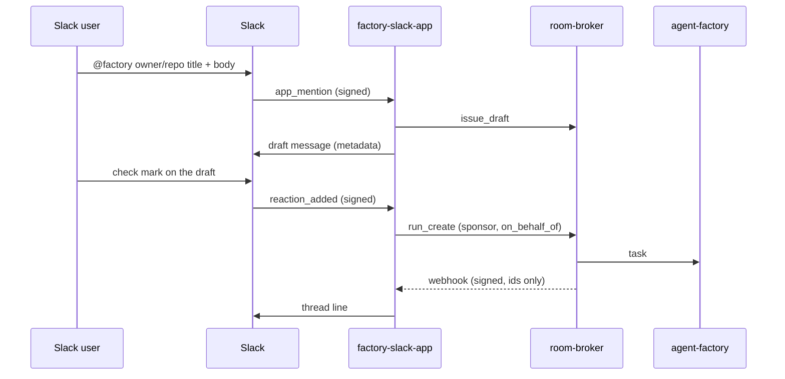

# The Slack App

`factory-slack-app` is the factory's Slack App: a mention in a thread drafts an issue, a maintainer's check mark files it and starts the work, and the broker's signed webhooks tell the same thread how it goes. Approvals and steering stay in the [web UI](web-ui.md). A question from the run is linked in the thread, never answered there.



## Manifest

The App is one workspace's: create it from this manifest, install it, and put the signing secret and the bot token in the secret store.

```json
{
  "display_information": { "name": "Factory" },
  "features": { "bot_user": { "display_name": "factory", "always_online": true } },
  "oauth_config": {
    "scopes": { "bot": ["app_mentions:read", "chat:write", "reactions:read", "channels:history", "groups:history"] }
  },
  "settings": {
    "event_subscriptions": {
      "request_url": "https://factory-slack.<domain>/slack/events",
      "bot_events": ["app_mention", "reaction_added"]
    },
    "interactivity": { "is_enabled": false },
    "org_deploy_enabled": false,
    "socket_mode_enabled": false
  }
}
```

No interactivity and no slash command.

## Config

`factory-slack-app --config <file>`, strictly decoded (an unknown key is refused).

| Key | Meaning |
|---|---|
| `teamID` | Required. The one workspace served; any other workspace's events are dropped |
| `channels` | Required, at least one: `<channel id>: {repositories: [owner/name], maxCostUSD}`. The repositories a draft there may name, and the `max_cost` a check mark there sends (at least 0.01) |
| `signingSecretFile`, `botTokenFile`, `webhookKeyFile`, `botUserIDFile` | Required mounted files; each must be present and non-empty at load |
| `clientIDFile`, `clientSecretFile`, `projectIDFile`, `issuerURL` | Required: the ZITADEL machine user's client, the project whose audience the token carries, and the issuer |
| `brokerURL`, `roomsURL` | The broker (its `/mcp`) and the room pages' base URL |
| `namespace` | Where the `factory-slack-threads` ConfigMap lives |
| `eventsAddr` `:8080` | Slack's events, `POST /slack/events`: the public route |
| `webhooksAddr` `:8081` | The broker's webhooks, `POST /webhooks`: cluster only |
| `opsAddr` `:9090` | Metrics and the probes |

The App's token is a client-credentials grant with the project-audience scope (`openid` and `urn:zitadel:iam:org:project:id:<project id>:aud`). The factory must list the Slack users it will serve in `onBehalfOf.slack` ([The factory](factory.md)).

The webhook subscriber in the broker's config is `cluster`, with the same key as `webhookKeyFile`.

## Flows

**Draft.** A mention whose text starts with the App's own `<@bot>` is read as: line 1 `<owner/repo> <title>`, the rest the body, as typed. Nothing is generated. The broker's `issue_draft` judges it against the template and a refusal is posted back as is. A good draft is posted in the thread by the bot with metadata `{repo, title, body, sha256}`.

**File.** A `white_check_mark` files the task only when all of these hold: the user is linked in `onBehalfOf.slack` (and the linked login is a maintainer); the message is the bot's own draft, re-read from Slack (a `conversations.replies` call on the message `ts` with `limit=1`; the message's user is the bot's) with a matching hash; the channel is configured. A second check mark on the same draft is a duplicate and files nothing. The App then calls `run_create` with `on_behalf_of: slack:<team>/<user>`, the draft, the channel's `maxCostUSD` and `ref: slack/<team>/<channel>/<thread_ts>`. The thread map records the room.

**Follow.** The broker's webhooks name a room; the App finds its thread in the map and posts a fixed line: the issue and PR numbers, the coarse state, a closed reason code and the room's URL (`<roomsURL>/r/<room>`).

## State

- The thread map is the ConfigMap `factory-slack-threads`, the only object the App's Role names. Entries older than 30 days are pruned on write, and the encoded map is bounded near 900 KiB (a ConfigMap holds 1 MiB).
- One replica. Slack events (on `event_id`) and webhooks (on `webhook-id`) are deduplicated in an in-memory LRU, so a restart can post one duplicate line. Two concurrent redeliveries of one id can both pass the check before either finishes (known race): the worst case is one duplicate thread line.
- A webhook key the App cannot read answers `503 no_key`; the broker holds the room and retries.
- Series: `factory_slack_requests_total{route, outcome}` (`events`, `webhooks`; outcomes such as `ok`, `bad_signature`, `duplicate`, `no_key`).

## What it never does

- Answer an approval, steer or stop a run, or read a thread reply as a command.
- Post room text or anything an agent wrote.
- Answer a slash command.
- Serve another workspace, an unlisted channel or a draft it did not post.
- Hand its Slack token or its ZITADEL secret to the broker or a run.

## Live proof 5

Offline, `internal/slackapp` and `internal/app` cover all of the above. On the cluster, confirm two things about Slack itself: `conversations.replies` with the reply's `ts` and `limit=1` returns the reply (not the thread's parent), and a bot's messages carry `user=<the bot's U-id>`. The check-mark filter relies on both.
