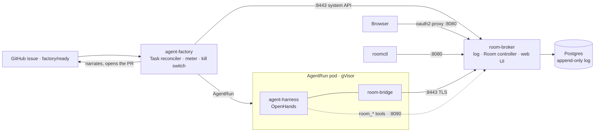

# Docs and Positioning Implementation Plan

> **For agentic workers:** REQUIRED SUB-SKILL: Use superpowers:subagent-driven-development (recommended) or superpowers:executing-plans to implement this plan task-by-task. Steps use checkbox (`- [ ]`) syntax for tracking.

**Goal:** Make the docs say what the project is and for whom, describe the system that ships (four binaries, a web UI, `roomctl`, a chart), give the factory, the CLI and the web UI their own pages, and make a lint refuse the per-row status tags that let the docs drift.

**Architecture:** Status is stated once (README) and version-gated where a consumer must know; every "Status", "Phase" and "Phase / PR" column goes; three new reader pages and a chart README land; `hack/docs.sh` checks relative links and refuses the status vocabulary outside `docs/superpowers/`, wired into `task check` last so the rewrite lands green.

**Tech Stack:** Markdown, mermaid, one POSIX shell script (`hack/docs.sh`, grep and a link resolver), `taskfile.yaml`.

**Spec:** [`docs/superpowers/specs/2026-10-15-docs-positioning-design.md`](../specs/2026-10-15-docs-positioning-design.md)

## Global Constraints

- House style (`AGENTS.md`, the owner's preference): lead with the conclusion, tables over paragraphs, say a thing once on the page that owns it and link from elsewhere, plain words before code names, mermaid diagrams welcome, no narration of history.
- No status vocabulary on a reader page: the lint's list is `AP-[0-9]`, `(phase [0-9]`, `phase [0-9] /`, `Planned`, `planned,`, `not built`, `not deployed`, `Nothing is deployed`, `Not merged`, `in review`. A version gate reads `since v0.7`.
- Ruling ids (`ruling X`, `P18`, `OD-16`, `GP-18`, `SC-10`, `T12`, `R9`, `F15`, `review M6`) leave reader pages; the code comments keep them. One "Design sources" line in `docs/README.md` links the specs.
- Every relative link resolves; every new page is listed in `docs/README.md`'s table and in a reading path.
- Facts come from the code: the plan names the file to read for each table. Do not invent a value; when a fact is unknown, name the file that holds it.
- `task check` exits 0 before every commit (the `docs` step joins it in Task 13); conventional commits `docs: …`, one page or one concern each.

## Review Focus

1. A reader who opens `README.md` and nothing else must learn what the project does, for whom, and where to go next for their role; the lead must not need `SP2`, `SP3` or a sibling repo to parse. Checked in Task 2's reader test.
2. A maintainer who gets a factory comment on their issue must find, from `docs/factory.md` alone, what each label does and why a task waits. Checked in Task 6 against the reason table in `internal/summary/waiting.go:65-100`.
3. An operator installing the chart must find the five secrets, their mount paths and the hard prerequisite (merger key when any class is live or shadow) in the chart README, lifted from `values.yaml:9-39`. Checked in Task 12.
4. A link to a heading that the rewrite renamed (`#the-room-crd`, `#metrics`, `#authorization`) must resolve: the lint checks anchors too. Checked in Task 1.
5. A page under `docs/superpowers/` must stay out of the lint: specs and plans speak of phases. Checked in Task 1.

---

### Task 1: The docs lint

**Files:**
- Create: `hack/docs.sh`, `hack/docs_test.sh`
- Modify: `taskfile.yaml` (a `docs` task, not yet in `check`)

**Interfaces:**
- Produces: `hack/docs.sh [files…]` exits 1 and prints `file:line: <reason>` for each hit; with no arguments it scans `README.md CONTRIBUTING.md AGENTS.md docs/**/*.md charts/**/README.md images/**/README.md` minus `docs/superpowers/`.

- [ ] **Step 1: Write the failing test** `hack/docs_test.sh`:

```bash
#!/usr/bin/env bash
# hack/docs.sh refuses the status vocabulary and dead relative links, and ignores docs/superpowers.
set -euo pipefail
cd "$(dirname "$0")/.."
tmp=$(mktemp -d); trap 'rm -rf "$tmp"' EXIT
mkdir -p "$tmp/docs/superpowers"
printf '# A\n\nSee [b](b.md#there) and [gone](nope.md). Status: AP-1. Planned, phase 2.\n' > "$tmp/docs/a.md"
printf '# B\n\n## There\n' > "$tmp/docs/b.md"
printf '# Spec\n\nPhase 1 is planned (AP-1).\n' > "$tmp/docs/superpowers/spec.md"
out=$(hack/docs.sh "$tmp/docs/a.md" "$tmp/docs/b.md" "$tmp/docs/superpowers/spec.md" 2>&1 || true)
grep -q 'a.md:3: status vocabulary: AP-1' <<<"$out"
grep -q 'a.md:3: status vocabulary: Planned' <<<"$out"
grep -q 'a.md:3: dead link: nope.md' <<<"$out"
! grep -q 'b.md' <<<"$out"
! grep -q 'superpowers' <<<"$out"
printf '# C\n\nSee [b](b.md#nowhere). Since v0.7 the broker serves it.\n' > "$tmp/docs/c.md"
out=$(hack/docs.sh "$tmp/docs/c.md" "$tmp/docs/b.md" 2>&1 || true)
grep -q 'c.md:3: dead anchor: b.md#nowhere' <<<"$out"
! grep -q 'status vocabulary' <<<"$out"
echo ok
```

- [ ] **Step 2: Run it**: `bash hack/docs_test.sh`. Expected: FAIL (`hack/docs.sh: No such file`).

- [ ] **Step 3: Write `hack/docs.sh`**:

```bash
#!/usr/bin/env bash
# Reader pages state status once (README) and never per row: this refuses the status vocabulary
# that let the docs drift (review 2026-10-15), and dead relative links and anchors. Specs and
# plans under docs/superpowers speak of phases by design and are skipped.
set -euo pipefail
cd "$(dirname "$0")/.."
if [ $# -eq 0 ]; then
  mapfile -t files < <(find README.md CONTRIBUTING.md AGENTS.md docs charts images -name '*.md' -not -path 'docs/superpowers/*' 2>/dev/null | sort)
else
  files=("$@")
fi
status='AP-[0-9]|\(phase [0-9]|phase [0-9] /|Planned|planned,|not built|not deployed|Nothing is deployed|Not merged|in review'
rc=0
anchor_of() { # heading text → GitHub anchor
  tr '[:upper:]' '[:lower:]' | sed -E 's/[`*_]//g; s/[^a-z0-9 -]//g; s/ /-/g'
}
for f in "${files[@]}"; do
  case "$f" in *docs/superpowers/*) continue;; esac
  while IFS= read -r hit; do
    echo "$f:${hit%%:*}: status vocabulary: $(grep -oE "$status" <<<"${hit#*:}" | head -1)"; rc=1
  done < <(grep -nE "$status" "$f" || true)
  dir=$(dirname "$f")
  while IFS= read -r hit; do
    n=${hit%%:*}; link=${hit#*:}
    target=${link%%#*}; frag=${link#*#}; [ "$frag" = "$link" ] && frag=""
    path="$f"; [ -n "$target" ] && path="$dir/$target"
    if [ ! -e "$path" ]; then echo "$f:$n: dead link: $link"; rc=1; continue; fi
    if [ -n "$frag" ] && ! grep -E '^#+ ' "$path" | sed -E 's/^#+ //' | anchor_of | grep -qx "$frag"; then
      echo "$f:$n: dead anchor: $link"; rc=1
    fi
  done < <(grep -noE '\]\((\.{0,2}/)?[A-Za-z0-9_./-]*\.md(#[A-Za-z0-9_-]+)?\)' "$f" | sed -E 's/\]\(//; s/\)$//' || true)
done
exit $rc
```

`chmod +x hack/docs.sh hack/docs_test.sh`.

- [ ] **Step 4: Run the test**: `bash hack/docs_test.sh`. Expected: `ok`.

- [ ] **Step 5: Add the task** to `taskfile.yaml` (not in `check` yet):

```yaml
  docs:
    desc: Reader pages carry no per-row status tags, and every relative link and anchor resolves.
    cmds:
      - bash hack/docs_test.sh
      - hack/docs.sh
```

- [ ] **Step 6: Run `task docs`** on today's docs. Expected: FAIL with the hits the rewrite removes (hundreds). Save the count: `hack/docs.sh | wc -l`.

- [ ] **Step 7: Commit**:

```bash
git add hack/docs.sh hack/docs_test.sh taskfile.yaml
git commit -m "ci(docs): a lint refuses per-row status tags and dead links on reader pages"
```

---

### Task 2: README

**Files:**
- Modify: `README.md` (lines 1-48 replaced; 50-117 kept and corrected)

- [ ] **Step 1: Replace lines 1-16** with the spec's lead and the why table:

```markdown
# agent-platform

**agent-platform** runs coding agents under human oversight and keeps the record. Label a GitHub
issue `factory/ready` and **agent-factory** triages it, starts sandboxed agent runs, opens the pull
request, narrates each step on the issue and stops at its budget. Every run streams into a
**collaboration room**: an append-only, redacted Postgres log that outlives the pod, which you
watch, steer, approve and fork from the web UI or from `roomctl` in a terminal. Four binaries in one
repo (`room-broker`, `room-bridge`, `agent-factory`, `roomctl`) plus the `agent-harness` image,
released together and pinned by digest. Built for one maintainer's Kubernetes platform
([cloud-native-ref](https://github.com/Smana/cloud-native-ref)); the core carries no platform
constants.

| Why | In one line | More |
|---|---|---|
| A factory | Work you do not want to babysit, sandboxed, reviewed and budgeted, under its own identity | [the platform's agents overview](https://github.com/Smana/cloud-native-ref/blob/main/website/content/docs/platform/ai-platform/agents/_index.md) |
| A room | The transcript, handoffs and decisions outlive the sandbox, and nobody can rewrite them | [docs/room-log.md](docs/room-log.md) |
| Humans in the loop | Approvals, steering and the merge gate sit outside the sandbox; the agent is not a trusted component | [docs/security.md](docs/security.md) |

**Status:** v0.11.0, in daily use on one cloud for one public repository, with the merge gate in
shadow. What is proven live and what comes next is on the platform's
[status page](https://github.com/Smana/cloud-native-ref/blob/main/website/content/docs/platform/ai-platform/status.md).

| You are | Start at |
|---|---|
| New here | [Concepts](docs/concepts.md), then [Architecture](docs/architecture.md) |
| A maintainer with a factory issue or PR | [The factory](docs/factory.md) |
| A developer who wants the CLI | [roomctl](docs/roomctl.md) |
| Operating a cluster | [Integration](docs/integration.md), then [Operations](docs/operations.md) |
| Changing the code | [AGENTS.md](AGENTS.md), then [Development](docs/development.md) |

The programme's sub-project codes, where you meet them in the specs: SP2 is the rooms, SP3 the factory.
```

- [ ] **Step 2: Replace the architecture diagram (lines 18-39)** with one that shows the whole system:



- [ ] **Step 3: Rewrite the port table (lines 41-48)** without the Phase column and with the factory's listeners:

```markdown
| Port | Binary | Who calls it |
|---|---|---|
| `:8080` | room-broker | Humans through oauth2-proxy (the web UI), `roomctl` |
| `:8443` | room-broker | `room-bridge` in each run pod; system callers (the factory) |
| `:8090` | room-broker | The agents' `room_*` tools through the agent gateway |
| `:9090` | room-broker | Metrics and probes |
| `api.listen` | agent-factory | `POST /v1/runs`: the broker's `start_run`, `task agent:run` |
| `runlore.listen` | agent-factory | `POST /intake/runlore` |
```

(Read the two defaults from `internal/factory/config/config.go:300-318` and print them in place of the key names.)

- [ ] **Step 4: Correct the rest**: line 110 "(from phase 1)" deleted; line 79's example tag `v0.11.0`; the `roomctl` row of the binaries table drops "(ruling P18)" for "never steers or approves: those stay in the web UI".

- [ ] **Step 5: Reader test**: hand the README to someone (or a fresh agent with no other context) and ask "what does it do, for whom, where do I start as a maintainer?" The three answers must come from the first screen.

- [ ] **Step 6: Run `hack/docs.sh README.md`**. Expected: exit 0.

- [ ] **Step 7: Commit**: `git commit -am "docs: README says what agent-platform does and for whom"`.

---

### Task 3: `docs/README.md`

**Files:**
- Modify: `docs/README.md` (rewrite)

- [ ] **Step 1: Rewrite** as: a one-line lead ("The reference for the broker, the bridge, the factory, the CLI and the web UI; the platform's docs site holds the overview and the status."), the pages table below, the reading paths from the spec, and one "Design sources" line.

```markdown
| Page | Answers |
|---|---|
| [Concepts](concepts.md) | The vocabulary of rooms and the factory; the room's phases; the Room CRD |
| [Architecture](architecture.md) | The four binaries, the trust boundaries, one task's life, where each piece runs |
| [The factory](factory.md) | What a label starts, the Task lifecycle, triage and budgets, the merge gate, escalation, the kill switch; the Task CRD, the config file, the factory's API |
| [roomctl](roomctl.md) | Install and verify, configure, every command, the factory-handoff skill |
| [Web UI](web-ui.md) | The room list, the room page, what each standing may do |
| [Event envelope](event-envelope.md) | The C4 envelope, its payloads and limits |
| [Room log](room-log.md) | The schema, the guarantees the database enforces, sealing, retention, migrations |
| [API](api.md) | The broker's four listeners, their errors and limits |
| [Security](security.md) | Threat model, identities, TLS, redaction, database roles, network, supply chain |
| [Integration](integration.md) | What this repo ships and what each consumer pins; the broker's config |
| [Operations](operations.md) | Metrics, alerts, SQL on the log, retention, backups, failures; the factory's signals |
| [Development](development.md) | The store test harness, migrations, the web build and preview |
| [Roadmap](roadmap.md) | What shipped, what is open |

Design sources: the [rooms design](https://github.com/Smana/cloud-native-ref/blob/main/docs/superpowers/specs/2026-09-23-agent-collaboration-rooms-design.md),
the [factory design](https://github.com/Smana/cloud-native-ref/blob/main/docs/superpowers/specs/2026-09-23-agent-dark-factory-design.md),
the [programme design](https://github.com/Smana/cloud-native-ref/blob/main/docs/superpowers/specs/2026-09-23-agent-factory-design.md)
and the [local-first UX design](https://github.com/Smana/cloud-native-ref/blob/main/docs/superpowers/specs/2026-10-08-agent-factory-local-first-ux-design.md).
The ruling ids in code comments point into their plans.
```

Delete the status-tag legend (lines 10-20) and the "Sources" paragraph (47-55).

- [ ] **Step 2: Run `hack/docs.sh docs/README.md`**. Expected: dead links for the three pages not yet written (`factory.md`, `roomctl.md`, `web-ui.md`); everything else clean. The links resolve after Tasks 6 to 8.
- [ ] **Step 3: Commit**: `git commit -am "docs: the index names every page and four reading paths, with no status legend"`.

---

### Task 4: `docs/concepts.md`

**Files:**
- Modify: `docs/concepts.md`

- [ ] **Step 1: Drop the Status column** from the glossary (lines 9-38): keep Term, Meaning, Where it lives. Delete every "(phase N)", "AP-N", "task 1.N", "ruling …" parenthetical in the cells; keep the facts.
- [ ] **Step 2: Add the factory's terms** as rows, from the code:

| Term | Meaning | Source for the cell |
|---|---|---|
| **Task** | One labelled issue's journey: a `Task` CR the intake creates, with its room, runs, PR and end, narrated on the issue | `internal/factory/reconciler` package comment |
| **Trigger** | What starts or stops a task: the labels `factory/ready`, `factory/stop`, `factory/revert`; `/factory retry`; the control issue; a schedule; a RunLore finding | `internal/factory/intake/issues.go:37-40`, `orphans.go:21`, `config.go:290-296` |
| **Tier** | `light`, `standard`, `frontier`: a run's model, deadline and budget, chosen once per task | `config.go:331-336` |
| **Template** | `solo`, `pair`, `trio`, `investigate`: which roles run in which order | `config.go:331-336` |
| **Merge gate** | Which agent PRs may merge themselves: only low-risk classes, green CI, policy-bot's check; live or shadow per class | `config.go:163-191` |
| **Kill switch** | The stop ConfigMap or the control issue's `factory/stop`: intake pauses, every run is revoked | `internal/factory/killswitch` package comment |
| **Narration** | The factory's comments on the issue and PR, at least once each, from an outbox | `internal/factory/narrate` package comment |
| **Needs you** | What waits for a viewer: an approval they may decide, a hold their driving causes, a PR waiting for their merge | `internal/summary/summary.go:89-124` |
| **Summary** | The deterministic fold of a room's log the page and `roomctl status` render (`summary/v1`) | `internal/summary` package comment |
| **Progress note** | A run's one-line claim about where it is, at most 280 characters, one a minute | `docs/api.md`, the `room_progress` row |

- [ ] **Step 3: Move "The Room CRD"** (lines 40-82) to the end under `## Reference: the Room CRD`; strip its status words. Keep "A room's phases" and its diagram. Delete "Who does what"'s "Owner, before SP3" row and the factory human-input table (it moves to `factory.md`, Task 6).
- [ ] **Step 4: Run `hack/docs.sh docs/concepts.md`**. Expected: exit 0.
- [ ] **Step 5: Commit**: `git commit -am "docs(concepts): one glossary for rooms and the factory, without a status column"`.

---

### Task 5: `docs/architecture.md`

**Files:**
- Modify: `docs/architecture.md`

- [ ] **Step 1: Rewrite the lead** (lines 1-8): "Four binaries and one image." then one sentence each for `agent-factory`, `room-broker`, `room-bridge`, `roomctl`, `agent-harness`, ending with "Nothing dials into a sandbox: every connection from the `agents` namespace is one the pod opens."
- [ ] **Step 2: Components table** (lines 10-22): drop the Status column; add rows for `agent-factory` (Deployment, two replicas, one leading; the `Task` CRD; `POST /v1/runs`; the run meter; narration), the web UI (shipped: watch, post, steer, approve, fork, invite, close), `roomctl`, the harness image.
- [ ] **Step 3: Trust boundaries**: delete the "phase 2"/"phase 3" labels in the mermaid (lines 28-50) and the table (54-62); add a row "Factory → GitHub: the factory App and the merger App, each a key in `agents-secrets`; the merger App alone may merge, confined by the `agent-merge` ruleset".
- [ ] **Step 4: Replace "One run's life"** (lines 64-117) with **"One task's life"**: a sequence diagram maintainer → GitHub → agent-factory → room-broker → AgentRun pod (bridge, harness) → GitHub, with the steps of `docs/user-guide` on the platform site ("What happens to a task", eight steps: label, implementer run, reviewer verdict, CI, wait for a maintainer, review and revise, resume a lost sandbox, approve and merge). Keep the bridge-lease diagram (119-136) after it, without "Before SP3 ships" (115-117).
- [ ] **Step 5: Replicas and the leader** (138-151): drop the "(phase N)" labels; add the factory's leader work (intake polling, the meter, narration outbox) as rows or a second small table.
- [ ] **Step 6: Code layout** (185-216): the package table loses its Phase column and gains every package `AGENTS.md`'s map lists, factory included (copy from `AGENTS.md:148-193`, one line each). Delete line 215's "It arrives with the first outbound call".
- [ ] **Step 7: Where each piece lives** (218-233): add the factory Deployment and chart, the `Task` CRD, the five factory secrets (names from `charts/agent-factory/values.yaml`).
- [ ] **Step 8: Run `hack/docs.sh docs/architecture.md`**. Expected: exit 0.
- [ ] **Step 9: Commit**: `git commit -am "docs(architecture): four binaries, one task's life, every package"`.

---

### Task 6: `docs/factory.md`

**Files:**
- Create: `docs/factory.md`

- [ ] **Step 1: Write the page** with these sections, each table filled from the named source:

```markdown
# The factory

A maintainer labels an issue; the factory turns it into a task, runs agents on it in sandboxes,
opens the pull request, narrates each step on the issue, and stops at its budget. Humans steer
through GitHub reviews or from the task's room. Only policy-defined low-risk classes merge
themselves, and only when the merge gate is live; today it runs in shadow and merges nothing.

## Triggers

| Trigger | Effect | Who |
|---|---|---|
| Label `factory/ready` on an issue | A Task is created from a snapshot of the issue … | A maintainer (`maintainers` in the config) |
| Label `factory/stop` on the issue or PR | … | A maintainer |
| Label `factory/revert` on a merged low-risk PR, within the window | … | A maintainer |
| Comment `/factory retry` alone on a line, on an escalated task | … | A maintainer |
| Label `factory/stop` on the control issue, or the `agent-factory-stop` ConfigMap | Every task stops, intake pauses | A maintainer, an operator |
| A schedule (`schedules[]`) | … | The factory itself |
| `POST /intake/runlore` | An `investigate` task from a RunLore finding | RunLore |
```

Fill "Effect" from `internal/factory/intake/issues.go` (the poller's package comment and `LabelStop`, `LabelRevert`), `orphans.go` (`factory/orphaned`), `intake/schedule.go`, `intake/runlore.go`, and the labels `factory/stale`, `factory/proposed` where `grep -rn 'factory/stale\|factory/proposed' internal/factory` leads.

```markdown
## A task's life
```

A `stateDiagram-v2` of the 17 phases in `api/factory/v1alpha1/task_phases.go:7-23` (Received → Triaged → Queued → Implementing → Reviewing → AwaitingCI → AutoMerging | AwaitingHuman → Merged → Verifying → Done; side exits Rejected, NoOp, Reverted, Escalated, Closed, Stopped), transitions read from `internal/factory/reconciler/*.go` (`grep -n 'PhaseEscalated\|PhaseAwaitingHuman' internal/factory/reconciler/*.go` for the edges). Below it, "When the factory waits for you": a table of the `AwaitingHuman`, `Escalated` and `Queued` reasons from `internal/summary/waiting.go:65-100` (`reasons()`), with the next step from `nextStep` and `waiting`.

```markdown
## Triage: tiers, templates, classes
```

Tiers from `config.go` (`Tier` struct, lines 197-215: model, deadline, run and task token budgets, USD caps); templates from the `Template` struct (225-230) and the four names; classes and the merge gate from `Class` and `Merge` (162-195). The budgets section moves here from `docs/operations.md:187-224` (the cost formula and the GLM-5.3 example), under `## Budgets`.

```markdown
## The merge gate
## Escalation, reminders and stale tasks
## The kill switch
## Reference
### The Task CRD
### The config file
### The factory's API
```

The Task CRD table: one row per `spec` and `status` field of `api/factory/v1alpha1/task_types.go` (`grep -n 'json:"' api/factory/v1alpha1/task_types.go` lists them with their doc comments above each). The config table: the 20 top-level keys of `internal/factory/config/config.go:75-101` with their sub-keys from the structs at 108-318 and the defaults from `ApplyDefaults`. The API: `POST /v1/runs` (`internal/factory/api/server.go:128` and its handler: auth by the human issuer's or system issuer's token, `Idempotency-Key`, the body fields, the status codes) and `POST /intake/runlore` (`internal/factory/intake/runlore.go:84`: the bearer token file, the body, 503 without the token). Move `docs/integration.md:162`'s cell here.

"Escalation…" lifts `docs/concepts.md:115-126` and `docs/operations.md:183-185`; "The kill switch" lifts `docs/operations.md:230-232` and the `killswitch` package comment.

- [ ] **Step 2: Run `hack/docs.sh docs/factory.md`**. Expected: exit 0.
- [ ] **Step 3: Commit**: `git commit -am "docs(factory): the factory for maintainers, with the Task CRD, config and API reference"`.

---

### Task 7: `docs/roomctl.md`

**Files:**
- Create: `docs/roomctl.md`

- [ ] **Step 1: Write the page**: lead (one sentence: the room from a terminal; never steers, interrupts, moves the driver token or approves: those stay in the web UI); "Install and verify" (the release assets `roomctl-{linux,darwin}-{amd64,arm64}`, `roomctl.sha256`, the `sha256sum -c` line, `sudo install`; or `go build ./cmd/roomctl`); "Configure and sign in" (`roomctl configure --url https://rooms.<domain>` discovers the rest from `/.well-known/roomctl`; `roomctl login` device flow; `roomctl doctor`); "Commands": one row per line of `internal/app/roomctl.go:34-48` (`configure`, `login`, `doctor`, `token`, `status`, `rooms`, `watch`, `post`, `skill install`, `fork`) with flags; "The factory-handoff skill": what it does and never does (from `internal/roomctl/skill/factory-handoff/SKILL.md`), where `skill install` writes it, the Claude Code symlink note; "Troubleshooting": the table lifted from `SKILL.md:50-60` (not found, not configured, no such host, x509, expired token) plus "`rooms` lists nothing: link your GitHub account to your ZITADEL user".
- [ ] **Step 2: Run `hack/docs.sh docs/roomctl.md`**. Expected: exit 0.
- [ ] **Step 3: Commit**: `git commit -am "docs(roomctl): install, configure, every command, the skill, troubleshooting"`.

---

### Task 8: `docs/web-ui.md`

**Files:**
- Create: `docs/web-ui.md`

- [ ] **Step 1: Write the page** describing behaviour, not layout (the readability plan changes the layout; this page must survive it): "Signing in" (oauth2-proxy, the two groups, the GitHub link for room visibility, the 403 FAQ pointer); "The room list" (one row per room you can read; the task's issue, title, phase and PR; the needs-you count; the filters mine, needs me, repo; new room: data class and repository, why the class cannot change); "The room page" (the summary's four questions: what the task is, what the agent does now, what needs you, what you can do; the stream of messages, tool calls and state changes; the raw events toggle); "What each standing may do" (a table from `internal/policy/policy.go`: watcher, collaborator, owner, approver × read, chat, queue, steer, interrupt, driver actions, start a run, invite, close, decide, fork); "Approvals" (the card shows the raw redacted action; first decision wins; four-eyes; expiry); "Forks" (what a fork copies, who owns it); "When something fails" (the rejection reasons from `web/src/controls.ts:8-25` as a table of reason → what it means → what to do).
- [ ] **Step 2: Run `hack/docs.sh docs/web-ui.md`**. Expected: exit 0.
- [ ] **Step 3: Commit**: `git commit -am "docs(web-ui): the room list and room page as a product, by standing"`.

---

### Task 9: `docs/api.md` and `docs/event-envelope.md`

**Files:**
- Modify: `docs/api.md`, `docs/event-envelope.md`

- [ ] **Step 1: `api.md`**: replace lines 3-5 with "The broker serves four listeners. Every body is JSON." and open with the listeners table (7-13) without its Phase column; delete the Phase/PR column from every table (42-53, 155-159, 337-345, 417-427); delete every "(phase N / AP-N)" in headings and prose (163, 316, 331, 388, 415, 448, 469); keep `:254`'s "A broker older than the route (v0.7)" as the model of a version gate; the `GET /api/rooms` row gains `lastEventAt` if the readability plan has not already added it.
- [ ] **Step 2: `event-envelope.md`**: delete lines 9-10 (the status sentence) and the Status column from the four tables (74-88, 92-100, 109-120, 124-142); delete the "(phase N)" parentheticals (53-54, 65, 178, 215, 225, 243, 252); keep line 142's "`commit`: no writer sets it yet" as the one open note, reworded without "plan task".
- [ ] **Step 3: Run `hack/docs.sh docs/api.md docs/event-envelope.md`**. Expected: exit 0.
- [ ] **Step 4: Commit**: `git commit -am "docs(api,envelope): references without status columns; version gates where a consumer must know"`.

---

### Task 10: `docs/room-log.md`, `docs/security.md`, `docs/integration.md`, `docs/operations.md`

**Files:**
- Modify: the four pages

- [ ] **Step 1: `room-log.md`**: lines 7-8 become "The database enforces the guarantees below (grants, a trigger and an insert check), so even a compromised broker cannot unseal a room, re-date it into early deletion, or leave a gap."; replace lines 77-83 with one sentence ("The guarantees live in the database, not the broker: a bug or a compromise in the broker cannot cross them."); drop the Status column from the guarantees table (85-107); delete "(phase N)" at 112, 167, 175, 186, 188; rewrite 217's `ref` cell to "`main`, or a release tag `v*`"; the migration table (219-226) lists all eight files on disk (`ls internal/store/migrations/*.sql`), without the Phase column; delete "edits the first migration in place" wherever it appears.
- [ ] **Step 2: `security.md`**: line 3-4's parenthetical goes; the threat table's "Here" column (14-27) loses its phases and becomes "Control" (the package or mechanism); add three rows: T13 untrusted issue text reaching a prompt (`internal/factory/sanitize`: defused to a fixpoint, `Withheld` fails closed), T14 a forged `Agent-Run` trailer versus push identity (`images/agent-harness/README.md:53-63`: the merge gate binds commits to the agents App by push identity), T15 the merger key (`values.yaml:17-19`: one workload mounts it, the ruleset lets only that App merge); line 31 goes; lines 44-45 become "The allowlist of system callers names the factory: `system:serviceaccount:agent-system:agent-factory: system:factory`."; delete the phase words at 68, 100, 122, 144-146, 161, 166; delete lines 204-206 (the "No `v*` tag" paragraph).
- [ ] **Step 3: `integration.md`**: lines 3-7 become "This repository ships four images (`room-broker`, `room-bridge`, `agent-factory`, `agent-harness`), the `agent-factory` chart, `roomctl`, two CRDs (`Room`, `Task`) and the log's migrations. cloud-native-ref deploys the broker, the factory chart, the databases, the CRDs and the policies; crossplane-configuration adds the bridge to every `AgentRun` that names a room. Each consumer pins a build by digest: a release, or a PR pre-release for an integration branch."; the diagram (9-36) shows the four images and the chart; the pins table (66-72) names release tags (`v0.11.0@sha256:…`); the "merged AP branch" bullet (81) goes; the config table (95-113) loses its Phase column and the "Ships empty" clause at 100; delete the merge-wave narrative (164-176); line 162's cell moves to `factory.md` (Task 6) and becomes a link.
- [ ] **Step 4: `operations.md`**: lines 4-5 become "The manifests live in cloud-native-ref."; drop the Phase columns (38-58, 75-84); line 94 becomes "The web UI and `roomctl` read rooms; SQL is for what they do not show. Read only: …"; line 150's "(phase 2)" goes; move 179-232 (the factory sections) under a new `## The factory` heading at the end, with `## Budgets`' model text gone to `factory.md` and only the operator's signals kept; add a metric table for the 26 `agent_factory_*` names (`grep -rhn '"agent_factory_[a-z_]*"' internal/factory/fmetrics/*.go` lists them; the type and labels are in the same file) and an alert row for `FactoryGitHubUnreachable` (from `docs/operations.md:179`).
- [ ] **Step 5: Run `hack/docs.sh`** on the four files. Expected: exit 0.
- [ ] **Step 6: Commit** one per page: `docs(room-log): …`, `docs(security): the threat model covers the factory; no status words`, `docs(integration): what this repo ships today`, `docs(operations): runbooks for rooms, then the factory's signals`.

---

### Task 11: `docs/roadmap.md`

**Files:**
- Modify: `docs/roadmap.md` (rewrite)

- [ ] **Step 1: Rewrite to one screen**:

```markdown
# Roadmap

What shipped is the [releases page](https://github.com/Smana/agent-platform/releases); what is
proven live, and the hardening and expansions ahead, is the platform's
[status page](https://github.com/Smana/cloud-native-ref/blob/main/website/content/docs/platform/ai-platform/status.md).
This page lists what this repository still owes.

| Open item | Where it is tracked |
|---|---|
| OTel spans across bridge → broker → store, `traceparent` on every hop | `AGENTS.md`, Observability |
| The platform-agnostic decision after the UX sign-off: 2 of 4 triggers (daily use, AHP 1.0 without identity and audit, a second harness or runtime, outside demand) | `AGENTS.md`, Seams |
| A second repository for the factory: the App installed, the trust policies, the rulesets, more audiences, a multi-repository intake | the platform's agents overview, "One repository at first" |
| The room page's readability | [`docs/superpowers/specs/2026-10-15-room-readability-design.md`](superpowers/specs/2026-10-15-room-readability-design.md) |
| Code health: the 2026-10-15 review's medium findings | [`docs/superpowers/specs/2026-10-15-code-health-design.md`](superpowers/specs/2026-10-15-code-health-design.md) |
```

- [ ] **Step 2: Run `hack/docs.sh docs/roadmap.md`**. Expected: exit 0.
- [ ] **Step 3: Commit**: `git commit -am "docs(roadmap): one screen of what is open; releases and the status page hold the rest"`.

---

### Task 12: `CONTRIBUTING.md`, `AGENTS.md`, the chart README

**Files:**
- Modify: `CONTRIBUTING.md:11-12, 24-26, 67-78`, `AGENTS.md:6, 29, 126-133, 137`
- Create: `charts/agent-factory/README.md`

- [ ] **Step 1: `CONTRIBUTING.md`**: line 12's Atlas row reads "Hashes the migration directory; pinned in `mise.toml`"; lines 24-26 list the ten steps by pointing at `AGENTS.md`'s table ("the ten steps and what each catches are in AGENTS.md"); the releases table (67-78) lists every artefact: the four images, the chart `oci://ghcr.io/smana/charts/agent-factory`, `roomctl-{os}-{arch}` and `roomctl.sha256`, `crd-rooms.yaml` (from `.github/workflows/release.yaml:23, 66-139`).
- [ ] **Step 2: `AGENTS.md`**: line 6 points at `docs/architecture.md` as well as the README; line 29 drops "from phase 1"; delete the "Added with first use, not before" table (126-133); line 137's legend reads "every package below exists"; drop the numbers from the Status column or the column itself.
- [ ] **Step 3: `charts/agent-factory/README.md`**: lead (what the chart deploys: two replicas, a PDB, RBAC in two namespaces, the `Task` CRD); a values table from `values.yaml` (image by digest, replicas, resources, the five secrets with their mount paths and keys, `roomsAudience`, `config`); a "Prerequisites" table lifting the comments at `values.yaml:9-39` (the merger key is a hard prerequisite when any merge class is live or shadow; the intake token for RunLore); a "Config" paragraph linking `docs/factory.md#the-config-file`. Then shorten the comments in `values.yaml` to one line each pointing at the README.
- [ ] **Step 4: Run `hack/docs.sh`** on the three files; `task chart:check`. Expected: exit 0.
- [ ] **Step 5: Commit**: `git commit -am "docs: contributing and agents guides match the gate and the releases; the chart has a README"`.

---

### Task 13: The lint joins the gate

**Files:**
- Modify: `taskfile.yaml` (`check` gains `- task: docs` after `migrations`), `AGENTS.md` (the gate table gains a `docs` row: "`hack/docs.sh`: a reader page with a per-row status tag, or a dead relative link or anchor")

- [ ] **Step 1: Run `task docs`**. Expected: exit 0 on the rewritten docs. Any hit is a leftover: fix the page, not the list.
- [ ] **Step 2: Wire it** into `check` and the `AGENTS.md` table.
- [ ] **Step 3: Run `task check`**. Expected: exit 0.
- [ ] **Step 4: Commit**: `git commit -am "ci: the docs lint joins task check"`.
- [ ] **Step 5: Push the branch and open the PR** with the spec linked and the gate's exit code cited.
