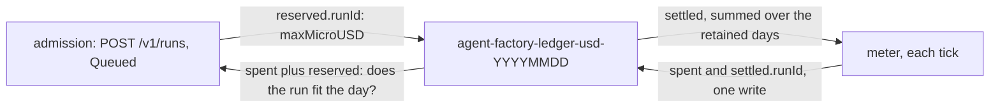

# Daily caps in dollars (#155) Implementation Plan

> **For agentic workers:** REQUIRED SUB-SKILL: Use superpowers:subagent-driven-development (recommended) or superpowers:executing-plans to implement this plan task-by-task. Steps use checkbox (`- [ ]`) syntax for tracking.

**Goal:** The factory's daily caps count dollars: a micro-USD day ledger
`agent-factory-ledger-usd-<YYYYMMDD>` with a per-run `settled.<runId>` watermark, the config keys
`budgets.factoryDailyUSD`, `budgets.humanDailyUSD` and `budgets.perPerson.dailyUSD` (the token keys
accepted and ignored for one release), settlement and admission in micro-USD, the
`agent_factory_budget_{cap,remaining,spent}_usd{principal}` gauges, and `source`/`checkedAt` on a
`meter.prices` row. Closes [#155](https://github.com/Smana/agent-platform/issues/155).

**Architecture:** one layer per task, bottom-up, so each reviewer gate is one concern:

- **Config (Tasks 1–2):** `config.Price` gains provenance; `config.Budgets` holds the days in USD
  (`float64`) and answers each ledger key's day in micro-USD (`DailyMicroUSD`, which replaces
  `DailyCap` so the compiler finds every reader). The token keys decode into `Ignored*` pointer
  fields that `Parse` names in `Config.Ignored` and clears; the binary logs one warning per key.
- **Ledger and admission (Task 3):** `internal/factory/api` owns the encoding: the USD prefix, the
  `settled.` key, `Reservation.MaxMicroUSD`, `OverDaily` in micro-USD, and the read helpers the
  meter uses (`SettledByRun`, `AddSettled`, `LedgerDay`). A task run reserves its `RunMicroUSD`,
  or its `RunTokens` at the reference rate; an API run its `MaxTokens` at the reference rate.
- **Settlement (Task 4):** the meter keeps an `account` per run: its total as the ledger counts it
  (priced cost, or tokens × 1.7 when unpriced or untyped), a `base` that lifts the total to what the
  ledgers already settled when this meter first measures the run, and what is settled. Each tick
  writes `spent` and `settled.<runId>` in one Update. The pruner deletes both prefixes.
- **Gauges (Task 5):** three `Float64Gauge`s replace the two token gauges; the meter tells each
  principal of the previous day 0 at a day's first tick.

**Tech Stack:** Go 1.27.2, controller-runtime's fake client and `interceptor.Funcs`, the
OpenTelemetry metric API on the Prometheus exporter, stdlib `testing` only, golangci-lint v2 through
`task lint`.

**Spec:** ai-native-ref
[`docs/superpowers/specs/2026-10-22-truthful-costs-design.md`](https://github.com/Smana/ai-native-ref/blob/main/docs/superpowers/specs/2026-10-22-truthful-costs-design.md):
TC1 (the `Price` fields), TC5–TC9, offline proofs 6–10. This plan is its pull request 2 only. Pull
request 3 (the pin bump, the USD keys and `source`/`checkedAt` in ai-native-ref) is separate.

**Provenance:** every step's code below was prototyped on `origin/main` at `d40876a`: each task's
code compiled, its tests passed under `-race`, the new tests failed against the code before them,
`hack/lint.sh` reported 0 issues, and `hack/docs.sh`, `hack/spdx.sh`, `go mod tidy -diff` and
`charts/agent-factory/tests/render.sh` passed. The prototype was discarded; this file is the
deliverable. Line numbers are `d40876a`'s and drift as tasks land: find blocks by their text.

## Global Constraints

- **Commits:** conventional, in English, no trailers (no `Co-Authored-By`, no generated-with line).
  The PR title is the squash commit: `feat(factory)!: daily caps in dollars (#155)`.
- **SPDX:** every new `.go` file starts with `// SPDX-License-Identifier: Apache-2.0`.
- **Gates per task:** `go build ./... && go vet ./...`, the task's packages with
  `go test -race -count=1`, and `task lint` (gofmt and goimports align the struct fields shown
  here) before its commit. Task 6 runs `task check`, exit 0; `internal/store` needs Docker.
- **Units:** the ledger, reservations, `OverDaily` and the day caps are micro-USD (`int64`); the
  config is USD (`float64`); the gauges are USD (`float64`). Micro-USD from USD is
  `config.MicroUSD`; from tokens, `config.RefMicroUSD` (1.7 a token, `RefUSDPerMToken` 1.70).
- **Never $0:** an unpriced or untyped run is charged 1.7 micro-USD per token (TC7).
- **Transitional branch:** Tasks 2–4 move one layer each. Between Task 2 and Task 4 the caps are
  micro-USD while the meter still settles tokens; the branch is consistent from Task 4. The PR is
  squash-merged, so no intermediate commit reaches `main`. Release nothing from the branch.
- **Unchanged behaviour:** `enforcePrincipal` (still `false` in the deployment), the shadow counter
  `budget-principal-shadow`, `waiting_daily_budget`, `waiting_meter_blind`, `budget-person`, the run
  and task caps, the run cap's `budget-run` revocations, B1/B2/B6.
- **Out of scope:** ai-native-ref (PR 3), the raw-token alerts, F4's `max_cost`, enforcing
  per-person caps, the drift check (PR 4).

## Rulings

Decisions on what the spec left open, each with its reason.

| # | Point | Ruling | Why |
|---|---|---|---|
| R1 | Go names | `Budgets.FactoryDailyUSD`, `HumanDailyUSD`, `PerPerson.DailyUSD`; `Budgets.DailyMicroUSD(principal)` replaces `DailyCap`; `config.RefMicroUSD`; `api.Reservation.MaxMicroUSD`; `api.LedgerSettled`, `api.LegacyLedgerPrefix`, `api.LedgerDay`, `api.SettledColumn`, `api.AddSettled`, `api.SettledByRun`; `fmetrics.Set.BudgetDay`; `meter.Meter.Day` replaces `Remaining` | A unit change under an unchanged name and type is a silent bug: renaming makes the compiler list every reader, `intake.personSpent` included |
| R2 | Accepting the token keys | Decoded into `*int64` fields `IgnoredFactoryDaily`, `IgnoredHumanDaily`, `PerPerson.IgnoredDailyTokens`; `Parse` lists each set one in `Config.Ignored []Ignored{Key, Use}` and clears it; the token value is never converted | The strict decoder must accept them; an `*int64` accepts exactly what the last release accepted. The next release deletes the three fields and the strict decoder refuses them |
| R3 | The warning | `internal/app.warnIgnored` logs `Warn("config key ignored: the daily budgets are in USD", "key", …, "use", …)` once per key at startup, on every replica | `Parse` has no logger (AGENTS.md: injected loggers) |
| R4 | A USD day of 0 or less | `0` (or omitted) takes the default, as the token days did; below 1 micro-USD, negative or not finite fails: `<key> must be a positive amount` | The ledger counts micro-USD; a smaller day is no day |
| R5 | `checkedAt`, `source` | `checkedAt` parses as `time.DateOnly`, a future date accepted; `source` is `https` with a host and no userinfo | `Parse` has no clock; the URL is provenance a human follows |
| R6 | The prefixes | `LedgerPrefix` now names the USD ledger; the token prefix survives as `LegacyLedgerPrefix` for the pruner alone. `LedgerDay` tests the USD prefix first | Every reader and writer moves by one constant. `agent-factory-ledger-` is a prefix of `agent-factory-ledger-usd-` |
| R7 | `settled.<runId>` value | A decimal integer string, one key per run (a C2 id is key-safe), malformed fails the read | The `spent` column is JSON only because principal ids hold `:` |
| R8 | Reading the watermark | One `List` of the namespace's ConfigMaps (`api.SettledByRun`) per tick that meets a run this meter holds no account of; learned once per run per leader. A write that reports an error (other than a conflict) leaves each run it charged in doubt with its `settled.<runId>` on that day before the write; the next tick reads that day's ledger (one `Get` per day in doubt) and adds what the entry gained, leaving the rest of what the run settled as the meter knows it (R10's lift, pending until written into `settled.<runId>` with the run's next charge, and days pruned since they were read). A failed read, of either kind, fails the tick as a failed write does: nothing charged, no usage annotation, no stamp, retried | Never charge a run whose settled amount is unknown: it could charge it twice. A write's outcome is unknown only on its own day's entry, so only that entry is read again (review of Task 4: re-reading every day's sum dropped R10's lift) |
| R9 | The floor | A run's ledger total is `base + measure`, `base = max(0, settled − measure)` fixed at the first measure after the account is read. `base` also lifts the run's priced USD total, so its run cap and its `Costs` survive a failover after a counter reset; the by-model cost (`agent_factory_model_cost_usd_total`) keeps the counters' view | The spec's "the larger of that sum and its priced counters", applied to the reference-rate measure too |
| R10 | TC9 and ended runs | A run first seen ended and annotated (`usage-tokens` > 0) is taken as settled up to its current measure, so charged nothing more, when nothing is settled for it, or when it was created before the oldest retained ledger day (the pruner's cutoff, 35 days). Judged at the run's first measure only | Nothing deletes an ended claim, the meter lists every claim, and the gateway keeps exporting an ended run's counters: without R10 the switch tick would charge each listed ended run its whole cost again, where TC9 assumes it is not charged. The lift is kept pending (not in `settled`, never in `spent`) and written into the run's `settled.<runId>` with its next charge, so a lifted run with late spend is not charged its pre-switch cost again by a new leader (final review I1); a lifted run with no later charge writes nothing and a new leader lifts it again. After the switch an annotated run has a settled entry once it is charged, because R11. A run created before the cutoff may have had its first days pruned while a later day is kept: its settled sum then reads short, and a new leader would charge the pruned part again (review of Task 4) |
| R11 | The usage annotation | Still written only after a successful ledger write | R10 relies on it: an annotation means some ledger charged the run |
| R12 | A run whose pricing flips | Priced then unpriced mid-run: charged `base + tokens × 1.7`, never below what is settled | Needs a new unpriced model on a live run, which `AgentModelUnpriced` already flags; a bounded under-count, never a refund |
| R13 | Midnight gauges | The meter remembers the principals it told `Day` of and the day; at the first settled tick of a new day it tells each one absent from today's ledger 0 spent | A synchronous gauge holds its last value; a new leader process starts with no series to clear |
| R14 | Rounding | `RefMicroUSD(t) = round(t × 1.70)` | One rule for charge and reservation |
| R15 | Reservations at the switch | Reservations in the token ledger are neither counted nor released after the switch; the pruner deletes them with their ledger | Admission reads only today's USD ledger; the spend they stood for is charged when settled |
| R16 | The person refusal comment | `narrate.PersonOverBudget` names the day in dollars: `` `github:alice` ($8.50) is spent `` | The comment states the cap that refused |
| R17 | Release | A breaking change (two metrics removed, the ledger renamed, `Reservation`'s JSON changed): PR title with `!`, tag `v0.16.0` (pre-1.0 breaking bumps the minor) | CONTRIBUTING.md |

## File map

| File | Change | Task |
|---|---|---|
| `internal/factory/config/config.go` | `Price.Source`, `Price.CheckedAt`; USD days, `DailyMicroUSD`, `RefMicroUSD`, `Ignored` | 1, 2 |
| `internal/factory/config/{prices,dailyusd}_test.go` | New | 1, 2 |
| `internal/factory/config/{config,perperson}_test.go` | Fixture and tests in USD | 2 |
| `internal/app/factory.go`, `internal/app/factory_ignored_test.go` | `warnIgnored`; then the `Day` wiring | 2, 5 |
| `internal/factory/narrate/narrate.go` | `USD`, `PersonOverBudget` in dollars | 2 |
| `internal/factory/intake/issues.go` | `personSpent` reads `DailyMicroUSD` | 2 |
| `internal/factory/api/server.go` | Prefixes, `LedgerSettled`, `Reservation.MaxMicroUSD`, `OverDaily` | 2, 3 |
| `internal/factory/api/settled.go`, `settled_test.go`, `usd_test.go` | New: the settled column, `LedgerDay` | 3 |
| `internal/factory/reconciler/{implement,reconciler}.go`, `dailyusd_test.go` | `runMicroUSD`; the limit from `DailyMicroUSD` | 2, 3 |
| `internal/factory/meter/meter.go` | `account`, `learn`, `measure`, `unsettled`, `settle` with `settled`, the pruner, the `Usage` comment; then `Day` and `tellDay` | 4, 5 |
| `internal/factory/meter/{settlement,day}_test.go` | New | 4, 5 |
| `internal/factory/fmetrics/fmetrics.go`, `fmetrics_test.go` | The USD gauges | 5 |
| `docs/factory.md`, `docs/operations.md`, `charts/agent-factory/README.md` | Folded into the task whose behaviour they describe | 1–5 |

---

### Task 1: `source` and `checkedAt` on a price row

**Files:**
- Modify: `internal/factory/config/config.go:354-362` (`Price`), `:780-787` (the `meter.prices` loop in `Validate`)
- Create: `internal/factory/config/prices_test.go`
- Modify: `internal/factory/meter/usd_test.go` (append one test)
- Modify: `docs/factory.md:278` (the `meter.prices` row), `charts/agent-factory/README.md:75` (the config example)

**Interfaces:**
- Produces: `config.Price.Source string` (`json:"source,omitempty"`), `config.Price.CheckedAt string` (`json:"checkedAt,omitempty"`). The meter never reads them.

- [ ] **Step 1: Write the failing tests**

Create `internal/factory/config/prices_test.go`:

```go
// SPDX-License-Identifier: Apache-2.0

package config

import (
	"strings"
	"testing"
)

// TC1: a price row may say where it was read and when. Both are validated when present and
// change no price.
func TestAPriceRowsSourceAndCheckedAt(t *testing.T) {
	row := func(extra string) string {
		return strings.Replace(good, "  logsURL:",
			"  prices: {agent-default: {input: 1.40, cacheRead: 0.26, output: 4.40"+extra+"}}\n  logsURL:", 1)
	}
	t.Run("both, parsed", func(t *testing.T) {
		cfg, err := Parse([]byte(row(`, source: "https://docs.z.ai/guides/overview/pricing", checkedAt: "2026-10-16"`)))
		if err != nil {
			t.Fatal(err)
		}
		want := Price{Input: 1.40, CacheRead: 0.26, Output: 4.40,
			Source: "https://docs.z.ai/guides/overview/pricing", CheckedAt: "2026-10-16"}
		if got := cfg.Meter.Prices["agent-default"]; got != want {
			t.Fatalf("%+v, want %+v", got, want)
		}
	})
	t.Run("neither, parsed", func(t *testing.T) {
		if _, err := Parse([]byte(row(""))); err != nil {
			t.Fatal(err)
		}
	})
	for name, c := range map[string]struct{ extra, want string }{
		"plain http":     {`, source: "http://docs.z.ai/pricing"`, `meter.prices.agent-default: source "http://docs.z.ai/pricing" is not an https:// URL`},
		"no host":        {`, source: "https:///pricing"`, `source "https:///pricing" is not an https:// URL`},
		"credentials":    {`, source: "https://u:p@docs.z.ai/pricing"`, `is not an https:// URL`},
		"not a URL":      {`, source: "docs.z.ai pricing"`, `is not an https:// URL`},
		"no such month":  {`, checkedAt: "2026-13-01"`, `meter.prices.agent-default: checkedAt "2026-13-01" is not a YYYY-MM-DD date`},
		"another layout": {`, checkedAt: "16/10/2026"`, `checkedAt "16/10/2026" is not a YYYY-MM-DD date`},
		"a timestamp":    {`, checkedAt: "2026-10-16T00:00:00Z"`, `is not a YYYY-MM-DD date`},
	} {
		t.Run(name, func(t *testing.T) {
			_, err := Parse([]byte(row(c.extra)))
			if err == nil || !strings.Contains(err.Error(), c.want) {
				t.Fatalf("err %v, want it to name %q", err, c.want)
			}
		})
	}
}
```

Append to `internal/factory/meter/usd_test.go`:

```go
// TC1: a row's source and checkedAt are provenance, never a price.
func TestAPriceRowsProvenanceChangesNoCost(t *testing.T) {
	p := glm["agent-default"]
	q := p
	q.Source, q.CheckedAt = "https://docs.z.ai/guides/overview/pricing", "2026-10-16"
	u := typedUsage(cohort["#2279"])
	if a, b := cost(p, u), cost(q, u); a != b {
		t.Fatalf("cost %d with provenance, %d without", b, a)
	}
}
```

- [ ] **Step 2: Run them to make sure they fail**

Run: `go test ./internal/factory/config/ -run TestAPriceRowsSourceAndCheckedAt && go test ./internal/factory/meter/ -run TestAPriceRowsProvenanceChangesNoCost`
Expected: FAIL, build failed: `unknown field Source in struct literal of type Price` and `q.Source undefined`.

- [ ] **Step 3: Add the fields and their checks**

In `internal/factory/config/config.go`, the `Price` struct becomes:

```go
// Price is a model's list price in USD per million tokens of each type the gateway reports.
// The gateway's input count includes the cache reads and writes, so each is priced once.
type Price struct {
	Input     float64 `json:"input"`
	CacheRead float64 `json:"cacheRead"`
	// CacheWrite prices cache_creation_input; omitted, the input rate (Z.ai bills no write).
	CacheWrite float64 `json:"cacheWrite,omitempty"`
	Output     float64 `json:"output"`
	// Source is the provider page the row was read from, an https URL, and CheckedAt the day it
	// was read, YYYY-MM-DD: provenance for the human who confirms a drift finding (truthful costs
	// TC1). Validated when present; the meter never reads them.
	Source    string `json:"source,omitempty"`
	CheckedAt string `json:"checkedAt,omitempty"`
}
```

In `Validate`, the `meter.prices` loop gains two checks after its `switch`:

```go
	for model, p := range c.Meter.Prices {
		switch {
		case !modelRE.MatchString(model):
			bad("meter.prices: %q is not a model name", model)
		case !slices.Contains(models(), model) && !c.Meter.ByModel():
			bad("meter.prices.%s: a served model's price needs meter.query grouped by gen_ai_request_model", model)
		case !finite(p.Input) || !finite(p.CacheRead) || !finite(p.Output) || !finite(p.CacheWrite) ||
			p.Input <= 0 || p.CacheRead <= 0 || p.Output <= 0 || p.CacheWrite < 0:
			bad("meter.prices.%s: input, cacheRead and output must be positive, cacheWrite 0 or more", model)
		}
		if u, err := url.Parse(p.Source); p.Source != "" && (err != nil || u.Scheme != "https" || u.Host == "" || u.User != nil) {
			bad("meter.prices.%s: source %q is not an https:// URL", model, p.Source)
		}
		if _, err := time.Parse(time.DateOnly, p.CheckedAt); p.CheckedAt != "" && err != nil {
			bad("meter.prices.%s: checkedAt %q is not a YYYY-MM-DD date", model, p.CheckedAt)
		}
	}
```

- [ ] **Step 4: Run them to make sure they pass**

Run: `go test -race -count=1 ./internal/factory/config/ ./internal/factory/meter/`
Expected: PASS.

- [ ] **Step 5: Document the two keys**

`docs/factory.md`, the first row of the Budgets settings table becomes:

```markdown
| `meter.prices.<model>: {input, cacheRead, cacheWrite?, output, source?, checkedAt?}` | USD per million tokens, keyed by the model that served the tokens (`glm-5.3`, `claude-opus-5-5`) when `meter.query` groups by `gen_ai_request_model`, else by the tier's logical model. `cacheWrite` defaults to `input`. Each price must be positive. `source` (an `https://` URL) and `checkedAt` (`YYYY-MM-DD`) say where and when the row was read: checked when set, never priced |
```

`charts/agent-factory/README.md`, the `meter:` line of the Config example becomes:

```yaml
meter: {prices: {agent-default: {input: 1.40, cacheRead: 0.26, output: 4.40, source: "https://docs.z.ai/guides/overview/pricing", checkedAt: "2026-10-16"}}}
```

- [ ] **Step 6: Lint and commit**

```bash
task lint && bash hack/docs.sh
git add internal/factory/config/config.go internal/factory/config/prices_test.go internal/factory/meter/usd_test.go docs/factory.md charts/agent-factory/README.md
git commit -m "feat(config): a price row says where and when it was read"
```

---

### Task 2: the daily budgets in USD in the config

**Files:**
- Modify: `internal/factory/config/config.go` (consts `:51-54`, `MicroUSD` `:351-352`, `Budgets`/`PerPerson`/`DailyCap` `:398-435`, `Config.Hash` `:134-136`, `Parse` `:594-602`, `Validate` `:862-870`)
- Create: `internal/factory/config/dailyusd_test.go`
- Modify: `internal/factory/config/config_test.go` (`good` `:56`, `TestBudgetDefaults` `:124-148`, two rows of `TestBadConfigsFail` `:372-373`), `internal/factory/config/perperson_test.go` (whole file)
- Modify: `internal/factory/api/server.go:563`, `internal/factory/reconciler/reconciler.go:802`, `internal/factory/reconciler/implement.go:155`, `internal/factory/meter/meter.go:864`, `internal/factory/intake/issues.go:352-360`, `internal/factory/narrate/narrate.go:519-525`
- Modify: `internal/app/factory.go:99-107`; create `internal/app/factory_ignored_test.go`
- Modify (fixtures): the tests listed in Step 7, `internal/app/runs_kind_test.go:118`, `internal/factory/intake/person_test.go`
- Modify: `docs/factory.md`, `charts/agent-factory/README.md`

**Interfaces:**
- Produces:
  - `config.Budgets{EnforceTask, EnforcePrincipal bool; FactoryDailyUSD, HumanDailyUSD float64; PerPerson PerPerson; IgnoredFactoryDaily, IgnoredHumanDaily *int64}`
  - `config.PerPerson{Enabled bool; DailyUSD float64; IgnoredDailyTokens *int64}`
  - `func (b config.Budgets) DailyMicroUSD(principal string) int64` (replaces `DailyCap`)
  - `func config.RefMicroUSD(tokens int64) int64`
  - `type config.Ignored struct{ Key, Use string }`; `config.Config.Ignored []Ignored` (`json:"-"`)
  - `func narrate.USD(micro int64) string`; `narrate.PersonOverBudget(number int, person string, capMicroUSD int64, at time.Time) Event`
  - `func warnIgnored(log *slog.Logger, cfg *config.Config)` in `internal/app`

- [ ] **Step 1: Write the failing config tests**

Create `internal/factory/config/dailyusd_test.go`:

```go
// SPDX-License-Identifier: Apache-2.0

package config

import (
	"slices"
	"strings"
	"testing"
)

// TC5: the days are in USD, defaulting to OD-10's 25 M and 5 M tokens at the reference $1.70 per
// million, and a person's day to the human one.
func TestTheDailyCapsAreInUSD(t *testing.T) {
	line := "budgets: {enforceTask: false, enforcePrincipal: false, factoryDailyUSD: 42.50, humanDailyUSD: 8.50}\n"
	for name, c := range map[string]struct {
		with                   string
		factory, human, person float64
	}{
		"omitted":      {"", 42.50, 8.50, 8.50},
		"written":      {"budgets: {factoryDailyUSD: 60, humanDailyUSD: 10, perPerson: {dailyUSD: 4.25}}\n", 60, 10, 4.25},
		"person, none": {"budgets: {humanDailyUSD: 10}\n", 42.50, 10, 10},
	} {
		t.Run(name, func(t *testing.T) {
			cfg, err := Parse([]byte(strings.Replace(good, line, c.with, 1)))
			if err != nil {
				t.Fatal(err)
			}
			b := cfg.Budgets
			if b.FactoryDailyUSD != c.factory || b.HumanDailyUSD != c.human || b.PerPerson.DailyUSD != c.person {
				t.Fatalf("%+v, want $%v, $%v, person $%v", b, c.factory, c.human, c.person)
			}
			if len(cfg.Ignored) != 0 {
				t.Fatalf("ignored %v on a file that writes no token day", cfg.Ignored)
			}
		})
	}
}

// TC5: one release accepts the token days, ignores them and names each, so a file written for the
// previous release still rolls out; the strict decoder refuses them once the fields are gone.
func TestTheTokenDaysAreAcceptedIgnoredAndNamed(t *testing.T) {
	line := "budgets: {enforceTask: false, enforcePrincipal: false, factoryDailyUSD: 42.50, humanDailyUSD: 8.50}\n"
	old := "budgets: {enforcePrincipal: false, factoryDaily: 25000000, humanDaily: 5000000, perPerson: {enabled: true, dailyTokens: 2000000}}\n"
	cfg, err := Parse([]byte(strings.Replace(good, line, old, 1)))
	if err != nil {
		t.Fatal(err)
	}
	want := []Ignored{
		{Key: "budgets.factoryDaily", Use: "budgets.factoryDailyUSD"},
		{Key: "budgets.humanDaily", Use: "budgets.humanDailyUSD"},
		{Key: "budgets.perPerson.dailyTokens", Use: "budgets.perPerson.dailyUSD"},
	}
	if !slices.Equal(cfg.Ignored, want) {
		t.Fatalf("ignored %v, want %v", cfg.Ignored, want)
	}
	b := cfg.Budgets
	if b.FactoryDailyUSD != 42.50 || b.HumanDailyUSD != 8.50 || b.PerPerson.DailyUSD != 8.50 {
		t.Fatalf("a token day is ignored, never converted: %+v", b)
	}
	if b.IgnoredFactoryDaily != nil || b.IgnoredHumanDaily != nil || b.PerPerson.IgnoredDailyTokens != nil {
		t.Fatalf("an ignored key is cleared, so nothing reads it: %+v", b)
	}
	one := strings.Replace(good, line, "budgets: {factoryDailyUSD: 42.50, humanDaily: 5000000}\n", 1)
	if cfg, err := Parse([]byte(one)); err != nil || !slices.Equal(cfg.Ignored, want[1:2]) {
		t.Fatalf("one token day beside the USD days: %v %v", err, cfg)
	}
}
```

Replace the whole of `internal/factory/config/perperson_test.go`:

```go
// SPDX-License-Identifier: Apache-2.0

package config

import (
	"strings"
	"testing"
)

// v2 per-person caps: off by default, the person's day defaulting to humanDailyUSD (D7), so a
// config that never names perPerson admits exactly as before.
func TestPerPersonDefaults(t *testing.T) {
	line := "budgets: {enforceTask: false, enforcePrincipal: false, factoryDailyUSD: 42.50, humanDailyUSD: 8.50}\n"
	for name, c := range map[string]struct {
		with    string
		enabled bool
		daily   float64
	}{
		"omitted":             {line, false, 8.50},
		"enabled, no value":   {strings.Replace(line, "}\n", ", perPerson: {enabled: true}}\n", 1), true, 8.50},
		"enabled, own value":  {strings.Replace(line, "}\n", ", perPerson: {enabled: true, dailyUSD: 3.40}}\n", 1), true, 3.40},
		"disabled, own value": {strings.Replace(line, "}\n", ", perPerson: {dailyUSD: 3.40}}\n", 1), false, 3.40},
	} {
		t.Run(name, func(t *testing.T) {
			cfg, err := Parse([]byte(strings.Replace(good, line, c.with, 1)))
			if err != nil {
				t.Fatal(err)
			}
			if p := cfg.Budgets.PerPerson; p.Enabled != c.enabled || p.DailyUSD != c.daily {
				t.Fatalf("%+v", p)
			}
		})
	}
	cfg, err := Parse([]byte(strings.Replace(good, line, strings.Replace(line, "}\n", ", perPerson: {dailyUSD: -1}}\n", 1), 1)))
	if err == nil || !strings.Contains(err.Error(), "budgets.perPerson.dailyUSD must be a positive amount") {
		t.Fatalf("a negative person day fails the rollout: %v %+v", err, cfg)
	}
}

// DailyMicroUSD is every reader's one answer to a ledger key's day, in the ledger's micro-USD: the
// fleet's, a person's while per-person caps are on, else the human day as before.
func TestDailyMicroUSD(t *testing.T) {
	b := Budgets{FactoryDailyUSD: 42.50, HumanDailyUSD: 8.50, PerPerson: PerPerson{DailyUSD: 3.40}}
	if b.DailyMicroUSD("system:factory") != 42_500_000 || b.DailyMicroUSD("github:alice") != 8_500_000 ||
		b.DailyMicroUSD("human:291") != 8_500_000 {
		t.Fatal("off: the human day")
	}
	b.PerPerson.Enabled = true
	if b.DailyMicroUSD("system:factory") != 42_500_000 || b.DailyMicroUSD("github:alice") != 3_400_000 ||
		b.DailyMicroUSD("human:291") != 3_400_000 {
		t.Fatal("on: the person day for every non-fleet key")
	}
}

// TC7: what the ledger charges a run it cannot price, 1.7 micro-USD a token, never $0.
func TestRefMicroUSD(t *testing.T) {
	for tokens, want := range map[int64]int64{0: 0, 1000: 1700, 1_500_000: 2_550_000, 2_000_000: 3_400_000, 5_000_000: 8_500_000} {
		if got := RefMicroUSD(tokens); got != want {
			t.Errorf("RefMicroUSD(%d) = %d, want %d", tokens, got, want)
		}
	}
}
```

In `internal/factory/config/config_test.go`:

1. In `good`, the budgets line becomes
   `budgets: {enforceTask: false, enforcePrincipal: false, factoryDailyUSD: 42.50, humanDailyUSD: 8.50}`.
2. In `TestBudgetDefaults`, the `line` becomes
   `"budgets: {enforceTask: false, enforcePrincipal: false, factoryDailyUSD: 42.50, humanDailyUSD: 8.50}\n"`
   and its assertion becomes:

   ```go
   			if b := cfg.Budgets; b.FactoryDailyUSD != 42.50 || b.HumanDailyUSD != 8.50 || b.EnforceTask != c.enforce || b.EnforcePrincipal {
   				t.Fatalf("defaults are $42.50 and $8.50, the principal's unenforced: %+v", b)
   			}
   ```

3. In `TestBadConfigsFail`, the two daily rows become three:

   ```go
   		"negative factory daily":    {"factoryDailyUSD: 42.50", "factoryDailyUSD: -1", "budgets.factoryDailyUSD must be a positive amount"},
   		"negative human daily":      {"humanDailyUSD: 8.50", "humanDailyUSD: -1", "budgets.humanDailyUSD must be a positive amount"},
   		"a day under a micro-USD":   {"humanDailyUSD: 8.50", "humanDailyUSD: 0.0000001", "budgets.humanDailyUSD must be a positive amount"},
   ```

- [ ] **Step 2: Write the failing warning and narration tests**

Create `internal/app/factory_ignored_test.go`:

```go
// SPDX-License-Identifier: Apache-2.0

package app

import (
	"bytes"
	"log/slog"
	"strings"
	"testing"

	"github.com/Smana/agent-platform/internal/factory/config"
)

// TC5: each token day a file still writes is named at startup, with the key that replaced it.
func TestEachIgnoredConfigKeyIsWarnedAbout(t *testing.T) {
	var buf bytes.Buffer
	warnIgnored(slog.New(slog.NewTextHandler(&buf, nil)), &config.Config{Ignored: []config.Ignored{
		{Key: "budgets.factoryDaily", Use: "budgets.factoryDailyUSD"},
		{Key: "budgets.perPerson.dailyTokens", Use: "budgets.perPerson.dailyUSD"},
	}})
	out := buf.String()
	if strings.Count(out, "level=WARN") != 2 ||
		!strings.Contains(out, "key=budgets.factoryDaily use=budgets.factoryDailyUSD") ||
		!strings.Contains(out, "key=budgets.perPerson.dailyTokens use=budgets.perPerson.dailyUSD") {
		t.Fatalf("want one warning per key, naming its replacement:\n%s", out)
	}
	buf.Reset()
	warnIgnored(slog.New(slog.NewTextHandler(&buf, nil)), &config.Config{})
	if buf.Len() != 0 {
		t.Fatalf("a file without them warns nothing: %s", buf.String())
	}
}
```

The intake refusal names the day in dollars (R16):

```bash
sed -i 's/`github:smana` (5.0 M tokens) is spent/`github:smana` ($5.00) is spent/' internal/factory/intake/person_test.go
```

- [ ] **Step 3: Run them to make sure they fail**

Run: `go test ./internal/factory/config/ ./internal/app/ -run 'TestTheDailyCapsAreInUSD|TestTheTokenDaysAreAcceptedIgnoredAndNamed|TestPerPersonDefaults|TestDailyMicroUSD|TestRefMicroUSD|TestEachIgnoredConfigKeyIsWarnedAbout'`
Expected: FAIL, build failed: `undefined: Ignored`, `unknown field FactoryDailyUSD in struct literal of type Budgets`, `undefined: warnIgnored`.

- [ ] **Step 4: Implement the USD days in the config**

In `internal/factory/config/config.go`, the two token defaults become:

```go
	// OD-10's daily budgets, when the config omits them: R3 wants a week of shadow numbers first,
	// so the ceilings exist even before an operator writes them down. OD-10's 25 M and 5 M tokens
	// at the reference $1.70 per million (truthful costs TC5).
	defaultFactoryDailyUSD = 42.50
	defaultHumanDailyUSD   = 8.50
```

After `MicroUSD`, add:

```go
// RefMicroUSD is tokens reference tokens in micro-USD, 1.7 a token: what the day ledger charges a
// run the meter cannot price, and reserves for a run capped in tokens (truthful costs TC7). Never
// $0 for an unknown model.
func RefMicroUSD(tokens int64) int64 { return int64(math.Round(float64(tokens) * RefUSDPerMToken)) }
```

Replace `Budgets`, `PerPerson`, `PrincipalFactory` and `DailyCap` with:

```go
// Budgets are the admission-time caps SP3 owns (C5). The task cap is enforced unless the config
// writes enforceTask: false (owner, 2026-10-07: a shadow cap let a task run to 3.35 M of its 3 M);
// the principal's starts false, a week of shadow numbers first (OD-10, R3). The run cap is always
// enforced by the meter. The days are in USD (truthful costs TC5): the day ledger counts each
// run's priced cost, a cache read at its own rate.
type Budgets struct {
	EnforceTask      bool    `json:"enforceTask"`
	EnforcePrincipal bool    `json:"enforcePrincipal"`
	FactoryDailyUSD  float64 `json:"factoryDailyUSD"`
	HumanDailyUSD    float64 `json:"humanDailyUSD"`
	// PerPerson is v2's per-person caps: off, every run is admitted as before.
	PerPerson PerPerson `json:"perPerson"`
	// The token days the USD days replaced (#155), accepted for one release so that a file
	// written for the previous one still loads: Parse names each in Config.Ignored and clears it.
	IgnoredFactoryDaily *int64 `json:"factoryDaily,omitempty"`
	IgnoredHumanDaily   *int64 `json:"humanDaily,omitempty"`
}

// PerPerson charges each run to the person who caused it as well as to the fleet, in one ledger
// write (v2 per-person caps D2, D3). Enabled alone attributes and counts (shadow); a refusal also
// needs EnforcePrincipal (D8).
type PerPerson struct {
	Enabled bool `json:"enabled"`
	// DailyUSD is every person's day (D7: one value, no per-person override). Omitted: humanDailyUSD.
	DailyUSD float64 `json:"dailyUSD"`
	// IgnoredDailyTokens is the token day DailyUSD replaced, accepted for one release (Budgets).
	IgnoredDailyTokens *int64 `json:"dailyTokens,omitempty"`
}

// PrincipalFactory is the fleet's ledger key: the factory's own principal.
const PrincipalFactory = "system:factory"

// DailyMicroUSD is the day of a ledger key, in the ledger's micro-USD: the fleet's for
// PrincipalFactory, the person day for any other key while per-person caps are on, else
// humanDailyUSD.
func (b Budgets) DailyMicroUSD(principal string) int64 {
	switch {
	case principal == PrincipalFactory:
		return MicroUSD(b.FactoryDailyUSD)
	case b.PerPerson.Enabled:
		return MicroUSD(b.PerPerson.DailyUSD)
	}
	return MicroUSD(b.HumanDailyUSD)
}

// Ignored is a key the file sets that this release accepts and ignores, and the key to use.
type Ignored struct{ Key, Use string }

// dropTokenDays clears the token days and names each one the file set.
func (b *Budgets) dropTokenDays() []Ignored {
	var out []Ignored
	for _, k := range []struct {
		v        **int64
		key, use string
	}{
		{&b.IgnoredFactoryDaily, "budgets.factoryDaily", "budgets.factoryDailyUSD"},
		{&b.IgnoredHumanDaily, "budgets.humanDaily", "budgets.humanDailyUSD"},
		{&b.PerPerson.IgnoredDailyTokens, "budgets.perPerson.dailyTokens", "budgets.perPerson.dailyUSD"},
	} {
		if *k.v != nil {
			out = append(out, Ignored{Key: k.key, Use: k.use})
			*k.v = nil
		}
	}
	return out
}
```

In `Config`, after `Hash`:

```go
	// Hash is the sha256 of the parsed file; tasks carry it (status.configHash).
	Hash string `json:"-"`
	// Ignored are the keys the file sets that this release accepts and ignores, for the binary
	// to warn about: Parse has no logger.
	Ignored []Ignored `json:"-"`
}
```

In `Parse`, the three token defaults become:

```go
	c.Ignored = c.Budgets.dropTokenDays()
	if c.Budgets.FactoryDailyUSD == 0 {
		c.Budgets.FactoryDailyUSD = defaultFactoryDailyUSD // OD-10
	}
	if c.Budgets.HumanDailyUSD == 0 {
		c.Budgets.HumanDailyUSD = defaultHumanDailyUSD
	}
	if c.Budgets.PerPerson.DailyUSD == 0 {
		c.Budgets.PerPerson.DailyUSD = c.Budgets.HumanDailyUSD // D7: one day for every person
	}
```

In `Validate`, the three `budgets.* must be positive` checks become (`finite` is the closure the
tier checks already use):

```go
	for _, d := range []struct {
		key string
		usd float64
	}{
		{"budgets.factoryDailyUSD", c.Budgets.FactoryDailyUSD}, {"budgets.humanDailyUSD", c.Budgets.HumanDailyUSD},
		{"budgets.perPerson.dailyUSD", c.Budgets.PerPerson.DailyUSD},
	} {
		if !finite(d.usd) || MicroUSD(d.usd) < 1 { // the ledger counts micro-USD: less is no day at all
			bad("%s must be a positive amount", d.key)
		}
	}
```

- [ ] **Step 5: Move every reader of a day to `DailyMicroUSD`**

`internal/factory/api/server.go`, in `reserve`:

```go
	over, err := Reserve(ctx, s.Rooms, s.Namespace, s.Now(), id, mine, b.DailyMicroUSD(mine.Principal), b.DailyMicroUSD(person), b.EnforcePrincipal)
```

`internal/factory/reconciler/reconciler.go`, before `reserveFactoryDay`:

```go
	if limit := r.Cfg.Budgets.DailyMicroUSD(runs.PrincipalFactory); limit > 0 {
```

`internal/factory/reconciler/implement.go`, the last line of `reserveFactoryDay`:

```go
		r.Cfg.Budgets.DailyMicroUSD(person), r.Cfg.Budgets.EnforcePrincipal)
```

`internal/factory/meter/meter.go`:

```go
func (m *Meter) dailyCap(principal string) int64 { return m.Budgets.DailyMicroUSD(principal) }
```

`internal/factory/intake/issues.go`, in `personSpent`, from `used, err := api.DayUsed(...)`'s error
check to the `PostOnce` call:

```go
	day := b.DailyMicroUSD(person)
	if used < day {
		return false, nil
	}
	if !b.EnforcePrincipal {
		p.log().Info("labeller's day is spent (shadow)", "issue", n, "person", person, "used_micro_usd", used, "cap_micro_usd", day)
		return false, nil
	}
	if err := p.narrator().PostOnce(ctx, n, fmt.Sprintf("issue-%d", n),
		narrate.PersonOverBudget(n, person, day, last.At)); err != nil {
```

`internal/factory/narrate/narrate.go`, `PersonOverBudget` and a new `USD`:

```go
func PersonOverBudget(number int, person string, capMicroUSD int64, at time.Time) Event {
	return Event{Key: fmt.Sprintf("refused-person_budget_exhausted-%d", at.Unix()),
		Body: fmt.Sprintf("The agent factory did not start a task for #%d: the daily budget of `%s` (%s) is spent. "+
			"It resets at 00:00 UTC; re-apply the label after that to start it.", number, person, USD(capMicroUSD))}
}

// USD is a micro-USD amount as people read it, to the cent: $8.50.
func USD(micro int64) string { return fmt.Sprintf("$%.2f", float64(micro)/1e6) }
```

- [ ] **Step 6: Warn about each ignored key at startup**

`internal/app/factory.go`, before `runFactory`:

```go
// warnIgnored names each key the config sets that this release accepts and ignores: a file written
// for the previous release loads, and its owner learns which key to move to (#155).
func warnIgnored(log *slog.Logger, cfg *config.Config) {
	for _, k := range cfg.Ignored {
		log.Warn("config key ignored: the daily budgets are in USD", "key", k.Key, "use", k.Use)
	}
}
```

and in `runFactory`, right after `config.Load` succeeds:

```go
	cfg, err := config.Load(cfgPath)
	if err != nil {
		return err
	}
	warnIgnored(log, cfg)
```

- [ ] **Step 7: Move the other packages' fixtures to the USD fields**

The tests keep their numbers: a token day of N reads as N micro-USD (`25_000_000` tokens become
`$25`, which is 25,000,000 micro-USD), so every comparison holds while the meter still settles
tokens (Task 4 re-prices them).

```bash
sed -i -e 's/FactoryDaily: 25_000_000/FactoryDailyUSD: 25/g' -e 's/HumanDaily: 5_000_000/HumanDailyUSD: 5/g' \
  -e 's/DailyTokens: 5_000_000/DailyUSD: 5/g' -e 's/DailyTokens: 2_000_000/DailyUSD: 2/g' \
  -e 's/HumanDaily: 120}/HumanDailyUSD: 0.000120}/g' -e 's/HumanDaily: humanDaily,/HumanDailyUSD: float64(humanDaily) \/ 1e6,/g' \
  internal/factory/api/person_test.go internal/factory/api/server_test.go internal/factory/meter/meter_test.go \
  internal/factory/meter/person_test.go internal/factory/intake/person_test.go internal/factory/reconciler/caps_test.go \
  internal/factory/reconciler/person_test.go internal/factory/reconciler/release_test.go
sed -i 's/factoryDaily: 25000000, humanDaily: 5000000}/factoryDailyUSD: 42.50, humanDailyUSD: 8.50}/' internal/app/runs_kind_test.go
go vet ./...
```

Expected: `go vet` prints nothing.

- [ ] **Step 8: Run the tests to make sure they pass**

Run: `go test -race -count=1 ./internal/factory/... ./internal/app/...`
Expected: PASS (`internal/factory/reconciler` skips its envtest test without `KUBEBUILDER_ASSETS`;
`task test` sets it).

- [ ] **Step 9: Document the USD days**

`docs/factory.md`:

1. The `waiting_daily_budget` row:

   ```markdown
   | `waiting_daily_budget` | `budgets.factoryDailyUSD` is spent. It resumes after 00:00 UTC |
   ```

2. At the end of the Budgets section, delete the sentence "The daily budgets, `budgets.factoryDaily`
   and `budgets.humanDaily`, stay in raw tokens." so the paragraph ends "...and `budget-fleet` below
   it. The metrics for each cap are in [Operations](operations.md#budget-signals).", then insert,
   before `### Per-person caps`:

   ```markdown
   ### Daily budgets

   The fleet's day (`budgets.factoryDailyUSD`, $42.50) and each human's (`budgets.humanDailyUSD`,
   $8.50) are in USD: OD-10's 25 M and 5 M tokens at $1.70 per million, with a cache read counted at
   its own rate. A file that still writes the token days (`budgets.factoryDaily`,
   `budgets.humanDaily`, `budgets.perPerson.dailyTokens`) loads in this release: each is ignored and
   named in a startup warning with the key to use, and the next release refuses it.
   ```

3. In Per-person caps, the `dailyTokens` row and the closing paragraph:

   ```markdown
   | `budgets.perPerson.dailyUSD` | Every person's day, in USD. Default: `humanDailyUSD` |
   ```

   ```markdown
   The person's day is in USD, like the fleet's ([Daily budgets](#daily-budgets)). Turning it on: set
   `enabled` and watch `budget-principal-shadow{principal}` for a week, then set `enforcePrincipal`.
   ```

4. The `budgets` row of the config file table:

   ```markdown
   | `budgets` | `enforceTask`, `enforcePrincipal`, `factoryDailyUSD`, `humanDailyUSD` ([daily budgets](#daily-budgets)), `perPerson: {enabled, dailyUSD}` ([per-person caps](#per-person-caps)), each day positive. The token days `factoryDaily`, `humanDaily` and `perPerson.dailyTokens` load in this release only, ignored, each named in a startup warning | `enforceTask` true, `factoryDailyUSD` 42.50, `humanDailyUSD` 8.50, `perPerson.enabled` false, `perPerson.dailyUSD` `humanDailyUSD` |
   ```

`charts/agent-factory/README.md`, the Config paragraph ends:

```markdown
default to the platform's values, so an older file loads unchanged: `api.groups` (`agents-admin`,
`agents-member`) and a schedule's `probeAuthor` (`renovate[bot]`). The daily budgets are in USD:
this release still loads the token days `budgets.factoryDaily`, `budgets.humanDaily` and
`budgets.perPerson.dailyTokens`, ignores them and logs a warning naming the USD key to use; the
next one refuses them. For example:
```

and its example gains the budgets line:

```yaml
api: {groups: {admin: agents-admin, member: agents-member}}
budgets: {factoryDailyUSD: 42.50, humanDailyUSD: 8.50}
caps: {escalatedHours: 72}
meter: {prices: {agent-default: {input: 1.40, cacheRead: 0.26, output: 4.40, source: "https://docs.z.ai/guides/overview/pricing", checkedAt: "2026-10-16"}}}
```

- [ ] **Step 10: Lint and commit**

```bash
task lint && bash hack/docs.sh
git add -A internal docs charts
git commit -m "feat(config): the daily budgets are in USD, the token days ignored for a release"
```

---

### Task 3: the USD day ledger and admission in micro-USD

**Files:**
- Modify: `internal/factory/api/server.go` (layout `:115-134`, `Reservation` `:136-145`, `reserve` `:555-563`, `Reserve`'s doc `:607` and its two `OverDaily` calls `:648-653`, `OverDaily`/`dayUsed` `:708-721`, `DayUsed`'s doc `:725-727`)
- Create: `internal/factory/api/settled.go`, `internal/factory/api/settled_test.go`, `internal/factory/api/usd_test.go`
- Modify: `internal/factory/reconciler/implement.go:140-156` (and its imports)
- Create: `internal/factory/reconciler/dailyusd_test.go`
- Modify (fixtures, Step 6): `internal/factory/api/{person,ledger,server,idempotency}_test.go`, `internal/factory/meter/{release,meter}_test.go`, `internal/factory/reconciler/{person,caps}_test.go`
- Modify: `docs/factory.md` (Daily budgets), `charts/agent-factory/README.md` (RBAC)

**Interfaces:**
- Consumes: `config.RefMicroUSD`, `Budgets.DailyMicroUSD` (Task 2).
- Produces:
  - `api.LedgerPrefix = "agent-factory-ledger-usd-"`, `api.LegacyLedgerPrefix = "agent-factory-ledger-"`, `api.LedgerSettled = "settled."`
  - `api.Reservation{Principal, Person, Room string; MaxMicroUSD int64}` (`json:"maxMicroUSD"`)
  - `func api.OverDaily(usedMicroUSD, maxMicroUSD, limit int64) bool`
  - `func api.LedgerDay(name, prefix string) (string, bool)`
  - `func api.SettledColumn(cm *corev1.ConfigMap) (map[string]int64, error)`
  - `func api.AddSettled(cm *corev1.ConfigMap, inc map[string]int64) error`
  - `func api.SettledByRun(ctx context.Context, c client.Reader, ns string) (map[string]int64, error)`
  - `func runMicroUSD(b v1alpha1.Budget) int64` in `internal/factory/reconciler`

- [ ] **Step 1: Write the failing tests**

Create `internal/factory/api/settled_test.go`:

```go
// SPDX-License-Identifier: Apache-2.0

package api

import (
	"maps"
	"strings"
	"testing"

	corev1 "k8s.io/api/core/v1"
	metav1 "k8s.io/apimachinery/pkg/apis/meta/v1"
	"sigs.k8s.io/controller-runtime/pkg/client/fake"
)

func configMap(name string, data map[string]string) *corev1.ConfigMap {
	return &corev1.ConfigMap{ObjectMeta: metav1.ObjectMeta{Name: name, Namespace: "agent-system"}, Data: data}
}

// TC6: the ledger is one ConfigMap per UTC day, its name carrying the day after the USD prefix.
// The token ledgers it replaced share a shorter prefix, so the USD one is tested first.
func TestLedgerDay(t *testing.T) {
	for name, c := range map[string]struct {
		prefix, day string
		ok          bool
	}{
		"agent-factory-ledger-usd-20261022": {LedgerPrefix, "20261022", true},
		"agent-factory-ledger-20261022":     {LegacyLedgerPrefix, "20261022", true},
		"agent-factory-ledger-20251301":     {LegacyLedgerPrefix, "", false},
		"agent-factory-meter":               {LegacyLedgerPrefix, "", false},
	} {
		if day, ok := LedgerDay(name, c.prefix); day != c.day || ok != c.ok {
			t.Errorf("%s: %q %v, want %q %v", name, day, ok, c.day, c.ok)
		}
	}
	if _, ok := LedgerDay("agent-factory-ledger-usd-20261022", LegacyLedgerPrefix); ok {
		t.Error("a USD ledger is no token ledger")
	}
	if LedgerPrefix+"20261022" != "agent-factory-ledger-usd-20261022" {
		t.Errorf("the name is %s", LedgerPrefix+"20261022")
	}
}

// TC6: settled.<runId> is what a run was charged that day; summed over every USD day ledger it is
// all a run was charged. A token ledger, another ConfigMap and a name that is no day add nothing.
func TestSettledByRunSumsTheUSDDayLedgers(t *testing.T) {
	c := fake.NewClientBuilder().WithScheme(scheme()).WithObjects(
		configMap(LedgerPrefix+"20260926", map[string]string{LedgerSettled + "aaaaaaaa": "1200000",
			LedgerSpent: `{"system:factory":1200000}`}),
		configMap(LedgerPrefix+"20260927", map[string]string{LedgerSettled + "aaaaaaaa": "300000",
			LedgerSettled + "bbbbbbbb": "7", LedgerReserved + "cccccccc": `{"principal":"system:factory","maxMicroUSD":2550000}`}),
		configMap(LegacyLedgerPrefix+"20260927", map[string]string{LedgerSettled + "aaaaaaaa": "999"}),
		configMap(MeterHeartbeat, map[string]string{LedgerSettled + "aaaaaaaa": "999"}),
		configMap(LedgerPrefix+"notaday", map[string]string{LedgerSettled + "aaaaaaaa": "999"}),
	).Build()
	got, err := SettledByRun(t.Context(), c, "agent-system")
	if err != nil {
		t.Fatal(err)
	}
	if want := map[string]int64{"aaaaaaaa": 1_500_000, "bbbbbbbb": 7}; !maps.Equal(got, want) {
		t.Fatalf("%v, want %v", got, want)
	}
	bad := fake.NewClientBuilder().WithScheme(scheme()).WithObjects(
		configMap(LedgerPrefix+"20260927", map[string]string{LedgerSettled + "aaaaaaaa": "1.5"})).Build()
	if _, err := SettledByRun(t.Context(), bad, "agent-system"); err == nil || !strings.Contains(err.Error(), "not a micro-USD amount") {
		t.Fatalf("an amount that does not parse fails the read: %v", err)
	}
}

// The meter adds a tick's charges to what the day already holds for each run.
func TestAddSettledAccumulates(t *testing.T) {
	cm := configMap(LedgerPrefix+"20260927", map[string]string{LedgerSettled + "aaaaaaaa": "100"})
	if err := AddSettled(cm, map[string]int64{"aaaaaaaa": 50, "bbbbbbbb": 7}); err != nil {
		t.Fatal(err)
	}
	if got, _ := SettledColumn(cm); !maps.Equal(got, map[string]int64{"aaaaaaaa": 150, "bbbbbbbb": 7}) {
		t.Fatalf("%v", got)
	}
	empty := configMap(LedgerPrefix+"20260927", nil)
	if err := AddSettled(empty, map[string]int64{"aaaaaaaa": 1}); err != nil || empty.Data[LedgerSettled+"aaaaaaaa"] != "1" {
		t.Fatalf("a new day's first entry: %v %v", err, empty.Data)
	}
}
```

Create `internal/factory/api/usd_test.go`:

```go
// SPDX-License-Identifier: Apache-2.0

package api

import (
	"net/http"
	"testing"

	"sigs.k8s.io/controller-runtime/pkg/client/fake"
)

// TC7: a run request caps in tokens until F4 brings max_cost, so it reserves its maxTokens at the
// reference rate, 1.7 micro-USD a token.
func TestARunRequestReservesItsMaxTokensAtTheReferenceRate(t *testing.T) {
	c := fake.NewClientBuilder().WithScheme(scheme()).Build()
	s := mkServer(t, &store{}, c, false, false, "7f3cq2xz", 8_500_000)
	body := base()
	body["maxTokens"] = 1_000_000
	if w := post(s.Handler(), "alice", body); w.Code != http.StatusCreated {
		t.Fatalf("%d %s", w.Code, w.Body)
	}
	if r := entry(t, s, "7f3cq2xz"); r != (Reservation{Principal: "human:291", MaxMicroUSD: 1_700_000}) {
		t.Fatalf("%+v, want 1.7 micro-USD a token", r)
	}
}
```

Create `internal/factory/reconciler/dailyusd_test.go`:

```go
// SPDX-License-Identifier: Apache-2.0

package reconciler

import (
	"testing"

	v1alpha1 "github.com/Smana/agent-platform/api/factory/v1alpha1"
	"github.com/Smana/agent-platform/internal/factory/config"
	"github.com/Smana/agent-platform/internal/factory/triage"
)

// TC7: a factory run reserves its USD run cap in the day ledger; a tier capped in tokens reserves
// its runTokens at the reference rate, 1.7 micro-USD a token.
func TestAFactoryRunReservesItsRunCapInMicroUSD(t *testing.T) {
	for name, c := range map[string]struct {
		runUSD float64
		want   int64
	}{
		"a USD run cap": {2.00, 2_000_000},
		"a token cap":   {0, 2_550_000},
	} {
		t.Run(name, func(t *testing.T) {
			g := newRig(t, issueTask("3buqdlot", 7, "x"))
			cf := cfg()
			tier := cf.Tiers["standard"]
			tier.RunUSD = c.runUSD
			cf.Tiers["standard"] = tier
			g.r.Triage = triage.Static{Cfg: cf}
			g.r.Cfg.Budgets = config.Budgets{FactoryDailyUSD: 42.50, HumanDailyUSD: 8.50}
			tk := g.reconcile(t, "3buqdlot", 3)
			if got := reservationOf(t, g, rid(0)); tk.Status.Phase != v1alpha1.PhaseImplementing || got.MaxMicroUSD != c.want {
				t.Fatalf("%s: reserved %+v, want %d micro-USD", tk.Status.Phase, got, c.want)
			}
		})
	}
}
```

- [ ] **Step 2: Run them to make sure they fail**

Run: `go test ./internal/factory/api/ ./internal/factory/reconciler/ -run 'TestLedgerDay|TestSettledByRun|TestAddSettled|TestARunRequestReservesItsMaxTokens|TestAFactoryRunReservesItsRunCap'`
Expected: FAIL, build failed: `undefined: LegacyLedgerPrefix`, `undefined: LedgerSettled`, `unknown field MaxMicroUSD in struct literal of type Reservation`.

- [ ] **Step 3: The ledger's layout and admission in micro-USD**

In `internal/factory/api/server.go`, the layout block and `Reservation` become:

```go
// Ledger layout (R50). One ConfigMap per UTC day, agent-factory-ledger-usd-<YYYYMMDD>, in the
// factory's namespace: the apiserver's resourceVersion is the transaction, so two replicas
// cannot take one slot. Every amount is micro-USD (truthful costs TC6). Exported so the meter
// reads and writes the same encoding: admission owns the reservations, the meter owns the spend.
const (
	LedgerPrefix = "agent-factory-ledger-usd-"
	// LegacyLedgerPrefix names the token ledgers the USD ones replaced (#155): nothing reads or
	// writes them; the meter's pruner deletes them once they are older than its retention.
	LegacyLedgerPrefix = "agent-factory-ledger-"
	// LedgerSpent is one JSON map, principal → micro-USD. It is a map rather than one key per
	// principal because principal ids carry ":", which no ConfigMap key may hold. The meter
	// owns this column; admission only reads it.
	LedgerSpent = "spent"
	// LedgerReserved prefixes one key per admitted run — reserved.<runId>, whose C2 id is
	// key-safe — holding {principal, person, room, maxMicroUSD}. Release drops the entry when the
	// run ends or its claim goes (#55); the spend it made stays: deleting a run refunds nothing.
	LedgerReserved = "reserved."
	// LedgerSettled prefixes one key per metered run, settled.<runId>: the micro-USD charged to
	// that run that day, written by the meter in the same write as spent. Per key, spent is the
	// sum of settled over the runs charged to it; summed over the retained days, it is how much
	// of a run any meter has charged, so a new leader charges neither twice nor less (TC6).
	LedgerSettled = "settled."
	// LedgerDayLayout labels the ledger with the UTC day it counts.
	LedgerDayLayout = "20060102"
	// LedgerAttempts bounds the conflict-retry loop: steady contention of that depth is
	// failure, not patience.
	LedgerAttempts = 5
)

// Reservation is one ledger entry: what the run may spend, in micro-USD, on whose behalf and on
// which room. Person is the second key the same entry charges (v2 per-person caps D3): the person
// who caused the run, beside the fleet as Principal. One key per run is what makes both
// reservations one write: no run ever holds one without the other.
type Reservation struct {
	Principal   string `json:"principal"`
	Person      string `json:"person,omitempty"`
	Room        string `json:"room,omitempty"`
	MaxMicroUSD int64  `json:"maxMicroUSD"`
}
```

`reserve`'s doc and first lines:

```go
// reserve is R50's admission on the day's ledger (Reserve), its refusals said in HTTP. A run
// charged to a person reserves the fleet and the person in one entry (D2, D3). A run request caps
// in tokens, so it reserves its maxTokens at the reference rate until F4 brings max_cost (TC7).
func (s *Server) reserve(ctx context.Context, p authn.Principal, person, id string, in RunRequest) (int, string) {
	b := s.Cfg.Budgets
	mine := Reservation{Principal: p.ID, Room: in.RoomRef, MaxMicroUSD: config.RefMicroUSD(in.MaxTokens)}
```

In `Reserve`'s doc, "check spent + reserved + maxTokens against limit" becomes "check spent +
reserved + maxMicroUSD against limit", and its two decisions:

```go
		case mine.Person != "" && OverDaily(dayUsed(spent, reserved, mine.Person), mine.MaxMicroUSD, personLimit):
```

```go
		case OverDaily(dayUsed(spent, reserved, mine.Principal), mine.MaxMicroUSD, limit):
```

`OverDaily`, `dayUsed` and `DayUsed`'s doc:

```go
// OverDaily is the daily cap's one decision (R50), in micro-USD (TC7): a run that may spend
// maxMicroUSD does not fit beside what the principal's day already holds. The API's admission and
// the factory's Queued (N2) both decide on it.
func OverDaily(usedMicroUSD, maxMicroUSD, limit int64) bool { return usedMicroUSD+maxMicroUSD > limit }

// dayUsed is what principal holds of its day, in micro-USD: the meter's settled spend plus its
// admitted runs' reservations, as their principal or their person.
func dayUsed(spent map[string]int64, reserved map[string]Reservation, principal string) int64 {
	used := spent[principal]
	for _, v := range reserved {
		if v.Principal == principal || v.Person == principal {
			used += v.MaxMicroUSD
		}
	}
	return used
}

// DayUsed reads principal's use of the UTC day of now from that day's ledger, in micro-USD, as
// admission does: a missing ledger is a day with nothing used. c must read ConfigMaps live: the
// factory's cached watch sees the stop object only.
```

- [ ] **Step 4: The settled column**

Create `internal/factory/api/settled.go`:

```go
// SPDX-License-Identifier: Apache-2.0

package api

import (
	"context"
	"fmt"
	"strconv"
	"strings"
	"time"

	corev1 "k8s.io/api/core/v1"
	"sigs.k8s.io/controller-runtime/pkg/client"
)

// LedgerDay is the UTC day name carries after prefix, and whether name is prefix followed by a
// day at all. LegacyLedgerPrefix is a prefix of LedgerPrefix, so a USD ledger read against it
// yields "usd-<day>", which is no day: test LedgerPrefix first.
func LedgerDay(name, prefix string) (string, bool) {
	day, ok := strings.CutPrefix(name, prefix)
	if !ok {
		return "", false
	}
	if _, err := time.Parse(LedgerDayLayout, day); err != nil {
		return "", false
	}
	return day, true
}

// SettledColumn reads a day ledger's settled.<runId> entries: the micro-USD charged to each run
// that day. Nil when there are none.
func SettledColumn(cm *corev1.ConfigMap) (map[string]int64, error) {
	var m map[string]int64
	for k, raw := range cm.Data {
		id, ok := strings.CutPrefix(k, LedgerSettled)
		if !ok {
			continue
		}
		n, err := strconv.ParseInt(raw, 10, 64)
		if err != nil || n < 0 {
			return nil, fmt.Errorf("ledger %s: settled %s is %q, not a micro-USD amount", cm.Name, id, raw)
		}
		if m == nil {
			m = map[string]int64{}
		}
		m[id] = n
	}
	return m, nil
}

// AddSettled adds each run's micro-USD to its settled.<runId> entry: the meter's half of the one
// write that also carries the spent column.
func AddSettled(cm *corev1.ConfigMap, inc map[string]int64) error {
	have, err := SettledColumn(cm)
	if err != nil {
		return err
	}
	if cm.Data == nil {
		cm.Data = map[string]string{}
	}
	for id, n := range inc {
		cm.Data[LedgerSettled+id] = strconv.FormatInt(have[id]+n, 10)
	}
	return nil
}

// SettledByRun sums settled.<runId> over every day ledger in ns: what the meters have charged each
// run so far, the floor a meter that first sees a run starts it from (TC6). The pruner bounds the
// sum to the retained days. c must list ConfigMaps live: the factory's cache sees the stop object
// only. One entry that does not parse fails the whole read: a meter must not guess what was charged.
func SettledByRun(ctx context.Context, c client.Reader, ns string) (map[string]int64, error) {
	var cms corev1.ConfigMapList
	if err := c.List(ctx, &cms, client.InNamespace(ns)); err != nil {
		return nil, fmt.Errorf("ledger: list the day ledgers: %w", err)
	}
	out := map[string]int64{}
	for i := range cms.Items {
		if _, ok := LedgerDay(cms.Items[i].Name, LedgerPrefix); !ok {
			continue
		}
		day, err := SettledColumn(&cms.Items[i])
		if err != nil {
			return nil, err
		}
		for id, n := range day {
			out[id] += n
		}
	}
	return out, nil
}
```

- [ ] **Step 5: A task run reserves its run cap in micro-USD**

In `internal/factory/reconciler/implement.go`, add `"github.com/Smana/agent-platform/internal/factory/config"`
to the imports (between `.../factory/api` and `.../factory/forge`), and `reserveFactoryDay` becomes:

```go
// With per-person caps on, the same entry also charges the person who caused the run (D2, D3).
func (r *Reconciler) reserveFactoryDay(ctx context.Context, t *v1alpha1.Task, limit int64) (string, error) {
	if r.Ledger == nil {
		return "", errors.New("the daily cap needs the ledger client")
	}
	person := r.person(t)
	return api.Reserve(ctx, r.Ledger, r.Namespace, r.Now(), runID(t.Name, len(t.Status.Runs)),
		api.Reservation{Principal: runs.PrincipalFactory, Person: person, MaxMicroUSD: runMicroUSD(t.Spec.Budget)}, limit,
		r.Cfg.Budgets.DailyMicroUSD(person), r.Cfg.Budgets.EnforcePrincipal)
}

// runMicroUSD is what one run of the task may spend, as the day ledger reserves it: its USD run
// cap, or its token cap at the reference rate for a tier capped in tokens (TC7).
func runMicroUSD(b v1alpha1.Budget) int64 {
	if b.RunMicroUSD > 0 {
		return b.RunMicroUSD
	}
	return config.RefMicroUSD(b.RunTokens)
}
```

- [ ] **Step 6: Move the fixtures to micro-USD reservations**

Reservation fields and entry JSON:

```bash
sed -i 's/MaxTokens: /MaxMicroUSD: /g; s/MaxMicroUSD: 2_000_000})/MaxMicroUSD: 3_400_000})/g; s/"maxTokens":/"maxMicroUSD":/g' \
  internal/factory/api/person_test.go
sed -i 's/"maxTokens":/"maxMicroUSD":/g; /Reservation{/s/MaxTokens:/MaxMicroUSD:/g' \
  internal/factory/api/ledger_test.go internal/factory/api/server_test.go internal/factory/meter/release_test.go internal/factory/meter/meter_test.go
sed -i 's/api.Reservation{Principal: runs.PrincipalFactory, MaxTokens: tk.Spec.Budget.RunTokens}/api.Reservation{Principal: runs.PrincipalFactory, MaxMicroUSD: config.RefMicroUSD(tk.Spec.Budget.RunTokens)}/; /LedgerReserved/s/"maxTokens"/"maxMicroUSD"/' \
  internal/factory/reconciler/person_test.go internal/factory/reconciler/caps_test.go
```

`server_test.go`'s `b["maxTokens"]` and `caps_test.go`'s `RunRequest` body keep `maxTokens`: they
are the request's field, not an entry.

An API run of the default 2 M tokens now reserves 3,400,000 micro-USD:

```bash
sed -i 's/if err != nil || used != 2_000_000 {/if err != nil || used != 3_400_000 {/; s/one reservation of the default 2M expected/one reservation of the default 2 M tokens at $1.70 per M expected/' \
  internal/factory/api/idempotency_test.go
sed -i 's/"one budget slot": {daily: 2_000_000,/"one budget slot": {daily: 3_400_000,/' internal/factory/api/server_test.go
```

The factory's daily-budget tests move to the real $42.50 day: every amount × 1.7, so every
comparison is the one it was, and a standard run reserves $2.55:

```bash
sed -i -e 's/config.Budgets{FactoryDailyUSD: 25, /config.Budgets{FactoryDailyUSD: 42.50, /g' \
  -e 's/HumanDailyUSD: 5}/HumanDailyUSD: 8.50}/g; s/HumanDailyUSD: 5, /HumanDailyUSD: 8.50, /g' \
  -e 's/factoryLedger(25_000_000/factoryLedger(42_500_000/g; s/factoryLedger(24_000_000/factoryLedger(40_800_000/; s/factoryLedger(23_500_000/factoryLedger(39_950_000/; s/factoryLedger(23_600_000/factoryLedger(40_120_000/; s/factoryLedger(22_000_000/factoryLedger(37_400_000/' \
  -e 's/factoryLedger(20_000_000, map\[string\]int64{"aaaaaaaa": 2_000_000, "bbbbbbbb": 2_000_000})/factoryLedger(34_000_000, map[string]int64{"aaaaaaaa": 3_400_000, "bbbbbbbb": 3_400_000})/; s/factoryLedger(20_000_000, map\[string\]int64{"aaaaaaaa": 2_000_000})/factoryLedger(34_000_000, map[string]int64{"aaaaaaaa": 3_400_000})/' \
  -e 's/used != 25_000_000 || len(ids) != 2/used != 42_500_000 || len(ids) != 2/; s/used != 26_500_000/used != 45_050_000/; s/used != 1_500_000/used != 2_550_000/g' \
  -e 's/No claim lists any of the 24 M:/No claim lists any of the $40.80:/; s/"24 M spent and a 1.5 M run do not fit 25 M: %s %s"/"$40.80 spent and a $2.55 run do not fit $42.50: %s %s"/; s/room for two 1.5 M runs, two of four/room for two $2.55 runs, two of four/; s/"22 M spent, a 25 M day, 1.5 M runs: %d started, %d wait"/"$37.40 spent, a $42.50 day, $2.55 runs: %d started, %d wait"/' \
  internal/factory/reconciler/caps_test.go
go vet ./...
```

Expected: `go vet` prints nothing.

- [ ] **Step 7: Run the tests to make sure they pass**

Run: `go test -race -count=1 ./internal/factory/... ./internal/app/...`
Expected: PASS. `TestAFactoryReservationSettlesOnceAcrossRestarts` still expects the meter to settle
900 (tokens): Task 4 makes it 1530.

- [ ] **Step 8: Document the ledger and the reservations**

`docs/factory.md`, append to the Daily budgets subsection:

````markdown
One ConfigMap per UTC day, `agent-factory-ledger-usd-<YYYYMMDD>`, holds the days in micro-USD:

| Key | Holds | Written by |
|---|---|---|
| `spent` | Principal → micro-USD charged that day | The meter |
| `reserved.<runId>` | `{principal, person?, room?, maxMicroUSD}`, dropped when the run ends | Admission |
| `settled.<runId>` | The micro-USD charged to that run that day, in the same write as `spent` | The meter |



Admission refuses (enforced) or counts (shadow) a run whose reservation does not fit beside the
day's spend and reservations: a task run reserves its `runUSD`, or its `runTokens` at $1.70 per
million on a tier capped in tokens, and a `POST /v1/runs` its `maxTokens` at $1.70 per million.
````

`charts/agent-factory/README.md`, the RBAC paragraph's ledger sentence:

```markdown
`agent-factory-stop`, the meter heartbeat `agent-factory-meter` and the day ledgers
`agent-factory-ledger-usd-<UTC day>`, whose names carry the date; the meter also deletes the token
ledgers they replaced, `agent-factory-ledger-<UTC day>`, once 35 days old. The namespace is the
bound, so the factory can touch every ConfigMap in it, its own config included: keep no ConfigMap
there it must not touch. In `agents`, a second Role manages `AgentRun`s. `tests/render.sh` asserts the ConfigMap rule's shape and the 8082 ports.
```

- [ ] **Step 9: Lint and commit**

```bash
task lint && bash hack/docs.sh
git add -A internal docs charts
git commit -m "feat(factory): the day ledger counts micro-USD, and admission reserves dollars"
```

---

### Task 4: settlement in micro-USD with the settled watermark

**Files:**
- Modify: `internal/factory/meter/meter.go` (the `Usage` comment `:87-91`; the `Ledger` field's doc `:258-262`; the private fields `:271-282`; `reading` `:284-293`; `total` `:308-337`; `spend` `:339-367`; `forget` `:384-415`; `Tick` `:478-560`; `settle` `:616-660`; `prune` `:975-1000`)
- Create: `internal/factory/meter/settlement_test.go`
- Modify: `internal/factory/meter/meter_test.go`, `internal/factory/meter/person_test.go`, `internal/factory/reconciler/caps_test.go`
- Modify: `docs/factory.md`, `docs/operations.md`

**Interfaces:**
- Consumes: `api.SettledByRun`, `api.AddSettled`, `api.SettledColumn`, `api.LedgerDay`, `api.LegacyLedgerPrefix` (Task 3); `config.RefMicroUSD`, `Budgets.DailyMicroUSD` (Task 2).
- Produces (unexported, for Task 5's readers): `type account struct{ total, settled, base int64; known, measured bool; doubt string; was int64 }`, `Meter.accounts map[string]account`, `(*Meter).learn(ctx, all []runs.Run) error`, `(*Meter).resolve(ctx) error`, `(*Meter).retainedFrom() string`, `(*Meter).measure(r runs.Run, v int64, priced bool) int64`, `(*Meter).unsettled(id string) int64`, `(*Meter).settle(ctx, day string, delta, inc map[string]int64) (map[string]int64, error)`. `Meter.Remaining` keeps its signature, now in micro-USD (Task 5 replaces it).

- [ ] **Step 1: Write the failing settlement tests**

Create `internal/factory/meter/settlement_test.go`:

```go
// SPDX-License-Identifier: Apache-2.0

package meter

import (
	"context"
	"errors"
	"maps"
	"testing"
	"time"

	corev1 "k8s.io/api/core/v1"
	"k8s.io/apimachinery/pkg/types"
	"sigs.k8s.io/controller-runtime/pkg/client"
	"sigs.k8s.io/controller-runtime/pkg/client/fake"
	"sigs.k8s.io/controller-runtime/pkg/client/interceptor"

	"github.com/Smana/agent-platform/internal/factory/api"
	"github.com/Smana/agent-platform/internal/factory/runs"
)

// settledOf reads a day ledger's settled.<runId> entries back.
func settledOf(t *testing.T, c client.Client, day string) map[string]int64 {
	t.Helper()
	var cm corev1.ConfigMap
	if err := c.Get(t.Context(), types.NamespacedName{Namespace: "agent-system", Name: api.LedgerPrefix + day}, &cm); err != nil {
		t.Fatal(err)
	}
	s, err := api.SettledColumn(&cm)
	if err != nil {
		t.Fatal(err)
	}
	return s
}

// glmRun is a factory run served by GLM-5.3, charged to alice beside the fleet.
func glmRun(id string, at time.Time) runs.Run {
	return runs.Run{ID: id, Phase: "Running", Tier: "standard", Model: "agent-default", MaxTokens: 1_500_000,
		Principal: runs.PrincipalFactory, ChargedTo: "github:alice", Created: at}
}

// glmUsage is input fresh tokens on GLM-5.3: 1.4 micro-USD each.
func glmUsage(input int64) Usage {
	return byModel(map[string]ModelUsage{"glm-5.3": {Input: input}})
}

// usdLedgerMeter meters st from src against c at *now, priced by the served models.
func usdLedgerMeter(st Store, src Source, c client.Client, now *time.Time) *Meter {
	return &Meter{Runs: st, Source: src, Prices: served, Ledger: c, Namespace: "agent-system", Costs: &Costs{},
		Now: func() time.Time { return *now }}
}

// TC6/TC7: a tick charges a run's priced increase to every key it is charged to and to its own
// settled entry, in one write of the day's ledger.
func TestATickChargesBothKeysAndTheRunInOneWrite(t *testing.T) {
	now := time.Date(2026, 10, 22, 12, 0, 0, 0, time.UTC)
	writes := 0
	c := fake.NewClientBuilder().WithScheme(cmScheme()).WithInterceptorFuncs(interceptor.Funcs{
		Create: func(ctx context.Context, cl client.WithWatch, obj client.Object, opts ...client.CreateOption) error {
			if obj.GetName() == api.LedgerPrefix+"20261022" {
				writes++
			}
			return cl.Create(ctx, obj, opts...)
		},
		Update: func(ctx context.Context, cl client.WithWatch, obj client.Object, opts ...client.UpdateOption) error {
			if obj.GetName() == api.LedgerPrefix+"20261022" {
				writes++
			}
			return cl.Update(ctx, obj, opts...)
		},
	}).Build()
	st := &store{patches: map[string]map[string]string{}, runs: []runs.Run{glmRun("aaaaaaaa", now)}}
	src := typed{"aaaaaaaa": byModel(map[string]ModelUsage{"glm-5.3": {Input: 1_000_000, Output: 10_000}})}
	if err := usdLedgerMeter(st, src, c, &now).Tick(t.Context()); err != nil {
		t.Fatal(err)
	}
	// 1,000,000 x 1.40 + 10,000 x 4.40 = 1,444,000 micro-USD
	spent, _ := spentOf(t, c, "20261022")
	if want := map[string]int64{runs.PrincipalFactory: 1_444_000, "github:alice": 1_444_000}; !maps.Equal(spent, want) {
		t.Fatalf("spent %v, want %v", spent, want)
	}
	if s := settledOf(t, c, "20261022"); !maps.Equal(s, map[string]int64{"aaaaaaaa": 1_444_000}) {
		t.Fatalf("settled %v", s)
	}
	if writes != 1 {
		t.Fatalf("%d ledger writes, want one", writes)
	}
}

// TC6: a second meter taking over mid-run starts the run at what the ledgers settled for it, or at
// its counters when they are higher: it charges neither twice nor less, with or without a reset
// of the gateway's counters between the two leaders.
func TestANewLeaderChargesNeitherTwiceNorLess(t *testing.T) {
	now := time.Date(2026, 10, 22, 12, 0, 0, 0, time.UTC)
	for name, tc := range map[string]struct {
		after []int64 // the new leader's readings of the run's input
		want  int64   // what the day holds for the run
	}{
		"no counter reset": {[]int64{1_500_000}, 2_100_000},
		// The gateway restarted: the new leader's first reading is below what was settled, and
		// only what the run spends after it is charged on top.
		"a counter reset": {[]int64{200_000, 500_000}, 1_820_000},
	} {
		t.Run(name, func(t *testing.T) {
			c := fake.NewClientBuilder().WithScheme(cmScheme()).Build()
			first := &store{patches: map[string]map[string]string{}, runs: []runs.Run{glmRun("aaaaaaaa", now)}}
			if err := usdLedgerMeter(first, typed{"aaaaaaaa": glmUsage(1_000_000)}, c, &now).Tick(t.Context()); err != nil {
				t.Fatal(err)
			}
			run := glmRun("aaaaaaaa", now)
			run.Tokens = 1_000_000 // what the first leader annotated
			src := typed{}
			next := usdLedgerMeter(&store{patches: map[string]map[string]string{}, runs: []runs.Run{run}}, src, c, &now)
			for _, in := range tc.after {
				src["aaaaaaaa"] = glmUsage(in)
				if err := next.Tick(t.Context()); err != nil {
					t.Fatal(err)
				}
			}
			spent, _ := spentOf(t, c, "20261022")
			if spent[runs.PrincipalFactory] != tc.want || spent["github:alice"] != tc.want {
				t.Fatalf("spent %v, want %d on both keys", spent, tc.want)
			}
			if s := settledOf(t, c, "20261022"); s["aaaaaaaa"] != tc.want {
				t.Fatalf("settled %v, want %d", s, tc.want)
			}
			if got, _ := next.Costs.Get("aaaaaaaa"); got.MicroUSD != tc.want {
				t.Fatalf("the run's cost %+v, want %d: its cap reads it", got, tc.want)
			}
		})
	}
}

// R07 and TC6: a run across midnight charges each day only what it spent in it, and a new leader
// the next day reads what every day settled for it.
func TestARunAcrossMidnightChargesEachDayItsOwnIncrease(t *testing.T) {
	now := time.Date(2026, 10, 22, 23, 59, 30, 0, time.UTC)
	c := fake.NewClientBuilder().WithScheme(cmScheme()).Build()
	st := &store{patches: map[string]map[string]string{}, runs: []runs.Run{glmRun("aaaaaaaa", now)}}
	src := typed{"aaaaaaaa": glmUsage(1_000_000)}
	m := usdLedgerMeter(st, src, c, &now)
	if err := m.Tick(t.Context()); err != nil {
		t.Fatal(err)
	}
	now = now.Add(time.Minute) // 2026-10-23 00:00:30
	src["aaaaaaaa"] = glmUsage(1_200_000)
	if err := m.Tick(t.Context()); err != nil {
		t.Fatal(err)
	}
	if spent, _ := spentOf(t, c, "20261022"); spent[runs.PrincipalFactory] != 1_400_000 {
		t.Fatalf("the first day: %v", spent)
	}
	if spent, _ := spentOf(t, c, "20261023"); spent[runs.PrincipalFactory] != 280_000 {
		t.Fatalf("the second day holds its own increase only: %v", spent)
	}
	now = now.Add(30 * time.Second)
	src["aaaaaaaa"] = glmUsage(1_300_000)
	next := usdLedgerMeter(&store{patches: map[string]map[string]string{}, runs: []runs.Run{glmRun("aaaaaaaa", now)}}, src, c, &now)
	if err := next.Tick(t.Context()); err != nil {
		t.Fatal(err)
	}
	if spent, _ := spentOf(t, c, "20261023"); spent[runs.PrincipalFactory] != 420_000 {
		t.Fatalf("a new leader charges the run's 1.82 M micro-USD less both days' 1.68 M: %v", spent)
	}
	if s := settledOf(t, c, "20261023"); s["aaaaaaaa"] != 420_000 {
		t.Fatalf("settled %v", s)
	}
}

// TC7: a run the meter cannot price is charged at the reference rate, 1.7 micro-USD a token,
// never $0: an untyped reading, and a model with no price.
func TestARunTheMeterCannotPriceIsChargedTheReferenceRate(t *testing.T) {
	now := time.Date(2026, 10, 22, 12, 0, 0, 0, time.UTC)
	for name, u := range map[string]Usage{
		"untyped":  {Tokens: 1000},
		"unpriced": byModel(map[string]ModelUsage{"claude-fable-5-1": {Input: 900, Output: 100}}),
	} {
		t.Run(name, func(t *testing.T) {
			c := fake.NewClientBuilder().WithScheme(cmScheme()).Build()
			st := &store{patches: map[string]map[string]string{}, runs: []runs.Run{glmRun("aaaaaaaa", now)}}
			if err := usdLedgerMeter(st, typed{"aaaaaaaa": u}, c, &now).Tick(t.Context()); err != nil {
				t.Fatal(err)
			}
			if spent, _ := spentOf(t, c, "20261022"); spent[runs.PrincipalFactory] != 1700 {
				t.Fatalf("spent %v, want 1700", spent)
			}
		})
	}
}

// TC9: the switch day starts at $0. A run in flight has nothing settled, so its whole cost is
// charged; a run that ended before the switch, annotated by the token ledgers' meter, is not
// charged again; a run that ended unannotated, between two leaders, is charged.
func TestTheSwitchDayStartsAtZero(t *testing.T) {
	now := time.Date(2026, 10, 22, 12, 0, 0, 0, time.UTC)
	c := fake.NewClientBuilder().WithScheme(cmScheme()).Build()
	st := &store{patches: map[string]map[string]string{}, runs: []runs.Run{
		{ID: "aaaaaaaa", Phase: "Running", Tokens: 1000, Principal: "human:1", Created: now},
		{ID: "bbbbbbbb", Phase: "Succeeded", Tokens: 5_000_000, Principal: "human:2", Created: now.Add(-time.Hour)},
		{ID: "cccccccc", Phase: "Failed", Principal: "human:3", Created: now.Add(-time.Hour)},
	}}
	src := source{"aaaaaaaa": 1200, "bbbbbbbb": 5_000_000, "cccccccc": 300}
	if err := (&Meter{Runs: st, Source: src, Ledger: c, Namespace: "agent-system", Now: func() time.Time { return now }}).Tick(t.Context()); err != nil {
		t.Fatal(err)
	}
	spent, _ := spentOf(t, c, "20261022")
	if want := map[string]int64{"human:1": 2040, "human:3": 510}; !maps.Equal(spent, want) {
		t.Fatalf("spent %v, want %v", spent, want)
	}
}

// unreadable is a client over objs whose lists fail while *down: SettledByRun cannot read.
func unreadable(down *bool, objs ...client.Object) client.Client {
	return fake.NewClientBuilder().WithScheme(cmScheme()).WithObjects(objs...).WithInterceptorFuncs(interceptor.Funcs{
		List: func(ctx context.Context, cl client.WithWatch, list client.ObjectList, opts ...client.ListOption) error {
			if *down {
				return errors.New("apiserver down")
			}
			return cl.List(ctx, list, opts...)
		},
	}).Build()
}

// halfSettled is the 20261022 ledger after an earlier leader charged aaaaaaaa settled micro-USD.
func halfSettled(t *testing.T, settled int64) *corev1.ConfigMap {
	t.Helper()
	return settledIn(t, ledgerDay(t, "20261022", map[string]int64{runs.PrincipalFactory: settled, "github:alice": settled}, nil),
		map[string]int64{"aaaaaaaa": settled})
}

// TC6 and R8: a meter that cannot read what the ledgers settled charges nothing, annotates nothing
// and stamps nothing, and never takes the unread for nothing settled: once it can read them, the
// run is charged what they do not hold yet, once.
func TestAnUnreadLedgerChargesNothingUntilItIsRead(t *testing.T) {
	now := time.Date(2026, 10, 22, 12, 0, 0, 0, time.UTC)
	down := true
	c := unreadable(&down, halfSettled(t, 700_000))
	run := glmRun("aaaaaaaa", now)
	run.Tokens = 500_000 // what the earlier leader annotated
	st := &store{patches: map[string]map[string]string{}, runs: []runs.Run{run}}
	m := usdLedgerMeter(st, typed{"aaaaaaaa": glmUsage(1_000_000)}, c, &now)
	var stamped bool
	m.OnSucceeded = func(context.Context, time.Time) { stamped = true }
	if err := m.Tick(t.Context()); err == nil {
		t.Fatal("an unread ledger is reported")
	}
	if spent, _ := spentOf(t, c, "20261022"); spent[runs.PrincipalFactory] != 700_000 || stamped || st.patches["aaaaaaaa"][runs.AnnUsage] != "" {
		t.Fatalf("charged %v, stamped %v, annotated %v", spent, stamped, st.patches)
	}
	down = false
	for range 2 {
		if err := m.Tick(t.Context()); err != nil {
			t.Fatal(err)
		}
	}
	if spent, _ := spentOf(t, c, "20261022"); spent[runs.PrincipalFactory] != 1_400_000 || !stamped {
		t.Fatalf("spent %v, stamped %v: want the run's 1.4 M micro-USD once, 700 k of it settled before", spent, stamped)
	}
}

// R8 and R9: a tick that cannot read the ledgers fixes no floor for the run either. Read later,
// past a gateway counter reset, the run starts at what was settled, and only what it spends
// after is charged on top.
func TestAnUnreadLedgerFixesNoFloor(t *testing.T) {
	now := time.Date(2026, 10, 22, 12, 0, 0, 0, time.UTC)
	down := true
	c := unreadable(&down, halfSettled(t, 1_400_000))
	run := glmRun("aaaaaaaa", now)
	run.Tokens = 1_000_000
	src := typed{"aaaaaaaa": glmUsage(200_000)} // the gateway restarted: 280,000 micro-USD on its counters
	m := usdLedgerMeter(&store{patches: map[string]map[string]string{}, runs: []runs.Run{run}}, src, c, &now)
	if err := m.Tick(t.Context()); err == nil {
		t.Fatal("an unread ledger is reported")
	}
	down = false
	for _, in := range []int64{200_000, 500_000} {
		src["aaaaaaaa"] = glmUsage(in)
		if err := m.Tick(t.Context()); err != nil {
			t.Fatal(err)
		}
	}
	if spent, _ := spentOf(t, c, "20261022"); spent[runs.PrincipalFactory] != 1_820_000 {
		t.Fatalf("spent %v, want the settled 1.4 M plus the 420 k spent since the reset", spent)
	}
}

// TC6 and R10: a new leader first seeing an ended run the ledgers already charged charges what
// the run's late readings add; only a run with nothing settled is taken as charged whole.
func TestAnEndedRunsLateSpendIsChargedByANewLeader(t *testing.T) {
	now := time.Date(2026, 10, 22, 12, 0, 0, 0, time.UTC)
	c := fake.NewClientBuilder().WithScheme(cmScheme()).WithObjects(halfSettled(t, 1_400_000)).Build()
	run := glmRun("aaaaaaaa", now)
	run.Phase, run.Tokens = "Succeeded", 1_000_000
	m := usdLedgerMeter(&store{patches: map[string]map[string]string{}, runs: []runs.Run{run}},
		typed{"aaaaaaaa": glmUsage(1_200_000)}, c, &now)
	if err := m.Tick(t.Context()); err != nil {
		t.Fatal(err)
	}
	if spent, _ := spentOf(t, c, "20261022"); spent[runs.PrincipalFactory] != 1_680_000 {
		t.Fatalf("spent %v, want the settled 1.4 M plus the late 280 k", spent)
	}
}

// TC9: on the switch day, a run in flight whose first charge fails to write and that ends before
// the ledger recovers is still charged, once: R10 judges a run at its first measure only.
func TestARunInFlightOnTheSwitchDayIsChargedOnceItEnds(t *testing.T) {
	now := time.Date(2026, 10, 22, 12, 0, 0, 0, time.UTC)
	fail := true
	c := fake.NewClientBuilder().WithScheme(cmScheme()).WithInterceptorFuncs(interceptor.Funcs{
		Create: func(ctx context.Context, cl client.WithWatch, obj client.Object, opts ...client.CreateOption) error {
			if fail && obj.GetName() == api.LedgerPrefix+"20261022" {
				return errors.New("configmap busy")
			}
			return cl.Create(ctx, obj, opts...)
		},
	}).Build()
	st := &store{patches: map[string]map[string]string{}, runs: []runs.Run{
		{ID: "aaaaaaaa", Phase: "Running", Tokens: 1000, Principal: "human:1", Created: now}}}
	m := &Meter{Runs: st, Source: source{"aaaaaaaa": 1200}, Ledger: c, Namespace: "agent-system", Now: func() time.Time { return now }}
	if err := m.Tick(t.Context()); err == nil {
		t.Fatal("the failed write is reported")
	}
	st.runs[0].Phase, fail = "Succeeded", false
	if err := m.Tick(t.Context()); err != nil {
		t.Fatal(err)
	}
	if spent, _ := spentOf(t, c, "20261022"); spent["human:1"] != 2040 {
		t.Fatalf("spent %v, want the in-flight run's 1200 tokens at 1.7 once", spent)
	}
}

// twoDays are aaaaaaaa's ledgers 36 and 35 days before 2026-10-22: 1.12 M settled on 20260916,
// which the pruner deletes that day, and 280 k on 20260917, the oldest day it keeps.
func twoDays(t *testing.T) []client.Object {
	t.Helper()
	return []client.Object{
		settledIn(t, ledgerDay(t, "20260916", map[string]int64{runs.PrincipalFactory: 1_120_000, "github:alice": 1_120_000}, nil),
			map[string]int64{"aaaaaaaa": 1_120_000}),
		settledIn(t, ledgerDay(t, "20260917", map[string]int64{runs.PrincipalFactory: 280_000, "github:alice": 280_000}, nil),
			map[string]int64{"aaaaaaaa": 280_000}),
	}
}

// R10 and the pruner: a run that ended annotated and began before the oldest retained ledger
// is charged nothing more, though a pruned day held part of its charge and the gateway still
// exports its counters.
func TestAnEndedRunsPrunedDaysAreNotChargedAgain(t *testing.T) {
	now := time.Date(2026, 10, 22, 12, 0, 0, 0, time.UTC) // the oldest retained day is 20260917
	c := fake.NewClientBuilder().WithScheme(cmScheme()).WithObjects(twoDays(t)...).Build()
	run := glmRun("aaaaaaaa", time.Date(2026, 9, 16, 23, 30, 0, 0, time.UTC))
	run.Phase, run.Tokens = "Succeeded", 1_000_000
	src := typed{"aaaaaaaa": glmUsage(1_000_000)}
	first := usdLedgerMeter(&store{patches: map[string]map[string]string{}, runs: []runs.Run{run}}, src, c, &now)
	if err := first.Tick(t.Context()); err != nil { // reads both days, then prunes 20260916
		t.Fatal(err)
	}
	later := now.Add(time.Hour)
	next := usdLedgerMeter(&store{patches: map[string]map[string]string{}, runs: []runs.Run{run}}, src, c, &later)
	if err := next.Tick(t.Context()); err != nil {
		t.Fatal(err)
	}
	if spent, found := spentOf(t, c, "20261022"); found {
		t.Fatalf("today %v: the run is charged again", spent)
	}
}

// R10's boundary: a run created on the oldest retained day has every day of its charge in the
// ledgers and is charged what they lack; a run created the day before is not.
func TestTheOldestRetainedDayBoundsR10(t *testing.T) {
	now := time.Date(2026, 10, 22, 12, 0, 0, 0, time.UTC) // the oldest retained day is 20260917
	for created, want := range map[time.Time]int64{
		time.Date(2026, 9, 17, 0, 0, 1, 0, time.UTC):    1_120_000, // its 1.4 M less the 280 k settled
		time.Date(2026, 9, 16, 23, 59, 59, 0, time.UTC): 0,
	} {
		c := fake.NewClientBuilder().WithScheme(cmScheme()).WithObjects(twoDays(t)[1]).Build()
		run := glmRun("aaaaaaaa", created)
		run.Phase, run.Tokens = "Succeeded", 1_000_000
		m := usdLedgerMeter(&store{patches: map[string]map[string]string{}, runs: []runs.Run{run}},
			typed{"aaaaaaaa": glmUsage(1_000_000)}, c, &now)
		if err := m.Tick(t.Context()); err != nil {
			t.Fatal(err)
		}
		if spent, _ := spentOf(t, c, "20261022"); spent[runs.PrincipalFactory] != want {
			t.Errorf("created %s: today %v, want %d", created, spent, want)
		}
	}
}

// flaky is a client over objs whose writes of the 20261022 ledger fail while *fail, landing first
// when *landed: a timeout after the commit.
func flaky(fail, landed *bool, objs ...client.Object) client.WithWatch {
	write := func(obj client.Object, do func() error) error {
		if obj.GetName() != api.LedgerPrefix+"20261022" || !*fail {
			return do()
		}
		if *landed {
			if err := do(); err != nil {
				return err
			}
		}
		return errors.New("context deadline exceeded")
	}
	return fake.NewClientBuilder().WithScheme(cmScheme()).WithObjects(objs...).WithInterceptorFuncs(interceptor.Funcs{
		Create: func(ctx context.Context, cl client.WithWatch, obj client.Object, opts ...client.CreateOption) error {
			return write(obj, func() error { return cl.Create(ctx, obj, opts...) })
		},
		Update: func(ctx context.Context, cl client.WithWatch, obj client.Object, opts ...client.UpdateOption) error {
			return write(obj, func() error { return cl.Update(ctx, obj, opts...) })
		},
	}).Build()
}

// TC6 and R10: a failed write of an ended run's late spend, landed or lost, is charged once, and
// the part of the run no ledger shows, R10's lift or a day pruned since it was read, never is.
func TestALiftSurvivesAFailedWrite(t *testing.T) {
	now := time.Date(2026, 10, 22, 12, 0, 0, 0, time.UTC)
	for name, tc := range map[string]struct {
		created time.Time
		ledgers []client.Object
	}{
		"the switch day, nothing settled": {now.Add(-2 * time.Hour), nil},
		"a day pruned since it was read":  {time.Date(2026, 9, 16, 23, 30, 0, 0, time.UTC), twoDays(t)},
	} {
		for what, landed := range map[string]bool{"lost": false, "landed": true} {
			t.Run(name+", "+what, func(t *testing.T) {
				fail := false
				objs := make([]client.Object, 0, len(tc.ledgers))
				for _, o := range tc.ledgers {
					objs = append(objs, o.DeepCopyObject().(client.Object))
				}
				c := flaky(&fail, &landed, objs...)
				run := glmRun("aaaaaaaa", tc.created)
				run.Phase, run.Tokens = "Succeeded", 1_000_000
				src := typed{"aaaaaaaa": glmUsage(1_000_000)}
				m := usdLedgerMeter(&store{patches: map[string]map[string]string{}, runs: []runs.Run{run}}, src, c, &now)
				if err := m.Tick(t.Context()); err != nil { // R10: settled up to 1.4 M; 20260916 is pruned
					t.Fatal(err)
				}
				src["aaaaaaaa"] = glmUsage(1_050_000) // a late reading: 70 k more
				fail = true
				if err := m.Tick(t.Context()); err == nil {
					t.Fatal("the failed write is reported")
				}
				fail = false
				for range 2 {
					if err := m.Tick(t.Context()); err != nil {
						t.Fatal(err)
					}
				}
				if spent, _ := spentOf(t, c, "20261022"); spent[runs.PrincipalFactory] != 70_000 {
					t.Fatalf("today %v, want the late 70 k once", spent)
				}
			})
		}
	}
}

// TC6 and R9: a failed write on a day that already holds the run's entry, landed or lost, is
// charged once, and the run keeps the floor a counter reset made it start from.
func TestAFailedWriteKeepsTheFloor(t *testing.T) {
	now := time.Date(2026, 10, 22, 12, 0, 0, 0, time.UTC)
	for what, landed := range map[string]bool{"lost": false, "landed": true} {
		t.Run(what, func(t *testing.T) {
			fail := false
			c := flaky(&fail, &landed, halfSettled(t, 1_400_000))
			run := glmRun("aaaaaaaa", now)
			run.Tokens = 1_000_000
			src := typed{}
			m := usdLedgerMeter(&store{patches: map[string]map[string]string{}, runs: []runs.Run{run}}, src, c, &now)
			// The gateway restarted (280 k on its counters, 1.4 M settled), then the run spends
			// 280 k whose write fails, then 140 k.
			for i, in := range []int64{200_000, 400_000, 400_000, 500_000} {
				src["aaaaaaaa"], fail = glmUsage(in), i == 1
				if err := m.Tick(t.Context()); (err != nil) != fail {
					t.Fatalf("tick %d: %v", i, err)
				}
			}
			if spent, _ := spentOf(t, c, "20261022"); spent[runs.PrincipalFactory] != 1_820_000 {
				t.Fatalf("today %v, want the settled 1.4 M, 280 k and 140 k, each once", spent)
			}
		})
	}
}

// R8 for a write in doubt: a tick that cannot read the failed write's day charges nothing, so a
// write that landed is charged once when the day reads again.
func TestAnUnreadDayInDoubtChargesNothing(t *testing.T) {
	now := time.Date(2026, 10, 22, 12, 0, 0, 0, time.UTC)
	fail, landed, blind := true, true, false
	c := interceptor.NewClient(flaky(&fail, &landed), interceptor.Funcs{
		Get: func(ctx context.Context, cl client.WithWatch, key client.ObjectKey, obj client.Object, opts ...client.GetOption) error {
			if blind {
				blind = false // the next read only: the failed write's day
				return errors.New("apiserver down")
			}
			return cl.Get(ctx, key, obj, opts...)
		},
	})
	m := usdLedgerMeter(&store{patches: map[string]map[string]string{}, runs: []runs.Run{glmRun("aaaaaaaa", now)}},
		typed{"aaaaaaaa": glmUsage(1_000_000)}, c, &now)
	for i, wantErr := range []bool{true, true, false} {
		fail, blind = i == 0, i == 1
		if err := m.Tick(t.Context()); (err != nil) != wantErr {
			t.Fatalf("tick %d: %v", i, err)
		}
	}
	if spent, _ := spentOf(t, c, "20261022"); spent[runs.PrincipalFactory] != 1_400_000 {
		t.Fatalf("today %v, want the run's 1.4 M once", spent)
	}
}

// TC6: a write that fails at 23:59, landed or lost, is charged once after midnight: the failed
// write's day, not the new one, tells whether it landed.
func TestAFailedWriteAcrossMidnightIsChargedOnce(t *testing.T) {
	for what, landed := range map[string]bool{"lost": false, "landed": true} {
		t.Run(what, func(t *testing.T) {
			now := time.Date(2026, 10, 22, 23, 59, 30, 0, time.UTC)
			fail := true
			c := flaky(&fail, &landed)
			m := usdLedgerMeter(&store{patches: map[string]map[string]string{}, runs: []runs.Run{glmRun("aaaaaaaa", now)}},
				typed{"aaaaaaaa": glmUsage(1_000_000)}, c, &now)
			if err := m.Tick(t.Context()); err == nil {
				t.Fatal("the failed write is reported")
			}
			fail, now = false, now.Add(time.Minute)
			if err := m.Tick(t.Context()); err != nil {
				t.Fatal(err)
			}
			d1, _ := spentOf(t, c, "20261022")
			d2, _ := spentOf(t, c, "20261023")
			if got := d1[runs.PrincipalFactory] + d2[runs.PrincipalFactory]; got != 1_400_000 {
				t.Fatalf("%v and %v, want the run's 1.4 M once", d1, d2)
			}
		})
	}
}

// TC6: a write that lands but reports an error (a timeout after the commit) is charged once: the
// meter reads that day's settled entry again before it charges the run anew.
func TestAWriteThatLandsDespiteAnErrorIsChargedOnce(t *testing.T) {
	now := time.Date(2026, 10, 22, 12, 0, 0, 0, time.UTC)
	lie := true
	c := fake.NewClientBuilder().WithScheme(cmScheme()).
		WithObjects(ledgerDay(t, "20261022", map[string]int64{"github:bob": 5}, nil)).
		WithInterceptorFuncs(interceptor.Funcs{
			Update: func(ctx context.Context, cl client.WithWatch, obj client.Object, opts ...client.UpdateOption) error {
				err := cl.Update(ctx, obj, opts...)
				if lie && err == nil && obj.GetName() == api.LedgerPrefix+"20261022" {
					lie = false
					return errors.New("context deadline exceeded")
				}
				return err
			},
		}).Build()
	m := usdLedgerMeter(&store{patches: map[string]map[string]string{}, runs: []runs.Run{glmRun("aaaaaaaa", now)}},
		typed{"aaaaaaaa": glmUsage(1_000_000)}, c, &now)
	if err := m.Tick(t.Context()); err == nil {
		t.Fatal("the write's error is reported")
	}
	if err := m.Tick(t.Context()); err != nil {
		t.Fatal(err)
	}
	if spent, _ := spentOf(t, c, "20261022"); spent[runs.PrincipalFactory] != 1_400_000 {
		t.Fatalf("spent %v, want the run's 1.4 M once", spent)
	}
	if s := settledOf(t, c, "20261022"); s["aaaaaaaa"] != 1_400_000 {
		t.Fatalf("settled %v", s)
	}
}

// TC6: on a day whose ledger already exists, the usual case, the Update that carries the spent
// column carries the run's settled entry too: one write, never two a failure could split.
func TestAnExistingDaysChargeAndSettledAreOneUpdate(t *testing.T) {
	now := time.Date(2026, 10, 22, 12, 0, 0, 0, time.UTC)
	var writes []*corev1.ConfigMap
	c := fake.NewClientBuilder().WithScheme(cmScheme()).
		WithObjects(ledgerDay(t, "20261022", map[string]int64{"github:bob": 5}, nil)).
		WithInterceptorFuncs(interceptor.Funcs{
			Update: func(ctx context.Context, cl client.WithWatch, obj client.Object, opts ...client.UpdateOption) error {
				if cm, ok := obj.(*corev1.ConfigMap); ok && cm.Name == api.LedgerPrefix+"20261022" {
					writes = append(writes, cm.DeepCopy())
				}
				return cl.Update(ctx, obj, opts...)
			},
		}).Build()
	st := &store{patches: map[string]map[string]string{}, runs: []runs.Run{glmRun("aaaaaaaa", now)}}
	if err := usdLedgerMeter(st, typed{"aaaaaaaa": glmUsage(1_000_000)}, c, &now).Tick(t.Context()); err != nil {
		t.Fatal(err)
	}
	if len(writes) != 1 {
		t.Fatalf("%d ledger updates, want one", len(writes))
	}
	spent, err := api.LedgerSpentColumn(writes[0])
	if err != nil {
		t.Fatal(err)
	}
	settled, err := api.SettledColumn(writes[0])
	if err != nil {
		t.Fatal(err)
	}
	if want := map[string]int64{runs.PrincipalFactory: 1_400_000, "github:alice": 1_400_000, "github:bob": 5}; !maps.Equal(spent, want) {
		t.Fatalf("the update's spent %v, want %v", spent, want)
	}
	if !maps.Equal(settled, map[string]int64{"aaaaaaaa": 1_400_000}) {
		t.Fatalf("the update's settled %v", settled)
	}
}

// R9: a new leader's lift of a run's USD total to what was settled holds on a tick with no
// reading too: the run's cap and its cost read the lifted total, never the reset counters.
func TestALiftedCostHoldsWithoutAReading(t *testing.T) {
	now := time.Date(2026, 10, 22, 12, 0, 0, 0, time.UTC)
	c := fake.NewClientBuilder().WithScheme(cmScheme()).WithObjects(halfSettled(t, 1_400_000)).Build()
	run := glmRun("aaaaaaaa", now)
	run.Tokens = 1_000_000
	src := typed{"aaaaaaaa": glmUsage(200_000)} // the gateway restarted: 280,000 micro-USD on its counters
	m := usdLedgerMeter(&store{patches: map[string]map[string]string{}, runs: []runs.Run{run}}, src, c, &now)
	for _, reading := range []bool{true, false} {
		if !reading {
			delete(src, "aaaaaaaa")
		}
		if err := m.Tick(t.Context()); err != nil {
			t.Fatal(err)
		}
		if got, _ := m.Costs.Get("aaaaaaaa"); got.MicroUSD != 1_400_000 {
			t.Fatalf("with a reading %v: the run's cost %+v, want the settled 1,400,000", reading, got)
		}
	}
}
```

- [ ] **Step 2: Move the existing meter tests to the micro-USD ledger**

In `internal/factory/meter/meter_test.go`, add after `spentOf`:

```go
// settledIn adds settled.<runId> entries to a day ledger: what earlier ticks charged each run.
func settledIn(t *testing.T, cm *corev1.ConfigMap, settled map[string]int64) *corev1.ConfigMap {
	t.Helper()
	if err := api.AddSettled(cm, settled); err != nil {
		t.Fatal(err)
	}
	return cm
}
```

Replace the whole of `TestGateway429sAndThePrincipalsDay`:

```go
// R50/R07: the day's spend comes from the ledger the meter maintains, never from a re-sum of
// live runs. The ledger already holds the day's earlier charges, per key and per run; this tick
// charges only each run's increase, untyped tokens at the reference rate, and budget-principal
// fires when the day is spent.
func TestGateway429sAndThePrincipalsDay(t *testing.T) {
	day := time.Date(2026, 9, 27, 12, 0, 0, 0, time.UTC)
	st := &store{patches: map[string]map[string]string{}, runs: []runs.Run{
		{ID: "aaaaaaaa", Phase: "Running", MaxTokens: 5_000_000, Tokens: 100, Principal: "system:factory", Created: day}, // 429 below B1
		{ID: "bbbbbbbb", Phase: "Running", MaxTokens: 5_000_000, Tokens: 100, Principal: "system:factory", Created: day}, // 429 at B1
		{ID: "cccccccc", Phase: "Running", MaxTokens: 5_000_000, Tokens: 100, Principal: "human:291", Created: day},      // her day is spent
		{ID: "dddddddd", Phase: "Succeeded", MaxTokens: 5_000_000, Tokens: 4_900_000, Principal: "human:291", Created: day},
	}}
	c := fake.NewClientBuilder().WithScheme(cmScheme()).WithObjects(settledIn(t,
		ledgerDay(t, "20260927", map[string]int64{"system:factory": 340, "human:291": 8_330_170}, nil),
		map[string]int64{"aaaaaaaa": 170, "bbbbbbbb": 170, "cccccccc": 170, "dddddddd": 8_330_000})).Build()
	remaining := map[string]int64{}
	m := &Meter{Runs: st, Source: source{"aaaaaaaa": 200, "bbbbbbbb": 5_000_000, "cccccccc": 200_000, "dddddddd": 4_900_000},
		Throttle: throttled{"aaaaaaaa": true, "bbbbbbbb": true}, B1Ceiling: 5_000_000,
		Budgets: config.Budgets{EnforcePrincipal: true, FactoryDailyUSD: 42.50, HumanDailyUSD: 8.50},
		Ledger:  c, Namespace: "agent-system",
		Now: func() time.Time { return day }, Remaining: func(p string, n, _ int64) { remaining[p] = n }}
	if err := m.Tick(context.Background()); err != nil {
		t.Fatal(err)
	}
	for id, want := range map[string]string{"aaaaaaaa": "budget-fleet", "bbbbbbbb": "budget-run", "cccccccc": "budget-principal"} {
		if got := st.patches[id][runs.AnnRevoked]; got != want {
			t.Errorf("%s: %q, want %q", id, got, want)
		}
	}
	if remaining["human:291"] != 0 || remaining["system:factory"] != 42_500_000-8_500_340 {
		t.Fatalf("%v", remaining)
	}
	// The ledger now holds the full day: the seeded charges plus each run's increase at 1.7
	// micro-USD a token; dddddddd, settled whole, adds nothing.
	spent, _ := spentOf(t, c, "20260927")
	if spent["human:291"] != 8_670_000 || spent["system:factory"] != 8_500_340 {
		t.Fatalf("ledger %v", spent)
	}
}
```

Replace the whole of `TestMidnightCrossingSplitsSpend`:

```go
// R07: the day is when the increase is observed, not when the run began. A run straddling
// midnight is billed to each day's ledger for only the spend of that day, and its principal's
// budget-principal revocation reads the day it is in.
func TestMidnightCrossingSplitsSpend(t *testing.T) {
	start := time.Date(2026, 9, 27, 23, 0, 0, 0, time.UTC)
	now := start
	st := &store{patches: map[string]map[string]string{}, runs: []runs.Run{
		{ID: "aaaaaaaa", Phase: "Running", Principal: "human:291", Created: start}}}
	src := source{"aaaaaaaa": 100}
	c := fake.NewClientBuilder().WithScheme(cmScheme()).Build()
	m := &Meter{Runs: st, Source: src, Ledger: c, Namespace: "agent-system",
		Budgets: config.Budgets{EnforcePrincipal: true, HumanDailyUSD: 0.000200}, // 200 micro-USD
		Now:     func() time.Time { return now }}
	if err := m.Tick(context.Background()); err != nil {
		t.Fatal(err)
	}
	if spent, _ := spentOf(t, c, "20260927"); spent["human:291"] != 170 {
		t.Fatalf("day one, 100 tokens at 1.7: %v", spent)
	}
	if st.patches["aaaaaaaa"][runs.AnnRevoked] != "" {
		t.Fatalf("170 under a cap of 200 is no revocation: %v", st.patches["aaaaaaaa"])
	}
	now = start.Add(2 * time.Hour) // 2026-09-28: the same run, a new ledger
	src["aaaaaaaa"] = 250
	if err := m.Tick(context.Background()); err != nil {
		t.Fatal(err)
	}
	if spent, _ := spentOf(t, c, "20260927"); spent["human:291"] != 170 {
		t.Fatalf("yesterday's ledger never moves: %v", spent)
	}
	// 255, not 425: the day counts the increase observed in it, not the run's lifetime total.
	if spent, _ := spentOf(t, c, "20260928"); spent["human:291"] != 255 {
		t.Fatalf("today: %v", spent)
	}
	if st.patches["aaaaaaaa"][runs.AnnRevoked] != "budget-principal" {
		t.Fatalf("her new day is spent at 255 over 200: %v", st.patches["aaaaaaaa"])
	}
}
```

Replace the whole of `TestLedgersOlderThan35DaysAreDeleted`:

```go
// R50: a day's ledger outlives its budget but not long: a month plus a week of margin. The token
// ledgers the USD ones replaced (#155) age out the same way.
func TestLedgersOlderThan35DaysAreDeleted(t *testing.T) {
	now := time.Date(2026, 9, 27, 12, 0, 0, 0, time.UTC)
	st := &store{patches: map[string]map[string]string{}, runs: []runs.Run{
		{ID: "aaaaaaaa", Phase: "Running", Principal: "human:291", Created: now}}}
	cm := func(name string) *corev1.ConfigMap {
		return &corev1.ConfigMap{ObjectMeta: metav1.ObjectMeta{Name: name, Namespace: "agent-system"}}
	}
	c := fake.NewClientBuilder().WithScheme(cmScheme()).WithObjects(
		ledgerDay(t, "20260822", map[string]int64{"human:291": 1}, nil), // 36 days: gone
		ledgerDay(t, "20260823", map[string]int64{"human:291": 1}, nil), // 35 days: kept
		ledgerDay(t, "20260927", nil, nil),
		cm(api.LedgerPrefix+"20251301"),       // not a day
		cm(api.LegacyLedgerPrefix+"20260822"), // a token ledger, 36 days: gone
		cm(api.LegacyLedgerPrefix+"20260823"), // 35 days: kept
		cm(api.LegacyLedgerPrefix+"20251301"), // not a day
	).Build()
	m := &Meter{Runs: st, Source: source{}, Ledger: c, Namespace: "agent-system",
		Now: func() time.Time { return now }}
	if err := m.Tick(context.Background()); err != nil {
		t.Fatal(err)
	}
	for name, want := range map[string]bool{
		api.LedgerPrefix + "20260822": false, api.LedgerPrefix + "20260823": true, api.LedgerPrefix + "20260927": true,
		api.LedgerPrefix + "20251301": true, api.LegacyLedgerPrefix + "20260822": false,
		api.LegacyLedgerPrefix + "20260823": true, api.LegacyLedgerPrefix + "20251301": true,
	} {
		var got corev1.ConfigMap
		err := c.Get(context.Background(), types.NamespacedName{Namespace: "agent-system", Name: name}, &got)
		if exists := err == nil; exists != want {
			t.Errorf("%s exists = %v, want %v", name, exists, want)
		}
	}
}
```

`failingLedger` takes the run entries the day already settled:

```go
func failingLedger(t *testing.T, spent, settled map[string]int64, fail *bool) client.Client {
	t.Helper()
	return fake.NewClientBuilder().WithScheme(cmScheme()).
		WithObjects(settledIn(t, ledgerDay(t, "20260927", spent, nil), settled)).
		WithInterceptorFuncs(interceptor.Funcs{
			Update: func(ctx context.Context, cl client.WithWatch, obj client.Object, opts ...client.UpdateOption) error {
				if *fail {
					return errors.New("configmap busy")
				}
				return cl.Update(ctx, obj, opts...)
			},
		}).Build()
}
```

In `TestARunIsRevokedEvenWhenTheLedgerFails`:

1. Its doc comment becomes:

   ```go
   // A ledger that cannot be written delays the daily budget, never a run's own cap (review
   // 2026-10-15, F2); the increase is charged once when the ledger recovers, and the usage
   // annotation is held back until then.
   ```

2. "an over-cap run is revoked and the failure reported" calls
   `failingLedger(t, map[string]int64{"human:a": 100}, nil, &fail)`.
3. "the same meter pays an increase missed during the outage once" becomes:

   ```go
   	// The ledger already charged bbbbbbbb its 500 annotated tokens: 850 micro-USD.
   	t.Run("the same meter pays an increase missed during the outage once", func(t *testing.T) {
   		fail := true
   		c := failingLedger(t, map[string]int64{"human:b": 850}, map[string]int64{"bbbbbbbb": 850}, &fail)
   		st := &store{patches: map[string]map[string]string{}, runs: []runs.Run{
   			{ID: "bbbbbbbb", Phase: "Running", MaxTokens: 100_000, Tokens: 500, Principal: "human:b", Created: day}}}
   		src := source{"bbbbbbbb": 500}
   		m := &Meter{Runs: st, Source: src, Ledger: c, Namespace: "agent-system", Now: now}
   		if err := m.Tick(t.Context()); err != nil { // no growth: nothing to write
   			t.Fatal(err)
   		}
   		src["bbbbbbbb"] = 800
   		if err := m.Tick(t.Context()); err == nil {
   			t.Fatal("the failing write is reported")
   		}
   		fail = false
   		for range 2 {
   			if err := m.Tick(t.Context()); err != nil {
   				t.Fatal(err)
   			}
   		}
   		if spent, _ := spentOf(t, c, "20260927"); spent["human:b"] != 1360 {
   			t.Fatalf("ledger %v, want human:b 1360 (850 + the 300 tokens' 510 once)", spent)
   		}
   	})
   ```

4. "a new leader after the outage still bills the increase once" seeds
   `failingLedger(t, map[string]int64{"human:b": 850}, map[string]int64{"bbbbbbbb": 850}, &fail)` and
   its final check becomes:

   ```go
   		if spent, _ := spentOf(t, c, "20260927"); spent["human:b"] != 1360 {
   			t.Fatalf("ledger %v, want human:b 1360 (850 + the 300 tokens' 510 once)", spent)
   		}
   ```

5. "a first typed reading after several failed ticks is revoked at the USD cap" calls
   `failingLedger(t, map[string]int64{"human:z": 1}, nil, &fail)` and its final check becomes:

   ```go
   		if spent, _ := spentOf(t, c, "20260927"); spent["human:c"] != 2_800_000 {
   			t.Fatalf("ledger %v, want human:c 2800000 (its cost, once)", spent)
   		}
   ```

Replace the whole of `TestAChargedRunSettlesToThePersonAndTheFleet` in
`internal/factory/meter/person_test.go`:

```go
// v2 per-person caps G4: a run charged to a person settles its cost to the fleet and to that
// person, never to its gateway principal; the person's day past its cap revokes the run (D5),
// and the gauge reports the person's remaining day.
func TestAChargedRunSettlesToThePersonAndTheFleet(t *testing.T) {
	day := time.Date(2026, 9, 27, 12, 0, 0, 0, time.UTC)
	st := &store{patches: map[string]map[string]string{}, runs: []runs.Run{
		{ID: "aaaaaaaa", Phase: "Running", MaxTokens: 5_000_000, Principal: "system:factory", ChargedTo: "github:alice", Created: day},
		{ID: "bbbbbbbb", Phase: "Running", MaxTokens: 5_000_000, Principal: "human:291", ChargedTo: "github:alice", Created: day},
		{ID: "cccccccc", Phase: "Running", MaxTokens: 5_000_000, Principal: "system:factory", Created: day}, // a schedule's: the fleet alone
	}}
	c := fake.NewClientBuilder().WithScheme(cmScheme()).WithObjects(
		ledgerDay(t, "20260927", map[string]int64{"github:alice": 3_060_000}, nil)).Build()
	remaining := map[string]int64{}
	m := &Meter{Runs: st, Source: source{"aaaaaaaa": 100_000, "bbbbbbbb": 100_000, "cccccccc": 50_000},
		Budgets: config.Budgets{EnforcePrincipal: true, FactoryDailyUSD: 42.50, HumanDailyUSD: 8.50,
			PerPerson: config.PerPerson{Enabled: true, DailyUSD: 3.40}},
		Ledger: c, Namespace: "agent-system",
		Now: func() time.Time { return day }, Remaining: func(p string, n, _ int64) { remaining[p] = n }}
	if err := m.Tick(context.Background()); err != nil {
		t.Fatal(err)
	}
	// Untyped readings at the reference rate: 170,000 micro-USD for each 100 k tokens.
	spent, _ := spentOf(t, c, "20260927")
	if spent["github:alice"] != 3_400_000 || spent["system:factory"] != 425_000 || spent["human:291"] != 0 {
		t.Fatalf("ledger %v", spent)
	}
	for id, want := range map[string]string{"aaaaaaaa": "budget-principal", "bbbbbbbb": "budget-principal", "cccccccc": ""} {
		if got := st.patches[id][runs.AnnRevoked]; got != want {
			t.Errorf("%s: %q, want %q", id, got, want)
		}
	}
	if remaining["github:alice"] != 0 || remaining["system:factory"] != 42_500_000-425_000 {
		t.Fatalf("%v", remaining)
	}
}
```

In `internal/factory/reconciler/caps_test.go`, the last check of
`TestAFactoryReservationSettlesOnceAcrossRestarts`:

```go
		if used, ids := ledgerOf(t, g); used != 1530 || len(ids) != 0 { // 900 untyped tokens at 1.7
			t.Fatalf("meter %d: the run's spend once, no reservation: used %d, %v", i, used, ids)
		}
```

- [ ] **Step 3: Run them to make sure they fail**

Run: `go test ./internal/factory/meter/ ./internal/factory/reconciler/ -run 'TestATickChargesBothKeys|TestANewLeaderCharges|TestARunAcrossMidnight|TestARunTheMeterCannotPrice|TestTheSwitchDayStartsAtZero|TestAnUnreadLedger|TestGateway429s|TestMidnightCrossing|TestLedgersOlderThan35Days|TestARunIsRevokedEvenWhenTheLedgerFails|TestAChargedRunSettles|TestAFactoryReservationSettlesOnce'`
Expected: FAIL on each: the meter still settles tokens, keeps no `settled` entry and prunes the
USD prefix only (for example `meter 0: the run's spend once, no reservation: used 900`).

- [ ] **Step 4: Implement the settlement**

All in `internal/factory/meter/meter.go`.

The `Usage` comment:

```go
// Usage is a run's raw counters. Tokens is what the token caps count: input plus output, or an
// untyped series' value. `Input` is the gateway's `input` series, which counts `cached_input` and
// `cache_creation_input` inside it on every path the platform runs: agentgateway 1.6's Chat
// Completions to Messages translation, streamed or not (measured 2026-10-22), and Z.ai's
// prompt_tokens. `cost` subtracts them to price fresh input, unless the input is below them
// (inputExcludesCache): only a gateway that leaves them out reports that.
```

The `Ledger` field's doc:

```go
	// Ledger is the store of R50's day ledgers (the manager's client): the meter charges each
	// tick's increase, in micro-USD, to the spent column and to each run's settled entry in one
	// write, releases the reservations of runs that ended, stamps the heartbeat admission reads
	// (#54), and prunes old days. nil: the day's spend lives in this meter's memory alone, and a
	// failover loses it — fine while EnforcePrincipal is off, which is every wiring that leaves
	// it unset today.
	Ledger client.Client
```

The private fields gain `accounts` (gofmt aligns the block):

```go
	last     map[string]reading          // per run: the last raw reading and the total it gave
	accounts map[string]account          // per run: its total as the day ledgers count it, and what they settled
	mem      map[string]int64            // the day's spend when no Ledger is wired
	memDay   string                      // the UTC day mem counts; a change resets it
	dropped  map[string]bool             // ended runs whose reservation was dropped
	orphans  map[string]time.Time        // unclaimed reservations, by when this meter first saw them
	pruned   string                      // the last UTC day whose old ledgers were deleted
	live     map[string]string           // priced runs seen live, by tier: their cost is still to report
	ended    map[string]time.Time        // live-seen runs, by when this meter first saw them ended
	settled  map[string]map[string]int64 // reported runs: the micro-USD by served model reported
	fell     map[string]bool             // runs whose fallback was reported
	named    map[string]bool             // run and model pairs whose missing price, or input without cache, was reported
```

`reading` loses `paid`; a new `account` follows it:

```go
type reading struct {
	raw, total int64
	// The USD total in micro-dollars, kept like the tokens' and lifted, when this meter first
	// measures the run, to what the day ledgers settled for it (account.base): a failover after a
	// counter reset forgets nothing the run spent before that reset.
	usd      int64
	usdKnown bool
	models   map[string]mono // the USD by served model: usd is their sum plus the account's base
}

// account is a run as the day ledgers count it (truthful costs TC6): total is its priced cost, or
// its tokens at the reference rate when it cannot be priced, lifted by base to what earlier
// meters settled; settled is what the ledgers charged it as this meter knows it: every retained
// day as read, what it wrote since, and what R10 takes as charged where no ledger shows it.
type account struct {
	total, settled, base int64
	known                bool   // settled was read from the ledgers
	measured             bool   // base is fixed: the run was measured once since
	doubt                string // the day of a charge whose write reported an error: it may have landed
	was                  int64  // the run's settled entry on that day before the write
}
```

In `total`, delete the doc paragraph that starts "A run first seen with no ledger memory starts
paid at its annotation" (and the `//` line before it), and the line `prev.paid = r.Tokens` in the
`case !known:` branch.

`spend` returns the models' sum, and `learn`, `resolve`, `measure` and `unsettled` follow it:

```go
// spend is a run's monotonic priced cost from its raw cost by served model, as total is for
// tokens: each model's counter grows on its own, so a reset of one hides none of the others. It
// returns the models' sum; measure lifts it to the run's USD total.
func (m *Meter) spend(id string, raw map[string]int64) int64 {
	if m.last == nil {
		m.last = map[string]reading{}
	}
	e := m.last[id]
	if e.models == nil {
		e.models = map[string]mono{}
	}
	for model, v := range raw {
		p := e.models[model]
		switch {
		case !e.usdKnown:
			p.total = v
		case v >= p.raw:
			p.total += v - p.raw
		}
		p.raw = v
		e.models[model] = p
	}
	var sum int64
	for _, p := range e.models {
		sum += p.total
	}
	e.usdKnown = true
	m.last[id] = e
	return sum
}

// learn reads what the day ledgers settled for each listed run this meter holds no account of:
// a new run, or every run after a failover. One list of the ledgers per tick that meets one;
// without a Ledger nothing was settled anywhere else. An unread ledger leaves those runs
// unaccounted, so none of them is charged until a later tick reads it.
func (m *Meter) learn(ctx context.Context, all []runs.Run) error {
	var need []string
	for _, r := range all {
		if !m.accounts[r.ID].known {
			need = append(need, r.ID)
		}
	}
	if len(need) == 0 {
		return nil
	}
	var settled map[string]int64
	if m.Ledger != nil {
		var err error
		if settled, err = api.SettledByRun(ctx, m.Ledger, m.Namespace); err != nil {
			return fmt.Errorf("meter: %w", err)
		}
	}
	if m.accounts == nil {
		m.accounts = map[string]account{}
	}
	for _, id := range need {
		a := m.accounts[id]
		a.settled, a.known = settled[id], true
		m.accounts[id] = a
	}
	return nil
}

// resolve settles each run whose last charge's write reported an error as the ledger of that
// write's day shows it: what the run's entry there gained over was is what the write landed. The
// rest of what the run settled stays as this meter knows it, the part no ledger shows included:
// R10's lift, and days pruned since they were read. One read per day in doubt; a failed one fails
// the tick, as learn's does, and leaves the runs in doubt.
func (m *Meter) resolve(ctx context.Context) error {
	read := map[string]map[string]int64{}
	for id, a := range m.accounts {
		if a.doubt == "" {
			continue
		}
		entries, ok := read[a.doubt]
		if !ok {
			cm := &corev1.ConfigMap{}
			switch err := m.Ledger.Get(ctx, types.NamespacedName{Namespace: m.Namespace, Name: api.LedgerPrefix + a.doubt}, cm); {
			case apierrors.IsNotFound(err):
				cm = &corev1.ConfigMap{} // the write that would have created it never landed
			case err != nil:
				return fmt.Errorf("meter: read the %s ledger: %w", a.doubt, err)
			}
			var err error
			if entries, err = api.SettledColumn(cm); err != nil {
				return fmt.Errorf("meter: %w", err)
			}
			read[a.doubt] = entries
		}
		a.settled += max(0, entries[id]-a.was)
		a.doubt, a.was = "", 0
		m.accounts[id] = a
	}
	return nil
}

// measure takes a seen run's cost this tick, v, priced or at the reference rate, and returns its
// total as the day ledgers count it. The first measure once the run's account is read fixes base,
// which lifts v to what earlier meters settled: the larger of the two, as total starts tokens at
// the annotation (TC6). A run first seen ended and annotated is charged nothing more when nothing
// is settled for it, since the token ledgers charged it before the switch to USD, or when it began
// before the oldest retained ledger, since a pruned day holds some of its charge (TC9). A priced v
// is also the run's USD total, for its cap and its cost.
func (m *Meter) measure(r runs.Run, v int64, priced bool) int64 {
	a := m.accounts[r.ID]
	if a.known && !a.measured {
		a.base, a.measured = max(0, a.settled-v), true
		if runs.Terminal(r.Phase) && r.Tokens > 0 &&
			(a.settled == 0 || r.Created.UTC().Format(api.LedgerDayLayout) < m.retainedFrom()) {
			a.settled = max(a.settled, v)
		}
	}
	a.total = a.base + v
	if m.accounts == nil {
		m.accounts = map[string]account{}
	}
	m.accounts[r.ID] = a
	if priced {
		e := m.last[r.ID]
		e.usd = a.total
		m.last[r.ID] = e
	}
	return a.total
}

// unsettled is what the day ledgers have yet to charge for the run: its total less what they
// settled. Nothing until its account is read and the run measured once.
func (m *Meter) unsettled(id string) int64 {
	a := m.accounts[id]
	if !a.known || !a.measured {
		return 0
	}
	return max(0, a.total-a.settled)
}
```

In `forget`, after the loop over `m.last`:

```go
	for id := range m.accounts {
		if !live[id] {
			delete(m.accounts, id)
		}
	}
```

`Tick`'s doc:

```go
// Tick meters every run once: it charges the cost this tick saw to the day's ledger, writes
// usage as it grew, revokes a live run at any of its caps, stamps the heartbeat admission reads,
// and keeps the ledgers themselves clean. A failed read of runs or usage writes no usage and no
// stamp. A ledger that cannot be read or written writes no usage annotation (a run's usage shows
// only what a day ledger charged), no stamp and no upkeep, but still revokes at the per-run caps.
// A failed annotation is reported and is no revocation. Occupancy is not usage: a tick that could
// not read usage still releases the runs that ended (#55), provided the ledger can be written.
```

In `Tick`, from `day := ...` to the line before `for _, r := range all {` of the annotation loop,
the body becomes (`m.Remaining` stays until Task 5):

```go
	day := m.now().UTC().Format(api.LedgerDayLayout)
	// What a failed write landed, and what earlier meters settled, before any run is charged.
	learnErr := errors.Join(m.resolve(ctx), m.learn(ctx, all))
	totals := make(map[string]int64, len(all))
	usd := map[string]int64{}
	caps := map[string]int64{}
	costs := map[string]Cost{}
	delta := map[string]int64{} // this tick's charges by ledger key
	inc := map[string]int64{}   // and by run: its settled entry
	for _, r := range all {
		u, seen := used[r.ID]
		t := m.total(r, u.Tokens, seen) // never the raw counter (R12)
		totals[r.ID] = t
		var why string // the pricing verdict: "" priced, or unread
		switch {
		case !seen:
			if e := m.last[r.ID]; e.usdKnown {
				usd[r.ID], costs[r.ID] = e.usd, Cost{MicroUSD: e.usd}
			}
		case !u.Typed:
			why = FallbackUntyped
		default:
			raw, model := runCosts(m.Prices, r.Model, u)
			if model != "" {
				why = FallbackUnpriced
				m.unpriced(ctx, r, model)
				break
			}
			for name, mu := range u.byModel() {
				if inputExcludesCache(mu.Input, mu.CacheRead, mu.CacheWrite) {
					m.excludesCache(ctx, r, cmp.Or(name, r.Model))
				}
			}
			v := m.measure(r, m.spend(r.ID, raw), true)
			usd[r.ID], costs[r.ID] = v, Cost{MicroUSD: v}
		}
		if why != "" {
			costs[r.ID] = Cost{Why: why}
			m.measure(r, config.RefMicroUSD(t), false) // never $0: the reference rate (TC7)
		}
		if caps[r.ID], why = m.usdCap(r, why); why != "" {
			m.fallback(ctx, r, why)
		}
		if n := m.unsettled(r.ID); n > 0 { // charged to the day it is observed in (R07)
			for _, k := range charged(r) {
				delta[k] += n
			}
			inc[r.ID] = n
		}
	}
	if m.Costs != nil {
		m.Costs.put(costs)
	}
	var spent map[string]int64
	settleErr := learnErr
	if settleErr == nil {
		spent, settleErr = m.settle(ctx, day, delta, inc) // budget-principal reads the ledger, not the live runs (R07)
	}
	var errs []error
	if settleErr != nil {
		// A ledger that cannot be read or written delays the daily budget, never a run's own cap:
		// the loop below still revokes. Nothing is settled, so the charges are retried whole.
		errs = append(errs, settleErr)
		spent = m.readSpent(ctx, day) // read-only; nil when that fails too: budget-principal waits
	} else {
		for id, n := range inc { // in the day's ledger: those runs are settled up
			a := m.accounts[id]
			a.settled += n
			m.accounts[id] = a
		}
		if m.Remaining != nil {
			for p, n := range spent {
				m.Remaining(p, max(0, m.dailyCap(p)-n), m.dailyCap(p))
			}
		}
	}
```

and the annotation's condition in the loop that follows:

```go
		// Usage shows only what a day ledger charged: an annotated run with nothing settled is one
		// the token ledgers charged before the switch (measure).
		if n > r.Tokens && settleErr == nil {
			kv[runs.AnnUsage] = strconv.FormatInt(n, 10)
		}
```

`settle`'s doc and signature, `settled.<runId>` in the same write, and each charged run left in
doubt by a write that reports an error:

```go
// settle adds this tick's charges to the day's ledger, delta to the spent column by key and inc
// to each run's settled entry in the same write (TC6), and returns the day's spend per principal
// (R07: the day a charge is observed is the day that carries it, not the day the run began).
// Admission reserves against the same column (R50), so the write retries conflicts like reserve
// does; a day that stays busy fails the tick, and the charges are retried whole on the next one.
// A write that reports any other error may have landed all the same (a timeout after the commit):
// settle leaves each charged run in doubt, with its entry before the write, for resolve. Without a
// Ledger the day lives in this meter's memory alone.
func (m *Meter) settle(ctx context.Context, day string, delta, inc map[string]int64) (map[string]int64, error) {
```

```go
		if err := api.SetLedgerSpentColumn(cm, spent); err != nil {
			return nil, fmt.Errorf("meter: %w", err)
		}
		was, err := api.SettledColumn(cm)
		if err != nil {
			return nil, fmt.Errorf("meter: the %s ledger: %w", day, err)
		}
		if err := api.AddSettled(cm, inc); err != nil {
			return nil, fmt.Errorf("meter: %w", err)
		}
```

```go
		default:
			for id := range inc {
				a := m.accounts[id]
				a.doubt, a.was = day, was[id]
				m.accounts[id] = a
			}
			return nil, fmt.Errorf("meter: write the %s ledger: %w", day, err)
		}
```

`retainedFrom`, the cutoff `prune` and `measure` share, then `prune`'s doc; its cutoff becomes
`cutoff := m.retainedFrom()`, and the body of its loop:

```go
// retainedFrom is the oldest UTC day whose ledger prune keeps: every older one is deleted.
func (m *Meter) retainedFrom() string {
	return m.now().UTC().Add(-ledgerRetention).Format(api.LedgerDayLayout)
}

// prune deletes the day ledgers older than ledgerRetention, the USD ones and the token ones they
// replaced (#155). Once per UTC day: a missed day of deletions is made up the next one, and the
// names are dated.
```

```go
	for i := range cms.Items {
		cm := &cms.Items[i]
		dated, ok := api.LedgerDay(cm.Name, api.LedgerPrefix)
		if !ok {
			dated, ok = api.LedgerDay(cm.Name, api.LegacyLedgerPrefix)
		}
		// A name that is not a day is not a ledger to us; the layout is ordered: so are the strings.
		if !ok || dated >= cutoff {
			continue
		}
		if err := m.Ledger.Delete(ctx, cm); err != nil && !apierrors.IsNotFound(err) {
			errs = append(errs, fmt.Errorf("meter: prune %s: %w", cm.Name, err))
		}
	}
```

- [ ] **Step 5: Run the tests to make sure they pass**

Run: `go test -race -count=1 ./internal/factory/... ./internal/app/...`
Expected: PASS.

- [ ] **Step 6: Document the settlement**

`docs/factory.md`:

1. In Budgets, the lines from "agentgateway 1.6 counts the cache tokens in `input`" to "...`agent_factory_meter_input_excludes_cache_runs_total{model}` counts the run." become:

   ```markdown
   Every gateway path the platform runs counts the cache tokens inside `input`: agentgateway 1.6's
   Chat Completions to Messages translation, streamed or not, and Z.ai's `prompt_tokens`. A model
   whose `input` is below `cached_input + cache_creation_input` comes from a gateway that leaves them
   out: it is priced with all of `input` as fresh, and
   `agent_factory_meter_input_excludes_cache_runs_total{model}` counts the run.
   ```

2. Append to the Daily budgets subsection, after the admission paragraph:

   ```markdown
   Each tick the meter charges a run's priced increase, or its token increase at $1.70 per million
   when the run cannot be priced (never $0), to every key the run is charged to and to its
   `settled.<runId>`, in one write. A meter that first sees a run, a new leader included, reads what
   the ledgers settled for it and starts it there. A write that reports an error may have landed all
   the same: the next tick reads that day's `settled.<runId>` to learn how much did, and charges only
   the rest. A run is charged once across a failover, a ledger that cannot be read, a failed write,
   landed or not, and midnight, with two bounded exceptions:

   - A gateway counter reset before a new leader's first reading, once the counters have passed what
     was settled, loses what the run spent before the reset: an under-count.
   - A run whose served model loses its price after such a reset and failover is charged its tokens
     at $1.70 per million on top of what was settled: an over-count.

   The meter deletes the ledgers after 35 days, and the token ledgers `agent-factory-ledger-<YYYYMMDD>`
   they replaced the same way. A run the meter first sees ended, with its usage annotated, is taken as
   charged for what it has spent so far when nothing is settled for it, or when it began before the
   oldest retained ledger: that spend was charged in the token ledgers, or partly in a day since
   deleted. Only that first sighting is judged so: what the run's later readings add is charged. So
   the day of the switch to USD starts at $0: runs that ended before it are not charged again, and runs
   in flight are charged their whole cost.
   ```

3. In Per-person caps, "the meter settles the run's tokens to the fleet and to that person" becomes
   "the meter settles the run's cost to the fleet and to that person".

`docs/operations.md`:

1. The `agent_factory_meter_input_excludes_cache_runs_total{model}` row of Budget signals:

   ```markdown
   | `agent_factory_meter_input_excludes_cache_runs_total{model}` | Runs whose `input` for `model` was below its cache tokens: the gateway served them on a path that leaves the cache out of `input`, and the meter priced all of `input` as fresh. Every path the platform runs today counts the cache inside `input`, streamed calls included, so any increase means a gateway, a provider or the harness changed |
   ```

2. The paragraph "A run's USD total is kept in the meter's memory only, ..." becomes:

   ```markdown
   A run's USD total survives a leader failover: the new leader reads what the day ledgers settled
   for the run (`settled.<runId>`, summed over the retained days) and starts the run there when its
   counters read lower, after a gateway counter reset. Its cost by served model still starts from the
   counters, so `agent_factory_model_cost_usd_total` can miss what a run spent before such a reset.
   ```

- [ ] **Step 7: Lint and commit**

```bash
task lint && bash hack/docs.sh
git add -A internal docs
git commit -m "feat(meter): settle each run in micro-USD with a settled watermark (#155)"
```

---

### Task 5: the USD gauges

**Files:**
- Modify: `internal/factory/fmetrics/fmetrics.go` (`Set` `:90-91`, `New` `:175-180`, `BudgetRemaining`/`BudgetCap` `:352-360`), `internal/factory/fmetrics/fmetrics_test.go`
- Modify: `internal/factory/meter/meter.go` (`Remaining` `:251-252`, the private fields, the `Remaining` call in `Tick`, after `dailyCap`)
- Create: `internal/factory/meter/day_test.go`
- Modify: `internal/factory/meter/meter_test.go`, `internal/factory/meter/person_test.go`, `internal/app/factory.go:248-251`
- Modify: `docs/operations.md`

**Interfaces:**
- Consumes: `Budgets.DailyMicroUSD` (Task 2), the micro-USD `spent` column (Task 4).
- Produces: `func (s *fmetrics.Set) BudgetDay(ctx context.Context, principal string, spentMicroUSD, capMicroUSD int64)`; `meter.Meter.Day func(principal string, spent, limit int64)` (micro-USD), replacing `Remaining`; `(*Meter).tellDay(day string, spent map[string]int64)`. `BudgetRemaining` and `BudgetCap` are removed.

- [ ] **Step 1: Write the failing tests**

In `internal/factory/fmetrics/fmetrics_test.go`, `TestEverySection7MetricIsExposed`:

1. The two budget calls become `s.BudgetDay(ctx, "system:factory", 34_000_000, 42_500_000)`.
2. The two `_tokens` wants become:

   ```go
   		`agent_factory_budget_cap_usd{principal="system:factory"} 42.5`,
   		`agent_factory_budget_remaining_usd{principal="system:factory"} 8.5`,
   		`agent_factory_budget_spent_usd{principal="system:factory"} 34`,
   ```

3. The unwanted list:

   ```go
   	for _, unwanted := range []string{"rooms_build_info", "otel_scope", "target_info", "_total_total", "_seconds_seconds",
   		"agent_factory_budget_remaining_tokens", "agent_factory_budget_cap_tokens"} { // TC8: one unit per day
   ```

Then, before `TestLabelValuesAreBounded`:

```go
// TC8: a principal's day in USD from the ledger's micro-USD: its cap, what is left of it, never
// below 0, and its spend, unclamped, which shows by how much a day was overrun.
func TestTheBudgetGaugesAreInUSD(t *testing.T) {
	s, scrape := rig(t, fake.NewClientBuilder().WithScheme(scheme()).Build(), func() bool { return false })
	s.BudgetDay(t.Context(), "github:alice", 9_350_000, 8_500_000)
	body := scrape()
	for _, want := range []string{
		`agent_factory_budget_cap_usd{principal="github:alice"} 8.5`,
		`agent_factory_budget_remaining_usd{principal="github:alice"} 0`,
		`agent_factory_budget_spent_usd{principal="github:alice"} 9.35`,
	} {
		if !strings.Contains(body, want+"\n") {
			t.Errorf("missing %s", want)
		}
	}
	if t.Failed() {
		t.Log(body)
	}
}
```

Create `internal/factory/meter/day_test.go`:

```go
// SPDX-License-Identifier: Apache-2.0

package meter

import (
	"maps"
	"testing"
	"time"

	"sigs.k8s.io/controller-runtime/pkg/client/fake"

	"github.com/Smana/agent-platform/internal/factory/config"
	"github.com/Smana/agent-platform/internal/factory/runs"
)

// TC8: a gauge moves only when recorded. At a day's first tick each principal of the day before
// that has spent nothing yet today reads 0, so an 80% alert does not outlive midnight; one that
// spends today reads today's spend alone.
func TestYesterdaysPrincipalsReadZeroAtTheDaysFirstTick(t *testing.T) {
	now := time.Date(2026, 10, 22, 23, 59, 30, 0, time.UTC)
	c := fake.NewClientBuilder().WithScheme(cmScheme()).Build()
	st := &store{patches: map[string]map[string]string{}, runs: []runs.Run{
		{ID: "aaaaaaaa", Phase: "Running", Principal: runs.PrincipalFactory, Created: now},
		{ID: "bbbbbbbb", Phase: "Running", Principal: "human:1", Created: now},
	}}
	src := source{"aaaaaaaa": 1000, "bbbbbbbb": 1000}
	type told struct{ spent, limit int64 }
	day := map[string]told{}
	m := &Meter{Runs: st, Source: src, Ledger: c, Namespace: "agent-system",
		Budgets: config.Budgets{FactoryDailyUSD: 42.50, HumanDailyUSD: 8.50},
		Now:     func() time.Time { return now },
		Day:     func(p string, spent, limit int64) { day[p] = told{spent, limit} }}
	if err := m.Tick(t.Context()); err != nil {
		t.Fatal(err)
	}
	if want := map[string]told{runs.PrincipalFactory: {1700, 42_500_000}, "human:1": {1700, 8_500_000}}; !maps.Equal(day, want) {
		t.Fatalf("the first day: %v, want %v", day, want)
	}
	now = now.Add(time.Minute) // 2026-10-23 00:00:30: only the fleet's run spends
	src["aaaaaaaa"] = 2000
	if err := m.Tick(t.Context()); err != nil {
		t.Fatal(err)
	}
	if want := map[string]told{runs.PrincipalFactory: {1700, 42_500_000}, "human:1": {0, 8_500_000}}; !maps.Equal(day, want) {
		t.Fatalf("after midnight: %v, want %v", day, want)
	}
}
```

The meter's other tests move to `Day`, computing what is left themselves:

```bash
sed -i 's/Remaining: func(p string, n, _ int64) { remaining\[p\] = n }}/Day: func(p string, n, c int64) { remaining[p] = max(0, c-n) }}/' \
  internal/factory/meter/meter_test.go internal/factory/meter/person_test.go
sed -i 's/Remaining:   func(string, int64, int64) { remaining = true }}/Day:         func(string, int64, int64) { remaining = true }}/' \
  internal/factory/meter/meter_test.go
gofmt -w internal/factory/meter/meter_test.go internal/factory/meter/person_test.go
```

- [ ] **Step 2: Run them to make sure they fail**

Run: `go test ./internal/factory/fmetrics/ ./internal/factory/meter/`
Expected: FAIL, build failed: `s.BudgetDay undefined`, `unknown field Day in struct literal of type Meter`.

- [ ] **Step 3: The gauges**

`internal/factory/fmetrics/fmetrics.go`, the two `Set` fields become three:

```go
	budgetCap       metric.Float64Gauge
	budgetRemaining metric.Float64Gauge
	budgetSpent     metric.Float64Gauge
```

In `New`, the two token gauges become:

```go
	// TC8: the day ledger's unit, USD, and nothing in tokens beside it.
	s.budgetCap, err = meter.Float64Gauge("agent_factory_budget_cap_usd",
		metric.WithDescription("The principal's daily cap in USD (§6.2), the dashboard's denominator."))
	check(err)
	s.budgetRemaining, err = meter.Float64Gauge("agent_factory_budget_remaining_usd",
		metric.WithDescription("USD left today per principal (§6.2), 0 once the day is spent."))
	check(err)
	s.budgetSpent, err = meter.Float64Gauge("agent_factory_budget_spent_usd",
		metric.WithDescription("USD spent today per principal, unclamped: how far past its cap a day ran."))
	check(err)
```

`BudgetRemaining` and `BudgetCap` become one method:

```go
// BudgetDay sets a principal's day from the day ledger's micro-USD: its cap, what is left of it
// (never below 0) and what it spent (unclamped).
func (s *Set) BudgetDay(ctx context.Context, principal string, spentMicroUSD, capMicroUSD int64) {
	at := metric.WithAttributes(attribute.String("principal", principal))
	s.budgetCap.Record(ctx, float64(capMicroUSD)/1e6, at)
	s.budgetRemaining.Record(ctx, float64(max(0, capMicroUSD-spentMicroUSD))/1e6, at)
	s.budgetSpent.Record(ctx, float64(spentMicroUSD)/1e6, at)
}
```

- [ ] **Step 4: The meter tells each day, and zeroes yesterday's principals**

`internal/factory/meter/meter.go`, the `Remaining` field becomes:

```go
	// Day reports each principal's day after a tick that settled, in micro-USD: what it spent,
	// unclamped, and its cap. The fmetrics gauges.
	Day func(principal string, spent, limit int64)
```

Two private fields after `pruned`:

```go
	told     map[string]bool             // the principals Day was told of on toldDay
	toldDay  string                      // the UTC day told counts
```

In `Tick`, the `m.Remaining` block becomes:

```go
		if m.Day != nil {
			m.tellDay(day, spent)
		}
```

After `dailyCap`:

```go
// tellDay hands Day every principal in day's ledger. At a day's first tick it first tells each
// principal of the day before that is not in it yet a spend of 0: a gauge moves only when
// recorded, and an 80% alert must not outlive midnight (TC8).
func (m *Meter) tellDay(day string, spent map[string]int64) {
	if m.toldDay != day {
		for p := range m.told {
			if _, ok := spent[p]; !ok {
				m.Day(p, 0, m.dailyCap(p))
			}
		}
		m.told, m.toldDay = map[string]bool{}, day
	}
	for p, n := range spent {
		m.Day(p, n, m.dailyCap(p))
		m.told[p] = true
	}
}
```

`internal/app/factory.go`, the meter's `Remaining` wiring becomes:

```go
			Day:          func(p string, spent, c int64) { m.BudgetDay(ctx, p, spent, c) },
```

- [ ] **Step 5: Run the tests to make sure they pass**

Run: `go test -race -count=1 ./internal/factory/... ./internal/app/...`
Expected: PASS.

- [ ] **Step 6: Document the gauges**

`docs/operations.md`, the two `_tokens` rows of the factory metrics table become:

```markdown
| `agent_factory_budget_cap_usd` | gauge | `principal` | The principal's daily cap in USD |
| `agent_factory_budget_remaining_usd` | gauge | `principal` | USD the principal has left today, 0 once its day is spent |
| `agent_factory_budget_spent_usd` | gauge | `principal` | USD the principal spent today, unclamped: how far past its cap a day ran. Each principal of yesterday reads 0 from the day's first tick |
```

and the last row of Budget signals:

```markdown
| `agent_factory_budget_spent_usd{principal="github:<login>"}` | A person's spend today, once per-person caps are on; `agent_factory_budget_cap_usd` is their day |
```

- [ ] **Step 7: Lint and commit**

```bash
task lint && bash hack/docs.sh
git add -A internal docs
git commit -m "feat(fmetrics): the daily budget gauges are in USD"
```

---

### Task 6: the gate, the pull request and the release

**Files:** none changed.

- [ ] **Step 1: Run the whole gate**

Run: `task check`
Expected: exit 0 (Docker running for `internal/store`'s testcontainers). Cite the exit code in the PR.

- [ ] **Step 2: Nothing reads the old names**

```bash
git grep -n 'DailyCap(\|budget_remaining_tokens\|budget_cap_tokens\|BudgetRemaining\|BudgetCap(' -- ':!docs/superpowers'
```

Expected: one line, the unwanted list in `internal/factory/fmetrics/fmetrics_test.go`.

- [ ] **Step 3: Rebase, push, open the pull request**

```bash
git fetch origin && git rebase origin/main
git push -u origin feat/daily-caps-usd
gh pr create --title "feat(factory)!: daily caps in dollars (#155)" --body-file - <<'EOF'
## What

The factory's daily caps count dollars (ai-native-ref truthful-costs design, TC1 and TC5–TC9):

- **Config:** `budgets.factoryDailyUSD` (42.50), `budgets.humanDailyUSD` (8.50),
  `budgets.perPerson.dailyUSD` (default `humanDailyUSD`). The token days `factoryDaily`,
  `humanDaily` and `perPerson.dailyTokens` load in this release only: ignored, each named in a
  startup warning. `meter.prices.<model>` gains `source` (https URL) and `checkedAt` (YYYY-MM-DD),
  validated, never priced.
- **Ledger:** `agent-factory-ledger-usd-<YYYYMMDD>`, all micro-USD: `spent`,
  `reserved.<runId>` with `maxMicroUSD`, and `settled.<runId>`, written with `spent` in one update.
  The pruner deletes the token ledgers too after 35 days.
- **Settlement:** each tick charges a run's priced increase, or 1.7 micro-USD a token when it cannot
  be priced. A new leader starts each run at what the ledgers settled for it: no double charge, no
  loss across a failover or a counter reset. The switch day starts at $0.
- **Admission:** `OverDaily` in micro-USD; a task run reserves `runMicroUSD` (or `runTokens` × 1.7),
  an API run `maxTokens` × 1.7. Waiting states and the shadow unchanged.
- **Metrics:** `agent_factory_budget_{cap,remaining,spent}_usd{principal}`; the `_tokens` gauges are
  removed. Yesterday's principals read 0 from a day's first tick.

Closes #155.

## Breaking

- `agent_factory_budget_remaining_tokens` and `agent_factory_budget_cap_tokens` are gone:
  ai-native-ref PR 3 moves `AgentFactoryDailyBudgetHigh` and the dashboard to the USD gauges.
- The token ledgers are no longer read or written; their reservations age out with them.

## Verification

`task check`: exit 0. New tests: config (USD days, ignored keys, `source`/`checkedAt`), the settled
column, both reservation shapes, settlement (one write, failover with and without a counter reset,
midnight, the reference rate, the switch day, an unread ledger), the gauges and the midnight zero.
EOF
```

No attribution line in the PR body (the owner's rule).

- [ ] **Step 4: Before the release (owner): what the release carries beside #155**

The release also carries #160 (the portable run runtime, on `main` since `v0.15.6`). Checked on
`d40876a`: for the factory it adds only an optional `runs:` config block that defaults to today's
kind, and no change under `charts/agent-factory`; the new `AgentRun` CRD and the `run-controller`
image are not part of the factory chart. Re-run before tagging, and note the result for PR 3:

```bash
git diff --stat v0.15.6..origin/main -- charts/agent-factory internal/factory/config internal/app/factory.go
```

If #165 (install anywhere) merged first, read its chart diff the same way.

- [ ] **Step 5: Tag the release (owner)**

```bash
git checkout main && git pull --ff-only
git tag -a v0.16.0 -m "v0.16.0" && git push origin v0.16.0
```

Pre-1.0, a breaking change bumps the minor (CONTRIBUTING.md). ai-native-ref PR 3 pins its digests.

## Done when

| Offline proof (spec) | Where |
|---|---|
| 6. The ledger's name, `spent` in micro-USD, `reserved.<runId>` with `maxMicroUSD`, `settled.<runId>`; the pruner deletes both prefixes after 35 days | `TestLedgerDay`, `TestSettledByRunSumsTheUSDDayLedgers`, `TestAddSettledAccumulates`, `TestATickChargesBothKeysAndTheRunInOneWrite`, `TestLedgersOlderThan35DaysAreDeleted` |
| 7. One write to both keys and `settled`; a new leader with or without a reset; midnight; unpriced or untyped at 1.7 micro-USD a token | `TestATickChargesBothKeysAndTheRunInOneWrite`, `TestANewLeaderChargesNeitherTwiceNorLess`, `TestARunAcrossMidnightChargesEachDayItsOwnIncrease`, `TestMidnightCrossingSplitsSpend`, `TestARunTheMeterCannotPriceIsChargedTheReferenceRate`, `TestTheSwitchDayStartsAtZero`, `TestAnUnreadLedgerChargesNothingUntilItIsRead` |
| 8. `OverDaily` in micro-USD at both call sites; both reservation shapes; the waiting states and the shadow | `TestQueuedAndTheAPIDecideTheDayAlike`, `TestARunRequestReservesItsMaxTokensAtTheReferenceRate`, `TestAFactoryRunReservesItsRunCapInMicroUSD`, `TestFactoryDailyBudget`, `TestShadowReservesAndNeverHolds`, `TestQueuedRefusesAPersonPastTheirDay`, `TestALabellerPastTheirDayIsRefusedAtIntake` |
| 9. The USD keys parse, default and validate; each token key accepted, ignored and warned; `source` and `checkedAt` parse and validate, the meter ignores them | `TestTheDailyCapsAreInUSD`, `TestTheTokenDaysAreAcceptedIgnoredAndNamed`, `TestEachIgnoredConfigKeyIsWarnedAbout`, `TestPerPersonDefaults`, `TestBadConfigsFail`, `TestAPriceRowsSourceAndCheckedAt`, `TestAPriceRowsProvenanceChangesNoCost` |
| 10. The three USD gauges and no `_tokens` gauge; yesterday's principals read 0 at a day's first tick | `TestEverySection7MetricIsExposed`, `TestTheBudgetGaugesAreInUSD`, `TestYesterdaysPrincipalsReadZeroAtTheDaysFirstTick` |

`task check` exits 0, and the pull request is open with the verification cited.
