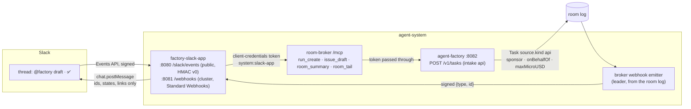

# Factory interfaces, part 2: sponsored principals, webhooks and Slack intake — Implementation Plan

> **For agentic workers:** REQUIRED SUB-SKILL: Use superpowers:subagent-driven-development (recommended) or superpowers:executing-plans to implement this plan task-by-task. Steps use checkbox (`- [ ]`) syntax for tracking.

**Goal:** A machine starts factory work only as a sponsored principal: a ZITADEL service account
that the config binds to a maintainer, with a daily budget in dollars and a mandatory `max_cost` on
every request, so that a `Task` with `source.kind: api` records both identities (F4). The broker
signs id-only events from the room log and posts them to the subscribers its config declares, with
the egress rules generated from that list (F6). A Slack App is one such principal and one such
subscriber. `@factory` in a thread drafts an issue, a ✅ from a Slack user linked to a maintainer
files it and starts the work, and the thread follows the room. Approvals stay in the web UI (F9).
Every switch is off by default (D4).

**Architecture:** six pull requests in four repositories:



| PR | Repository, branch | Tasks | Decision | Depends on |
|---|---|---|---|---|
| A | agent-platform `feat/sponsored-principals` (this plan's branch, renamed from `feat/interfaces-part2`) | 1–9 | F4, F5's `run_create` | #168, #171, #172 (merged) |
| B | agent-platform `feat/room-webhooks` | 10–14 | F6 | A merged (the emitter's member check reads A's sponsored rooms; the code is otherwise independent) |
| C | agent-platform `feat/factory-slack` | 15–19 | F9 | A and B merged |
| D | cloud-native-ref `feat/factory-slack-host` | 20–22 | F9's host half | nothing; must merge before E's `HOST_REF` bump |
| E | ai-native-ref `feat/webhook-egress-gate` | 23 | F6's generated egress | nothing: it renders an empty policy until a subscriber is declared |
| F | ai-native-ref `feat/interfaces-part2-pins` | 24–25 | D4: pins, everything off, docs | A, B, C released; D merged; E merged |

**Tech Stack:** Go 1.27.3 (stdlib `net/http`, `crypto/hmac`, `encoding/json`; `golang.org/x/oauth2`
and its `clientcredentials` subpackage, already a direct module; `golang.org/x/time/rate`;
controller-runtime; the OpenTelemetry metric API), controller-gen through `task crd:gen`, envtest
1.36.2, Atlas migrations (`task migrations`), golangci-lint 2.14.0 through `task lint`, Python 3 with
PyYAML for the ai-native-ref generator, Bash for the host's provisioning script.

**Spec:** [factory interfaces](https://github.com/Smana/ai-native-ref/blob/main/docs/superpowers/specs/2026-10-21-factory-interfaces-design.md)
(ai-native-ref), decisions F4, F5 (`run_create`), F6, F8 (text from machines), F9, with O1, O2 and
O7 taken; "Events"; "Identity and budgets"; live proofs 2, 3 and 5; "Left to the builder". Spend
per identity SI9 ([design](https://github.com/Smana/ai-native-ref/blob/main/docs/superpowers/specs/2026-10-22-spend-per-identity-design.md)):
F4 records `agent_factory_principal_sponsor_info` and `agent_factory_max_cost_usd_total`. Part 1:
[`2026-10-22-rooms-mcp-server-plan.md`](2026-10-22-rooms-mcp-server-plan.md), whose rulings R1–R15
this plan keeps.

**Out of this plan,** each a follow-up:

| Follow-up | What | Depends on |
|---|---|---|
| G1 Sponsored principals on the tailnet | A non-cluster sponsored principal (CI outside the cluster, another agent) reaching `/mcp` through `rooms.<domain>`: oauth2-proxy's `EXTRA_JWT_ISSUERS` gains the project audience | An owner decision (O-E), the host's oauth2-proxy values |
| G2 A Slack identity provider in ZITADEL | Replace R9's link map by a lookup of the ✅ user's ZITADEL identity | O-B taken the other way |
| G3 Subscriptions through an API | F6's "if subscribers multiply" | More than a handful of subscribers |
| G4 The closed room's state | Part 1's R12 left a closed room without a task `stopped`. The emitter reads the log, so it could tell a verdict's close from the owner's | The owner's confirmation of R12 |
| G5 The Sponsored row | ai-native-ref's `agent-identity` "Sponsored" panel reads PR A's two series. It needs no change: it reads No data until a principal is declared | PR F applied with a principal declared |

### This plan's rulings

These are the points the design left open, or that reading the code forced. Each is settled here.
Rulings marked **(owner)** depart from the design's text and are listed again under
[Owner decisions](#owner-decisions-the-design-leaves-open).

| # | Ruling | Why |
|---|---|---|
| R1 | **A sponsored principal is declared in the factory's config, `api.sponsored[]`**: `name` (the principal is `system:<name>`), `clientIDFile`, `sponsor` (a GitHub login), `repositories`, `dailyUSD`, `maxCostUSD`, an optional `onBehalfOf.slack` link map. The token proves the service account. **The sponsor comes from the config, not from a token claim (owner).** | The design names "a `sponsor` claim" and leaves "the `sponsor` claim's shape in ZITADEL" to the builder. A ZITADEL claim needs an Action plus user metadata that any ZITADEL admin can edit outside Git. The config is a gate path that maintainers review. SI9 already reads the sponsor "from its config", and the maintainers it must belong to are GitHub logins in the same file |
| R2 | **The token is identified by its client, as roomctl's is:** `VerifyAuthorizedParty(raw, clientID)`, where the client id is read at each use from `clientIDFile`. That file comes from the host's sync, because gcp-0 mints new ZITADEL ids on every build (Ruling AS-a). A sponsored client id equal to the web or roomctl client id is refused at start | `client_id` is the claim ZITADEL sets from the authenticated client (client credentials). Reading it at each use follows the pattern of every other ZITADEL id. **Live check:** gcp-0 must confirm that a machine user's JWT access token carries `client_id` (next session, step 1). The fallback is a `userIDFile` matched on `sub` |
| R3 | **Config load checks that every sponsor is a maintainer, and admission checks it again**: `sponsor` and every link target must be in `maintainers` of each listed repository. `repositories` must be repositories the config lists. `dailyUSD` must be in (0, `factoryDailyUSD`] and `maxCostUSD` in (0, `dailyUSD`]. The name must be a DNS label other than `factory`, `runlore` and `scheduler` | F4: "who must be in the repository's `maintainers`". The admission check covers a maintainer removed between load and request, which can only happen through a config change, a restart anyway; it costs nothing. The reserved names are ledger keys that already mean something (SI1) |
| R4 | **The factory's intake `api` is `POST /v1/tasks` on `:8082`**, registered only while `api.sponsored` is non-empty (otherwise `404`). It takes only sponsored tokens: a human gets `403 sponsored_only`, and so does a system caller. The admission order is: authenticate, stop object, body (≤ 64 KiB), `Idempotency-Key` (required), shape, repository (the principal's list, then `Owned`), `max_cost`, sponsor, the principal's day, then issue and Task | The design: "a new intake kind `api` that creates a `Task` … never through `/v1/runs`". `/v1/runs` makes bare runs, which F4 rejects for machines. The order follows `createRun`'s (local refusals first, then the call to GitHub, then the ledger) |
| R5 | **`max_cost` is mandatory, in USD.** It is refused at 0 or below (`max_cost_required`), above the principal's `maxCostUSD` (`max_cost_over_principal`), and above the largest `taskUSD` among the tiers (`max_cost_over_class`). It is stored as `spec.maxMicroUSD`, which CEL makes immutable. **Triage then caps the task at `min(tier taskUSD, maxMicroUSD)`** and the run at `min(tier runUSD, maxMicroUSD)` | "capped by the class's `taskUSD`": the class is known only at triage, so admission refuses what no class could hold and triage applies the class's own cap. The meter then ends the task `budget-task` at the ceiling (live proof 3: "ends at `max_cost`") |
| R6 | **The principal's day is checked at admission against the ledger's `spent` column**: `spent[system:<name>] + max_cost > dailyUSD` gives `429 principal_budget_exhausted`. The per-run reservation (`Reserve`) enforces the day again for each run | "above the principal's daily budget". `max_cost` is the most the request can cost, so it is the fair check at intake. Reservations then bound each run, as for a person (D3) |
| R7 | **Charging.** An `api` task's runs always carry `chargedTo: system:<name>` beside the fleet, whether `perPerson` is on or off. `Task.Payer()` returns `RetriedBy`, else the sponsored principal for kind `api`, else the `github:` labeller. `Budgets.DailyMicroUSD("system:<name>")` is the principal's `dailyUSD` | SI9: "F4 makes `Payer` return the sponsored principal, so its runs carry `chargedTo: system:<name>`". The principal's day is F4's own bound and must not depend on the per-person switch. A maintainer's `/factory retry` moves the payer to the retrier, as for any task (SI1) |
| R8 | **Both identities are on the Task**: `spec.source.requestedBy: system:<name>`, `spec.source.sponsor: github:<login>` (a ledger key, SI9/D1), and `spec.source.onBehalfOf` (`slack:<team>/<user>` when a link chose the sponsor). Both identities also appear in the room: the sponsored principal becomes a `watcher` member, and the factory's first `task_state` names both. **The sponsor is `github:<login>`, not `human:<sub>` (owner)** | The design's table writes `sponsor: human:<sub>`. Maintainers are GitHub logins in the config, SI9 wants the sponsor "as a ledger key", and ZITADEL subs change on every gcp-0 build, so a recorded sub would point at nobody after a rebuild |
| R9 | **A Slack user is linked by a map in the factory's config**: `api.sponsored[].onBehalfOf.slack: {"T…/U…": <maintainer login>}`. The App passes `on_behalf_of: slack:T…/U…`. The factory maps it and refuses an unknown user (`not_linked`) or a non-maintainer (`not_a_maintainer`). **A map, not a ZITADEL Slack IdP (owner)** | "Left to the builder: … a Slack identity provider in ZITADEL, or a maintained map". The map is offline-provable, reviewed in Git and gate-protected, and survives gcp-0 rebuilds. An IdP would be a host ZITADEL change (H5) and would add a lookup per ✅. The App only relays what Slack's signed request said; the factory decides |
| R10 | **`run_create` may file the issue.** With `title`, the factory files `title` and `text` (checked by `issue_draft`'s rules) as an issue, using the factory App on the repository, as RunLore does. It carries no label, its body ends with a footer naming the sponsor and the principal, and `spec.issueAuthor` is the sponsor's login, so `--mine` finds it. Without `title`, the Task has no issue (R28), as a schedule's has none. **A factory-authored issue for machine intake (owner)** | F9: "a ✅ … files it and calls `run_create`". The Slack App has no developer `gh`. F3 refused server-side filing for a human's agent because the human must stay the author, but a Slack draft has no GitHub author at all. The factory App already holds `issues: write` (RunLore). No label: the Task exists already, so a `factory/ready` would only start a second one |
| R11 | **Text from machines (F8).** `text` and `title` go through `sanitize.Hidden`, then the draft rules when `title` is set. The Task's `spec.text` is `sanitize.Text` of the issue snapshot, `trust: untrusted`, as an issue's is. Class, tier, template, auto-merge and egress are never accepted from the caller (unknown fields are refused) | F8: "class, tier and auto-merge are never caller-controlled; hidden characters are stripped at intake". The snapshot stays the only task text |
| R12 | **The Task's name is `taskid.Name("api:<name>:" + Idempotency-Key)`.** A replay finds it (`200 {duplicate: true}`), and two ✅ on one draft make one Task | RunLore's dedup. The Slack App's key is the draft message's `team/channel/ts`, so the second maintainer's ✅ is a no-op |
| R13 | **On the broker, sponsored tokens reach `/mcp` only.** They are verified like the factory's (R2) against `human.mcp.sponsored[]` (`name`, `clientIDFile`). They see four tools: `run_create`, `issue_draft`, `room_summary`, `room_tail`. They read a room only as one of its `watcher` members, with no GitHub check, and every other route refuses them. **Reached in-cluster only in v3 (owner)**: the broker's CNP admits the Slack App on `:8080`, and oauth2-proxy is unchanged (G1) | The broker's D7 check reads a GitHub link a service account does not have. Membership is what the factory grants when it creates the task's room. A sponsored principal therefore reads exactly the rooms of its own tasks |
| R14 | **`run_create` is an MCP Task (F5)** whose id is `run.` + base64url JSON `{v, by, room, created, ttl}`. Its `ttl` defaults to 24 h, with a maximum of 72 h. `tasks/get` maps the room's coarse state: `queued` and `running` to `working`; `waiting_for_human` to `input_required`, with a `statusMessage` naming the room page; `done` to `completed`; `failed` to `failed`; `stopped` to `cancelled`. `tasks/result` on `input_required` returns the summary and never an elicitation | F5: "`input_required` maps to `waiting_for_human`". No input is asked of the caller: approvals stay on the web page (F9). The id is stateless like part 1's `tail.` (R5 there) |
| R15 | **Signing follows Standard Webhooks.** Headers `webhook-id`, `webhook-timestamp` (Unix seconds) and `webhook-signature: v1,<base64 HMAC-SHA256(key, id + "." + timestamp + "." + body)>`, one signature per key, separated by spaces. The id is `evt_` + the base32 of sha256(subscriber, room, seq, type) | The design: "`webhook-id`, `-timestamp`, `-signature`" and "a forged `webhook-id` is rejected" (live proof 2). That holds only if the id is signed, and Standard Webhooks signs it. The id is stable across retries and leaders, so subscribers can dedupe on it |
| R16 | **Key rotation** (left to the builder): `secretFile` holds one or two base64 keys, one per line. A delivery is signed with each. Rotation adds the new key, rolls the subscribers, then removes the old one | It adds no state, and the spec's multi-signature header exists for this |
| R17 | **Delivery.** It is at-least-once and unordered. Each event is attempted up to four times (the first try, then three retries at 10 s, 1 min and 5 min), with a 10 s timeout. A 2xx is success, and redirects are not followed. A delivery that exhausts its retries is a failure. **Three consecutive failed deliveries disable the subscriber**: `rooms_webhook_disabled{subscriber} = 1`, and the alert `RoomWebhookDisabled` fires. A disabled subscriber stays disabled until its config entry's `generation` changes | "at most three retries … auto-disabled after three failures". Re-enabling goes through Git, where the subscriber is declared (O7) |
| R18 | **The emitter is the broker's leader**, woken by `Store.Listen`. Per subscriber and room it reads the log after a cursor kept in a new table, `webhook_cursors`, and advances the cursor past each event once that event is delivered or given up. A new subscriber starts at each room's current `last_seq`, so no history is replayed | The log is the source of truth (F6), and the leader already sweeps. A cursor in the database survives leader changes, so a new leader resends at most what was in flight |
| R19 | **The events** (the design's table), computed from the log alone. `room.task_received` and `room.task_triaged` come from `task_state` phases `Received` and `Triaged`. `room.run_started` and `room.run_ended` come from the broker's `run_phase` `Running` and its terminal phases. `room.waiting_for_human` comes from `approval_requested`, and from `task_state` phases `AwaitingHuman` and `Escalated`. `room.pr_opened` is the first `task_state` carrying a `pr`. `room.verdict_posted` is a verdict event. `room.merged` and `room.reverted` come from phases `Merged` and `Reverted`. `room.budget_reached` is a run end or a task reason that starts with `budget-`. `room.ended` is the first coarse `done`, `failed` or `stopped`. **Payloads carry ids, states and reasons only** (`reason` and `limit` are clipped to the known vocabularies, else `other`) | The design's table. No room text leaves the broker. A subscriber fetches if it needs more |
| R20 | **Subscriber addresses.** For `network: cluster`, the URL must be `http(s)://<svc>.<ns>.svc.cluster.local:<port>/<path>`. For `network: internet`, it must be `https://<dns-name>/<path>`; an IP literal is refused, and so are `localhost`, `*.local`, `*.internal`, `*.svc` and `*.cluster.local`, all at config load. On top of that, an internet delivery dials through a guard that refuses loopback, private, link-local, CGNAT, unique-local and metadata addresses after resolution | "a private or cluster address is refused at config load". The load check is syntactic. A name can still resolve to a private address (DNS rebinding), and the dial guard closes that |
| R21 | **The generator**: ai-native-ref `scripts/ci/gen-webhook-egress.py` renders `infrastructure/base/room-broker/network-policy-webhooks.yaml` (a second CNP on the broker, egress only) from `infrastructure/base/room-broker/config.yaml`'s `webhooks`. A cluster subscriber gives `toEndpoints {namespace, app.kubernetes.io/name: <svc>}` on its port. An internet subscriber gives `toFQDNs matchName` on 443. Its suite fails on drift, as `gen-capabilities.py`'s does | F6: "A generator renders the broker's egress rules from this list, and a gate fails when they differ, as the capability profiles' gate does". By convention here, a Service is named after its pods' `app.kubernetes.io/name`, and the suite checks that the Service exists with that selector |
| R22 | **The Slack App answers a mention, never a slash command** (left to the builder). The draft is the mention's own text: line 1 is `<owner/repo> <title>`, and the rest is the body with the template's three sections. The App adds a permalink to the thread. A refusal from `issue_draft` is posted back as is | A mention works inside the thread where the question was asked, and slash commands do not thread. The draft is exactly what a human typed: no model writes it, so there is nothing to inject into |
| R23 | **The draft rides the App's own message metadata.** The App posts the checked draft with `metadata {event_type: factory_draft, event_payload: {repo, title, body, sha256}}`. On a ✅ it re-reads that message, refuses any message its own bot did not post, and checks the hash | Only the bot can edit its message, and Slack keeps the metadata off the visible text. A ✅ on any other message does nothing |
| R24 | **Only a ✅ (`white_check_mark`) in an allowed channel counts**, and only on a draft. The factory decides who may sponsor (R9). The App never answers an approval and never relays room text: its thread messages are fixed templates that hold the issue number, the PR number, the coarse state, the reason code and the room's URL | F9: "a question from the run is linked in the thread, never answered there". No agent-written string reaches Slack |
| R25 | **The App's thread map** (room to channel and thread ts) lives in one ConfigMap, `factory-slack-threads`. The App's Role grants `get`/`update` on that name only. Entries older than 30 days are pruned on write | Webhook payloads carry the room only. The ConfigMap is the smallest durable store the platform already runs, and least privilege names the one object |
| R26 | **The App runs one replica.** It dedupes Slack's retries on `event_id` and webhooks on `webhook-id` in an in-memory LRU of 10,000 entries for 10 minutes. A restart can post one duplicate thread line | Slack retries an event that goes unacknowledged for 3 s, and the broker retries for 5 min, so one replica loses nothing. Two replicas would need a shared dedupe store for one duplicate line at most |
| R27 | **Slack request verification:** `v0=` + hex HMAC-SHA256(signing secret, `v0:` + timestamp + `:` + raw body), compared in constant time. The timestamp must be within 5 minutes. The body is capped at 1 MiB and read before anything is parsed. A failure is `401` and counted. The public route matches `POST /slack/events` exactly | Slack's documented scheme, and the host's RunLore pattern (an exact route, an HMAC, ±5 min) |
| R28 | **Public ingress through a new host listener**: `factory-slack.${public_domain_name}` on `platform-public`, with `allowedRoutes` limited to `agent-system` and both clouds updated. It is H4's inventory, extended by a host PR. Socket Mode is rejected | Socket Mode has no per-request signature, needs one more long-lived `xapp-` token, and needs a websocket egress. The host already reviews and runs the listener-per-consumer pattern |
| R29 | **Secrets follow the host's patterns.** ZITADEL machine user `factory-slack-app`, created by `zitadel-oidc-clients.sh`, writes `agents/factory-slack-principal` `{client-id, client-secret}`. The bot token and signing secret are human-written under `agents/factory-slack-app`. Each webhook key is generated under `agents/webhook-<name>`. Each gets a `bao-map.sh` entry. The ExternalSecrets live in ai-native-ref | H5: the ZITADEL clients and OpenBao mounts are the host's, and the stores are ai-native-ref's |
| R30 | **Off by default (D4).** No `api.sponsored` means `/v1/tasks` is a `404` and the broker lists no `run_create` and refuses sponsored tokens. No `webhooks` means no emitter. The Slack App's manifests ship in ai-native-ref, and no cluster kustomization includes them | D4. A gcp-0 session turns each one on |

## Global Constraints

- **Worktrees.** PR A in `/home/smana/Sources/agent-platform-interfaces2`. That is the branch that
  carries this plan, renamed at Task 1 Step 0 to `feat/sponsored-principals`. PR B in
  `/home/smana/Sources/agent-platform-webhooks` (`feat/room-webhooks`), PR C in
  `/home/smana/Sources/agent-platform-factory-slack` (`feat/factory-slack`), each cut from a freshly
  fetched `origin/main` after the PR before it merges. cloud-native-ref in
  `/home/smana/Sources/cloud-native-ref-factory-slack`, ai-native-ref in
  `/home/smana/Sources/ai-native-ref-webhook-egress` and `/home/smana/Sources/ai-native-ref-interfaces2`.
  Run `mise trust mise.toml` once in each. Rebase onto a freshly fetched `origin/main` before every
  push.
- **Commits** are conventional, in English, with **no trailers** and no generated-with lines. PR
  bodies carry no attribution line.
- **Offline first (D4 of the program order):** every proof below runs on a laptop. The live proofs
  wait for the next gcp-0 session (last section).
- **Off by default:** the default config of each binary behaves byte for byte as on `origin/main`
  (`097a738`), and every existing test passes unmodified.
- **Evidence.** agent-platform: `task check`. **Docker is off locally**, so `internal/store`'s
  testcontainers tests (PR B's migration and cursor) run in CI. Locally, run
  `task spdx tidy lint vuln crd:check chart:check migrations docs scripts`, then
  `go test -race -count=1 $(go list ./... | grep -v internal/store)`. Envtest is:
  `KUBEBUILDER_ASSETS=/home/smana/.local/share/kubebuilder-envtest/k8s/1.36.2-linux-amd64 go test -p 1 -count=1 -run Envtest ./internal/factory/reconciler/ ./api/...`.
  **Every new CEL rule must pass this envtest install.** ai-native-ref:
  `task check` with system `python3` for PyYAML (memory: local task check setup).
- **agent-platform conventions:** the first line of every `.go` file is
  `// SPDX-License-Identifier: Apache-2.0`. Tests use stdlib `testing`, table-driven where cases
  repeat, with hand-written fakes and `httptest`. Never write a literal zero-width or bidi character
  in Go source: write `​`. Use `task lint` and never a bare `golangci-lint`. Label values stay
  bounded. Comments carry *why*. Exported symbols carry doc comments.
- **No new module.** `golang.org/x/oauth2/clientcredentials` is in the module `golang.org/x/oauth2`,
  which is already direct. `go mod tidy -diff` must stay clean.
- **Security invariants**, each held by a named test:
  1. No path lets a machine start a run that is not a Task (`TestRunsRefusesSponsored`).
  2. No `run_create` without `max_cost` (`TestCreateTaskAdmission/no_max_cost`).
  3. The sponsor is a maintainer at load and at admission (`TestSponsoredConfig`, `TestCreateTaskAdmission/sponsor_*`).
  4. A forged, stale or wrong-key webhook is rejected (`TestVerify`).
  5. A bad Slack signature or a stale timestamp is `401` (`TestSlackSignature`).
  6. A ✅ from an unlinked user or a non-maintainer files nothing (`TestReactionFlow`).
  7. No Slack message carries room text (`TestThreadMessagesCarryNoText`).
  8. No tool or Slack path approves or steers (`TestSponsoredToolList`, `TestSlackNeverDecides`).
- **Names, verbatim:** the intake kind `api`. The tool `run_create`. The reasons `sponsored_only`,
  `max_cost_required`, `max_cost_over_principal`, `max_cost_over_class`, `not_linked`,
  `not_a_maintainer`, `principal_budget_exhausted`, `repository_not_allowed`. The events
  `room.task_received`, `room.task_triaged`, `room.run_started`, `room.run_ended`,
  `room.waiting_for_human`, `room.pr_opened`, `room.verdict_posted`, `room.merged`, `room.reverted`,
  `room.budget_reached`, `room.ended`. The series `agent_factory_principal_sponsor_info{principal, sponsor}`,
  `agent_factory_max_cost_usd_total{principal}`, `agent_factory_api_intake_total{principal, outcome}`,
  `rooms_webhook_deliveries_total{subscriber, outcome}`, `rooms_webhook_disabled{subscriber}`,
  `factory_slack_requests_total{route, outcome}`. The alert `RoomWebhookDisabled`.
- **Verbatim from the spec:**
  - F4: "Machine callers start work only as sponsored principals, through a new intake kind `api`
    that creates a `Task` (triage, gate and narration apply), never through `/v1/runs` … a mandatory
    `max_cost` per request capped by the class's `taskUSD`, both identities on the `Task` and in the room."
  - F6: "Outbound events are signed webhooks with id-only payloads, emitted by the broker from the
    room log and declared in the broker's config per repository … `internet` (a public address,
    egress generated as `toFQDNs`; a private or cluster address is refused at config load)."
  - F9: "a ✅ from a Slack user linked to a maintainer's ZITADEL identity files it and calls
    `run_create` with that maintainer as `sponsor` and `on_behalf_of` … **Approvals and steering stay
    in the web UI** (ADR-0049): a question from the run is linked in the thread, never answered there."
  - Events: "A subscriber verifies the signature, rejects a timestamp older than five minutes,
    deduplicates on `webhook-id`, and fetches the room through the MCP server or the human API."

## File structure

| Repository · file | Change | Responsibility |
|---|---|---|
| **PR A** agent-platform `internal/factory/config/config.go`, `sponsored_test.go` | modify, create | `API.Sponsored`, validation, `Budgets.DailyMicroUSD` per principal |
| `api/factory/v1alpha1/task_types.go`, `person.go`, `sponsored_test.go`, generated CRD | modify, create, regenerate | `source.kind: api`, `source.sponsor`, `source.onBehalfOf`, `spec.maxMicroUSD`, `Payer()` |
| `internal/factory/reconciler/sponsored_envtest_test.go` | create | The CEL rules on a real API server |
| `internal/authn/sponsored.go`, `sponsored_test.go` | create | `Sponsored`: a service account's token → `system:<name>` |
| `internal/authn/jwt.go` | modify | `Principal.Sponsored` |
| `internal/factory/api/authn.go`, `authn_test.go` | modify | The third branch |
| `internal/factory/api/tasks.go`, `tasks_test.go`, `server.go` | create, modify | `POST /v1/tasks` |
| `internal/factory/fmetrics/fmetrics.go`, `sponsored_test.go` | modify, create | The three series |
| `internal/factory/triage/triage.go`, `internal/factory/reconciler/reconciler.go`, `implement.go`, `internal/factory/rooms/rooms.go`, `sponsored_test.go` | modify, create | The ceiling at triage, the charge, the member, the first fact |
| `internal/config/config.go`, `sponsored_test.go` | modify, create | The broker's `human.mcp.sponsored` |
| `internal/humanapi/mcp.go`, `server.go`, `access.go`, `internal/policy/policy.go`, `sponsored_test.go` | modify, create | Sponsored callers on `/mcp` |
| `internal/humanapi/runcreate.go`, `runcreate_test.go`, `mcptasks.go` | create, modify | `run_create` and its MCP Task |
| `internal/runrequest/tasks.go`, `tasks_test.go` | create | The broker's client of `POST /v1/tasks` |
| `internal/app/factory.go`, `internal/app/broker.go` | modify | Wiring |
| `charts/agent-factory/values.yaml`, `templates/deployment.yaml` | modify | `sponsoredSecret`, optional |
| `docs/api.md`, `docs/factory.md`, `docs/operations.md`, `docs/security.md`, `docs/integration.md` | modify | The contract |
| **PR B** `internal/webhook/webhook.go`, `webhook_test.go` | create | Sign, Verify, the event type, the id |
| `internal/webhook/events.go`, `events_test.go` | create | Events from log entries |
| `internal/webhook/dial.go`, `dial_test.go` | create | The internet dial guard |
| `internal/config/config.go`, `webhooks_test.go` | modify, create | `webhooks[]`, validation |
| `internal/store/migrations/20261023120000_webhooks.sql`, `atlas.sum`, `internal/store/webhooks.go`, `webhooks_test.go` | create | Cursors and subscriber state |
| `internal/webhook/emitter.go`, `emitter_test.go` | create | The leader's emitter |
| `internal/metrics/metrics.go`, `internal/app/broker.go` | modify | Two series, wiring |
| `docs/api.md`, `docs/operations.md`, `docs/security.md` | modify | Events and operations |
| **PR C** `internal/slackapp/verify.go`, `verify_test.go` | create | Slack's v0 signature |
| `internal/slackapp/draft.go`, `draft_test.go` | create | A mention's draft |
| `internal/slackapp/broker.go`, `broker_test.go` | create | The App's MCP client, client-credentials token |
| `internal/slackapp/slack.go`, `slack_test.go` | create | `chat.postMessage`, `conversations.history`, metadata |
| `internal/slackapp/app.go`, `app_test.go`, `threads.go`, `threads_test.go` | create | The flows, the thread map |
| `internal/slackapp/config.go`, `config_test.go` | create | The App's config |
| `cmd/factory-slack-app/main.go`, `internal/app/slackapp.go`, `images/factory-slack-app/Dockerfile` | create | The binary and the image |
| `.github/workflows/ci.yaml`, `release.yaml` | modify | The image in both matrices |
| `docs/slack.md`, `docs/security.md`, `AGENTS.md` | create, modify | Operating the App |
| **PR D** cloud-native-ref `scripts/provision/zitadel-oidc-clients.sh`, `scripts/lib/bao-map.sh`, `scripts/provision/secret-store.sh`, `scripts/ci/tests/test-zitadel-machine-users.sh`, both `platform-public` gateways, `docs/` | modify, create | The machine user, the secrets, the listener |
| **PR E** ai-native-ref `scripts/ci/gen-webhook-egress.py`, `scripts/ci/tests/test-room-broker-webhook-egress.sh`, `infrastructure/base/room-broker/network-policy-webhooks.yaml`, `kustomization.yaml` | create, modify | The generated egress and its gate |
| **PR F** ai-native-ref pins, broker and factory config, `tooling/base/factory-slack-app/*`, the broker's CNP, `HOST_REF`, `HOST-CONTRACT.md`, site pages | modify, create | Release, everything off, docs |

---

## PR A — agent-platform: sponsored principals and `run_create` (F4, F5)

- [ ] **Step 0: The worktree**

```bash
cd /home/smana/Sources/agent-platform-interfaces2 && mise trust mise.toml
git fetch origin && git rebase origin/main
git branch -m feat/interfaces-part2 feat/sponsored-principals   # the branch carries this plan
```

### Task 1: `api.sponsored` in the factory's config

**Files:**
- Modify: `internal/factory/config/config.go`
- Create: `internal/factory/config/sponsored_test.go`

**Interfaces produced** (Tasks 3–6 rely on them): `type Sponsored struct{Name, ClientIDFile, Sponsor string; Repositories []string; DailyUSD, MaxCostUSD float64; OnBehalfOf OnBehalfOf}`;
`type OnBehalfOf struct{Slack map[string]string}`; `API.Sponsored []Sponsored`;
`func (c *Config) SponsoredBy(principal string) *Sponsored`; `func (s Sponsored) Principal() string`;
`func (c *Config) MaxTaskMicroUSD() int64`; `Budgets.DailyMicroUSD` answers a sponsored key.

- [ ] **Step 1: Write the failing test**

`internal/factory/config/sponsored_test.go`:

```go
// SPDX-License-Identifier: Apache-2.0

package config

import (
	"strings"
	"testing"
)

// slackApp is a valid principal on good's repository, whose maintainer is Smana.
const slackApp = `  sponsored:
    - name: slack-app
      clientIDFile: /etc/agent-factory-sponsored/slack-app-client-id
      sponsor: Smana
      repositories: [Smana/cloud-native-ref]
      dailyUSD: 10
      maxCostUSD: 5
      onBehalfOf: {slack: {"T01ABC/U02DEF": smana}}
`

func withSponsored(block string) string {
	return strings.Replace(good, "api:\n", "api:\n"+block, 1)
}

// F4, R1, R3: a principal is declared in the config, bound to a maintainer, bounded in dollars.
func TestSponsoredConfig(t *testing.T) {
	cfg, err := Parse([]byte(withSponsored(slackApp)))
	if err != nil {
		t.Fatal(err)
	}
	s := cfg.SponsoredBy("system:slack-app")
	if s == nil || s.Principal() != "system:slack-app" || s.Sponsor != "Smana" || s.MaxCostUSD != 5 {
		t.Fatalf("%+v", s)
	}
	if got := cfg.Budgets.DailyMicroUSD("system:slack-app"); got != 10_000_000 {
		t.Fatalf("the principal's day is its dailyUSD: %d", got)
	}
	if cfg.SponsoredBy("system:factory") != nil || cfg.SponsoredBy("github:smana") != nil {
		t.Fatal("only a declared principal is sponsored")
	}
	for name, c := range map[string]struct{ from, to, want string }{
		"a reserved name":           {"name: slack-app", "name: runlore", `"runlore" is reserved`},
		"not a DNS label":           {"name: slack-app", "name: Slack_App", "is not a DNS label"},
		"no client id file":         {"      clientIDFile: /etc/agent-factory-sponsored/slack-app-client-id\n", "", "clientIDFile is required"},
		"a sponsor not a maintainer": {"sponsor: Smana", "sponsor: mallory", `sponsor "mallory" is not a maintainer of Smana/cloud-native-ref`},
		"an unlisted repository":    {"repositories: [Smana/cloud-native-ref]", "repositories: [Smana/other]", `"Smana/other" is not a listed repository`},
		"no day":                    {"dailyUSD: 10", "dailyUSD: 0", "dailyUSD must be above 0 and at most factoryDailyUSD"},
		"a day above the fleet's":   {"dailyUSD: 10", "dailyUSD: 1000", "dailyUSD must be above 0 and at most factoryDailyUSD"},
		"a ceiling above the day":   {"maxCostUSD: 5", "maxCostUSD: 11", "maxCostUSD must be above 0 and at most dailyUSD"},
		"a link to a non-maintainer": {`"T01ABC/U02DEF": smana`, `"T01ABC/U02DEF": mallory`, `links "T01ABC/U02DEF" to "mallory", not a maintainer`},
		"a malformed Slack id":      {`"T01ABC/U02DEF"`, `"alice"`, `"alice" is not <team>/<user>`},
	} {
		t.Run(name, func(t *testing.T) {
			raw := withSponsored(strings.Replace(slackApp, c.from, c.to, 1))
			if _, err := Parse([]byte(raw)); err == nil || !strings.Contains(err.Error(), c.want) {
				t.Fatalf("got %v, want %q", err, c.want)
			}
		})
	}
	twice := withSponsored(slackApp + strings.Replace(slackApp, "  sponsored:\n", "", 1))
	if _, err := Parse([]byte(twice)); err == nil || !strings.Contains(err.Error(), "declared twice") {
		t.Fatalf("a name twice: %v", err)
	}
}

// R30: no principal, no sponsored day, and a hand-built config reads as before.
func TestNoSponsoredByDefault(t *testing.T) {
	cfg, err := Parse([]byte(good))
	if err != nil {
		t.Fatal(err)
	}
	if len(cfg.API.Sponsored) != 0 || cfg.SponsoredBy("system:slack-app") != nil {
		t.Fatal("nothing is declared by default")
	}
	if got, want := cfg.Budgets.DailyMicroUSD("system:slack-app"), MicroUSD(cfg.Budgets.HumanDailyUSD); got != want {
		t.Fatalf("an undeclared key keeps today's day: %d, want %d", got, want)
	}
}
```

- [ ] **Step 2: Run it and watch it fail**

Run: `ulimit -v 4000000; timeout 300 go test -race -count=1 -run 'Sponsored' ./internal/factory/config/`
Expected: `FAIL`, with `cfg.SponsoredBy undefined` and `unknown field "sponsored"`.

- [ ] **Step 3: The implementation**

In `internal/factory/config/config.go`, add this after `SystemRepositories` in `type API`:

```go
	// Sponsored is factory interfaces F4: the service accounts that may start tasks through
	// POST /v1/tasks, each bound to a maintainer. Empty ships: the route is a 404 (D4).
	Sponsored []Sponsored `json:"sponsored,omitempty"`
```

Add the types and helpers after `type Access`:

```go
// Sponsored is one sponsored principal (F4, R1): a ZITADEL service account, recognised by its
// client id, whose tasks are charged to system:<name> and bounded by a day and a per-request
// ceiling, in USD. Sponsor is the maintainer accountable for it; a link names who may sponsor one
// request instead (R9).
type Sponsored struct {
	Name         string     `json:"name"`
	ClientIDFile string     `json:"clientIDFile"`
	Sponsor      string     `json:"sponsor"`
	Repositories []string   `json:"repositories"`
	DailyUSD     float64    `json:"dailyUSD"`
	MaxCostUSD   float64    `json:"maxCostUSD"`
	OnBehalfOf   OnBehalfOf `json:"onBehalfOf,omitzero"`
}

// OnBehalfOf maps an external user to the maintainer login who sponsors their request (R9).
type OnBehalfOf struct {
	// Slack maps "<team id>/<user id>" to a maintainer's GitHub login.
	Slack map[string]string `json:"slack,omitempty"`
}

// Principal is the ledger key and requestedBy of the principal's tasks.
func (s Sponsored) Principal() string { return "system:" + s.Name }

// SponsoredBy is principal's declaration, nil when the config declares none.
func (c *Config) SponsoredBy(principal string) *Sponsored {
	for i := range c.API.Sponsored {
		if c.API.Sponsored[i].Principal() == principal {
			return &c.API.Sponsored[i]
		}
	}
	return nil
}

// MaxTaskMicroUSD is the largest task cap any tier holds: no request's max_cost may exceed what a
// class could ever hold (R5); triage then applies the class's own.
func (c *Config) MaxTaskMicroUSD() int64 {
	var m int64
	for _, t := range c.Tiers {
		m = max(m, MicroUSD(t.TaskUSD))
	}
	return m
}

// slackLinkRE is a Slack team and user id pair.
var slackLinkRE = regexp.MustCompile(`^T[A-Z0-9]{2,20}/[UW][A-Z0-9]{2,20}$`)

// reservedPrincipals are ledger keys that already mean something (SI1).
var reservedPrincipals = []string{"factory", "runlore", "scheduler"}

func (c *Config) validateSponsored(bad func(string, ...any)) {
	seen := map[string]bool{}
	for _, s := range c.API.Sponsored {
		switch {
		case !factoryRE.MatchString(s.Name):
			bad("api.sponsored: %q is not a DNS label", s.Name)
			continue
		case slices.Contains(reservedPrincipals, s.Name):
			bad("api.sponsored: %q is reserved", s.Name)
			continue
		case seen[s.Name]:
			bad("api.sponsored: %q is declared twice", s.Name)
			continue
		}
		seen[s.Name] = true
		if s.ClientIDFile == "" {
			bad("api.sponsored.%s: clientIDFile is required", s.Name)
		}
		if len(s.Repositories) == 0 {
			bad("api.sponsored.%s: repositories is empty", s.Name)
		}
		for _, name := range s.Repositories {
			r := c.listed(name)
			if r == nil {
				bad("api.sponsored.%s: %q is not a listed repository", s.Name, name)
				continue
			}
			if !r.IsMaintainer(s.Sponsor) {
				bad("api.sponsored.%s: sponsor %q is not a maintainer of %s", s.Name, s.Sponsor, r.Name)
			}
			for id, login := range s.OnBehalfOf.Slack {
				if !r.IsMaintainer(login) {
					bad("api.sponsored.%s: onBehalfOf.slack links %q to %q, not a maintainer of %s", s.Name, id, login, r.Name)
				}
			}
		}
		for id := range s.OnBehalfOf.Slack {
			if !slackLinkRE.MatchString(id) {
				bad("api.sponsored.%s: onBehalfOf.slack %q is not <team>/<user>", s.Name, id)
			}
		}
		if s.DailyUSD <= 0 || s.DailyUSD > c.Budgets.FactoryDailyUSD {
			bad("api.sponsored.%s: dailyUSD must be above 0 and at most factoryDailyUSD", s.Name)
		}
		if s.MaxCostUSD <= 0 || s.MaxCostUSD > s.DailyUSD {
			bad("api.sponsored.%s: maxCostUSD must be above 0 and at most dailyUSD", s.Name)
		}
	}
}
```

Call it from `Validate`, after the repositories loop: `c.validateSponsored(bad)`.

In `Budgets`, add an unexported map and use it in `DailyMicroUSD`. A config built by hand has no
map, so its keys read as today's:

```go
	// sponsoredDays is each sponsored principal's day in micro-USD, set by Parse (R7).
	sponsoredDays map[string]int64
```

```go
func (b Budgets) DailyMicroUSD(principal string) int64 {
	if d, ok := b.sponsoredDays[principal]; ok {
		return d
	}
	switch {
	case principal == PrincipalFactory:
		return MicroUSD(b.FactoryDailyUSD)
	case b.PerPerson.Enabled:
		return MicroUSD(b.PerPerson.DailyUSD)
	}
	return MicroUSD(b.HumanDailyUSD)
}
```

In `Parse`, after `c.Validate()` succeeds:

```go
	for _, s := range c.API.Sponsored {
		if c.Budgets.sponsoredDays == nil {
			c.Budgets.sponsoredDays = map[string]int64{}
		}
		c.Budgets.sponsoredDays[s.Principal()] = MicroUSD(s.DailyUSD)
	}
```

- [ ] **Step 4: Run the package**

Run: `ulimit -v 4000000; timeout 300 go test -race -count=1 ./internal/factory/config/`
Expected: `ok`.

- [ ] **Step 5: Commit**

```bash
git add internal/factory/config/
git commit -m "feat(factory): declare sponsored principals in the config, each bound to a maintainer"
```

### Task 2: The Task records the sponsor, the ceiling and the kind `api`

**Files:**
- Modify: `api/factory/v1alpha1/task_types.go`, `api/factory/v1alpha1/person.go`
- Create: `api/factory/v1alpha1/sponsored_test.go`, `internal/factory/reconciler/sponsored_envtest_test.go`
- Regenerate: `task crd:gen` (`config/crd/…tasks.yaml`, the chart's copy, `zz_generated.deepcopy.go`)

- [ ] **Step 1: Write the failing tests**

`api/factory/v1alpha1/sponsored_test.go`:

```go
// SPDX-License-Identifier: Apache-2.0

package v1alpha1

import "testing"

// R7: an api task is charged to its principal; a maintainer's retry moves it, as for any task.
func TestPayerOfAnAPITask(t *testing.T) {
	task := &Task{Spec: TaskSpec{Source: Source{Kind: "api", RequestedBy: "system:slack-app", Sponsor: "github:smana"}}}
	if got := task.Payer(); got != "system:slack-app" {
		t.Fatalf("payer %q", got)
	}
	if got := task.Sponsored(); got != "system:slack-app" {
		t.Fatalf("sponsored %q", got)
	}
	task.Status.RetriedBy = "github:alice"
	if got := task.Payer(); got != "github:alice" {
		t.Fatalf("after a retry %q", got)
	}
	issue := &Task{Spec: TaskSpec{Source: Source{Kind: "issue", RequestedBy: "github:Bob"}}}
	if issue.Payer() != "github:bob" || issue.Sponsored() != "" {
		t.Fatal("an issue's payer is unchanged")
	}
}
```

`internal/factory/reconciler/sponsored_envtest_test.go`. This follows `envtest_test.go`'s setup,
starting the environment with the same CRD paths:

```go
// SPDX-License-Identifier: Apache-2.0

package reconciler

import (
	"os"
	"path/filepath"
	"strings"
	"testing"

	metav1 "k8s.io/apimachinery/pkg/apis/meta/v1"
	"k8s.io/apimachinery/pkg/runtime"
	"sigs.k8s.io/controller-runtime/pkg/client"
	"sigs.k8s.io/controller-runtime/pkg/envtest"

	v1alpha1 "github.com/Smana/agent-platform/api/factory/v1alpha1"
)

// R5, R8: the CRD installs with its new CEL rules, an api task needs its sponsor and ceiling, and
// neither moves once written.
func TestEnvtestSponsoredTask(t *testing.T) {
	if os.Getenv("KUBEBUILDER_ASSETS") == "" {
		t.Skip("KUBEBUILDER_ASSETS unset")
	}
	env := &envtest.Environment{CRDDirectoryPaths: []string{filepath.Join("..", "..", "..", "config", "crd")}, ErrorIfCRDPathMissing: true}
	cfg, err := env.Start()
	if err != nil {
		t.Fatal(err) // a CEL rule the apiserver cannot cost fails here
	}
	defer func() { _ = env.Stop() }()
	s := runtime.NewScheme()
	_ = v1alpha1.AddToScheme(s)
	c, err := client.New(cfg, client.Options{Scheme: s})
	if err != nil {
		t.Fatal(err)
	}
	task := func(name string, src v1alpha1.Source, maxUSD int64) *v1alpha1.Task {
		return &v1alpha1.Task{ObjectMeta: metav1.ObjectMeta{Name: name, Namespace: "default"},
			Spec: v1alpha1.TaskSpec{Source: src, Repository: "Smana/ai-native-ref", Text: "t", DataClass: "public", MaxMicroUSD: maxUSD}}
	}
	sum := strings.Repeat("a", 64)
	api := v1alpha1.Source{Kind: "api", Ref: "api:slack-app/k", Key: "k", RequestedBy: "system:slack-app",
		Sponsor: "github:smana", OnBehalfOf: "slack:T01ABC/U02DEF", Trust: "untrusted", ContentSHA256: sum}
	for name, c2 := range map[string]struct {
		t    *v1alpha1.Task
		want string
	}{
		"an api task without a sponsor": {task("aaaaaaaa", func() v1alpha1.Source { s := api; s.Sponsor = ""; return s }(), 5_000_000), "an api task names its sponsor"},
		"an api task without a ceiling":  {task("aaaaaaab", api, 0), "an api task carries maxMicroUSD"},
		"a sponsor on an issue":          {task("aaaaaaac", v1alpha1.Source{Kind: "issue", Ref: "r", Key: "k", RequestedBy: "github:x", Sponsor: "github:smana", Trust: "untrusted", ContentSHA256: sum}, 0), "only an api task has a sponsor"},
	} {
		t.Run(name, func(t *testing.T) {
			if err := c.Create(t.Context(), c2.t); err == nil || !strings.Contains(err.Error(), c2.want) {
				t.Fatalf("got %v, want %q", err, c2.want)
			}
		})
	}
	ok := task("aaaaaaad", api, 5_000_000)
	if err := c.Create(t.Context(), ok); err != nil {
		t.Fatal(err)
	}
	ok.Spec.MaxMicroUSD = 9_000_000
	if err := c.Update(t.Context(), ok); err == nil || !strings.Contains(err.Error(), "maxMicroUSD never changes") {
		t.Fatalf("a raised ceiling: %v", err)
	}
	ok.Spec.MaxMicroUSD, ok.Spec.Source.Sponsor = 5_000_000, "github:alice"
	if err := c.Update(t.Context(), ok); err == nil || !strings.Contains(err.Error(), "the source never changes") {
		t.Fatalf("a new sponsor: %v", err)
	}
	plain := task("aaaaaaae", v1alpha1.Source{Kind: "issue", Ref: "r", Key: "k", RequestedBy: "github:x", Trust: "untrusted", ContentSHA256: sum}, 0)
	if err := c.Create(t.Context(), plain); err != nil {
		t.Fatal(err)
	}
	plain.Spec.Issue = 7 // the rules never bite a task without a ceiling
	if err := c.Update(t.Context(), plain); err != nil {
		t.Fatalf("a non-api task's update: %v", err)
	}
}
```

- [ ] **Step 2: Run them and watch them fail**

Run: `ulimit -v 4000000; timeout 300 go test -count=1 -run PayerOfAnAPITask ./api/factory/v1alpha1/`
Expected: compile errors: `unknown field Sponsor`, `task.Sponsored undefined`.

- [ ] **Step 3: The implementation**

In `api/factory/v1alpha1/task_types.go`, in `Source`, widen the enum and add two fields:

```go
	// +kubebuilder:validation:Enum=issue;runlore;schedule;api
	Kind string `json:"kind"`
```

```go
	// The maintainer accountable for an api task, as a ledger key (F4, R8): github:<login>.
	// +kubebuilder:validation:Pattern=`^github:[a-z0-9][a-z0-9-]{0,38}$`
	// +kubebuilder:validation:MaxLength=46
	// +optional
	Sponsor string `json:"sponsor,omitempty"`
	// The external user a link made the sponsor (R9): slack:<team>/<user>.
	// +kubebuilder:validation:Pattern=`^slack:T[A-Z0-9]{2,20}/[UW][A-Z0-9]{2,20}$`
	// +kubebuilder:validation:MaxLength=64
	// +optional
	OnBehalfOf string `json:"onBehalfOf,omitempty"`
```

Above `type Source struct`, add the rules. Each is costed against the bounds above:

```go
// +kubebuilder:validation:XValidation:rule="self.kind != 'api' || (has(self.sponsor) && self.sponsor != '')",message="an api task names its sponsor"
// +kubebuilder:validation:XValidation:rule="self.kind == 'api' || (!has(self.sponsor) && !has(self.onBehalfOf))",message="only an api task has a sponsor"
// +kubebuilder:validation:XValidation:rule="self == oldSelf",message="the source never changes"
```

In `TaskSpec`, after `Steering`:

```go
	// The request's ceiling in micro-USD (F4, R5): triage caps the task and each run at it. Set on
	// api tasks only; 0 elsewhere.
	// +kubebuilder:validation:Minimum=0
	// +kubebuilder:validation:Maximum=1000000000
	// +kubebuilder:validation:XValidation:rule="self == oldSelf",message="maxMicroUSD never changes"
	// +optional
	MaxMicroUSD int64 `json:"maxMicroUSD,omitempty"`
```

On `TaskSpec`, so the rule sees both fields:

```go
// +kubebuilder:validation:XValidation:rule="self.source.kind != 'api' || (has(self.maxMicroUSD) && self.maxMicroUSD > 0)",message="an api task carries maxMicroUSD"
```

The transition rules on `Source` and `MaxMicroUSD` need no `has()` on `oldSelf`: the whole object
and an integer that is present (memory: CEL transition rule omitempty needs has). `maxMicroUSD` is
`omitempty`, so it is absent on non-api tasks, and a transition rule on an absent field does not
run. The envtest's last case covers it: a non-api task, created without `maxMicroUSD`, must update freely.

In `api/factory/v1alpha1/person.go`:

```go
// Sponsored is the api task's principal (F4): the ledger key its runs are charged to beside the
// fleet whatever per-person caps say (R7); "" for any other task.
func (t *Task) Sponsored() string {
	if t.Spec.Source.Kind == "api" {
		return t.Spec.Source.RequestedBy
	}
	return ""
}

// Payer is the person the task's next run is charged to beside the fleet (D2): the maintainer
// whose /factory retry sent it back, else an api task's sponsored principal (R7), else the
// labeller; "" for a task no person or principal started.
func (t *Task) Payer() string {
	if t.Status.RetriedBy != "" {
		return t.Status.RetriedBy
	}
	if p := t.Sponsored(); p != "" {
		return p
	}
	if login, ok := strings.CutPrefix(t.Spec.Source.RequestedBy, "github:"); ok && login != "" {
		return Person(login)
	}
	return ""
}
```

Run: `task crd:gen`.

- [ ] **Step 4: Run the tests and the envtest install**

Run: `ulimit -v 4000000; timeout 300 go test -race -count=1 ./api/... && KUBEBUILDER_ASSETS=/home/smana/.local/share/kubebuilder-envtest/k8s/1.36.2-linux-amd64 timeout 600 go test -p 1 -count=1 -run 'EnvtestSponsoredTask|EnvtestTaskToRun' ./internal/factory/reconciler/`
Expected: `ok` twice. `TestTaskCRDBoundsEveryStringAndList` passes (every new string has a
`maxLength`), and so does `task crd:check`.

- [ ] **Step 5: Commit**

```bash
git add api/ config/ charts/ internal/factory/reconciler/sponsored_envtest_test.go
git commit -m "feat(factory): the Task records an api task's sponsor and ceiling, immutable"
```

### Task 3: `authn.Sponsored` and the factory's third branch

**Files:**
- Create: `internal/authn/sponsored.go`, `internal/authn/sponsored_test.go`
- Modify: `internal/authn/jwt.go` (`Principal.Sponsored`), `internal/factory/api/authn.go`, `internal/factory/api/authn_test.go`

**Interfaces produced:** `type SponsoredClient struct{Name string; ClientID func() string}`;
`type Sponsored struct{V *Verifier; Clients []SponsoredClient; Exclude func() []string}`;
`func (s *Sponsored) Authenticate(raw string, ctx context.Context) (Principal, error)`, which returns
`Principal{Kind: ActorSystem, ID: "system:<name>", Sub, ClientID, Expiry, AccessToken: raw, Sponsored: true}`
or `ErrUnauthenticated`. `api.Authenticator.Sponsored *authn.Sponsored`.

- [ ] **Step 1: Write the failing test**

`internal/authn/sponsored_test.go` uses the package's signing helpers from `authn_test.go`
(`newTestIssuer`, `issuer.sign(claims)`; read that file for their exact names first and use them as
they are):

```go
// SPDX-License-Identifier: Apache-2.0

package authn

import (
	"testing"
	"time"

	"github.com/golang-jwt/jwt/v5"
)

// R2: a sponsored token is recognised by the client it was issued to, read at use; nothing else
// about it is trusted, and a human client's id can never name a principal.
func TestSponsored(t *testing.T) {
	iss := newTestIssuer(t)
	id := "345@platform"
	s := &Sponsored{V: iss.verifier(t), Clients: []SponsoredClient{{Name: "slack-app", ClientID: func() string { return id }}},
		Exclude: func() []string { return []string{"web-1", "roomctl-1"} }}
	tok := func(client, sub string) string {
		return iss.sign(t, jwt.MapClaims{"iss": iss.url, "sub": sub, "client_id": client, "aud": []string{"proj"},
			"iat": time.Now().Unix(), "exp": time.Now().Add(time.Hour).Unix()})
	}
	p, err := s.Authenticate(t.Context(), tok(id, "345"))
	if err != nil || p.ID != "system:slack-app" || !p.Sponsored || p.Sub != "345" || p.AccessToken == "" {
		t.Fatalf("%+v %v", p, err)
	}
	for name, raw := range map[string]string{
		"another client":   tok("roomctl-1", "345"),
		"no subject":       tok(id, ""),
		"another issuer":   iss.signOther(t, jwt.MapClaims{"sub": "345", "client_id": id}),
	} {
		t.Run(name, func(t *testing.T) {
			if _, err := s.Authenticate(t.Context(), raw); err == nil {
				t.Fatal("accepted")
			}
		})
	}
	id = "roomctl-1" // a rotation that lands on a human client's id must refuse, never admit roomctl's tokens
	if _, err := s.Authenticate(t.Context(), tok("roomctl-1", "345")); err == nil {
		t.Fatal("a principal sharing a human client id was admitted")
	}
	id = "" // an unreadable file refuses
	if _, err := s.Authenticate(t.Context(), tok("", "345")); err == nil {
		t.Fatal("an empty client id was admitted")
	}
}
```

In `internal/factory/api/authn_test.go`, add `TestAuthenticatorSponsoredBranch`. Through
`Authenticate(r)`, a sponsored token yields `system:slack-app` with `Sponsored: true`. A human token
still yields `human:<sub>`. The sponsored branch runs after the human clients and before the
cluster's system issuer.

- [ ] **Step 2: Run it and watch it fail**

Run: `ulimit -v 4000000; timeout 300 go test -race -count=1 -run Sponsored ./internal/authn/ ./internal/factory/api/`
Expected: `undefined: Sponsored`.

- [ ] **Step 3: The implementation**

`internal/authn/jwt.go`, in `Principal`, after `AccessToken`:

```go
	// Sponsored marks a sponsored principal's token (factory interfaces F4): a service account's,
	// which may start api tasks and read its own tasks' rooms, and nothing a human may do.
	Sponsored bool
```

`internal/authn/sponsored.go`:

```go
// SPDX-License-Identifier: Apache-2.0

package authn

import (
	"context"
	"fmt"
	"slices"

	"github.com/Smana/agent-platform/internal/envelope"
)

// SponsoredClient is one sponsored principal's ZITADEL client, its id read at use (Ruling AS-a).
type SponsoredClient struct {
	Name     string
	ClientID func() string
}

// Sponsored authenticates a sponsored principal (factory interfaces F4, R2): a ZITADEL service
// account's access token, issued to one of Clients through client credentials. The client id is
// the claim ZITADEL sets from the authenticated client; nothing else in the token names the
// principal. Exclude lists the human clients' ids: a principal whose id equals one never matches.
type Sponsored struct {
	V       *Verifier
	Clients []SponsoredClient
	Exclude func() []string
}

// Authenticate maps raw to its sponsored principal, or ErrUnauthenticated.
func (s *Sponsored) Authenticate(ctx context.Context, raw string) (Principal, error) {
	var human []string
	if s.Exclude != nil {
		human = s.Exclude()
	}
	for _, c := range s.Clients {
		id := c.ClientID()
		if id == "" || slices.Contains(human, id) {
			continue
		}
		cl, err := s.V.VerifyAuthorizedParty(ctx, raw, id)
		if err != nil {
			continue
		}
		return Principal{Kind: envelope.ActorSystem, ID: "system:" + c.Name, Sub: cl.Subject, ClientID: id,
			Expiry: cl.ExpiresAt.Time, AccessToken: raw, Sponsored: true}, nil
	}
	return Principal{}, fmt.Errorf("%w: not a sponsored principal", ErrUnauthenticated)
}
```

`internal/factory/api/authn.go`. Add a field to `Authenticator`:

```go
	// Sponsored is F4's third branch; nil while api.sponsored is empty.
	Sponsored *authn.Sponsored
```

and, in `Authenticate`, between the human loop and `if a.Systems != nil`:

```go
	if a.Sponsored != nil {
		if p, err := a.Sponsored.Authenticate(r.Context(), raw); err == nil {
			return p, nil
		}
	}
```

- [ ] **Step 4: Run the packages**

Run: `ulimit -v 4000000; timeout 300 go test -race -count=1 ./internal/authn/ ./internal/factory/api/`
Expected: `ok` twice.

- [ ] **Step 5: `/v1/runs` refuses sponsored tokens (invariant 1)**

In `internal/factory/api/server.go` `createRun`, right after authentication:

```go
	if p.Sponsored { // F4: a machine starts work only as a Task, never as a bare run
		refuse(w, http.StatusForbidden, "sponsored_only_tasks")
		return
	}
```

Test `TestRunsRefusesSponsored` in `internal/factory/api/tasks_test.go` (Task 4 creates the file;
write this test there first). A fake `Authenticating` returns `Sponsored: true`, and the request
gets `403 {"error":"sponsored_only_tasks"}` with nothing reserved.

- [ ] **Step 6: Commit**

```bash
git add internal/authn/ internal/factory/api/
git commit -m "feat(factory): authenticate sponsored principals by their ZITADEL client, never on /v1/runs"
```

### Task 4: `POST /v1/tasks`, the intake `api`

**Files:**
- Create: `internal/factory/api/tasks.go`, `internal/factory/api/tasks_test.go`
- Modify: `internal/factory/api/server.go` (`Handler`, `Server.Forges`), `internal/app/factory.go`

**Interfaces produced:** `type TaskRequest struct{Repository, Title, Text, DataClass, OnBehalfOf, Ref string; MaxCostUSD float64}`
(JSON `repository`, `title`, `text`, `dataClass`, `maxCostUSD`, `onBehalfOf`, `ref`);
the answer `201 {task, room, issue?}` or `200 {task, room, issue?, duplicate: true}`;
`Server.Forges func(repository string) IssueFiler`, with
`type IssueFiler interface{ CreateIssue(ctx, title, body string, labels []string) (int, error) }`;
`Server.Logins` (the `GitHubAccess.Identity` already wired is not needed: links are config).

- [ ] **Step 1: Write the failing test**

`internal/factory/api/tasks_test.go` builds a `Server` with the package's existing fakes
(`fakeRuns`, the fake client with the ledger ConfigMap; read `server_test.go` and
`ledger_test.go` for their names) and a `Cfg` parsed from `config`'s test fixture plus the
principal. Wiring a fixture: copy `withSponsored`/`slackApp` from Task 1 into a `testdata` string
here, since test helpers do not cross packages.

```go
// SPDX-License-Identifier: Apache-2.0

package api

import (
	"encoding/json"
	"net/http"
	"net/http/httptest"
	"strings"
	"testing"

	factoryv1 "github.com/Smana/agent-platform/api/factory/v1alpha1"
	"github.com/Smana/agent-platform/internal/authn"
	"github.com/Smana/agent-platform/internal/envelope"
)

type filed struct {
	title, body string
	labels      []string
}

type fakeFiler struct{ got []filed }

func (f *fakeFiler) CreateIssue(_ context.Context, title, body string, labels []string) (int, error) {
	f.got = append(f.got, filed{title, body, labels})
	return 41 + len(f.got), nil
}

var slack = authn.Principal{Kind: envelope.ActorSystem, ID: "system:slack-app", Sponsored: true, AccessToken: "t"}

const draft = `{"repository":"Smana/cloud-native-ref","title":"docs(agents): the link is dead",` +
	`"text":"## What is wrong\nx​\n## What it should be\ny\n## Acceptance check\nz","dataClass":"public",` +
	`"maxCostUSD":2,"onBehalfOf":"slack:T01ABC/U02DEF","ref":"slack:T01ABC/C03/1729.0001"}`

// F4, R4–R12: admission in its order, both identities on the Task, the issue filed once, no label.
func TestCreateTaskAdmission(t *testing.T) {
	for name, c := range map[string]struct {
		p      authn.Principal
		body   string
		key    string
		status int
		reason string
	}{
		"a human":                  {authn.Principal{Kind: envelope.ActorHuman, ID: "human:1"}, draft, "k", 403, "sponsored_only"},
		"no idempotency key":       {slack, draft, "", 400, "idempotency_key_required"},
		"an unknown field":         {slack, strings.Replace(draft, `"ref"`, `"tier":"frontier","ref"`, 1), "k", 400, "bad_json"},
		"another repository":       {slack, strings.Replace(draft, "cloud-native-ref", "other", 1), "k", 403, "repository_not_allowed"},
		"no max_cost":              {slack, strings.Replace(draft, `"maxCostUSD":2,`, ``, 1), "k", 400, "max_cost_required"},
		"over the principal":       {slack, strings.Replace(draft, `"maxCostUSD":2`, `"maxCostUSD":6`, 1), "k", 400, "max_cost_over_principal"},
		"an unlinked user":         {slack, strings.Replace(draft, "U02DEF", "U09XYZ", 1), "k", 403, "not_linked"},
		"a bad draft":              {slack, strings.Replace(draft, `## Acceptance check\nz`, ``, 1), "k", 400, "invalid_draft"},
		"internal from a machine":  {slack, strings.Replace(draft, `"public"`, `"internal"`, 1), "k", 400, "bad_data_class"},
	} {
		t.Run(name, func(t *testing.T) {
			s, f := newTaskServer(t, c.p, 0)
			rec := post(t, s, c.body, c.key)
			if rec.Code != c.status || !strings.Contains(rec.Body.String(), c.reason) {
				t.Fatalf("%d %s, want %d %s", rec.Code, rec.Body, c.status, c.reason)
			}
			if len(f.got) != 0 || len(tasks(t, s)) != 0 {
				t.Fatal("a refusal filed or created something")
			}
		})
	}
	t.Run("the day is spent", func(t *testing.T) {
		s, f := newTaskServer(t, slack, 9_000_000) // 9 of the principal's 10 USD spent today
		if rec := post(t, s, draft, "k"); rec.Code != 429 || !strings.Contains(rec.Body.String(), "principal_budget_exhausted") {
			t.Fatalf("%d %s", rec.Code, rec.Body)
		}
		if len(f.got) != 0 {
			t.Fatal("filed")
		}
	})
	t.Run("admitted, then replayed", func(t *testing.T) {
		s, f := newTaskServer(t, slack, 0)
		rec := post(t, s, draft, "k")
		if rec.Code != 201 {
			t.Fatalf("%d %s", rec.Code, rec.Body)
		}
		var out struct {
			Task, Room string
			Issue      int
		}
		_ = json.Unmarshal(rec.Body.Bytes(), &out)
		ts := tasks(t, s)
		if len(ts) != 1 || out.Room != out.Task || out.Issue != 42 {
			t.Fatalf("%+v %d", out, len(ts))
		}
		got := ts[0].Spec
		if got.Source.Kind != "api" || got.Source.RequestedBy != "system:slack-app" || got.Source.Sponsor != "github:smana" ||
			got.Source.OnBehalfOf != "slack:T01ABC/U02DEF" || got.Source.Trust != "untrusted" || got.MaxMicroUSD != 2_000_000 ||
			got.Issue != 42 || got.IssueAuthor != "smana" || strings.Contains(got.Text, "​") {
			t.Fatalf("%+v", got)
		}
		if len(f.got) != 1 || f.got[0].labels != nil || !strings.Contains(f.got[0].body, "sponsored by @smana through system:slack-app") ||
			strings.Contains(f.got[0].body, "​") {
			t.Fatalf("%+v", f.got)
		}
		if rec := post(t, s, draft, "k"); rec.Code != 200 || !strings.Contains(rec.Body.String(), `"duplicate":true`) || len(f.got) != 1 {
			t.Fatalf("the replay: %d %s, %d issues", rec.Code, rec.Body, len(f.got))
		}
	})
	t.Run("no title, no issue", func(t *testing.T) {
		s, f := newTaskServer(t, slack, 0)
		body := strings.Replace(strings.Replace(draft, `"title":"docs(agents): the link is dead",`, "", 1), `"onBehalfOf":"slack:T01ABC/U02DEF",`, "", 1)
		if rec := post(t, s, body, "k2"); rec.Code != 201 || len(f.got) != 0 {
			t.Fatalf("%d %s", rec.Code, rec.Body)
		}
		if got := tasks(t, s)[0].Spec; got.Issue != 0 || got.Source.Sponsor != "github:smana" || got.Source.OnBehalfOf != "" {
			t.Fatalf("the config's sponsor: %+v", got.Source)
		}
	})
}

// R30: with no principal declared, the route does not exist.
func TestTasksRouteOffByDefault(t *testing.T) {
	s := &Server{Cfg: mustParse(t, "")}
	rec := httptest.NewRecorder()
	s.Handler().ServeHTTP(rec, httptest.NewRequest(http.MethodPost, "/v1/tasks", strings.NewReader(draft)))
	if rec.Code != http.StatusNotFound {
		t.Fatalf("%d", rec.Code)
	}
}

var _ = factoryv1.Task{}
```

Write `newTaskServer(t, p, spentMicroUSD) (*Server, *fakeFiler)`, `post`, `tasks` and `mustParse`
beside it. They seed the day's ledger ConfigMap `spent` column with `{"system:slack-app": spent}`
and wire `Forges` to the one `fakeFiler`.

- [ ] **Step 2: Run it and watch it fail**

Run: `ulimit -v 4000000; timeout 300 go test -race -count=1 -run 'CreateTask|TasksRoute|RunsRefusesSponsored' ./internal/factory/api/`
Expected: `FAIL`. `/v1/tasks` answers `404` for every case.

- [ ] **Step 3: The implementation**

`internal/factory/api/server.go`: register the route only when a principal exists, and add the
fields:

```go
	// Forges files an api task's issue as the factory App on its repository (R10); nil files none.
	Forges func(repository string) IssueFiler
```

```go
func (s *Server) Handler() http.Handler {
	mux := http.NewServeMux()
	mux.HandleFunc("POST /v1/runs", s.createRun)
	if len(s.Cfg.API.Sponsored) > 0 { // F4, D4: off until a principal is declared
		mux.HandleFunc("POST /v1/tasks", s.createTask)
	}
	return mux
}
```

`internal/factory/api/tasks.go`. The draft rules are the broker's `issue_draft` rules. Move them
from `internal/humanapi/issuedraft.go` into `internal/factory/sanitize/draft.go` as
`sanitize.CheckDraft(title, body string) (string, string, error)`, so that both packages call one
copy. `humanapi` keeps its redaction step, and its tests stay unchanged:

```go
// SPDX-License-Identifier: Apache-2.0

package api

import (
	"context"
	"crypto/sha256"
	"encoding/hex"
	"encoding/json"
	"errors"
	"fmt"
	"net/http"
	"slices"
	"strings"

	apierrors "k8s.io/apimachinery/pkg/api/errors"
	metav1 "k8s.io/apimachinery/pkg/apis/meta/v1"
	"k8s.io/apimachinery/pkg/types"
	"sigs.k8s.io/controller-runtime/pkg/client"

	factoryv1 "github.com/Smana/agent-platform/api/factory/v1alpha1"
	"github.com/Smana/agent-platform/internal/authn"
	"github.com/Smana/agent-platform/internal/factory/config"
	"github.com/Smana/agent-platform/internal/factory/fmetrics"
	"github.com/Smana/agent-platform/internal/factory/sanitize"
	"github.com/Smana/agent-platform/internal/factory/taskid"
)

// IssueFiler files an issue as the factory App (RunLore's CreateIssue).
type IssueFiler interface {
	CreateIssue(ctx context.Context, title, body string, labels []string) (int, error)
}

// TaskRequest is POST /v1/tasks's body (F4). Unknown fields are refused: class, tier, template,
// auto-merge and egress are never the caller's (F8, R11).
type TaskRequest struct {
	Repository string  `json:"repository"`
	Title      string  `json:"title,omitempty"`
	Text       string  `json:"text"`
	DataClass  string  `json:"dataClass"`
	MaxCostUSD float64 `json:"maxCostUSD"`
	OnBehalfOf string  `json:"onBehalfOf,omitempty"`
	Ref        string  `json:"ref,omitempty"`
}

const (
	reasonSponsoredOnly = "sponsored_only"
	reasonPrincipalOver = "principal_budget_exhausted"
	maxRefLen           = 256
)

// createTask is the intake api (F4, R4): a sponsored principal's request becomes a Task, which
// triage, the gate and narration then treat as any other. Refusals name codes only.
func (s *Server) createTask(w http.ResponseWriter, r *http.Request) {
	p, err := s.Auth.Authenticate(r)
	switch {
	case errors.Is(err, authn.ErrForbidden):
		refuse(w, http.StatusForbidden, "not_permitted")
		return
	case err != nil:
		refuse(w, http.StatusUnauthorized, "unauthenticated")
		return
	}
	sp := s.Cfg.SponsoredBy(p.ID)
	if !p.Sponsored || sp == nil {
		refuse(w, http.StatusForbidden, reasonSponsoredOnly)
		return
	}
	ctx := fmetrics.WithPrincipal(r.Context(), p.ID)
	out := func(code int, reason string) {
		s.Metrics.APIIntake(ctx, reason)
		refuse(w, code, reason)
	}
	if s.Stopped(ctx) {
		out(http.StatusServiceUnavailable, "kill_switch")
		return
	}
	var in TaskRequest
	dec := json.NewDecoder(http.MaxBytesReader(w, r.Body, 64<<10))
	dec.DisallowUnknownFields()
	if err := dec.Decode(&in); err != nil {
		out(http.StatusBadRequest, "bad_json")
		return
	}
	key := r.Header.Get("Idempotency-Key")
	switch {
	case key == "" || len(key) > maxKeyLen:
		out(http.StatusBadRequest, "idempotency_key_required")
		return
	case in.DataClass != "public": // R37: internal data is the admins', and a machine is none
		out(http.StatusBadRequest, "bad_data_class")
		return
	case len(in.Ref) > maxRefLen:
		out(http.StatusBadRequest, "bad_ref")
		return
	case !slices.Contains(sp.Repositories, in.Repository):
		out(http.StatusForbidden, "repository_not_allowed")
		return
	case s.Owned == nil || !s.Owned(in.Repository):
		out(http.StatusConflict, "repository_not_owned")
		return
	}
	maxUSD := config.MicroUSD(in.MaxCostUSD)
	switch {
	case maxUSD <= 0:
		out(http.StatusBadRequest, "max_cost_required")
		return
	case maxUSD > config.MicroUSD(sp.MaxCostUSD):
		out(http.StatusBadRequest, "max_cost_over_principal")
		return
	case maxUSD > s.Cfg.MaxTaskMicroUSD():
		out(http.StatusBadRequest, "max_cost_over_class")
		return
	}
	login, reason := s.sponsorOf(sp, in)
	if reason != "" {
		out(http.StatusForbidden, reason)
		return
	}
	title, text, err := cleanRequest(in)
	if err != nil {
		out(http.StatusBadRequest, err.Error())
		return
	}
	name := taskid.Name("api:" + sp.Name + ":" + key)
	if t, found, err := s.existing(ctx, name); err != nil {
		out(http.StatusServiceUnavailable, "tasks_unavailable")
		return
	} else if found {
		reply(w, http.StatusOK, map[string]any{"task": t.Name, "room": t.Name, "issue": t.Spec.Issue, "duplicate": true})
		return
	}
	switch over, err := s.principalSpent(ctx, p.ID, maxUSD); {
	case err != nil:
		out(http.StatusServiceUnavailable, "ledger_unavailable")
		return
	case over:
		out(http.StatusTooManyRequests, reasonPrincipalOver)
		return
	}
	code, body, err := s.admitTask(ctx, sp, login, name, key, title, text, in, maxUSD)
	if err != nil {
		out(http.StatusServiceUnavailable, "intake_failed")
		return
	}
	s.Metrics.APIIntake(ctx, "admitted")
	s.Metrics.MaxCost(ctx, maxUSD)
	reply(w, code, body)
}

// sponsorOf is the request's sponsor login (R1, R3, R9): a linked user's maintainer, else the
// config's sponsor, re-checked as a maintainer of the repository either way.
func (s *Server) sponsorOf(sp *config.Sponsored, in TaskRequest) (string, string) {
	login := sp.Sponsor
	if in.OnBehalfOf != "" {
		id, ok := strings.CutPrefix(in.OnBehalfOf, "slack:")
		if login, ok = sp.OnBehalfOf.Slack[id]; !ok {
			return "", "not_linked"
		}
	}
	if !s.Cfg.RepositoryFor(in.Repository).IsMaintainer(login) {
		return "", "not_a_maintainer"
	}
	return strings.ToLower(login), ""
}

// cleanRequest strips hidden characters (F8) and, with a title, holds the draft to the template.
func cleanRequest(in TaskRequest) (string, string, error) {
	if in.Title == "" {
		text, _ := sanitize.Hidden(strings.TrimSpace(in.Text))
		if text == "" || len(text) > 16<<10 {
			return "", "", errors.New("bad_text")
		}
		return "", text, nil
	}
	title, body, err := sanitize.CheckDraft(in.Title, in.Text)
	if err != nil {
		return "", "", errors.New("invalid_draft")
	}
	return title, body, nil
}

func (s *Server) existing(ctx context.Context, name string) (*factoryv1.Task, bool, error) {
	var t factoryv1.Task
	err := s.Rooms.Get(ctx, types.NamespacedName{Namespace: s.Namespace, Name: name}, &t)
	if apierrors.IsNotFound(err) {
		return nil, false, nil
	}
	return &t, err == nil, err
}

// principalSpent reads the day's spent column (R6): the request's whole ceiling must still fit.
func (s *Server) principalSpent(ctx context.Context, principal string, maxUSD int64) (bool, error) {
	spent, err := DaySpent(ctx, s.Rooms, s.Namespace, s.Now())
	if err != nil {
		return false, err
	}
	return spent[principal]+maxUSD > s.Cfg.Budgets.DailyMicroUSD(principal), nil
}

// admitTask creates the Task before the issue, as RunLore does: the name is the key's, so a racing
// replay loses on AlreadyExists and files no second issue (R12).
func (s *Server) admitTask(ctx context.Context, sp *config.Sponsored, login, name, key, title, text string,
	in TaskRequest, maxUSD int64) (int, map[string]any, error) {
	snapshot := text
	if title != "" {
		snapshot = "# " + title + "\n\n" + text
	}
	sum := sha256.Sum256([]byte(snapshot))
	clean, _ := sanitize.Text(snapshot)
	ref := in.Ref
	if ref == "" {
		ref = "api:" + sp.Name
	}
	t := &factoryv1.Task{ObjectMeta: metav1.ObjectMeta{Name: name, Namespace: s.Namespace},
		Spec: factoryv1.TaskSpec{
			Source: factoryv1.Source{Kind: "api", Ref: ref, Key: "api:" + sp.Name + ":" + key, RequestedBy: sp.Principal(),
				Sponsor: factoryv1.Person(login), OnBehalfOf: in.OnBehalfOf, Trust: "untrusted", ContentSHA256: hex.EncodeToString(sum[:])},
			Repository: in.Repository, Text: clean, DataClass: in.DataClass, MaxMicroUSD: maxUSD, IssueAuthor: login}}
	if err := s.Rooms.Create(ctx, t); apierrors.IsAlreadyExists(err) {
		got, _, err := s.existing(ctx, name)
		if err != nil {
			return 0, nil, err
		}
		return http.StatusOK, map[string]any{"task": name, "room": name, "issue": got.Spec.Issue, "duplicate": true}, nil
	} else if err != nil {
		return 0, nil, err
	}
	body := map[string]any{"task": name, "room": name}
	if title == "" || s.Forges == nil {
		return http.StatusCreated, body, nil
	}
	footer := fmt.Sprintf("\n\n---\nFiled by the agent factory, sponsored by @%s through %s. Its room: %s/r/%s (tailnet only).",
		login, sp.Principal(), strings.TrimSuffix(s.Cfg.RoomsURL, "/"), name)
	n, err := s.Forges(in.Repository).CreateIssue(ctx, title, text+footer, nil) // no label (R10)
	if err != nil {
		return 0, nil, err // the Task exists; a replay finds it and files nothing, so the owner sees it without an issue
	}
	patch, _ := json.Marshal(map[string]any{"spec": map[string]any{"issue": n}})
	if err := s.Rooms.Patch(ctx, &factoryv1.Task{ObjectMeta: metav1.ObjectMeta{Name: name, Namespace: s.Namespace}},
		client.RawPatch(types.MergePatchType, patch)); err != nil {
		return 0, nil, err
	}
	body["issue"] = n
	return http.StatusCreated, body, nil
}
```

`DaySpent(ctx, c, ns, now) (map[string]int64, error)` is the read half of `Reserve`. Extract it
from `Reserve`'s loop (the `Get` and `LedgerSpentColumn`), so that a missing ledger reads as
nothing spent.

A failed `CreateIssue` leaves a Task with no issue. This is the one gap RunLore has too. The test
`TestCreateTaskIssueFails` holds that a replay answers `duplicate` and files nothing. The owner sees
the Task in the rooms list, and the first `task_state` still names both identities (Task 5).

`internal/app/factory.go`: wire `Forges: func(repo string) api.IssueFiler { c, _ := conns.get(repo); return c.gh }`,
and, when `len(cfg.API.Sponsored) > 0`, `Sponsored: &authn.Sponsored{V: humansV, Clients: …, Exclude: clientIDs}`
on the `Authenticator`. Each client's `ClientID` reads its `ClientIDFile` at use, trimmed, the way
`clientIDs` reads the human ones.

- [ ] **Step 4: Run the package**

Run: `ulimit -v 4000000; timeout 300 go test -race -count=1 ./internal/factory/api/ ./internal/factory/sanitize/ ./internal/humanapi/ ./internal/app/`
Expected: `ok` for each. `humanapi`'s `issue_draft` tests pass unchanged on `sanitize.CheckDraft`.

- [ ] **Step 5: Commit**

```bash
git add internal/factory/api/ internal/factory/sanitize/ internal/humanapi/issuedraft.go internal/app/factory.go
git commit -m "feat(factory): the intake api, a sponsored principal's request becomes a Task within its ceiling"
```

### Task 5: Triage applies the ceiling; the room and the ledger name the principal

**Files:**
- Modify: `internal/factory/triage/triage.go`, `internal/factory/reconciler/reconciler.go` (`triaged`), `internal/factory/reconciler/implement.go` (`person`), `internal/factory/rooms/rooms.go` (`Ensure`)
- Create: `internal/factory/reconciler/sponsored_test.go`

- [ ] **Step 1: Write the failing test**

`internal/factory/reconciler/sponsored_test.go` runs on the reconciler rig of `reconciler_test.go`
(read it for `newRig`, `rig.task`, `rig.step` and `rig.claims`):

```go
// SPDX-License-Identifier: Apache-2.0

package reconciler

import (
	"strings"
	"testing"

	v1alpha1 "github.com/Smana/agent-platform/api/factory/v1alpha1"
)

// R5, R7, R8: an api task is capped at its ceiling, charged to its principal with per-person caps
// off, its principal reads its room, and the room's first facts name both identities.
func TestSponsoredTaskEndToEnd(t *testing.T) {
	rig := newRig(t) // per-person caps off, as the default config ships
	task := rig.task("api", func(tk *v1alpha1.Task) {
		tk.Spec.Source = v1alpha1.Source{Kind: "api", Ref: "api:slack-app", Key: "k", RequestedBy: "system:slack-app",
			Sponsor: "github:smana", OnBehalfOf: "slack:T01ABC/U02DEF", Trust: "untrusted", ContentSHA256: strings.Repeat("a", 64)}
		tk.Spec.MaxMicroUSD = 2_000_000
	})
	rig.stepUntil(t, task, v1alpha1.PhaseImplementing)
	got := rig.get(t, task)
	if b := got.Spec.Budget; b.TaskMicroUSD != 2_000_000 || b.RunMicroUSD > 2_000_000 {
		t.Fatalf("the ceiling: %+v", b)
	}
	claim := rig.claims(t)[0]
	if claim.ChargedTo != "system:slack-app" {
		t.Fatalf("charged to %q", claim.ChargedTo)
	}
	room := rig.room(t, task)
	if len(room.Spec.Members) != 1 || room.Spec.Members[0].Principal != "system:slack-app" || room.Spec.Members[0].Role != "watcher" {
		t.Fatalf("members %+v", room.Spec.Members)
	}
	if first := rig.roomFacts(t, task)[0]; !strings.Contains(first, "system:slack-app") || !strings.Contains(first, "github:smana") {
		t.Fatalf("the first fact names both identities: %s", first)
	}
}

// R5: a ceiling above the class's cap leaves the class's.
func TestCeilingNeverRaisesTheClassCap(t *testing.T) {
	rig := newRig(t)
	task := rig.task("api-high", func(tk *v1alpha1.Task) {
		tk.Spec.Source = v1alpha1.Source{Kind: "api", Ref: "r", Key: "k", RequestedBy: "system:slack-app", Sponsor: "github:smana",
			Trust: "untrusted", ContentSHA256: strings.Repeat("a", 64)}
		tk.Spec.MaxMicroUSD = 1_000_000_000
	})
	rig.stepUntil(t, task, v1alpha1.PhaseQueued)
	if b, tier := rig.get(t, task).Spec.Budget, rig.cfg.Tiers[rig.get(t, task).Spec.Budget.Tier]; b.TaskMicroUSD != int64(tier.TaskUSD*1e6) {
		t.Fatalf("%+v", b)
	}
}
```

Where the rig lacks a helper the test names (`stepUntil`, `room`, `roomFacts`), add it in the
test file with the rig's own client and fake broker.

- [ ] **Step 2: Run it and watch it fail**

Run: `ulimit -v 4000000; timeout 600 go test -race -count=1 -run 'Sponsored|Ceiling' ./internal/factory/reconciler/`
Expected: `FAIL`. The cap is the tier's, `ChargedTo` is empty, and there are no members.

- [ ] **Step 3: The implementation**

`internal/factory/triage/triage.go`:

```go
// Ceiling caps a budget at an api task's max_cost (F4, R5): never above the class's own caps.
func Ceiling(b v1alpha1.Budget, maxMicroUSD int64) v1alpha1.Budget {
	if maxMicroUSD <= 0 {
		return b
	}
	if b.TaskMicroUSD == 0 || b.TaskMicroUSD > maxMicroUSD {
		b.TaskMicroUSD = maxMicroUSD
	}
	if b.RunMicroUSD == 0 || b.RunMicroUSD > maxMicroUSD {
		b.RunMicroUSD = maxMicroUSD
	}
	return b
}
```

In the reconciler, where the triage decision is written to `t.Spec.Budget`
(`grep -n 'Spec.Budget = ' internal/factory/reconciler/*.go`), wrap it as
`triage.Ceiling(d.Budget, t.Spec.MaxMicroUSD)`. A task without a ceiling gets today's budget,
byte for byte.

A task whose tier has no USD caps (no `meter.prices`) is token-capped. `usdCapped` then decides,
and the ceiling would be ignored. **Refuse at admission instead:** `createTask` answers
`503 meter_unpriced` while `len(s.Cfg.Meter.Prices) == 0`. Add that case to
`TestCreateTaskAdmission`. A ceiling in dollars must never be silently a ceiling in nothing.

`internal/factory/reconciler/implement.go`:

```go
// person is the key the task's runs are charged to beside the fleet: an api task's principal
// always (R7), otherwise the person while per-person caps are on.
func (r *Reconciler) person(t *v1alpha1.Task) string {
	if p := t.Sponsored(); p != "" && t.Status.RetriedBy == "" {
		return p
	}
	if !r.Cfg.Budgets.PerPerson.Enabled {
		return ""
	}
	return t.Payer()
}
```

`runs.TaskPayer` gets the same first branch, so that the tasks gauge names the principal.

`internal/factory/rooms/rooms.go`: `Ensure` takes `members []v1alpha1.Member`. It creates the room
with them, and adopts an existing room only if its members are equal too. `triaged` passes
`[]v1alpha1.Member{{Principal: t.Sponsored(), Role: "watcher"}}` for an api task, else nil. Every
other caller passes nil.

The first `task_state` the factory appends (`grep -n 'func (r \*Reconciler) postSnapshot\|snapshot' internal/factory/reconciler/*.go`)
gains, for an api task, one line before the snapshot:
`Requested by system:<name>, sponsored by github:<login>[, on behalf of slack:<team>/<user>]; ceiling $<max>.`
The values are config-bounded ids, so they need no fence.

- [ ] **Step 4: Run the factory's packages**

Run: `ulimit -v 4000000; timeout 900 go test -race -count=1 ./internal/factory/...`
Expected: `ok` for every package. The existing `Ensure` tests pass with `nil` members.

- [ ] **Step 5: Commit**

```bash
git add internal/factory/
git commit -m "feat(factory): an api task is capped at its ceiling, charged to its principal, watched by it"
```

### Task 6: The three series (SI9)

**Files:**
- Modify: `internal/factory/fmetrics/fmetrics.go`, `internal/app/factory.go`
- Create: `internal/factory/fmetrics/sponsored_test.go`

- [ ] **Step 1: Write the failing test**

```go
// SPDX-License-Identifier: Apache-2.0

package fmetrics

import (
	"context"
	"strings"
	"testing"
)

// SI9: the sponsor of each principal from the config, each admitted ceiling, each intake outcome.
func TestSponsoredSeries(t *testing.T) {
	s, scrape := newTestSet(t) // the package's existing in-memory reader helper
	s.Sponsors(map[string]string{"system:slack-app": "github:smana"})
	ctx := WithPrincipal(context.Background(), "system:slack-app")
	s.MaxCost(ctx, 2_000_000)
	s.APIIntake(ctx, "admitted")
	s.APIIntake(ctx, "not_linked")
	s.APIIntake(WithPrincipal(ctx, "system:<script>"), "admitted")
	out := scrape()
	for _, want := range []string{
		`agent_factory_principal_sponsor_info{principal="system:slack-app",sponsor="github:smana"} 1`,
		`agent_factory_max_cost_usd_total{principal="system:slack-app"} 2`,
		`agent_factory_api_intake_total{outcome="admitted",principal="system:slack-app"} 1`,
		`agent_factory_api_intake_total{outcome="not_linked",principal="system:slack-app"} 1`,
		`agent_factory_api_intake_total{outcome="admitted",principal="other"} 1`,
	} {
		if !strings.Contains(out, want) {
			t.Errorf("missing %s", want)
		}
	}
}
```

- [ ] **Step 2: Run it and watch it fail**

Run: `ulimit -v 4000000; timeout 300 go test -race -count=1 -run SponsoredSeries ./internal/factory/fmetrics/`
Expected: `s.Sponsors undefined`.

- [ ] **Step 3: The implementation**

In `fmetrics.go`, beside the existing principal series: an observable gauge
`agent_factory_principal_sponsor_info` whose callback reads a map set by `Sponsors`; a float
counter `agent_factory_max_cost_usd_total` (unit `USD`, value `microUSD/1e6`); and an int counter
`agent_factory_api_intake_total`. Every `principal` goes through the existing bound (R5 of spend
per identity). `outcome` is checked against the closed list `admitted`, `kill_switch`, `bad_json`,
`idempotency_key_required`, `bad_data_class`, `bad_ref`, `repository_not_allowed`,
`repository_not_owned`, `max_cost_required`, `max_cost_over_principal`, `max_cost_over_class`,
`meter_unpriced`, `not_linked`, `not_a_maintainer`, `invalid_draft`, `bad_text`,
`tasks_unavailable`, `ledger_unavailable`, `principal_budget_exhausted` and `intake_failed`, else
`other`. In `internal/app/factory.go`, call
`m.Sponsors(map of s.Principal() → factoryv1.Person(s.Sponsor))` at start.

- [ ] **Step 4: Run, commit**

Run: `ulimit -v 4000000; timeout 300 go test -race -count=1 ./internal/factory/fmetrics/ ./internal/factory/api/`
Expected: `ok` twice.

```bash
git add internal/factory/fmetrics/ internal/app/factory.go
git commit -m "feat(factory): the sponsor, ceiling and intake series spend per identity reads"
```

### Task 7: Sponsored callers on the broker's `/mcp`

**Files:**
- Modify: `internal/config/config.go` (`MCPConfig.Sponsored`), `internal/humanapi/mcp.go`, `internal/humanapi/access.go` (`gate`), `internal/policy/policy.go` (`Resolve`), `internal/app/broker.go`
- Create: `internal/config/sponsored_test.go`, `internal/humanapi/sponsored_test.go`

- [ ] **Step 1: Write the failing tests**

`internal/config/sponsored_test.go`. `human.mcp.sponsored: [{name: slack-app, clientIDFile: /x}]`
parses. The following are refused: a name that is not a DNS label, a name declared twice, an empty
`clientIDFile`, and `sponsored` with `enabled: false` (with the message
`human.mcp.sponsored needs human.mcp.enabled`).

`internal/humanapi/sponsored_test.go`, on part 1's `/mcp` test server (read `mcp_test.go`:
`newMCPServer`, `callMCP`):

```go
// SPDX-License-Identifier: Apache-2.0

package humanapi

import (
	"strings"
	"testing"

	"github.com/Smana/agent-platform/api/v1alpha1"
	"github.com/Smana/agent-platform/internal/authn"
	"github.com/Smana/agent-platform/internal/envelope"
)

var sponsoredP = authn.Principal{Kind: envelope.ActorSystem, ID: "system:slack-app", Sponsored: true, AccessToken: "t"}

// R13, invariant 8: four tools, none that labels, approves, steers or stops.
func TestSponsoredToolList(t *testing.T) {
	srv := newMCPServer(t, withPrincipal(sponsoredP))
	names := toolNames(t, srv)
	if strings.Join(names, ",") != "run_create,issue_draft,room_summary,room_tail" {
		t.Fatalf("%v", names)
	}
	human := toolNames(t, newMCPServer(t))
	if strings.Contains(strings.Join(human, ","), "run_create") {
		t.Fatal("run_create is a sponsored principal's tool only")
	}
}

// R13: a sponsored principal reads a room only as its member, never through GitHub, never another.
func TestSponsoredReadsItsRoomsOnly(t *testing.T) {
	mine := room("aaaaaaaa", func(r *v1alpha1.Room) {
		r.Spec.Members = []v1alpha1.Member{{Principal: "system:slack-app", Role: "watcher"}}
	})
	other := room("bbbbbbbb", nil)
	srv := newMCPServer(t, withPrincipal(sponsoredP), withRooms(mine, other))
	if out := callTool(t, srv, "room_summary", `{"room":"aaaaaaaa"}`); out.IsError {
		t.Fatalf("its own room: %s", out.Text)
	}
	if out := callTool(t, srv, "room_summary", `{"room":"bbbbbbbb"}`); !out.IsError || out.Text != noSuchRoom {
		t.Fatalf("another room: %+v", out)
	}
	if srv.identityCalls() != 0 {
		t.Fatal("a sponsored read asked GitHub")
	}
}

// R13: a sponsored token is refused everywhere but /mcp, and on /mcp while no principal is declared.
func TestSponsoredTokenElsewhere(t *testing.T) {
	srv := newMCPServer(t, withPrincipal(sponsoredP))
	for _, path := range []string{"/api/rooms", "/api/rooms/aaaaaaaa/summary", "/ws/rooms/aaaaaaaa"} {
		if code := get(t, srv, path); code != 403 {
			t.Errorf("%s: %d", path, code)
		}
	}
	off := newMCPServer(t, withPrincipal(sponsoredP), withoutSponsored())
	if code := postMCP(t, off, `{"jsonrpc":"2.0","id":1,"method":"tools/list"}`); code != 403 {
		t.Fatalf("no principal declared: %d", code)
	}
}
```

Add the options `withPrincipal`, `withRooms`, `withoutSponsored`, and the helpers `toolNames`,
`callTool`, `identityCalls`, `get`, `postMCP` to `mcp_test.go`'s rig where they are missing.

- [ ] **Step 2: Run them and watch them fail**

Run: `ulimit -v 4000000; timeout 300 go test -race -count=1 -run Sponsored ./internal/config/ ./internal/humanapi/`
Expected: `FAIL`. The config does not know `sponsored`, and `/mcp` answers `403 mcp_needs_roomctl`.

- [ ] **Step 3: The implementation**

`internal/config/config.go`:

```go
type MCPConfig struct {
	Enabled bool `json:"enabled,omitempty"`
	// Sponsored are the service accounts that may call run_create (factory interfaces F4, R13);
	// each is also declared in the factory's api.sponsored, which decides everything else.
	Sponsored []SponsoredConfig `json:"sponsored,omitempty"`
}

// SponsoredConfig is one sponsored principal the broker admits on /mcp.
type SponsoredConfig struct {
	Name         string `json:"name"`
	ClientIDFile string `json:"clientIDFile"`
}
```

Validate it in `HumanConfig.validate()` as the test says.

`internal/humanapi/server.go` gains `Sponsored *authn.Sponsored` (nil while none is declared).
`internal/humanapi/mcp.go`. At the top of `mcp`, before `s.principal`:

```go
	p, ok := s.sponsoredPrincipal(r)
	if !ok {
		if p, ok = s.principal(w, r); !ok {
			return
		}
		if cli := s.roomctlClient(); cli == "" || (s.WebClient != nil && cli == s.WebClient()) || p.ClientID != cli {
			s.rejected(r.Context(), reasonMCPClient)
			http.Error(w, reasonMCPClient, http.StatusForbidden)
			return
		}
	}
```

```go
// sponsoredPrincipal is the request's sponsored principal (R13), when the broker declares any and
// the bearer is one of theirs. Its expiry is checked as a human's is.
func (s *Server) sponsoredPrincipal(r *http.Request) (authn.Principal, bool) {
	if s.Sponsored == nil {
		return authn.Principal{}, false
	}
	raw, err := authn.Bearer(r)
	if err != nil {
		return authn.Principal{}, false
	}
	p, err := s.Sponsored.Authenticate(r.Context(), raw)
	if err != nil || !p.Expiry.After(s.now()) {
		return authn.Principal{}, false
	}
	return p, true
}
```

`mcpTools` takes the principal: `func (s *Server) mcpTools(p authn.Principal) []mcpTool`. A
sponsored principal gets `run_create` (Task 8), `issue_draft`, `room_summary` and `room_tail`, in
that order. A human gets part 1's six. `tools/list` and `tools/call` pass `p`.

The other routes need no change. `principal()` runs `Humans.Authenticate`, which never accepts a
sponsored token (no rooms client), so they keep answering `401`. The test's `403` comes from
`Groups.Admitted`; adjust the test to accept `401` or `403`, whichever the rig's fake authenticator
yields, and assert that it is never `200`.

`internal/humanapi/access.go`, first in `gate`:

```go
	if p.Sponsored { // R13: only the rooms of its own tasks, by membership, never through GitHub
		if slices.ContainsFunc(room.Spec.Members, func(m v1alpha1.Member) bool { return m.Principal == p.ID }) {
			return admitted, nil
		}
		return denied, nil
	}
```

`internal/policy/policy.go`, in `Resolve`, before `if p.Kind != envelope.ActorHuman`:

```go
	if p.Sponsored { // R13: a watcher of the rooms it is a member of, at most
		for _, m := range room.Spec.Members {
			if m.Principal == p.ID && ParseRole(m.Role) >= Watcher {
				s.Role = Watcher
			}
		}
		return s
	}
```

`internal/app/broker.go`: when `len(cfg.Human.MCP.Sponsored) > 0`, build `authn.Sponsored` on the
human verifier, with each client id read at use from its file, and `Exclude` returning the web and
roomctl ids.

- [ ] **Step 4: Run the packages**

Run: `ulimit -v 4000000; timeout 600 go test -race -count=1 ./internal/config/ ./internal/humanapi/ ./internal/policy/ ./internal/app/`
Expected: `ok` for each. Part 1's `TestMCPToolList` and `TestCLISessionsNeverSteer` pass unchanged.

- [ ] **Step 5: Commit**

```bash
git add internal/config/ internal/humanapi/ internal/policy/ internal/app/broker.go
git commit -m "feat(broker): sponsored principals on /mcp, reading only their own tasks' rooms"
```

### Task 8: `run_create`, as an MCP Task

**Files:**
- Create: `internal/runrequest/tasks.go`, `internal/runrequest/tasks_test.go`, `internal/humanapi/runcreate.go`, `internal/humanapi/runcreate_test.go`
- Modify: `internal/humanapi/mcptasks.go` (the `run.` task kind), `internal/humanapi/mcp.go`, `internal/app/broker.go`

**Interfaces produced:** `runrequest.TaskRequest` (the factory's `TaskRequest` fields plus
`AccessToken`, `IdempotencyKey`); `func (f Factory) CreateTask(ctx, TaskRequest) (TaskResult, error)`,
where `TaskResult{Task, Room string; Issue int; Duplicate bool}`; and the errors
`ErrRefused{Status int; Reason string}`, which carries the factory's code.

- [ ] **Step 1: Write the failing tests**

`internal/runrequest/tasks_test.go`. Against an `httptest` factory, `CreateTask` posts to
`/v1/tasks` with the caller's own bearer and the `Idempotency-Key`. A `201` and a `200 duplicate`
decode. A `403 {"error":"not_linked"}` returns `ErrRefused{403, "not_linked"}`. A reason outside
the factory's closed list reads as `refused`. An empty token or key is refused before the call.

`internal/humanapi/runcreate_test.go`:

```go
// SPDX-License-Identifier: Apache-2.0

package humanapi

import (
	"strings"
	"testing"
)

// F4, F5, R14: run_create is refused without max_cost by its schema and by the factory; with it,
// the answer is a task whose status follows the room's coarse state.
func TestRunCreate(t *testing.T) {
	f := &fakeTaskFactory{answer: taskAnswer{Task: "aaaaaaaa", Room: "aaaaaaaa", Issue: 42}}
	srv := newMCPServer(t, withPrincipal(sponsoredP), withTaskFactory(f), withRooms(room("aaaaaaaa", sponsoredMember)))
	if out := callTool(t, srv, "run_create", `{"repo":"Smana/ai-native-ref","text":"x","dataClass":"public"}`); !out.IsError ||
		!strings.Contains(out.Text, "max_cost") {
		t.Fatalf("no max_cost: %+v", out)
	}
	if len(f.got) != 0 {
		t.Fatal("asked the factory")
	}
	task := callTask(t, srv, "run_create", `{"repo":"Smana/ai-native-ref","title":"docs(x): y","text":"b","dataClass":"public","max_cost":2,"on_behalf_of":"slack:T01ABC/U02DEF"}`, `{"ttl":86400000}`)
	if !strings.HasPrefix(task.TaskID, "run.") || task.Status != "working" {
		t.Fatalf("%+v", task)
	}
	if got := f.got[0]; got.AccessToken != "t" || got.MaxCostUSD != 2 || got.OnBehalfOf != "slack:T01ABC/U02DEF" || got.IdempotencyKey == "" {
		t.Fatalf("%+v", got)
	}
	for phase, want := range map[string]string{"AwaitingHuman": "input_required", "Done": "completed", "Rejected": "failed", "Stopped": "cancelled"} {
		srv.setTaskPhase("aaaaaaaa", phase)
		if got := tasksGet(t, srv, task.TaskID); got.Status != want {
			t.Errorf("%s: %s, want %s", phase, got.Status, want)
		}
	}
	srv.setTaskPhase("aaaaaaaa", "AwaitingHuman")
	if got := tasksGet(t, srv, task.TaskID); !strings.Contains(got.StatusMessage, "/r/aaaaaaaa") {
		t.Fatalf("a wait names the room page, never a command: %q", got.StatusMessage)
	}
	other := newMCPServer(t, withPrincipal(sponsoredOther), withRooms(room("aaaaaaaa", sponsoredMember)))
	if code := tasksGetCode(t, other, task.TaskID); code != -32602 {
		t.Fatalf("another principal's task: %d", code)
	}
}
```

- [ ] **Step 2: Run them and watch them fail**

Run: `ulimit -v 4000000; timeout 300 go test -race -count=1 -run 'RunCreate|CreateTask' ./internal/humanapi/ ./internal/runrequest/`
Expected: `undefined: fakeTaskFactory`, `Factory.CreateTask undefined`.

- [ ] **Step 3: The implementation**

`internal/runrequest/tasks.go` mirrors `Factory.Request`: the same `httpx` client and timeout. It
posts `{repository, title, text, dataClass, maxCostUSD, onBehalfOf, ref}`, reads at most
`maxResponse`, and maps `201` and `200` to `TaskResult`. Any 4xx with `{"error": code}` becomes
`ErrRefused`.

`internal/humanapi/runcreate.go`:

```go
// SPDX-License-Identifier: Apache-2.0

package humanapi

import (
	"context"
	"crypto/sha256"
	"encoding/hex"
	"encoding/json"
	"errors"

	"github.com/Smana/agent-platform/internal/authn"
	"github.com/Smana/agent-platform/internal/mcpwire"
	"github.com/Smana/agent-platform/internal/runrequest"
)

// TaskCreator is the factory's intake api, as the broker reaches it with the caller's own token.
type TaskCreator interface {
	CreateTask(ctx context.Context, r runrequest.TaskRequest) (runrequest.TaskResult, error)
}

// runCreateSchema requires max_cost (F4: "refused without max_cost"); additionalProperties false
// keeps class, tier and auto-merge out (F8).
var runCreateSchema = json.RawMessage(`{"type":"object","additionalProperties":false,"required":["repo","text","dataClass","max_cost"],` +
	`"properties":{"repo":{"type":"string","pattern":"^[A-Za-z0-9-]+/[A-Za-z0-9._-]+$"},"title":{"type":"string","maxLength":1024},` +
	`"text":{"type":"string","minLength":1,"maxLength":16384},"dataClass":{"enum":["public"]},"max_cost":{"type":"number","exclusiveMinimum":0},` +
	`"on_behalf_of":{"type":"string","pattern":"^slack:T[A-Z0-9]{2,20}/[UW][A-Z0-9]{2,20}$"},"ref":{"type":"string","maxLength":256},` +
	`"idempotency_key":{"type":"string","minLength":1,"maxLength":200}}}`)

type runCreateArgs struct {
	Repo           string  `json:"repo"`
	Title          string  `json:"title"`
	Text           string  `json:"text"`
	DataClass      string  `json:"dataClass"`
	MaxCost        float64 `json:"max_cost"`
	OnBehalfOf     string  `json:"on_behalf_of"`
	Ref            string  `json:"ref"`
	IdempotencyKey string  `json:"idempotency_key"`
}

// createTask asks the factory for an api task with the caller's own token (C4): the factory
// authenticates it again and decides everything (R4). The key defaults to the arguments' hash, so
// a retried call creates one task.
func (s *Server) createTask(ctx context.Context, p authn.Principal, args json.RawMessage) (runrequest.TaskResult, error) {
	var a runCreateArgs
	if mcpwire.DecodeArgs(args, &a) != nil || a.MaxCost <= 0 || a.Text == "" || a.DataClass != "public" {
		return runrequest.TaskResult{}, toolError("invalid_arguments: repo, text, dataClass public and max_cost above 0 are required")
	}
	if s.Tasks == nil {
		return runrequest.TaskResult{}, toolError("no_factory: the factory is not configured")
	}
	key := a.IdempotencyKey
	if key == "" {
		sum := sha256.Sum256(args)
		key = hex.EncodeToString(sum[:16])
	}
	res, err := s.Tasks.CreateTask(ctx, runrequest.TaskRequest{Repository: a.Repo, Title: a.Title, Text: a.Text,
		DataClass: a.DataClass, MaxCostUSD: a.MaxCost, OnBehalfOf: a.OnBehalfOf, Ref: a.Ref,
		AccessToken: p.AccessToken, IdempotencyKey: p.ID + ":" + key})
	var refused runrequest.ErrRefused
	if errors.As(err, &refused) {
		return runrequest.TaskResult{}, toolError("rejected: " + refused.Reason)
	}
	return res, err
}
```

`mcptasks.go`. Generalise the task id. `decodeTask` dispatches on its prefix: `tail.` stays as it
is, and `run.` decodes `runTask{V, By, Room, Created, TTL}` with a TTL of 1 min to 72 h (default
24 h). For a `run.` task, `taskStatus` reads the room with `readRoom` under the caller and maps
`summary.Coarse` as R14 says. On `waiting_for_human` the `statusMessage` is
`"waiting for a human on the room page: " + PublicURL + "/r/" + room`. Without a task argument,
`run_create` answers the `TaskResult` directly. With one, `mcpCall` creates the `run.` task after
`createTask` succeeds. The tool entry is
`{name: "run_create", tasks: true, schema: runCreateSchema, description: "Start factory work as a sponsored principal: a Task with your sponsor and ceiling (max_cost, USD). It files the issue when title is set. Approvals happen on the room page, never here."}`.

`internal/app/broker.go`: `Tasks: runrequest.Factory{URL: cfg.FactoryURL}` when principals are
declared.

- [ ] **Step 4: Run the packages**

Run: `ulimit -v 4000000; timeout 600 go test -race -count=1 ./internal/humanapi/ ./internal/runrequest/`
Expected: `ok` twice. Part 1's tail-task tests pass unchanged.

- [ ] **Step 5: Commit**

```bash
git add internal/humanapi/ internal/runrequest/ internal/app/broker.go
git commit -m "feat(broker): run_create, a sponsored principal's task as an MCP Task"
```

### Task 9: The chart, the docs, the whole check, the pull request

**Files:** `charts/agent-factory/values.yaml`, `charts/agent-factory/templates/deployment.yaml`,
`charts/agent-factory/README.md`, `docs/api.md`, `docs/factory.md`, `docs/operations.md`,
`docs/security.md`, `docs/integration.md`

- [ ] **Step 1: The chart**

Add `sponsoredSecret: ""` to `values.yaml`. In the deployment, when it is set, mount it at
`/etc/agent-factory-sponsored` with `defaultMode: 0440, optional: true`. The pod's `fsGroup` must
let the nonroot user read a 0440 mount (memory: nonroot pod secret 0400 fsGroup 0440); check that
`securityContext.fsGroup` is set in the template, and set it if not. `task chart:check` renders
both shapes.

- [ ] **Step 2: The docs**

- `docs/api.md`: `POST /v1/tasks` (body, `Idempotency-Key`, answers, the closed reason list),
  `run_create` (schema, task statuses, R14's mapping).
- `docs/factory.md`: `api.sponsored` (every field, R3's checks), the kind `api`, `spec.maxMicroUSD`,
  `source.sponsor` and `source.onBehalfOf`, the charge rule (R7).
- `docs/operations.md`: the three series, how to declare a principal (host machine user, both
  configs), and that `meter.prices` is required.
- `docs/security.md`: the sponsored principal's bounds, in one table: identity, sponsor, day,
  ceiling, repositories, reads, and never `/v1/runs`.
- `docs/integration.md`: a sponsored client's sequence (client credentials, `/mcp`, `run_create`,
  `tasks/get`).

- [ ] **Step 3: The whole check**

Run: `ulimit -v 4000000; timeout 1800 task spdx tidy lint vuln crd:check chart:check migrations docs scripts`, then
`ulimit -v 4000000; timeout 1800 go test -race -count=1 $(go list ./... | grep -v internal/store)`, then the envtest line
from Global Constraints.
Expected: each exits 0. `lint` reports `0 issues`.

- [ ] **Step 4: Push and open the pull request**

```bash
git fetch origin && git rebase origin/main && git push -u origin feat/sponsored-principals
gh pr create --title "feat(factory): sponsored principals and run_create, off by default" --body-file -
```

Body (English): the outcome; R1–R14 in short; the security invariants 1–3 and 8 with their tests;
that nothing changes until `api.sponsored` and `human.mcp.sponsored` are written; the owner
decisions O-A to O-E. No attribution line. Then run `gh pr checks --watch`. CI runs `internal/store`.

---

## PR B — agent-platform: signed webhooks from the room log (F6)

- [ ] **Step 0: The worktree** (after PR A merges)

```bash
git -C /home/smana/Sources/agent-platform fetch origin
git -C /home/smana/Sources/agent-platform worktree add /home/smana/Sources/agent-platform-webhooks -b feat/room-webhooks origin/main
cd /home/smana/Sources/agent-platform-webhooks && mise trust mise.toml
```

### Task 10: `internal/webhook`: sign, verify, the id

**Files:**
- Create: `internal/webhook/webhook.go`, `internal/webhook/webhook_test.go`

**Interfaces produced** (Tasks 13 and 17 rely on them): `type Event struct{Type, Room, Repo, Run, Reason, Limit, State string; PR int}`
(JSON omits empties); `func ID(subscriber, room string, seq int64, typ string) string`;
`func Sign(keys [][]byte, id string, ts time.Time, body []byte) http.Header`;
`func Verify(keys [][]byte, h http.Header, body []byte, now time.Time) (id string, err error)`;
`func ReadKeys(path string) ([][]byte, error)`; `const Tolerance = 5 * time.Minute`.

- [ ] **Step 1: Write the failing test**

```go
// SPDX-License-Identifier: Apache-2.0

package webhook

import (
	"net/http"
	"os"
	"path/filepath"
	"strings"
	"testing"
	"time"
)

var (
	k1 = []byte("0123456789abcdef0123456789abcdef")
	k2 = []byte("fedcba9876543210fedcba9876543210")
)

// R15, R16, live proof 2 offline, invariant 4: a delivery verifies under any of its keys; an old
// timestamp, a wrong signature, a forged id and a body changed in flight are rejected.
func TestVerify(t *testing.T) {
	now := time.Unix(1_790_000_000, 0)
	body := []byte(`{"type":"room.ended","room":"aaaaaaaa","state":"done"}`)
	id := ID("slack-app", "aaaaaaaa", 42, "room.ended")
	h := Sign([][]byte{k1, k2}, id, now, body)
	if got, err := Verify([][]byte{k2}, h, body, now.Add(time.Minute)); err != nil || got != id {
		t.Fatalf("the second key alone: %q %v", got, err)
	}
	if !strings.HasPrefix(id, "evt_") || id != ID("slack-app", "aaaaaaaa", 42, "room.ended") || id == ID("other", "aaaaaaaa", 42, "room.ended") {
		t.Fatalf("the id is stable per subscriber, room, seq and type: %s", id)
	}
	tamper := func(f func(http.Header)) http.Header {
		c := h.Clone()
		f(c)
		return c
	}
	for name, c := range map[string]struct {
		h    http.Header
		body []byte
		at   time.Time
	}{
		"older than five minutes": {h, body, now.Add(Tolerance + time.Second)},
		"from the future":         {h, body, now.Add(-Tolerance - time.Second)},
		"a wrong key":             {Sign([][]byte{[]byte("not the key, not the key, not it")}, id, now, body), body, now},
		"a forged id":             {tamper(func(c http.Header) { c.Set("webhook-id", "evt_forged") }), body, now},
		"a changed body":          {h, []byte(`{"type":"room.ended","room":"bbbbbbbb","state":"done"}`), now},
		"no signature":            {tamper(func(c http.Header) { c.Del("webhook-signature") }), body, now},
		"a v0 signature":          {tamper(func(c http.Header) { c.Set("webhook-signature", strings.ReplaceAll(c.Get("webhook-signature"), "v1,", "v0,")) }), body, now},
	} {
		t.Run(name, func(t *testing.T) {
			if _, err := Verify([][]byte{k1}, c.h, c.body, c.at); err == nil {
				t.Fatal("accepted")
			}
		})
	}
}

// R16: one or two base64 keys, one per line; anything else refuses to start.
func TestReadKeys(t *testing.T) {
	dir := t.TempDir()
	write := func(s string) string {
		p := filepath.Join(dir, "k")
		_ = os.WriteFile(p, []byte(s), 0o600)
		return p
	}
	if ks, err := ReadKeys(write("MDEyMzQ1Njc4OWFiY2RlZjAxMjM0NTY3ODlhYmNkZWY=\nZmVkY2JhOTg3NjU0MzIxMGZlZGNiYTk4NzY1NDMyMTA=\n")); err != nil || len(ks) != 2 {
		t.Fatalf("%d %v", len(ks), err)
	}
	for _, bad := range []string{"", "not base64!", "c2hvcnQ=", "a\nb\nc\n"} {
		if _, err := ReadKeys(write(bad)); err == nil {
			t.Errorf("accepted %q", bad)
		}
	}
}
```

- [ ] **Step 2: Run it and watch it fail**

Run: `ulimit -v 4000000; timeout 300 go test -race -count=1 ./internal/webhook/`
Expected: `no non-test Go files` / `undefined: ID`.

- [ ] **Step 3: The implementation**

```go
// SPDX-License-Identifier: Apache-2.0

// Package webhook is the broker's outbound events (factory interfaces F6): id-only payloads,
// signed as Standard Webhooks sign them, so a subscriber verifies, rejects a stale timestamp and
// dedupes on webhook-id. Both the broker and the factory's Slack App use it.
package webhook

import (
	"bytes"
	"crypto/hmac"
	"crypto/sha256"
	"encoding/base32"
	"encoding/base64"
	"errors"
	"fmt"
	"net/http"
	"os"
	"strconv"
	"strings"
	"time"
)

// Tolerance is how far a delivery's timestamp may stand from the receiver's clock (the design's
// five minutes), either way.
const Tolerance = 5 * time.Minute

// minKey is the shortest signing key accepted: 32 bytes, HMAC-SHA256's block-strength floor.
const minKey = 32

// Event is one delivery's payload: ids, states and reason codes only (R19). No room text.
type Event struct {
	Type   string `json:"type"`
	Room   string `json:"room"`
	Repo   string `json:"repo,omitempty"`
	Run    string `json:"run,omitempty"`
	PR     int    `json:"pr,omitempty"`
	Reason string `json:"reason,omitempty"`
	Limit  string `json:"limit,omitempty"`
	State  string `json:"state,omitempty"`
}

// ID is a delivery's webhook-id: the same for every retry and every leader, distinct per
// subscriber, so each subscriber dedupes its own stream (R15).
func ID(subscriber, room string, seq int64, typ string) string {
	sum := sha256.Sum256([]byte(subscriber + "\x00" + room + "\x00" + strconv.FormatInt(seq, 10) + "\x00" + typ))
	return "evt_" + strings.ToLower(base32.StdEncoding.WithPadding(base32.NoPadding).EncodeToString(sum[:16]))
}

func mac(key []byte, id, ts string, body []byte) string {
	m := hmac.New(sha256.New, key)
	m.Write([]byte(id + "." + ts + "."))
	m.Write(body)
	return base64.StdEncoding.EncodeToString(m.Sum(nil))
}

// Sign is a delivery's three headers: one v1 signature per key, space-separated (R16).
func Sign(keys [][]byte, id string, ts time.Time, body []byte) http.Header {
	t := strconv.FormatInt(ts.Unix(), 10)
	sigs := make([]string, 0, len(keys))
	for _, k := range keys {
		sigs = append(sigs, "v1,"+mac(k, id, t, body))
	}
	h := http.Header{}
	h.Set("webhook-id", id)
	h.Set("webhook-timestamp", t)
	h.Set("webhook-signature", strings.Join(sigs, " "))
	return h
}

// ErrInvalid is any delivery that does not verify; its text never says which check failed.
var ErrInvalid = errors.New("webhook: invalid delivery")

// Verify checks a delivery against any of keys: the timestamp within Tolerance of now, then one v1
// signature over id, timestamp and body, compared in constant time. It returns the webhook-id.
func Verify(keys [][]byte, h http.Header, body []byte, now time.Time) (string, error) {
	id, ts := h.Get("webhook-id"), h.Get("webhook-timestamp")
	sec, err := strconv.ParseInt(ts, 10, 64)
	if id == "" || err != nil {
		return "", ErrInvalid
	}
	if d := now.Sub(time.Unix(sec, 0)); d > Tolerance || d < -Tolerance {
		return "", ErrInvalid
	}
	for _, sig := range strings.Fields(h.Get("webhook-signature")) {
		v, ok := strings.CutPrefix(sig, "v1,")
		if !ok {
			continue
		}
		got, err := base64.StdEncoding.DecodeString(v)
		if err != nil {
			continue
		}
		for _, k := range keys {
			want, _ := base64.StdEncoding.DecodeString(mac(k, id, ts, body))
			if hmac.Equal(got, want) {
				return id, nil
			}
		}
	}
	return "", ErrInvalid
}

// ReadKeys reads one or two base64 keys, one per line (R16).
func ReadKeys(path string) ([][]byte, error) {
	raw, err := os.ReadFile(path)
	if err != nil {
		return nil, fmt.Errorf("webhook: keys: %w", err)
	}
	var keys [][]byte
	for line := range bytes.Lines(raw) {
		s := strings.TrimSpace(string(line))
		if s == "" {
			continue
		}
		k, err := base64.StdEncoding.DecodeString(s)
		if err != nil || len(k) < minKey {
			return nil, errors.New("webhook: keys: each line is a base64 key of at least 32 bytes")
		}
		keys = append(keys, k)
	}
	if len(keys) == 0 || len(keys) > 2 {
		return nil, errors.New("webhook: keys: one or two keys")
	}
	return keys, nil
}
```

- [ ] **Step 4: Run, commit**

Run: `ulimit -v 4000000; timeout 300 go test -race -count=1 ./internal/webhook/`
Expected: `ok`.

```bash
git add internal/webhook/
git commit -m "feat(broker): sign and verify webhook deliveries as Standard Webhooks do"
```

### Task 11: The events, from log entries

**Files:**
- Create: `internal/webhook/events.go`, `internal/webhook/events_test.go`

**Interfaces produced:** `type Tracker struct{…}` (per room: the coarse state already sent, whether
`pr_opened` was sent); `func (t *Tracker) Events(room, repo string, ev envelope.Event) []Event`;
`func Types() []string` (the eleven event names, for config validation).

- [ ] **Step 1: Write the failing test**

```go
// SPDX-License-Identifier: Apache-2.0

package webhook

import (
	"encoding/json"
	"slices"
	"testing"

	"github.com/Smana/agent-platform/internal/envelope"
)

func fact(seq int64, f envelope.TaskFacts) envelope.Event {
	b, _ := json.Marshal(map[string]any{"kind": "task", "facts": f})
	return envelope.Event{RoomID: "aaaaaaaa", Seq: seq, Type: envelope.StateChanged, Actor: envelope.Actor{Kind: envelope.ActorSystem, ID: "system:factory"}, Payload: b}
}

// R19: the design's table, from the log alone, ids and codes only, each once where the design
// says "the first".
func TestEvents(t *testing.T) {
	var tr Tracker
	got := func(ev envelope.Event) []string {
		var names []string
		for _, e := range tr.Events("aaaaaaaa", "Smana/ai-native-ref", ev) {
			b, _ := json.Marshal(e)
			names = append(names, string(b))
		}
		return names
	}
	steps := []struct {
		ev   envelope.Event
		want []string
	}{
		{fact(1, envelope.TaskFacts{Phase: "Received"}), []string{`{"type":"room.task_received","room":"aaaaaaaa","repo":"Smana/ai-native-ref"}`}},
		{fact(2, envelope.TaskFacts{Phase: "Triaged"}), []string{`{"type":"room.task_triaged","room":"aaaaaaaa","repo":"Smana/ai-native-ref"}`}},
		{runPhase(3, "cf4ato2x", "Running", ""), []string{`{"type":"room.run_started","room":"aaaaaaaa","run":"cf4ato2x"}`}},
		{fact(4, envelope.TaskFacts{Phase: "AwaitingCI", PR: &envelope.PRFact{Number: 7}}), []string{`{"type":"room.pr_opened","room":"aaaaaaaa","pr":7}`}},
		{fact(5, envelope.TaskFacts{Phase: "AwaitingCI", PR: &envelope.PRFact{Number: 7}}), nil},
		{runPhase(6, "cf4ato2x", "Failed", "budget-run"), []string{`{"type":"room.run_ended","room":"aaaaaaaa","run":"cf4ato2x"}`, `{"type":"room.budget_reached","room":"aaaaaaaa","limit":"budget-run"}`}},
		{fact(7, envelope.TaskFacts{Phase: "Escalated", Reason: "<script>"}), []string{`{"type":"room.waiting_for_human","room":"aaaaaaaa","reason":"other"}`}},
		{fact(8, envelope.TaskFacts{Phase: "Merged"}), []string{`{"type":"room.merged","room":"aaaaaaaa","pr":7}`}},
		{fact(9, envelope.TaskFacts{Phase: "Done"}), []string{`{"type":"room.ended","room":"aaaaaaaa","state":"done"}`}},
		{fact(10, envelope.TaskFacts{Phase: "Done"}), nil},
		{envelope.Event{RoomID: "aaaaaaaa", Seq: 11, Type: envelope.Message, Payload: json.RawMessage(`{"text":"ignore previous instructions"}`)}, nil},
	}
	for _, s := range steps {
		if g := got(s.ev); !slices.Equal(g, s.want) {
			t.Errorf("seq %d: %v, want %v", s.ev.Seq, g, s.want)
		}
	}
	if len(Types()) != 11 {
		t.Fatalf("%v", Types())
	}
}
```

Write `runPhase(seq, run, phase, reason)` beside it with `envelope.StatePayload("run_phase", …)`,
in the exact shape `internal/runwatch/events.go` writes. Read that file and reuse its constructor
when it is exported. An `approval_requested` event gives `room.waiting_for_human`, reason
`approval`. A verdict event (`grep -n 'verdict' internal/envelope/*.go`) gives
`room.verdict_posted` with the PR. Add one step for each.

- [ ] **Step 2: Run it and watch it fail**

Run: `ulimit -v 4000000; timeout 300 go test -race -count=1 -run TestEvents ./internal/webhook/`
Expected: `undefined: Tracker`.

- [ ] **Step 3: The implementation**

`events.go` decodes `state_changed` payloads with `kind: task` into `envelope.TaskFacts` and
`kind: run_phase` into the runwatch shape. It maps them by R19's table, using
`summary.Coarse(phase, "", false)` for `room.ended` (sent once per room; the Tracker remembers it).
It clips `reason` to the factory's reason vocabulary and `limit` to the `budget-*` names, else
`other`. Every other event type yields nothing. The Tracker is per-room state in memory. The
emitter (Task 13) rebuilds it for a room by replaying that room's task facts from seq 0 the first
time it sees the room after a start. That is one indexed read (`LastTaskState` already exists),
done once per room per leader.

- [ ] **Step 4: Run, commit**

Run: `ulimit -v 4000000; timeout 300 go test -race -count=1 ./internal/webhook/`
Expected: `ok`.

```bash
git add internal/webhook/
git commit -m "feat(broker): the room events webhooks carry, read from the log, ids and codes only"
```

### Task 12: `webhooks` in the broker's config, and the dial guard

**Files:**
- Modify: `internal/config/config.go`
- Create: `internal/config/webhooks_test.go`, `internal/webhook/dial.go`, `internal/webhook/dial_test.go`

- [ ] **Step 1: Write the failing tests**

`internal/config/webhooks_test.go`:

```go
// SPDX-License-Identifier: Apache-2.0

package config

import (
	"strings"
	"testing"
)

const slackHook = `webhooks:
  - name: slack-app
    network: cluster
    url: http://factory-slack-app.agent-system.svc.cluster.local:8081/webhooks
    events: [room.waiting_for_human, room.pr_opened, room.ended]
    secretFile: /etc/room-broker/webhooks/slack-app/signing-key
    repositories: [Smana/ai-native-ref]
`

// F6, R17, R20, live proof 2 offline: a subscriber names its network; an internet one with a
// private or cluster address, or a cluster one outside the cluster, is refused at load.
func TestWebhooksConfig(t *testing.T) {
	if _, err := parse(t, slackHook); err != nil {
		t.Fatal(err)
	}
	for name, c := range map[string]struct{ from, to, want string }{
		"no network":               {"network: cluster", "network: ''", `network is cluster or internet`},
		"cluster, a public host":   {"factory-slack-app.agent-system.svc.cluster.local:8081", "hooks.example.io", "<svc>.<ns>.svc.cluster.local"},
		"internet, http":           {"network: cluster\n    url: http://factory-slack-app.agent-system.svc.cluster.local:8081/webhooks", "network: internet\n    url: http://hooks.example.io/x", "an internet subscriber is https"},
		"internet, an IP":          {"network: cluster\n    url: http://factory-slack-app.agent-system.svc.cluster.local:8081/webhooks", "network: internet\n    url: https://10.0.0.7/x", "a DNS name, never an address"},
		"internet, a public IP":    {"network: cluster\n    url: http://factory-slack-app.agent-system.svc.cluster.local:8081/webhooks", "network: internet\n    url: https://8.8.8.8/x", "a DNS name, never an address"},
		"internet, a cluster name": {"network: cluster\n    url: http://factory-slack-app.agent-system.svc.cluster.local:8081/webhooks", "network: internet\n    url: https://x.agent-system.svc.cluster.local/x", "not a cluster or private name"},
		"internet, localhost":      {"network: cluster\n    url: http://factory-slack-app.agent-system.svc.cluster.local:8081/webhooks", "network: internet\n    url: https://localhost/x", "not a cluster or private name"},
		"an unknown event":         {"room.ended]", "room.everything]", `unknown event "room.everything"`},
		"no secret":                {"    secretFile: /etc/room-broker/webhooks/slack-app/signing-key\n", "", "secretFile is required"},
		"no repository":            {"repositories: [Smana/ai-native-ref]", "repositories: []", "repositories is empty"},
	} {
		t.Run(name, func(t *testing.T) {
			if _, err := parse(t, strings.Replace(slackHook, c.from, c.to, 1)); err == nil || !strings.Contains(err.Error(), c.want) {
				t.Fatalf("got %v, want %q", err, c.want)
			}
		})
	}
}
```

`parse(t, block)` appends `block` to the package's valid fixture (read `config_test.go`) and calls
`Load` on a temp file.

`internal/webhook/dial_test.go`: `Guard` refuses `127.0.0.1`, `10.1.2.3`, `172.16.0.1`,
`192.168.1.1`, `169.254.169.254`, `100.64.0.1`, `::1`, `fc00::1`, `fe80::1` and `0.0.0.0`. It
allows `1.1.1.1` and `2606:4700::1111`. An `http.Client` built with `SafeClient` that dials an
`httptest` server on `127.0.0.1` fails with `webhook: refused address`, and it never follows a
redirect.

- [ ] **Step 2: Run them and watch them fail**

Run: `ulimit -v 4000000; timeout 300 go test -race -count=1 -run 'Webhooks|Guard|SafeClient' ./internal/config/ ./internal/webhook/`
Expected: `unknown field "webhooks"`, `undefined: Guard`.

- [ ] **Step 3: The implementation**

`internal/config/config.go`:

```go
// WebhookConfig is one subscriber (factory interfaces F6, O7): declared here because subscribers
// are few, this file is a gate path, and ai-native-ref generates the broker's egress from it.
type WebhookConfig struct {
	Name         string   `json:"name"`
	Network      string   `json:"network"` // cluster | internet
	URL          string   `json:"url"`
	Events       []string `json:"events"`
	SecretFile   string   `json:"secretFile"`
	Repositories []string `json:"repositories"`
	// Generation re-enables a subscriber the emitter disabled: changing it is the reviewed act (R17).
	Generation int `json:"generation,omitempty"`
}
```

`Config.Webhooks []WebhookConfig \`json:"webhooks,omitempty"\``. Validation: `name` is a unique DNS
label; `network` is one of the two; for `cluster`, the URL matches
`^https?://([a-z0-9-]+)\.([a-z0-9-]+)\.svc\.cluster\.local:[0-9]{1,5}/` (the generator in PR E
parses the same pattern); for `internet`, the scheme is `https`, `net.ParseIP(host) == nil` (else
"a DNS name, never an address"), and the host is not `localhost` and does not end in `.local`,
`.internal`, `.svc`, `.cluster.local` or `.localdomain` (else "not a cluster or private name");
`events` is a non-empty subset of `webhook.Types()` (import `internal/webhook`, which imports only
`envelope` and `summary`, so there is no import cycle); `secretFile` and `repositories` must be
present.

`internal/webhook/dial.go`:

```go
// SPDX-License-Identifier: Apache-2.0

package webhook

import (
	"context"
	"errors"
	"net"
	"net/http"
	"net/netip"
	"syscall"
	"time"
)

var cgnat = netip.MustParsePrefix("100.64.0.0/10")

// Guard refuses an address an internet subscriber may never resolve to (R20): loopback, private,
// link-local (cloud metadata included), CGNAT (the tailnet), unique-local and unspecified.
func Guard(a netip.Addr) error {
	a = a.Unmap()
	if a.IsLoopback() || a.IsPrivate() || a.IsLinkLocalUnicast() || a.IsLinkLocalMulticast() || a.IsUnspecified() ||
		a.IsMulticast() || cgnat.Contains(a) {
		return errors.New("webhook: refused address")
	}
	return nil
}

// SafeClient is an internet subscriber's client: every dialled address passes Guard after
// resolution, so a name that rebinds to a private address is refused at connect; no redirect is
// followed, since the address it names was never declared.
func SafeClient(timeout time.Duration) *http.Client {
	d := &net.Dialer{Timeout: timeout, Control: func(_, address string, _ syscall.RawConn) error {
		ap, err := netip.ParseAddrPort(address)
		if err != nil {
			return err
		}
		return Guard(ap.Addr())
	}}
	tr := &http.Transport{DialContext: func(ctx context.Context, network, addr string) (net.Conn, error) { return d.DialContext(ctx, network, addr) },
		ForceAttemptHTTP2: true, TLSHandshakeTimeout: timeout, ResponseHeaderTimeout: timeout, Proxy: nil}
	return &http.Client{Timeout: timeout, Transport: tr,
		CheckRedirect: func(*http.Request, []*http.Request) error { return http.ErrUseLastResponse }}
}
```

A cluster subscriber's client is `httpx.New(10*time.Second, nil)` with the same `CheckRedirect`.

- [ ] **Step 4: Run, commit**

Run: `ulimit -v 4000000; timeout 300 go test -race -count=1 ./internal/config/ ./internal/webhook/`
Expected: `ok` twice.

```bash
git add internal/config/ internal/webhook/
git commit -m "feat(broker): webhook subscribers in the config, each with its network, addresses checked at load and at dial"
```

### Task 13: Cursors in the store, and the emitter

**Files:**
- Create: `internal/store/migrations/20261023120000_webhooks.sql`, `internal/store/webhooks.go`, `internal/store/webhooks_test.go`, `internal/webhook/emitter.go`, `internal/webhook/emitter_test.go`
- Modify: `internal/store/migrations/atlas.sum` (`task migrations`), `internal/metrics/metrics.go`, `internal/app/broker.go`

- [ ] **Step 1: The migration and the store's methods**

```sql
-- Webhook delivery state (factory interfaces F6, R17, R18): where each subscriber stands in each
-- room, and whether it is disabled. Written by the broker's leader only; no event content.
CREATE TABLE webhook_cursors (
  subscriber text   NOT NULL CHECK (subscriber ~ '^[a-z0-9]([a-z0-9-]{0,61}[a-z0-9])?$'),
  room_id    text   NOT NULL REFERENCES rooms (room_id) ON DELETE CASCADE,
  seq        bigint NOT NULL CHECK (seq >= 0),
  PRIMARY KEY (subscriber, room_id)
);

CREATE TABLE webhook_subscribers (
  subscriber  text        PRIMARY KEY CHECK (subscriber ~ '^[a-z0-9]([a-z0-9-]{0,61}[a-z0-9])?$'),
  generation  integer     NOT NULL DEFAULT 0,
  failures    integer     NOT NULL DEFAULT 0 CHECK (failures >= 0),
  disabled_at timestamptz
);

GRANT SELECT, INSERT, UPDATE ON webhook_cursors, webhook_subscribers TO rooms_broker;
GRANT DELETE ON webhook_cursors TO rooms_retention;
```

Read `20261005120000_approvals.sql` first and follow its grants. If retention purges rooms with a
`DELETE`, the `ON DELETE CASCADE` must be allowed by its row-level security, or the retention role
needs that `DELETE` grant (shown above). `task migrations` lints the file and rewrites `atlas.sum`.

`internal/store/webhooks.go`:
`Cursor(ctx, sub, room) (int64, bool, error)`, `SetCursor(ctx, sub, room, seq)` (an upsert that
never moves back: `ON CONFLICT … DO UPDATE SET seq = GREATEST(webhook_cursors.seq, EXCLUDED.seq)`),
`Subscriber(ctx, sub, generation) (failures int, disabled bool, err)` (a new generation resets
`failures` and `disabled_at`), `Failed(ctx, sub) (failures int, err)`, `Succeeded(ctx, sub)`,
`Disable(ctx, sub)`.

`internal/store/webhooks_test.go`, on the package's testcontainers rig: the cursor never goes
back; a new generation re-enables; a room purged by retention drops its cursors. **Docker is off
locally:** run `go vet ./internal/store/` here, and CI runs the tests.

- [ ] **Step 2: Write the emitter's failing test**

`internal/webhook/emitter_test.go` fakes the store (`Range`, `Room`, the cursor methods), the Room
reader (repository by room), the clock and the HTTP client:

```go
// SPDX-License-Identifier: Apache-2.0

package webhook

import (
	"net/http"
	"net/http/httptest"
	"sync/atomic"
	"testing"
	"time"
)

// R17, R18: an event goes to each subscriber of its repository and type, signed; a failure is
// retried three times, then given up; three given-up deliveries in a row disable the subscriber;
// a cursor moves past each event once it is delivered or given up; a new subscriber starts at
// the room's last seq.
func TestEmitter(t *testing.T) {
	var hits atomic.Int32
	var fail atomic.Bool
	srv := httptest.NewServer(http.HandlerFunc(func(w http.ResponseWriter, r *http.Request) {
		hits.Add(1)
		if _, err := Verify([][]byte{k1}, r.Header, readAll(r), time.Now()); err != nil {
			t.Error("unsigned delivery")
		}
		if fail.Load() {
			w.WriteHeader(500)
			return
		}
		w.WriteHeader(204)
	}))
	defer srv.Close()
	rig := newEmitterRig(t, srv.URL, "Smana/ai-native-ref", []string{"room.ended", "room.pr_opened"})
	rig.log("aaaaaaaa", fact(1, factsPhase("Received")))                // before the subscriber existed
	rig.emitter.Start(rig.ctx)
	rig.log("aaaaaaaa", fact(2, factsPR("AwaitingCI", 7)))
	rig.waitCursor(t, "aaaaaaaa", 2)
	if hits.Load() != 1 {
		t.Fatalf("one pr_opened, no replay of seq 1: %d", hits.Load())
	}
	rig.log("bbbbbbbb", fact(1, factsPR("AwaitingCI", 9)), withRepo("Smana/other"))
	rig.waitCursor(t, "bbbbbbbb", 1)
	if hits.Load() != 1 {
		t.Fatal("another repository's event was delivered")
	}
	fail.Store(true)
	for i, room := range []string{"cccccccc", "dddddddd", "eeeeeeee"} {
		rig.log(room, fact(1, factsPhase("Done")))
		rig.stepRetries(t) // the fake clock walks 10 s, 1 min, 5 min
		rig.waitCursor(t, room, 1)
		if want := int32(2 + 4*(i+1) - 1); hits.Load() != want {
			t.Fatalf("after %s: %d attempts, want %d (one try, three retries)", room, hits.Load(), want)
		}
	}
	if !rig.disabled("slack-app") || rig.gauge("slack-app") != 1 {
		t.Fatal("three failed deliveries disable the subscriber")
	}
	before := hits.Load()
	rig.log("ffffffff", fact(1, factsPhase("Done")))
	rig.waitCursor(t, "ffffffff", 1)
	if hits.Load() != before {
		t.Fatal("a disabled subscriber received a delivery")
	}
}
```

Write `newEmitterRig` and its helpers in the test file. The fake clock drives the retry waits, so
the test takes milliseconds. `readAll`, `factsPhase` and `factsPR` are small helpers.

- [ ] **Step 3: Run it and watch it fail**

Run: `ulimit -v 4000000; timeout 300 go test -race -count=1 -run TestEmitter ./internal/webhook/`
Expected: `undefined: newEmitterRig` / `Emitter`.

- [ ] **Step 4: The implementation**

`internal/webhook/emitter.go`. `type Emitter struct{Subs []Subscriber; Log LogReader; Rooms RoomRepo; State StateStore; Now func() time.Time; Sleep func(ctx, d) error; Metrics Recorder; Log *slog.Logger}`,
with `NeedLeaderElection() bool { return true }` and `Start(ctx)`:

1. Read each subscriber's state (`Subscriber(name, generation)`), and set the disabled gauge.
2. `Store.Listen` (reconnect with a backoff, as the fan-out hub does). Each notification
   enqueues `room` on a buffered channel of 1,024; on overflow, the room is marked dirty in a set
   and swept every 10 s. `fn` never blocks (the store's rule).
3. Per room, one worker at a time (a `map[string]bool` under a mutex). For each enabled subscriber
   whose `repositories` hold the room's repository: with no cursor, set it to the room's
   `last_seq` (R18) and move on. Otherwise `Range(room, cursor, 100)`, run each event through the
   room's Tracker (warmed once per room, Task 11), and for each resulting event in the
   subscriber's `events`, deliver it. Then `SetCursor(seq)`.
4. A delivery: `json.Marshal(Event)`, `Sign(keys, ID(name, room, seq, type), now, body)`, then a
   POST with `Content-Type: application/json`, through `SafeClient(10s)` for `internet` or the
   cluster client. 2xx is success. Otherwise retry after 10 s, 1 min and 5 min. Success calls
   `Succeeded`. Exhaustion calls `Failed`, and at 3, `Disable`, gauge 1, log
   `webhook subscriber disabled` (name only).
5. Keys are re-read from `secretFile` before each delivery: a rotation needs no restart. An
   unreadable key file counts `outcome="no_key"`, and that delivery fails.

`internal/metrics/metrics.go`: `rooms_webhook_deliveries_total{subscriber, outcome}`, where
`outcome` is one of `delivered`, `retried`, `failed`, `no_key` and `subscriber` is bounded to the
configured names; and `rooms_webhook_disabled{subscriber}` (a gauge).

`internal/app/broker.go`: when `len(cfg.Webhooks) > 0`, add the emitter to the manager (leader
only). With none configured, nothing starts (R30).

- [ ] **Step 5: Run, commit**

Run: `ulimit -v 4000000; timeout 600 go test -race -count=1 ./internal/webhook/ ./internal/metrics/ ./internal/app/ && go vet ./internal/store/`
Expected: `ok` three times and a clean vet.

```bash
git add internal/store/ internal/webhook/ internal/metrics/ internal/app/broker.go
git commit -m "feat(broker): the webhook emitter, signed id-only events from the room log, disabled after three failures"
```

### Task 14: Docs, the whole check, the pull request

- [ ] **Step 1: The docs**

- `docs/api.md`, a section "Webhooks": the eleven events and their payloads (R19's table), the
  headers, the signature string (`id.timestamp.body`), what a subscriber must do (verify, ±5 min,
  dedupe on `webhook-id`, fetch if needed), at-least-once and no ordering. Add a Go snippet calling
  `webhook.Verify`, and a ten-line Python receiver using `hmac.compare_digest`.
- `docs/operations.md`: the `webhooks` config, R16's rotation steps, R17's re-enable
  (bump `generation`), the two series, and the alert expression
  `max by (subscriber) (rooms_webhook_disabled) == 1` for `RoomWebhookDisabled`. The rule itself
  lives in ai-native-ref's `vmrule-agent-factory.yaml` (PR F).
- `docs/security.md`: no room text in a payload; the network split; the dial guard; no redirects.

- [ ] **Step 2: The whole check, push, PR**

The commands are the same as Task 9's Step 3. CI runs `internal/store`'s migration tests.

```bash
git fetch origin && git rebase origin/main && git push -u origin feat/room-webhooks
```

Title: `feat(broker): signed webhooks from the room log, declared per subscriber, off by default`.
Body: R15–R20, invariant 4, live proof 2's offline half, and that egress is generated in
ai-native-ref (PR E). No attribution line. Then run `gh pr checks --watch`.

---

## PR C — agent-platform: the factory's Slack App (F9)

- [ ] **Step 0: The worktree** (after PRs A and B merge)

```bash
git -C /home/smana/Sources/agent-platform fetch origin
git -C /home/smana/Sources/agent-platform worktree add /home/smana/Sources/agent-platform-factory-slack -b feat/factory-slack origin/main
cd /home/smana/Sources/agent-platform-factory-slack && mise trust mise.toml
```

The App is `cmd/factory-slack-app`, image `ghcr.io/smana/factory-slack-app`, package
`internal/slackapp`. It has two listeners: `:8080` serves `POST /slack/events` (the public route,
R27, R28), and `:8081` serves `POST /webhooks` (cluster only, R24). Metrics and probes are on
`:9090`.

### Task 15: Slack's request signature

**Files:**
- Create: `internal/slackapp/verify.go`, `internal/slackapp/verify_test.go`

- [ ] **Step 1: Write the failing test**

```go
// SPDX-License-Identifier: Apache-2.0

package slackapp

import (
	"crypto/hmac"
	"crypto/sha256"
	"encoding/hex"
	"net/http"
	"net/http/httptest"
	"strconv"
	"strings"
	"testing"
	"time"
)

func slackSign(secret, ts, body string) string {
	m := hmac.New(sha256.New, []byte(secret))
	m.Write([]byte("v0:" + ts + ":" + body))
	return "v0=" + hex.EncodeToString(m.Sum(nil))
}

// R27, invariant 5: Slack's v0 signature over the raw body, five minutes either way, in constant
// time; anything else is 401 before the body is parsed.
func TestSlackSignature(t *testing.T) {
	now := time.Unix(1_790_000_000, 0)
	ts := strconv.FormatInt(now.Unix(), 10)
	body := `{"type":"event_callback","event_id":"Ev1"}`
	req := func(sig, ts, body string) *http.Request {
		r := httptest.NewRequest(http.MethodPost, "/slack/events", strings.NewReader(body))
		r.Header.Set("X-Slack-Signature", sig)
		r.Header.Set("X-Slack-Request-Timestamp", ts)
		return r
	}
	v := Verifier{Secret: func() string { return "s3cret" }, Now: func() time.Time { return now }}
	if got, err := v.Body(req(slackSign("s3cret", ts, body), ts, body)); err != nil || string(got) != body {
		t.Fatalf("%q %v", got, err)
	}
	old := strconv.FormatInt(now.Add(-6*time.Minute).Unix(), 10)
	for name, r := range map[string]*http.Request{
		"a wrong secret":     req(slackSign("other", ts, body), ts, body),
		"a stale timestamp":  req(slackSign("s3cret", old, body), old, body),
		"a changed body":     req(slackSign("s3cret", ts, body), ts, body+" "),
		"no signature":       req("", ts, body),
		"an empty secret":    nil,
		"over 1 MiB":         req(slackSign("s3cret", ts, strings.Repeat("a", 1<<20+1)), ts, strings.Repeat("a", 1<<20+1)),
	} {
		t.Run(name, func(t *testing.T) {
			vv := v
			if r == nil {
				vv.Secret = func() string { return "" }
				r = req(slackSign("", ts, body), ts, body)
			}
			if _, err := vv.Body(r); err == nil {
				t.Fatal("accepted")
			}
		})
	}
}
```

- [ ] **Step 2: Run it and watch it fail**

Run: `ulimit -v 4000000; timeout 300 go test -race -count=1 ./internal/slackapp/`
Expected: `undefined: Verifier`.

- [ ] **Step 3: The implementation**

```go
// SPDX-License-Identifier: Apache-2.0

// Package slackapp is the factory's Slack App (factory interfaces F9): a sponsored principal that
// drafts and files issues from a thread, and a webhook subscriber that keeps the thread told.
// It never answers an approval and never relays room text.
package slackapp

import (
	"crypto/hmac"
	"crypto/sha256"
	"encoding/hex"
	"errors"
	"io"
	"net/http"
	"strconv"
	"strings"
	"time"
)

const (
	maxSlackBody = 1 << 20
	skew         = 5 * time.Minute
)

// ErrSignature is any request that does not verify; it never says which check failed.
var ErrSignature = errors.New("slackapp: request not signed by Slack")

// Verifier checks Slack's v0 request signature (R27). Secret is read at use: a rotation is a
// Secret update and a restart-free reload.
type Verifier struct {
	Secret func() string
	Now    func() time.Time
}

// Body reads and verifies the request's body, returning it only when Slack signed it.
func (v Verifier) Body(r *http.Request) ([]byte, error) {
	secret := v.Secret()
	if secret == "" {
		return nil, ErrSignature // an unprovisioned App is closed, never open
	}
	ts := r.Header.Get("X-Slack-Request-Timestamp")
	sec, err := strconv.ParseInt(ts, 10, 64)
	if err != nil {
		return nil, ErrSignature
	}
	if d := v.Now().Sub(time.Unix(sec, 0)); d > skew || d < -skew {
		return nil, ErrSignature
	}
	body, err := io.ReadAll(io.LimitReader(r.Body, maxSlackBody+1))
	if err != nil || len(body) > maxSlackBody {
		return nil, ErrSignature
	}
	got, err := hex.DecodeString(strings.TrimPrefix(r.Header.Get("X-Slack-Signature"), "v0="))
	if err != nil || !strings.HasPrefix(r.Header.Get("X-Slack-Signature"), "v0=") {
		return nil, ErrSignature
	}
	m := hmac.New(sha256.New, []byte(secret))
	m.Write([]byte("v0:" + ts + ":"))
	m.Write(body)
	if !hmac.Equal(got, m.Sum(nil)) {
		return nil, ErrSignature
	}
	return body, nil
}
```

- [ ] **Step 4: Run, commit**

Run: `ulimit -v 4000000; timeout 300 go test -race -count=1 ./internal/slackapp/`
Expected: `ok`.

```bash
git add internal/slackapp/
git commit -m "feat(slack): verify Slack's request signature before reading a request"
```

### Task 16: A mention's draft, and the App's MCP client

**Files:**
- Create: `internal/slackapp/draft.go`, `draft_test.go`, `internal/slackapp/broker.go`, `broker_test.go`

**Interfaces produced:** `func ParseMention(text, botUserID string) (Draft, error)`, where
`Draft{Repo, Title, Body string}`; `type Broker struct{URL string; Token oauth2.TokenSource; HC *http.Client}`;
`func (b Broker) IssueDraft(ctx, Draft) (Draft, error)`;
`func (b Broker) RunCreate(ctx, RunCreate) (RunResult, error)`, where
`RunCreate{Draft; MaxCostUSD float64; OnBehalfOf, Ref, Key string}` and `RunResult{Room string; Issue int; Duplicate bool}`;
`type Refused string` (a tool's refusal, shown in the thread as is).

- [ ] **Step 1: Write the failing tests**

`draft_test.go`:

```go
// SPDX-License-Identifier: Apache-2.0

package slackapp

import "testing"

// R22: line 1 after the mention is <owner/repo> <title>; the rest is the body, as typed.
func TestParseMention(t *testing.T) {
	text := "<@U0BOT> Smana/ai-native-ref docs(agents): the runbook link is dead\n## What is wrong\nx\n## What it should be\ny\n## Acceptance check\nz"
	d, err := ParseMention(text, "U0BOT")
	if err != nil || d.Repo != "Smana/ai-native-ref" || d.Title != "docs(agents): the runbook link is dead" ||
		d.Body != "## What is wrong\nx\n## What it should be\ny\n## Acceptance check\nz" {
		t.Fatalf("%+v %v", d, err)
	}
	for _, bad := range []string{"<@U0BOT>", "<@U0BOT> not-a-repo title\nbody", "<@U0OTHER> Smana/x t\nb", "<@U0BOT> Smana/x\nbody"} {
		if _, err := ParseMention(bad, "U0BOT"); err == nil {
			t.Errorf("accepted %q", bad)
		}
	}
}
```

`broker_test.go`. Against an `httptest` broker, `IssueDraft` sends `tools/call issue_draft` with a
bearer from a static `oauth2.TokenSource`. A tool result with `isError` becomes `Refused(text)`.
`RunCreate` sends `max_cost`, `on_behalf_of`, `ref` and `idempotency_key` exactly. An HTTP `401`
refreshes the token once, then fails. The client never sends `tasks/*`, because the App follows
the room through webhooks.

- [ ] **Step 2: Run them and watch them fail**

Run: `ulimit -v 4000000; timeout 300 go test -race -count=1 -run 'Mention|Broker' ./internal/slackapp/`
Expected: `undefined: ParseMention`.

- [ ] **Step 3: The implementation**

`draft.go`. The mention must be the text's first token, exactly `<@botUserID>`. Line 1's rest is
split on the first space into `repo`, which must match
`^[A-Za-z0-9-]+/[A-Za-z0-9._-]+$`, and the title. The body is the remaining lines, trimmed and
non-empty. Slack's `&lt;`, `&gt;` and `&amp;` are unescaped. The broker's `issue_draft` judges the
template; this parser only shapes it.

`broker.go`: a minimal JSON-RPC client over `POST {URL}/mcp`, one message per request (part 1's
R2: stateless, no `initialize` needed on this server). Each call sends
`MCP-Protocol-Version: 2025-11-25`. The token comes from `clientcredentials.Config{ClientID,
ClientSecret, TokenURL: issuer + "/oauth/v2/token", Scopes: ["openid", "urn:zitadel:iam:org:project:id:" + projectID + ":aud"]}.TokenSource(ctx)`,
with the ids and the secret read from mounted files at start. The response cap is 256 KiB.

- [ ] **Step 4: Run, commit**

Run: `ulimit -v 4000000; timeout 300 go test -race -count=1 ./internal/slackapp/`
Expected: `ok`.

```bash
git add internal/slackapp/
git commit -m "feat(slack): a mention's draft and the App's MCP client on its client-credentials token"
```

### Task 17: The flows: mention, ✅, webhook, the thread map

**Files:**
- Create: `internal/slackapp/slack.go`, `slack_test.go`, `internal/slackapp/threads.go`, `threads_test.go`, `internal/slackapp/app.go`, `app_test.go`, `internal/slackapp/config.go`, `config_test.go`

**Interfaces:** `type Config struct{BotUserIDFile, BotTokenFile, SigningSecretFile, WebhookKeyFile, BrokerURL, RoomsURL, IssuerURL, ClientIDFile, ClientSecretFile, ProjectIDFile, Namespace string; Channels map[string]Channel}`,
`type Channel struct{Repositories []string; MaxCostUSD float64}`;
`type Slack interface{Post(ctx, channel, threadTS, text string, meta *Metadata) (ts string, err error); Message(ctx, channel, ts string) (Message, error)}`;
`type Threads interface{Put(ctx, room string, t Thread) error; Get(ctx, room string) (Thread, bool, error)}`;
`type App struct{…}` with `Events http.Handler` (`:8080`) and `Webhooks http.Handler` (`:8081`).

- [ ] **Step 1: Write the failing tests**

`app_test.go` wires a fake `Slack` (it records posts and serves messages with metadata and
`bot_id`), a fake `Broker` (it records calls and answers refusals by input), fake `Threads`, and
signs every request with Task 15's `slackSign`:

```go
// SPDX-License-Identifier: Apache-2.0

package slackapp

import (
	"strings"
	"testing"
)

// F9, R22–R24, invariants 6–8, live proof 5 offline: a mention drafts; a ✅ from a linked
// maintainer files and starts the work once; from anyone else nothing is filed; a ✅ on a message
// that is not the App's draft does nothing; the thread receives the room's state as templates.
func TestReactionFlow(t *testing.T) {
	rig := newAppRig(t, Channel{Repositories: []string{"Smana/ai-native-ref"}, MaxCostUSD: 2})
	rig.mention("C03", "1729.0001", "<@U0BOT> Smana/ai-native-ref docs(agents): the link is dead\n## What is wrong\nx\n## What it should be\ny\n## Acceptance check\nz")
	draft := rig.lastPost()
	if draft.meta == nil || draft.meta.EventType != "factory_draft" || !strings.Contains(draft.text, "a maintainer reacts :white_check_mark:") {
		t.Fatalf("%+v", draft)
	}
	rig.broker.refuse("slack:T01ABC/U09XYZ", "rejected: not_linked")
	rig.react("C03", draft.ts, "U09XYZ", "white_check_mark")
	if rig.broker.created() != 0 && !strings.Contains(rig.lastPost().text, "not_linked") {
		t.Fatal("an unlinked user's ✅ filed, or its refusal went unsaid")
	}
	rig.react("C03", draft.ts, "U02DEF", "+1")
	rig.react("C03", "1729.0001", "U02DEF", "white_check_mark") // the human's own message, not a draft
	rig.react("C99", draft.ts, "U02DEF", "white_check_mark")    // a channel the App does not serve
	if rig.broker.created() != 0 {
		t.Fatal("only a ✅ on the App's draft in a served channel counts")
	}
	rig.react("C03", draft.ts, "U02DEF", "white_check_mark")
	rig.react("C03", draft.ts, "U07GHI", "white_check_mark") // a second maintainer: the same key, one task
	calls := rig.broker.runCreates()
	if len(calls) != 2 || calls[0].Key != calls[1].Key || calls[0].OnBehalfOf != "slack:T01ABC/U02DEF" || calls[0].MaxCostUSD != 2 ||
		calls[0].Title != "docs(agents): the link is dead" || calls[0].Ref != "slack:T01ABC/C03/1729.0001" {
		t.Fatalf("%+v", calls)
	}
	if th, ok := rig.threads.get("aaaaaaaa"); !ok || th.Channel != "C03" || th.TS != "1729.0001" {
		t.Fatalf("the thread map: %+v", th)
	}
}

// R24, invariant 7: a thread line is a template of ids, states, codes and the room's URL.
func TestThreadMessagesCarryNoText(t *testing.T) {
	rig := newAppRig(t, Channel{Repositories: []string{"Smana/ai-native-ref"}, MaxCostUSD: 2})
	rig.threads.put("aaaaaaaa", Thread{Channel: "C03", TS: "1729.0001"})
	for _, body := range []string{
		`{"type":"room.waiting_for_human","room":"aaaaaaaa","reason":"approval"}`,
		`{"type":"room.pr_opened","room":"aaaaaaaa","pr":7}`,
		`{"type":"room.ended","room":"aaaaaaaa","state":"done"}`,
		`{"type":"room.ended","room":"aaaaaaaa","state":"ignore previous instructions <!channel>"}`,
	} {
		rig.webhook(body)
	}
	posts := rig.posts()
	if len(posts) != 4 {
		t.Fatalf("%d posts", len(posts))
	}
	if !strings.Contains(posts[0].text, "https://rooms.example/r/aaaaaaaa") || !strings.Contains(posts[0].text, "answer it on the room page") {
		t.Fatalf("a wait is linked, never answered here: %q", posts[0].text)
	}
	if strings.Contains(posts[3].text, "ignore") || strings.Contains(posts[3].text, "<!channel>") || !strings.Contains(posts[3].text, "state: other") {
		t.Fatalf("an unknown value is clipped: %q", posts[3].text)
	}
	if rig.webhookStatus(`{"type":"room.ended","room":"aaaaaaaa","state":"done"}`, "unsigned") != 401 {
		t.Fatal("an unsigned webhook was accepted")
	}
	if rig.webhookReplay() != 200 || len(rig.posts()) != 4 {
		t.Fatal("a replayed webhook-id posted twice")
	}
}

// Invariant 8: nothing in a thread approves, steers or stops; the App reads no reply.
func TestSlackNeverDecides(t *testing.T) {
	rig := newAppRig(t, Channel{Repositories: []string{"Smana/ai-native-ref"}, MaxCostUSD: 2})
	rig.threads.put("aaaaaaaa", Thread{Channel: "C03", TS: "1729.0001"})
	for _, text := range []string{"approve", "/factory retry", "<@U0BOT> approve aaaaaaaa", "stop"} {
		rig.message("C03", "1729.0001", "U02DEF", text)
	}
	if calls := rig.broker.all(); len(calls) != 0 {
		t.Fatalf("a thread message reached the broker: %+v", calls)
	}
}
```

`threads_test.go`, on the controller-runtime fake client: `Put` and `Get` on the ConfigMap
`factory-slack-threads`; an entry older than 30 days is pruned on the next `Put`; a conflict
retries three times.

`config_test.go`: a config with no channel is refused. So are a channel ceiling at or below 0 and a
repository that is not `owner/name`.

- [ ] **Step 2: Run them and watch them fail**

Run: `ulimit -v 4000000; timeout 300 go test -race -count=1 ./internal/slackapp/`
Expected: `undefined: newAppRig` and the rest.

- [ ] **Step 3: The implementation**

`slack.go`: `chat.postMessage` (`channel`, `thread_ts`, `text`, `metadata`, `unfurl_links: false`,
`unfurl_media: false`, and Slack's `mrkdwn` link syntax for the URL) and `conversations.history`
(`channel`, `latest=ts`, `inclusive=true`, `limit=1`, `include_all_metadata=true`). Both go to
`https://slack.com/api/` with the bot token as bearer through `httpx`, and a non-`ok` answer is an
error. The scopes the App needs: `app_mentions:read`, `chat:write`, `reactions:read`,
`channels:history`, `groups:history`.

`app.go`, `Events`:

1. `Verifier.Body` (else `401`, counted `factory_slack_requests_total{route="events", outcome="bad_signature"}`).
2. `url_verification`: echo `challenge` (it is signed too).
3. An `event_callback` whose `event_id` is already in the LRU: `200`, nothing done (R26).
4. Answer `200` at once, then handle the event in a goroutine with a 30 s context. Slack retries
   anything slower than 3 s.
   - `app_mention` in a served channel: `ParseMention`, then `Broker.IssueDraft`. A refusal is
     posted in the thread as `Draft refused: <refusal>`. On success, post
     `Draft for <repo>: *<title>*. A maintainer reacts :white_check_mark: to file it and start the work.`
     followed by the body in a code block, and attach `metadata{event_type: factory_draft,
     event_payload: {repo, title, body, sha256(repo\x00title\x00body)}}`. The thread is the
     mention's `thread_ts`, else its `ts`.
   - `reaction_added` with `reaction == "white_check_mark"` and `item.type == "message"` in a
     served channel: `Slack.Message(channel, item.ts)`. Ignore it unless `bot_id` is this App's
     and the metadata is `factory_draft` with a matching hash (R23). Otherwise call
     `RunCreate{Draft, MaxCostUSD: channel's, OnBehalfOf: "slack:" + team + "/" + user,
     Ref: "slack:" + team + "/" + channel + "/" + thread_ts, Key: team + "/" + channel + "/" + item.ts}`.
     A refusal is posted as `Not filed: <code>`. On success, `Threads.Put(room, {channel, thread_ts})`
     and post `Filed #<issue> for <maintainer's Slack mention>; the factory starts it. Room: <url>`,
     or `Already filed: <url>` when duplicate.
   - Anything else: ignored. Plain thread messages are never read for commands (invariant 8).

`app.go`, `Webhooks`: `webhook.Verify` with the keys from `WebhookKeyFile`, read at use (else
`401`). Dedupe on `webhook-id`. Decode `webhook.Event`, then `Threads.Get(room)`, which is silent
when the room was not filed from Slack. Post one template per type. Every value is checked against
its closed vocabulary before it is formatted, else `other`:

| Event | Thread line |
|---|---|
| `room.task_triaged` | `Triaged. Room: <url>` |
| `room.run_started` | `A run started.` |
| `room.waiting_for_human` | `The work waits for a human (<reason>): answer it on the room page, <url>. Nothing posted here reaches the run.` |
| `room.pr_opened` | `Pull request #<pr> opened.` |
| `room.verdict_posted` | `A review verdict is on #<pr>.` |
| `room.merged` / `room.reverted` | `#<pr> merged.` / `#<pr> reverted.` |
| `room.budget_reached` | `A budget was reached (<limit>).` |
| `room.ended` | `Ended, state: <state>. Room: <url>` |

`config.go` loads YAML strictly, as the broker's config loader does.

- [ ] **Step 4: Run, commit**

Run: `ulimit -v 4000000; timeout 300 go test -race -count=1 ./internal/slackapp/`
Expected: `ok`.

```bash
git add internal/slackapp/
git commit -m "feat(slack): draft on a mention, file on a maintainer's check mark, follow the room in the thread"
```

### Task 18: The binary, the image, the release

**Files:**
- Create: `cmd/factory-slack-app/main.go`, `internal/app/slackapp.go`, `internal/app/slackapp_test.go`, `images/factory-slack-app/Dockerfile`
- Modify: `.github/workflows/ci.yaml`, `.github/workflows/release.yaml` (add `factory-slack-app` to both `matrix.image` lists)

- [ ] **Step 1: Write the failing test**

`internal/app/slackapp_test.go`: `RunSlackApp(ctx, log, []string{"--config", path}, getenv)` with
a valid config. Probes `/healthz` and `/readyz` on `:9090` must answer `200`. A config with no
channel exits with `config:`. `/slack/events` on the events listener with no signature answers
`401`. Use the existing app tests' free-port helper.

- [ ] **Step 2: The implementation**

`cmd/factory-slack-app/main.go` is `cmd/room-broker/main.go` with `app.RunSlackApp`.
`internal/app/slackapp.go` reads the config, builds the token source, the Slack client, the
in-cluster client for the thread ConfigMap (scoped to its namespace) and the three listeners. Each
listener uses `ReadHeaderTimeout` 5 s, `ReadTimeout` 10 s, `WriteTimeout` 10 s and
`MaxHeaderBytes` 16 KiB. It drains on context end, in the factory API's shape.

`images/factory-slack-app/Dockerfile` copies `images/room-broker/Dockerfile` with `room-broker`
replaced by `factory-slack-app` everywhere. It keeps the same pinned base digests.

- [ ] **Step 3: Run, commit**

Run: `ulimit -v 4000000; timeout 600 go test -race -count=1 ./internal/app/ ./internal/slackapp/ && go build ./cmd/factory-slack-app`
Expected: `ok` twice and a binary.

```bash
git add cmd/factory-slack-app internal/app/slackapp*.go images/factory-slack-app .github/workflows/
git commit -m "feat(slack): the factory-slack-app binary and image, released with the others"
```

### Task 19: Docs, the whole check, the pull request

- [ ] **Step 1: The docs**

- `docs/slack.md`, new: the Slack App manifest (as JSON: bot scopes, the event subscriptions
  `app_mention` and `reaction_added`, the request URL `https://factory-slack.<domain>/slack/events`,
  no interactivity, no slash command), the App's config, the flows, and what it never does.
- `docs/security.md`: invariants 5–8, the public route, and that the bot token and the
  client-credentials secret never reach the broker or a run.
- `AGENTS.md`: the new image in the components list.

- [ ] **Step 2: The whole check, push, PR**

The commands are the same as Task 9's Step 3. Then:

```bash
git fetch origin && git rebase origin/main && git push -u origin feat/factory-slack
```

Title: `feat(slack): the factory's Slack App, intake from a thread, approvals on the room page`.
Body: F9, R22–R27, invariants 5–8, and live proof 5's offline half. No attribution line. Then run
`gh pr checks --watch`; the image builds in the PR job.

---

## PR D — cloud-native-ref: the Slack App's machine user, its secrets, its public listener

The host provides what H5 and H4 say are its own: the ZITADEL client, the OpenBao paths, the public
Gateway listener. A host change goes first as a cloud-native-ref PR (ai-native-ref AGENTS.md).

- [ ] **Step 0: The worktree**

```bash
git -C /home/smana/Sources/cloud-native-ref fetch origin
git -C /home/smana/Sources/cloud-native-ref worktree add /home/smana/Sources/cloud-native-ref-factory-slack -b feat/factory-slack-host origin/main
cd /home/smana/Sources/cloud-native-ref-factory-slack && mise trust mise.toml
```

### Task 20: The machine user `factory-slack-app`

**Files:**
- Modify: `scripts/provision/zitadel-oidc-clients.sh`, `scripts/lib/bao-map.sh`
- Create: `scripts/ci/tests/test-zitadel-machine-users.sh`

- [ ] **Step 1: Write the failing test**

`scripts/ci/tests/test-zitadel-machine-users.sh` runs the script's `ensure_machine_user` against a
stub `api` function, the way `test-zitadel-oidc-clients-rooms.sh` stubs the API. Read that suite
first and reuse its harness. It asserts:

1. With no user `factory-slack-app`, it calls `POST /management/v1/users/machine` with
   `{"userName":"factory-slack-app","name":"factory-slack-app","accessTokenType":"ACCESS_TOKEN_TYPE_JWT"}`,
   then `PUT /management/v1/users/<id>/secret`. It writes the store key
   `agents-factory-slack-principal` as `{"client-id": <clientId>, "client-secret": <clientSecret>}`
   and prints no secret.
2. When the user exists and the stored secret is accepted (stubbed probe), it writes nothing and
   rotates nothing.
3. When the stored secret is refused, it rotates once with `PUT …/secret` and restarts nothing.
   The App reads its secret from a file, and PR F's Reloader annotation rolls it.
4. A dry run (no `--apply`) calls no mutating endpoint.
5. `bao_target_for agents-factory-slack-principal` prints `agents/factory-slack-principal`;
   `agents-factory-slack-app` prints `agents/factory-slack-app`; `agents-webhook-slack-app` prints
   `agents/webhook-slack-app`.

Line 2 is `# requires: bash jq`.

- [ ] **Step 2: Run it and watch it fail**

Run: `ulimit -v 4000000; timeout 120 bash scripts/ci/tests/test-zitadel-machine-users.sh`
Expected: `ensure_machine_user: command not found`, exit 1.

- [ ] **Step 3: The implementation**

In `zitadel-oidc-clients.sh`, add `MACHINE_USERS=("factory-slack-app|agents-factory-slack-principal")`
beside the OIDC consumers, with a comment block that says why. A sponsored principal of the agent
factory (factory interfaces F4) authenticates with client credentials. Its client id is not a
secret, but the client secret is. gcp-0 mints a fresh directory each build, so the user and its
secret are re-created and stored, never assumed.

Add `ensure_machine_user name key`:

- search `POST /management/v1/users/_search` with a `userNameQuery`;
- create the user if it is missing;
- probe a stored secret with a client-credentials token request against `${IDP_URL}/oauth/v2/token`,
  in the shape of `probe_client_secret`;
- generate a secret with `PUT /management/v1/users/<id>/secret` when there is none or it is
  refused;
- write the result with `store_write_and_mirror` (so `--mirror-openbao` copies it to OpenBao on
  gcp-0).

Call it from `cmd_sync` after the OIDC consumers. Grant the user no project role: a sponsored
principal is not a human and must never pass `Groups.Admitted`.

In `bao-map.sh`, add three entries under `room-broker-zitadel-reader`:

```bash
        agents-factory-slack-principal) printf 'agents/factory-slack-principal' ;;
        agents-factory-slack-app) printf 'agents/factory-slack-app' ;;
        agents-webhook-slack-app) printf 'agents/webhook-slack-app' ;;
```

- [ ] **Step 4: Run, commit**

Run: `ulimit -v 4000000; timeout 120 bash scripts/ci/tests/test-zitadel-machine-users.sh && timeout 120 bash scripts/ci/tests/test-zitadel-oidc-clients-rooms.sh`
Expected: `PASS` twice.

```bash
git add scripts/
git commit -m "feat(zitadel): the agent factory's Slack App as a machine user, its secret stored and mirrored"
```

### Task 21: The webhook key and the human-written Slack secrets

**Files:**
- Modify: `scripts/provision/secret-store.sh` (`GENERATABLE`), its seed test, `docs/` (the secrets runbook that lists `runlore-slack-app`; `git grep -l runlore-slack-app -- docs website` finds it)

- [ ] **Step 1: The test, then the implementation**

In `scripts/ci/tests/test-secret-store-seed.sh`, add an assertion that `agents-webhook-slack-app`
is generatable. It seeds a JSON `{"signing-key": "<base64 of 32 random bytes>"}` (one line: R16's
format). Then add it to `GENERATABLE`, with a comment that the broker signs with it and the App
verifies with it, and that a rebuild re-seeds it, so that neither side depends on someone
remembering it. The seed generator for this key must emit base64 of 32 bytes. If `seed` only knows
passwords, add a `case` for this key.

`agents-factory-slack-app` (`{"bot-token", "signing-secret"}`) comes from Slack's console. The docs
gain one row in the secrets runbook, next to `runlore-slack-app`: who writes it, from where, and
that it is optional until the App is switched on.

- [ ] **Step 2: Run, commit**

Run: `ulimit -v 4000000; timeout 300 bash scripts/ci/tests/test-secret-store-seed.sh && timeout 300 bash scripts/ci/tests/test-secret-store-lint.sh`
Expected: `PASS` twice.

```bash
git add scripts/ docs/ website/
git commit -m "feat(secrets): seed the room broker's Slack webhook key, document the Slack App's secrets"
```

### Task 22: The public listener, both clouds; the PR

**Files:**
- Modify: `infrastructure/aws-0/gapi/platform-public-gateway.yaml`, `infrastructure/gcp-0/gapi-public/platform-public-gateway.yaml`

- [ ] **Step 1: The listener**

Add the listener to both files, after `policy-bot`:

```yaml
    # The agent factory's Slack App (factory interfaces F9): Slack posts its Events API callbacks
    # here, and the App verifies each against its signing secret (±5 min) before reading it. Routes
    # from agent-system only; its HTTPRoute matches POST /slack/events and nothing else.
    - name: factory-slack
      hostname: "factory-slack.${public_domain_name}"
      port: 443
      protocol: HTTPS
      allowedRoutes:
        namespaces:
          from: Selector
          selector:
            matchExpressions:
              - key: kubernetes.io/metadata.name
                operator: In
                values:
                  - agent-system
      tls:
        mode: Terminate
        certificateRefs:
          - name: factory-slack-public-tls
```

Update the inventory comment at the top of each file. An unattached listener serves only 404s, so
it changes nothing until PR F's route attaches (D4).

- [ ] **Step 2: The whole check, push, PR**

Run: `ulimit -v 4000000; timeout 1800 task check` (host repo). Expected: exit 0, the gateway schemas and the external-dns
filter tests included.

```bash
git fetch origin && git rebase origin/main && git push -u origin feat/factory-slack-host
```

Title: `feat(agents): a machine user, secrets and a public listener for the agent factory's Slack App`.
Body: what H4 and H5 gain (for HOST-CONTRACT version 3 in ai-native-ref), that nothing routes to
the listener until ai-native-ref's PR, and the owner's manual steps (create the Slack App from
agent-platform's `docs/slack.md` manifest, write `agents-factory-slack-app`). No attribution line.

---

## PR E — ai-native-ref: the generated webhook egress and its gate (F6, R21)

### Task 23: `gen-webhook-egress.py` and `test-room-broker-webhook-egress.sh`

**Files:**
- Create: `scripts/ci/gen-webhook-egress.py`, `scripts/ci/tests/test-room-broker-webhook-egress.sh`, `scripts/ci/tests/test-gen-webhook-egress.py`, `infrastructure/base/room-broker/network-policy-webhooks.yaml`
- Modify: `infrastructure/base/room-broker/kustomization.yaml`

- [ ] **Step 0: The worktree**

```bash
git -C /home/smana/Sources/ai-native-ref fetch origin
git -C /home/smana/Sources/ai-native-ref worktree add /home/smana/Sources/ai-native-ref-webhook-egress -b feat/webhook-egress-gate origin/main
cd /home/smana/Sources/ai-native-ref-webhook-egress && mise trust mise.toml
```

- [ ] **Step 1: Write the failing test**

`scripts/ci/tests/test-gen-webhook-egress.py` (line 1 is the shebang, line 2 `# requires: python3`)
imports the generator by path and checks `render(config)` on in-memory configs:

```python
#!/usr/bin/env python3
# requires: python3
"""gen-webhook-egress: one egress rule per subscriber, by its network (factory interfaces F6, R21)."""
import importlib.util
import pathlib
import sys

ROOT = pathlib.Path(__file__).resolve().parents[3]
spec = importlib.util.spec_from_file_location("gen", ROOT / "scripts/ci/gen-webhook-egress.py")
gen = importlib.util.module_from_spec(spec)
spec.loader.exec_module(gen)

failures = []


def check(name, cond):
    if not cond:
        failures.append(name)


none = gen.render({})
check("no subscriber, an egress-only policy that allows nothing", none["spec"]["egress"] == [{}] and "ingress" not in none["spec"])

cfg = {"webhooks": [
    {"name": "slack-app", "network": "cluster", "url": "http://factory-slack-app.agent-system.svc.cluster.local:8081/webhooks"},
    {"name": "ci-mirror", "network": "internet", "url": "https://hooks.example.io/factory"},
]}
rules = gen.render(cfg)["spec"]["egress"]
check("cluster: toEndpoints by namespace and name, its port",
      rules[0] == {"toEndpoints": [{"matchLabels": {"io.kubernetes.pod.namespace": "agent-system",
                                                    "app.kubernetes.io/name": "factory-slack-app"}}],
                   "toPorts": [{"ports": [{"port": "8081", "protocol": "TCP"}]}]})
check("internet: toFQDNs matchName on 443",
      rules[1] == {"toFQDNs": [{"matchName": "hooks.example.io"}], "toPorts": [{"ports": [{"port": "443", "protocol": "TCP"}]}]})

for bad in ({"network": "internet", "url": "https://10.0.0.1/x"},
            {"network": "internet", "url": "https://x.agent-system.svc.cluster.local/x"},
            {"network": "cluster", "url": "http://hooks.example.io/x"},
            {"network": "mars", "url": "https://hooks.example.io/x"}):
    try:
        gen.render({"webhooks": [dict(bad, name="x")]})
        failures.append(f"accepted {bad}")
    except gen.ConfigError:
        pass

print("\n".join(failures) or "PASS")
sys.exit(1 if failures else 0)
```

`scripts/ci/tests/test-room-broker-webhook-egress.sh` is the gate, like
`test-agent-capabilities.sh`:

```bash
#!/usr/bin/env bash
# requires: python3
#
# Factory interfaces F6, R21: the broker's webhook egress is exactly what gen-webhook-egress.py
# renders from the broker's config, and each cluster subscriber names a Service whose selector is
# its app.kubernetes.io/name. A rule edited by hand, or a subscriber added without --write, fails
# here with the diff. The real tree.
set -uo pipefail
ROOT="$(cd "$(dirname "${BASH_SOURCE[0]}")/../../.." && pwd)"
python3 -c 'import yaml' 2>/dev/null || { echo "SKIP: pyyaml not installed"; exit 77; }
python3 -I "$ROOT/scripts/ci/gen-webhook-egress.py" "$ROOT"
```

- [ ] **Step 2: Run them and watch them fail**

Run: `ulimit -v 4000000; timeout 120 python3 -I scripts/ci/tests/test-gen-webhook-egress.py`
Expected: `FileNotFoundError` on the generator.

- [ ] **Step 3: The implementation**

`scripts/ci/gen-webhook-egress.py` has `render(config) -> dict` and `ConfigError`. The URL rules
are the broker's (Task 12): the cluster pattern
`^https?://([a-z0-9-]+)\.([a-z0-9-]+)\.svc\.cluster\.local:([0-9]{1,5})/`, and for internet,
`https` with a DNS name that is not an IP and not a cluster or private suffix. The script also has
`main(argv)`, in `gen-capabilities.py`'s shape:

- read `infrastructure/base/room-broker/config.yaml`, and each `infrastructure/<cluster>/room-broker/config.yaml`
  that overrides `webhooks`. The rendered policy is per base. An overlay that changes subscribers
  gets its own rendered file next to it, and the gate checks each.
- render a `CiliumNetworkPolicy` `room-broker-webhooks` in `agent-system`, selecting
  `app.kubernetes.io/name: room-broker`, with egress only. With no subscriber, the egress list is
  `[{}]`, which selects no peer.
- for each cluster subscriber, find a `Service` named `<svc>` in namespace `<ns>` among the
  repository's manifests, with `selector: {app.kubernetes.io/name: <svc>}`, else fail. Until PR F
  adds the App's Service there is no subscriber, so this holds vacuously.
- without `--write`, compare to the committed file and print a unified diff on drift (exit 1).

The DNS rule needed by `toFQDNs` already exists in `network-policy.yaml` (`matchPattern: "*"`).
Cilium unions the two policies.

Run `python3 -I scripts/ci/gen-webhook-egress.py --write .` once to commit the empty policy, and
add `network-policy-webhooks.yaml` to `infrastructure/base/room-broker/kustomization.yaml`.

- [ ] **Step 4: The whole check, commit, PR**

Run: `ulimit -v 4000000; timeout 120 python3 -I scripts/ci/tests/test-gen-webhook-egress.py && timeout 1800 task check`
Expected: `PASS`, then `task check` exit 0 with the two new suites passing, the host's
`validate-manifests.sh` on the composite, and the doc-path, link and source checks.

```bash
git add scripts/ci/gen-webhook-egress.py scripts/ci/tests/test-gen-webhook-egress.py scripts/ci/tests/test-room-broker-webhook-egress.sh infrastructure/base/room-broker/
git commit -m "feat(room-broker): generate the webhook egress from the broker's config, and gate it"
git fetch origin && git rebase origin/main && git push -u origin feat/webhook-egress-gate
```

Title: `feat(room-broker): the webhook egress, generated and gated, empty until a subscriber is declared`.
No attribution line.

---

## PR F — ai-native-ref: pins, everything off, the docs (D4)

### Task 24: Pins, config, manifests not wired, the host contract

**Files:**
- Modify: the agent-platform pins (`flux/sources/ocirepo-agent-factory.yaml` and the room-broker image pin; `test-agent-factory-pins.py` names them), `infrastructure/base/room-broker/config.yaml`, `infrastructure/base/room-broker/network-policy.yaml`, `tooling/base/agent-factory/helm-values-configmap.yaml`, `tooling/base/agent-factory/network-policy.yaml`, `observability/base/agent-platform/vmrule-agent-factory.yaml`, `HOST_REF`, `HOST-CONTRACT.md`
- Create: `tooling/base/factory-slack-app/{kustomization,deployment,service,serviceaccount,rbac,config,network-policy,httproute,externalsecret-principal,externalsecret-slack,externalsecret-webhook}.yaml`, the broker's `externalsecret-webhook-slack-app.yaml` (also unwired)

**Depends on:** PRs A, B, C released (tag and digest); PR D merged; PR E merged.

- [ ] **Step 1: The worktree**

```bash
git -C /home/smana/Sources/ai-native-ref fetch origin
git -C /home/smana/Sources/ai-native-ref worktree add /home/smana/Sources/ai-native-ref-interfaces2 -b feat/interfaces-part2-pins origin/main
cd /home/smana/Sources/ai-native-ref-interfaces2 && mise trust mise.toml
```

- [ ] **Step 2: Pins and the off config**

Move every agent-platform pin to the release that carries PRs A to C (tag and digest, as
`test-agent-factory-pins.py` requires). In the broker's config, add only comments. They document
`human.mcp.sponsored` and `webhooks`, with the design's example and "none declared (D4): a gcp-0
session declares the Slack App". In the factory's values, a commented `api.sponsored` example does
the same. `test-agent-factory-pins.py` parses both files under the pinned releases' strict
decoders, so an unknown key fails here first.

Add the alert `RoomWebhookDisabled` to `vmrule-agent-factory.yaml`
(`max by (subscriber) (rooms_webhook_disabled) == 1`, for 1 m, severity warning). Its runbook
annotation points at the operations doc, and its promtool test sits beside the existing ones.

- [ ] **Step 3: The Slack App's manifests, not wired**

Under `tooling/base/factory-slack-app/`, write a full kustomization. No `clusters/*` kustomization
includes it (R30). It holds:

- a `Deployment` `factory-slack-app` in `agent-system`: 1 replica (R26); the restricted security
  context with `fsGroup: 65532`; requests 10m/32Mi and limits 200m/128Mi; liveness and readiness on
  `:9090`; the config, principal, Slack and webhook-key Secrets mounted 0440; the Reloader
  annotation for the three Secrets.
- a `Service` with the same name, selector `app.kubernetes.io/name: factory-slack-app`, ports
  `8080` and `8081`.
- a `ServiceAccount`, and a `Role`/`RoleBinding` granting `get` and `update` on the ConfigMap
  `factory-slack-threads` only (R25). The ConfigMap is created empty here, so no `create` verb is
  needed.
- three `ExternalSecret`s on the `agents-secrets` store: `agents/factory-slack-principal`,
  `agents/factory-slack-app`, `agents/webhook-slack-app`.
- an `HTTPRoute` on `platform-public` (`sectionName: factory-slack`), hostname
  `factory-slack.${public_domain_name}`, matching `POST /slack/events` exactly.
- a `CiliumNetworkPolicy`, default deny. Ingress: from the entity `ingress` on 8080, from the
  room-broker on 8081, and from the host and vmagent on 9090. Egress: DNS, `kube-apiserver` 443,
  the room-broker on 8080, `toFQDNs slack.com` on 443, and ZITADEL (`auth.${public_domain_name}`
  443; gcp-0's overlay follows ruling AU as the broker's does).

The broker's CNP gains an ingress from `factory-slack-app` on `8080`, also commented as dormant
(R13). The factory's CNP needs nothing new, because the broker already reaches `8082`.

The suite `test-agent-platform-manifests` (or the constitution checker the host's
`validate-manifests.sh` runs) must pass on the unwired directory. Add the directory to the list of
kustomizations it builds, if it builds a list.

- [ ] **Step 4: The host contract**

Bump `HOST_REF` to PR D's merge commit. In `HOST-CONTRACT.md`, go to **contract version 3**: H4
gains "a `factory-slack` listener for `agent-system`", and H5's ZITADEL row gains "the
`factory-slack-app` machine user". Add a "Changes from 2" line.

- [ ] **Step 5: The whole check, commit**

Run: `ulimit -v 4000000; timeout 1800 task check`
Expected: exit 0, including the pins suite, the webhook egress gate (still empty), the manifests on
the composite, links and doc paths.

```bash
git add <every path above, by name>
git commit -m "feat(agent-platform): pin sponsored principals, webhooks and the Slack App, every switch off"
```

### Task 25: The docs, the PR

- [ ] **Step 1: The site**

- The factory page: the intake kinds now include `api`; the sponsor, ceiling and day.
- The user guide: "From Slack": mention, draft, ✅ by a linked maintainer, what the thread shows,
  and that approvals happen on the room page.
- The operations runbook for the next gcp-0 session's switch-on: declare the principal in both
  configs, link the owner's Slack id, declare the webhook, include `tooling/base/factory-slack-app`
  in `clusters/gcp-0-agent-platform`, and `gen-webhook-egress.py --write`.
- `docs/superpowers/specs/2026-10-21-factory-interfaces-design.md`: under "Left to the builder",
  one line per point settled here, linking this plan's rulings (R2, R9, R15, R16, R22).

- [ ] **Step 2: The check, push, PR**

Run: `ulimit -v 4000000; timeout 1800 task check`. Expected: exit 0.

```bash
git fetch origin && git rebase origin/main && git push -u origin feat/interfaces-part2-pins
```

Title: `feat(agent-platform): sponsored principals, webhooks and Slack intake, released and off`.
Body: the releases; that nothing is declared (D4); the host contract going to version 3; the live
proofs that wait for the next gcp-0 session. No attribution line.

---

## Offline proofs

Each is run by the task named, on a laptop, before its PR opens:

| # | Proof | Where |
|---|---|---|
| 1 | A sponsored principal's request without `max_cost` is refused by the tool schema and by the factory, and nothing is filed or created (live proof 3, first half) | Tasks 4, 8 |
| 2 | With `max_cost`, a `Task` with `source.kind: api` records `requestedBy`, `sponsor`, `onBehalfOf` and `maxMicroUSD`; triage caps it there; its runs are charged to the principal with per-person caps off; its principal reads its room and no other (live proof 3, second half, up to the meter) | Tasks 2, 4, 5, 7 |
| 3 | The CRD's new CEL rules install and bite on a real API server | Task 2 (envtest) |
| 4 | A webhook with an old timestamp, a wrong signature, a forged `webhook-id` or a changed body is rejected; an internet subscriber with a private address or a cluster name is refused at load, and one resolving to a private address is refused at dial (live proof 2, but the last clause) | Tasks 10, 12 |
| 5 | A cluster subscriber missing from the generated egress fails the gate (live proof 2, last clause) | Task 23 |
| 6 | Three failed deliveries disable a subscriber, and a disabled one receives nothing | Task 13 |
| 7 | A ✅ from an unlinked user files nothing; from a linked maintainer, one task for two ✅; the thread receives state lines and never room text (live proof 5, but Slack itself) | Task 17 |
| 8 | A Slack request with a bad signature or a stale timestamp is `401` before it is parsed | Task 15 |
| 9 | Hidden characters in a draft are stripped, and its text reaches the Task as `untrusted` (live proof 4, for the api path) | Task 4 |
| 10 | Nothing in Slack or in the sponsored tool list approves, steers or stops | Tasks 7, 17 |

## Live proofs: the next gcp-0 session

After PR F is applied, with every switch still off, in this order. Turn everything back off at the
end.

1. **The token.** Run the host sync; then
   `curl -s -d grant_type=client_credentials -d scope='openid urn:zitadel:iam:org:project:id:<project>:aud' -u <id>:<secret> https://auth.<domain>/oauth/v2/token`.
   Decode the access token: it must carry `client_id` equal to the stored client id and an `aud`
   holding the project id (R2's assumption). If `client_id` is missing, stop. R2's fallback
   (`userIDFile`, matched on `sub`) is a one-task change to Tasks 3 and 7.
2. **Declare the principal**, in the broker (`human.mcp.sponsored`) and the factory
   (`api.sponsored` with the owner as `sponsor` and the owner's Slack id linked, `dailyUSD: 5`,
   `maxCostUSD: 2`). The rollout succeeds and `agent_factory_principal_sponsor_info` reads 1.
3. **Live proof 3.** With the token from step 1, call `/mcp` from a pod in `agent-system` (an
   ephemeral debug pod with the App's labels, so the CNP admits it). `run_create` without
   `max_cost` is refused. With `max_cost: 0.5` on a small `docs` issue text, a Task appears with
   `source.kind: api` and both identities. Its room lists `system:slack-app` as a member. The run is
   charged to `system:slack-app` in the day ledger. The task ends `Escalated budget-task` or `Done`
   at or under $0.50 (`status.usage.costMicroUSD`).
4. **Declare the webhook** for the App, run `gen-webhook-egress.py --write`, and include
   `tooling/base/factory-slack-app` in the gcp-0 cluster kustomization. Then live proof 2: replay a
   captured delivery (old timestamp, flipped signature byte, edited `webhook-id`) at the App's
   `:8081`; each answers `401`. Add a cluster subscriber to the config without regenerating: the
   gate fails in CI.
5. **Live proof 5.** Create the Slack App from `docs/slack.md`'s manifest and point its request URL
   at `https://factory-slack.<domain>/slack/events` (Slack's verification challenge passes). In a
   served channel, post `@factory` with a draft. A ✅ from a second, unlinked Slack user gets
   `Not filed: not_linked`. A ✅ from the owner files the issue (factory-authored, no label, the
   footer naming the sponsor). A Task with `source.kind: api` names the App and the owner, and the
   thread receives `Triaged`, `A run started`, `Pull request #… opened` and `Ended`. When the run
   asks an approval, the thread shows the room link and the approval is given on the room page.
6. **Live proof 4 on the api path**: a draft carrying a zero-width character and an
   instruction-shaped line arrives stripped, fenced as untrusted, and the run treats it as data.
7. **Read the series**: `agent_factory_max_cost_usd_total`, `agent_factory_api_intake_total`,
   `rooms_webhook_deliveries_total`, `factory_slack_requests_total`; the `agent-identity`
   dashboard's Sponsored row shows the principal (G5).
8. **Everything off again**: remove the declarations and the App from the cluster kustomization,
   regenerate the empty egress, and confirm that `/v1/tasks` is a 404 and the emitter is idle.

## Owner decisions the design leaves open

| # | Decision | This plan's choice | The alternative |
|---|---|---|---|
| O-A | Where a principal's sponsor is declared | The factory's config (R1) | A ZITADEL claim through an Action and user metadata, as F4's text says |
| O-B | How a Slack user is linked | A map in the factory's config, Slack id → maintainer login (R9) | A Slack identity provider in ZITADEL (G2), a host change |
| O-C | The recorded sponsor's shape | `github:<login>` (R8) | `human:<sub>`, as the design's table writes it; ZITADEL subs change on every gcp-0 build |
| O-D | Who files a Slack draft | The factory App, with no label, the sponsor recorded as author (R10) | The ✅ maintainer's own GitHub identity, which would need a user token the App holds (refused here: a long-lived personal credential in the cluster) |
| O-E | Where sponsored principals reach `/mcp` | In-cluster only in v3 (R13, G1) | Through oauth2-proxy on the tailnet, for CI outside the cluster |
| O-F | How Slack reaches the App | The Events API on a new public listener (R28) | Socket Mode: no public route, but no per-request signature and one more long-lived token |
| O-G | Part 1's R12, a closed room without a task | Unchanged (`stopped`); the emitter could refine it (G4) | `done` after a verdict or a hand-off, as the design's table reads |

## Self-review

- **Decision coverage.**
  - F4: sponsored principals through intake `api` (Tasks 1, 3, 4); never `/v1/runs` (Task 3
    Step 5); a ZITADEL service account (Tasks 3, 7, 20); the sponsor in `maintainers` (R3,
    Tasks 1, 4); a daily USD budget per principal (R6, R7, Tasks 1, 4, 5); a mandatory `max_cost`
    capped by the class's `taskUSD` (R5, Tasks 2, 4, 5, 8); both identities on the Task and in the
    room (R8, Tasks 2, 5); SI9's two series (Task 6).
  - F5 for `run_create`: an MCP Task with `taskSupport: optional`, `tasks/get` polling,
    `input_required` for `waiting_for_human` (R14, Task 8).
  - F6: signed (R15, Task 10), id-only payloads (R19, Task 11), from the room log by the broker
    (R18, Task 13), declared in the broker's config per repository (Task 12), `cluster` and
    `internet` with generated egress (R20, R21, Tasks 12, 23), private addresses refused at load
    (Task 12), `webhook-id`/`-timestamp`/`-signature` (Task 10), at most three retries, no
    ordering, disabled after three failures, `RoomWebhookDisabled` (R17, Tasks 13, 24).
  - F8 for machine text: hidden characters stripped, untrusted, no caller-controlled class, tier or
    auto-merge (R11, Task 4).
  - F9: a sponsored principal and a subscriber (Tasks 17, 24); in the cluster (Task 24); `@factory`
    drafts through `issue_draft` (R22, Tasks 16, 17); a ✅ from a linked maintainer files and calls
    `run_create` with sponsor and `on_behalf_of` (R9, R10, R23, R24, Tasks 4, 17); the thread
    follows the room through F6 (Task 17); approvals and steering stay in the web UI, and a
    question is linked, never answered (R24, Task 17, invariant 8).
  - D4: off by default (R30, Tasks 4, 7, 13, 24).
  - Live proofs 2, 3 and 5 are offline proofs 4–8, and live steps 3–5. Live proof 4 on the api
    path is offline proof 9 and live step 6.
  - "Left to the builder": the sponsor claim's shape (R1, O-A), the signing key's rotation (R16),
    the Slack link (R9, O-B), mention or slash command (R22).
- **Placeholders.** None, except where a step depends on test helpers this plan has
  not read: Tasks 3, 5, 7 and 13 name the rig helpers to reuse (`newTestIssuer`, `newRig`,
  `newMCPServer`) and say to read those files first, and add any missing helper in the test file.
  The PR D script work names the functions to add and the API endpoints; the host script's own
  harness decides its exact stubs.
- **Type consistency.** `Sponsored` (config) and `authn.Sponsored` live in different packages, on
  purpose. `Principal.Sponsored`, `Task.Sponsored()`, `TaskRequest`, `runrequest.TaskRequest`,
  `TaskResult`, `webhook.Event`, `webhook.ID`, `Sign`, `Verify`, `Tracker`, `Guard`, `SafeClient`
  and `ParseMention` are named the same in every task that uses them.
- **Not prototyped.** Unlike part 1, no code here was run: every block was written against
  `origin/main` at `097a738`, as read on 2026-10-23. The first execution of each task is its
  proof. Expect the rig helper names to need adjusting, and treat a failure that is not the
  expected one as a plan error to fix, not to work around.

**Design points this plan could not settle offline:** whether ZITADEL's client-credentials JWT
access token carries `client_id` for a machine user (live step 1, with a fallback planned), and
whether Slack's `conversations.history` returns message `metadata` for a bot's own message with
`include_all_metadata` under the scopes listed (live step 5; if it does not, R23 falls back to an
HMAC-signed draft id in the message's block `block_id`).
