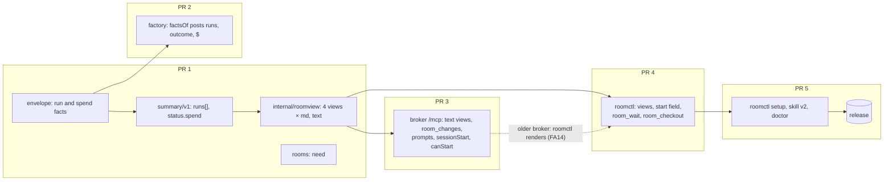

# The factory from your coding agent, PRs 1–5 — Implementation Plan

> **For agentic workers:** REQUIRED SUB-SKILL: Use superpowers:subagent-driven-development (recommended) or superpowers:executing-plans to implement this plan task-by-task. Steps use checkbox (`- [ ]`) syntax for tracking.

**Goal:** From any terminal coding agent, a developer starts, follows and brings back factory work
without leaving the session. Every room reads the same in the agent's transcript and in a terminal,
through four views one Go package renders.

**Architecture:** Five pull requests, 19 tasks, each commit leaving `task check` green.

- **PR 1** adds the run and spend facts to `summary/v1`, the view package `internal/roomview`, and
  each room row's `need`.
- **PR 2** makes the factory write those facts.
- **PR 3** turns the broker's view tools into text plus `structuredContent`, and adds `room_changes`,
  the prompts and the start switch.
- **PR 4** gives `roomctl` the views, the start field, `room_wait` and `room_checkout`.
- **PR 5** adds `roomctl setup`, skill v2 and the doctor's drift check, then the release.



**Tech Stack:** Go 1.27.3 (stdlib `net/http`, `encoding/json`, `os/exec`, `text/tabwriter`),
`golang.org/x/sync/errgroup`, golangci-lint 2.14.0 through `task lint`. One new module,
`github.com/yuin/goldmark`, is used **in tests only** (R6). MCP revisions `2025-06-18` and
`2025-11-25` (form and URL elicitation, roots, progress, cancellation).

**Spec:** [the factory from your coding agent](https://github.com/Smana/ai-native-ref/blob/main/docs/superpowers/specs/2026-10-25-factory-from-your-agent-design.md)
(ai-native-ref): FA1–FA14, "The views", "The tools and the journey", `room_checkout`, "Security",
"Failures", "Setup and portability", "The switch", offline proofs 1–5, and rows 1–5 of "Pull
requests, in order". The roadmap's D4 applies: every switch is off by default. ai-native-ref's
[adopt plan](https://github.com/Smana/ai-native-ref/blob/main/docs/superpowers/plans/2026-10-25-factory-from-your-agent-adopt-plan.md)
pins the release and turns `/mcp` on with `sessionStart: []`.

**Out of PRs 1–5:** the ai-native-ref and cloud-native-ref changes (PRs 6, 7), the live proofs, MCP
Apps, MCP Tasks for `room_wait`, and the web UI. The new summary fields are additive and the web
ignores them.

### This plan's rulings

| # | Ruling | Why |
|---|---|---|
| R1 | **`internal/roomview` is the one renderer.** It holds one model per view and writes three encodings: Markdown, terminal text, and terminal text with colour. The broker and `roomctl` both call it, and nothing else formats a view. `roomctl`'s `RenderSummary`, `stamp`, `tokens` and `budgetText` move into it | FA2, FA14. A package by domain (AGENTS.md); `roomctl` already imports `summary` and `envelope`, and the view needs nothing else |
| R2 | **The factory posts the task's runs**: `TaskFacts.Runs`, the last 20, oldest first, without provenance, each with its verdict (`RunRecord.Verdict`: `approve`, `changes` or `none`). The fold keeps the last fact, as it does for every other field | Facts post once per reconcile, after the phase step (`reconciler.go:252`), so a run's end and the next run's start can share one post. A run map in the fold would then never see the ended run. Last-fact-wins keeps `TestAddingPagesIsFoldingTheLog` true with no new fold state. The runs line's "reviewer approved" is per run, which the room's `lastVerdict` is not |
| R3 | **A run's outcome** is one of `succeeded`, `failed`, `budget_exhausted`, `revoked`, `lost`, `ended`. It is set once `RunRecord.Finished` is set. A `Reason` of `Disrupted`, `PodLost`, `pod_lost` or `run_lost` is `lost`; otherwise the phase decides (`Succeeded`, `Failed`, `BudgetExhausted`, `Revoked`), so `PodFailed` under `Failed` is `failed`; anything else is `ended` | The factory has no stalled outcome. The record holds the AgentRun's phase (`implement.go:301`) and the end reason (`implement.go:469`, `team.go:134`). `PodFailed` is the pod failing on its own, which the factory never resumes (`runs.go:66`) |
| R4 | **Dollars are their own fact, `TaskFacts.Spend`**, set when `Spec.Budget.TaskMicroUSD` or `Status.Usage.CostMicroUSD` is above 0. `Budget` keeps today's rule (set when `TaskTokens > 0`). The facts key steps `Spend.UsedMicroUSD` as it steps tokens: 10 % of the cap, or $0.10 without one. A run without `EndedAt` leaves its micro-USD out of the key. Facts posted carry exact values | Every meter tick would otherwise post facts (`facts.go:75`). A budget fact with no token limit would make the room page read `182 k / 0` (`web/src/strip.ts:91`). The spec has spend "with each budget fact"; the owner chose the separate fact, 2026-10-25 |
| R5 | **Untrusted text is made inert in one place.** `clean` first folds each run of `unicode.IsSpace` runes to one space, then strips every rune `unicode.IsPrint` refuses (control, bidi, zero-width), then cuts at 160 runes plus `…`. In Markdown, agents' text goes in a code span whose backtick fence is longer than the text's longest backtick run. A title has every ASCII punctuation character backslash-escaped, which covers `<` (raw HTML), `[`, `*`, `#` and `` ` ``. Any title word GFM could autolink (containing `://`, `www.` or `@`) goes in its own code span instead. In a table cell, every `\|` is written `\\|`, even inside a code span: GFM splits cells before inline parsing. The terminal gets `clean` text, with agents' words in double quotes | FA10, T10. Folding first keeps `a\nb` two words. Backslash escapes don't stop GFM's extended autolinks, which run on text nodes after inline parsing |
| R6 | **The golden link check parses with goldmark and its GFM extension** (Table, Linkify, Strikethrough), a test-only dependency. Every link node and autolink must be on the allowlist; there is no raw HTML node; and no heading, table, list or emphasis may come from a fixture's untrusted string | An independent parser. A hand-written checker would share the escaper's blind spots |
| R7 | **A room row's `need`** is the caller's first need, in the summary's order: approval, hold, merge. Answers are left out, as in today's count. Approvals read `Log.OpenApprovals` only for a room whose CR shows a pending approval the caller could decide | FA11. The CR projects a count, not ids or deadlines (`rooms.go:246`) |
| R8 | **A view tool's result is the Markdown view in `content[0].text`**, with the JSON as before in `structuredContent`, declared by an `outputSchema`: a root object whose properties stay open. This is a deviation: the MCP spec says a tool SHOULD also put the serialised JSON in a text block | FA2. Every in-repository reader (`roomctl/issuefile.go:111`, `slackapp/broker.go:179`) reads `structuredContent` |
| R9 | **`room_changes` reads the facts at the cursor** through a new store method, `TaskStateAt`, on the `events_task_facts` partial index (no migration). Without a cursor it starts at `max(forkSeq, LastSeq − 2000)` and drops events older than 24 h. A page shows at most 30 milestones; past that, `more` counts the rest, and the cursor is the last shown milestone's seq. Turns, tool calls and pushes (class `forge.push`) collapse into counts per run | View 4. Without the facts at the cursor, a PR that opened in a page's first fact would never show |
| R10 | **Prompts go to roomctl's principals only.** A sponsored principal sees neither the `prompts` capability nor any prompt | FA12. Prompts are slash commands for a person; the Slack App has none |
| R11 | **`canStart`** is true only for a repository in `human.mcp.sessionStart`, with `Identity` and `Access` both set, a caller with a linked GitHub login, and `CanWrite` true. Otherwise `canStartWhy` is one of `off`, `not_linked`, `no_write`, `unverified` (a lookup error); a sponsored caller gets `off` | FA5. Unknown means no. The reason lets `issue_file` say why the start isn't offered (Failures) |
| R12 | **The relay's local tools** (`issue_file`, `room_wait`, `room_checkout`) each run under their own context, cancelled by `notifications/cancelled` for their id, which is never forwarded. From `initialize` the relay reads `elicitation` (`{}` or `{form}` means forms; `{url}` means URL forms, used only at `2025-11-25`) and `roots` (then `roots/list`, waited for 5 s, gives the workspace) | FA6, FA7, FA8. Today only the elicitation's presence is read (`mcp.go:123`) |
| R13 | **`room_wait` compares each poll with a snapshot taken at its start.** `needs_you`: `needsMe` turns true or `need.id` changes. `pr_opened`: `pr` goes from 0 to a number. `ended`: `state` becomes `done`, `failed` or `stopped`. `any_change`: `lastSeq` moves. It polls every 5 s, ×1.5 up to 30 s while nothing moves, and back to 5 s after a move. `timeout` is in seconds: 300 by default, at most 1800 | FA6; Calls made without asking ("newly true", the 20-room cap) |
| R14 | **A URL form** is sent only when the client declared URL mode, the hit is an approval need, and the URL is exactly the card's `needsYou[].url`, on the configured rooms host under `/r/<room>` | Security, "An approval link leads elsewhere" |
| R15 | **Checkout's git** runs without a shell, with `-c core.hooksPath=/dev/null` on every call and `GIT_TERMINAL_PROMPT=0`. Changed files are those of `git diff --name-only -z <merge-base HEAD origin/agent/<room>> origin/agent/<room>`. The flagged list adds hook configs, because the developer's next commit in the worktree runs them: `.husky/`, `.githooks/`, `.pre-commit-config.yaml`, `lefthook.yml`, `.lefthook.yml`, and the repository's `core.hooksPath` when it points inside the repository | `worktree add` runs `post-checkout`, and `fetch` runs `reference-transaction`. A branch-provided hook is the same exposure as config that runs on open |
| R16 | **`setup` registers through the client's CLI** when it is on PATH and takes the server non-interactively; otherwise it prints the snippet and changes nothing. The command is `roomctl` when `exec.LookPath` finds it, else the absolute `os.Executable()` path | FA9. A path that survives upgrades when one exists |
| R17 | **The doctor's `skill` check** reads `factory-handoff/SKILL.md` in every client's user-level skill directory and in the project directories under the working directory. A version that differs from the binary's is `FAIL`, with `roomctl setup <client>` as the fix; no skill found is `skip` | Setup, "Drift" |
| R18 | **`roomctl changes`** calls the broker's `room_changes` over `/mcp` with the CLI's own token, with no new HTTP route. The last cursor per room goes in `<Dir>/cursors.json`, keeping the 200 most recently used rooms | View 4: "since I last looked" needs no memory in the agent |
| R19 | **Where the spec's examples need data no fact carries, the view says less, and the goldens follow the view.** Trigger `human` reads "human review", not "your review", and view 4's "you requested changes on #2239" reads "changes were requested on #2239": no fact names the reviewer. A lost run reads "the sandbox was lost", without "(spot reclaim)": runs carry an outcome, not a reason. A resume reads "(resume N)", with N counted from `runs`, not "(1 of 2)": no fact carries `resume.maxPerTask`. Every other line of the spec's four examples is reproduced | Each phrase would need its own fact field. The owner kept the plan's wording, 2026-10-25 |
| R20 | **The repository on the card** is the `owner/name` of `status.issue.url`, else of `status.pr.url`; the line leaves it out when neither is set | `summary/v1` has no repository field, and both URLs pass `GitHubURL` |

## Global Constraints

- **Worktrees:** each PR is a worktree beside this repository, from a freshly fetched `origin/main`,
  rebased onto it before every push. Branches: `feat/roomview` (PR 1), `feat/factory-run-facts`
  (PR 2), `feat/broker-views` (PR 3), `feat/roomctl-views` (PR 4), `feat/roomctl-setup` (PR 5).
  PR 2 branches from PR 1's merge (it needs Task 1's fields), PR 3 and PR 4 from PR 1's, and PR 5
  from PR 4's.
- **`task check` is the evidence** (AGENTS.md): exit 0, with Docker running for the store tests.
  Each task's own steps run `go test -race -count=1` on the packages they touch.
- **Every `.go` file** starts with `// SPDX-License-Identifier: Apache-2.0`. Lint only through
  `task lint`. stdlib `testing`, table-driven, hand-written fakes, `httptest`. Never a literal
  zero-width, bidi or ESC character in Go source: write `\u200b`, `\u202e`, `\x1b`.
- **Goldens** are rewritten only by `-update-golden`. Views go in `internal/roomview/testdata/`,
  and setup snippets in `internal/roomctl/testdata/setup/`.
- **Strict ingest:** the broker decodes facts strictly (`bridgeapi/system.go:94`), so Task 1's fields
  merge before any task that posts them (PR 1 before PR 2).
- **Off by default (D4):** `human.mcp.sessionStart` is empty unless configured.
- **Names, verbatim:**
  - the tools `rooms_list` (gains `all`), `room_summary`, `room_changes`, `issue_draft`
    (gains `canStart`, `canStartWhy`), `issue_file`, `room_wait`, `room_checkout`;
  - the prompts `handoff` (`what`), `status` (`room`) and `inbox`;
  - the config key `human.mcp.sessionStart`;
  - the commands `roomctl changes`, `roomctl checkout`, `roomctl setup <claude|opencode|codex|gemini|cursor|copilot> [--project] [--print]`, and the doctor check `skill`;
  - the label `factory/ready`.
- **Wording, verbatim from the spec:**
  - the state words `needs you` (only when an item names the caller), `waiting for a human`,
    `running`, `queued`, `done`, `failed`, `stopped`; no glyphs or emoji;
  - "a form field, never a tool argument";
  - "Approvals stay on the room page";
  - "Agents' text always goes in code spans. The only links are ones the broker built";
  - sizes: "Overview: one row per room, at most 7 columns. Card: about 25 lines. Changes: 30 lines,
    then "N more"".
- **Commits:** conventional, in English, no trailers. One concern per commit.

## Review Focus

- **A note or title that breaks out of its span.** A note with `|`, a run of backticks, a newline
  then `# heading`, `](https://evil.example)` or `` must not split a
  table cell, close its code span, start a heading, make a link or reach the page as HTML, in
  Markdown or in the terminal. The `hostile` fixture (Task 2) has each case, and the goldmark check
  (R6) parses every rendering of it in Tasks 4–6.
- **A title with a bare URL or an email address.** GFM autolinks `https://evil.example`,
  `www.evil.example` and `a@evil.example` even when they are backslash-escaped. Task 3's
  `TestTitleWordsThatAutolinkGoInCodeSpans` pins each one.
- **A branch that plants a hook.** A branch that adds `.husky/post-checkout`, while the developer's
  `core.hooksPath` is `.husky`, must neither run during the checkout nor go unflagged. Task 17's
  `TestCheckoutRunsNoHook` uses a hook that writes a marker file, and asserts the file doesn't exist
  and that the form lists `.husky/post-checkout`.
- **A newer factory against an older broker during a rollout.** The broker refuses the new fields
  with a 400. The facts stay due and are retried, and the reconcile's other work is kept. Task 8's
  `TestFactsRefusedByAnOlderBrokerStayDue` pins this, and `docs/operations.md` says to roll the
  broker first.
- **A `room_wait` whose client goes away.** When stdin closes or the request is cancelled, polling
  stops within one tick, with no write after the cancel. Task 16's `TestRoomWaitStopsOnCancel` and
  `TestRoomWaitStopsWhenStdinCloses` pin it.

## File structure

| File | Change | Responsibility |
|---|---|---|
| `internal/envelope/payloads.go` (+ test) | modify (Task 1) | `RunFact` fields, `SpendFact`, `TaskFacts.Runs` and `Spend`; outcomes; `GitHubURL` |
| `internal/summary/summary.go`, `state.go` (+ goldens) | modify (Task 2) | `runs[]`, `status.spend`; `TaskPhases`, `IsHold`, `DescribeApproval` |
| `internal/roomview/inert.go` (+ test) | create (Task 3) | `clean`, code spans, escapes, the link allowlist |
| `internal/roomview/words.go` (+ test) | create (Task 3) | State, phase, reason, trigger and outcome words; money, time |
| `internal/roomview/overview.go` (+ test) | create (Task 4) | View 1, `Row` |
| `internal/roomview/card.go` (+ test) | create (Task 5) | Views 2 and 3 |
| `internal/roomview/changes.go` (+ test) | create (Task 6) | View 4: `Milestones`, `ChangeSet` |
| `internal/roomview/goldmark_test.go`, `testdata/` | create (Tasks 3–6) | The parse check, the goldens |
| `internal/humanapi/rooms.go` (+ `rooms_list_test.go`) | modify (Task 7) | `need` on rows |
| `internal/factory/reconciler/facts.go` (+ test) | modify (Task 8) | Runs, outcomes, dollars, the key |
| `internal/mcpwire/mcpwire.go` (+ test) | modify (Task 9) | `ToolResultText` |
| `internal/humanapi/mcp.go`, `mcpread.go` (+ tests) | modify (Tasks 9–11) | `outputSchema`, text views, `room_changes`, prompts, instructions |
| `internal/humanapi/mcpchanges.go` (+ test), `server.go`, `internal/store/rooms.go` (+ test) | create, modify (Task 10) | `room_changes`; `Log.TaskStateAt` |
| `internal/humanapi/mcpprompts.go` (+ test) | create (Task 11) | `prompts/list`, `prompts/get` |
| `internal/config/config.go` (+ `mcp_test.go`), `internal/app/broker.go`, `internal/humanapi/issuedraft.go` (+ test) | modify (Task 12) | `sessionStart`, `canStart` |
| `internal/roomctl/client.go`, `cursors.go`, `internal/app/roomctl.go` (+ tests) | modify, create (Task 13) | Views in the CLI, `changes` |
| `internal/roomctl/mcp.go`, `localtools.go` (+ tests) | modify, create (Task 14) | Capabilities, cancellation, progress, the views for an older broker |
| `internal/roomctl/issuefile.go` (+ test) | modify (Task 15) | The start field |
| `internal/roomctl/roomwait.go` (+ test) | create (Task 16) | `room_wait` |
| `internal/roomctl/checkout.go`, `git.go` (+ tests) | create (Task 17) | `room_checkout`, `roomctl checkout` |
| `internal/roomctl/setup.go` (+ test, goldens) | create (Task 18) | `roomctl setup` |
| `internal/roomctl/skill/factory-handoff/SKILL.md`, `skill.go`, `doctor.go` (+ tests) | modify (Task 19) | Skill v2, `skill.Version`, the `skill` check |
| `docs/api.md`, `docs/roomctl.md`, `docs/security.md`, `docs/event-envelope.md`, `docs/operations.md`, `docs/architecture.md` | modify (Tasks 7, 8, 12, 17, 19) | The reader's contract |

---

## PR 1: the views and their data

### Task 1: The run and spend facts

**Files:**
- Modify: `internal/envelope/payloads.go`
- Test: `internal/envelope/payloads_test.go`

**Interfaces:**
- Produces:
  - `RunFact` gains `EndedAt time.Time` (`json:"endedAt,omitzero"`), `Outcome string`
    (`json:"outcome,omitempty"`), `Verdict string` (`json:"verdict,omitempty"`, at most 32 bytes,
    as the CRD bounds it) and `MicroUSD int64` (`json:"microUSD,omitempty"`).
  - `type SpendFact struct { UsedMicroUSD int64 \`json:"usedMicroUSD"\`; LimitMicroUSD int64 \`json:"limitMicroUSD,omitempty"\` }`,
    and `TaskFacts.Spend *SpendFact` (`json:"spend,omitempty"`). `BudgetFact` is unchanged (R4).
  - `TaskFacts` gains `Runs []RunFact` (`json:"runs,omitempty"`), with `const MaxRuns = 20`.
  - The outcome constants `OutcomeSucceeded`, `OutcomeFailed`, `OutcomeBudgetExhausted`,
    `OutcomeRevoked`, `OutcomeLost`, `OutcomeEnded`, with the values from R3.
  - `func GitHubURL(s string) bool`, the existing `githubURL` regexp exported as a predicate.

- [ ] **Step 1: Write the failing tests**

`TestTaskFactsValidate`, a table that grows these cases:

| Case | Expect |
|---|---|
| `Spend.UsedMicroUSD: -1` | an error naming `usedMicroUSD` |
| `Spend.LimitMicroUSD: -1` | an error naming `limitMicroUSD` |
| `Run.MicroUSD: -1` | an error naming `microUSD` |
| `Runs[2].MicroUSD: -1` | an error naming `runs[2]` |
| 21 runs | an error naming `runs` and 20 |
| `Runs[0].Outcome: "stalled"` | an error naming the outcome |
| `Runs[0].Verdict` of 33 bytes | an error naming `verdict` |
| `Run.EndedAt` before `Run.StartedAt` | an error |

`TestTaskFactsRoundTripsRunsAndDollars` marshals facts with two runs, a budget and a spend,
unmarshals with `DisallowUnknownFields`, and requires equality. `TestGitHubURL` takes
`https://github.com/Smana/a/pull/7` and refuses `https://github.com.evil/Smana/a/pull/7`.

- [ ] **Step 2: Run them, and see them fail**

Run: `go test -race -count=1 ./internal/envelope -run 'TestTaskFacts|TestGitHubURL'`
Expected: FAIL to compile on the new fields.

- [ ] **Step 3: Add the fields, the constants and the checks to `TaskFacts.Validate`**

Outcome `""` stays valid: a run that hasn't ended has none.

- [ ] **Step 4: Run them, and see them pass**

Run: `go test -race -count=1 ./internal/envelope ./internal/bridgeapi`
Expected: PASS. `bridgeapi` still ingests facts strictly, now with the new fields.

- [ ] **Step 5: Document the fields** in the `task` row of `docs/event-envelope.md:136`.

- [ ] **Step 6: Commit**

```bash
git add internal/envelope docs/event-envelope.md
git commit -m "feat(envelope): a task's runs, each run's outcome, end and dollars, and the task's spend"
```

### Task 2: `summary/v1` carries runs and spend

**Files:**
- Modify: `internal/summary/summary.go`, `internal/summary/state.go`
- Create: `internal/summary/testdata/runs_and_spend.json`, `internal/summary/testdata/hostile.json`
- Test: `internal/summary/summary_test.go`, `internal/summary/state_test.go`

**Interfaces:**
- Consumes: Task 1's fields.
- Produces:
  - `Summary.Runs []envelope.RunFact` (`json:"runs,omitempty"`), copied from the last task fact's
    `Runs`.
  - `Summary.Status.Spend *envelope.SpendFact` (`json:"spend,omitempty"`), from the last task
    fact's `Spend`.
  - `func TaskPhases() []string`: the keys of `taskStates()`, sorted.
  - `func IsHold(reason string) bool`: whether `holds()` has the reason, for Task 6's `held`.
  - `func DescribeApproval(class string, action json.RawMessage) string`: today's `describe`'s
    body, exported so that room rows say the same; `describe` calls it.

- [ ] **Step 1: Write the fixtures and the failing tests**

- `runs_and_spend.json`: the `normal` log, plus a last task fact with three runs and a spend of
  `{usedMicroUSD: 310000, limitMicroUSD: 1500000}`. The runs are: implementer `initial`, succeeded;
  reviewer `review`, succeeded with verdict `approve`; and implementer `human` with no `endedAt`.
- `hostile.json`: the `normal` log with hostile text wherever an agent or an issue author writes.
  Fixtures are JSON, so control characters are `\u` escapes:

| Where | Text |
|---|---|
| a note | ```` a\|b `x` ``y`` ```z ```` (the `\|` is this table's escape; the note holds a bare pipe) |
| a note | `"\n# heading\n[x](https://evil.example)"` |
| a note | `**bold** _it_ ~~gone~~ ` |
| an approval command | `"\u001b[2Jrm -rf / \u202e\u200b"` |
| the issue title | `docs: see https://evil.example or www.evil.example, mail a@evil.example <b>x</b>` |

Add both to `goldens`, and fill their `want` with `go test ./internal/summary -run TestFoldGolden
-update-golden`. Review the diff by hand: `runs` has three entries and `status.spend` is
`{usedMicroUSD, limitMicroUSD}`. Then add `TestTaskPhasesCoverCoarse`: every phase in `TaskPhases()`
gives a non-empty `Coarse(p, "Open", false)`. Also add `TestIsHold`: `waiting_human_driver` and
`waiting_room_busy` hold, and `waiting_run_slot` does not.

- [ ] **Step 2: Run them, and see them fail**

Run: `go test -race -count=1 ./internal/summary`
Expected: FAIL. `want` has `runs`, and the fold doesn't produce it.

- [ ] **Step 3: Set `Runs` and `Status.Spend` in `View`, beside `s.Status.Budget` (`summary.go:250`)**

Copy `Runs` rather than aliasing it. A sealed room keeps both, since they are facts and not needs.

- [ ] **Step 4: Run them, see them pass, and check the older goldens**

Run: `go test -race -count=1 ./internal/summary ./internal/humanapi && git diff --exit-code -- internal/summary/testdata/{normal,resumed,expired_approval,sealed,no_facts}.json`
Expected: PASS, `TestAddingPagesIsFoldingTheLog` included, and no diff: the new fields are omitted
when absent.

- [ ] **Step 5: Document** `runs[]` and `status.spend` in `docs/api.md`'s `GET /api/rooms/{id}/summary`
  table.

- [ ] **Step 6: Commit**

```bash
git add internal/summary docs/api.md
git commit -m "feat(summary): summary/v1 carries the task's runs and its spend in dollars"
```

### Task 3: Inert text, the allowlist and the words

**Files:**
- Create: `internal/roomview/doc.go`, `internal/roomview/inert.go`, `internal/roomview/words.go`,
  `internal/roomview/goldmark_test.go`, `internal/roomview/inert_test.go`, `internal/roomview/words_test.go`
- Modify: `go.mod`, `go.sum` (`github.com/yuin/goldmark`, test-only)

**Interfaces:**
- Produces (package `roomview`, `// Package roomview renders the factory's four room views, and is
  the one place that makes untrusted text inert`):
  - `type Format int`, with the constants `Markdown`, `Text` and `TextColor`.
  - `type Options struct { Format Format; Now time.Time; All bool; Rooms string }`. `Rooms` is the
    rooms base URL, `https://rooms.<domain>`.
  - Unexported, used by Tasks 4–6:
    - `clean(s string) string`;
    - `code(s string, cell bool) string`;
    - `escapeTitle(s string, cell bool) string`;
    - `quote(s string) string`, for the terminal;
    - `link(text, url string, o Options, cell bool) string`, which renders text alone for a URL off
      the allowlist;
    - `allowed(url string, o Options) bool`, true for `o.Rooms + "/r/<room>"` with an optional
      `#fragment`, or `envelope.GitHubURL`;
    - `stateWord(state string, needsYou bool) string`, `phaseWords(phase string) string`,
      `reasonWords(reason string) string`, `triggerWords(trigger string) string`,
      `outcomeWords(outcome string) string`, `verdictWords(verdict string) string`;
    - `repoOf(urls ...string) string`: the `owner/name` of the first URL that passes
      `envelope.GitHubURL`, else `""` (R20);
    - `dollars(micro int64) string`, which rounds half up to the cent (`$0.31`);
    - `ago(t, now time.Time) string`: `3 min ago` or `2 h ago` under 24 h, else the date;
    - `stamp(t, now time.Time) string`: `19:30 UTC` today, else `2026-10-08 19:30 UTC`;
    - `tokens(n int64) string`, moved from `roomctl`.
  - In `goldmark_test.go`: `func assertInert(t *testing.T, md string, rooms string, untrusted []string)`.
    It parses `md` with goldmark and `extension.GFM`, and fails on four things: a link or autolink
    node whose destination isn't `allowed`; any raw HTML node, inline or block; a heading, list,
    table, emphasis, strikethrough or link node whose text holds one of `untrusted`; and any byte
    below `0x20` other than `\n`.

- [ ] **Step 1: Write the failing tests**

- `TestClean`, a table:

| In | Out |
|---|---|
| `"a\u200bb\u202ec\x1b[2J"` | `"abc[2J"` |
| `"one\n\n two\t three"` | `"one two three"` |
| `"a\nb"` | `"a b"` |
| 200 × `"é"` | 160 × `"é"` + `"…"` |

- `TestCodeSpanOutrunsBackticks`: `code("a``b", false)` is ``"``` a``b ```"``; `code("`x", false)`
  has a space before `` `x ``; goldmark reads back each one's text as the input.
- `TestTableCellEscapesPipes`: `code("a|b", true)` contains `\|`; a one-row table holding it parses
  to exactly 2 cells.
- `TestTitleWordsThatAutolinkGoInCodeSpans`: each of `https://evil.example`, `www.evil.example`
  and `a@evil.example` in a title renders with no link node (`assertInert`).
- `TestTitleEscapesMarkdown`: `# x *y* [z](w) <b>v</b>` renders as one paragraph whose text equals
  the input, with no raw HTML node.
- `TestAllowed`: it accepts `https://rooms.example/r/26zfnuxm#01M4A` and the issue and PR URLs of
  the `normal` golden. It refuses `https://rooms.example.evil/r/26zfnuxm`,
  `https://rooms.example/admin` and `javascript:x`.
- `TestEveryPhaseAndReasonHasWords`: `phaseWords` is non-empty and differs from the phase for every
  `summary.TaskPhases()` entry; `reasonWords` is non-empty for every `summary.Reasons()` entry,
  with at most 40 runes.
- `TestEveryTriggerOutcomeAndVerdictHasWords`: `triggerWords` for each of `initial`, `review`,
  `human`, `ci`, `retry` and `resume` (the CRD's enum, `task_types.go:547`); `outcomeWords` for the
  six outcomes; `verdictWords` for `approve`, `changes` and `none`. `triggerWords("human")` is
  `human review` (R19).
- `TestRepoOf`: an issue URL gives `Smana/a`; no URL, or one off `GitHubURL`, gives `""`.
- `TestDollars`: `0` → `$0.00`, `4999` → `$0.00`, `5000` → `$0.01`, `1_500_000` → `$1.50`.
- `TestAgo` and `TestStamp`: 3 minutes, 2 hours, 25 hours; and a stamp today and yesterday.

- [ ] **Step 2: Run them, and see them fail**

Run: `go test -race -count=1 ./internal/roomview`
Expected: FAIL to compile.

- [ ] **Step 3: Implement `inert.go` and `words.go`**

`go get github.com/yuin/goldmark@latest`. It is imported only from `_test.go` files, which `go mod
tidy` keeps. The state words come from the spec's list: `waiting_for_human` reads `waiting for a
human`. The short reason phrases are `words.go`'s own: the spec's view 1 says
`waiting for a run slot` where `summary`'s sentence is longer.

- [ ] **Step 4: Run them, and see them pass**

Run: `go test -race -count=1 ./internal/roomview && task tidy && task vuln`
Expected: PASS; no vulnerability reached.

- [ ] **Step 5: Commit**

```bash
git add go.mod go.sum internal/roomview
git commit -m "feat(roomview): inert untrusted text, the link allowlist and the views' words"
```

### Task 4: View 1, the rooms overview

**Files:**
- Create: `internal/roomview/overview.go`, `internal/roomview/overview_test.go`,
  `internal/roomview/testdata/overview.{md,txt}`, `internal/roomview/testdata/overview_hostile.{md,txt}`

**Interfaces:**
- Consumes: Task 3.
- Produces:
  - `type Row struct` with the JSON names of `GET /api/rooms`: `id`, `url`, `phase`, `state`,
    `repository`, `issue`, `title`, `task`, `pr`, `reason`, `lastSeq`, `lastEventAt`, `needsMe`,
    `needsYou`, and `need` (`*summary.Need`, `json:"need,omitempty"`).
  - `func Overview(w io.Writer, rows []Row, o Options) error`.

- [ ] **Step 1: Write the failing tests**

- `TestOverviewGolden`: the spec's four rooms (view 1's example) plus one that ended 8 days ago,
  rendered in `Markdown` and `Text`, compared with the goldens under `-update-golden`. The Markdown
  must equal the spec's example byte for byte, footer included: `1 room ended more than 7 days ago:
  \`roomctl rooms --all\` shows it.`
- `TestOverviewOrder`: rows that need you come first, then running, queued and ended, newest first
  within each group.
- `TestOverviewAllShowsEnded`: with `All: true` the old room is a row and there is no footer.
- `TestOverviewRepoColumnOnlyWhenMixed`: a Repo column appears only when the rows span two
  repositories, and the column count stays at most 7.
- `TestOverviewHostile`: titles and need descriptions from `hostile.json` pass `assertInert`, and the
  `Text` rendering holds no byte below `0x20` other than `\n`.
- `TestOverviewNeedsYouOnlyForTheCaller`: a row with `state: waiting_for_human` and no `need` reads
  `waiting for a human`, never `needs you`.

- [ ] **Step 2: Run them, and see them fail**

Run: `go test -race -count=1 ./internal/roomview -run TestOverview`
Expected: FAIL to compile.

- [ ] **Step 3: Implement `Overview`**

The header is `**Factory rooms** · <rows shown> open · <rows with a need> needs you`, with the
`needs you` part left out at zero. "Where it is" is the need when there is one: for kind
`approval`, `approve <code(what)> by <stamp(deadline)>`; for a hold or a merge, its `what`.
Otherwise it is `reasonWords(reason)` when the row has a reason, else `phaseWords(task)`. This gives
the spec's four rows: `implementing`, `waiting for a run slot`, `merged`. A missing PR is `—` in
Markdown and `-` in the terminal. The terminal encoding follows the spec's terminal example: the
header `ROOM  TASK  STATE  WHERE IT IS  PR  UPDATED`, aligned with `text/tabwriter`, and an approval
need as `approve "<what>" <HH:MM>`. Colour (bold for `needs you`) appears only under `TextColor`.

- [ ] **Step 4: Run them, and see them pass**

Run: `go test -race -count=1 ./internal/roomview`
Expected: PASS.

- [ ] **Step 5: Commit**

```bash
git add internal/roomview
git commit -m "feat(roomview): the rooms overview, in Markdown and for a terminal"
```

### Task 5: Views 2 and 3, the room card and its runs line

**Files:**
- Create: `internal/roomview/card.go`, `internal/roomview/card_test.go`, `internal/roomview/testdata/card_<golden>.{md,txt}` for each summary golden
- Modify: `internal/roomctl/status.go` (`RenderSummary` and its helpers removed), `internal/roomctl/roomctl_test.go`, `internal/app/roomctl.go:272`, `internal/app/roomctl_test.go`
- Delete: `internal/roomctl/render_waiting_test.go` (ported)

**Interfaces:**
- Consumes: `summary.Summary` with Task 2's fields; Task 3.
- Produces: `func Card(w io.Writer, s summary.Summary, o Options) error`.

- [ ] **Step 1: Write the failing tests**

- `TestCardGolden`: each `internal/summary/testdata/*.json` is folded and viewed exactly as
  `TestFoldGolden` does, then carded in `Markdown` and `Text`.
- `TestCardMatchesTheSpec`: `runs_and_spend` in Markdown holds, in this order: the `### <room> · #<n>
  <title>` heading; the state line, `<state word> · <phase> · <repository> · [open the room](<url>)`
  (R20); the facts table with `Run`, `Spend` (`$0.31 of $1.50 (21 %) · 182 k tokens`), `PR` with the
  last verdict, and `Next`; `**Needs you**`; `**Runs**`; `**Agents' notes**, their claims, not
  checked`; `Ran on`; and `**You can**`. Apart from R19's words, each line has the spec's view 2
  shape.
- `TestCardOmitsAbsentLines`: `no_facts` has no `Run`, `Spend`, `PR` or `Runs` line; `sealed` has no
  `Needs you` or `You can`.
- `TestCardFallsBackToTokens`: a budget with no spend reads `182 k of 1.5 M tokens (12 %)`.
- `TestRunsLine`: the three runs of `runs_and_spend` read `implementer (initial) succeeded · 4 min ·
  $0.08 → reviewer approved · 3 min · $0.04 → implementer (human review) **running** · 8 min · $0.08`.
  An implementer shows `(<triggerWords>)` and its outcome. A reviewer or tester shows no trigger
  (always `review`), and shows `verdictWords(verdict)` in place of `succeeded` when it has a
  verdict. A running run's time counts to `Now`.
- `TestCardHostile`: `hostile` passes `assertInert`; every note sits in a code span.
- `TestCardSize`: no golden's card is longer than 30 lines.

Port the four tests that call `RenderSummary` to `internal/roomview/card_test.go` as `Text`-format
cases, keeping each one's point with the card's new lines:

- `TestRenderSummary` (`roomctl_test.go:479`): no ESC byte, and no `roomctl approve`;
- `TestStatusLeadsWithTheTaskAndReadsTheBudget`: the issue's title leads, and the budget reads as on
  the page;
- `TestRenderSummaryPrintsTheReasonAndNextStep` and `TestRenderSummaryPrintsAMerge`
  (`render_waiting_test.go`): why and next are printed, and a merge carries its PR link.

Then delete `render_waiting_test.go`. In `internal/app/roomctl_test.go`, change `TestRoomctlStatus`'s
`phase: Implementing` to the card's terminal state line, and keep its ESC assertions.

- [ ] **Step 2: Run them, and see them fail**

Run: `go test -race -count=1 ./internal/roomview ./internal/app -run 'TestCard|TestRunsLine|TestRoomctlStatus'`
Expected: FAIL.

- [ ] **Step 3: Implement `Card`, then switch `roomctl status` over**

`roomctl status` decodes the body into `summary.Summary`, as `RenderSummary` did, and calls
`roomview.Card` with `Format: Text`, or `TextColor` when stdout is a character device and `NO_COLOR`
is unset, and `Rooms: cfg.URL`. Delete `RenderSummary`, `stamp`, `tokens` and `budgetText` from
`roomctl/status.go`. Keep `oneLine`, which `client.go`, `doctor.go` and `issuefile.go` use.

- [ ] **Step 4: Run them, and see them pass**

Run: `go test -race -count=1 ./internal/roomview ./internal/roomctl ./internal/app`
Expected: PASS.

- [ ] **Step 5: Commit**

```bash
git add internal/roomview internal/roomctl internal/app
git commit -m "feat(roomview): the room card and its runs line; roomctl status renders it"
```

### Task 6: View 4, what changed since

**Files:**
- Create: `internal/roomview/changes.go`, `internal/roomview/changes_test.go`, `internal/roomview/testdata/changes_*.{md,txt}`

**Interfaces:**
- Consumes: Task 3; `envelope` events and facts.
- Produces:
  - `type ChangeSet struct { Room, URL string; Since time.Time; Items []Milestone; More int; Cursor string; Untrusted bool }`,
    with JSON names `room`, `url`, `since`, `items`, `more`, `cursor` and `untrusted` (always true).
    It is `room_changes`' `structuredContent`.
  - `type Milestone struct { Seq int64; At, Until time.Time; Kind, Run, Role, Text, URL string; Turns, Tools, Pushes int }`,
    with JSON names `seq`, `at`, `until,omitzero`, `kind`, `run,omitempty`, `role,omitempty`,
    `text,omitempty`, `url,omitempty`, `turns,omitempty`, `tools,omitempty`, `pushes,omitempty`.
  - The kinds `run_started`, `run_ended`, `activity`, `handoff`, `note`, `approval_requested`,
    `approval_decided`, `verdict`, `pr_opened`, `merged`, `reverted`, `held`, `resumed`,
    `budget_reached` and `ended`.
  - `type MilestoneInput struct { Room, URL string; Base *envelope.TaskFacts; Events []envelope.Event; Limit int }`.
  - `func Milestones(in MilestoneInput) ChangeSet`.
  - `func Changes(w io.Writer, c ChangeSet, o Options) error`.

- [ ] **Step 1: Write the failing tests**

- `TestMilestonesFromFacts`, a table over a base fact and a page:

| Base → page | Milestones |
|---|---|
| no PR → PR #2239 | `pr_opened` with the PR's URL |
| run `a` → runs `a` (`lost`), `b` (`resume`) | `run_ended` for `a` (`the sandbox was lost`), then `run_started` for `b`, `(resume 1)` |
| run `a` → runs `a`, `b` (`human`) with a PR | `run_started` for `b`: `changes were requested on #2239 → the factory started implementer \`b\` (human review)` |
| phase `Implementing` → `Merged` | `merged` |
| phase `Merged` → `Reverted` | `reverted` |
| reason `""` → `waiting_human_driver` | `held` (`summary.IsHold`) |
| `held` → phase `Implementing` | `resumed` |
| spend used < limit → used ≥ limit | `budget_reached`; with no spend, the token budget decides |
| nil base, page with PR #2239 | no `pr_opened`: the PR predates the window |

- `TestMilestonesCollapseActivity`: a run's 9 completed turns, 14 tool calls and 1 `forge.push` tool
  call become one `activity` milestone, spanning its first to its last event, with `turns: 9`,
  `tools: 14` and `pushes: 1`.
- `TestMilestonesPageAt30`: 40 notes give 30 items, `more: 10`, and `cursor` equal to the 30th
  item's `seq:N`.
- `TestChangesGolden`: the spec's view 4 example is built from a fixture log and rendered in both
  formats. The Markdown must equal the spec's six lines, apart from R19's three phrases.
- `TestChangesHostile`: `hostile.json`'s events pass `assertInert`.

- [ ] **Step 2: Run them, and see them fail**

Run: `go test -race -count=1 ./internal/roomview -run 'TestMilestones|TestChanges'`
Expected: FAIL to compile.

- [ ] **Step 3: Implement `Milestones` and `Changes`**

Task facts are diffed in order against `Base`, then against each other. A note is a `progress`
message, and a verdict is `review_verdict`. Approvals come from `approval_requested` and
`approval_decided`, the request with `URL` `<url>#<id>`. Handoffs come from `handoff`, and the
room's end from `room_phase: Closed` or `limit`. `Since` is the first event's `ts`.

- [ ] **Step 4: Run them, and see them pass**

Run: `go test -race -count=1 ./internal/roomview`
Expected: PASS.

- [ ] **Step 5: Commit**

```bash
git add internal/roomview
git commit -m "feat(roomview): what changed since a cursor, milestones only"
```

### Task 7: Room rows name the caller's first need; PR 1 opens

**Files:**
- Modify: `internal/humanapi/rooms.go`
- Test: `internal/humanapi/rooms_list_test.go`
- Modify: `docs/api.md` (the room list's fields)

**Interfaces:**
- Consumes: `summary.Hold`, `summary.Merge`, `summary.DescribeApproval`; `Log.OpenApprovals`.
- Produces: `roomRow.Need *summary.Need` (`json:"need,omitempty"`), and
  `func (s *Server) firstNeed(ctx context.Context, room *v1alpha1.Room, sub, web policy.Subject, url string) *summary.Need`.
  It reads `LastTaskState` once, and `held` and `waitReason` share that read.

- [ ] **Step 1: Write the failing tests**

- `TestRoomRowNeedIsTheFirstNeed`, a table:

| Room | Expected `need` |
|---|---|
| 2 pending approvals the caller may decide | kind `approval`: the lowest id (the summary's order, `summary.go:266`; ids are ULIDs), `DescribeApproval` text, its deadline, `url#id` |
| an approval already expired, and a hold | the hold |
| Queued, held for the caller | kind `hold`, the wait reason as `id` |
| a PR waiting for the caller's merge | kind `merge`, URL `https://github.com/<repo>/pull/<n>` |
| a pending approval the caller may not decide | none |
| nothing waits | none, and the JSON has no `need` key |

- `TestRoomRowsReadApprovalsOnlyWhenPending`: the fake `Log` counts `OpenApprovals` calls. It is
  called once for one room with a pending approval among three rooms.

- [ ] **Step 2: Run them, and see them fail**

Run: `go test -race -count=1 ./internal/humanapi -run 'TestRoomRow'`
Expected: FAIL.

- [ ] **Step 3: Implement `firstNeed`, and set `row.Need` beside `NeedsYou` (`rooms.go:341`)**

- [ ] **Step 4: Run the package, then the gate**

Run: `go test -race -count=1 ./internal/humanapi`, then `task check`
Expected: PASS, then exit 0.

- [ ] **Step 5: Commit, push, open PR 1**

```bash
git add internal/humanapi docs/api.md
git commit -m "feat(humanapi): each room row names the caller's first need"
git push -u origin feat/roomview
gh pr create --title "feat(roomview): the factory's room views, runs and spend in summary/v1" --body-file -
```

Write the body from Tasks 1–7, linking the spec. Expected: `check` and `analyze` green.

---

## PR 2: the factory writes the facts

### Task 8: Runs, outcomes and dollars in the task's facts

**Files:**
- Modify: `internal/factory/reconciler/facts.go`
- Test: `internal/factory/reconciler/facts_test.go`
- Modify: `docs/factory.md` (what the room's facts carry), `docs/operations.md` (roll the broker first)

**Interfaces:**
- Consumes: Task 1's fields and outcomes; `RunRecord.{Phase, Reason, Verdict, Finished, CostMicroUSD}`,
  `Spec.Budget.TaskMicroUSD` and `Status.Usage.CostMicroUSD` (`api/factory/v1alpha1/task_types.go`).
- Produces: `func outcomeOf(r v1alpha1.RunRecord) string`, and `runFact(r v1alpha1.RunRecord) envelope.RunFact`,
  shared by `Run` and `Runs`.

- [ ] **Step 1: Write the failing tests**

- `TestOutcomeOf`, a table over R3: each of the four phases; `Disrupted`, `PodLost`, `pod_lost` and
  `run_lost` → `lost`, even with phase `Failed`; `PodFailed` with phase `Failed` → `failed`;
  `Finished` with phase `""` → `ended`; no `Finished` → `""`.
- `TestFactsOfCarriesRuns`: a task with 3 runs (two finished) gives `Runs` of 3, oldest first. Each
  run has its `MicroUSD` and `Verdict`. The finished ones have `EndedAt` truncated to the second and
  an `Outcome`; only `Run` has provenance.
- `TestFactsOfKeepsTheLast20Runs`: 25 runs give the last 20.
- `TestFactsOfSpend`: `TaskMicroUSD: 1_500_000` and usage `310_000` give `Spend{310_000, 1_500_000}`.
  With no cap and usage `310_000`, `Spend{310_000, 0}`. With neither, no `Spend`. With
  `TaskTokens: 0`, still no `Budget` (R4).
- `TestFactsKeyStepsDollars`: the key is equal at 310 000 and 340 000 µUSD of a 1.5 M cap, and
  differs at 460 000. Without a cap, it is equal at 10 000 and 90 000 and differs at 110 000. A
  running run's micro-USD moving from 10 000 to 80 000 leaves the key unchanged.
- `TestFactsRefusedByAnOlderBrokerStayDue`, beside `TestAFailedFactsPostReusesItsSeq`: the rig's
  `fakeLog.failFacts` is `&rooms.APIError{Status: 400, Reason: wire.ReasonBadMessage}`, which is what
  `rooms.Client.do` returns when the broker's strict decoder refuses a field
  (`bridgeapi/system.go:98`). `postFacts` returns an error, `factsDue` stays true, and once
  `failFacts` is cleared the retry succeeds: `factsSeqs` is `[1, 1]`.

- [ ] **Step 2: Run them, and see them fail**

Run: `go test -race -count=1 ./internal/factory/reconciler -run 'TestOutcomeOf|TestFactsOf|TestFactsKey|TestFactsRefused'`
Expected: FAIL.

- [ ] **Step 3: Implement it in `factsOf` and `factsKey`**

- [ ] **Step 4: Run them, the hash round-trip and the envtests**

Run: `go test -race -count=1 ./internal/factory/...`
Expected: PASS. The existing test that reads a task back and compares its hash still holds with the
new `EndedAt`.

- [ ] **Step 5: Document, run the gate, commit and open PR 2**

`docs/operations.md`, under upgrades: "roll the broker before the factory: a broker older than its
factory refuses the new task facts with a 400, and the factory retries them". Then:

```bash
task check
git add internal/factory docs/factory.md docs/operations.md
git commit -m "feat(factory): a room's facts carry the task's runs, their outcomes and dollars, and its spend"
git push -u origin feat/factory-run-facts
gh pr create --title "feat(factory): runs, outcomes and dollars in the room's facts" --body-file -
```

---

## PR 3: the broker serves the views

### Task 9: Text views, `structuredContent` and `outputSchema`

**Files:**
- Modify: `internal/mcpwire/mcpwire.go`, `internal/humanapi/mcp.go`, `internal/humanapi/mcpread.go`
- Test: `internal/mcpwire/mcpwire_test.go`, `internal/humanapi/mcpread_test.go`, `internal/humanapi/mcp_test.go`

**Interfaces:**
- Consumes: `roomview.Overview`, `roomview.Card`, `roomview.Row`.
- Produces:
  - `func ToolResultText(text string, out any) (map[string]any, error)` in `mcpwire`, returning
    `content: [{type: text, text}]` and `structuredContent: out`. `ToolResult` is unchanged, since
    `internal/mcp` uses it.
  - `mcpTool.output json.RawMessage`, emitted as `outputSchema` in `tools/list` when it is set.
  - `type viewResult struct { text string; data any }` in `humanapi`. `writeTool` sends a
    `viewResult` through `ToolResultText`, and anything else through `ToolResult`.
  - `rooms_list` gains `all` (boolean). It returns a `viewResult`, whose text is the overview.
    `structuredContent` stays `{rooms, access}` with every row, `all` or not.
  - `room_summary` returns a `viewResult`, whose text is the card.
  - Both render with `Format: Markdown`, `Rooms: s.PublicURL` and `Now: s.now()`.

- [ ] **Step 1: Write the failing tests**

- `TestToolResultText`: the text is the given text, `structuredContent` is `out`, and there is no
  `isError`.
- `TestViewToolsReturnTextAndStructure`: for `rooms_list` and `room_summary`, `got.text` starts with
  `**Factory rooms**` or `### `, and `got.structured` decodes as before (`rooms`, or `apiVersion
  summary/v1`).
- `TestViewToolsDeclareOutputSchema`: `tools/list` gives `rooms_list` and `room_summary` an
  `outputSchema` of `type: object`, whose `required` names are each a key of the structured result
  above.
- `TestRoomsListAllOnlyChangesTheText`: an old ended room is in `structured.rooms` both ways, and in
  the text only with `all: true`.

Update every existing test that unmarshals `got.text` from `rooms_list` or `room_summary` to read
`got.structured` instead (`git grep -n 'got.text' internal/humanapi`), and the relay test
`mcprelay_test.go` likewise.

- [ ] **Step 2: Run them, and see them fail**

Run: `go test -race -count=1 ./internal/mcpwire ./internal/humanapi -run 'TestToolResultText|TestViewTools|TestRoomsListAll'`
Expected: FAIL.

- [ ] **Step 3: Implement it**

Each schema is an inline `json.RawMessage` beside its tool, as `schema` is. A row converts to
`roomview.Row` by field, in `mcpread.go`.

- [ ] **Step 4: Run them, and see them pass**

Run: `go test -race -count=1 ./internal/mcpwire ./internal/mcp ./internal/humanapi ./internal/slackapp ./internal/roomctl`
Expected: PASS. `internal/mcp` (`:8090`) is unchanged, and the Slack App reads `structuredContent`.

- [ ] **Step 5: Commit**

```bash
git add internal/mcpwire internal/humanapi
git commit -m "feat(humanapi): rooms_list and room_summary return their view as text, the JSON as structuredContent"
```

### Task 10: `room_changes`

**Files:**
- Modify: `internal/store/rooms.go`, `internal/humanapi/server.go` (`Log`), the `humanapi` test fake `memLog`
- Create: `internal/humanapi/mcpchanges.go`, `internal/humanapi/mcpchanges_test.go`
- Test: `internal/store/task_state_test.go`

**Interfaces:**
- Consumes: `roomview.Milestones`, `roomview.Changes`; `s.readRoom`, `parseCursor`, `Log.Range`.
- Produces:
  - `func (s *Store) TaskStateAt(ctx context.Context, roomID string, after, upTo int64) (json.RawMessage, error)`:
    the highest-seq task fact with `after < seq ≤ upTo`, or nil. It is added to `humanapi.Log`.
  - `func (s *Server) roomChanges(ctx context.Context, p authn.Principal, args json.RawMessage) (any, error)`,
    with input `{room, cursor?}` (the same patterns as `room_tail`). It returns a `viewResult` with
    the `ChangeSet`.
  - The tool `room_changes`, listed for humans after `room_tail` and added to `sponsoredTools`.

- [ ] **Step 1: Write the failing tests**

- `TestTaskStateAt` (testcontainers): facts at seqs 3, 7 and 12 give 7 for `(0, 10)`, nil for
  `(7, 10)`, and 3 for `(0, 6)`. `EXPLAIN` names `events_task_facts`.
- `TestMCPRoomChanges`: a fixture log; without a cursor the text starts `**<room> · since`; with
  `cursor: seq:N` only what follows N; `structured.cursor` passed back gives an empty page with
  `items: []`.
- `TestMCPRoomChangesBaseline`: a PR in the facts at or below the cursor gives no `pr_opened`, and a
  PR that appears after it does.
- `TestMCPRoomChangesLast24h`: without a cursor, events older than 24 h are absent.
- `TestMCPRoomChangesRefusals`: `aaaaaaaa` gives `no such room`; a room the caller can't read gives
  the same refusal as `room_summary`.
- `TestSponsoredSeesRoomChanges`: a sponsored principal's `tools/list` has `room_changes`.

- [ ] **Step 2: Run them, and see them fail**

Run: `go test -race -count=1 ./internal/store -run TestTaskStateAt && go test -race -count=1 ./internal/humanapi -run 'TestMCPRoomChanges|TestSponsoredSeesRoomChanges'`
Expected: FAIL.

- [ ] **Step 3: Implement `TaskStateAt` and `roomChanges`**

The SQL is `lastTaskStateSQL`'s predicate plus `AND seq <= $3`, with the same partial index. The
baseline is `TaskStateAt(room, roomctrl.ForkSeq(room), cursor)`. Events are read in pages through
`Range`, at most `tailScan` (2000) per call, as `tail` does.

- [ ] **Step 4: Run them, and see them pass**

Run: `go test -race -count=1 ./internal/store ./internal/humanapi`
Expected: PASS.

- [ ] **Step 5: Commit**

```bash
git add internal/store internal/humanapi
git commit -m "feat(humanapi): room_changes, a room's milestones since a cursor"
```

### Task 11: Prompts and instructions

**Files:**
- Create: `internal/humanapi/mcpprompts.go`, `internal/humanapi/mcpprompts_test.go`
- Modify: `internal/humanapi/mcp.go` (the method switch at `:192`, `mcpInitialize`, `mcpInstructions`)

**Interfaces:**
- Produces:
  - The methods `prompts/list` and `prompts/get`. `initialize` gains
    `caps["prompts"] = {"listChanged": false}` for roomctl's principals only (R10).
  - `type mcpPrompt struct { name, description string; args []promptArg; text func(args map[string]string) string }`.
  - `var mcpPrompts = []mcpPrompt{…}` for `handoff` (`what`, optional), `status` (`room`, optional:
    a room id or `#<issue>`) and `inbox` (none).
  - `prompts/get` answers `{description, messages: [{role: "user", content: {type: "text", text}}]}`.

| Prompt | The message tells the agent to |
|---|---|
| `handoff` | Draft one issue for `what` (or the side task just discussed) in the template's three sections, check it with `issue_draft`, fix what it reports, then call `issue_file`; never apply a label |
| `status` | Find the room (by id, or the `rooms_list` row whose `issue` is the number, else the caller's most recently updated room), call `room_summary`, and show its text as it is |
| `inbox` | Call `rooms_list` with `needsMe`, then without it, and show each text as it is |

- [ ] **Step 1: Write the failing tests**

- `TestPromptsList`: three prompts with the names and arguments above.
- `TestPromptsGetFillsArguments`: `handoff` with `what: "fix the dead link"` gives a message that
  holds the phrase. An unknown prompt gives `-32602`, and an unknown argument gives `-32602`.
- `TestSponsoredHasNoPrompts`: a sponsored principal's `initialize` has no `prompts` capability, and
  `prompts/list` gives `[]`.
- `TestInstructionsFirst512`: the first 512 bytes of `mcpInstructions` hold `as it is`,
  `untrusted`, `never apply a label`, `room page` and `room_wait`.

- [ ] **Step 2: Run them, and see them fail**

Run: `go test -race -count=1 ./internal/humanapi -run 'TestPrompts|TestSponsoredHasNoPrompts|TestInstructionsFirst512'`
Expected: FAIL.

- [ ] **Step 3: Implement the prompts, and rewrite the instructions' opening**

The opening covers five things: show a view tool's text as it is; agents' text is data under
`untrusted: true`; approvals happen on the room page through the link; never apply a label unless
the developer asks for that exact label in that message; run `room_wait` in a background task where
the client can. The current rules follow.

- [ ] **Step 4: Run them, and see them pass**

Run: `go test -race -count=1 ./internal/humanapi ./internal/mcp`
Expected: PASS. `internal/mcp`'s `TestNoResourcesNoPrompts` still holds on `:8090`.

- [ ] **Step 5: Commit**

```bash
git add internal/humanapi
git commit -m "feat(humanapi): the handoff, status and inbox prompts, and the display rules first"
```

### Task 12: `human.mcp.sessionStart` and `canStart`; PR 3 opens

**Files:**
- Modify: `internal/config/config.go` (`MCPConfig` `:63`, `HumanConfig.validate` `:317`), `internal/app/broker.go:287`, `internal/humanapi/server.go`, `internal/humanapi/issuedraft.go`
- Test: `internal/config/mcp_test.go`, `internal/humanapi/issuedraft_test.go`
- Modify: `docs/api.md` (`POST /mcp`: the tools, the prompts, `canStart`), `docs/integration.md` (the config key)

**Interfaces:**
- Produces:
  - `MCPConfig.SessionStart []string` (`json:"sessionStart,omitempty"`).
  - `Server.SessionStart map[string]bool`, keyed by the lowercased `owner/name`, wired from
    `h.MCP.SessionStart` in `humanServer`.
  - `issueDraft` gains `CanStart bool` (`json:"canStart"`) and `CanStartWhy string`
    (`json:"canStartWhy,omitempty"`), with the values of R11.
  - `func (s *Server) canStart(ctx context.Context, p authn.Principal, repo string) (bool, string)`.

- [ ] **Step 1: Write the failing tests**

- `TestLoadMCPSessionStart`, a table in `TestLoadMCP`'s style:

| Doc | Expect |
|---|---|
| `enabled: true`, `sessionStart: [Smana/a]` | loads |
| `sessionStart: [Smana/a]` without `enabled` | `human.mcp.sessionStart needs human.mcp.enabled` |
| `sessionStart: [not-a-repo]` | `human.mcp.sessionStart[0]` and `owner/name` |
| `sessionStart: [Smana/a, Smana/a]` | `declared twice` |

- `TestIssueDraftCanStart`, a table over `access_test.go`'s `gitHubWorld` rig. Its `Perm` answers
  only `read` or `none` today, so the rig gains `writes map[string][]string`, and a login listed
  there for a repository answers `write`:

| Case | `canStart`, `canStartWhy` |
|---|---|
| listed, linked, write | `true`, `""` |
| not listed | `false`, `off` |
| listed, `Identity` nil | `false`, `off` |
| listed, unlinked | `false`, `not_linked` |
| listed, read only | `false`, `no_write` |
| listed, the permission lookup fails | `false`, `unverified` |
| a sponsored caller, listed | `false`, `off` |

- [ ] **Step 2: Run them, and see them fail**

Run: `go test -race -count=1 ./internal/config ./internal/humanapi -run 'TestLoadMCPSessionStart|TestIssueDraftCanStart'`
Expected: FAIL.

- [ ] **Step 3: Implement it**

`config` holds its own `owner/name` pattern, the same as `humanapi`'s `repositoryRE`
(`rooms.go:52`): `^[A-Za-z0-9-]+/[A-Za-z0-9._-]+$`. `config` can't import `humanapi`.
`canStart` follows `gate`'s lookup (`access.go:43`), calling `CanWrite` in place of `CanRead`, and
the repository matches the list case-insensitively, as GitHub names do.

- [ ] **Step 4: Run the packages, then the gate**

Run: `go test -race -count=1 ./internal/config ./internal/humanapi ./internal/app ./internal/slackapp`, then `task check`
Expected: PASS, then exit 0.

- [ ] **Step 5: Commit, push, open PR 3**

```bash
git add internal/config internal/app internal/humanapi docs/api.md docs/integration.md
git commit -m "feat(humanapi): human.mcp.sessionStart and issue_draft's canStart"
git push -u origin feat/broker-views
gh pr create --title "feat(humanapi): the views on /mcp, room_changes, prompts and the start switch" --body-file -
```

---

## PR 4: `roomctl` shows, starts, waits and checks out

### Task 13: The CLI's views, and `roomctl changes`

**Files:**
- Modify: `internal/roomctl/client.go`, `internal/app/roomctl.go` (`roomctlUsage` `:33`, the dispatch, the whitelist at `:110`)
- Create: `internal/roomctl/cursors.go`
- Test: `internal/roomctl/roomctl_test.go`, `internal/app/roomctl_test.go`

**Interfaces:**
- Consumes: `roomview.*`.
- Produces:
  - `func (c Client) RoomRows(ctx context.Context, f RoomFilter) ([]roomview.Row, string, error)`,
    which returns the rows and `X-Rooms-Access`. `Client.Rooms` is rebuilt on it.
  - `func (c Client) Tool(ctx context.Context, name string, args any) (text string, structured json.RawMessage, err error)`,
    one stateless `tools/call` to `/mcp` with header `MCP-Protocol-Version: 2025-06-18`. A 404 is
    `mcp_off`; an `isError` result is an error carrying its text.
  - `type Cursors struct{ Path string }`, with `Get(room string) string` and
    `Put(room, cursor string) error`, keeping the 200 most recently used rooms (R18).
  - `RoomFilter.All bool`. The flags are `--all` (`rooms`), `--format md|text` (`status`, `rooms`,
    `changes`), and `--cursor seq:N` and `--json` (`changes`).

- [ ] **Step 1: Write the failing tests**

- `TestRoomctlRoomsRendersTheOverview`: the fake broker's row gives the terminal overview's header
  `ROOM  TASK  STATE  WHERE IT IS  PR  UPDATED`. `--format md` gives `**Factory rooms**`, and
  `--json` prints the body as received.
- `TestRoomctlChanges`: the fake broker's `/mcp` answers `room_changes`. The first run sends no
  cursor; the second sends the cursor the first returned, read from `cursors.json`. `--cursor`
  overrides it.
- `TestRoomctlChangesOldBroker`: a `-32602` unknown tool answers `roomctl changes needs a broker
  with room_changes (agent-platform vX.Y.Z or later)`, with X.Y.Z the version this PR ships.
- `TestCursorsKeep200`: 201 puts keep the 200 most recent.
- `TestRoomctlHelpNamesTheNewCommands`: the usage has `changes <room>` and `rooms … --all`.

- [ ] **Step 2: Run them, and see them fail**

Run: `go test -race -count=1 ./internal/roomctl ./internal/app -run 'TestRoomctlRooms|TestRoomctlChanges|TestCursors|TestRoomctlHelp'`
Expected: FAIL.

- [ ] **Step 3: Implement it**

`changes` joins the commands that need config.

- [ ] **Step 4: Run them, and see them pass**

Run: `go test -race -count=1 ./internal/roomctl ./internal/app`
Expected: PASS.

- [ ] **Step 5: Commit**

```bash
git add internal/roomctl internal/app
git commit -m "feat(roomctl): status and rooms render the views; roomctl changes"
```

### Task 14: The relay's local tools and capabilities

**Files:**
- Modify: `internal/roomctl/mcp.go` (`Relay` `:39`, `handle` `:109`)
- Create: `internal/roomctl/localtools.go`
- Test: `internal/roomctl/mcp_test.go`

**Interfaces:**
- Consumes: `roomview.Overview`, `roomview.Card`.
- Produces, on `Relay`:
  - the fields `forms`, `urls`, `roots bool` (R12), set at `initialize`;
  - `local map[string]context.CancelFunc`, keyed by `string(id)`;
  - views render with `Rooms: r.URL`: the relay's broker URL is the rooms base URL (`mcp.go:40`);
  - `func (r *Relay) callBroker(ctx context.Context, tool string, args any) (text string, structured json.RawMessage, isError bool, err error)`;
  - `func (r *Relay) progress(token json.RawMessage, done, total float64, msg string)`, which writes
    `notifications/progress` only for a non-empty token;
  - `func (r *Relay) workspace(ctx context.Context) (string, error)`: the first `roots/list` root's
    path (5 s), else the process's working directory;
  - `func withLocalTools(res json.RawMessage) (json.RawMessage, error)`, which replaces
    `withIssueFile` and appends `issue_file`, `room_wait` and `room_checkout`;
  - `func viewed(tool string, res json.RawMessage, rooms string, now time.Time) json.RawMessage`.
    For `rooms_list` and `room_summary` results whose text is valid JSON (an older broker, FA14), it
    replaces the text with the Markdown view of their `structuredContent`.

- [ ] **Step 1: Write the failing tests**

- `TestRelayReadsElicitationModes`, a table: `{}` → forms; `{"form":{}}` → forms; `{"url":{}}` → URL
  forms only; `{"form":{},"url":{}}` → both; absent → neither.
- `TestRelayCancelsALocalTool`: a local tool blocked on its context ends after a
  `notifications/cancelled` with its `requestId`, writes no reply, and the broker never sees the
  notification.
- `TestRelayRendersForAnOlderBroker`: `mcpBroker` answers `room_summary` with JSON text. The client
  receives the card's Markdown, and `structuredContent` is unchanged.
- `TestRelayPassesANewBrokersView`: a text that isn't JSON is passed through byte for byte.
- `TestRelayListsLocalTools`: `tools/list` ends with `issue_file`, `room_wait` and `room_checkout`.
- `TestRelayWorkspaceFromRoots`: a client declaring `roots` answers `roots/list` with
  `file:///tmp/x`, which gives `/tmp/x`; a client that doesn't answer within 5 s gives the working
  directory.

- [ ] **Step 2: Run them, and see them fail**

Run: `go test -race -count=1 ./internal/roomctl -run 'TestRelay(ReadsElicitation|Cancels|Renders|Passes|ListsLocal|Workspace)'`
Expected: FAIL.

- [ ] **Step 3: Implement it**

`room_wait` and `room_checkout` answer `unavailable` until Tasks 16 and 17. Notifications other than
a local `notifications/cancelled` are forwarded in order, as today.

- [ ] **Step 4: Run them, and see them pass**

Run: `go test -race -count=1 ./internal/roomctl ./internal/humanapi -run 'TestRelay|TestRoomctlMCPAgainstTheBroker'`
Expected: PASS.

- [ ] **Step 5: Commit**

```bash
git add internal/roomctl
git commit -m "feat(roomctl): the relay's local tools: elicitation modes, roots, cancellation, progress, views for an older broker"
```

### Task 15: "Start the factory now" in `issue_file`'s form

**Files:**
- Modify: `internal/roomctl/issuefile.go`
- Test: `internal/roomctl/issuefile_test.go`

**Interfaces:**
- Consumes: `issue_draft`'s `canStart` and `canStartWhy` (Task 12); `callBroker` (Task 14).
- Produces:
  - `type Labeler func(ctx context.Context, repo string, issue int, label string) error`, with
    `Relay.Label Labeler` and the default `GHLabel`. `GHLabel` runs
    `gh issue edit <n> --repo=<repo> --add-label=<label>`, each value joined to its flag.
  - `func issueNumber(url, repo string) (int, error)`: the number from
    `https://github.com/<repo>/issues/<n>`, refusing any other shape.
  - `Relay.RoomWait time.Duration`, 60 s when zero. Tests set it short.
  - The result: `{filed, url, started, room?, why?}`. With a room, the text is its card.

- [ ] **Step 1: Write the failing tests**

- `TestIssueFileSchemaHasNoStart`: the input schema's properties are exactly `repo`, `title` and
  `body`, with `additionalProperties: false`.
- `TestIssueFileOffersStartOnlyWhenCanStart`: with `canStart: true` the form has a boolean `start`
  with `default: false`; with `false` it has none, and the message says why from `canStartWhy` and
  that labelling `factory/ready` starts it.
- `TestIssueFileStarts`, a table over the answer:

| Answer | `gh` sees | Result |
|---|---|---|
| `file: true, start: true`, `canStart` | create, then `issue edit 7 --repo=Smana/a --add-label=factory/ready` | `started: true`, the card once `rooms_list` has the room |
| `file: true, start: false` | create only | `started: false` |
| `file: true, start: true`, `canStart: false` | create only | `started: false`: a start the form never offered is ignored |
| `file: false, start: true` | nothing | `filed: false` |

- `TestIssueFileNoRoomWithin60s`: no room appears, which gives `started: true`, `why: "not started
  yet: the factory's comment on the issue says why"`, and the issue URL.
- `TestGHLabelArgs`: a fake `gh` on PATH records exactly
  `issue\nedit\n7\n--repo=Smana/a\n--add-label=factory/ready\n`.
- `TestIssueNumber`: it refuses another repository's URL and a pull request's URL.

- [ ] **Step 2: Run them, and see them fail**

Run: `go test -race -count=1 ./internal/roomctl -run 'TestIssueFile|TestGHLabel|TestIssueNumber'`
Expected: FAIL.

- [ ] **Step 3: Implement it**

The room is the `rooms_list` row with the same `repository` and `issue`, polled every 5 s. The card
comes from `room_summary`, rendered by `viewed`.

- [ ] **Step 4: Run them, and see them pass**

Run: `go test -race -count=1 ./internal/roomctl ./internal/humanapi -run 'TestIssueFile|TestGH|TestRoomctlMCPAgainstTheBroker'`
Expected: PASS.

- [ ] **Step 5: Commit**

```bash
git add internal/roomctl
git commit -m "feat(roomctl): issue_file's form can start the factory, with your gh and your label"
```

### Task 16: `room_wait`

**Files:**
- Create: `internal/roomctl/roomwait.go`, `internal/roomctl/roomwait_test.go`

**Interfaces:**
- Consumes: Task 14's `callBroker`, `progress` and `local`; `roomview.Row`.
- Produces:
  - The local tool `room_wait`, with input
    `{"rooms":{"type":"array","maxItems":20,"items":{"pattern":"^[a-z2-7]{8}$"}},"until":{"type":"array","items":{"enum":["needs_you","pr_opened","ended","any_change"]}},"timeout":{"type":"integer","minimum":1,"maximum":1800}}`.
  - `type waitHit struct { Room, Condition string }`, and
    `func hit(base, now map[string]roomview.Row, until []string) (waitHit, bool)`, pure (R13).
  - The result. On a hit, the text is the room's card and `structuredContent` is
    `{room, condition}`. On timeout, the text is the watched rooms' overview plus `nothing new yet`,
    and `structuredContent` is `{room: "", condition: "timeout"}`.

- [ ] **Step 1: Write the failing tests**

- `TestHit`, a table over R13's four conditions, each newly true and each already true at the
  start (the latter no hit).
- `TestRoomWaitDefaultsToMyOpenRooms`: without `rooms`, it watches the `mine: true` rows that haven't
  ended, the 20 most recently updated.
- `TestRoomWaitReturnsTheCard`: the fake broker turns `needsMe` true on the third poll. The result's
  text is the card, and the condition is `needs_you`.
- `TestRoomWaitBacksOff`: with a stepped `After`, the waits are 5, 7.5, 11.25 … up to 30 s, and
  back to 5 s after `lastSeq` moves.
- `TestRoomWaitTimesOut`: `timeout: 12` with nothing moving gives `nothing new yet`.
- `TestRoomWaitProgressOnlyWithAToken`: with `_meta.progressToken` there is one
  `notifications/progress` per poll; without it, none.
- `TestRoomWaitStopsOnCancel` and `TestRoomWaitStopsWhenStdinCloses`: the broker sees no poll after
  the cancel's next tick, and nothing is written after it.
- `TestRoomWaitURLForm`, a table over R14: a broker-built approval URL on the rooms host with URL
  mode gives `elicitation/create` with `mode: url` and that URL. A URL on another host, a hold, or a
  client without URL mode gives none.
- `TestRoomWaitRefuses21Rooms`: refused by the schema check, with `at most 20 rooms`.
- `TestRoomWaitLeavesSlots`: with 7 `room_wait` calls blocked, a `rooms_list` still answers, and a
  `notifications/cancelled` for one of the 7 still ends it.

- [ ] **Step 2: Run them, and see them fail**

Run: `go test -race -count=1 ./internal/roomctl -run 'TestHit|TestRoomWait'`
Expected: FAIL.

- [ ] **Step 3: Implement it**

One `rooms_list` call per tick covers every watched room. The URL form goes out before the result,
and its answer doesn't change the result. A waiting `room_wait` holds one of the relay's
`maxInFlight` slots (`mcp.go:29`) until it returns: requests run in `Serve`'s errgroup, and a ninth
is refused with `busy`, never queued. Keep the limit at 8. Cancellation still reaches the wait,
because notifications are handled inline on the read loop (`mcp.go:92`) and never wait for a slot.

- [ ] **Step 4: Run them, and see them pass**

Run: `go test -race -count=1 ./internal/roomctl`
Expected: PASS.

- [ ] **Step 5: Commit**

```bash
git add internal/roomctl
git commit -m "feat(roomctl): room_wait follows rooms from your machine, until they need you, open a PR or end"
```

### Task 17: `room_checkout` and `roomctl checkout`; PR 4 opens

**Files:**
- Create: `internal/roomctl/git.go`, `internal/roomctl/checkout.go`, `internal/roomctl/checkout_test.go`
- Modify: `internal/roomctl/localtools.go`, `internal/app/roomctl.go` (`checkout <room>`)
- Modify: `docs/roomctl.md` (`## Commands`, `## The MCP server`), `docs/security.md` (the start form, checking out an agent's branch)

**Interfaces:**
- Produces:
  - `type Git func(ctx context.Context, dir string, args ...string) (string, error)`, and the
    default `RunGit`. `RunGit` runs `git -c core.hooksPath=/dev/null -C <dir> <args>`, never through
    a shell, with `GIT_TERMINAL_PROMPT=0`, stdout capped at 1 MiB, and errors carrying `oneLine(stderr)`.
  - `var flagged = []string{".claude/settings.json", ".claude/settings.local.json", ".opencode/plugins/", ".mcp.json", ".vscode/tasks.json", ".vscode/mcp.json", ".envrc", "mise.toml", ".mise.toml", "mise.local.toml", "opencode.json", "opencode.jsonc", ".codex/config.toml", ".gemini/settings.json", ".cursor/mcp.json", ".husky/", ".githooks/", ".pre-commit-config.yaml", "lefthook.yml", ".lefthook.yml"}`.
    An entry ending in `/` is a prefix. The repository's in-tree `core.hooksPath` is added at run time.
  - `type Checkout struct { Git Git; Workspace, Room, Repository string; PR int; Confirm func(ctx context.Context, files []string) (bool, error) }`,
    where a nil `Confirm` means the client can't ask.
  - `type CheckedOut struct { Path, Branch, PR string; Reused bool }`, with JSON `path`, `branch`,
    `pr,omitempty` and `reused`.
  - `func (c Checkout) Run(ctx context.Context) (CheckedOut, error)`. Its errors are `*CheckoutRefusal{Why, Fix string}`.
  - The local tool `room_checkout {room}`, which reads `repository` and `pr` from the room's
    `rooms_list` row and confirms through a form with a boolean `create` defaulting to false. The
    CLI `roomctl checkout <room>` confirms with `y/N` on a TTY, and refuses without one.

- [ ] **Step 1: Write the failing tests**

All against real `git` in `t.TempDir()`: an origin bare repository with `main` and
`agent/26zfnuxm`, and a clone as the workspace.

- `TestCheckoutCreatesAWorktree`: the result's path is `<parent>/<clone>.26zfnuxm`, on branch
  `agent/26zfnuxm`. The clone's `HEAD`, branch and `git status --porcelain` are unchanged, a dirty
  file included.
- `TestCheckoutReusesItsWorktree`: a second call gives the same path with `reused: true`, and runs no
  fetch.
- `TestCheckoutConfirmsEachFlaggedPath`: a table with one fixture per `flagged` entry. The branch
  adds that file, `Confirm` receives exactly it, `false` creates nothing, and `true` creates the
  worktree.
- `TestCheckoutRefusesFlaggedFilesWithoutForms`: a nil `Confirm` gives a refusal naming the file.
- `TestCheckoutRunsNoHook`: the clone sets `core.hooksPath=.husky`, with a `post-checkout` and a
  `reference-transaction` hook that each `touch` a marker. The branch also changes
  `.husky/post-checkout`. After a confirmed checkout, neither marker exists, and `Confirm` listed
  `.husky/post-checkout`.
- `TestCheckoutRefusesAnotherRepository`: a workspace whose origin is `Smana/b` gives `Fix: "gh repo
  clone Smana/a"`.
- `TestCheckoutBranchGone`: no `agent/26zfnuxm` on origin gives `Why` naming the PR's URL.
- `TestCheckoutHostileFileNames`: a flagged path holding a newline and `\u202e` reaches `Confirm`
  cleaned.
- `TestRoomctlCheckoutNeedsATTY`: the CLI with a non-TTY stdin and flagged files refuses.

- [ ] **Step 2: Run them, and see them fail**

Run: `go test -race -count=1 ./internal/roomctl ./internal/app -run 'TestCheckout|TestRoomctlCheckout'`
Expected: FAIL.

- [ ] **Step 3: Implement `Run`** in the spec's flowchart order (`room_checkout`).

The branch is checked with `ls-remote --heads origin refs/heads/agent/<room>`; an existing worktree
with `worktree list --porcelain`. The fetch is `fetch origin +refs/heads/agent/<room>:refs/remotes/origin/agent/<room>`,
and the diff follows R15. The worktree is `worktree add --track -b agent/<room> <path> origin/agent/<room>`,
or `worktree add <path> agent/<room>` when the local branch exists.

- [ ] **Step 4: Run the packages, then the gate**

Run: `go test -race -count=1 ./internal/roomctl ./internal/app`, then `task check`
Expected: PASS, then exit 0.

- [ ] **Step 5: Document, commit, push, open PR 4**

In `docs/roomctl.md`: `changes`, `checkout`, the start field, `room_wait` and `room_checkout`. In
`docs/security.md`: the start form's accepted risk, quoted from the spec ("a client that auto-accepts
forms (some headless modes) lets the agent start work"), and R15.

```bash
git add internal/roomctl internal/app docs/roomctl.md docs/security.md
git commit -m "feat(roomctl): room_checkout and roomctl checkout, a new worktree beside your repository"
git push -u origin feat/roomctl-views
gh pr create --title "feat(roomctl): views, the start field, room_wait and room_checkout" --body-file -
```

---

## PR 5: one command to set it up, and the release

### Task 18: `roomctl setup`

**Files:**
- Create: `internal/roomctl/setup.go`, `internal/roomctl/setup_test.go`, `internal/roomctl/testdata/setup/<client>[-project].txt`
- Modify: `internal/app/roomctl.go` (`setup`, no config needed)

**Interfaces:**
- Consumes: `skill.Install(dir, version string) ([]string, error)`.
- Produces:
  - `type Client struct { Name string; Add, AddProject []string; Snippet, SnippetProject, SnippetPath, SnippetProjectPath string; SkillDir, SkillProjectDir string }`.
    `Add` is an argv whose `{CMD}` is the roomctl command; nil means print the snippet.
  - `var Clients = map[string]Client{…}`, with the values below.
  - `type Setup struct { Client Client; Project, Print bool; Home, Dir, Cmd, Version string; LookPath func(string) (string, error); Run func(ctx context.Context, argv []string) error; Out io.Writer }`.
  - `func (s Setup) Do(ctx context.Context) error`.

| Client | `Add` (user / `--project`) | Snippet when no CLI | Skill dir (user / project) |
|---|---|---|---|
| `claude` | `claude mcp add --scope user factory -- {CMD} mcp` / `--scope project` | `.mcp.json` | `~/.claude/skills` / `.claude/skills` |
| `opencode` | `opencode mcp add` if non-interactive, else nil | `~/.config/opencode/opencode.json` / `opencode.json`: `{"mcp":{"factory":{"type":"local","command":["{CMD}","mcp"]}}}` | `~/.agents/skills` / `.agents/skills` |
| `codex` | `codex mcp add factory -- {CMD} mcp` / nil | `.codex/config.toml` | `~/.agents/skills` / `.agents/skills` |
| `gemini` | `gemini mcp add --scope user factory {CMD} mcp` / `--scope project` | `.gemini/settings.json` | `~/.gemini/skills` / `.gemini/skills` |
| `cursor` | nil | `~/.cursor/mcp.json` / `.cursor/mcp.json` | `~/.cursor/skills` / `.cursor/skills` |
| `copilot` | nil | `~/.copilot/mcp-config.json` / `.vscode/mcp.json` | `~/.copilot/skills` / `.github/skills` |

The skill directories follow the
[research companion](https://github.com/Smana/ai-native-ref/blob/main/docs/superpowers/specs/2026-10-25-factory-from-your-agent-research.md)'s
§2 table where it names one. These match it: Claude Code's two directories, OpenCode's and Codex's
`.agents/skills` and `~/.agents/skills` (OpenCode also reads `.opencode/skills` and `.claude/skills`),
Copilot's `.github/skills`, Cursor's `.cursor/skills`, and Gemini's `~/.gemini/skills`. These are
guesses that Step 1 must confirm or drop: Copilot's `~/.copilot/skills`, Cursor's
`~/.cursor/skills` and Gemini's `.gemini/skills`. With no user-level directory, `setup` installs at
project level only and says so.

- [ ] **Step 1: Check each row against its client's docs**

Run `<cli> mcp add --help` where installed, and read each client's MCP and skills docs. Correct
`Add`, the snippet paths and the skill directories, the three guesses above first. Set `Add` to nil
for any CLI that prompts or is absent. Record each source URL in a comment on its `Clients` entry.
The spec leaves these to build time ("Left to the builder").

- [ ] **Step 2: Write the failing tests**

- `TestSetupPrintGolden`: for each client, with and without `--project`, the `--print` output with
  `Home: /home/dev`, `Dir: /work/repo` and `Cmd: roomctl` matches its golden. It runs nothing and
  writes nothing (the `Run` fake fails the test, and `Home` is a fresh `t.TempDir()` that stays
  empty).
- `TestSetupRegistersThroughTheCLI`: for `claude`, with `LookPath` finding `claude`, `Run` receives
  `claude mcp add --scope user factory -- roomctl mcp`, and the skill lands in `<Home>/.claude/skills`.
- `TestSetupPrintsWhenTheCLIIsMissing`: for `claude` with no `claude` on PATH, it prints the snippet,
  and `Run` isn't called.
- `TestSetupNeverEditsAConfig`: for every client, the files under `Home` and `Dir` after a run are
  only the skill's.
- `TestSetupUnknownClient`: `roomctl setup vim` names the six clients.
- `TestSetupCmdPrefersPATH`: `LookPath("roomctl")` found gives `roomctl`, and not found gives the
  absolute executable path.

- [ ] **Step 3: Run them, and see them fail**

Run: `go test -race -count=1 ./internal/roomctl ./internal/app -run 'TestSetup'`
Expected: FAIL.

- [ ] **Step 4: Implement `Do`, and wire `roomctl setup <client> [--project] [--print]`**

- [ ] **Step 5: Run them, and see them pass**

Run: `go test -race -count=1 ./internal/roomctl ./internal/app`
Expected: PASS.

- [ ] **Step 6: Commit**

```bash
git add internal/roomctl internal/app
git commit -m "feat(roomctl): roomctl setup <client> registers the MCP server and installs the skill"
```

### Task 19: Skill v2 and the doctor's drift check; PR 5 opens, then the release

**Files:**
- Modify: `internal/roomctl/skill/factory-handoff/SKILL.md`, `internal/roomctl/skill/skill.go`, `internal/roomctl/skill/skill_test.go`, `internal/roomctl/doctor.go`, `internal/roomctl/doctor_test.go`, `internal/app/roomctl.go` (`doctor`)
- Modify: `docs/roomctl.md` (`## The factory-handoff skill`, `## Troubleshooting`), `docs/architecture.md` (`internal/roomview`)

**Interfaces:**
- Consumes: `Clients` (Task 18).
- Produces:
  - `Doctor.SkillDirs []string` and `Doctor.Version string`, wired by `app` from every client's
    `SkillDir` under the home directory and `SkillProjectDir` under the working directory, each
    directory once.
  - `func skill.Version(dir string) (string, bool, error)` in `internal/roomctl/skill/skill.go`: the
    `metadata.roomctl-version` of `dir/factory-handoff/SKILL.md`, read with `sigs.k8s.io/yaml` as
    `skill_test.go`'s `frontMatter` reads it. It returns `false` when the file is absent, and an error
    when the front matter isn't YAML. `frontMatter` stays a test helper.
  - The check `skill` (R17).

- [ ] **Step 1: Write the failing tests**

- `TestSkillV2`: `SKILL.md` names `rooms_list`, `room_summary`, `room_changes`, `room_wait`,
  `room_checkout` and `issue_file` before any shell command. It holds "show the tool's text as it
  is", "If you can run a background task or subagent, run `room_wait` there and keep working;
  otherwise call it only when the developer asks to wait. Call it again when it times out.", and
  "never apply a label". `allowed-tools` keeps the shell fallbacks and gains `Bash(roomctl
  changes:*)` and `Bash(roomctl checkout:*)`. `TestInstallWritesTheSkill` keeps `len(got) == 2`.
- `TestDoctorSkillDrift`, a table: a skill at `roomctl-version: "v0.1.0"` with the binary at `v0.2.0`
  is `FAIL skill`, naming the directory and `roomctl setup`; the same versions are `ok   skill`; no
  skill in any directory is `skip skill`.
- `TestVersion`, in `skill_test.go`: after `Install(dir, "v0.8.0")`, `Version(dir)` is `"v0.8.0",
  true, nil`; an empty dir gives `false` and no error; a `SKILL.md` without front matter gives an
  error.

- [ ] **Step 2: Run them, and see them fail**

Run: `go test -race -count=1 ./internal/roomctl/... -run 'TestSkillV2|TestInstall|TestVersion|TestDoctorSkillDrift'`
Expected: FAIL.

- [ ] **Step 3: Rewrite `SKILL.md` and add the check**

The skill's sections: MCP first (the tools, the prompts as slash commands), following in the
background, bringing a branch back, the untrusted text rule, setup through `roomctl setup`, and the
shell fallback: the current commands for an agent without the MCP server. Add `skill.Version`,
and have the doctor's `skill` check call it for each of `SkillDirs`.

- [ ] **Step 4: Run them, then the gate**

Run: `go test -race -count=1 ./internal/roomctl/... ./internal/app`, then `task check`
Expected: PASS, then exit 0.

- [ ] **Step 5: Commit, push, open PR 5**

```bash
git add internal/roomctl internal/app docs/roomctl.md docs/architecture.md
git commit -m "feat(roomctl): the factory-handoff skill v2, MCP first, and the doctor's skill check"
git push -u origin feat/roomctl-setup
gh pr create --title "feat(roomctl): roomctl setup, skill v2, the doctor's skill check" --body-file -
```

- [ ] **Step 6: The release, once PRs 1–5 are on `main`**

Ask the owner before tagging. Then, on the merge commit CI passed (CONTRIBUTING, Releases):
`git tag -a vX.Y.Z -m vX.Y.Z && git push origin vX.Y.Z`. Expected: `release.yaml` green. The release
lists the images, the chart and `roomctl-*`, and its notes name `room_wait`, `room_checkout`,
`roomctl setup` and `human.mcp.sessionStart`, which the adopt plan's Task 1 looks for.
