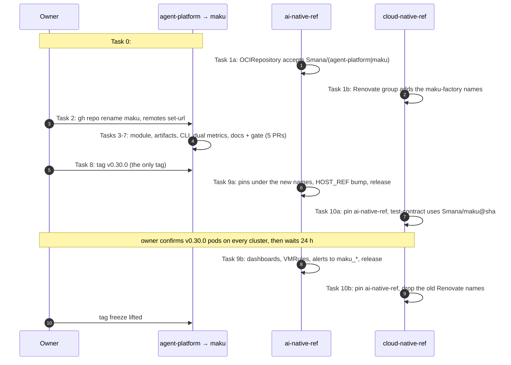

# Maku rebrand, phase 1: names without data migration (Implementation Plan)

> **For agentic workers:** REQUIRED SUB-SKILL: Use superpowers:subagent-driven-development (recommended) or superpowers:executing-plans to implement this plan task-by-task. Steps use checkbox (`- [ ]`) syntax for tracking.

**Goal:** Ship agent-platform `v0.30.0` as `Smana/maku`: the module, binaries, images, charts and CLI
under their `maku` names, every metric served under both names, and the consumers (ai-native-ref,
cloud-native-ref) pinned to the new names. Nothing stored changes.

**Architecture:** Consumers learn to accept the new signer first. The owner renames the GitHub
repository, then five agent-platform PRs land in turn: module path, artifact names, CLI, dual metrics,
docs and an old-name gate. The owner tags `v0.30.0`. Consumers then pin the new names in two waves:
images and charts first, while the dashboards still read the old metric names that `v0.30.0` keeps
serving, and the dashboards and rules second, once the new names have a day of history. Every
Kubernetes identity (ServiceAccounts, Deployments, Services, labels, leases, audiences, config keys,
routes) keeps its name: phase 1 renames artifacts, not identities.

**Tech Stack:** Go 1.27 (module `github.com/Smana/maku`), OpenTelemetry metrics with the Prometheus
exporter (`client_golang` v1.25, `client_model` v0.6.3), Helm charts on GHCR OCI, keyless cosign,
GitHub Actions, TypeScript UI (esbuild, vitest), Flux `OCIRepository` signature verification, VMRules and
Grafana dashboards in ai-native-ref.

**Spec:** [`docs/superpowers/specs/2026-10-28-maku-rebrand-design.md`](../specs/2026-10-28-maku-rebrand-design.md),
including "Decisions recorded with the owner (2026-10-28)". The spec is binding. Where this plan goes
beyond it or departs from it, the departure is under [Decisions this plan makes](#decisions-this-plan-makes),
with its reason.

**Baseline:** `origin/main` of agent-platform at `dd562be`, ai-native-ref at `d478b83`, cloud-native-ref at
`6ba6867a`, crossplane-configuration at `ffdcaac`, and PR #165 (`feat/install-anywhere`) at `5f49123e`.
Task 0 re-measures every count below before anything changes.

## Global Constraints

From the spec (verbatim where quoted):

- Scope is **phase 1 only**: "names, no data migration". "Phase 1 ships as one agent-platform release,
  `v0.30.0`". "Nothing stored changes."
- Out of scope: phase 2 (the CRD group `maku.ogenki.io`, `maku-broker migrate-group`), which gets its own
  plan. The rooms-only ZITADEL login branding "gets its own spec after phase 1".
- Also out of scope: "`agentruns.cloud.ogenki.io`", "The `agents` namespace and the `xplane-run-` claim
  prefix", "Event types and the C4 envelope (`room.*`, `summary/v1`)". The CRD group stays
  `agents.ogenki.io` throughout phase 1.
- "The web host stays `rooms.<domain>`."
- Names: "Components are named `maku-*`, and the CLI is `maku`." The mapping is `room-broker` →
  `maku-broker`, `room-bridge` → `maku-bridge`, `roomctl` → `maku`, `agent-factory` → `maku-factory`,
  `run-controller` → `maku-run-controller`, `factory-slack-app` → `maku-slack`, `agent-harness` →
  `maku-harness`. Charts: `agent-platform` → `maku` and `agent-factory` → `maku-factory`, at
  `oci://ghcr.io/smana/charts/<new>`. The module is `github.com/Smana/maku`.
- "**The old image names stop at v0.29.x.** No more tags are pushed under the old names."
- "Metrics get a `maku_` prefix and keep the rest of their name": "`rooms_x` becomes `maku_rooms_x`, and
  `agent_factory_x` becomes `maku_factory_x`". `v0.30.0` emits both, "under a feature switch that defaults
  on". "`v0.31.0` stops emitting the old names." "The `*_build_info` series follow the same rule."
- Signer: "the signer becomes `https://github.com/Smana/maku/.github/workflows/release.yaml@refs/tags/v*`".
  "**Before** the rename, … any other consumer that verifies, accepts both `Smana/(agent-platform|maku)`."
- "**ServiceAccounts keep their names** (`agent-factory`, `room-broker`, …) through phases 1 and 2."
- "**The JWT audiences `room-broker` and `rooms-system` stay** as legacy wire identifiers."
- "**The Go module moves in phase 1,** in the same release as the repository rename."
- "Coordinate every tag with the other session that releases agent-platform: no tag while phase 1 is in
  flight."
- Rollback: "revert the pin in ai-native-ref, which restores the v0.29.x images."

From the repository's `CLAUDE.md` (a symlink to `AGENTS.md`) and the owner's instructions:

- **`task check` exits 0 once per repository before each commit**, or the commit is not done.
  agent-platform, ai-native-ref and cloud-native-ref each run their own `task check`.
- **Lint through `task lint`**, never a bare `golangci-lint run`.
- Every `.go` file starts with `// SPDX-License-Identifier: Apache-2.0`.
- TDD: the failing test first. Table-driven `t.Run` tests, stdlib `testing` only, hand-written fakes,
  `-race` always.
- Goldens are rewritten only by an explicit flag (`-update-golden`, or `-update` in `internal/runctl`).
- **No secret on argv.** Tokens, keys and DSNs come from mounted files or the environment. For
  `helm registry login`, pipe the token on stdin, as the workflows already do.
- **Never `HOME=…` and never `env -i`.** Tests isolate the config directory by passing a `t.TempDir()`
  path, never by changing `HOME` or `XDG_CONFIG_HOME`.
- **Memory limits: never run two heavy suites at once**, across every session and repository. Heavy
  suites are `task check`, `task test`, the quickstart e2e, the harness image build and ai-native-ref's
  `task check`. Run them one after another.
- **No live CLI runs.** Never run `roomctl` or `maku` subcommands against a live broker: a run once leaked
  a live token. Read usage from source and test with fakes.
- **No commands against any cluster** from the executing agent. Cluster-side checks are **owner steps**.
- **No `Co-Authored-By`, no "Generated with" line and no other attribution trailer** in commits or PR
  bodies. Commit messages, PR titles and PR bodies are in English.
- **Tag coordination:** the other Claude session that tags agent-platform pushes no tag from Task 0
  until Task 10 is merged, and `v0.30.0` is the only tag phase 1 pushes. Tags are admin-only, so the tag
  push is an **owner step**.
- **CI job ids stay**: `check` and `harness-test` are required checks of the `main` ruleset (with CodeQL's
  `analyze`), so the jobs keep those ids.

---

## Decisions this plan makes

The spec leaves these open, or states them in a way that does not hold against the code. Each one is
reported to the owner with the plan.

**D1. Identity freeze: phase 1 renames artifacts, not identities.** The spec renames "the Deployment and
container names, where they embed the binary name". This plan does **not**, and keeps every name
below. Decision 1 keeps the ServiceAccounts for the same reason: allowlists, CNPs and DNS are keyed on
these names.

| Kept | Where | Why it cannot move in phase 1 |
|---|---|---|
| Deployment, Service, App XR `room-broker`, `agent-factory`, `factory-slack-app` | ai-native-ref `infrastructure/base/room-broker/app.yaml:8`, `charts/agent-factory/templates/*.yaml` | The Service DNS `room-broker.agent-system.svc.cluster.local` is the bridge's `BROKER_URL`, the TLS SAN and the gateway's MCP backend host. crossplane-configuration's run CNP selects `app.kubernetes.io/name: room-broker` (`apis/agentrun/kcl/main.k`). A Deployment's `matchLabels` is immutable |
| `app.kubernetes.io/name` labels, container names | factory chart `_helpers.tpl:2`, `deployment.yaml:34`, `internal/runctl/pod.go:161` (`room-bridge`) | CNP selectors, log rules (`kubernetes.pod_labels…`) and `kubectl logs -c` use them |
| Leader-election ids `room-broker` and `run-controller` | `internal/app/broker.go:338`, `internal/app/runcontroller.go:52` | During a rolling update, old and new pods with different lease names would both lead |
| `managedBy = "run-controller"` | `internal/runctl/objects.go:21` | A label selector on existing objects |
| Audiences `room-broker`, `rooms-system`, **`agent-factory`** | `internal/authn/jwt.go:31`, `internal/factory/api/authn.go:17` | Decision 2, which applies to the third audience as well, though the spec does not name it |
| Trace `service.name` `agent-factory` | `internal/factory/tracing/tracing.go:93,139` | The trace collector and its queries key on it |
| Wire routes and codes `/api/roomctl`, `/.well-known/roomctl`, `mcp_needs_roomctl`, `ViaRoomctl = "roomctl"` | `internal/humanapi/server.go:185-186`, `internal/humanapi/mcp.go:38`, `internal/humanapi/machinetext.go:17` | v0.29 `roomctl` clients call them. `via` crosses to the factory in `runrequest.Via` and lands in the log |
| Config keys and paths `human.roomctlClientIDFile`, `/etc/room-broker/roomctl`, `room-broker-roomctl`, `roomctl-client-id`, `/etc/agent-factory*` | `internal/config/config.go:50`, ai-native-ref `infrastructure/base/room-broker/config.yaml:30` | Strict config: renaming a key fails the deployed config |
| Reserved principal `room-broker`, the fence file `.github/agent-factory.yaml`, release assets `crd-rooms.yaml` and `crd-agentruns.yaml`, the MCP registration key `factory`, the skill name `factory-handoff` | `internal/sponsored/sponsored.go:15`, release.yaml `:136-140` | Read by name in other repositories, or by agents already set up |
| Postgres roles `rooms_broker`, `rooms_retention`, `rooms_owner`, MCP tool `rooms_list`, reason codes `rooms_crd_outdated` and `rooms_unavailable` | `internal/store`, `internal/humanapi/mcp.go:98`, `internal/factory/reconciler/reconciler.go:784` | They are not metrics, and they are on the wire or in the database |

**D2. Dual metrics by a renaming Gatherer, not a second instrument set.** The spec registers "a second
instrument set over the same values in `internal/metrics` and `internal/factory/fmetrics`". Three
instruments live outside those packages (`internal/bridge/bridge.go:79-80`, `internal/app/slackapp.go:248`),
and two instrument sets can only be kept equal by convention. So `internal/metrics.NewExporter` takes
`WithMakuNames(on)`, and on scrape it serves each gathered family twice: once under its name and once
under `MakuName(name)`, over the same samples. Equal values then hold by construction, for every
instrument on that exporter. `fmetrics` gets the test that proves it for the factory's series. The
switch is `metrics.makuNames` in both config files, and it defaults on.

**D3. `factory_slack_*` keeps its names in phase 1.** The Slack App serves `factory_slack_build_info` and
`factory_slack_requests_total` (`internal/metrics/metrics.go:47`, `internal/app/slackapp.go:248`). The spec
maps only `rooms_*` and `agent_factory_*`, so `MakuName` returns `""` for these, and the owner decides
their name separately.

**D4. The Go package `internal/roomctl` becomes `internal/maku`.** `cmd/roomctl` and `internal/roomctl`
follow the codebase's one-binary-one-package convention, and `cmd/maku` with `internal/maku` keeps it.
Keeping `internal/roomctl` would leave the old name in about 140 import lines and need a permanent gate
exception. `git mv` keeps the history. `internal/app/roomctl*.go` becomes `internal/app/maku*.go`, with
`type Maku` and `RunMaku`. The fields tied to config keys stay (`RoomctlClientIDFile`, `RoomctlClient`):
renaming them buys nothing.

**D5. Consumers move in two waves, so the dashboards never go blank.** The spec switches the
dashboards "in the same pin PR, so nothing goes blank between Flux applying the pin and the pods
restarting". That does not hold. The v0.29 pods that are still running emit no `maku_*` series, so the
switched panels read nothing. Alerts such as `absent(rooms_authn_jwks_last_refresh_timestamp_seconds…)`
(ai-native-ref `observability/base/agent-platform/vmrule-rooms.yaml:110`), once renamed, fire until
every pod has rolled. The order is therefore:

1. Wave A (Task 9a, Task 10a) pins the new images and charts while the dashboards still read the old
   names, which `v0.30.0` serves.
2. Wave B (Task 9b, Task 10b) switches the dashboards and rules to `maku_*`, at least 24 h after
   `v0.30.0` runs on every cluster. 24 h is the longest range in the switched rules (`[24h]`), so every
   window already has new-name samples when the switch lands.

That makes three ai-native-ref and three cloud-native-ref PRs, not the spec's "two consumer PRs".

**D6. The phase-1 old-name gate checks artifact names only.** The spec's gate pattern list (`room-broker`,
`roomctl`, `agents.ogenki.io`, `rooms_`) cannot pass in phase 1:

- `rooms_` is still emitted until `v0.31.0`, and it names Postgres roles, an MCP tool and reason codes
  (D1).
- `agents.ogenki.io` is phase 2.
- A bare `room-broker` is also the audience, the ServiceAccount, the Service and the lease.

`hack/names.sh` therefore refuses these forms:

- `Smana/agent-platform`;
- `ghcr.io/smana/<old image>`;
- `charts/agent-factory`, `charts/agent-platform`;
- `cmd/<old>` and `images/<old>`;
- the word `roomctl`, apart from the legacy identifiers in D1.

Its allowlist is `docs/superpowers/`, `web/test/fixtures/`, `docs/naming.md`, the gate's own two
scripts, and `internal/maku/legacy*.go`. The spec's allowlist also names "the changelog", and none
exists. Phase 2 widens the patterns.

**D7. Consumer pins the spec does not list.**

- crossplane-configuration's `apis/agentrun/kcl/main.k:43,83` pins `ghcr.io/smana/agent-harness` and
  `room-bridge` at v0.29.7, and ai-native-ref's headroom Deployment
  (`infrastructure/base/karpenter-nodepools-agents/headroom/deployment.yaml:81,89`) mirrors those pins
  to pre-pull them. Both stay at v0.29.7 in phase 1. The images keep working, since nothing on the
  wire changes. A later crossplane-configuration bump moves both to `maku-harness`/`maku-bridge`
  together.
- ai-native-ref's `scripts/ci/tests/test-agent-factory-pins.py:41` reads the **host's**
  `.github/renovate.json` (cloud-native-ref at `HOST_REF`). So cloud-native-ref's Renovate group gains
  the new names (Task 1b) before ai-native-ref's test can name them (Task 9a).

**D8. The demo URL changes.** The demo is GitHub Pages at `https://blog.ogenki.io/agent-platform/` (README
lines 18 and 25). Pages URLs do not follow a repository rename, so it moves to `https://blog.ogenki.io/maku/`,
and the old path returns 404. Task 7 updates the README. Links from the blog, if any, are the owner's to
update.

## Rollout across repositories



## File structure

agent-platform (after the tasks; `→` is a `git mv`):

| Path | Responsibility | Task |
|---|---|---|
| `go.mod`, 416 `.go` files, `.golangci.yaml:68`, `images/*/Dockerfile`, `.github/workflows/release.yaml:127` | the module path `github.com/Smana/maku` and the `-X …/internal/version.Version` ldflags | 3 |
| `cmd/{room-broker,room-bridge,agent-factory,run-controller,factory-slack-app}` → `cmd/maku-{broker,bridge,factory,run-controller,slack}` | the binaries | 4 |
| `images/<old>` → `images/maku-*` (including `agent-harness` → `maku-harness`) | the image builds | 4 |
| `charts/agent-factory` → `charts/maku-factory`, `charts/agent-platform` → `charts/maku` (from #165) | the charts, published as `oci://ghcr.io/smana/charts/maku-factory` and `…/maku` | 4 |
| `.github/workflows/{ci,release}.yaml`, `taskfile.yaml`, `.github/actions/test-contract/action.yml`, `hack/quickstart/*` | the matrix, prereleases, chart jobs, the action's script path, the quickstart | 4 |
| `cmd/roomctl` → `cmd/maku`, `internal/roomctl` → `internal/maku`, `internal/app/roomctl*.go` → `internal/app/maku*.go` | the CLI | 5 |
| `internal/maku/legacy.go` (new), `internal/maku/legacy_test.go` (new) | the one-time import from `<config dir>/roomctl` | 5 |
| `internal/maku/skill/**` | the embedded factory-handoff skill, `metadata.maku-version` | 5 |
| `web/src/view.ts`, `web/test/cli-setup.test.ts`, `internal/humanapi/ui/dist/**` | the CLI setup block, `maku-<os>-<arch>`, `maku.sha256` | 5 |
| `internal/metrics/metrics.go`, `internal/metrics/metrics_test.go` | `WithMakuNames`, `MakuName`, the renaming Gatherer | 6 |
| `internal/factory/fmetrics/makunames_test.go` (new) | the factory's both-names test | 6 |
| `internal/config/config.go`, `internal/factory/config/config.go` (+ tests) | `metrics.makuNames`, default on | 6 |
| `README.md`, `AGENTS.md` (`CLAUDE.md` links to it), `CONTRIBUTING.md`, `SECURITY.md`, `docs/*.md`, `docs/roomctl.md` → `docs/cli.md`, `docs/naming.md` | the reader docs | 7 |
| `hack/names.sh` (new), `hack/names_test.sh` (new), `taskfile.yaml` (`names` in `check`) | the old-name gate | 7 |

ai-native-ref:

- `flux/sources/ocirepo-agent-factory.yaml`, Tasks 1a and 9a;
- `tooling/base/agent-factory/helm-values-configmap.yaml` and `tooling/base/agent-factory/slack-app/deployment.yaml`,
  Task 9a;
- `infrastructure/base/room-broker/{app,retention-cronjob,sqlinstance,crd-rooms}.yaml`, Task 9a;
- `scripts/ci/tests/test-agent-factory-pins.py` and `HOST_REF`, Task 9a;
- `observability/base/agent-platform/*.yaml`, `scripts/ci/tests/*`, `scripts/ops/k8s/*`, Task 9b.

cloud-native-ref:

- `.github/renovate.json:151`, Tasks 1b and 10b;
- `flux/sources/ocirepo-ai-native-ref.yaml:15-16`, Tasks 10a and 10b;
- `.github/workflows/test-contract.yaml:39`, Task 10a;
- `tooling/base/homepage/helmrelease.yaml:224`, Task 10a.

Shared shell variables for every task (set once per session, nothing secret in them):

```bash
AP=/home/smana/Sources/agent-platform          # the one clone; every agent-platform worktree hangs off it
AI=/home/smana/Sources/ai-native-ref
CN=/home/smana/Sources/cloud-native-ref
SCRATCH=$(mktemp -d -t maku-p1.XXXXXX)          # name lists and digests; never inside a repository
```

---

### Task 0: Preconditions, tag freeze, re-baseline (agent-platform; coordination)

**Files:** none changed.

**Interfaces:**
- Consumes: nothing.
- Produces: `$SCRATCH/baseline.txt`, which holds the counts every later task's verification compares
  with, and the last tag before the freeze.

- [ ] **Step 1: #165 has merged (the spec's precondition)**

Run: `gh pr view 165 -R Smana/agent-platform --json state --jq .state`
Expected: `MERGED`. If it prints `OPEN`, stop: phase 1 "starts after #165 (install anywhere) merges", and
Task 4's umbrella-chart and quickstart steps operate on files only #165 adds (`charts/agent-platform/`,
`hack/quickstart/`, `.github/workflows/quickstart-e2e.yaml`).

- [ ] **Step 2: Owner step: the tag freeze**

The owner tells the other session that tags agent-platform: "No agent-platform tag from now until the
maku phase-1 plan's Task 10 is merged. `v0.30.0` will be the only tag." Record the last tag and confirm
that no release is running:

```bash
git -C "$AP" fetch origin --tags -q
git -C "$AP" tag --sort=-v:refname | head -1 | tee "$SCRATCH/last-tag.txt"   # v0.29.9 at the baseline
gh run list -R Smana/agent-platform --workflow release.yaml --limit 3 --json status,headBranch \
  --jq '.[] | select(.status != "completed")'
```

Expected: a `v0.29.*` tag, and no output from the second command.

- [ ] **Step 3: Re-measure the counts this plan cites**

```bash
cd "$AP" && git fetch origin -q
{
  echo "go-files-importing-module $(git grep -l 'github.com/Smana/agent-platform' origin/main -- '*.go' | wc -l)"
  echo "non-go-files-with-module $(git grep -l 'Smana/agent-platform' origin/main -- ':!*.go' ':!docs/superpowers' ':!web/test/fixtures' ':!internal/humanapi/ui/dist' | wc -l)"
  echo "rooms-metric-names $(git grep -hoE '"rooms(_[a-z_]+)?"' origin/main -- internal/metrics/metrics.go internal/bridge/bridge.go | sort -u | wc -l)"
  echo "factory-metric-names $(git grep -hoE '"agent_factory_[a-z_]+"' origin/main -- internal/factory/fmetrics/fmetrics.go internal/metrics/metrics.go | sort -u | wc -l)"
  echo "roomctl-files $(git grep -lw roomctl origin/main -- ':!docs/superpowers' ':!internal/humanapi/ui/dist' | wc -l)"
} | tee "$SCRATCH/baseline.txt"
```

Expected at `dd562be` (before #165 merged): `416`, `19`, `27`, `52`, about `131`. Higher numbers after
#165 are expected. Each later verification checks for zero leftovers, not for these numbers, so a
difference is not a failure. A **new metric prefix** is: if
`git grep -hoE 'Int64[A-Za-z]*\("[a-z_]+|Float64[A-Za-z]*\("[a-z_]+' origin/main -- internal | grep -vE '"(rooms|agent_factory_|factory_slack_)'`
prints a name, add it to D2/D3 before Task 6.

---

### Task 1: Consumers accept both signers (ai-native-ref, cloud-native-ref)

**Files:**
- Modify: ai-native-ref `flux/sources/ocirepo-agent-factory.yaml:18-22` (1a)
- Modify: cloud-native-ref `.github/renovate.json:151` (1b)

**Interfaces:**
- Consumes: nothing from agent-platform. It needs no release.
- Produces: an OCIRepository that verifies charts signed by `Smana/agent-platform` or `Smana/maku`. Task
  9a's pin relies on it. cloud-native-ref's Renovate group names `ghcr.io/smana/charts/maku-factory` and
  `ghcr.io/smana/maku-factory`, which ai-native-ref's pins test reads through `HOST_REF` (D7).

Every signature verifier in both repositories, found with
`git grep -n 'certificate-identity\|matchOIDCIdentity\|subject:' -- '*.yaml'` at the baseline:

| Repository | File | Verifies | Change |
|---|---|---|---|
| ai-native-ref | `flux/sources/ocirepo-agent-factory.yaml:22` | `Smana/agent-platform` release.yaml | **yes** |
| ai-native-ref | `flux/sources/ocirepo-flux-operator-mcp.yaml:21` | controlplaneio-fluxcd | no |
| cloud-native-ref | `flux/sources/ocirepo-ai-native-ref.yaml:24` | `Smana/ai-native-ref` | no |
| cloud-native-ref | `flux/sources/ocirepo-flux-operator.yaml:15`, `ocirepo-karpenter.yaml:15` | upstream charts | no |
| cloud-native-ref | `crds/base/crds-cert-manager.yaml:892` | a CRD schema field, not a verifier | no |

No other file in either repository verifies an agent-platform image: neither has a Kyverno `verifyImages`
nor a policy-controller policy naming it.

- [ ] **Step 1: Re-run the inventory on current main**

```bash
for r in "$AI" "$CN"; do git -C "$r" fetch origin -q
  git -C "$r" grep -n 'certificate-identity\|matchOIDCIdentity\|subject:' origin/main -- '*.yaml'; done
```

Expected: the rows above. A new verifier naming `Smana/agent-platform` gets the same edit as Step 3.

- [ ] **Step 2: 1a, the ai-native-ref worktree**

```bash
git -C "$AI" worktree add /home/smana/Sources/ai-native-ref-maku-signer -b feat/accept-maku-signer origin/main
cd /home/smana/Sources/ai-native-ref-maku-signer
```

- [ ] **Step 3: One identity that takes both repository names**

Flux's cosign keyless refuses several identities ("multiple identities are not supported at this time",
noted at cloud-native-ref `flux/sources/ocirepo-ai-native-ref.yaml:19-21`), so a single regex takes both:

```bash
grep -c 'Smana/agent-platform/' flux/sources/ocirepo-agent-factory.yaml      # 1: the subject line
sed -i 's#Smana/agent-platform/#Smana/(agent-platform|maku)/#' flux/sources/ocirepo-agent-factory.yaml
sed -i 's|^  verify:$|  # One identity: Flux refuses several. It takes both repository names across the maku rename\n  # (agent-platform v0.29.x and maku v0.30.0+); a follow-up after phase 2 narrows it to maku.\n  verify:|' \
  flux/sources/ocirepo-agent-factory.yaml
grep -n -A5 'verify:' flux/sources/ocirepo-agent-factory.yaml
```

Expected tail:

```yaml
  verify:
    provider: cosign
    matchOIDCIdentity:
      - issuer: "^https://token\\.actions\\.githubusercontent\\.com$"
        subject: "^https://github\\.com/Smana/(agent-platform|maku)/\\.github/workflows/release\\.yaml@refs/tags/v.*$"
```

- [ ] **Step 4: Check the regex matches both signers and nothing broader**

```bash
re='^https://github\.com/Smana/(agent-platform|maku)/\.github/workflows/release\.yaml@refs/tags/v.*$'
for s in https://github.com/Smana/agent-platform/.github/workflows/release.yaml@refs/tags/v0.29.9 \
         https://github.com/Smana/maku/.github/workflows/release.yaml@refs/tags/v0.30.0; do
  grep -qE "$re" <<<"$s" && echo "ok $s"; done
grep -qE "$re" <<<https://github.com/Smana/makuX/.github/workflows/release.yaml@refs/tags/v1 || echo "ok refuses makuX"
grep -qE "$re" <<<https://github.com/Smana/maku/.github/workflows/ci.yaml@refs/pull/1/merge || echo "ok refuses ci.yaml"
```

Expected: four `ok` lines.

- [ ] **Step 5: ai-native-ref's gate, then commit**

Run: `task check` (heavy, nothing else running). Expected: exit 0.

```bash
git add flux/sources/ocirepo-agent-factory.yaml
git commit -m "feat(flux): the factory chart verifies under agent-platform or maku, ahead of the rename"
git push -u origin feat/accept-maku-signer
gh pr create -R Smana/ai-native-ref --base main --title "feat(flux): accept the maku signer for the factory chart" \
  --body "Agent-platform becomes Smana/maku (maku rebrand phase 1). Release signatures carry the repository path, so the factory chart's OCIRepository accepts both Smana/agent-platform and Smana/maku, in one identity: Flux refuses several. Needs no agent-platform release. Narrowed to maku after phase 2."
```

- [ ] **Step 6: 1b, cloud-native-ref's Renovate group gains the new names (additive)**

```bash
git -C "$CN" worktree add /home/smana/Sources/cloud-native-ref-maku-renovate -b chore/renovate-maku-names origin/main
cd /home/smana/Sources/cloud-native-ref-maku-renovate
sed -i '151s#"ghcr.io/smana/charts/agent-factory", "ghcr.io/smana/agent-factory",#"ghcr.io/smana/charts/agent-factory", "ghcr.io/smana/agent-factory", "ghcr.io/smana/charts/maku-factory", "ghcr.io/smana/maku-factory",#' .github/renovate.json
python3 -c 'import json;r=json.load(open(".github/renovate.json"));print([x["matchPackageNames"] for x in r["packageRules"] if x.get("groupName")=="agent-factory"])'
```

Expected: one list holding both old and both new names. Run `task check` (exit 0), commit
`chore(renovate): group the maku-factory chart and image with the factory`, push, and open the PR with a
body stating why: ai-native-ref's pins test reads this file through `HOST_REF`.

- [ ] **Step 7: Owner step: merge both PRs.** Record the cloud-native-ref merge commit in
`$SCRATCH/host-ref.txt`. Task 9a sets ai-native-ref's `HOST_REF` to it.

---

### Task 2: Owner step: rename the repository, repoint every local clone

**Files:** none in any repository. Local git config only.

**Interfaces:**
- Consumes: Task 1's two PRs merged.
- Produces: the repository `Smana/maku`, with GitHub redirecting `Smana/agent-platform`. Every local
  worktree's `origin` points at `https://github.com/Smana/maku.git`.

- [ ] **Step 1: Owner step: the rename**

Run (owner): `gh repo rename maku -R Smana/agent-platform --yes`

- [ ] **Step 2: Verify the rename and the redirects**

```bash
gh repo view Smana/maku --json nameWithOwner --jq .nameWithOwner                 # Smana/maku
gh api repos/Smana/agent-platform --jq .full_name                                 # Smana/maku (redirect)
git ls-remote https://github.com/Smana/agent-platform.git HEAD | cut -c1-12      # resolves through the redirect
```

The rename keeps the rulesets, secrets, Actions history and existing GHCR packages. Two things do not
follow it. The Pages demo moves to `https://blog.ogenki.io/maku/` (D8). New workflow runs sign as
`Smana/maku` from now on, which is why Task 0 froze tags.

- [ ] **Step 3: Repoint the clone (its 127 worktrees share its config)**

The only clone is `$AP`. Every other `~/Sources/agent-platform-*` directory is one of its worktrees
(`.git` is a file), so one `set-url` covers them all. Do **not** rename the local directories: each
worktree's `gitdir` link names them.

```bash
git -C "$AP" remote set-url origin https://github.com/Smana/maku.git
git -C "$AP" worktree list --porcelain | awk '/^worktree /{print $2}' | while read -r w; do
  [ -d "$w" ] && git -C "$w" remote get-url origin; done | sort | uniq -c
for d in /home/smana/Sources/*/; do [ -d "$d.git" ] && git -C "$d" remote -v 2>/dev/null | grep -q 'Smana/agent-platform' && echo "STILL OLD: $d"; done
```

Expected: one line, `<n> https://github.com/Smana/maku.git`, and no `STILL OLD` line. Any `STILL OLD`
clone gets `git -C <dir> remote set-url origin https://github.com/Smana/maku.git`.

---

### Task 3: The module path moves to `github.com/Smana/maku` (agent-platform, PR 1 of 5)

**Files:**
- Modify: `go.mod:1`, the 416 `.go` files that import the module (more after #165, including
  `charts/agent-platform/tests/loadconfig/main.go`), `.golangci.yaml:68`, the `-ldflags` of
  `images/{agent-factory,factory-slack-app,room-bridge,room-broker,run-controller}/Dockerfile` and of
  `.github/workflows/release.yaml:127`, and the non-Go mentions in `SECURITY.md`, `docs/{factory,roadmap,security}.md`,
  `images/agent-harness/README.md`, `.github/actions/test-contract/action.yml:4,14`, `web/src/view.ts:249-250`,
  `web/preview/{demo.ts,list.js}`, `web/test/{cli-setup,fork}.test.ts`
- Regenerate: `internal/humanapi/ui/dist/assets/app.js` (`task ui:build`)
- Keep: `docs/superpowers/**` (history), `web/test/fixtures/live-session.jsonl` (recorded data)

**Interfaces:**
- Consumes: Task 2 (decision 3: the module and the repository never disagree in a release).
- Produces: the import prefix `github.com/Smana/maku/...` and the ldflags variable
  `github.com/Smana/maku/internal/version.Version`. Tasks 4-7 write Go against this path.

- [ ] **Step 1: Worktree**

```bash
git -C "$AP" fetch origin -q
git -C "$AP" worktree add /home/smana/Sources/maku-p1-module -b refactor/module-maku origin/main
cd /home/smana/Sources/maku-p1-module
```

- [ ] **Step 2: The failing check first**

Run: `go list -m`
Expected: `github.com/Smana/agent-platform` (the state this task changes).

- [ ] **Step 3: Move the module and every mention**

```bash
go mod edit -module github.com/Smana/maku
keep=(':!docs/superpowers' ':!web/test/fixtures' ':!internal/humanapi/ui/dist')
git grep -lz 'Smana/agent-platform' -- . "${keep[@]}" | xargs -0 sed -i 's#Smana/agent-platform#Smana/maku#g'
```

The second pattern also covers `github.com/Smana/agent-platform`, the `uses: Smana/agent-platform/...`
comments in the test-contract action, and issue links (GitHub redirects old issue URLs).

- [ ] **Step 4: Rebuild the embedded UI bundle (it carries the release URL)**

Run: `task ui:build`
Expected: `internal/humanapi/ui/dist/assets/app.js` changes. Nothing else under `dist/` should.

- [ ] **Step 5: Verify**

```bash
go list -m                                                                   # github.com/Smana/maku
git grep -n 'Smana/agent-platform' -- . ':!docs/superpowers' ':!web/test/fixtures'   # no output
go build ./... && go vet ./...
gofmt -l $(git ls-files '*.go')                                              # no output
grep -n 'Smana/maku' .golangci.yaml images/*/Dockerfile .github/workflows/release.yaml
```

The sed changes every path by the same prefix, so the order inside the local import group is unchanged,
and goimports stays satisfied.

- [ ] **Step 6: The version ldflags still land**

`-X` with a wrong path is silently ignored, so check the symbol the flag names:

```bash
go build -ldflags "-X github.com/Smana/maku/internal/version.Version=v0.0.0-ldflags" -o "$SCRATCH/broker" ./cmd/room-broker
go tool nm "$SCRATCH/broker" | grep -c 'github.com/Smana/maku/internal/version.Version'   # 1 or more
strings "$SCRATCH/broker" | grep -c v0.0.0-ldflags                                         # 1 or more
```

- [ ] **Step 7: Gate, commit, PR**

Run: `task check` (heavy, alone). Expected: exit 0.

```bash
git add -A
git commit -m "refactor: the module is github.com/Smana/maku"
git push -u origin refactor/module-maku
gh pr create -R Smana/maku --base main --title "refactor: the module is github.com/Smana/maku" \
  --body "Maku rebrand phase 1, PR 1 of 5: the module path, imports, ldflags, goimports local-prefixes and doc links. Mechanical; no behaviour change. Recorded data under web/test/fixtures and historical plans and specs keep the old path."
```

- [ ] **Step 8: Owner step: merge.** Each of Tasks 4-7 branches from `origin/main` after this merges.

---

### Task 4: Binaries, images and charts under `maku-*` (agent-platform, PR 2 of 5)

**Files:**
- Move: `cmd/room-broker` → `cmd/maku-broker`, `cmd/room-bridge` → `cmd/maku-bridge`, `cmd/agent-factory` →
  `cmd/maku-factory`, `cmd/run-controller` → `cmd/maku-run-controller`, `cmd/factory-slack-app` →
  `cmd/maku-slack`, the same five under `images/`, plus `images/agent-harness` → `images/maku-harness`,
  `charts/agent-factory` → `charts/maku-factory`, `charts/agent-platform` → `charts/maku`
- Modify: every `images/maku-*/Dockerfile` (the `-o /out/…`, `./cmd/…`, `COPY`, `ENTRYPOINT` lines,
  e.g. `images/room-broker/Dockerfile:13,16,18`), each `cmd/maku-*/main.go` (stderr and log prefixes)
- Modify: `.github/workflows/release.yaml:23,43,46,53,98-102`, `.github/workflows/ci.yaml:40,68,71,76-77,93,100,127,197-204`,
  `.github/workflows/quickstart-e2e.yaml` (from #165), `taskfile.yaml:77,88-89,95,100-102` (and #165's
  umbrella lines), `.github/actions/test-contract/action.yml:31`, `.github/dependabot.yml:43`
- Modify: `charts/maku-factory/{Chart.yaml,values.yaml:2,tests/render.sh:57,README.md}`,
  `charts/maku/{Chart.yaml,values.yaml,templates/_helpers.tpl,tests/render.sh,README.md}`, `hack/quickstart/*`
- Modify: `internal/humanapi/mcp.go:272` and `internal/mcp/server.go:235` (serverInfo `room-broker` →
  `maku-broker`), `internal/github/app.go:266` (User-Agent), `internal/humanapi/mcp_test.go:119`
- Modify (test data): `internal/runctl/config_test.go:28-29`, `internal/runctl/testdata/pod.golden.yaml`
  (via `-update`), `internal/factory/{reconciler,runs}/provenance*_test.go`
- Modify (links only, so `task docs` keeps resolving): every relative link into a moved path

**Interfaces:**
- Consumes: Task 3's module path. The ldflags line stays
  `-X github.com/Smana/maku/internal/version.Version=${VERSION}`.
- Produces: images `ghcr.io/smana/maku-{broker,bridge,factory,harness,run-controller,slack}`, charts
  `oci://ghcr.io/smana/charts/maku-factory` and `…/maku`, and image entrypoints
  `/maku-{broker,bridge,factory,run-controller,slack}`. Tasks 8-10 pin these. The build-info series do
  **not** change name here: `rooms_build_info` and `agent_factory_build_info` stay the constants in
  `internal/metrics/metrics.go:44-46`, and Task 6 serves their twins `maku_rooms_build_info` and
  `maku_factory_build_info`.
- Kept by D1: every Kubernetes object name, label and container name inside the charts, the release
  name `agent-factory` in `render.sh:10`, and the leader-election ids.

- [ ] **Step 1: Worktree**

```bash
git -C "$AP" fetch origin -q
git -C "$AP" worktree add /home/smana/Sources/maku-p1-artifacts -b feat/maku-artifact-names origin/main
cd /home/smana/Sources/maku-p1-artifacts
```

- [ ] **Step 2: The failing tests first: the render tests name the new images**

```bash
sed -i '57s#ghcr.io/smana/agent-factory:#ghcr.io/smana/maku-factory:#' charts/agent-factory/tests/render.sh
sed -n 57p charts/agent-factory/tests/render.sh      # … == \"ghcr.io/smana/maku-factory:$digest\"" "the image by digest"
bash charts/agent-factory/tests/render.sh
```

Expected: FAIL on "the image by digest".

At #165's head, `charts/agent-platform/tests/render.sh` asserts no image name. Give it one, after its
line 43, in the file's own `ykind` form:

```bash
sed -i '43a ykind Deployment '"'"'select(.metadata.name=="room-broker") | .spec.template.spec.containers[0].image | startswith("ghcr.io/smana/maku-broker:")'"'"' '"'"'the broker image is maku-broker; the Deployment keeps its name'"'"'' charts/agent-platform/tests/render.sh
bash charts/agent-platform/tests/render.sh
```

Expected: FAIL on "the broker image is maku-broker".

- [ ] **Step 3: Move the directories**

```bash
for p in room-broker:maku-broker room-bridge:maku-bridge agent-factory:maku-factory \
         run-controller:maku-run-controller factory-slack-app:maku-slack; do
  o=${p%%:*} n=${p##*:}
  git mv "cmd/$o" "cmd/$n" && git mv "images/$o" "images/$n"
  sed -i "s#$o#$n#g" "images/$n/Dockerfile" "cmd/$n/main.go"
done
git mv images/agent-harness images/maku-harness
git mv charts/agent-factory charts/maku-factory
git mv charts/agent-platform charts/maku
grep -n -E '/out/|ENTRYPOINT|COPY --from' images/maku-*/Dockerfile
```

Expected, for each Go image:
`-o /out/maku-broker ./cmd/maku-broker`, `COPY --from=build /out/maku-broker /maku-broker`,
`ENTRYPOINT ["/maku-broker"]`. These Dockerfiles and `main.go` files mention their binary only as the
binary, so a plain per-file sed is exact. The harness keeps `ENTRYPOINT ["tini", "--", "/usr/local/bin/agent-run"]`.

No consumer overrides an entrypoint. ai-native-ref's retention CronJob passes `args: ["retention"]`
(`infrastructure/base/room-broker/retention-cronjob.yaml:36`), its headroom `room-bridge` passes
`args: ["gate"]`, and crossplane-configuration's composition sets no bridge `command`. Re-check before
Task 9a:
`git -C "$AI" grep -nE '"/(room-broker|room-bridge|agent-factory|run-controller|factory-slack-app)' origin/main -- ':!docs'`
must print nothing.

- [ ] **Step 4: One sed script for every artifact reference**

```bash
cat > "$SCRATCH/artifacts.sed" <<'EOF'
s#\[room-broker, room-bridge, agent-factory, agent-harness, run-controller, factory-slack-app\]#[maku-broker, maku-bridge, maku-factory, maku-harness, maku-run-controller, maku-slack]#g
s#(cmd|images)/room-broker([^a-z-]|$)#\1/maku-broker\2#g
s#(cmd|images)/room-bridge([^a-z-]|$)#\1/maku-bridge\2#g
s#(cmd|images)/agent-factory([^a-z-]|$)#\1/maku-factory\2#g
s#(cmd|images)/run-controller([^a-z-]|$)#\1/maku-run-controller\2#g
s#(cmd|images)/factory-slack-app([^a-z-]|$)#\1/maku-slack\2#g
s#images/agent-harness#images/maku-harness#g
s#'agent-harness'#'maku-harness'#g
s#agent-harness:checks#maku-harness:checks#g
s#charts/agent-factory#charts/maku-factory#g
s#charts/agent-platform#charts/maku#g
s#agent-factory-\$\{v\}\.tgz#maku-factory-${v}.tgz#g
s#agent-platform-\$\{v\}\.tgz#maku-${v}.tgz#g
s#chart agent-factory#chart maku-factory#g
s#ghcr\.io/smana/room-broker#ghcr.io/smana/maku-broker#g
s#ghcr\.io/smana/room-bridge#ghcr.io/smana/maku-bridge#g
s#ghcr\.io/smana/agent-factory#ghcr.io/smana/maku-factory#g
s#ghcr\.io/smana/agent-harness#ghcr.io/smana/maku-harness#g
s#ghcr\.io/smana/run-controller#ghcr.io/smana/maku-run-controller#g
s#ghcr\.io/smana/factory-slack-app#ghcr.io/smana/maku-slack#g
EOF
keep=(':!docs/superpowers' ':!web/test/fixtures' ':!internal/humanapi/ui/dist')
git grep -lzE 'room-broker|room-bridge|agent-factory|agent-harness|run-controller|factory-slack-app|charts/agent-platform' -- . "${keep[@]}" \
  | xargs -0 sed -i -E -f "$SCRATCH/artifacts.sed"
```

The patterns match only the artifact forms (`cmd/…`, `images/…`, `charts/…`, `ghcr.io/smana/…`, the
matrix, the chart tarball), never a bare `room-broker`. So Services, SAs, labels, audiences, leases and
mount paths stay (D1). The sed also fixes doc links into moved paths, which `task docs` checks.

- [ ] **Step 5: The chart and quickstart names**

```bash
sed -i 's/^name: agent-factory$/name: maku-factory/; s/^description: .*/description: maku'"'"'s factory: Tasks, triggers, the run meter. Its objects keep the agent-factory names (ServiceAccount, Deployment, labels)./' charts/maku-factory/Chart.yaml
sed -i 's/^name: agent-platform$/name: maku/' charts/maku/Chart.yaml
sed -i 's/app.kubernetes.io\/part-of: agent-platform/app.kubernetes.io\/part-of: maku/' charts/maku/templates/_helpers.tpl
# #165's quickstart: its namespace and kind cluster are fresh per run, so they take the new name;
# the Deployment room-broker inside stays (D1).
git grep -lz -E '(^|[^a-z-])agent-platform([^a-z-]|$)' -- hack/quickstart charts/maku .github/workflows/quickstart-e2e.yaml \
  | xargs -0 sed -i -E 's/(^|[^a-z/-])agent-platform([^a-z-]|$)/\1maku\2/g'
sed -i -E 's/for i in room-broker room-bridge run-controller; do/for i in maku-broker maku-bridge maku-run-controller; do/; s/for i in agent-harness room-broker room-bridge run-controller stub-model; do/for i in maku-harness maku-broker maku-bridge maku-run-controller stub-model; do/' hack/quickstart/e2e.sh
git grep -n -E 'agent-platform|agent-harness|ghcr\.io/smana/(room|run-controller)' -- charts hack/quickstart .github/workflows   # review: no artifact left
```

`ap.labels` keeps `app.kubernetes.io/name: room-broker`. `api.github.com/repos/Smana/agent-platform` in
`hack/quickstart/up.sh:44` was moved by Task 3.

- [ ] **Step 6: serverInfo and User-Agent**

```bash
sed -i 's/"serverInfo": map\[string\]string{"name": "room-broker"/"serverInfo": map[string]string{"name": "maku-broker"/' internal/humanapi/mcp.go
sed -i 's/"serverInfo":   map\[string\]string{"name": "room-broker"/"serverInfo":   map[string]string{"name": "maku-broker"/' internal/mcp/server.go
sed -i 's/req.Header.Set("User-Agent", "room-broker")/req.Header.Set("User-Agent", "maku-broker")/' internal/github/app.go
sed -i 's/\["name"\] != "room-broker"/["name"] != "maku-broker"/' internal/humanapi/mcp_test.go
git grep -n '"serverInfo"' -- internal | grep -c maku-broker      # 2
```

The agent gateway routes MCP by backend name (`room-broker` in ai-native-ref
`infrastructure/base/agent-gateway/mcp.yaml:55`), not by serverInfo, so the gateway's CEL rules are
unaffected.

- [ ] **Step 7: Regenerate the run-pod golden, run the render tests**

```bash
go test ./internal/runctl -run 'Golden|Pod' -update -count=1
git diff --stat internal/runctl/testdata    # only image lines change
bash charts/maku-factory/tests/render.sh && bash charts/maku/tests/render.sh
```

Expected: both PASS. They failed in Step 2.

- [ ] **Step 8: Verify that no artifact reference is left**

```bash
git grep -nE 'ghcr\.io/smana/(room-broker|room-bridge|agent-factory|agent-harness|run-controller|factory-slack-app)([^a-z-]|$)|(cmd|images)/(room-broker|room-bridge|agent-factory|agent-harness|run-controller|factory-slack-app)([^a-z-]|$)|charts/agent-(factory|platform)' \
  -- . ':!docs/superpowers' ':!web/test/fixtures'
go build ./... && go build -o "$SCRATCH/maku-broker" ./cmd/maku-broker
go tool nm "$SCRATCH/maku-broker" | grep -c 'github.com/Smana/maku/internal/version.Version'
```

Expected: no output from the grep, and a count of 1 or more.

- [ ] **Step 9: Gate, commit, PR**

Run: `task check` (alone). Expected: exit 0.

```bash
git add -A
git commit -m "feat!: binaries, images and charts are maku-*"
git push -u origin feat/maku-artifact-names
gh pr create -R Smana/maku --base main --title "feat!: binaries, images and charts are maku-*" \
  --body "Maku rebrand phase 1, PR 2 of 5. cmd/, images/, charts/, the release and prerelease matrices and the quickstart move to maku-broker, maku-bridge, maku-factory, maku-harness, maku-run-controller, maku-slack, and the charts maku and maku-factory. Entrypoints are /maku-*. Every Kubernetes identity keeps its name: ServiceAccounts, Deployments, Services, labels, containers, leases, audiences (plan D1). Old image names stop at v0.29.x."
```

- [ ] **Step 10: The prerelease proves the new names are public**

The PR's `prerelease` and `chart-prerelease` jobs push the first images and charts under the new names.
A GHCR package created from a public repository is public on first push (seen at bootstrap, 2026-09-29),
but a private one would break Flux and kind pulls, so check anonymously:

```bash
v=$(gh pr view feat/maku-artifact-names -R Smana/maku --json headRefOid --jq '.headRefOid[:8]')
latest=$(cat "$SCRATCH/last-tag.txt"); base=${latest#v}; next="${base%.*}.$(( ${base##*.} + 1 ))"
pr=$(gh pr view feat/maku-artifact-names -R Smana/maku --json number --jq .number)
for i in maku-broker maku-bridge maku-factory maku-harness maku-run-controller maku-slack; do
  skopeo inspect --no-creds "docker://ghcr.io/smana/$i:v${next}-pr${pr}.${v}" --format '{{.Digest}}' >/dev/null && echo "public $i"; done
skopeo inspect --no-creds --raw "docker://ghcr.io/smana/charts/maku-factory:${next}-pr${pr}.g${v}" >/dev/null && echo "public chart maku-factory"
```

Expected: seven `public` lines. If one fails with 401 or 403, the **owner** opens
`https://github.com/users/Smana/packages/container/<name>/settings` and sets visibility to public. The
`quickstart-e2e` workflow (`charts/**` changed) runs on this PR: it is the spec's "quickstart e2e on the
new chart", and it must pass.

- [ ] **Step 11: Owner step: merge.**

---

### Task 5: The CLI `roomctl` becomes `maku` (agent-platform, PR 3 of 5)

**Files:**
- Move: `cmd/roomctl` → `cmd/maku`, `internal/roomctl` → `internal/maku` (including `skill/`),
  `internal/app/roomctl.go` → `internal/app/maku.go`, `internal/app/roomctl_views.go` → `internal/app/maku_views.go`,
  `internal/app/roomctl_{checkout,onboarding,pty_linux,}_test.go` → `internal/app/maku_*_test.go`
- Create: `internal/maku/legacy.go`, `internal/maku/legacy_test.go`
- Modify: `internal/maku/config.go:42-48` (`Dir`), `internal/maku/config.go:52-75` (`SaveJSON` split),
  `internal/maku/setup.go:155-161` (`SetupCmd`), `internal/maku/skill/skill.go:81-106` (`Version`),
  `internal/maku/skill/factory-handoff/SKILL.md`, `internal/maku/skill/commands/factory.md`,
  `internal/maku/skill/factory-handoff/references/issue-template.md`
- Modify: the prose and strings naming roomctl in `internal/**` (`internal/humanapi` MCP instructions and
  prompts, `internal/summary/summary.go:421`, `internal/roomview/overview.go:137-139`, comments)
- Modify: `web/src/view.ts:243-288,346-375`, `web/test/cli-setup.test.ts`, `web/src/{app.css,dashboards.ts,room.ts,strip.ts}`
  comments, `web/preview/list.ts`; regenerate `web/preview/list.js` and `internal/humanapi/ui/dist/**`
- Modify: `.github/workflows/release.yaml:104-140` (the `cli` job), `hack/quickstart/{lib,e2e}.sh` (#165)
- Regenerate goldens: `internal/summary/testdata/*.json`, `internal/roomview/testdata/*`, `internal/maku/testdata/setup/*`

**Interfaces:**
- Consumes: Task 3's module path, Task 4's `cmd/` layout.
- Produces:
  - `package maku` (import `github.com/Smana/maku/internal/maku`);
  - `func Dir() (string, error)`, which returns `<user config dir>/maku`;
  - `func ImportLegacy(base string) (bool, error)`;
  - `func writeFile(path string, b []byte) error` (unexported; `SaveJSON` calls it);
  - `app.RunMaku(ctx, args, stdout) error` and `type app.Maku`;
  - `skill.Version`, which reads `metadata.maku-version`, then `metadata.roomctl-version`;
  - release assets `maku-{linux,darwin}-{amd64,arm64}` and `maku.sha256`.
- Kept by D1: `/api/roomctl`, `/.well-known/roomctl`, `mcp_needs_roomctl`, `ViaRoomctl = "roomctl"`,
  `roomctlClientIDFile`, `RoomctlClient*`, the skill name `factory-handoff` and the MCP key `factory`.

**Why `internal/maku`:** D4.

- [ ] **Step 1: Worktree and moves**

```bash
git -C "$AP" fetch origin -q
git -C "$AP" worktree add /home/smana/Sources/maku-p1-cli -b feat/maku-cli origin/main
cd /home/smana/Sources/maku-p1-cli
git mv cmd/roomctl cmd/maku
git mv internal/roomctl internal/maku
for f in internal/app/roomctl*.go; do git mv "$f" "${f/roomctl/maku}"; done
```

- [ ] **Step 2: Write the failing import test**

`internal/maku/legacy_test.go`:

```go
// SPDX-License-Identifier: Apache-2.0

package maku

import (
	"os"
	"path/filepath"
	"testing"
)

func put(t *testing.T, path, body string) {
	t.Helper()
	if err := os.MkdirAll(filepath.Dir(path), 0o700); err != nil {
		t.Fatal(err)
	}
	if err := os.WriteFile(path, []byte(body), 0o600); err != nil {
		t.Fatal(err)
	}
}

func read(t *testing.T, path string) string {
	t.Helper()
	b, err := os.ReadFile(path) //nolint:gosec // a test's own temp directory
	if err != nil {
		t.Fatal(err)
	}
	return string(b)
}

// roomctl's files move once, so a developer upgrading to maku does not sign in again.
func TestImportLegacy(t *testing.T) {
	for _, tc := range []struct {
		name  string
		setup func(t *testing.T, base string)
		want  bool
		check func(t *testing.T, base string)
	}{
		{"copies roomctl's files, owner-only, and skips temp files and directories", func(t *testing.T, base string) {
			put(t, filepath.Join(base, "roomctl", "config.json"), `{"url":"https://rooms.example"}`)
			put(t, filepath.Join(base, "roomctl", "token.json"), `{"refresh_token":"r"}`)
			put(t, filepath.Join(base, "roomctl", "cursors.json"), `{}`)
			put(t, filepath.Join(base, "roomctl", ".roomctl-123"), `partial`)
			put(t, filepath.Join(base, "roomctl", "sub", "x.json"), `{}`)
		}, true, func(t *testing.T, base string) {
			for _, f := range []string{"config.json", "token.json", "cursors.json"} {
				p := filepath.Join(base, "maku", f)
				if read(t, p) != read(t, filepath.Join(base, "roomctl", f)) {
					t.Errorf("%s differs from roomctl's", f)
				}
				if st, err := os.Stat(p); err != nil || st.Mode().Perm() != 0o600 {
					t.Errorf("%s mode %v (%v), want 0600", f, st.Mode().Perm(), err)
				}
			}
			for _, f := range []string{".roomctl-123", "sub"} {
				if _, err := os.Stat(filepath.Join(base, "maku", f)); !os.IsNotExist(err) {
					t.Errorf("%s was copied", f)
				}
			}
			if st, _ := os.Stat(filepath.Join(base, "maku")); st.Mode().Perm() != 0o700 {
				t.Errorf("maku dir mode %v, want 0700", st.Mode().Perm())
			}
		}},
		{"a maku directory already there wins, and roomctl's is not read", func(t *testing.T, base string) {
			put(t, filepath.Join(base, "maku", "config.json"), `{"url":"https://new"}`)
			put(t, filepath.Join(base, "roomctl", "config.json"), `{"url":"https://old"}`)
		}, false, func(t *testing.T, base string) {
			if got := read(t, filepath.Join(base, "maku", "config.json")); got != `{"url":"https://new"}` {
				t.Errorf("maku config = %s, want the new one", got)
			}
		}},
		{"nothing to import creates nothing", func(*testing.T, string) {}, false, func(t *testing.T, base string) {
			if _, err := os.Stat(filepath.Join(base, "maku")); !os.IsNotExist(err) {
				t.Errorf("maku dir created with nothing to import: %v", err)
			}
		}},
	} {
		t.Run(tc.name, func(t *testing.T) {
			base := t.TempDir()
			tc.setup(t, base)
			got, err := ImportLegacy(base)
			if err != nil || got != tc.want {
				t.Fatalf("ImportLegacy = %v, %v; want %v, nil", got, err, tc.want)
			}
			tc.check(t, base)
		})
	}
}

// Once is once: a second run, after roomctl's file changed, keeps what the first copied.
func TestImportLegacyRunsOnce(t *testing.T) {
	base := t.TempDir()
	put(t, filepath.Join(base, "roomctl", "config.json"), `{"url":"https://a"}`)
	if ok, err := ImportLegacy(base); !ok || err != nil {
		t.Fatalf("first import = %v, %v", ok, err)
	}
	put(t, filepath.Join(base, "roomctl", "config.json"), `{"url":"https://b"}`)
	if ok, err := ImportLegacy(base); ok || err != nil {
		t.Fatalf("second import = %v, %v; want false, nil", ok, err)
	}
	if got := read(t, filepath.Join(base, "maku", "config.json")); got != `{"url":"https://a"}` {
		t.Fatalf("config = %s, want the first import's", got)
	}
}
```

Run: `go test ./internal/maku -run ImportLegacy -count=1`
Expected: FAIL to compile. The package is still `roomctl` and `ImportLegacy` is undefined. Step 3 fixes
the package and Step 4 adds the function.

- [ ] **Step 3: Package, imports, identifiers and strings**

```bash
go_files=$(git ls-files -- '*.go'; git ls-files --others --exclude-standard -- '*.go')
sed -i 's#github.com/Smana/maku/internal/roomctl#github.com/Smana/maku/internal/maku#g' $go_files
sed -i 's/^package roomctl$/package maku/; s/^package roomctl_test$/package maku_test/' internal/maku/*.go
sed -i -E 's/\bRunRoomctl\b/RunMaku/g; s/\bRoomctl\b/Maku/g; s/\broomctlUsage\b/makuUsage/g; s/\broomctlTimeout\b/makuTimeout/g' internal/app/*.go cmd/maku/main.go
# The word roomctl, except after / or - or . (routes, paths, secret names) and before - or a word
# character (roomctl-version, roomctl-client-id, mcp_needs_roomctl stay): D1's legacy identifiers.
perl -pi -e 's{(?<![/\w.-])roomctl(?![\w-])}{maku}g; s{"roomctl-}{"maku-}g; s{\.roomctl-\*}{.maku-*}g' $go_files
# ViaRoomctl's value crosses to the factory and into the log: it stays (D1).
sed -i 's/ViaRoomctl = "maku"/ViaRoomctl = "roomctl"/' internal/humanapi/machinetext.go
git grep -l 'machine-sent via maku' -- '*_test.go' | xargs -r sed -i 's/machine-sent via maku/machine-sent via roomctl/g'
```

The perl rewrites `"roomctl"` to `"maku"` in `Dir` (`internal/maku/config.go:48`) and in
`SetupCmd` (`setup.go:155-161`), and the comment `// Dir is where roomctl…` with them. It also renames
the JSON-RPC ids `"roomctl-draft"`, `"roomctl-poll"` and `"roomctl-call-"`, the lock file
`roomctl-checkout-<room>.lock` (`checkout.go:248`) and the temp prefix `.roomctl-*` (`config.go:62`).

- [ ] **Step 4: The import, minimal**

In `internal/maku/config.go`, split `SaveJSON` so that the import writes raw bytes the same way:

```go
// SaveJSON writes v owner-only, through a new file renamed into place: the token
// file holds a refresh token, and WriteFile would keep an existing file's mode.
func SaveJSON(path string, v any) error {
	b, err := json.MarshalIndent(v, "", "  ")
	if err != nil {
		return err
	}
	return writeFile(path, b)
}

// writeFile writes b owner-only (0600), through a new file renamed into place.
func writeFile(path string, b []byte) error {
	dir := filepath.Dir(path)
	if err := os.MkdirAll(dir, 0o700); err != nil {
		return err
	}
	f, err := os.CreateTemp(dir, ".maku-*") // 0600
	if err != nil {
		return err
	}
	defer func() { _ = os.Remove(f.Name()) }() // a no-op once renamed
	if _, err := f.Write(b); err != nil {
		_ = f.Close()
		return err
	}
	if err := f.Close(); err != nil {
		return err
	}
	return os.Rename(f.Name(), path)
}
```

`internal/maku/legacy.go`:

```go
// SPDX-License-Identifier: Apache-2.0

package maku

import (
	"errors"
	"fmt"
	"io/fs"
	"os"
	"path/filepath"
	"strings"
)

// legacyName is the directory roomctl, maku's name before v0.30.0, kept its files in.
const legacyName = "roomctl"

// ImportLegacy copies roomctl's files (config.json, token.json, cursors.json) from
// <base>/roomctl into <base>/maku, once: only while <base>/maku does not exist, so a later run,
// or a developer who configured maku first, never reads the old directory again. The copy is
// built in a temporary directory and renamed into place, so a failure leaves no half import. The
// old directory stays, and roomctl keeps working for a rollback. It reports whether it imported.
func ImportLegacy(base string) (bool, error) {
	dst, src := filepath.Join(base, "maku"), filepath.Join(base, legacyName)
	if _, err := os.Stat(dst); !errors.Is(err, fs.ErrNotExist) {
		return false, err // nil when dst exists: nothing to do
	}
	entries, err := os.ReadDir(src)
	if errors.Is(err, fs.ErrNotExist) {
		return false, nil
	}
	if err != nil {
		return false, fmt.Errorf("import %s: %w", src, err)
	}
	tmp, err := os.MkdirTemp(base, ".maku-import-") // 0700
	if err != nil {
		return false, fmt.Errorf("import %s: %w", src, err)
	}
	defer func() { _ = os.RemoveAll(tmp) }() // a no-op once renamed
	for _, e := range entries {
		if !e.Type().IsRegular() || strings.HasPrefix(e.Name(), ".") {
			continue // a directory, a link, or a temp file SaveJSON left behind
		}
		b, err := os.ReadFile(filepath.Join(src, e.Name())) //nolint:gosec // the user's own config directory
		if err != nil {
			return false, fmt.Errorf("import %s: %w", e.Name(), err)
		}
		if err := writeFile(filepath.Join(tmp, e.Name()), b); err != nil {
			return false, fmt.Errorf("import %s: %w", e.Name(), err)
		}
	}
	if err := os.Rename(tmp, dst); err != nil {
		return false, fmt.Errorf("import into %s: %w", dst, err)
	}
	return true, nil
}
```

In `internal/app/maku.go`, `RunMaku` imports before anything reads the directory. It prints nothing:
`maku mcp` speaks JSON-RPC on stdout.

```go
// RunMaku runs one maku command (SP2 §8), its files under maku.Dir, roomctl's imported there
// once, and its egress through httpx.
func RunMaku(ctx context.Context, args []string, stdout io.Writer) error {
	dir, err := maku.Dir()
	if err != nil {
		return err
	}
	if _, err := maku.ImportLegacy(filepath.Dir(dir)); err != nil {
		return err
	}
	stream := httpx.NewStreaming(makuTimeout, nil) // a watch lasts as long as the developer wants it
	return Maku{Dir: dir, HC: httpx.New(makuTimeout, nil), Stream: stream, Out: stdout}.Run(ctx, args)
}
```

Run: `go test ./internal/maku -run ImportLegacy -count=1 -race`
Expected: PASS.

- [ ] **Step 5: The skill reads its new metadata key, and still reads the old one (failing test first)**

Add to `internal/maku/skill/skill_test.go`:

```go
// A skill roomctl installed before v0.30.0 carries metadata.roomctl-version: maku still reads it,
// so doctor reports a version, not a broken file.
func TestVersionReadsBothKeys(t *testing.T) {
	for _, tc := range []struct{ name, key string }{
		{"maku-version", "maku-version"},
		{"roomctl-version, before v0.30.0", "roomctl-version"},
	} {
		t.Run(tc.name, func(t *testing.T) {
			dir := t.TempDir()
			p := filepath.Join(dir, "factory-handoff", "SKILL.md")
			if err := os.MkdirAll(filepath.Dir(p), 0o700); err != nil {
				t.Fatal(err)
			}
			body := "---\nname: factory-handoff\nmetadata:\n  " + tc.key + ": \"v0.29.9\"\n---\n# x\n"
			if err := os.WriteFile(p, []byte(body), 0o600); err != nil {
				t.Fatal(err)
			}
			v, ok, err := Version(dir)
			if err != nil || !ok || v != "v0.29.9" {
				t.Fatalf("Version = %q, %v, %v; want v0.29.9, true, nil", v, ok, err)
			}
		})
	}
}
```

Run: `go test ./internal/maku/skill -run TestVersionReadsBothKeys -count=1`
Expected: FAIL on the `maku-version` case.

Then change `internal/maku/skill/skill.go`:

```go
// Version is the metadata.maku-version of dir/factory-handoff/SKILL.md, or its
// metadata.roomctl-version when roomctl installed it. It reports false when the file is absent,
// and an error when the front matter is not YAML.
```

```go
	v, _ := fm.Metadata["maku-version"].(string)
	if v == "" {
		v, _ = fm.Metadata["roomctl-version"].(string) // installed by roomctl, before v0.30.0
	}
	if v == "" {
		return "", false, fmt.Errorf("%s has no metadata.maku-version: run maku setup <client> to rewrite it", p)
	}
```

In `internal/maku/skill/factory-handoff/SKILL.md`:
- `metadata.roomctl-version` becomes `metadata.maku-version`;
- `compatibility: … roomctl (logged in)` becomes `maku (logged in)`;
- every `Bash(roomctl <cmd>:*)` in `allowed-tools` becomes `Bash(maku <cmd>:*)`;
- each `roomctl` in the body becomes `maku`.

`commands/factory.md` and `references/issue-template.md` get the same body change:

```bash
sed -i 's/^  roomctl-version: /  maku-version: /' internal/maku/skill/factory-handoff/SKILL.md
perl -pi -e 's{(?<![/\w.-])roomctl(?![\w-])}{maku}g' internal/maku/skill/factory-handoff/SKILL.md \
  internal/maku/skill/commands/factory.md internal/maku/skill/factory-handoff/references/issue-template.md
grep -c roomctl internal/maku/skill/factory-handoff/SKILL.md internal/maku/skill/commands/factory.md   # 0 0
```

Run: `go test ./internal/maku/skill -count=1 -race`
Expected: PASS. Step 3's `s{"roomctl-}{"maku-}` already rewrote the Go string `"roomctl-version"` to
`"maku-version"` in `skill.go` and `skill_test.go`, so the stamped-key assertions name the new key, and the
code above brings the old key back only as the fallback.

- [ ] **Step 6: The web UI's CLI setup (failing test first)**

In `web/test/cli-setup.test.ts`, the expected install block (lines 8-12) becomes:

```ts
  `base=https://github.com/Smana/maku/releases/download/v0.7.0`,
  `curl -fsSLO "$base/maku-$os-$arch" && curl -fsSLO "$base/maku.sha256"`,
  `command -v sha256sum >/dev/null && sum=sha256sum || sum="shasum -a 256"`,
  `grep " maku-$os-$arch$" maku.sha256 | $sum -c - && sudo install -m 0755 "maku-$os-$arch" /usr/local/bin/maku`,
```

and every `roomctl configure`, `roomctl login`, `roomctl status`, `roomctl mcp`, `roomctl run`, plus the
`Use roomctl from your terminal` summary in that file, becomes the `maku` form.

Run: `(cd web && npm ci --no-audit --no-fund && npx vitest run test/cli-setup.test.ts)`
Expected: FAIL.

Replace `installRoomctl` in `web/src/view.ts:243-258` with:

```ts
// installMaku downloads the maku release for this machine, checks it against the release's
// checksums and installs it: the broker's own release, or the latest when the broker is not a
// release build. The version lands in a pasted shell block: only a whole semver passes. macOS
// has shasum, not always sha256sum.
function installMaku(version?: string): string {
  const base = /^v\d+\.\d+\.\d+(-[0-9A-Za-z.-]+)?$/.test(version ?? "")
    ? `https://github.com/Smana/maku/releases/download/${version}`
    : "https://github.com/Smana/maku/releases/latest/download";
  return [
    `os=$(uname -s | tr A-Z a-z); arch=$(uname -m); case $arch in x86_64) arch=amd64;; aarch64) arch=arm64;; esac`,
    `base=${base}`,
    `curl -fsSLO "$base/maku-$os-$arch" && curl -fsSLO "$base/maku.sha256"`,
    `command -v sha256sum >/dev/null && sum=sha256sum || sum="shasum -a 256"`,
    `grep " maku-$os-$arch$" maku.sha256 | $sum -c - && sudo install -m 0755 "maku-$os-$arch" /usr/local/bin/maku`,
  ].join("\n");
}
```

and the rest of the web sources:

```bash
sed -i 's/installRoomctl(c.version)/installMaku(c.version)/' web/src/view.ts
perl -pi -e 's{(?<![/\w.-])roomctl(?![\w-])}{maku}g' web/src/*.ts web/src/app.css web/test/*.ts web/preview/*.ts
grep -n '/api/roomctl' web/src/*.ts | wc -l      # unchanged: the route stays (D1)
(cd web && npm run typecheck && npm test && npm run preview:build) && git add web/preview/list.js
task ui:build
```

The `(?<![/…])` guard keeps `/api/roomctl`. Expected: vitest PASS, typecheck clean, and `dist/` rebuilt.

- [ ] **Step 7: The release job builds `maku-<os>-<arch>`**

Replace `.github/workflows/release.yaml:104-140` (the `roomctl` job) with:

```yaml
  # maku's binaries and their checksums, on the tag's GitHub release (P33), and the Room CRD:
  # cloud-native-ref vendors it from the release asset, not from a branch (ruling P16).
  cli:
    needs: release
    runs-on: ubuntu-latest
    timeout-minutes: 15
    permissions:
      contents: write # the release and its assets
    steps:
      - uses: actions/checkout@fbc6f3992d24b796d5a048ff273f7fcc4a7b6c09 # v5.1.0
        with:
          persist-credentials: false
      - uses: jdx/mise-action@5228313ee0372e111a38da051671ca30fc5a96db # v3.6.3
        with:
          cache: false
      - name: Build
        env:
          VERSION: ${{ github.ref_name }}
        run: |
          set -euo pipefail
          for target in linux/amd64 linux/arm64 darwin/amd64 darwin/arm64; do
            os="${target%/*}" arch="${target#*/}"
            CGO_ENABLED=0 GOOS="$os" GOARCH="$arch" go build -trimpath \
              -ldflags "-s -w -X github.com/Smana/maku/internal/version.Version=${VERSION}" \
              -o "maku-${os}-${arch}" ./cmd/maku
          done
          sha256sum maku-* > maku.sha256
      - name: Upload
        env:
          GH_TOKEN: ${{ github.token }}
          TAG: ${{ github.ref_name }}
        run: |
          set -euo pipefail
          gh release view "$TAG" >/dev/null 2>&1 || gh release create "$TAG" --verify-tag --generate-notes
          cp config/crd/agents.ogenki.io_rooms.yaml crd-rooms.yaml
          cp config/crd/agents.ogenki.io_agentruns.yaml crd-agentruns.yaml
          gh release upload "$TAG" maku-* maku.sha256 crd-rooms.yaml crd-agentruns.yaml --clobber
```

Line 15's comment (`so roomctl and the release never ran`) becomes `so the CLI and the release never ran`.
The Go build is `GOOS`-portable already: `os.UserConfigDir` is `~/Library/Application Support` on darwin,
and `ImportLegacy` takes the same base there.

- [ ] **Step 8: The quickstart (from #165)**

```bash
sed -i -E 's/roomctl-linux-/maku-linux-/g; s/roomctl\.sha256/maku.sha256/g; s/no roomctl release/no maku release/' hack/quickstart/lib.sh
sed -i -E 's#\.quickstart/e2e/roomctl#.quickstart/e2e/maku#g; s#\./cmd/roomctl#./cmd/maku#g' hack/quickstart/*.sh
perl -pi -e 's{(?<![/\w.-])roomctl(?![\w-])}{maku}g' hack/quickstart/*.sh hack/quickstart/README.md
git grep -nw roomctl -- hack/quickstart     # no output
```

- [ ] **Step 9: Goldens, then the full Go suite**

```bash
go test ./internal/summary ./internal/roomview ./internal/maku -update-golden -count=1
git diff --stat -- '*/testdata/*'     # review: only roomctl → maku in CLI hints and setup output
go test -race -count=1 ./internal/... ./cmd/...
```

Expected: PASS. Then read `internal/maku/setup.go`'s handling of an agent that already has a `factory`
entry. If the agent's `Add` command fails on an existing entry, the release note in Task 8 tells
developers to remove it first (`claude mcp remove factory`), then run `maku setup <agent>`.

- [ ] **Step 10: Verify that only the legacy identifiers keep the name**

```bash
legacy='/api/roomctl|/\.well-known/roomctl|mcp_needs_roomctl|ViaRoomctl|roomctlClientIDFile|RoomctlClient|roomctl-client-id|room-broker-roomctl|/etc/room-broker/roomctl|roomctl-version|legacyName|machine-sent via roomctl'
git grep -nw roomctl -- . ':!docs' ':!*.md' ':!docs/superpowers' ':!web/test/fixtures' ':!internal/maku/legacy*.go' ':!internal/humanapi/ui/dist' | grep -vE "$legacy"
```

Expected: no output. Markdown is Task 7's.

- [ ] **Step 11: Gate, commit, PR**

Run: `task check` (alone). Expected: exit 0.

```bash
git add -A
git commit -m "feat!: the CLI is maku, roomctl's config imported once"
git push -u origin feat/maku-cli
gh pr create -R Smana/maku --base main --title "feat!: the CLI is maku, roomctl's config imported once" \
  --body "Maku rebrand phase 1, PR 3 of 5. roomctl becomes maku: cmd/maku, internal/maku, maku mcp, the embedded factory-handoff skill (metadata.maku-version, roomctl-version still read), the web UI's CLI setup (maku-<os>-<arch>, maku.sha256) and the release job. On first run maku copies config.json, token.json and cursors.json from the roomctl config directory into the maku one, once, so nobody signs in again; the old directory stays for a rollback. Wire routes and config keys keep their roomctl names (plan D1): /api/roomctl, /.well-known/roomctl, human.roomctlClientIDFile, via=roomctl."
```

- [ ] **Step 12: Owner step: merge.**

---

### Task 6: Every metric under both names (agent-platform, PR 4 of 5)

**Files:**
- Modify: `internal/metrics/metrics.go:1-90` (package doc, imports, `NewExporter`, plus the new `Option`,
  `WithMakuNames`, `MakuName`, `makuGatherer`)
- Test: `internal/metrics/metrics_test.go`
- Create: `internal/factory/fmetrics/makunames_test.go`
- Modify: `internal/config/config.go:146-160` (`Metrics MetricsConfig`), `internal/config/config_test.go`
- Modify: `internal/factory/config/config.go:96-140,933` (`Metrics Metrics`, its default in `Parse`),
  `internal/factory/config/config_test.go`
- Modify: `internal/app/broker.go:143`, `internal/app/factory.go:143`
- Modify: `go.mod` (`github.com/prometheus/client_model` becomes a direct dependency)

**Interfaces:**
- Consumes: Task 3's module path.
- Produces:
  - `type metrics.Option func(*exporterOptions)`;
  - `func metrics.WithMakuNames(on bool) metrics.Option`;
  - `func metrics.MakuName(name string) string`;
  - `func metrics.NewExporter(buildInfo, version string, opts ...metrics.Option) (*metrics.Exporter, error)`;
  - broker `config.Config.Metrics.MakuNamesOn() bool`;
  - factory `config.Config.Metrics.MakuNames bool`.
  - Every caller that passes no option is unchanged: the Slack App keeps `factory_slack_*` only (D3).
  - Task 9b's dashboard switch relies on the series names `maku_rooms_*`, `maku_rooms` and `maku_factory_*`.

- [ ] **Step 1: Worktree**

```bash
git -C "$AP" fetch origin -q
git -C "$AP" worktree add /home/smana/Sources/maku-p1-metrics -b feat/maku-metric-names origin/main
cd /home/smana/Sources/maku-p1-metrics
```

- [ ] **Step 2: Write the failing exporter tests**

Append to `internal/metrics/metrics_test.go`:

```go
// series maps each sample line of a scrape, "name{labels}", to its value.
func series(body string) map[string]string {
	out := map[string]string{}
	for _, l := range strings.Split(body, "\n") {
		if l == "" || strings.HasPrefix(l, "#") {
			continue
		}
		i := strings.LastIndexByte(l, ' ')
		out[l[:i]] = l[i+1:]
	}
	return out
}

func TestMakuName(t *testing.T) {
	for _, tc := range []struct{ in, want string }{
		{"rooms", "maku_rooms"},
		{"rooms_events_appended_total", "maku_rooms_events_appended_total"},
		{"rooms_build_info", "maku_rooms_build_info"},
		{"agent_factory_tasks", "maku_factory_tasks"},
		{"agent_factory_build_info", "maku_factory_build_info"},
		{"factory_slack_build_info", ""},
		{"roomsx", ""},
		{"go_goroutines", ""},
	} {
		t.Run(tc.in, func(t *testing.T) {
			if got := MakuName(tc.in); got != tc.want {
				t.Fatalf("MakuName(%q) = %q, want %q", tc.in, got, tc.want)
			}
		})
	}
}

// v0.30.0 serves every rooms series twice, the second under maku_ (the rebrand): dashboards switch
// names while both carry the same values. Off, only the old names.
func TestMakuNamesMirrorEveryRoomsSeries(t *testing.T) {
	for _, tc := range []struct {
		name string
		on   bool
	}{{"on serves both names with equal values", true}, {"off serves the old names only", false}} {
		t.Run(tc.name, func(t *testing.T) {
			ctx := t.Context()
			exp, err := NewExporter(BrokerBuildInfo, "v0.30.0", WithMakuNames(tc.on))
			if err != nil {
				t.Fatal(err)
			}
			defer func() { _ = exp.Shutdown(ctx) }()
			s, err := New(exp.Meter())
			if err != nil {
				t.Fatal(err)
			}
			s.Appended(ctx, "message", "harness", []string{"jwt"})
			s.AppendTook(ctx, 3*time.Millisecond)
			s.ObserveRoom("3kq7x2ma", "Active", true, 2, time.Unix(1_700_000_000, 0))
			s.BridgeStalled(ctx, "cursor_lost")
			got := series(scrape(t, exp.Handler()))
			n := 0
			for k, v := range got {
				if !strings.HasPrefix(k, "rooms_") && !strings.HasPrefix(k, "rooms{") {
					continue
				}
				n++
				m, ok := got["maku_"+k]
				switch {
				case tc.on && (!ok || m != v):
					t.Errorf("%s = %s, maku_%s = %q (present %v)", k, v, k, m, ok)
				case !tc.on && ok:
					t.Errorf("maku_%s served with the switch off", k)
				}
			}
			if n < 6 {
				t.Fatalf("scraped %d rooms series, want at least 6", n)
			}
			if _, ok := got[`maku_rooms_build_info{version="v0.30.0"}`]; ok != tc.on {
				t.Errorf("maku_rooms_build_info present = %v, want %v", ok, tc.on)
			}
		})
	}
}
```

Run: `go test ./internal/metrics -run 'MakuName' -count=1`
Expected: FAIL to compile (`MakuName`, `WithMakuNames` undefined).

- [ ] **Step 3: Write the failing factory test**

`internal/factory/fmetrics/makunames_test.go`:

```go
// SPDX-License-Identifier: Apache-2.0

package fmetrics

import (
	"context"
	"io"
	"net/http"
	"net/http/httptest"
	"strings"
	"testing"
	"time"

	"sigs.k8s.io/controller-runtime/pkg/client/fake"

	"github.com/Smana/maku/internal/metrics"
)

// v0.30.0 serves every agent_factory_ series twice, the second as maku_factory_ (the rebrand):
// the factory's dashboards switch names while both carry the same values.
func TestMakuNamesMirrorEveryFactorySeries(t *testing.T) {
	ctx := t.Context()
	exp, err := metrics.NewExporter(metrics.FactoryBuildInfo, "v0.30.0", metrics.WithMakuNames(true))
	if err != nil {
		t.Fatal(err)
	}
	t.Cleanup(func() { _ = exp.Shutdown(context.Background()) })
	c := fake.NewClientBuilder().WithScheme(scheme()).WithObjects(tk("a", "Running")).Build()
	s, err := New(exp.Meter(), c, "agent-system", func() bool { return true })
	if err != nil {
		t.Fatal(err)
	}
	s.PROpened(ctx)
	s.PROpened(ctx)
	s.TimeToPR(ctx, 90*time.Second, "issue", "standard", "default")

	rec := httptest.NewRecorder()
	exp.Handler().ServeHTTP(rec, httptest.NewRequestWithContext(ctx, http.MethodGet, "/metrics", nil))
	b, _ := io.ReadAll(rec.Body)
	body := string(b)
	for _, want := range []string{
		"agent_factory_prs_opened_total 2", "maku_factory_prs_opened_total 2",
		`maku_factory_build_info{version="v0.30.0"} 1`,
	} {
		if !strings.Contains(body, want) {
			t.Errorf("scrape lacks %q", want)
		}
	}
	got := map[string]string{}
	for _, l := range strings.Split(body, "\n") {
		if l != "" && !strings.HasPrefix(l, "#") {
			i := strings.LastIndexByte(l, ' ')
			got[l[:i]] = l[i+1:]
		}
	}
	n := 0
	for k, v := range got {
		rest, ok := strings.CutPrefix(k, "agent_factory_")
		if !ok {
			continue
		}
		n++
		if m := got["maku_factory_"+rest]; m != v {
			t.Errorf("%s = %s, maku_factory_%s = %q", k, v, rest, m)
		}
	}
	if n < 3 {
		t.Fatalf("scraped %d agent_factory_ series, want at least 3", n)
	}
}
```

Run: `go test ./internal/factory/fmetrics -run MakuNames -count=1`
Expected: FAIL to compile (`metrics.WithMakuNames` undefined).

- [ ] **Step 4: Implement in `internal/metrics/metrics.go`**

Add the following after the package doc's paragraph "Names are exposed exactly as written here…":

```go
// With WithMakuNames, each rooms_* and agent_factory_* family is also served under its maku_
// name (MakuName), from the same read: the rebrand's one release of both names (v0.30.0).
```

Add the imports `"slices"`, `"strings"` and `dto "github.com/prometheus/client_model/go"`. Then:

```go
// Option tunes NewExporter.
type Option func(*exporterOptions)

type exporterOptions struct{ makuNames bool }

// WithMakuNames also serves every family that has a maku_ name (MakuName) under that name, with
// the same samples. Off, the old names only.
func WithMakuNames(on bool) Option { return func(o *exporterOptions) { o.makuNames = on } }

// MakuName is name's maku_ spelling: rooms and rooms_x become maku_rooms and maku_rooms_x, and
// agent_factory_x becomes maku_factory_x. It is "" for any other name, which keeps only its own.
func MakuName(name string) string {
	switch {
	case name == "rooms" || strings.HasPrefix(name, "rooms_"):
		return "maku_" + name
	case strings.HasPrefix(name, "agent_factory_"):
		return "maku_factory_" + strings.TrimPrefix(name, "agent_factory_")
	}
	return ""
}

// makuGatherer serves each family reg gathers, then its MakuName twin over the same samples: one
// read, so both names always carry equal values.
type makuGatherer struct{ reg prometheus.Gatherer }

func (g makuGatherer) Gather() ([]*dto.MetricFamily, error) {
	mfs, err := g.reg.Gather()
	out := make([]*dto.MetricFamily, 0, 2*len(mfs))
	for _, mf := range mfs {
		out = append(out, mf)
		if n := MakuName(mf.GetName()); n != "" {
			out = append(out, &dto.MetricFamily{Name: &n, Help: mf.Help, Type: mf.Type, Metric: mf.Metric})
		}
	}
	slices.SortFunc(out, func(a, b *dto.MetricFamily) int { return strings.Compare(a.GetName(), b.GetName()) })
	return out, err
}
```

Change `NewExporter`:

```go
// NewExporter builds a provider on its own registry: no global state, so two in one process
// (tests) never collide. buildInfo is BrokerBuildInfo, FactoryBuildInfo or SlackBuildInfo.
func NewExporter(buildInfo, version string, opts ...Option) (*Exporter, error) {
	if buildInfo != BrokerBuildInfo && buildInfo != FactoryBuildInfo && buildInfo != SlackBuildInfo {
		return nil, fmt.Errorf("metrics: %q is no binary's build-info gauge", buildInfo)
	}
	var o exporterOptions
	for _, opt := range opts {
		opt(&o)
	}
	reg := prometheus.NewRegistry()
	reader, err := otelprom.New(otelprom.WithRegisterer(reg),
		otelprom.WithTranslationStrategy(otlptranslator.UnderscoreEscapingWithoutSuffixes),
		otelprom.WithoutScopeInfo(), otelprom.WithoutTargetInfo())
	if err != nil {
		return nil, fmt.Errorf("metrics: prometheus exporter: %w", err)
	}
	var g prometheus.Gatherer = reg
	if o.makuNames {
		g = makuGatherer{reg: reg}
	}
	e := &Exporter{provider: sdkmetric.NewMeterProvider(sdkmetric.WithReader(reader)),
		handler: promhttp.HandlerFor(g, promhttp.HandlerOpts{})}
```

The rest of the function, from the build-info gauge on, is unchanged. Then:

```bash
go mod tidy && git diff go.mod   # client_model moves from // indirect to the direct block
```

Run: `go test -race -count=1 ./internal/metrics ./internal/factory/fmetrics`
Expected: PASS, both new tests included.

- [ ] **Step 5: The switch in both configs (failing tests first)**

Append to `internal/config/config_test.go`:

```go
func TestLoadMetrics(t *testing.T) {
	for _, tc := range []struct {
		name, body string
		want       bool
	}{
		{"unset is on", valid, true},
		{"true is on", valid + "metrics:\n  makuNames: true\n", true},
		{"false is off", valid + "metrics:\n  makuNames: false\n", false},
	} {
		t.Run(tc.name, func(t *testing.T) {
			c, err := Load(write(t, tc.body))
			if err != nil {
				t.Fatal(err)
			}
			if got := c.Metrics.MakuNamesOn(); got != tc.want {
				t.Fatalf("MakuNamesOn() = %v, want %v", got, tc.want)
			}
		})
	}
	if _, err := Load(write(t, valid+"metrics:\n  makuName: true\n")); err == nil {
		t.Fatal("a misspelt metrics key loaded")
	}
}
```

Append to `internal/factory/config/config_test.go`:

```go
func TestMetricsMakuNames(t *testing.T) {
	for _, tc := range []struct {
		name, raw string
		want      bool
	}{
		{"unset is on", good, true},
		{"true is on", good + "metrics:\n  makuNames: true\n", true},
		{"false is off", good + "metrics:\n  makuNames: false\n", false},
	} {
		t.Run(tc.name, func(t *testing.T) {
			c, err := Parse([]byte(tc.raw))
			if err != nil {
				t.Fatal(err)
			}
			if c.Metrics.MakuNames != tc.want {
				t.Fatalf("Metrics.MakuNames = %v, want %v", c.Metrics.MakuNames, tc.want)
			}
		})
	}
}
```

Run: `go test ./internal/config ./internal/factory/config -run 'Metrics' -count=1`
Expected: FAIL to compile (no `Metrics` field).

- [ ] **Step 6: Implement both config fields**

`internal/config/config.go`: in `Config`, after `Webhooks`:

```go
	// Metrics tunes /metrics (the maku rebrand, v0.30.0).
	Metrics MetricsConfig `json:"metrics,omitzero"`
```

and, next to `SuspendConfig`:

```go
// MetricsConfig tunes what /metrics serves beyond the instruments themselves.
type MetricsConfig struct {
	// MakuNames also serves every rooms_* series as maku_rooms_* (one release of both names):
	// on unless set to false.
	MakuNames *bool `json:"makuNames,omitempty"`
}

// MakuNamesOn reports whether MakuNames is on: unset is on.
func (m MetricsConfig) MakuNamesOn() bool { return m.MakuNames == nil || *m.MakuNames }
```

`internal/factory/config/config.go`: in `Config`, after `Tracing`:

```go
	Metrics   Metrics             `json:"metrics,omitzero"`
```

and, next to `Tracing`:

```go
// Metrics tunes what /metrics serves beyond the §7 instruments.
type Metrics struct {
	// MakuNames also serves every agent_factory_* series as maku_factory_* (the maku rebrand, one
	// release of both names). On unless the file sets it false.
	MakuNames bool `json:"makuNames"`
}
```

and in `Parse` (line 933), keep the default the file omits:

```go
	c := Config{Budgets: Budgets{EnforceTask: true}, Metrics: Metrics{MakuNames: true}} // decoding keeps a default the file omits
```

If `Metrics` already names a type in package `config` at execution time, call it `MetricsConfig`, as the
broker does.

- [ ] **Step 7: Wire the switch**

```bash
sed -i 's/exp, err := metrics.NewExporter(metrics.BrokerBuildInfo, version.Version)/exp, err := metrics.NewExporter(metrics.BrokerBuildInfo, version.Version, metrics.WithMakuNames(cfg.Metrics.MakuNamesOn()))/' internal/app/broker.go
sed -i 's/exp, err := metrics.NewExporter(metrics.FactoryBuildInfo, version.Version)/exp, err := metrics.NewExporter(metrics.FactoryBuildInfo, version.Version, metrics.WithMakuNames(cfg.Metrics.MakuNames))/' internal/app/factory.go
grep -n 'WithMakuNames' internal/app/*.go     # broker.go:143, factory.go:143; slackapp.go:90 untouched (D3)
```

Run: `go test -race -count=1 ./internal/config ./internal/factory/config ./internal/metrics ./internal/factory/fmetrics ./internal/app`
Expected: PASS.

- [ ] **Step 8: AGENTS.md's observability rule names the twin**

In `AGENTS.md`, the "Metrics" bullet under "Observability" gets this sentence after "counters end
`_total`, durations `_seconds`.":

```markdown
  Until `v0.31.0` drops them, the exporter also serves each `rooms_*` and `agent_factory_*` family as
  `maku_rooms_*` and `maku_factory_*` (`metrics.MakuName`, `metrics.makuNames` in each config, on by
  default). A new instrument still takes the old prefix, and its twin follows on its own.
```

- [ ] **Step 9: Gate, commit, PR**

Run: `task check` (alone). Expected: exit 0.

```bash
git add -A
git commit -m "feat(metrics): every rooms_ and agent_factory_ series also as maku_"
git push -u origin feat/maku-metric-names
gh pr create -R Smana/maku --base main --title "feat(metrics): every rooms_ and agent_factory_ series also as maku_" \
  --body "Maku rebrand phase 1, PR 4 of 5. The exporter serves each rooms_* (and rooms) family as maku_rooms_*, and each agent_factory_* as maku_factory_*, build_info included, from the same gather, so both names carry equal values by construction and instruments outside internal/metrics (the bridge's) are covered too. metrics.makuNames in the broker and factory configs, on by default; false serves the old names only. v0.31.0 drops the old names. The Slack App's factory_slack_* is unchanged (no maku name decided)."
```

- [ ] **Step 10: Owner step: merge.**

---

### Task 7: Docs and the old-name gate (agent-platform, PR 5 of 5)

**Files:**
- Create: `hack/names.sh`, `hack/names_test.sh`
- Modify: `taskfile.yaml` (task `names`, listed in `check` after `docs`)
- Move: `docs/roomctl.md` → `docs/cli.md`. Links to it are in `README.md`, `docs/README.md`, `docs/api.md`,
  `docs/security.md` and `docs/web-ui.md`.
- Modify: `README.md`, `AGENTS.md`, `CONTRIBUTING.md`, `SECURITY.md`, `docs/{README,api,architecture,concepts,event-envelope,factory,integration,operations,room-log,roadmap,security,slack,web-ui,naming}.md`,
  `charts/maku-factory/README.md`, `charts/maku/README.md`, `images/maku-harness/README.md`, `docs/quickstart.md` (#165)
- Modify: the cosign examples, `docs/architecture.md:337-341` and `docs/security.md:296-312`

**Interfaces:**
- Consumes: Tasks 3-6's names.
- Produces: `bash hack/names.sh [root]`, which exits 1 and lists `path:line:` for each old artifact
  name. Phase 2's plan widens its patterns.

- [ ] **Step 1: Worktree**

```bash
git -C "$AP" fetch origin -q
git -C "$AP" worktree add /home/smana/Sources/maku-p1-docs -b docs/maku-names-gate origin/main
cd /home/smana/Sources/maku-p1-docs
```

- [ ] **Step 2: Write the failing gate test**

`hack/names_test.sh`:

```bash
#!/usr/bin/env bash
# hack/names.sh refuses an old artifact name outside the historical docs, and passes the
# identities that keep their names (the maku rebrand, phase 1, plan D1 and D6).
set -euo pipefail
here="$(cd "$(dirname "$0")" && pwd)"
tmp=$(mktemp -d); trap 'rm -rf "$tmp"' EXIT
git -C "$tmp" init -q
mkdir -p "$tmp/docs/superpowers/plans" "$tmp/internal/humanapi"
printf 'old plan: ghcr.io/smana/room-broker and roomctl\n' > "$tmp/docs/superpowers/plans/p.md"
printf 'mux.HandleFunc("GET /api/roomctl", s.setup)\nViaRoomctl = "roomctl"\n' > "$tmp/internal/humanapi/server.go"
printf 'The audience room-broker and the Service room-broker.agent-system keep their names.\n' > "$tmp/docs/ok.md"
bash "$here/names.sh" "$tmp"
printf 'image: ghcr.io/smana/room-broker:v0.29.9\n' > "$tmp/docs/bad-image.md"
printf 'run roomctl status\n' > "$tmp/docs/bad-cli.md"
printf 'import "github.com/Smana/agent-platform/internal/store"\n' > "$tmp/bad.go"
printf 'see cmd/agent-factory/main.go\n' > "$tmp/docs/bad-path.md"
out=$(bash "$here/names.sh" "$tmp" 2>&1 || true)
for f in docs/bad-image.md docs/bad-cli.md bad.go docs/bad-path.md; do
  grep -q "^$f:1:" <<<"$out" || { echo "names.sh missed $f"; exit 1; }
done
grep -q 'FAIL: an old name' <<<"$out"
if grep -qE 'superpowers|humanapi|ok\.md' <<<"$out"; then echo "unexpected match: $out"; exit 1; fi
echo "==> names_test: ok"
```

Run: `bash hack/names_test.sh`
Expected: FAIL (`hack/names.sh: No such file or directory`).

- [ ] **Step 3: The gate**

`hack/names.sh`:

```bash
#!/usr/bin/env bash
# The maku rebrand's old-name gate (phase 1): an artifact name from before v0.30.0 (the repository,
# an image, a chart, a cmd/ or images/ path, the roomctl CLI) outside the historical docs fails the
# check. Identities keep their names in phase 1 (ServiceAccounts, audiences, the room-broker
# Service and lease, rooms_* roles and metrics, routes and config keys), so the patterns name
# artifacts only. Phase 2 adds agents.ogenki.io; v0.31.0 adds the old metric names.
set -euo pipefail
cd "${1:-$(dirname "$0")/..}"

# History and recorded data keep the old names.
allow=(':!docs/superpowers' ':!web/test/fixtures' ':!docs/naming.md' ':!hack/names.sh' ':!hack/names_test.sh'
  ':!internal/maku/legacy.go' ':!internal/maku/legacy_test.go' ':!internal/humanapi/ui/dist')
# roomctl's identifiers that stay on the wire or in config (plan D1).
legacy='/api/roomctl|/\.well-known/roomctl|mcp_needs_roomctl|ViaRoomctl|roomctlClientIDFile|RoomctlClient|roomctl-client-id|room-broker-roomctl|/etc/room-broker/roomctl|roomctl-version|machine-sent via roomctl|formerly `?roomctl'
old='room-broker|room-bridge|agent-factory|agent-harness|run-controller|factory-slack-app'
artifacts="Smana/agent-platform|ghcr\\.io/smana/($old)([^a-z-]|\$)|charts/agent-(factory|platform)([^a-z-]|\$)|(cmd|images)/(roomctl|$old)([^a-z-]|\$)"

hits="$( { git grep --untracked -nIE "$artifacts" -- . "${allow[@]}" || true
          git grep --untracked -nIw roomctl -- . "${allow[@]}" | grep -vE "$legacy" || true; } )"
if [ -n "$hits" ]; then
  printf '%s\n' "$hits" >&2
  echo "FAIL: an old name (above): rename it, or, for an identity that keeps its name, add it to hack/names.sh's legacy set with its reason" >&2
  exit 1
fi
echo "==> names: no old artifact name outside the historical docs"
```

In `taskfile.yaml`, add `- task: names` after `- task: docs` in `check`, and:

```yaml
  names:
    desc: No artifact name from before the maku rebrand outside the historical docs (hack/names.sh).
    cmds:
      - bash hack/names_test.sh
      - bash hack/names.sh
```

Run: `bash hack/names_test.sh`
Expected: `==> names_test: ok`.

Run: `bash hack/names.sh`
Expected: FAIL, with the remaining old names in the docs listed. Steps 4-7 clear them.

- [ ] **Step 4: Mechanical doc renames**

```bash
git mv docs/roomctl.md docs/cli.md
docs=$(git ls-files -- '*.md' | grep -v '^docs/superpowers/' | grep -v '^docs/naming.md$')
sed -i 's#(roomctl\.md#(cli.md#g; s#(docs/roomctl\.md#(docs/cli.md#g; s#\.\./roomctl\.md#../cli.md#g' $docs
sed -i -E 's/roomctl-(linux|darwin|\$os)/maku-\1/g; s/roomctl\.sha256/maku.sha256/g; s#/usr/local/bin/roomctl#/usr/local/bin/maku#g' $docs
perl -pi -e 's{(?<![/\w.-])roomctl(?![\w-])}{maku}g' $docs
sed -i 's#https://blog\.ogenki\.io/agent-platform/#https://blog.ogenki.io/maku/#g' README.md
bash hack/docs.sh
```

Expected: `hack/docs.sh` exits 0. That proves every moved link and anchor resolves: an anchor that named
`#roomctl` now names the new heading.

- [ ] **Step 5: Binary, image and identity names in prose, by hand**

List what is left:

```bash
git grep -nE '(^|[^a-z/._-])(room-broker|room-bridge|agent-factory|run-controller|factory-slack-app|agent-harness|agent-platform)([^a-z-]|$)' \
  -- README.md AGENTS.md CONTRIBUTING.md SECURITY.md docs charts images ':!docs/superpowers' ':!docs/naming.md'
```

The rule for each hit: **rename** it when the line means the binary, the image, the chart, the
repository or a command (`room-broker serve` becomes `maku-broker serve`, "the `agent-factory` binary",
`# agent-platform` in the README title). **Keep** it when the line means a Kubernetes identity from D1:
the ServiceAccount, the Service or its DNS name, a Deployment, the audience, a label, a Secret, the lease,
or a mount path. The same holds for the ZITADEL client that cloud-native-ref provisions under the
name `roomctl`, and for the Secret `room-broker-roomctl`: call the client "the CLI's ZITADEL client
(formerly `roomctl`)", which the gate's legacy set accepts. The Secret's name passes as is. Where a kept
name could puzzle a reader, add once per page: "(an identity that keeps its
pre-maku name, see [naming](naming.md#technical-names))". The README's line 10 ("`agent-platform` stays the
name of the repository, module, binaries, images and APIs") becomes:

```markdown
Maku is the product, the repository, the module and the CLI (`maku`); its components are `maku-*`. Kubernetes identities (ServiceAccounts, Services, audiences) keep their earlier names ([naming](docs/naming.md#technical-names)).
```

- [ ] **Step 6: The cosign examples**

`docs/architecture.md:338-340` becomes:

````markdown
```bash
cosign verify ghcr.io/smana/maku-broker@sha256:<digest> \
  --certificate-oidc-issuer https://token.actions.githubusercontent.com \
  --certificate-identity-regexp '^https://github\.com/Smana/maku/\.github/workflows/release\.yaml@refs/tags/v'
```

Releases up to v0.29.x were published as `ghcr.io/smana/room-broker` and signed by `Smana/agent-platform`:
verify those with `Smana/agent-platform` in the regexp.
````

In `docs/security.md:296` and `:310`, the variable becomes `IMAGE=ghcr.io/smana/maku-broker@sha256:<digest>`
and both regexps take `Smana/maku`. The second keeps `ci\.yaml@`. The same v0.29.x sentence follows the first
block.

- [ ] **Step 7: `docs/naming.md`: the repository is maku now**

Replace lines 11-12 ("This page records the name … nothing in the codebase changes because of this
page.") with:

```markdown
This page records the name and the reasoning behind it. Since v0.30.0 the repository, the Go module, the
binaries, the images, the charts and the CLI carry it: see [technical names](#technical-names).
```

Append the section:

```markdown
## Technical names

Since v0.30.0 every artifact carries the name; identities that other systems key on keep theirs.

| What | Before v0.30.0 | Since v0.30.0 |
|---|---|---|
| Repository, module | `Smana/agent-platform`, `github.com/Smana/agent-platform` | `Smana/maku`, `github.com/Smana/maku` |
| Binaries and images | `room-broker`, `room-bridge`, `agent-factory`, `run-controller`, `factory-slack-app`, `agent-harness` | `maku-broker`, `maku-bridge`, `maku-factory`, `maku-run-controller`, `maku-slack`, `maku-harness` |
| CLI | `roomctl` | `maku` (formerly `roomctl`; its config directory is imported once) |
| Charts | `agent-platform`, `agent-factory` | `maku`, `maku-factory` |
| Metrics | `rooms_*`, `agent_factory_*` | `maku_rooms_*`, `maku_factory_*`; v0.30.0 serves both |
| Signer | `Smana/agent-platform/.github/workflows/release.yaml` | `Smana/maku/.github/workflows/release.yaml` |

Unchanged, because issuers, allowlists, network policies or older clients key on them: the
ServiceAccounts, Deployments and Services (`room-broker`, `agent-factory`), the JWT audiences
`room-broker`, `rooms-system` and `agent-factory`, the leader-election leases, the routes
`/api/roomctl` and `/.well-known/roomctl`, the config key `human.roomctlClientIDFile`, the CRD group
`agents.ogenki.io`, the `room.*` event types and the web host `rooms.<domain>`. The
[rebrand design](superpowers/specs/2026-10-28-maku-rebrand-design.md) schedules the CRD group.
```

Also delete the sentence "Repository, package, image, API and other technical renames are separate work"
wherever it remains.

- [ ] **Step 8: AGENTS.md's map**

In `AGENTS.md`:

- the title becomes `# maku: contributor and agent guide`;
- the first paragraph names `maku-broker`, `maku-bridge` and `maku-factory`;
- the package map rows become `cmd/maku-broker`, `cmd/maku-bridge`, `cmd/maku-slack` with
  `internal/slackapp`, `cmd/maku` with `internal/maku`, `internal/maku/skill` ("…released with maku;
  `maku skill install` writes it") and `cmd/maku-factory`;
- the chart reference becomes `charts/maku-factory`.

The seams table keeps the `room-broker`, `rooms-system` audiences row as is. Then:

```bash
bash hack/names.sh && bash hack/docs.sh
```

Expected: both exit 0.

- [ ] **Step 9: Gate, commit, PR**

Run: `task check` (alone). Expected: exit 0, `names` included.

```bash
git add -A
git commit -m "docs: the maku names everywhere, and a gate for the old ones"
git push -u origin docs/maku-names-gate
gh pr create -R Smana/maku --base main --title "docs: the maku names everywhere, and a gate for the old ones" \
  --body "Maku rebrand phase 1, PR 5 of 5. README, AGENTS.md, docs (roomctl.md is now cli.md), cosign examples (Smana/maku, with the v0.29.x variant), docs/naming.md's technical-names table. hack/names.sh, in task check and so in CI, refuses an old artifact name (repository, image, chart, cmd/ or images/ path, roomctl) outside docs/superpowers and recorded fixtures; identities that keep their names (plan D1) pass."
```

- [ ] **Step 10: Owner step: merge.**

---

### Task 8: Release v0.30.0 (agent-platform, owner tag)

**Files:** none changed.

**Interfaces:**
- Consumes: Tasks 3-7 merged, and the Task 0 freeze.
- Produces: `$SCRATCH/pins.txt`, which holds the six image digests and two chart digests at `v0.30.0`
  (all verified as signed by `Smana/maku`), the tag's commit SHA, and the GitHub release with `maku-*`,
  `maku.sha256`, `crd-rooms.yaml` and `crd-agentruns.yaml`. Tasks 9 and 10 pin from this file.

- [ ] **Step 1: Coordination: nothing tagged since the freeze**

The owner asks the other session to confirm that it pushed no tag and has none pending. Check:

```bash
git -C "$AP" fetch origin --tags -q
[ "$(git -C "$AP" tag --sort=-v:refname | head -1)" = "$(cat "$SCRATCH/last-tag.txt")" ] && echo "no tag since the freeze"
gh run list -R Smana/maku --workflow release.yaml --limit 3 --json status --jq '.[] | select(.status != "completed")'
gh run list -R Smana/maku --branch main --workflow ci.yaml --limit 1 --json conclusion --jq '.[0].conclusion'   # success
```

- [ ] **Step 2: Owner step: tag the merge of Task 7**

```bash
sha=$(git -C "$AP" rev-parse origin/main); echo "$sha" > "$SCRATCH/v0.30.0.sha"
git -C "$AP" tag -a v0.30.0 -m "v0.30.0: maku names (rebrand phase 1)" "$sha"
git -C "$AP" push origin v0.30.0
```

- [ ] **Step 3: Watch the release**

```bash
id=$(gh run list -R Smana/maku --workflow release.yaml --limit 1 --json databaseId --jq '.[0].databaseId')
gh run watch -R Smana/maku "$id" --exit-status
```

Expected: exit 0. The `release` matrix (six images), `chart-release` and `cli` all succeed. The arm64
harness build can take up to 60 minutes.

- [ ] **Step 4: Verify every artifact and its signer**

```bash
ident='^https://github\.com/Smana/maku/\.github/workflows/release\.yaml@refs/tags/v'
iss=https://token.actions.githubusercontent.com
: > "$SCRATCH/pins.txt"
for i in maku-broker maku-bridge maku-factory maku-harness maku-run-controller maku-slack; do
  d=$(skopeo inspect --no-creds "docker://ghcr.io/smana/$i:v0.30.0" --format '{{.Digest}}')
  cosign verify "ghcr.io/smana/$i@$d" --certificate-oidc-issuer "$iss" --certificate-identity-regexp "$ident" >/dev/null \
    && echo "$i v0.30.0@$d" | tee -a "$SCRATCH/pins.txt"
done
for c in maku-factory maku; do
  d="sha256:$(skopeo inspect --no-creds --raw "docker://ghcr.io/smana/charts/$c:0.30.0" | sha256sum | cut -d' ' -f1)"
  cosign verify "ghcr.io/smana/charts/$c@$d" --certificate-oidc-issuer "$iss" --certificate-identity-regexp "$ident" >/dev/null \
    && echo "chart/$c 0.30.0@$d" | tee -a "$SCRATCH/pins.txt"
done
gh release view v0.30.0 -R Smana/maku --json assets --jq '[.assets[].name] | sort | join(" ")'
skopeo inspect --no-creds docker://ghcr.io/smana/room-broker:v0.30.0 >/dev/null 2>&1 && echo "OLD NAME PUSHED" || echo "old names stop at v0.29.x"
```

Expected:
- eight lines in `pins.txt`;
- the assets `crd-agentruns.yaml crd-rooms.yaml maku-darwin-amd64 maku-darwin-arm64 maku-linux-amd64 maku-linux-arm64 maku.sha256`;
- the line `old names stop at v0.29.x`.

- [ ] **Step 5: Release notes (one edit, no attribution)**

```bash
gh release view v0.30.0 -R Smana/maku --json body --jq .body > "$SCRATCH/notes.md"
cat >> "$SCRATCH/notes.md" <<'EOF'

## Upgrading to the maku names

- Images and charts are `ghcr.io/smana/maku-*` and `oci://ghcr.io/smana/charts/{maku,maku-factory}`; the old names stop at v0.29.x. Signatures are by `Smana/maku/.github/workflows/release.yaml`.
- The CLI is `maku` (release assets `maku-<os>-<arch>`, `maku.sha256`). Its first run copies the roomctl config directory into the maku one, so you stay signed in. Re-run `maku setup <agent>` so your agent's `factory` MCP entry runs `maku mcp`.
- Metrics are served under both names in this release (`maku_rooms_*`, `maku_factory_*`); v0.31.0 drops `rooms_*` and `agent_factory_*`. `metrics.makuNames: false` serves the old names only.
- ServiceAccounts, Services, audiences, routes and config keys keep their names.
EOF
gh release edit v0.30.0 -R Smana/maku --notes-file "$SCRATCH/notes.md"
```

If Task 5 Step 9 found that an agent's `Add` fails on an existing entry, insert "(remove the old entry
first, e.g. `claude mcp remove factory`)" after "Re-run `maku setup <agent>`".

- [ ] **Step 6: The freeze holds.** The owner reminds the other session that no tag goes out until Task
10b is merged.

---

### Task 9: ai-native-ref pins under the new names (ai-native-ref; 9a, then 9b)

**Files (9a):**
- Modify: `flux/sources/ocirepo-agent-factory.yaml:9,13-14` (url, tag, digest; `metadata.name` stays
  `agent-factory`, since the HelmRelease's `chartRef` names it)
- Modify: `tooling/base/agent-factory/helm-values-configmap.yaml:16-19`, `tooling/base/agent-factory/slack-app/deployment.yaml:33`
- Modify: `infrastructure/base/room-broker/app.yaml:12-15`, `infrastructure/base/room-broker/retention-cronjob.yaml:35`,
  `infrastructure/base/room-broker/sqlinstance.yaml:33,36`, `infrastructure/base/room-broker/crd-rooms.yaml`
- Modify: `scripts/ci/tests/test-agent-factory-pins.py:41`, `HOST_REF`
- Keep: the headroom Deployment's v0.29.7 pins (D7), and every Deployment, ServiceAccount, container,
  label, Secret and mount path (D1)

**Files (9b):**
- Modify: `observability/base/agent-platform/{grafana-dashboard-agent-factory,grafana-dashboard-agent-fleet,grafana-dashboard-agent-identity,grafana-dashboard-agent-room,grafana-dashboard-agent-run,grafana-dashboard-agents-overview,vmrule-agent-factory,vmrule-rooms}.yaml`
- Modify: `scripts/ci/tests/{test-agent-cost-crosscheck-alerts.sh,test-agent-cost-rules.sh,test-agent-dashboard-conventions.py,test-agent-dashboard-queries.sh,test-agent-factory-budget-alerts.sh,test-agent-identity-dashboard.py,test-agent-identity-queries.sh,test-agent-merge-regression-alert.sh,test-agent-observability.py,test-agent-runs-phase.sh,test-gcp-0-checks.sh,test-room-webhook-alerts.sh}`
- Modify: `scripts/ops/k8s/{agentgateway-poc-live-check.sh,gcp-0-v21-checks.sh}`
- Keep: the Postgres roles `rooms_broker`, `rooms_retention`, `rooms_owner` in `infrastructure/`, and the
  folder name `observability/base/agent-platform` (ai-native-ref's own naming)

**Interfaces:**
- Consumes: `$SCRATCH/pins.txt` and `$SCRATCH/v0.30.0.sha` (Task 8), `$SCRATCH/host-ref.txt` (Task 1b), and
  the series names from Task 6.
- Produces: ai-native-ref releases `vA` (9a) and `vB` (9b), which Task 10a and Task 10b pin in
  cloud-native-ref.

- [ ] **Step 1 (9a): Worktree**

```bash
git -C "$AI" fetch origin -q
git -C "$AI" worktree add /home/smana/Sources/ai-native-ref-maku-pin -b feat/maku-v0.30.0 origin/main
cd /home/smana/Sources/ai-native-ref-maku-pin
pin() { awk -v k="$1" '$1==k {print $2}' "$SCRATCH/pins.txt"; }   # pin maku-broker -> v0.30.0@sha256:…
```

- [ ] **Step 2 (9a): The failing test first: the pins test names the new chart and image**

The test today checks only that the tags agree and that the Renovate group holds the names, so it
would pass on the old pins too. It gains two assertions that name the new artifacts. In
`scripts/ci/tests/test-agent-factory-pins.py`, line 41 becomes the new set, and after the line
`version, _, digest = image["tag"].partition("@")` add:

```python
# The maku names since v0.30.0 (agent-platform renamed); the old ones stop at v0.29.x.
if source["spec"]["url"] != "oci://ghcr.io/smana/charts/maku-factory":
    problems.append(f"OCIRepository agent-factory url {source['spec']['url']!r} is not oci://ghcr.io/smana/charts/maku-factory")
if image.get("repository") != "ghcr.io/smana/maku-factory":
    problems.append(f"image repository {image.get('repository')!r} is not ghcr.io/smana/maku-factory")
```

```bash
sed -i '41s#names = {"ghcr.io/smana/charts/agent-factory", "ghcr.io/smana/agent-factory"}#names = {"ghcr.io/smana/charts/maku-factory", "ghcr.io/smana/maku-factory"}#' scripts/ci/tests/test-agent-factory-pins.py
cat "$SCRATCH/host-ref.txt" > HOST_REF
task host-profile && python3 .composite/scripts/ci/tests/test-agent-factory-pins.py
```

The test reads the host's `.github/renovate.json`, so it runs inside `.composite/`, which
`task host-profile` rebuilds. Expected: FAIL with the two new `is not … maku-factory` problems. The
Renovate check passes, because Task 1b put the new names in the host's group.

- [ ] **Step 3 (9a): Move every pin**

```bash
b=$(pin maku-broker); f=$(pin maku-factory); s=$(pin maku-slack); c=$(pin chart/maku-factory)
sed -i "s#url: oci://ghcr.io/smana/charts/agent-factory#url: oci://ghcr.io/smana/charts/maku-factory#; s#tag: \"0.29.8\"  \# agent-platform v0.29.8#tag: \"0.30.0\"  \# maku v0.30.0#; s#digest: sha256:[0-9a-f]\{64\}#digest: ${c#*@}#" flux/sources/ocirepo-agent-factory.yaml
sed -i "s#repository: ghcr.io/smana/agent-factory#repository: ghcr.io/smana/maku-factory#; s#\# agent-platform v0.29.8, the chart's appVersion.#\# maku v0.30.0, the chart's appVersion.#; s#depName=ghcr.io/smana/agent-factory#depName=ghcr.io/smana/maku-factory#; s#tag: \"v0.29.8@sha256:[0-9a-f]\{64\}\"#tag: \"$f\"#" tooling/base/agent-factory/helm-values-configmap.yaml
sed -i "s#image: ghcr.io/smana/factory-slack-app:v0.29.8@sha256:[0-9a-f]\{64\}#image: ghcr.io/smana/maku-slack:$s#" tooling/base/agent-factory/slack-app/deployment.yaml
sed -i "s#repository: ghcr.io/smana/room-broker#repository: ghcr.io/smana/maku-broker#; s#\# agent-platform v0.29.8, by digest.#\# maku v0.30.0, by digest.#; s#tag: \"v0.29.8@sha256:[0-9a-f]\{64\}\"#tag: \"$b\"#" infrastructure/base/room-broker/app.yaml
sed -i "s#image: ghcr.io/smana/room-broker:v0.29.8@sha256:[0-9a-f]\{64\}#image: ghcr.io/smana/maku-broker:$b#" infrastructure/base/room-broker/retention-cronjob.yaml
sed -i "s#url: https://github.com/Smana/agent-platform#url: https://github.com/Smana/maku#; s#ref: v0.29.8#ref: v0.30.0#" infrastructure/base/room-broker/sqlinstance.yaml
gh release download v0.30.0 -R Smana/maku -p crd-rooms.yaml -O "$SCRATCH/crd-rooms.yaml"
{ printf '# Source: the crd-rooms.yaml asset of maku v0.30.0, the maku-broker pin.\n'; sed -n '/^apiVersion:/,$p' "$SCRATCH/crd-rooms.yaml"; } > infrastructure/base/room-broker/crd-rooms.yaml
git diff --stat
git grep -n -E 'v0\.29\.8|ghcr\.io/smana/(room-broker|agent-factory|factory-slack-app)|charts/agent-factory' -- clusters infrastructure tooling flux scripts
```

Expected:
- the diff touches 8 files;
- the final grep prints nothing. If it prints a line, that line is a pin Step 3 missed: move it the
  same way. The headroom `room-bridge` and `agent-harness` pins are at v0.29.7, which the pattern does
  not match, and they stay (D7).

Check the CRD header against the old file: `head -3` of both. Keep the old file's comment lines between
the `# Source:` line and `apiVersion:`, if it had any. Then confirm the body did not change:

```bash
diff <(git show origin/main:infrastructure/base/room-broker/crd-rooms.yaml | sed -n '/^apiVersion:/,$p') <(sed -n '/^apiVersion:/,$p' infrastructure/base/room-broker/crd-rooms.yaml)
```

Expected: empty. The CRD group is unchanged in phase 1.

- [ ] **Step 4 (9a): ai-native-ref's gate**

Run: `task check` (alone). Expected: exit 0. That covers the pins test, kubeconform, the host profile at
the new `HOST_REF`, and every dashboard and VMRule test (still on the old names).

- [ ] **Step 5 (9a): Commit, PR, owner merge, release**

```bash
git add -A
git commit -m "feat(agent-platform): maku v0.30.0, the factory, broker and Slack App under their maku names"
git push -u origin feat/maku-v0.30.0
gh pr create -R Smana/ai-native-ref --base main --title "feat: maku v0.30.0 under the new image and chart names" \
  --body "Pins maku v0.30.0 (agent-platform renamed): oci://ghcr.io/smana/charts/maku-factory, ghcr.io/smana/maku-factory, maku-broker (App and retention CronJob), maku-slack; the Rooms CRD and atlasSchema from Smana/maku v0.30.0. Every Deployment, Service, ServiceAccount, container, label and Secret keeps its name. Dashboards and rules still read rooms_* and agent_factory_*, which v0.30.0 serves alongside maku_*: they switch in a follow-up once the new names have a day of history. The headroom pins follow crossplane-configuration (v0.29.7) and are untouched. HOST_REF moves to the cloud-native-ref commit whose Renovate group names maku-factory."
```

**Owner step:** merge, then cut ai-native-ref's release the way that repository releases (its
`release.yaml` on a `v*` tag). Record the tag as `vA` in `$SCRATCH/ai-release-a.txt` and its OCI digest:

```bash
git -C "$AI" fetch origin --tags -q
t=$(git -C "$AI" describe --tags --abbrev=0 origin/main)          # the tag on the merge, e.g. v2.8.7
echo "$t" > "$SCRATCH/ai-release-a.txt"
echo "sha256:$(skopeo inspect --no-creds --raw "docker://ghcr.io/smana/ai-native-ref:$t" | sha256sum | cut -d' ' -f1)" >> "$SCRATCH/ai-release-a.txt"
cosign verify "ghcr.io/smana/ai-native-ref@$(sed -n 2p "$SCRATCH/ai-release-a.txt")" --certificate-oidc-issuer https://token.actions.githubusercontent.com \
  --certificate-identity-regexp '^https://github\.com/Smana/ai-native-ref/\.github/workflows/release\.yaml@refs/tags/v' >/dev/null && echo signed
```

Then go to Task 10a. **Wave B waits.**

- [ ] **Step 6: Owner step: the new names are live, then wait 24 h**

After Task 10a merges, the owner confirms on every cluster that runs it (gcp-0, and aws-0 if active):

- `kubectl -n agent-system get deploy room-broker agent-factory -o jsonpath='{..image}'` shows
  `maku-broker:v0.30.0` and `maku-factory:v0.30.0`;
- Grafana Explore shows `maku_rooms_build_info` and `maku_factory_build_info` with `version="v0.30.0"`.

The owner records the time. 9b merges **at least 24 h later**: `[24h]` is the longest range in the rules
being switched, so every rule window then holds new-name samples, and no `absent()` alert fires on a
name that has no history yet (D5).

- [ ] **Step 7 (9b): Worktree and the name list from the released code**

```bash
git -C "$AI" fetch origin -q
git -C "$AI" worktree add /home/smana/Sources/ai-native-ref-maku-metrics -b feat/maku-metric-names origin/main
cd /home/smana/Sources/ai-native-ref-maku-metrics
git -C "$AP" grep -hoE '"rooms_[a-z_]+"' v0.30.0 -- internal/metrics/metrics.go internal/bridge/bridge.go | tr -d '"' | sort -u > "$SCRATCH/rooms-names.txt"
wc -l < "$SCRATCH/rooms-names.txt"    # 26 at the baseline (27 with the bare "rooms", handled apart)
```

- [ ] **Step 8 (9b): Rename the queries**

```bash
files=$(git ls-files -- observability/base/agent-platform scripts/ci/tests scripts/ops/k8s \
  | xargs grep -lE '(^|[^A-Za-z0-9_])(rooms|agent_factory)(_[a-z_]+)?' )
NAMES="$SCRATCH/rooms-names.txt" perl -pi -e '
  BEGIN { open my $f, "<", $ENV{NAMES} or die; chomp(my @n = <$f>);
          $re = join "|", map quotemeta, sort { length $b <=> length $a } @n }
  s/(?<![A-Za-z0-9_:.\/-])($re)(?![A-Za-z0-9])/maku_$1/g;          # rooms_x, rooms_x_bucket/_sum/_count
  s/(?<![A-Za-z0-9_:.\/-])rooms(?=\{)/maku_rooms/g;                 # the bare rooms{phase=…} gauge
  s/(?<![A-Za-z0-9_:.\/-])agent_factory_/maku_factory_/g;           # every agent_factory_* name and prefix
' $files
```

The rooms rule uses the exact list, not a prefix, because `rooms_broker`, `rooms_retention` and
`rooms_owner` are Postgres roles (D1). The `(?![A-Za-z0-9])` lookahead lets a histogram's `_bucket`,
`_sum` and `_count` through. The `agent_factory_` prefix rule also covers regex selectors such as
`agent_factory_budget_.*`.

- [ ] **Step 9 (9b): The bare `rooms` gauge outside `rooms{`, by hand**

```bash
git grep -nE '(^|[^A-Za-z0-9_.:/-])rooms([^A-Za-z0-9_{.-]|$)' -- observability/base/agent-platform scripts/ci/tests scripts/ops/k8s
```

For each hit: if it is PromQL (`sum(rooms)`, `count by (phase) (rooms)`, `rooms > 0`), change `rooms`
to `maku_rooms`. If it is prose ("the rooms page"), leave it. Then confirm nothing old is left in a
query:

```bash
git grep -nE '(^|[^A-Za-z0-9_:.\/-])(rooms_(append|approval|approvals|authn|bridge|build|connections|driver|events|fanout|human|last|participants|redactions|rejected|run|slack|verdict|webhook)|agent_factory_)' \
  -- observability/base/agent-platform scripts/ci/tests scripts/ops/k8s
```

Expected: no output.

- [ ] **Step 10 (9b): ai-native-ref's gate, including the dashboard query tests**

Run: `task check` (alone). Expected: exit 0. `test-agent-dashboard-queries.sh`,
`test-agent-identity-queries.sh`, `test-agent-observability.py` and `validate-vmrules.sh` then pass on
the `maku_*` names.

- [ ] **Step 11 (9b): Commit, PR, owner merge, release**

```bash
git add -A
git commit -m "feat(observability): dashboards, VMRules and alerts read the maku_ metric names"
git push -u origin feat/maku-metric-names
gh pr create -R Smana/ai-native-ref --base main --title "feat(observability): dashboards and rules on maku_* metrics" \
  --body "maku v0.30.0 serves every rooms_* and agent_factory_* series also as maku_rooms_* and maku_factory_*, and has run for more than 24 h (the longest rule window), so every window holds new-name samples. Dashboards, VMRules, alerts, their tests and the ops checks switch to maku_*. Postgres roles rooms_* are untouched. v0.31.0 stops the old names."
```

**Owner step:** merge after the 24 h mark from Step 6, then cut the release. Record `vB` and its
digest in `$SCRATCH/ai-release-b.txt`, with Step 5's commands writing to `ai-release-b.txt` instead of
`ai-release-a.txt`.

---

### Task 10: cloud-native-ref pins (cloud-native-ref; 10a, then 10b)

**Files (10a):**
- Modify: `flux/sources/ocirepo-ai-native-ref.yaml:15-16` (tag and digest of `vA`)
- Modify: `.github/workflows/test-contract.yaml:39`
- Modify: `tooling/base/homepage/helmrelease.yaml:224` (icon URL)

**Files (10b):**
- Modify: `flux/sources/ocirepo-ai-native-ref.yaml:15-16` (`vB`)
- Modify: `.github/renovate.json:151` (drops the old names)

**Interfaces:**
- Consumes: `$SCRATCH/ai-release-a.txt` and `$SCRATCH/ai-release-b.txt` (Task 9), and
  `$SCRATCH/v0.30.0.sha` (Task 8).
- Produces: gcp-0 (and aws-0) on maku v0.30.0 (10a), then on the switched dashboards (10b). Phase 1
  completes when 10b merges.

- [ ] **Step 1 (10a): Worktree**

```bash
git -C "$CN" fetch origin -q
git -C "$CN" worktree add /home/smana/Sources/cloud-native-ref-maku-pin -b chore/ai-native-ref-maku origin/main
cd /home/smana/Sources/cloud-native-ref-maku-pin
```

- [ ] **Step 2 (10a): The test-contract action from the renamed repository**

The action at the `v0.30.0` commit runs `images/maku-harness/test_contract.py` (Task 4 moved the path in
`action.yml:31`), so the pin moves to that commit and the new repository name together:

```bash
sha=$(cat "$SCRATCH/v0.30.0.sha")
sed -i "39s#uses: Smana/agent-platform/.github/actions/test-contract@[0-9a-f]\{40\} \# v0.29.0#uses: Smana/maku/.github/actions/test-contract@$sha \# v0.30.0#" .github/workflows/test-contract.yaml
sed -n 39p .github/workflows/test-contract.yaml
gh api "repos/Smana/maku/contents/.github/actions/test-contract/action.yml?ref=$sha" --jq .content | base64 -d | grep -n 'maku-harness/test_contract.py'
```

Expected: line 39 reads `uses: Smana/maku/.github/actions/test-contract@<40 hex> # v0.30.0`, and the
action at that commit names `images/maku-harness/test_contract.py`.

- [ ] **Step 3 (10a): The ai-native-ref pin and the homepage icon**

```bash
t=$(sed -n 1p "$SCRATCH/ai-release-a.txt"); d=$(sed -n 2p "$SCRATCH/ai-release-a.txt")
sed -i "s#^    tag: \"v[0-9.]*\"#    tag: \"$t\"#; s#^    digest: sha256:[0-9a-f]\{64\}#    digest: $d#" flux/sources/ocirepo-ai-native-ref.yaml
sed -i 's#https://raw.githubusercontent.com/Smana/agent-platform/v0.29.5/docs/assets/brand/png/maku-icon-192.png#https://raw.githubusercontent.com/Smana/maku/v0.30.0/docs/assets/brand/png/maku-icon-192.png#' tooling/base/homepage/helmrelease.yaml
curl -fsSI https://raw.githubusercontent.com/Smana/maku/v0.30.0/docs/assets/brand/png/maku-icon-192.png | head -1   # HTTP/2 200
git diff
git grep -n 'Smana/agent-platform' -- ':!docs'     # no output
```

- [ ] **Step 4 (10a): Gate, commit, PR, owner merge**

Run: `task check` (alone). Expected: exit 0.

```bash
git add -A
git commit -m "feat(ai): ai-native-ref $t, maku v0.30.0 under its new names; test-contract from Smana/maku"
git push -u origin chore/ai-native-ref-maku
gh pr create -R Smana/cloud-native-ref --base main --title "feat(ai): ai-native-ref $t (maku v0.30.0)" \
  --body "Pins ai-native-ref $t: maku v0.30.0 (agent-platform renamed) under the maku-* images and charts. The test-contract action comes from Smana/maku at the v0.30.0 commit, whose script lives in images/maku-harness. Homepage icon from the renamed repository. Rollback: revert this PR, which restores the v0.29.x images."
```

**Owner step:** merge (`.github/workflows` is a gate path). Then go to Task 9 Step 6.

- [ ] **Step 5 (10b): After Task 9b's release, the second pin, and the old Renovate names go**

```bash
git -C "$CN" fetch origin -q
git -C "$CN" worktree add /home/smana/Sources/cloud-native-ref-maku-metrics -b chore/ai-native-ref-maku-metrics origin/main
cd /home/smana/Sources/cloud-native-ref-maku-metrics
t=$(sed -n 1p "$SCRATCH/ai-release-b.txt"); d=$(sed -n 2p "$SCRATCH/ai-release-b.txt")
sed -i "s#^    tag: \"v[0-9.]*\"#    tag: \"$t\"#; s#^    digest: sha256:[0-9a-f]\{64\}#    digest: $d#" flux/sources/ocirepo-ai-native-ref.yaml
sed -i '151s#"ghcr.io/smana/charts/agent-factory", "ghcr.io/smana/agent-factory", ##' .github/renovate.json
python3 -c 'import json;r=json.load(open(".github/renovate.json"));print([x["matchPackageNames"] for x in r["packageRules"] if x.get("groupName")=="agent-factory"])'
```

Expected: the group lists `ghcr.io/smana/charts/maku-factory` and `ghcr.io/smana/maku-factory`, with no
old names. Run `task check` (alone, exit 0), commit
`feat(ai): ai-native-ref $t, dashboards on maku_* metrics`, push, and open the PR.

**Owner step:** merge. The owner then confirms that the agent dashboards on gcp-0 show data and that no
alert fired from the switch.

- [ ] **Step 6: Phase 1 closes**

1. The owner lifts the tag freeze with the other session.
2. Remove this plan's worktrees: `git -C "$AP" worktree remove` on each `maku-p1-*`, and the same in
   `$AI` and `$CN`.
3. Delete `$SCRATCH`.
4. Three follow-ups remain, each its own change:
   - `v0.31.0` drops the old metric names and widens `hack/names.sh` to `rooms_` metric names;
   - phase 2's plan (the CRD group);
   - a crossplane-configuration bump to `maku-harness`/`maku-bridge`, with ai-native-ref's headroom pins
     moving alongside (D7).

---

## Spec coverage

| Spec requirement | Task |
|---|---|
| Repository renamed; local clones `set-url` | 2 |
| Module `github.com/Smana/maku` across `go.mod`, imports, `-ldflags`, `.golangci.yaml`, docs | 3 |
| `cmd/`, `images/`, release matrix under new names; charts `charts/maku`, `charts/maku-factory` at `oci://ghcr.io/smana/charts/<new>` | 4 |
| Old image names stop at v0.29.x | 4 (matrices), 8 Step 4 (checked) |
| `maku` replaces `roomctl`; config imported once from `$XDG_CONFIG_HOME/roomctl` | 5 |
| Embedded skill, the web UI's `maku-<os>-<arch>`, `maku mcp`, factory-handoff skill text | 5 |
| Signer accepted as `Smana/(agent-platform|maku)` before the rename | 1 |
| `cosign verify` examples in `docs/security.md` and `docs/architecture.md` | 7 |
| Metrics under both names, switch on by default, `*_build_info` too | 6 |
| Test: both metric sets register with equal values | 6 Steps 2-3 |
| Test: `maku` imports the `roomctl` config once | 5 Step 2 |
| Release dry run on a PR, prerelease images under new names | 4 Step 10 |
| Quickstart e2e on the new chart | 4 Step 10 (`quickstart-e2e` on the PR) |
| ai-native-ref pin: images, charts, HelmRelease chart; ServiceAccounts unchanged; dashboards and rules on `maku_*`; its `task check` | 9 (D1, D5) |
| cloud-native-ref pin with the test-contract reference | 10 |
| Tag coordination, no tag while phase 1 is in flight | 0, 8, 10 Step 6 |
| `git grep` gate in CI with a historical-docs allowlist | 7 (D6) |
| Rollback: revert the ai-native-ref pin | 10a PR body; the old images stay pullable |
