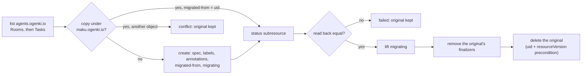

# Maku rebrand, phase 2: the CRD group in a quiet window (Implementation Plan)

> **For agentic workers:** REQUIRED SUB-SKILL: Use superpowers:subagent-driven-development (recommended) or superpowers:executing-plans to implement this plan task-by-task. Steps use checkbox (`- [ ]`) syntax for tracking.

**Goal:** Ship maku `v0.31.0` with `Room`, `Task` and the quickstart's `AgentRun` under
`maku.ogenki.io`, move every live object there with `maku-broker migrate-group` in one quiet window,
stop serving the old metric names, and leave no `agents.ogenki.io` CRD behind on any cluster.

**Architecture:** Six agent-platform PRs make `v0.31.0`. A guard annotation keeps both controllers off
a copy whose status is not written yet. The two API packages move group, which regenerates the CRDs
and the charts' copies. `migrate-group` copies each object as unstructured, writes its status
through the subresource, confirms the copy and only then releases and deletes the original. The
exporter serves `maku_*` only. A kind e2e upgrades from `v0.30.0` and migrates, and the runbook and
gate land last. The owner tags `v0.31.0`. ai-native-ref then pins it with **both** Room CRDs
installed, and the owner runs the window: kill switch, zero active runs, pin, dry run, `--apply`,
verify, release. A day later a second ai-native-ref PR prunes the old Room CRD, and the owner deletes
the other old CRDs by hand. Kubernetes label and annotation keys `agents.ogenki.io/*` keep their
names (D1): they are a key prefix that three other repositories select on, not the API group.

**Tech Stack:** Go 1.27 (module `github.com/Smana/maku`), controller-runtime v0.25.2 (unstructured
client, fake client with `interceptor.Funcs`), apimachinery v0.37.1, controller-gen, Helm charts on GHCR
OCI, Flux (`HelmRelease` `crds: CreateReplace`, kustomize prune), kind, OpenTelemetry metrics with the
Prometheus exporter, `hack/names.sh`.

**Spec:** [`docs/superpowers/specs/2026-10-28-maku-rebrand-design.md`](../specs/2026-10-28-maku-rebrand-design.md),
its "Phase 2" section, the decisions recorded with the owner, and the corrections found while planning
phase 1. The spec is binding. Where this plan departs from it, the departure is in
[Decisions this plan makes](#decisions-this-plan-makes) with its reason, and the
[spec defects](#spec-defects-found-while-planning) are listed for the owner.

**Baseline:** agent-platform `feat/maku-phase1` at `2c07fca` (phase 1 renames done: module
`github.com/Smana/maku`, binaries `maku-*`, CLI `maku`, `internal/maku`). ai-native-ref `origin/main` at
`d634590`, cloud-native-ref at `963fffb6`, crossplane-configuration at `01017f2`. ai-native-ref still pins
v0.29.11 at that baseline: phase 1's consumer waves land before this plan starts (Task 0), so Task 0
re-measures every line number cited in another repository.

## Global Constraints

From the spec (verbatim where quoted):

- Scope is **phase 2 only**: "the CRD group, in a scheduled quiet window". "Kubernetes can't serve one
  kind under two groups, so the objects are copied, not converted."
- The group: "`agents.ogenki.io`" → "`maku.ogenki.io`", for "`Room`, `Task`, the quickstart's `AgentRun`".
- Out of scope: "**`agentruns.cloud.ogenki.io`.** Production's `AgentRun` is a Crossplane XRD in
  crossplane-configuration, part of the platform's `cloud.ogenki.io` API". "**The `agents` namespace**
  and the `xplane-run-` claim prefix". "**The JWT audiences `room-broker` and `rooms-system`**".
  "**Event types and the C4 envelope** (`room.*`, `summary/v1`)". "The web host stays `rooms.<domain>`."
- "**ServiceAccounts keep their names** (`agent-factory`, `room-broker`, …) through phases 1 and 2."
  "**Every Kubernetes identity stays in phase 1**" (correction 1): this plan keeps them in phase 2 too.
- The subcommand: "`maku-broker migrate-group --from agents.ogenki.io --to maku.ogenki.io`". "For every
  `Room`, then every `Task`, in every namespace". "**Dry run by default.** `--apply` does the work."
  "**Each object succeeds or fails on its own,** with a report. Nothing is deleted until its copy is
  confirmed." "`maku.ogenki.io/migrated-from: <old uid>`". "re-running the migration in reverse, which
  the subcommand supports with `--from` and `--to` swapped."
- "**Rooms' durable state is in Postgres,** keyed by room id, which doesn't change."
- "`v0.31.0` stops emitting the old names." "The `*_build_info` series follow the same rule."
- The window: "Engage the factory kill switch and wait until no `AgentRun` is active", "Apply the new
  CRDs (pin v0.31.0's chart, broker and factory). The old CRDs stay installed", "dry-run mode, read the
  report, then run it with `--apply`", check, "Release the kill switch", "After one day, delete the old
  CRDs."
- "After phase 2 completes, a follow-up narrows it [the signer] to `maku`."
- "Coordinate every tag with the other session that releases agent-platform".

From the repository's `CLAUDE.md` (a symlink to `AGENTS.md`) and the owner's instructions:

- **`task check` exits 0 once per repository before each commit** ("exit 0, or it is not done").
  agent-platform, ai-native-ref and cloud-native-ref each run their own `task check`.
- **Lint through `task lint`, never a bare `golangci-lint run`.**
- Every `.go` file starts with `// SPDX-License-Identifier: Apache-2.0`.
- TDD: the failing test first, then the least code that passes it. Table-driven `t.Run`, stdlib
  `testing` only, hand-written fakes, controller-runtime's fake client for reconcilers, `-race` always.
- **No secret on argv.** "Tokens, keys and DSNs come from mounted files or the environment, never flags
  or a child process's arguments: `/proc/<pid>/cmdline` is world-readable." `migrate-group` reads the
  kubeconfig from `KUBECONFIG` (a file path), never a token flag.
- **Never `HOME=…` and never `env -i`.** Redirect only what needs it (`XDG_CONFIG_HOME`, `KUBECONFIG`).
- **Memory limits: never run two heavy suites at once**, across every session and repository. Heavy
  suites are `task check`, `task test`, the quickstart e2e, the migrate-group e2e, the harness image
  build and ai-native-ref's `task check`. Run them one after another.
- **No live CLI runs.** The executing agent never runs `maku` against a live broker.
- **No commands against any cluster** from the executing agent: kind e2es run in CI only; every
  `kubectl` against gcp-0 or aws-0 is an **owner step**.
- **No `Co-Authored-By`, no "Generated with" line and no other attribution trailer** in commits or PR
  bodies. Commit messages, PR titles and PR bodies are in English.
- **Tag freeze:** the other Claude session that tags agent-platform pushes no tag from Task 0 until
  Task 11 is done, and `v0.31.0` is the only tag this plan pushes. Tags are admin-only: the tag push is
  an **owner step**.
- **The owner's admin merges and the quiet window are owner steps.** The executor prepares PRs and
  commands; the owner merges, tags and runs everything in the window.
- **CI job ids stay**: `check` and `harness-test` are required checks of the `main` ruleset (with
  CodeQL's `analyze`).

---

## Decisions this plan makes

**D1. Label and annotation keys `agents.ogenki.io/*` stay; the API group, the Room finalizer and two new
keys move.** Grounded in `git grep -n 'agents\.ogenki\.io'` at the baselines:

| Repository | Lines (files) | Group form (`…/v1alpha1`, `rooms.…`, `apiGroups`, `group:`) | Key form (`agents.ogenki.io/<key>`) |
|---|---|---|---|
| agent-platform (excluding `docs/superpowers`) | 147 (63) | 73 lines in 38 files | the rest: 30 distinct keys |
| ai-native-ref (excluding `docs`, `spikes`) | 40 | `infrastructure/base/room-broker/crd-rooms.yaml:10,12`, `rbac.yaml:13,16,19`, `scripts/ops/github/cohort-row.py:132` | policies, collector, node pools, scripts |
| cloud-native-ref | 11 (excluding docs) | none in live config; `scripts/ci/flux-schema/gen-catalog.sh:20,312,313` name the Room schema path | node labels, Cilium, FIS, VictoriaMetrics/Logs |
| crossplane-configuration | 194 | **none** | the whole composition (`apis/agentrun/composition.yaml`, `apis/agentrun/kcl/main.k`) |

What stays, and who selects on it:

| Keys | Object | Reader outside agent-platform | Why it cannot move here |
|---|---|---|---|
| `run-id`, `role`, `task`, `tier`, `principal`, `traceparent`, `usage-tokens`, `pull-request`, `revoked`, `operating-mode`, `remaining-seconds`, `resumed-at`, `task-url`, `start-seq`, `head`, `request-hash`, `charged-to`, `max-micro-usd`, `factory-version` | the `cloud.ogenki.io` AgentRun claim and its pods | crossplane-configuration `apis/agentrun/kcl/main.k:194,279,287,292,352,354,455,493,535-547,581`; ai-native-ref `security/base/agent-policies/validatingpolicies.yaml:238,279-283`, `observability/base/agent-platform/agent-traces-collector.yaml:137,140,284`, `infrastructure/base/{room-broker,agent-gateway}/network-policy.yaml:20,35`; cloud-native-ref `opentofu/*/init/helm_values/cilium.yaml` (`--pod-restart-selector=!agents.ogenki.io/run-id`), `vm-common-helm-values-configmap.yaml:702,705` | These are SP1's XRD seams (spec: the XRD stays `cloud.ogenki.io`). A rename needs crossplane-configuration, two consumers and every running pod's labels to move in step, and CNP selectors on live pods would drop traffic mid-change |
| `runtime`, `pod-lost`, `finished-phase`, `finished-reason`, `fis-target` | nodes, sandboxes, AWS tags | crossplane-configuration, ai-native-ref node pools, cloud-native-ref tofu | Never written by maku at all |
| `stop`, `revert`, `issue`, `published-issue`, `parent`, `source-key` | `Task` | ai-native-ref `scripts/ops/github/factory-walkthrough.sh:21` (`-l agents.ogenki.io/issue=`); docs tell operators `kubectl annotate task … agents.ogenki.io/stop=true` | Stored on every Task. `migrate-group` copies labels verbatim (spec), and the intake dedups on `agents.ogenki.io/issue`. Renaming means a key translation in both directions for no gain |
| `forked-from` | `Room` | none | Stored; `roomctrl.ForkSeq` reads it |
| `stop-source`, `fenced-at` | ConfigMaps | none | Not migrated objects |
| Lease `agent-factory.agents.ogenki.io` | Lease (`internal/app/factory.go:474`) | ai-native-ref runbook `04-gateway-secrets-budgets.md:459` | A leader-election id: phase 1's D1 keeps every lease, since two names elect two leaders during a roll |

What moves: the group (`api/v1alpha1/groupversion_info.go:5,16`, `api/factory/v1alpha1/groupversion_info.go:3,7,19`),
every CRD file and RBAC rule, the chart's `runs.group` (`charts/maku/values.yaml:4`), and the Room
finalizer `agents.ogenki.io/room-log` → `maku.ogenki.io/room-log` (`internal/roomctrl/reconciler.go:32`).
The finalizer is controller-private: `migrate-group` strips the old one from the original, the copy
never carries one until the v0.31.0 controller adds the new one, and no other repository reads it.
New keys: `maku.ogenki.io/migrated-from` (spec) and `maku.ogenki.io/migrating` (D2).

crossplane-configuration therefore changes **nothing**: its composition references key-form strings only.

**D2. A guard annotation, `maku.ogenki.io/migrating`, keeps the controllers off an unfinished copy.**
The spec creates the copy, then writes its status. In between, the v0.31.0 controllers already watch
`maku.ogenki.io`:

- the Room controller sees `status.lastSeq == 0`, so it calls `open` (`internal/roomctrl/reconciler.go:114-119`).
  For a Closed room whose row retention purged, that writes a fresh row and seq 1, which
  `TestPurgedLogIsNeverResurrected` exists to forbid;
- the factory sees `status.phase == ""`, moves the task to `Received` (`internal/factory/reconciler/reconciler.go:229-231`),
  and under the window's kill switch `stopRequested` (`:464-472`) ends a `Done` task `Stopped`.

`migrate-group` creates each copy with the guard, writes the status, confirms, then lifts the guard.
Both reconcilers return early on a guarded object (Task 1). It is a removable annotation, so a crash
leaves a guarded copy that the next run finishes.

**D3. A re-run resumes a copy it made, rather than skipping it.** The spec skips an object whose copy
already carries `migrated-from: <its uid>`. When the original is still there, skipping leaves it, its
old finalizer included, and that blocks the old CRD's deletion a day later. So the run finishes the
copy (status, guard) and deletes the original. When the original is gone, nothing lists it, so a full
re-run reports nothing: that is the spec's idempotency. Release order is: finalizers removed, then
`Delete` with `Preconditions{UID, ResourceVersion}`. If anything rewrote the original in between, the
delete conflicts and the object is reported failed, not deleted.

**D4. AgentRuns are not migrated.** Only the quickstart serves `agentruns.agents.ogenki.io`. The window
waits for zero active runs, the kill switch revokes and deletes every live run every 15 s
(`docs/factory.md:1035-1044`), and a finished run's end is already in its room's log. A finished
quickstart AgentRun left under the old group goes with the old CRD in Task 11, and its pods go with it
by owner reference. `migrate-group` moves `Room` and `Task` only (spec).

**D5. Rollback after `--apply` is the reverse migration, run while v0.31.0 still runs.** The spec's
"Re-pin v0.30.x and delete the new-group copies" does not hold once `--apply` ran. The originals are
deleted by then. And deleting a Room copy that v0.31.0 finalized runs its finalizer, which deletes
the room's runs and **seals its log** (`internal/roomctrl/reconciler.go:233-260`). So the order is:

1. `migrate-group --from maku.ogenki.io --to agents.ogenki.io --apply` with v0.31.0 still running. It
   watches only `maku.ogenki.io`, so it never acts on the reverse copies. `migrate-group` strips the
   copies' finalizers before it deletes them, so nothing is sealed.
2. Then revert the pins.

Never `kubectl delete rooms.maku.ogenki.io` by hand while v0.31.0 runs.

**D6. Helm never installs `crds/` on upgrade.** "pin v0.31.0, which installs the new CRDs alongside the
old ones" holds for ai-native-ref:

- the factory's `HelmRelease` sets `upgrade.crds: CreateReplace` (`tooling/base/agent-factory/helmrelease.yaml:18-23`), which
  creates `tasks.maku.ogenki.io` and deletes nothing;
- the Room CRD is a kustomize resource (`infrastructure/base/room-broker/kustomization.yaml:6`).

A plain `helm upgrade` of `charts/maku` or `charts/maku-factory` (the quickstart, the kind e2e) skips
`crds/` entirely, so those apply the CRDs first:
`helm show crds oci://ghcr.io/smana/charts/<chart> --version 0.31.0 | kubectl apply --server-side -f -`.

**D7. The window starts with no open task, and the test task runs after the release.** Engaging the
kill switch ends every open task `Stopped` (`docs/factory.md:1038`). That is not a pause: "the factory
resumes" can only mean intake and new tasks. So:

- Task 10 Step 1 counts the open tasks first, and the owner picks a time when that count is 0, or
  accepts the stops;
- the spec's check "a test task runs end to end" cannot pass while the kill switch is on, so it moves
  after the release (Task 10 Step 7), while the reverse migration is still available.

**D8. `migrate-group` runs from the owner's machine, with the owner's kubeconfig.**

- It is a one-shot: a Job would need a ClusterRole over both groups in every namespace, shipped for
  one use.
- The image cannot use GKE's exec credential plugin.

The owner builds it from the `v0.31.0` tag and runs it with a one-context `KUBECONFIG` file in
`$SCRATCH`. No RBAC ships.

**D9. The exporter renames instead of mirroring, and `metrics.makuNames` is refused.**

- `makuGatherer` (phase 1 D2) now serves each mapped family under its `maku_` name only, and leaves
  unmapped ones (`go_*`, `factory_slack_*`) as they are.
- Instruments keep their `rooms_*` / `agent_factory_*` strings in Go, so the 78 instrument names do not
  churn.
- `WithMakuNames` and both configs' `metrics` section go. Strict decode then refuses
  `metrics.makuNames`. No deployment sets it (`git grep makuNames` is empty in ai-native-ref, charts
  and hack), so the release notes say "drop it".

**D10. Consumers: two ai-native-ref PRs, two cloud-native-ref pins, nothing in crossplane-configuration.**

- **A** (Task 8) pins v0.31.0, keeps the old Room CRD beside the new one, and grants the broker both
  groups, so rolling back is a pin revert. It merges inside the window.
- **B** (Task 11), at least 24 h later, removes the old CRD file (Flux prunes the CRD), drops the old
  group from RBAC, and narrows the signer to `Smana/maku`, the spec's "follow-up".
- cloud-native-ref pins each ai-native-ref release (Tasks 10 and 11), and its stale `gen-catalog.sh`
  Room stanza moves to the new schema path in the first pin.

**D11. The kind e2e has no factory.** The quickstart chart ships the broker and the run controller only
(`charts/maku/templates/`). So the e2e checks a Task's status and labels through the move, and the
factory side is covered twice:

- Task 1's fake-client test proves a guarded copy is left alone and a migrated one reconciles from
  its status;
- the window's test task (Task 10 Step 7) proves the factory end to end.

**D12. The old-name gate widens to the group form and to the old metric names.**

`hack/names.sh` refuses:

- `agents.ogenki.io/v1alpha1`, `<plural>.agents.ogenki.io`, `apiGroups` or `group:` naming it,
  `groupName=`, a CRD file name `agents.ogenki.io_*.yaml`, and the backticked bare group;
- the 78 instrument names of `internal/metrics`, `internal/factory/fmetrics` and `internal/bridge`, as
  whole words in any non-Go file.

Key-form `agents.ogenki.io/<key>` passes (D1). The allowlist gains the runbook, the migration code and
its e2e, which must name the old group.

## Spec defects found while planning

Reported to the owner; the spec is not edited by this plan.

1. **Create-then-status races the running controllers** (D2): a statusless copy re-opens a purged log
   or ends a finished task `Stopped`.
2. **"Rollback before step 6: re-pin v0.30.x and delete the new-group copies" is unsafe after
   `--apply`** (D5). The originals are gone, and deleting a v0.31.0-finalized Room seals its log.
3. **The kill switch stops every open task** (D7), and **the test task cannot run before the kill
   switch is released**: the spec's step 4 check precedes its step 5 release.
4. **"pin v0.31.0 … installs the new CRDs"** is false for `helm upgrade` (D6).
5. **"`kubectl get agentruns -A`" and "the factory lists its `Task`s" are ambiguous** while both groups
   serve `rooms`, `tasks` (and, on the quickstart, `agentruns`): short names resolve to one group. The
   runbook uses fully qualified names.
6. "the report from step 3 must be empty first": a report of migrated objects is not empty. The check is a
   fresh dry run that finds nothing to copy.

## Rollout across repositories

```mermaid
sequenceDiagram
  autonumber
  participant O as Owner
  participant AP as maku (agent-platform)
  participant AI as ai-native-ref
  participant CN as cloud-native-ref
  Note over O,CN: Task 0: v0.30.0 on every cluster, dashboards on maku_*, tag freeze
  AP->>AP: Tasks 1-6: guard, group, migrate-group, metrics, kind e2e, runbook + gate (6 PRs)
  O->>AP: Task 7: tag v0.31.0 (the only tag)
  AI->>AI: Task 8: PR A ready (v0.31.0 pins, both Room CRDs, both RBAC groups), not merged
  Note over O,CN: Task 10: the quiet window
  O->>O: kill switch, zero active AgentRuns
  O->>AI: merge PR A, release
  CN->>CN: pin A (Task 9 prepared it), owner merges, Flux rolls v0.31.0
  O->>O: migrate-group dry run, then --apply, verify, release the kill switch, test task
  Note over O,CN: Task 11: 24 h later, a fresh dry run finds nothing
  AI->>AI: PR B: prune the old Room CRD, one RBAC group, signer Smana/maku
  CN->>CN: pin B; owner deletes tasks/agentruns.agents.ogenki.io by hand
  O->>AP: tag freeze lifted
```

## File structure

agent-platform:

| Path | Responsibility | Task |
|---|---|---|
| `api/v1alpha1/migration.go` (new) | `AnnotationMigrating`, `AnnotationMigratedFrom` | 1 |
| `internal/roomctrl/reconciler.go:97-104`, `internal/factory/reconciler/reconciler.go:201-205` (+ tests) | the guard | 1 |
| `api/v1alpha1/groupversion_info.go`, `api/factory/v1alpha1/groupversion_info.go` | `groupName=maku.ogenki.io` | 2 |
| `config/crd/agents.ogenki.io_*.yaml` → `config/crd/maku.ogenki.io_*.yaml` (3), `charts/maku/crds/*` (2), `charts/maku-factory/crds/*` (1) | the generated CRDs and the charts' copies | 2 |
| `charts/maku/templates/broker-rbac.yaml:15-23`, `charts/maku-factory/templates/rbac.yaml:9-17`, `charts/maku/values.yaml:4`, `charts/maku/tests/render.sh:49` | RBAC and the run kind | 2 |
| `taskfile.yaml:85,88`, `.github/workflows/release.yaml:144-145` | `crd:gen` copies and the release assets (asset names stay) | 2 |
| `internal/roomctrl/reconciler.go:32` | the finalizer `maku.ogenki.io/room-log` | 2 |
| 21 test files (group strings only) | fixtures | 2 |
| `internal/migrategroup/migrategroup.go`, `internal/migrategroup/migrategroup_test.go` (new) | the copy, the report | 3 |
| `internal/app/migrategroup.go`, `internal/app/migrategroup_test.go` (new), `internal/app/broker.go:72-99`, `cmd/maku-broker/main.go:3-7` | the subcommand | 3 |
| `internal/metrics/metrics.go:12-13,61-127`, `internal/metrics/metrics_test.go:355-425`, `internal/factory/fmetrics/makunames_test.go` | `maku_*` only | 4 |
| `internal/config/config.go:232-233,310-318`, `internal/factory/config/config.go:134,585-591,945`, both `config_test.go`, `internal/app/broker.go:157`, `internal/app/factory.go:143` | the `metrics` section goes | 4 |
| `hack/quickstart/migrate-e2e.sh` (new), `.github/workflows/quickstart-e2e.yaml` (job `migrate-group`) | the kind e2e | 5 |
| `docs/maku-group-migration.md` (new), `docs/operations.md:187-202`, `docs/README.md`, `docs/{architecture,concepts,factory,integration,naming,api,security}.md`, `AGENTS.md:112-125`, `hack/names.sh`, `hack/names_test.sh` | runbook, docs, the gate | 6 |

ai-native-ref (lines at `d634590`; Task 0 re-measures after phase 1):

- `infrastructure/base/room-broker/crd-rooms.yaml` (becomes the maku CRD), `crd-rooms-agents.yaml` (new; the
  old one), `kustomization.yaml:6`, `rbac.yaml:13,16,19`, the v0.31.0 pins (`flux/sources/ocirepo-agent-factory.yaml:13-14`,
  `tooling/base/agent-factory/helm-values-configmap.yaml:17-19`, `tooling/base/agent-factory/slack-app/deployment.yaml:32-33`,
  `infrastructure/base/room-broker/app.yaml:13-15`, `retention-cronjob.yaml:35`, `sqlinstance.yaml:36`),
  `scripts/ci/tests/test-room-broker-rbac.py:19`, `scripts/ops/github/cohort-row.py:132`: Task 8;
- `crd-rooms-agents.yaml` (deleted), `kustomization.yaml`, `rbac.yaml`, `flux/sources/ocirepo-agent-factory.yaml`
  (signer): Task 11.

cloud-native-ref: `flux/sources/ocirepo-ai-native-ref.yaml:15-16` (Tasks 9 and 11),
`scripts/ci/flux-schema/gen-catalog.sh:20,312-313` (Task 9).

crossplane-configuration: none (D1).

Shared shell variables for every task (set once per session, nothing secret in them):

```bash
AP=/home/smana/Sources/agent-platform          # the one clone (remote Smana/maku); every worktree hangs off it
AI=/home/smana/Sources/ai-native-ref
CN=/home/smana/Sources/cloud-native-ref
XC=/home/smana/Sources/crossplane-configuration
SCRATCH=$(mktemp -d -t maku-p2.XXXXXX)          # reports, kubeconfigs, digests; never inside a repository
OLD=agents.ogenki.io NEW=maku.ogenki.io
```

---

### Task 0: Preconditions, tag freeze, re-baseline (coordination)

**Files:** none changed.

**Interfaces:**
- Consumes: phase 1 complete.
- Produces: `$SCRATCH/baseline.txt` (counts), `$SCRATCH/last-tag.txt`.

- [ ] **Step 1: Phase 1 is released and adopted**

```bash
gh release view v0.30.0 -R Smana/maku --json tagName,assets --jq '.tagName, ([.assets[].name] | sort | join(" "))'
git -C "$CN" fetch origin -q && git -C "$CN" show origin/main:flux/sources/ocirepo-ai-native-ref.yaml | grep -E '^\s+tag:'
```

Expected: `v0.30.0` with `crd-agentruns.yaml crd-rooms.yaml maku-*`, and a cloud-native-ref pin of the
ai-native-ref release that carries phase 1's wave B. If v0.30.0 is not released, stop: Task 5's e2e
upgrades from it.

- [ ] **Step 2: The precondition for dropping the old metric names: ai-native-ref reads `maku_*` only**

```bash
t=$(git -C "$CN" show origin/main:flux/sources/ocirepo-ai-native-ref.yaml | sed -n 's/^ *tag: "\(v[0-9.]*\)".*/\1/p')
git -C "$AI" fetch origin --tags -q
git -C "$AI" grep -nP '(?<![A-Za-z0-9_])(rooms_[a-z_]+|agent_factory_[a-z_]+)' "$t" -- observability scripts/ci/tests scripts/ops \
  | grep -vE 'rooms_(broker|retention|owner|list)\b|rooms_crd_outdated|rooms_unavailable' | tee "$SCRATCH/old-metric-refs.txt"
```

Expected: no output. Any line is a dashboard, rule or alert that v0.31.0 would blank: stop, and land
that wave-B fix in ai-native-ref first. **Owner step:** on each cluster, confirm the switched panels
have had data for at least 24 h (`count(maku_rooms_build_info)` and `count(maku_factory_build_info)`
in VictoriaMetrics, over `[24h]`, are non-zero).

- [ ] **Step 3: Owner step: the tag freeze**

The owner tells the other session that tags agent-platform: "No maku tag from now until the phase-2
plan's Task 11 is done. `v0.31.0` will be the only tag." Then:

```bash
git -C "$AP" fetch origin --tags -q
git -C "$AP" tag --sort=-v:refname | head -1 | tee "$SCRATCH/last-tag.txt"     # v0.30.x
gh run list -R Smana/maku --workflow release.yaml --limit 3 --json status --jq '.[] | select(.status != "completed")'
```

Expected: a `v0.30.*` tag and no output from the second command.

- [ ] **Step 4: Re-measure what this plan cites**

```bash
cd "$AP" && git fetch origin -q
re='agents\.ogenki\.io(/v1alpha1|_|"?\]|\s*$|"\s*[,}]|\)|`)|(rooms|tasks|agentruns)\.agents\.ogenki\.io|group: *"?agents\.ogenki\.io|groupName=agents|Group: "agents|apiGroups: \[agents'
{
  echo "all-lines $(git grep -n 'agents\.ogenki\.io' origin/main -- ':!docs/superpowers' | wc -l)"
  echo "group-form-lines $(git grep -nE "$re" origin/main -- ':!docs/superpowers' | wc -l)"
  echo "metric-names $(git grep -hoE '"(rooms|agent_factory)_[a-z_]+"' origin/main -- internal/metrics internal/factory/fmetrics internal/bridge ':!*_test.go' | sort -u | wc -l)"
  for r in "$AI" "$CN" "$XC"; do git -C "$r" fetch origin -q
    echo "$(basename "$r")-group-form $(git -C "$r" grep -nE "$re" origin/main -- ':!docs/superpowers' ':!spikes' | wc -l)"; done
} | tee "$SCRATCH/baseline.txt"
git -C "$AI" grep -n 'agents\.ogenki\.io\|v0\.30\.' origin/main -- infrastructure/base/room-broker flux/sources/ocirepo-agent-factory.yaml tooling/base/agent-factory scripts/ci/tests/test-room-broker-rbac.py scripts/ops/github/cohort-row.py
```

Expected at the baseline: `147`, `73`, `78`, `ai-native-ref-group-form 7` (one a runbook line under `docs/`),
`cloud-native-ref-group-form 0`, `crossplane-configuration-group-form 0`. A non-zero crossplane-configuration count
means its composition names the group: stop and add it to D10. The last command prints the ai-native-ref
lines Task 8 edits; use its line numbers there.

---

### Task 1: Controllers leave a migrating object alone (agent-platform, PR 1 of 6)

**Files:**
- Create: `api/v1alpha1/migration.go`
- Modify: `internal/roomctrl/reconciler.go:97-104`
- Modify: `internal/factory/reconciler/reconciler.go:201-205`
- Test: `internal/roomctrl/reconciler_test.go`, `internal/factory/reconciler/migrating_test.go` (new)

**Interfaces:**
- Consumes: nothing.
- Produces: `v1alpha1.AnnotationMigrating = "maku.ogenki.io/migrating"` and
  `v1alpha1.AnnotationMigratedFrom = "maku.ogenki.io/migrated-from"` (package `github.com/Smana/maku/api/v1alpha1`),
  which Task 3 writes and Task 5 checks.

- [ ] **Step 1: Worktree**

```bash
git -C "$AP" fetch origin -q
git -C "$AP" worktree add /home/smana/Sources/maku-p2-guard -b feat/maku-migrating-guard origin/main
cd /home/smana/Sources/maku-p2-guard
```

- [ ] **Step 2: Write the failing tests**

Append to `internal/roomctrl/reconciler_test.go`:

```go
// A copy migrate-group has not finished (no status yet) is left alone: reconciling it would open a
// purged log again, and add a finalizer the migration does not expect (maku rebrand, plan D2).
func TestAMigratingRoomIsLeftAlone(t *testing.T) {
	room := newRoom()
	room.Annotations = map[string]string{v1alpha1.AnnotationMigrating: "true"}
	c := build(room)
	ms := newStore(nil)
	r := &Reconciler{Client: c, Store: ms, Runs: runwatch.New(), Now: clock(deletedAt)}
	res, err := r.Reconcile(t.Context(), request())
	if err != nil {
		t.Fatal(err)
	}
	if res != (ctrl.Result{}) {
		t.Fatalf("result = %+v, want none: lifting the annotation is the next event", res)
	}
	got, _ := getRoom(t, c)
	if ms.ensured != 0 || len(ms.drafts) != 0 || len(got.Finalizers) != 0 || got.Status != (v1alpha1.RoomStatus{}) {
		t.Fatalf("%d ensures, %d drafts, finalizers %v, status %+v: the migrating copy was touched",
			ms.ensured, len(ms.drafts), got.Finalizers, got.Status)
	}
}
```

Create `internal/factory/reconciler/migrating_test.go`:

```go
// SPDX-License-Identifier: Apache-2.0

package reconciler

import (
	"testing"

	corev1 "k8s.io/api/core/v1"
	metav1 "k8s.io/apimachinery/pkg/apis/meta/v1"

	v1alpha1 "github.com/Smana/maku/api/factory/v1alpha1"
	roomv1 "github.com/Smana/maku/api/v1alpha1"
	"github.com/Smana/maku/internal/factory/killswitch"
)

// A copy migrate-group has not finished is left alone (maku rebrand, plan D2): with no status yet it
// reads as a new task, and under the window's kill switch a finished one would end Stopped.
func TestAMigratingTaskIsLeftAlone(t *testing.T) {
	tk := issueTask("3buqdlot", 7, "x")
	tk.Annotations = map[string]string{roomv1.AnnotationMigrating: "true"}
	stop := &corev1.ConfigMap{ObjectMeta: metav1.ObjectMeta{Name: killswitch.ConfigMap, Namespace: "agent-system"}}
	g := newRig(t, tk, stop)
	got := g.reconcile(t, "3buqdlot", 2)
	if got.Status.Phase != "" || len(g.runs.specs) != 0 || len(g.f.Comments(7)) != 0 {
		t.Fatalf("phase %q, %d runs, %d comments: the migrating copy was reconciled",
			got.Status.Phase, len(g.runs.specs), len(g.f.Comments(7)))
	}
	// Once migrate-group has written the status and lifted the guard, the task reconciles from it.
	got.Status.Phase = v1alpha1.PhaseDone
	if err := g.c.Status().Update(t.Context(), got); err != nil {
		t.Fatal(err)
	}
	delete(got.Annotations, roomv1.AnnotationMigrating)
	if err := g.c.Update(t.Context(), got); err != nil {
		t.Fatal(err)
	}
	if after := g.reconcile(t, "3buqdlot", 1); after.Status.Phase != v1alpha1.PhaseDone {
		t.Fatalf("phase %q after the migration, want Done kept: a terminal task is never stopped", after.Status.Phase)
	}
}
```

- [ ] **Step 3: Run them to verify they fail**

Run: `go test -race -count=1 ./internal/roomctrl/ ./internal/factory/reconciler/ -run 'Migrating'`
Expected: FAIL to compile, `undefined: v1alpha1.AnnotationMigrating` (and `roomv1.AnnotationMigrating`).

- [ ] **Step 4: The constants and the two guards**

Create `api/v1alpha1/migration.go`:

```go
// SPDX-License-Identifier: Apache-2.0

package v1alpha1

// AnnotationMigrating marks a Room or Task that maku-broker migrate-group has copied but whose status
// it has not written yet. The Room controller and the factory leave such an object alone until the
// annotation is gone: with no status it would read as new (the maku rebrand's group move).
const AnnotationMigrating = "maku.ogenki.io/migrating"

// AnnotationMigratedFrom is the UID of the object a migrate-group copy was made from. A re-run
// finishes a copy that carries its original's UID and refuses a same-named object that does not.
const AnnotationMigratedFrom = "maku.ogenki.io/migrated-from"
```

In `internal/roomctrl/reconciler.go`, after the `Get` block (`:99-104`) and before
`if !room.DeletionTimestamp.IsZero()`:

```go
	if _, migrating := room.Annotations[v1alpha1.AnnotationMigrating]; migrating {
		return ctrl.Result{}, nil // migrate-group lifts the guard, which is the next event (plan D2)
	}
```

In `internal/factory/reconciler/reconciler.go`, after the `Get` at `:202-205`:

```go
	if _, migrating := t.Annotations[roomv1.AnnotationMigrating]; migrating {
		return ctrl.Result{}, nil // a migrate-group copy without its status yet: lifting the guard requeues it
	}
```

(`roomv1` is already imported at `:27`.)

- [ ] **Step 5: Run the tests to verify they pass**

Run: `go test -race -count=1 ./internal/roomctrl/ ./internal/factory/reconciler/`
Expected: PASS, the existing tests included.

- [ ] **Step 6: Gate, commit, PR**

Run: `task check` (alone). Expected: exit 0.

```bash
git add api/v1alpha1/migration.go internal/roomctrl/reconciler.go internal/roomctrl/reconciler_test.go \
  internal/factory/reconciler/reconciler.go internal/factory/reconciler/migrating_test.go
git commit -m "feat(rooms): the Room controller and the factory leave a migrating copy alone"
git push -u origin feat/maku-migrating-guard
gh pr create -R Smana/maku --base main --title "feat: controllers leave a migrate-group copy alone until its status is written" \
  --body "Phase 2 of the maku rebrand, PR 1 of 6. A copy made by the coming migrate-group carries maku.ogenki.io/migrating until its status is written. Without the guard, the Room controller would re-open a purged log (fresh seq 1) and the factory would take a finished task back to Received, then Stopped under the window's kill switch. Both reconcilers now return early on it."
```

**Owner step:** merge.

---

### Task 2: The group moves to `maku.ogenki.io` (agent-platform, PR 2 of 6)

**Files:**
- Modify: `api/v1alpha1/groupversion_info.go:5,16`, `api/factory/v1alpha1/groupversion_info.go:3,7,19`
- Move + regenerate: `config/crd/agents.ogenki.io_{rooms,tasks,agentruns}.yaml` → `config/crd/maku.ogenki.io_*.yaml`;
  `charts/maku/crds/agents.ogenki.io_{rooms,agentruns}.yaml` → `charts/maku/crds/maku.ogenki.io_*.yaml`;
  `charts/maku-factory/crds/agents.ogenki.io_tasks.yaml` → `charts/maku-factory/crds/maku.ogenki.io_tasks.yaml`
- Modify: `taskfile.yaml:85,88`, `.github/workflows/release.yaml:144-145`
- Modify: `charts/maku/templates/broker-rbac.yaml:15,18,21`, `charts/maku-factory/templates/rbac.yaml:9,12,15`,
  `charts/maku/values.yaml:4`, `charts/maku/tests/render.sh:49`
- Modify: `internal/roomctrl/reconciler.go:32` (finalizer), comments `cmd/maku-run-controller/main.go:3`,
  `internal/runctl/config.go:3`
- Test: `api/v1alpha1/crd_test.go:20,28`, `api/v1alpha1/agentrun_crd_test.go:17`, `api/factory/v1alpha1/task_crd_test.go:18,53,135,188`,
  `api/factory/v1alpha1/curlyquotes_test.go:14`, and the group strings in `internal/app/runs_kind_test.go:18,20`,
  `internal/config/config_test.go:197,206`, `internal/factory/config/{config_test.go:220,616,617,loops_test.go:56,scope_test.go:97,101}`,
  `internal/factory/reconciler/{finalfix_test.go:37,loop_test.go:137,157,split_fixes_test.go:52}`,
  `internal/humanapi/{acts_test.go:742,fork_test.go:361,rooms_test.go:90,123}`, `internal/maku/run_test.go:26`,
  `internal/roomctrl/reconciler_test.go:433`, `internal/runrequest/runrequest_test.go:131`, `internal/runwatch/kind_test.go:37,40,43,46`
- Keep: `internal/app/factory.go:474` and `internal/app/factory_test.go:59` (the lease, D1); every
  key-form `agents.ogenki.io/<key>` (D1); the release asset names `crd-rooms.yaml`, `crd-agentruns.yaml`
  (phase 1 D1).

**Interfaces:**
- Consumes: Task 1 (merged).
- Produces: `v1alpha1.GroupVersion.Group == "maku.ogenki.io"` in both API packages;
  `roomctrl.Finalizer == "maku.ogenki.io/room-log"`; CRD files `config/crd/maku.ogenki.io_{rooms,tasks,agentruns}.yaml`,
  which Task 5 applies and Task 7's release attaches as `crd-rooms.yaml` and `crd-agentruns.yaml`.

- [ ] **Step 1: Worktree**

```bash
git -C "$AP" fetch origin -q
git -C "$AP" worktree add /home/smana/Sources/maku-p2-group -b feat/maku-crd-group origin/main
cd /home/smana/Sources/maku-p2-group
```

- [ ] **Step 2: Write the failing test**

Append to `api/v1alpha1/crd_test.go`:

```go
// The maku rebrand moves the group (phase 2): the types, every generated CRD and the charts' copies
// agree on maku.ogenki.io, and no agents.ogenki.io CRD file is left to install by mistake.
func TestEveryCRDIsUnderTheMakuGroup(t *testing.T) {
	if GroupVersion.Group != "maku.ogenki.io" {
		t.Fatalf("GroupVersion.Group = %q", GroupVersion.Group)
	}
	for _, f := range []string{
		"../../config/crd/maku.ogenki.io_rooms.yaml", "../../config/crd/maku.ogenki.io_agentruns.yaml",
		"../../config/crd/maku.ogenki.io_tasks.yaml", "../../charts/maku/crds/maku.ogenki.io_rooms.yaml",
		"../../charts/maku/crds/maku.ogenki.io_agentruns.yaml", "../../charts/maku-factory/crds/maku.ogenki.io_tasks.yaml",
	} {
		raw, err := os.ReadFile(f)
		if err != nil {
			t.Fatal(err)
		}
		var crd apiextensionsv1.CustomResourceDefinition
		if err := yaml.UnmarshalStrict(raw, &crd); err != nil {
			t.Fatalf("%s: %v", f, err)
		}
		if crd.Spec.Group != "maku.ogenki.io" || !strings.HasSuffix(crd.Name, ".maku.ogenki.io") {
			t.Errorf("%s: group %q, name %q", f, crd.Spec.Group, crd.Name)
		}
	}
	for _, dir := range []string{"../../config/crd", "../../charts/maku/crds", "../../charts/maku-factory/crds"} {
		old, err := filepath.Glob(filepath.Join(dir, "agents.ogenki.io_*.yaml"))
		if err != nil || len(old) != 0 {
			t.Errorf("%s still holds %v", dir, old)
		}
	}
}
```

Add `"path/filepath"` to the file's imports.

- [ ] **Step 3: Run it to verify it fails**

Run: `go test -race -count=1 ./api/v1alpha1/ -run TestEveryCRDIsUnderTheMakuGroup`
Expected: FAIL, `GroupVersion.Group = "agents.ogenki.io"`.

- [ ] **Step 4: Move the files, then change the group everywhere it is a group**

```bash
for f in rooms tasks agentruns; do git mv "config/crd/agents.ogenki.io_$f.yaml" "config/crd/maku.ogenki.io_$f.yaml"; done
for f in rooms agentruns; do git mv "charts/maku/crds/agents.ogenki.io_$f.yaml" "charts/maku/crds/maku.ogenki.io_$f.yaml"; done
git mv charts/maku-factory/crds/agents.ogenki.io_tasks.yaml charts/maku-factory/crds/maku.ogenki.io_tasks.yaml
re='agents\.ogenki\.io(/v1alpha1|_|"?\]|\s*$|"\s*[,}]|\)|`)|(rooms|tasks|agentruns)\.agents\.ogenki\.io|group: *"?agents\.ogenki\.io|groupName=agents|Group: "agents|apiGroups: \[agents'
files=$(git grep -lE "$re" -- ':!docs' ':!*.md' ':!config/crd' ':!charts/*/crds' ':!hack/names.sh' \
  ':!internal/app/factory.go' ':!internal/app/factory_test.go')
echo "$files" | wc -l            # 29
perl -pi -e 's#agents\.ogenki\.io(?=/v1alpha1|_|"|\]|$| AgentRuns)#maku.ogenki.io#g; s#(groupName=|group: )agents\.ogenki\.io#${1}maku.ogenki.io#g' $files
sed -i '32s#Finalizer = "agents.ogenki.io/room-log"#Finalizer = "maku.ogenki.io/room-log"#' internal/roomctrl/reconciler.go
sed -n 32p internal/roomctrl/reconciler.go
```

Expected: `Finalizer = "maku.ogenki.io/room-log"`. Then `api/factory/v1alpha1/groupversion_info.go:3` reads
"It shares the maku.ogenki.io" and line 7 `// +groupName=maku.ogenki.io`.

- [ ] **Step 5: Regenerate the CRDs and their copies**

Run: `task crd:gen`
Then: `git status --short config/crd charts`
Expected: the three `config/crd/maku.ogenki.io_*.yaml` and three chart copies are modified (`metadata.name`
`<plural>.maku.ogenki.io`, `spec.group: maku.ogenki.io`), and no `agents.ogenki.io_*.yaml` file appears.

- [ ] **Step 6: Nothing group-form is left outside the docs and the lease**

```bash
git grep -nE "$re" -- ':!docs' ':!*.md' ':!hack/names.sh'
git grep -n 'agents\.ogenki\.io' -- internal/app/factory.go internal/app/factory_test.go
```

Expected: the first prints nothing; the second prints the two lease lines (`agent-factory.agents.ogenki.io`).

- [ ] **Step 7: Run the tests to verify they pass**

Run: `go test -race -count=1 ./api/... ./internal/roomctrl/ ./internal/runwatch/ ./internal/config/ ./internal/factory/... ./internal/humanapi/ ./internal/maku/ ./internal/runrequest/ ./internal/app/`
Then: `bash charts/maku/tests/render.sh && bash charts/maku-factory/tests/render.sh`
Expected: PASS, and both render tests print their pass lines.

- [ ] **Step 8: Gate, commit, PR**

Run: `task check` (alone). Expected: exit 0 (`crd:check` included).

```bash
git add -A
git commit -m "feat(api): Room, Task and AgentRun move to the maku.ogenki.io group"
git push -u origin feat/maku-crd-group
gh pr create -R Smana/maku --base main --title "feat: the CRD group moves to maku.ogenki.io" \
  --body "Phase 2 of the maku rebrand, PR 2 of 6. groupName=maku.ogenki.io in api/v1alpha1 and api/factory/v1alpha1; the CRDs and the charts' copies regenerated under maku.ogenki.io_*.yaml; RBAC, runs.group and the render tests follow; the Room finalizer becomes maku.ogenki.io/room-log. Label and annotation keys agents.ogenki.io/* keep their names: crossplane-configuration's composition, ai-native-ref's policies and cloud-native-ref's Cilium flags select on them (plan D1). The factory's lease keeps its name. Release assets keep their names (crd-rooms.yaml, crd-agentruns.yaml). Not releasable alone: live objects need migrate-group (PR 3) and the window."
```

**Owner step:** merge.

---

### Task 3: `maku-broker migrate-group` (agent-platform, PR 3 of 6)

**Files:**
- Create: `internal/migrategroup/migrategroup.go`, `internal/migrategroup/migrategroup_test.go`
- Create: `internal/app/migrategroup.go`, `internal/app/migrategroup_test.go`
- Modify: `internal/app/broker.go:72-99` (the `migrate-group` case and the help), `cmd/maku-broker/main.go:3-7` (package doc)

**Interfaces:**
- Consumes: `v1alpha1.AnnotationMigrating`, `v1alpha1.AnnotationMigratedFrom` (Task 1).
- Produces:
  - `migrategroup.Run(ctx context.Context, c client.Client, o migrategroup.Options) (migrategroup.Report, error)`;
  - `type Options struct{ From, To, Namespace string; Apply bool }`, `func (Options) Validate() error`;
  - `type Report []Result`, `type Result struct{ Kind, Namespace, Name string; Outcome Outcome; Err error }`,
    `func (Report) Count(Outcome) int`, `func (Report) OK() bool`;
  - outcomes `WouldCopy`, `WouldResume`, `Migrated`, `Resumed`, `Conflict`, `Failed`, `NotServed`,
    spelt `would-copy`, `would-resume`, `migrated`, `resumed`, `conflict`, `failed`, `not-served`;
  - the CLI `maku-broker migrate-group --from <group> --to <group> [--namespace <ns>] [--apply]`. It logs one line
    per object (`msg=migrate-group kind= namespace= name= outcome=`, plus `err=` on a failure), then
    `msg="migrate-group done"` with `migrated resumed wouldCopy wouldResume conflicts failed`. It exits
    non-zero on any conflict or failure. Tasks 5 and 10 parse those lines.

- [ ] **Step 1: Worktree**

```bash
git -C "$AP" fetch origin -q
git -C "$AP" worktree add /home/smana/Sources/maku-p2-migrate -b feat/maku-migrate-group origin/main
cd /home/smana/Sources/maku-p2-migrate
```

- [ ] **Step 2: Write the failing package tests**

Create `internal/migrategroup/migrategroup_test.go`:

```go
// SPDX-License-Identifier: Apache-2.0

package migrategroup

import (
	"context"
	"errors"
	"reflect"
	"testing"

	"k8s.io/apimachinery/pkg/api/meta"
	"k8s.io/apimachinery/pkg/apis/meta/v1/unstructured"
	"k8s.io/apimachinery/pkg/runtime"
	"k8s.io/apimachinery/pkg/runtime/schema"
	"k8s.io/apimachinery/pkg/types"
	"sigs.k8s.io/controller-runtime/pkg/client"
	"sigs.k8s.io/controller-runtime/pkg/client/fake"
	"sigs.k8s.io/controller-runtime/pkg/client/interceptor"

	"github.com/Smana/maku/api/v1alpha1"
)

const (
	oldG = "agents.ogenki.io"
	newG = "maku.ogenki.io"
	ns   = "agent-system"
)

func obj(group, kind, name, uid string) *unstructured.Unstructured {
	u := &unstructured.Unstructured{Object: map[string]any{}}
	u.SetGroupVersionKind(schema.GroupVersionKind{Group: group, Version: Version, Kind: kind})
	u.SetNamespace(ns)
	u.SetName(name)
	u.SetUID(types.UID(uid))
	return u
}

func room(group, name, uid string) *unstructured.Unstructured {
	u := obj(group, "Room", name, uid)
	u.Object["spec"] = map[string]any{"owner": "system:factory", "driver": "system:factory", "dataClass": "public", "retention": "90d"}
	u.Object["status"] = map[string]any{"phase": "Closed", "lastSeq": int64(42), "driver": "system:factory"}
	u.SetLabels(map[string]string{"agents.ogenki.io/issue": "7"})
	u.SetAnnotations(map[string]string{"agents.ogenki.io/forked-from": "aaaaaaaa@3"})
	u.SetFinalizers([]string{"agents.ogenki.io/room-log"})
	return u
}

func task(group, name, uid string) *unstructured.Unstructured {
	u := obj(group, "Task", name, uid)
	u.Object["spec"] = map[string]any{"repository": "Smana/x", "text": "t", "dataClass": "public",
		"source": map[string]any{"kind": "issue", "ref": "Smana/x#7", "key": "k"}}
	u.Object["status"] = map[string]any{"phase": "Done", "roomRef": name}
	u.SetLabels(map[string]string{"agents.ogenki.io/issue": "7"})
	return u
}

func scheme() *runtime.Scheme {
	s := runtime.NewScheme()
	for _, g := range []string{oldG, newG} {
		for _, k := range Kinds {
			s.AddKnownTypeWithName(schema.GroupVersionKind{Group: g, Version: Version, Kind: k}, &unstructured.Unstructured{})
			s.AddKnownTypeWithName(schema.GroupVersionKind{Group: g, Version: Version, Kind: k + "List"}, &unstructured.UnstructuredList{})
		}
	}
	return s
}

// fail lets a case refuse one call: op is create, status, list, update or delete; name is the
// object's name, or the kind for a list. The fake gives a created object a UID, as the server does.
type fail func(op, group, name string) error

func newClient(f fail, objs ...client.Object) client.Client {
	if f == nil {
		f = func(string, string, string) error { return nil }
	}
	var protos []client.Object
	for _, g := range []string{oldG, newG} {
		for _, k := range Kinds {
			protos = append(protos, obj(g, k, "", ""))
		}
	}
	group := func(o client.Object) string { return o.GetObjectKind().GroupVersionKind().Group }
	return fake.NewClientBuilder().WithScheme(scheme()).WithStatusSubresource(protos...).WithObjects(objs...).
		WithInterceptorFuncs(interceptor.Funcs{
			Create: func(ctx context.Context, c client.WithWatch, o client.Object, opts ...client.CreateOption) error {
				if err := f("create", group(o), o.GetName()); err != nil {
					return err
				}
				o.SetUID(types.UID("uid-" + group(o) + "-" + o.GetName()))
				return c.Create(ctx, o, opts...)
			},
			List: func(ctx context.Context, c client.WithWatch, l client.ObjectList, opts ...client.ListOption) error {
				gvk := l.GetObjectKind().GroupVersionKind()
				if err := f("list", gvk.Group, gvk.Kind); err != nil {
					return err
				}
				return c.List(ctx, l, opts...)
			},
			Update: func(ctx context.Context, c client.WithWatch, o client.Object, opts ...client.UpdateOption) error {
				if err := f("update", group(o), o.GetName()); err != nil {
					return err
				}
				return c.Update(ctx, o, opts...)
			},
			Delete: func(ctx context.Context, c client.WithWatch, o client.Object, opts ...client.DeleteOption) error {
				if err := f("delete", group(o), o.GetName()); err != nil {
					return err
				}
				return c.Delete(ctx, o, opts...)
			},
			SubResourceUpdate: func(ctx context.Context, c client.Client, sub string, o client.Object, opts ...client.SubResourceUpdateOption) error {
				if err := f("status", group(o), o.GetName()); err != nil {
					return err
				}
				return c.SubResource(sub).Update(ctx, o, opts...)
			},
		}).Build()
}

func get(t *testing.T, c client.Client, group, kind, name string) (*unstructured.Unstructured, bool) {
	t.Helper()
	u := obj(group, kind, name, "")
	err := c.Get(t.Context(), client.ObjectKey{Namespace: ns, Name: name}, u)
	if err != nil && client.IgnoreNotFound(err) != nil {
		t.Fatal(err)
	}
	return u, err == nil
}

func outcomes(r Report) []Outcome {
	out := make([]Outcome, 0, len(r))
	for _, x := range r {
		out = append(out, x.Outcome)
	}
	return out
}

func TestRun(t *testing.T) {
	boom := errors.New("boom")
	for _, tc := range []struct {
		name  string
		objs  []client.Object
		fail  fail
		wrap  func(client.Client) client.Client
		apply bool
		want  []Outcome
		check func(t *testing.T, c client.Client, r Report)
	}{
		{
			name: "a dry run writes nothing and reports each object",
			objs: []client.Object{room(oldG, "aaaaaaaa", "u1"), task(oldG, "aaaaaaaa", "u2")},
			want: []Outcome{WouldCopy, WouldCopy},
			check: func(t *testing.T, c client.Client, _ Report) {
				if _, ok := get(t, c, newG, "Room", "aaaaaaaa"); ok {
					t.Error("a dry run created a copy")
				}
				if _, ok := get(t, c, oldG, "Room", "aaaaaaaa"); !ok {
					t.Error("a dry run deleted the original")
				}
			},
		},
		{
			name: "apply copies spec, labels, annotations and status, then deletes the original",
			objs: []client.Object{room(oldG, "aaaaaaaa", "u1"), task(oldG, "aaaaaaaa", "u2")}, apply: true,
			want: []Outcome{Migrated, Migrated},
			check: func(t *testing.T, c client.Client, _ Report) {
				for _, want := range []*unstructured.Unstructured{room(newG, "aaaaaaaa", ""), task(newG, "aaaaaaaa", "")} {
					kind := want.GetKind()
					got, ok := get(t, c, newG, kind, "aaaaaaaa")
					if !ok {
						t.Fatalf("no %s copy", kind)
					}
					if !reflect.DeepEqual(got.Object["spec"], want.Object["spec"]) || !reflect.DeepEqual(got.Object["status"], want.Object["status"]) {
						t.Errorf("%s copy spec %v status %v", kind, got.Object["spec"], got.Object["status"])
					}
					if got.GetLabels()["agents.ogenki.io/issue"] != "7" || len(got.GetFinalizers()) != 0 {
						t.Errorf("%s copy labels %v finalizers %v", kind, got.GetLabels(), got.GetFinalizers())
					}
					a := got.GetAnnotations()
					if _, guarded := a[v1alpha1.AnnotationMigrating]; guarded || a[v1alpha1.AnnotationMigratedFrom] == "" {
						t.Errorf("%s copy annotations %v: want migrated-from and no guard", kind, a)
					}
					if _, ok := get(t, c, oldG, kind, "aaaaaaaa"); ok {
						t.Errorf("the %s original is still there", kind)
					}
				}
				if r, _ := get(t, c, newG, "Room", "aaaaaaaa"); r.GetAnnotations()["agents.ogenki.io/forked-from"] != "aaaaaaaa@3" ||
					r.GetAnnotations()[v1alpha1.AnnotationMigratedFrom] != "u1" {
					t.Errorf("room annotations %v", r.GetAnnotations())
				}
			},
		},
		{
			name: "a copy an earlier run made is finished, not duplicated",
			objs: func() []client.Object {
				cp := room(newG, "aaaaaaaa", "c1")
				delete(cp.Object, "status")
				cp.SetFinalizers(nil)
				cp.SetAnnotations(map[string]string{"agents.ogenki.io/forked-from": "aaaaaaaa@3",
					v1alpha1.AnnotationMigratedFrom: "u1", v1alpha1.AnnotationMigrating: "true"})
				return []client.Object{room(oldG, "aaaaaaaa", "u1"), cp}
			}(),
			apply: true, want: []Outcome{Resumed},
			check: func(t *testing.T, c client.Client, _ Report) {
				got, _ := get(t, c, newG, "Room", "aaaaaaaa")
				if _, guarded := got.GetAnnotations()[v1alpha1.AnnotationMigrating]; guarded || got.Object["status"] == nil {
					t.Errorf("the resumed copy: annotations %v, status %v", got.GetAnnotations(), got.Object["status"])
				}
				if _, ok := get(t, c, oldG, "Room", "aaaaaaaa"); ok {
					t.Error("the original is still there")
				}
			},
		},
		{
			name:  "a same-named object no run copied is a conflict, and the original stays",
			objs:  []client.Object{room(oldG, "aaaaaaaa", "u1"), room(newG, "aaaaaaaa", "someone-else")},
			apply: true, want: []Outcome{Conflict},
			check: func(t *testing.T, c client.Client, r Report) {
				if r.OK() {
					t.Error("a conflict reported OK")
				}
				if _, ok := get(t, c, oldG, "Room", "aaaaaaaa"); !ok {
					t.Error("the original was deleted over a conflict")
				}
			},
		},
		{
			name: "a failed create keeps that original, and the next object still moves",
			objs: []client.Object{room(oldG, "aaaaaaaa", "u1"), room(oldG, "bbbbbbbb", "u2")},
			fail: func(op, g, name string) error {
				if op == "create" && name == "aaaaaaaa" {
					return boom
				}
				return nil
			},
			apply: true, want: []Outcome{Failed, Migrated},
			check: func(t *testing.T, c client.Client, _ Report) {
				if _, ok := get(t, c, oldG, "Room", "aaaaaaaa"); !ok {
					t.Error("the original of a failed copy was deleted")
				}
			},
		},
		{
			name: "a failed status write keeps the original and leaves the copy guarded",
			objs: []client.Object{room(oldG, "aaaaaaaa", "u1")},
			fail: func(op, _, _ string) error {
				if op == "status" {
					return boom
				}
				return nil
			},
			apply: true, want: []Outcome{Failed},
			check: func(t *testing.T, c client.Client, _ Report) {
				cp, _ := get(t, c, newG, "Room", "aaaaaaaa")
				if _, guarded := cp.GetAnnotations()[v1alpha1.AnnotationMigrating]; !guarded {
					t.Error("a copy without its status lost its guard")
				}
				if _, ok := get(t, c, oldG, "Room", "aaaaaaaa"); !ok {
					t.Error("the original was deleted before its copy was confirmed")
				}
			},
		},
		{
			name: "a copy the server changed is not confirmed, and the original stays",
			objs: []client.Object{room(oldG, "aaaaaaaa", "u1")},
			wrap: pruning, apply: true, want: []Outcome{Failed},
			check: func(t *testing.T, c client.Client, _ Report) {
				if _, ok := get(t, c, oldG, "Room", "aaaaaaaa"); !ok {
					t.Error("an unconfirmed copy cost the original")
				}
			},
		},
		{
			name: "a kind the source group does not serve is reported, not failed",
			objs: []client.Object{room(oldG, "aaaaaaaa", "u1")},
			fail: func(op, g, kind string) error {
				if op == "list" && kind == "TaskList" {
					return &meta.NoKindMatchError{GroupKind: schema.GroupKind{Group: g, Kind: "Task"}}
				}
				return nil
			},
			apply: true, want: []Outcome{Migrated, NotServed},
			check: func(t *testing.T, _ client.Client, r Report) {
				if !r.OK() {
					t.Errorf("not-served failed the run: %+v", r)
				}
			},
		},
	} {
		t.Run(tc.name, func(t *testing.T) {
			c := newClient(tc.fail, tc.objs...)
			if tc.wrap != nil {
				c = tc.wrap(c)
			}
			r, err := Run(t.Context(), c, Options{From: oldG, To: newG, Apply: tc.apply})
			if err != nil {
				t.Fatal(err)
			}
			if got := outcomes(r); !reflect.DeepEqual(got, tc.want) {
				t.Fatalf("outcomes %v, want %v (%+v)", got, tc.want, r)
			}
			tc.check(t, c, r)
		})
	}
}

// pruning wraps c so that a create under the target group loses spec.dataClass, as a stricter
// target schema would prune it.
func pruning(c client.Client) client.Client {
	return interceptor.NewClient(c.(client.WithWatch), interceptor.Funcs{
		Create: func(ctx context.Context, w client.WithWatch, o client.Object, opts ...client.CreateOption) error {
			if u, ok := o.(*unstructured.Unstructured); ok && u.GroupVersionKind().Group == newG {
				unstructured.RemoveNestedField(u.Object, "spec", "dataClass")
			}
			return w.Create(ctx, o, opts...)
		},
	})
}

// A full run, then a run in reverse, then a full run again: the spec's rollback path. A re-run after
// a full run finds nothing to do.
func TestRunIsIdempotentAndRunsInReverse(t *testing.T) {
	c := newClient(nil, room(oldG, "aaaaaaaa", "u1"), task(oldG, "aaaaaaaa", "u2"))
	ctx := t.Context()
	for i, step := range []struct {
		from, to string
		want     []Outcome
	}{
		{oldG, newG, []Outcome{Migrated, Migrated}},
		{oldG, newG, []Outcome{}},
		{newG, oldG, []Outcome{Migrated, Migrated}},
		{oldG, newG, []Outcome{Migrated, Migrated}},
	} {
		r, err := Run(ctx, c, Options{From: step.from, To: step.to, Apply: true})
		if err != nil {
			t.Fatal(err)
		}
		if got := outcomes(r); !reflect.DeepEqual(got, step.want) {
			t.Fatalf("step %d (%s to %s): outcomes %v, want %v", i, step.from, step.to, got, step.want)
		}
	}
	got, ok := get(t, c, newG, "Room", "aaaaaaaa")
	if !ok || got.Object["status"].(map[string]any)["lastSeq"] != int64(42) {
		t.Fatalf("after the round trip: present %v, status %v", ok, got.Object["status"])
	}
}

func TestOptionsValidate(t *testing.T) {
	for _, tc := range []struct {
		name string
		o    Options
		ok   bool
	}{
		{"the forward move", Options{From: oldG, To: newG}, true},
		{"the reverse move", Options{From: newG, To: oldG}, true},
		{"the same group twice", Options{From: newG, To: newG}, false},
		{"a missing --from", Options{To: newG}, false},
		{"a group without a dot", Options{From: "agents", To: newG}, false},
	} {
		t.Run(tc.name, func(t *testing.T) {
			if err := tc.o.Validate(); (err == nil) != tc.ok {
				t.Fatalf("Validate() = %v, want ok %v", err, tc.ok)
			}
		})
	}
}
```

- [ ] **Step 3: Run them to verify they fail**

Run: `go test -race -count=1 ./internal/migrategroup/`
Expected: FAIL to compile (`undefined: Run`, `Version`, `Kinds`, `Options`).

- [ ] **Step 4: The package**

Create `internal/migrategroup/migrategroup.go`:

```go
// SPDX-License-Identifier: Apache-2.0

// Package migrategroup moves Rooms and Tasks from one API group to another: maku-broker
// migrate-group, the maku rebrand's one-shot. Kubernetes serves a kind under one group only, so each
// object is copied. The copy gets the original's spec, labels and annotations on create, behind
// v1alpha1.AnnotationMigrating, which keeps both controllers off it. Its status goes through the
// status subresource. Only once the copy reads back equal is the guard lifted, the original's
// finalizers released and the original deleted. Each object succeeds or fails on its own. A re-run
// finishes a copy it made (v1alpha1.AnnotationMigratedFrom) and refuses a same-named object it did
// not. A room's log stays in Postgres under the room's name, which the copy keeps.
package migrategroup

import (
	"context"
	"errors"
	"fmt"
	"reflect"
	"regexp"

	apierrors "k8s.io/apimachinery/pkg/api/errors"
	"k8s.io/apimachinery/pkg/api/meta"
	"k8s.io/apimachinery/pkg/apis/meta/v1/unstructured"
	"k8s.io/apimachinery/pkg/runtime"
	"k8s.io/apimachinery/pkg/runtime/schema"
	"k8s.io/apimachinery/pkg/types"
	"sigs.k8s.io/controller-runtime/pkg/client"

	"github.com/Smana/maku/api/v1alpha1"
)

// Version is the one version both groups serve.
const Version = "v1alpha1"

// Kinds are moved in this order: a Task names its Room, never the reverse. AgentRuns are not
// moved: the window has none active, and a finished run's end is already in its room's log.
var Kinds = []string{"Room", "Task"}

// Outcome is what happened to one object, or to a kind the source group does not serve.
type Outcome string

// The outcomes, as the report spells them.
const (
	WouldCopy   Outcome = "would-copy"   // dry run: there is no copy yet
	WouldResume Outcome = "would-resume" // dry run: a copy an earlier run made, to finish
	Migrated    Outcome = "migrated"
	Resumed     Outcome = "resumed"    // a copy an earlier run made, now finished
	Conflict    Outcome = "conflict"   // a same-named object under the target group that no run copied from this one
	Failed      Outcome = "failed"     // the original is kept
	NotServed   Outcome = "not-served" // the source group serves no such kind: nothing to move
)

// Options is one run.
type Options struct {
	From, To  string
	Namespace string // empty: every namespace
	Apply     bool   // false: read and report, write nothing
}

// Result is one object's line in the report. Name is empty for a kind that is not served.
type Result struct {
	Kind, Namespace, Name string
	Outcome               Outcome
	Err                   error
}

// Report is every Result, Rooms first.
type Report []Result

// Count is how many results have outcome o.
func (r Report) Count(o Outcome) int {
	n := 0
	for _, x := range r {
		if x.Outcome == o {
			n++
		}
	}
	return n
}

// OK reports whether nothing conflicted or failed.
func (r Report) OK() bool { return r.Count(Conflict) == 0 && r.Count(Failed) == 0 }

var groupRE = regexp.MustCompile(`^[a-z0-9]([a-z0-9-]*[a-z0-9])?(\.[a-z0-9]([a-z0-9-]*[a-z0-9])?)+$`)

// Validate refuses a malformed or identical pair of groups.
func (o Options) Validate() error {
	var errs []error
	for _, g := range []struct{ flag, v string }{{"--from", o.From}, {"--to", o.To}} {
		if !groupRE.MatchString(g.v) {
			errs = append(errs, fmt.Errorf("%s %q is not an API group (a DNS subdomain with a dot)", g.flag, g.v))
		}
	}
	if o.From != "" && o.From == o.To {
		errs = append(errs, errors.New("--from and --to name the same group"))
	}
	return errors.Join(errs...)
}

// Run moves every kind in Kinds. Its error is a refused Options only: every object's fate is in
// the Report.
func Run(ctx context.Context, c client.Client, o Options) (Report, error) {
	if err := o.Validate(); err != nil {
		return nil, err
	}
	rep := Report{}
	for _, kind := range Kinds {
		rep = append(rep, moveKind(ctx, c, o, kind)...)
	}
	return rep, nil
}

func gvk(group, kind string) schema.GroupVersionKind {
	return schema.GroupVersionKind{Group: group, Version: Version, Kind: kind}
}

func moveKind(ctx context.Context, c client.Client, o Options, kind string) []Result {
	list := &unstructured.UnstructuredList{}
	list.SetGroupVersionKind(gvk(o.From, kind+"List"))
	var opts []client.ListOption
	if o.Namespace != "" {
		opts = append(opts, client.InNamespace(o.Namespace))
	}
	if err := c.List(ctx, list, opts...); err != nil {
		if meta.IsNoMatchError(err) {
			return []Result{{Kind: kind, Outcome: NotServed}}
		}
		return []Result{{Kind: kind, Outcome: Failed, Err: fmt.Errorf("list %s.%s: %w", kind, o.From, err)}}
	}
	out := make([]Result, 0, len(list.Items))
	for i := range list.Items {
		old := &list.Items[i]
		outcome, err := moveOne(ctx, c, o, kind, old)
		out = append(out, Result{Kind: kind, Namespace: old.GetNamespace(), Name: old.GetName(), Outcome: outcome, Err: err})
	}
	return out
}

func moveOne(ctx context.Context, c client.Client, o Options, kind string, old *unstructured.Unstructured) (Outcome, error) {
	from := string(old.GetUID())
	if from == "" {
		return Failed, errors.New("the original has no uid")
	}
	cp := &unstructured.Unstructured{}
	cp.SetGroupVersionKind(gvk(o.To, kind))
	err := c.Get(ctx, client.ObjectKeyFromObject(old), cp)
	switch {
	case apierrors.IsNotFound(err):
		if !o.Apply {
			return WouldCopy, nil
		}
		cp = copyOf(old, gvk(o.To, kind))
		if err := c.Create(ctx, cp); err != nil {
			return Failed, fmt.Errorf("create the copy: %w", err)
		}
		return finish(ctx, c, old, cp, Migrated)
	case err != nil:
		return Failed, fmt.Errorf("read the copy: %w", err)
	case cp.GetAnnotations()[v1alpha1.AnnotationMigratedFrom] != from:
		return Conflict, fmt.Errorf("a %s of this name exists under %s and was not copied from uid %s", kind, o.To, from)
	case !o.Apply:
		return WouldResume, nil
	}
	return finish(ctx, c, old, cp, Resumed)
}

// copyOf is the copy's first write: spec, labels and annotations, the original's uid and the guard.
// Never finalizers, owner references or status: the controllers and the server own those.
func copyOf(old *unstructured.Unstructured, to schema.GroupVersionKind) *unstructured.Unstructured {
	cp := &unstructured.Unstructured{Object: map[string]any{}}
	cp.SetGroupVersionKind(to)
	cp.SetNamespace(old.GetNamespace())
	cp.SetName(old.GetName())
	cp.SetLabels(old.GetLabels())
	ann := make(map[string]string, len(old.GetAnnotations())+2)
	for k, v := range old.GetAnnotations() {
		ann[k] = v
	}
	ann[v1alpha1.AnnotationMigratedFrom] = string(old.GetUID())
	ann[v1alpha1.AnnotationMigrating] = "true"
	cp.SetAnnotations(ann)
	if spec, ok := old.Object["spec"]; ok {
		cp.Object["spec"] = runtime.DeepCopyJSONValue(spec)
	}
	return cp
}

// finish writes the status, confirms the copy, lifts the guard, then releases and deletes the
// original. Each step is idempotent, so a run stopped half way is finished by the next.
func finish(ctx context.Context, c client.Client, old, cp *unstructured.Unstructured, done Outcome) (Outcome, error) {
	if st, ok := old.Object["status"]; ok && !reflect.DeepEqual(cp.Object["status"], st) {
		cp.Object["status"] = runtime.DeepCopyJSONValue(st)
		if err := c.Status().Update(ctx, cp); err != nil {
			return Failed, fmt.Errorf("write the copy's status: %w", err)
		}
	}
	fresh := &unstructured.Unstructured{}
	fresh.SetGroupVersionKind(cp.GroupVersionKind())
	if err := c.Get(ctx, client.ObjectKeyFromObject(cp), fresh); err != nil {
		return Failed, fmt.Errorf("read the copy back: %w", err)
	}
	if err := same(old, fresh); err != nil {
		return Failed, fmt.Errorf("the copy differs, so the original is kept: %w", err)
	}
	if _, guarded := fresh.GetAnnotations()[v1alpha1.AnnotationMigrating]; guarded {
		patch := []byte(`{"metadata":{"annotations":{"` + v1alpha1.AnnotationMigrating + `":null}}}`)
		if err := c.Patch(ctx, fresh, client.RawPatch(types.MergePatchType, patch)); err != nil {
			return Failed, fmt.Errorf("lift the copy's guard: %w", err)
		}
	}
	if len(old.GetFinalizers()) > 0 {
		old.SetFinalizers(nil)
		if err := c.Update(ctx, old); err != nil {
			return Failed, fmt.Errorf("release the original's finalizers: %w", err)
		}
	}
	uid, rv := old.GetUID(), old.GetResourceVersion()
	if err := c.Delete(ctx, old, client.Preconditions{UID: &uid, ResourceVersion: &rv}); client.IgnoreNotFound(err) != nil {
		return Failed, fmt.Errorf("delete the original: %w", err)
	}
	return done, nil
}

// same is nil when the copy carries everything the original does: spec and status as subsets (a
// newer schema may default a field the original lacks), and every label and annotation except the
// migration's own. It names fields, never values: a spec holds task text.
func same(old, cp *unstructured.Unstructured) error {
	var errs []error
	for _, f := range []string{"spec", "status"} {
		if !subset(old.Object[f], cp.Object[f]) {
			errs = append(errs, fmt.Errorf("%s", f))
		}
	}
	for k, v := range old.GetLabels() {
		if cp.GetLabels()[k] != v {
			errs = append(errs, fmt.Errorf("label %s", k))
		}
	}
	for k, v := range old.GetAnnotations() {
		if k == v1alpha1.AnnotationMigratedFrom || k == v1alpha1.AnnotationMigrating {
			continue
		}
		if cp.GetAnnotations()[k] != v {
			errs = append(errs, fmt.Errorf("annotation %s", k))
		}
	}
	return errors.Join(errs...)
}

// subset: every field of a is in b with the same value; lists and scalars compare whole.
func subset(a, b any) bool {
	am, ok := a.(map[string]any)
	if !ok {
		return reflect.DeepEqual(a, b)
	}
	bm, ok := b.(map[string]any)
	if !ok {
		return len(am) == 0 && b == nil
	}
	for k, v := range am {
		if !subset(v, bm[k]) {
			return false
		}
	}
	return true
}
```

- [ ] **Step 5: Run the package tests to verify they pass**

Run: `go test -race -count=1 ./internal/migrategroup/`
Expected: PASS.

- [ ] **Step 6: Write the failing subcommand tests**

Create `internal/app/migrategroup_test.go`:

```go
// SPDX-License-Identifier: Apache-2.0

package app

import (
	"bytes"
	"log/slog"
	"strings"
	"testing"

	"k8s.io/apimachinery/pkg/apis/meta/v1/unstructured"
	"k8s.io/apimachinery/pkg/runtime"
	"k8s.io/apimachinery/pkg/runtime/schema"
	"k8s.io/apimachinery/pkg/types"
	"sigs.k8s.io/controller-runtime/pkg/client"
	"sigs.k8s.io/controller-runtime/pkg/client/fake"
)

func oldRoom(name, uid string) *unstructured.Unstructured {
	u := &unstructured.Unstructured{Object: map[string]any{"spec": map[string]any{"owner": "human:local"}}}
	u.SetGroupVersionKind(schema.GroupVersionKind{Group: "agents.ogenki.io", Version: "v1alpha1", Kind: "Room"})
	u.SetNamespace("maku")
	u.SetName(name)
	u.SetUID(types.UID(uid))
	return u
}

// migrateScheme knows Room and Task under both groups, as unstructured: the fake client needs the
// kinds of the objects it starts with.
func migrateScheme() *runtime.Scheme {
	s := runtime.NewScheme()
	for _, g := range []string{"agents.ogenki.io", "maku.ogenki.io"} {
		for _, k := range []string{"Room", "Task"} {
			s.AddKnownTypeWithName(schema.GroupVersionKind{Group: g, Version: "v1alpha1", Kind: k}, &unstructured.Unstructured{})
			s.AddKnownTypeWithName(schema.GroupVersionKind{Group: g, Version: "v1alpha1", Kind: k + "List"}, &unstructured.UnstructuredList{})
		}
	}
	return s
}

func TestRunMigrateGroup(t *testing.T) {
	for _, tc := range []struct {
		name    string
		args    []string
		objs    []client.Object
		wantErr string
		wantLog []string
	}{
		{"no --from", []string{"--to", "maku.ogenki.io"}, nil, `--from "" is not an API group`, nil},
		{"the same group twice", []string{"--from", "maku.ogenki.io", "--to", "maku.ogenki.io"}, nil, "the same group", nil},
		{"an unknown flag", []string{"--from", "a.b", "--to", "c.d", "--force"}, nil, "flag provided but not defined", nil},
		{"a stray argument", []string{"--from", "a.b", "--to", "c.d", "now"}, nil, `unexpected argument "now"`, nil},
		{"a dry run logs each object and the totals", []string{"--from", "agents.ogenki.io", "--to", "maku.ogenki.io"},
			[]client.Object{oldRoom("aaaaaaaa", "u1")}, "",
			[]string{`"outcome":"would-copy"`, `"name":"aaaaaaaa"`, `"msg":"migrate-group done"`, `"wouldCopy":1`}},
		{"a conflict fails the command", []string{"--from", "agents.ogenki.io", "--to", "maku.ogenki.io", "--apply"},
			[]client.Object{oldRoom("aaaaaaaa", "u1"), func() client.Object {
				u := oldRoom("aaaaaaaa", "other")
				u.SetGroupVersionKind(schema.GroupVersionKind{Group: "maku.ogenki.io", Version: "v1alpha1", Kind: "Room"})
				return u
			}()}, "1 conflicts, 0 failed",
			[]string{`"outcome":"conflict"`, `"conflicts":1`}},
	} {
		t.Run(tc.name, func(t *testing.T) {
			var buf bytes.Buffer
			log := slog.New(slog.NewJSONHandler(&buf, nil))
			newClient := func() (client.Client, error) {
				return fake.NewClientBuilder().WithScheme(migrateScheme()).WithObjects(tc.objs...).Build(), nil
			}
			err := runMigrateGroup(t.Context(), log, tc.args, newClient)
			if tc.wantErr == "" && err != nil || tc.wantErr != "" && (err == nil || !strings.Contains(err.Error(), tc.wantErr)) {
				t.Fatalf("runMigrateGroup = %v, want %q", err, tc.wantErr)
			}
			for _, w := range tc.wantLog {
				if !strings.Contains(buf.String(), w) {
					t.Errorf("log lacks %s:\n%s", w, buf.String())
				}
			}
		})
	}
}
```

- [ ] **Step 7: Run them to verify they fail**

Run: `go test -race -count=1 ./internal/app/ -run TestRunMigrateGroup`
Expected: FAIL to compile, `undefined: runMigrateGroup`.

- [ ] **Step 8: The subcommand**

Create `internal/app/migrategroup.go`:

```go
// SPDX-License-Identifier: Apache-2.0

package app

import (
	"context"
	"flag"
	"fmt"
	"io"
	"log/slog"

	"github.com/go-logr/logr"
	"k8s.io/klog/v2"
	ctrl "sigs.k8s.io/controller-runtime"
	"sigs.k8s.io/controller-runtime/pkg/client"

	"github.com/Smana/maku/internal/migrategroup"
)

// runMigrateGroup is `maku-broker migrate-group`, the CRD group move's one-shot (the maku rebrand). It
// logs one line per object, then the totals, and fails when any object conflicted or failed. Without
// --apply it writes nothing.
func runMigrateGroup(ctx context.Context, log *slog.Logger, args []string, newClient func() (client.Client, error)) error {
	fs := flag.NewFlagSet("migrate-group", flag.ContinueOnError)
	fs.SetOutput(io.Discard)
	var o migrategroup.Options
	fs.StringVar(&o.From, "from", "", "the API group the objects are under now")
	fs.StringVar(&o.To, "to", "", "the API group to move them to")
	fs.StringVar(&o.Namespace, "namespace", "", "one namespace; every namespace when empty")
	fs.BoolVar(&o.Apply, "apply", false, "write; without it, report what would happen and write nothing")
	if err := fs.Parse(args); err != nil {
		return fmt.Errorf("maku-broker migrate-group: %w", err)
	}
	if fs.NArg() > 0 {
		return fmt.Errorf("maku-broker migrate-group: unexpected argument %q", fs.Arg(0))
	}
	if err := o.Validate(); err != nil {
		return fmt.Errorf("maku-broker migrate-group: %w", err)
	}
	c, err := newClient()
	if err != nil {
		return fmt.Errorf("maku-broker migrate-group: %w", err)
	}
	rep, err := migrategroup.Run(ctx, c, o)
	if err != nil {
		return fmt.Errorf("maku-broker migrate-group: %w", err)
	}
	for _, r := range rep {
		attrs := []any{"kind", r.Kind, "namespace", r.Namespace, "name", r.Name, "outcome", string(r.Outcome)}
		if r.Err != nil {
			log.ErrorContext(ctx, "migrate-group", append(attrs, "err", r.Err)...)
			continue
		}
		log.InfoContext(ctx, "migrate-group", attrs...)
	}
	log.InfoContext(ctx, "migrate-group done", "from", o.From, "to", o.To, "apply", o.Apply,
		"migrated", rep.Count(migrategroup.Migrated), "resumed", rep.Count(migrategroup.Resumed),
		"wouldCopy", rep.Count(migrategroup.WouldCopy), "wouldResume", rep.Count(migrategroup.WouldResume),
		"conflicts", rep.Count(migrategroup.Conflict), "failed", rep.Count(migrategroup.Failed))
	if !rep.OK() {
		return fmt.Errorf("maku-broker migrate-group: %d conflicts, %d failed (above)",
			rep.Count(migrategroup.Conflict), rep.Count(migrategroup.Failed))
	}
	return nil
}

// kubeClient builds an unstructured-capable client from the kubeconfig kubectl would use:
// KUBECONFIG, else in-cluster, else ~/.kube/config. Never a credential on argv.
func kubeClient(log *slog.Logger) func() (client.Client, error) {
	return func() (client.Client, error) {
		lr := logr.FromSlogHandler(log.Handler())
		ctrl.SetLogger(lr)
		klog.SetLogger(lr)
		cfg, err := ctrl.GetConfig()
		if err != nil {
			return nil, fmt.Errorf("kubeconfig: %w", err)
		}
		return client.New(cfg, client.Options{})
	}
}
```

In `internal/app/broker.go`, the doc comment of `RunBroker` (`:72-74`) becomes
"`retention`, `migrate` or `migrate-group`", and the switch gains, before its closing brace (`:97`):

```go
	case "migrate-group":
		return runMigrateGroup(ctx, log, args[1:], kubeClient(log))
```

and `:99` becomes `return fmt.Errorf("room-broker: unknown subcommand %q (serve, retention, migrate, migrate-group)", cmd)`.
`TestRunBrokerMigrateEnvironment`'s `"serve, retention, migrate"` still matches. In `cmd/maku-broker/main.go:3-7`, append to the package doc:
"`maku-broker migrate-group --from <group> --to <group> [--apply]` moves Rooms and Tasks between
API groups (dry run without `--apply`)."

- [ ] **Step 9: Run the tests to verify they pass**

Run: `go test -race -count=1 ./internal/migrategroup/ ./internal/app/`
Expected: PASS.

- [ ] **Step 10: Gate, commit, PR**

Run: `task check` (alone). Expected: exit 0.

```bash
git add internal/migrategroup internal/app/migrategroup.go internal/app/migrategroup_test.go internal/app/broker.go cmd/maku-broker/main.go
git commit -m "feat(broker): migrate-group copies Rooms and Tasks to another API group"
git push -u origin feat/maku-migrate-group
gh pr create -R Smana/maku --base main --title "feat: maku-broker migrate-group, the one-shot CRD group move" \
  --body "Phase 2 of the maku rebrand, PR 3 of 6. maku-broker migrate-group --from <group> --to <group> [--namespace <ns>] [--apply] moves every Room, then every Task. Dry run without --apply. Each copy is created guarded (maku.ogenki.io/migrating) with spec, labels, annotations and maku.ogenki.io/migrated-from: <uid>; its status goes through the status subresource; it is read back and compared; only then is the guard lifted, the original's finalizers released and the original deleted under a UID and resourceVersion precondition. Each object is reported on its own; a re-run finishes a copy it made and refuses one it did not; --from and --to swapped is the rollback. The kubeconfig comes from KUBECONFIG, never argv. AgentRuns are not moved (plan D4)."
```

**Owner step:** merge.

---

### Task 4: The old metric names stop (agent-platform, PR 4 of 6)

**Files:**
- Modify: `internal/metrics/metrics.go:12-13` (package doc), `:61-100` (`Option`, `exporterOptions`,
  `WithMakuNames`, `makuGatherer`), `:108-127` (`NewExporter`)
- Test: `internal/metrics/metrics_test.go:355-425`, `internal/factory/fmetrics/makunames_test.go` (whole file)
- Modify: `internal/config/config.go:232-233,310-318`, `internal/config/config_test.go:567-589`
- Modify: `internal/factory/config/config.go:134,585-591,945`, `internal/factory/config/config_test.go:655-677`
- Modify: `internal/app/broker.go:157`, `internal/app/factory.go:143`
- Modify (scrape assertions, 21 tests): `internal/app/{approvals,broker,mcp,rooms,runs,startup_warnings,tokenreview,verdicts}_test.go`,
  `internal/factory/api/payer_test.go`, `internal/factory/fmetrics/{fmetrics,github_up,principal,repository,sponsored}_test.go`,
  the rest of `internal/metrics/metrics_test.go`. `internal/humanapi` and `internal/runwatch` tests read
  their own readers and do not change.

**Interfaces:**
- Consumes: Task 0 Step 2 (ai-native-ref reads `maku_*` only).
- Produces: `func metrics.NewExporter(buildInfo, version string) (*metrics.Exporter, error)`: no options.
  `metrics.MakuName` is unchanged. Every scrape of the broker and the factory carries `maku_rooms*` and
  `maku_factory_*` and no `rooms_*` or `agent_factory_*`. `factory_slack_*` and `go_*` are unchanged.
  Neither config accepts a `metrics` key.

- [ ] **Step 1: Worktree**

```bash
git -C "$AP" fetch origin -q
git -C "$AP" worktree add /home/smana/Sources/maku-p2-metrics -b feat/maku-metrics-only origin/main
cd /home/smana/Sources/maku-p2-metrics
```

- [ ] **Step 2: Write the failing tests**

In `internal/metrics/metrics_test.go`, replace `TestMakuNamesMirrorEveryRoomsSeries` (`:355-400`) with:

```go
// v0.31.0 serves the maku_ names only (the rebrand): every rooms series as maku_rooms*, none under its
// old name, the build info included.
func TestOnlyMakuNamesAreServed(t *testing.T) {
	ctx := t.Context()
	exp, err := NewExporter(BrokerBuildInfo, "v0.31.0")
	if err != nil {
		t.Fatal(err)
	}
	defer func() { _ = exp.Shutdown(ctx) }()
	s, err := New(exp.Meter())
	if err != nil {
		t.Fatal(err)
	}
	s.Appended(ctx, "message", "harness", []string{"jwt"})
	s.AppendTook(ctx, 3*time.Millisecond)
	s.ObserveRoom("3kq7x2ma", "Active", true, 2, time.Unix(1_700_000_000, 0))
	s.BridgeStalled(ctx, "cursor_lost")
	got := series(scrape(t, exp.Handler()))
	n := 0
	for k := range got {
		switch {
		case strings.HasPrefix(k, "rooms_"), strings.HasPrefix(k, "rooms{"):
			t.Errorf("%s served under its old name", k)
		case strings.HasPrefix(k, "maku_rooms"):
			n++
		}
	}
	if n < 6 {
		t.Fatalf("scraped %d maku_rooms series, want at least 6", n)
	}
	if v := got[`maku_rooms_build_info{version="v0.31.0"}`]; v != "1" {
		t.Errorf("maku_rooms_build_info = %q, want 1", v)
	}
}
```

Replace `TestMakuGathererSkipsATwinThatIsAlreadyReal` (`:402-425`) with:

```go
// A mapped family is served under its maku_ name only; a real family of that name wins over the
// renamed one, so a scrape never holds two families of one name; an unmapped family keeps its own.
func TestMakuGathererRenames(t *testing.T) {
	fam := func(name string, v float64) *dto.MetricFamily {
		typ := dto.MetricType_GAUGE
		return &dto.MetricFamily{Name: &name, Type: &typ, Metric: []*dto.Metric{{Gauge: &dto.Gauge{Value: &v}}}}
	}
	g := makuGatherer{reg: prometheus.GathererFunc(func() ([]*dto.MetricFamily, error) {
		return []*dto.MetricFamily{fam("rooms_x", 1), fam("maku_rooms_x", 2), fam("rooms_y", 3), fam("factory_slack_z", 4)}, nil
	})}
	mfs, err := g.Gather()
	if err != nil {
		t.Fatal(err)
	}
	got := map[string][]float64{}
	for _, mf := range mfs {
		got[mf.GetName()] = append(got[mf.GetName()], mf.GetMetric()[0].GetGauge().GetValue())
	}
	want := map[string][]float64{"maku_rooms_x": {2}, "maku_rooms_y": {3}, "factory_slack_z": {4}}
	if !reflect.DeepEqual(got, want) {
		t.Fatalf("families %v, want %v", got, want)
	}
}
```

Add `"reflect"` to the imports if absent. Replace `internal/factory/fmetrics/makunames_test.go` with:

```go
// SPDX-License-Identifier: Apache-2.0

package fmetrics

import (
	"context"
	"io"
	"net/http"
	"net/http/httptest"
	"strings"
	"testing"
	"time"

	"sigs.k8s.io/controller-runtime/pkg/client/fake"

	"github.com/Smana/maku/internal/metrics"
)

// v0.31.0 serves every factory series as maku_factory_ only (the rebrand).
func TestOnlyMakuFactoryNamesAreServed(t *testing.T) {
	ctx := t.Context()
	exp, err := metrics.NewExporter(metrics.FactoryBuildInfo, "v0.31.0")
	if err != nil {
		t.Fatal(err)
	}
	t.Cleanup(func() { _ = exp.Shutdown(context.Background()) })
	c := fake.NewClientBuilder().WithScheme(scheme()).WithObjects(tk("a", "Running")).Build()
	s, err := New(exp.Meter(), c, "agent-system", func() bool { return true })
	if err != nil {
		t.Fatal(err)
	}
	s.PROpened(ctx)
	s.PROpened(ctx)
	s.TimeToPR(ctx, 90*time.Second, "issue", "standard", "default")
	rec := httptest.NewRecorder()
	exp.Handler().ServeHTTP(rec, httptest.NewRequestWithContext(ctx, http.MethodGet, "/metrics", nil))
	b, _ := io.ReadAll(rec.Body)
	body := string(b)
	for _, want := range []string{
		`maku_factory_prs_opened_total{principal="other",repository="other"} 2`,
		`maku_factory_build_info{version="v0.31.0"} 1`,
	} {
		if !strings.Contains(body, want) {
			t.Errorf("scrape lacks %q", want)
		}
	}
	for _, l := range strings.Split(body, "\n") {
		if strings.HasPrefix(l, "agent_factory_") || strings.HasPrefix(l, "# HELP agent_factory_") {
			t.Errorf("served under its old name: %s", l)
		}
	}
}
```

In `internal/config/config_test.go`, replace `TestLoadMetrics` (`:567-589`) with:

```go
// v0.31.0 serves the maku_ names only, so the one-release switch is gone, and strict decode refuses it.
func TestLoadRefusesTheMetricsSwitch(t *testing.T) {
	for _, body := range []string{valid + "metrics:\n  makuNames: true\n", valid + "metrics:\n  makuNames: false\n"} {
		if _, err := Load(write(t, body)); err == nil {
			t.Fatalf("loaded %q", body)
		}
	}
}
```

In `internal/factory/config/config_test.go`, replace `TestMetricsMakuNames` (`:655-677`) with:

```go
// v0.31.0 serves the maku_ names only, so the one-release switch is gone, and strict decode refuses it.
func TestParseRefusesTheMetricsSwitch(t *testing.T) {
	for _, raw := range []string{good + "metrics:\n  makuNames: true\n", good + "metrics:\n  makuNames: false\n"} {
		if _, err := Parse([]byte(raw)); err == nil {
			t.Fatalf("parsed %q", raw)
		}
	}
}
```

- [ ] **Step 3: Run them to verify they fail**

Run: `go test -race -count=1 ./internal/metrics/ ./internal/factory/fmetrics/ ./internal/config/ ./internal/factory/config/`
Expected: FAIL. The metrics tests see `rooms_*` served (the switch is still there, and on), and both
config tests load the `metrics` key.

- [ ] **Step 4: Rename only, and remove the switch**

In `internal/metrics/metrics.go`:

- `:12-13`: the package doc becomes "Each rooms_* and agent_factory_* family is served under its maku_ name
  (MakuName); the instruments keep their old strings, which the exporter renames on every scrape (the
  rebrand, v0.31.0)."
- Delete `Option`, `exporterOptions` and `WithMakuNames` (`:61-70`).
- Replace `makuGatherer` (`:82-100`) with:

```go
// makuGatherer serves each family reg gathers under its maku_ name (MakuName), and a family with none
// (go_*, factory_slack_*) under its own. A real family that already has the maku_ name wins and the
// renamed one is dropped: Prometheus refuses two families of one name.
type makuGatherer struct{ reg prometheus.Gatherer }

func (g makuGatherer) Gather() ([]*dto.MetricFamily, error) {
	mfs, err := g.reg.Gather()
	taken := make(map[string]bool, len(mfs))
	for _, mf := range mfs {
		taken[mf.GetName()] = true
	}
	out := make([]*dto.MetricFamily, 0, len(mfs))
	for _, mf := range mfs {
		switch n := MakuName(mf.GetName()); {
		case n == "":
			out = append(out, mf)
		case !taken[n]:
			out = append(out, &dto.MetricFamily{Name: &n, Help: mf.Help, Type: mf.Type, Metric: mf.Metric})
		}
	}
	slices.SortFunc(out, func(a, b *dto.MetricFamily) int { return strings.Compare(a.GetName(), b.GetName()) })
	return out, err
}
```

- `NewExporter` (`:108-127`): drop `opts ...Option` and the options loop, and serve
  `promhttp.HandlerFor(makuGatherer{reg: reg}, promhttp.HandlerOpts{})` unconditionally. Its doc
  comment gains "served under the maku_ names".

In `internal/config/config.go`, delete the `Metrics MetricsConfig` field (`:232-233`), `MetricsConfig`
and `MakuNamesOn` (`:310-318`). In `internal/factory/config/config.go`, delete the `Metrics` field
(`:134`) and the `Metrics` type (`:585-591`), and make `:945`
`c := Config{Budgets: Budgets{EnforceTask: true}} // decoding keeps a default the file omits`.
`internal/app/broker.go:157` becomes `exp, err := metrics.NewExporter(metrics.BrokerBuildInfo, version.Version)`,
and `internal/app/factory.go:143` becomes `exp, err := metrics.NewExporter(metrics.FactoryBuildInfo, version.Version)`.

- [ ] **Step 5: Nothing reads the switch**

Run: `git grep -n 'MakuNames\|makuNames\|WithMakuNames' -- ':!docs/superpowers'`
Expected: only `AGENTS.md:118`, which Task 6 rewrites.

- [ ] **Step 6: Run the tests to verify they pass**

Run: `go test -race -count=1 ./internal/metrics/ ./internal/factory/fmetrics/ ./internal/config/ ./internal/factory/config/ ./internal/app/ ./internal/factory/api/`
Expected: the new tests PASS, and 21 existing tests FAIL, each `missing agent_factory_…` or
`missing rooms_…`. They assert the v0.30.0 scrape. Move their expectations to the `maku_` names,
histogram suffixes included, everywhere except `TestMakuName`'s table (its inputs are old names by
design):

```bash
git grep -hoE '"(rooms|agent_factory)_[a-z_]+"' -- internal/metrics internal/factory/fmetrics internal/bridge ':!*_test.go' \
  | tr -d '"' | sort -u > "$SCRATCH/metric-names.txt"                       # 78
files=$(git grep -lIwF -f "$SCRATCH/metric-names.txt" -- 'internal/app/*_test.go' 'internal/factory/api/*_test.go' 'internal/factory/fmetrics/*_test.go')
a=$(grep -n '^func TestMakuName(' internal/metrics/metrics_test.go | cut -d: -f1)
e=$(awk -v a="$a" 'NR>a && /^}/ {print NR; exit}' internal/metrics/metrics_test.go)
while read -r n; do
  m=$(sed -E 's/^rooms_/maku_rooms_/; s/^agent_factory_/maku_factory_/' <<<"$n")
  perl -pi -e "s/(?<![A-Za-z0-9_])\Q$n\E(?=_bucket|_sum|_count|(?![A-Za-z0-9_]))/$m/g" $files
  perl -pi -e "next if \$. >= $a && \$. <= $e; s/(?<![A-Za-z0-9_])\Q$n\E(?=_bucket|_sum|_count|(?![A-Za-z0-9_]))/$m/g" internal/metrics/metrics_test.go
done < "$SCRATCH/metric-names.txt"
sed -i 's#"\\nrooms_run_info{"#"\\nmaku_rooms_run_info{"#' internal/metrics/metrics_test.go     # TestRunInfo's count
gofmt -l internal
```

Run the same `go test` again. Expected: PASS, with `gofmt -l` printing nothing.

- [ ] **Step 7: Gate, commit, PR**

Run: `task check` (alone). Expected: exit 0.

```bash
git add -A
git commit -m "feat(metrics): serve the maku_ names only; the metrics.makuNames switch goes"
git push -u origin feat/maku-metrics-only
gh pr create -R Smana/maku --base main --title "feat: v0.31.0 serves maku_rooms_* and maku_factory_* only" \
  --body "Phase 2 of the maku rebrand, PR 4 of 6, the spec's 'v0.31.0 stops emitting the old names'. The renaming gatherer now serves each rooms_* and agent_factory_* family under its maku_ name only (build info included); factory_slack_* and go_* are unchanged. WithMakuNames and the metrics.makuNames key of both configs go: strict decode refuses the key, and no deployment sets it. Precondition, checked: ai-native-ref's dashboards, VMRules and alerts read maku_* only."
```

**Owner step:** merge.

---

### Task 5: The kind e2e: old group, upgrade, migrate (agent-platform, PR 5 of 6)

**Files:**
- Create: `hack/quickstart/migrate-e2e.sh`
- Modify: `.github/workflows/quickstart-e2e.yaml` (a second job, `migrate-group`)

**Interfaces:**
- Consumes: Tasks 1-4 merged, the `v0.30.0` release (its images, `maku` binary and tag), the report
  lines of Task 3.
- Produces: a CI job that proves the whole spec sequence on kind: rooms and a task under
  `agents.ogenki.io` from v0.30.0, the upgrade with the CRDs applied first (D6), a dry run, `--apply`,
  every room's log unchanged and readable, the task's status kept, a re-run with nothing to do, and the
  reverse and forward round trip with nothing sealed.

- [ ] **Step 1: Worktree**

```bash
git -C "$AP" fetch origin --tags -q
git -C "$AP" worktree add /home/smana/Sources/maku-p2-e2e -b test/maku-migrate-e2e origin/main
cd /home/smana/Sources/maku-p2-e2e
```

- [ ] **Step 2: The e2e script**

Create `hack/quickstart/migrate-e2e.sh` (mode 0755):

```bash
#!/usr/bin/env bash
# SPDX-License-Identifier: Apache-2.0
# migrate-group e2e: v0.30.0 from its release in kind, Rooms and a Task under agents.ogenki.io, the
# upgrade to this checkout, migrate-group dry run then --apply, then the checks: every room's log
# unchanged and readable, the task's status kept, a re-run with nothing to do, the reverse and back.
# No secrets: nothing here starts a run. `.github/workflows/quickstart-e2e.yaml`, job migrate-group.
set -euo pipefail
cd "$(dirname "${BASH_SOURCE[0]}")/../.."
# shellcheck source=hack/quickstart/versions.env
. hack/quickstart/versions.env
FROM_VERSION="${FROM_VERSION:-v0.30.0}"
OLD=agents.ogenki.io NEW=maku.ogenki.io NS=maku TAG=e2e ROOMS=(migroom2 migroom3) TASK=migtask2
step() { printf '\n==> %s\n' "$*"; }
fail() { echo "migrate-e2e: $*" >&2; exit 1; }
export MODEL_API_KEY=stub GITHUB_TOKEN=unused REPO=e2e/unused ALLOW_UNSANDBOXED=1 # up.sh requires them; no run starts
mkdir -p .quickstart/e2e
old=$(mktemp -d)
onexit() {
  local rc=$?
  [[ -z ${pf:-} ]] || kill "$pf" 2>/dev/null || true
  if [[ $rc -ne 0 ]]; then
    kubectl get "rooms.$OLD,rooms.$NEW,tasks.$OLD,tasks.$NEW" -A -o yaml >&2 || true
    kubectl -n "$NS" logs deploy/room-broker --tail=200 >&2 || true
    cat .quickstart/e2e/migrate-*.json >&2 || true
  fi
  git worktree remove --force "$old" 2>/dev/null || true
  exit "$rc"
}
trap onexit EXIT
sql() { kubectl -n "$NS" exec rooms-1 -c postgres -- psql -d rooms -tAc "$1"; }
mg() { LOG_FORMAT=json .quickstart/e2e/maku-broker migrate-group "$@"; }

step "install $FROM_VERSION from its release"
git fetch -q origin "refs/tags/$FROM_VERSION:refs/tags/$FROM_VERSION" || true
git worktree add -q --detach "$old" "$FROM_VERSION"
(cd "$old" && AP_VERSION="$FROM_VERSION" hack/quickstart/up.sh)
kind export kubeconfig --name "$KIND_CLUSTER" --kubeconfig "$PWD/.quickstart/kubeconfig"
export KUBECONFIG="$PWD/.quickstart/kubeconfig"

step "rooms and a task under $OLD"
kubectl apply --server-side -f "$old/config/crd/${OLD}_tasks.yaml" # the umbrella chart ships no Task CRD
for r in "${ROOMS[@]}"; do
  kubectl apply -f - <<EOF
apiVersion: $OLD/v1alpha1
kind: Room
metadata: {name: $r, namespace: $NS}
spec: {owner: "human:local", driver: "human:local", dataClass: public, repository: e2e/unused}
EOF
  kubectl -n "$NS" wait "rooms.$OLD/$r" --for=jsonpath='{.status.lastSeq}'=1 --timeout=120s
done
kubectl apply -f - <<EOF
apiVersion: $OLD/v1alpha1
kind: Task
metadata: {name: $TASK, namespace: $NS, labels: {agents.ogenki.io/issue: "7"}}
spec:
  source: {kind: issue, ref: "e2e/unused#7", key: k, requestedBy: "github:e2e", trust: untrusted, contentSHA256: "$(printf '%064d' 0)"}
  repository: e2e/unused
  issue: 7
  text: migrate-group e2e
  dataClass: public
EOF
kubectl -n "$NS" patch "tasks.$OLD/$TASK" --subresource=status --type=merge -p "{\"status\":{\"phase\":\"Done\",\"roomRef\":\"${ROOMS[0]}\"}}"
before=$(sql "select count(*) || '/' || max(seq) from events where room_id in ('${ROOMS[0]}','${ROOMS[1]}')")
uid0=$(kubectl -n "$NS" get "rooms.$OLD/${ROOMS[0]}" -o jsonpath='{.metadata.uid}')

step "upgrade to this checkout: the CRDs first (helm upgrade skips crds/), then the chart"
for i in maku-broker maku-run-controller; do
  docker build -f "images/$i/Dockerfile" -t "ghcr.io/smana/$i:$TAG" .
  kind load docker-image --name "$KIND_CLUSTER" "ghcr.io/smana/$i:$TAG"
done
go build -o .quickstart/e2e/maku ./cmd/maku
go build -o .quickstart/e2e/maku-broker ./cmd/maku-broker
kubectl apply --server-side -f "config/crd/${NEW}_rooms.yaml" -f "config/crd/${NEW}_agentruns.yaml" -f "config/crd/${NEW}_tasks.yaml"
export ROOMCTL="$PWD/.quickstart/e2e/maku" LOCAL_PORT=18080
export UP_HELM_ARGS="--set e2e.unpinnedImages=true --set broker.image.tag=$TAG --set runController.image.tag=$TAG --set runController.images.harness.tag=$TAG --set runController.images.bridge.tag=$TAG"
hack/quickstart/up.sh
kubectl get "crd/rooms.$OLD" >/dev/null || fail "the upgrade removed the old Room CRD"

step "dry run: three to copy, nothing written"
mg --from "$OLD" --to "$NEW" >.quickstart/e2e/migrate-dry.json
[[ $(grep -c '"outcome":"would-copy"' .quickstart/e2e/migrate-dry.json) == 3 ]] || fail "the dry run does not list 3 objects"
[[ -z $(kubectl get "rooms.$NEW" -n "$NS" -o name) ]] || fail "the dry run wrote a copy"

step "--apply"
mg --from "$OLD" --to "$NEW" --apply >.quickstart/e2e/migrate-apply.json
[[ $(grep -c '"outcome":"migrated"' .quickstart/e2e/migrate-apply.json) == 3 ]] || fail "--apply did not migrate 3 objects"
[[ -z $(kubectl get "rooms.$OLD,tasks.$OLD" -A -o name) ]] || fail "originals are left under $OLD"

step "the logs came through, and the broker serves them"
for r in "${ROOMS[@]}"; do
  kubectl -n "$NS" wait "rooms.$NEW/$r" --for=jsonpath='{.status.lastSeq}'=1 --timeout=60s
  [[ -z $(kubectl -n "$NS" get "rooms.$NEW/$r" -o jsonpath='{.metadata.annotations.maku\.ogenki\.io/migrating}') ]] || fail "$r is still guarded"
  kubectl -n "$NS" get "rooms.$NEW/$r" -o jsonpath='{.metadata.finalizers}' | grep -q "$NEW/room-log" || fail "$r has no $NEW/room-log finalizer"
done
[[ $(kubectl -n "$NS" get "rooms.$NEW/${ROOMS[0]}" -o jsonpath='{.metadata.annotations.maku\.ogenki\.io/migrated-from}') == "$uid0" ]] || fail "migrated-from is not the original's uid"
[[ $(sql "select count(*) || '/' || max(seq) from events where room_id in ('${ROOMS[0]}','${ROOMS[1]}')") == "$before" ]] || fail "the logs changed: no event may be written by a move"
[[ $(kubectl -n "$NS" get "tasks.$NEW/$TASK" -o jsonpath='{.status.phase}/{.status.roomRef}/{.metadata.labels.agents\.ogenki\.io/issue}') == "Done/${ROOMS[0]}/7" ]] || fail "the task's status or label did not come through"
kubectl -n "$NS" port-forward deploy/room-broker 18080:8080 >.quickstart/e2e/port-forward.log 2>&1 &
pf=$!
for _ in $(seq 30); do curl -fsS -o /dev/null http://localhost:18080/api/rooms 2>/dev/null && break; sleep 1; done
listed=$(curl -fsS http://localhost:18080/api/rooms | yq -p=json '[.[].id] | sort | join(",")')
[[ $listed == *migroom2*migroom3* ]] || fail "the room list is '$listed'"
for r in "${ROOMS[@]}"; do
  [[ $(curl -s -o /dev/null -w '%{http_code}' "http://localhost:18080/api/rooms/$r/summary") == 200 ]] || fail "no summary for $r"
done

step "a re-run has nothing to do"
mg --from "$OLD" --to "$NEW" --apply >.quickstart/e2e/migrate-again.json
grep -q '"msg":"migrate-group done".*"migrated":0' .quickstart/e2e/migrate-again.json || fail "a re-run moved something"

step "the rollback path: reverse, then forward again; nothing sealed"
mg --from "$NEW" --to "$OLD" --apply >.quickstart/e2e/migrate-reverse.json
[[ $(kubectl get "rooms.$OLD" -n "$NS" -o name | wc -l) == 2 && -z $(kubectl get "rooms.$NEW" -n "$NS" -o name) ]] || fail "the reverse did not move both rooms back"
mg --from "$OLD" --to "$NEW" --apply >.quickstart/e2e/migrate-forward.json
[[ $(sql "select count(*) from rooms where room_id in ('${ROOMS[0]}','${ROOMS[1]}') and sealed") == 0 ]] || fail "a round trip sealed a log"
[[ $(sql "select count(*) || '/' || max(seq) from events where room_id in ('${ROOMS[0]}','${ROOMS[1]}')") == "$before" ]] || fail "a round trip wrote an event"
echo "migrate-e2e OK: ${#ROOMS[@]} rooms and 1 task moved $OLD -> $NEW and back and forth, logs unchanged ($before)"
```

- [ ] **Step 3: The CI job**

Append to `.github/workflows/quickstart-e2e.yaml` (`jobs:`, after `e2e`). The workflow's `hack/quickstart/**`
and `internal/**` paths already trigger it:

```yaml
  migrate-group:
    runs-on: ubuntu-latest
    timeout-minutes: 45
    permissions:
      contents: read
    steps:
      - uses: actions/checkout@fbc6f3992d24b796d5a048ff273f7fcc4a7b6c09 # v5.1.0
        with:
          persist-credentials: false
          fetch-depth: 0 # the v0.30.0 tag, for its chart and CRDs
      - uses: jdx/mise-action@5228313ee0372e111a38da051671ca30fc5a96db # v3.6.3
        with:
          install_args: go kubectl aqua:kubernetes-sigs/kind helm aqua:mikefarah/yq
      - run: sudo rm -rf /usr/share/dotnet /usr/local/lib/android /opt/ghc /opt/hostedtoolcache/CodeQL
      - run: hack/quickstart/migrate-e2e.sh
```

No secrets: the job runs on fork PRs too.

- [ ] **Step 4: Static checks (no cluster)**

```bash
bash -n hack/quickstart/migrate-e2e.sh
shellcheck -x hack/quickstart/migrate-e2e.sh
bash hack/quickstart/check.sh
```

Expected: no output from the first two; `check.sh` prints its pass line. Do **not** run the script
locally: it builds images and a kind cluster (heavy, and a cluster).

- [ ] **Step 5: Gate, commit, PR; the e2e runs in CI**

Run: `task check` (alone). Expected: exit 0.

```bash
git add hack/quickstart/migrate-e2e.sh .github/workflows/quickstart-e2e.yaml
git commit -m "test(quickstart): migrate-group e2e from v0.30.0, the upgrade, the move and back"
git push -u origin test/maku-migrate-e2e
gh pr create -R Smana/maku --base main --title "test: kind e2e for the CRD group move" \
  --body "Phase 2 of the maku rebrand, PR 5 of 6. A new quickstart-e2e job, migrate-group: v0.30.0 from its release in kind, two Rooms and a Task under agents.ogenki.io, the upgrade to this checkout with the new CRDs applied first (Helm never installs crds/ on upgrade), a dry run, --apply, then: the old group empty, every room's events count and max seq unchanged, the room list and summaries served, the task's status and label kept, a re-run with nothing to do, and a reverse plus forward round trip with nothing sealed. The quickstart has no factory, so the factory's resume is covered by the guard's fake-client test and the window's test task. No secrets."
gh pr checks --watch
```

Expected: `migrate-group` passes. On a failure, read the job log's dump, fix, and push.

**Owner step:** merge.

---

### Task 6: The runbook, the docs and the gate (agent-platform, PR 6 of 6)

**Files:**
- Create: `docs/maku-group-migration.md`
- Modify: `docs/operations.md:187-202` (an `Upgrades` row), `docs/README.md:30` (a row)
- Modify: the group mentions `docs/architecture.md:23,307,311`, `docs/concepts.md:33,48,101,122,123,158`,
  `docs/factory.md:1062,1244`, `docs/integration.md:18`, `docs/naming.md:166-172`
- Modify: the old metric names, 123 lines in `AGENTS.md`, `docs/api.md`, `docs/factory.md`, `docs/operations.md`,
  `docs/security.md`; `AGENTS.md:112-125` (the metrics paragraph)
- Modify: `hack/names.sh`, `hack/names_test.sh`
- Keep: `docs/architecture.md:150` (the lease), every key-form `agents.ogenki.io/<key>`

**Interfaces:**
- Consumes: every name from Tasks 1-5; the report lines of Task 3.
- Produces: `docs/maku-group-migration.md`, the runbook Tasks 10 and 11 run (its headings are linked by
  `docs/operations.md`), and a `hack/names.sh` that fails on the group form and the old metric names.

- [ ] **Step 1: Worktree**

```bash
git -C "$AP" fetch origin -q
git -C "$AP" worktree add /home/smana/Sources/maku-p2-docs -b docs/maku-group-migration origin/main
cd /home/smana/Sources/maku-p2-docs
```

- [ ] **Step 2: Write the failing gate test**

Append before the final `echo` of `hack/names_test.sh`:

```bash
# Phase 2: the group as a group fails; a label or annotation key and the lease pass (plan D1, D12).
printf 'apiVersion: agents.ogenki.io/v1alpha1\n' > "$tmp/docs/bad-group.md"
printf '  - apiGroups: [agents.ogenki.io]\n' > "$tmp/bad-rbac.yaml"
printf 'kubectl get rooms.agents.ogenki.io\n' > "$tmp/docs/bad-plural.md"
printf 'the `rooms_events_appended_total` counter\n' > "$tmp/docs/bad-metric.md"
printf 'kubectl annotate task x agents.ogenki.io/stop=true; lease agent-factory.agents.ogenki.io; maku_rooms_events_appended_total\n' > "$tmp/docs/ok-keys.md"
mkdir -p "$tmp/internal/metrics" && printf 'const x = "rooms_events_appended_total"\n' > "$tmp/internal/metrics/m.go"
out=$(bash "$here/names.sh" "$tmp" 2>&1 || true)
for f in docs/bad-group.md bad-rbac.yaml docs/bad-plural.md docs/bad-metric.md; do
  grep -q "^$f:1:" <<<"$out" || { echo "names.sh missed $f"; exit 1; }
done
if grep -q 'ok-keys\.md' <<<"$out"; then echo "a key, the lease or a maku_ name was refused: $out"; exit 1; fi
```

The fixture `internal/metrics/m.go` gives `names.sh` its metric list in the temporary tree.

Run: `bash hack/names_test.sh`
Expected: FAIL, `names.sh missed docs/bad-group.md`.

- [ ] **Step 3: The gate**

In `hack/names.sh`:

- Replace the header's last sentence (`:6`) with "Phase 2 (v0.31.0) adds the CRD group as a group
  (never a label or annotation key) and the old metric names outside Go."
- After the `artifacts=` line (`:22`), add:

```bash
# Phase 2: agents.ogenki.io as an API group, never as a key prefix (agents.ogenki.io/<key> stays, plan D1).
group='agents\.ogenki\.io(/v1alpha1|_[a-z]+\.yaml|`)|(rooms|tasks|agentruns)\.agents\.ogenki\.io|groupName=agents\.ogenki\.io|apiGroups:.*agents\.ogenki\.io|group: *"?agents\.ogenki\.io|Group: "agents\.ogenki\.io"'
# The migration must name the group it moves from.
group_allow=(':!docs/maku-group-migration.md' ':!internal/migrategroup' ':!internal/app/migrategroup_test.go'
  ':!hack/quickstart/migrate-e2e.sh')
# The instruments keep their old strings in Go; the exporter serves maku_ names only (v0.31.0).
metric_args=()
while IFS= read -r n; do metric_args+=(-e "$n"); done < <(git grep --untracked -hoE '"(rooms|agent_factory)_[a-z_]+"' -- \
  internal/metrics internal/factory/fmetrics internal/bridge ':!*_test.go' 2>/dev/null | tr -d '"' | sort -u)
```

- Extend `hits` (`:24-25`) with two more producers inside the braces:

```bash
          git grep --untracked -nIE "$group" -- . "${allow[@]}" "${group_allow[@]}" || true
          [ ${#metric_args[@]} -eq 0 ] || git grep --untracked -nIwF "${metric_args[@]}" -- . ':!*.go' "${allow[@]}" || true
```

- [ ] **Step 4: Run the gate test to verify it passes, then the gate on the tree**

Run: `bash hack/names_test.sh`
Expected: `==> names_test: ok`.
Run: `bash hack/names.sh`
Expected: FAIL, listing the docs lines Step 5 and Step 6 fix (the group mentions and 123 metric lines).

- [ ] **Step 5: The old metric names become `maku_` names in the docs**

```bash
git grep -hoE '"(rooms|agent_factory)_[a-z_]+"' -- internal/metrics internal/factory/fmetrics internal/bridge ':!*_test.go' \
  | tr -d '"' | sort -u > "$SCRATCH/metric-names.txt"
wc -l < "$SCRATCH/metric-names.txt"                      # 78
files=$(git grep -lIwF -f "$SCRATCH/metric-names.txt" -- ':!*.go' ':!docs/superpowers' ':!internal/humanapi/ui/dist')
echo "$files"                                            # AGENTS.md docs/api.md docs/factory.md docs/operations.md docs/security.md
while read -r n; do
  m=$(sed -E 's/^rooms_/maku_rooms_/; s/^agent_factory_/maku_factory_/' <<<"$n")
  perl -pi -e "s/(?<![A-Za-z0-9_])\Q$n\E(?=_bucket|_sum|_count|(?![A-Za-z0-9_]))/$m/g" $files
done < "$SCRATCH/metric-names.txt"
git grep -nIwF -f "$SCRATCH/metric-names.txt" -- ':!*.go' ':!docs/superpowers' ':!internal/humanapi/ui/dist'
```

Expected: the last command prints nothing. Then rewrite `AGENTS.md:112-125` so the metrics bullet reads:

```markdown
- **Metrics:** the OpenTelemetry metric API with the Prometheus exporter on `:9090`. Scrapes carry
  `maku_rooms_*` (the SP2 §9 set, e.g. `maku_rooms_events_appended_total`), and `maku_factory_*` in
  the factory (SP3 §7, `internal/factory/fmetrics`); counters end `_total`, durations `_seconds`.
  Instruments are still created as `rooms_*` and `agent_factory_*`: the exporter renames every
  family on scrape (`metrics.MakuName`), so a new instrument takes the old prefix and is served
  under `maku_`. Buckets per histogram family sit on real thresholds (SC-12: fan-out p95
  under 0.5 s). Instruments hang off an injected set that works with a no-op provider in tests.
  Label values are bounded: never a payload field; `room` only on the per-Active-room gauge and
  on per-live-run series such as `maku_factory_run_charge_info`, whose `run` label already makes
  one series per run.
- **`maku_rooms_build_info{version}` = 1** from the first metric; `maku_factory_build_info{version}`
  in the factory.
```

- [ ] **Step 6: The group mentions**

Edit by hand (each line names the group as a group):

| Line | Becomes |
|---|---|
| `docs/architecture.md:23` | `` `maku.ogenki.io/v1alpha1`, namespaced `` |
| `docs/architecture.md:307` | `` owns the `Room` CRD (`maku.ogenki.io/v1alpha1`) `` |
| `docs/architecture.md:311` | `` reconciles `maku.ogenki.io` AgentRuns into gVisor pods `` |
| `docs/concepts.md:33` | `` `Task` CR (`maku.ogenki.io`) `` |
| `docs/concepts.md:48` | `` `Room` CR (`maku.ogenki.io/v1alpha1`) `` |
| `docs/concepts.md:101` | `` the finalizer `maku.ogenki.io/room-log` `` |
| `docs/concepts.md:122-123` | `` `Room` (`maku.ogenki.io/v1alpha1`) … `config/crd/maku.ogenki.io_rooms.yaml`). `kubectl get rooms` `` |
| `docs/concepts.md:158` | `apiVersion: maku.ogenki.io/v1alpha1` |
| `docs/factory.md:1062` | `` `tasks.maku.ogenki.io/v1alpha1`, namespaced `` |
| `docs/factory.md:1244` | `` The portable `maku.ogenki.io` AgentRun `` |
| `docs/integration.md:18` | `crd["config/crd/maku.ogenki.io_rooms.yaml"]` |
| `docs/naming.md:166-172` | drop "the CRD group `agents.ogenki.io`," from the unchanged list, and replace the last sentence with: "Since v0.31.0 the CRD group is `maku.ogenki.io`; Kubernetes label and annotation keys keep the `agents.ogenki.io/` prefix that other repositories select on ([the group move](maku-group-migration.md))." |

- [ ] **Step 7: The runbook**

Create `docs/maku-group-migration.md`:

````markdown
# Moving to the maku.ogenki.io group (v0.31.0)

v0.31.0 serves `Room`, `Task` and the quickstart's `AgentRun` under `maku.ogenki.io` only. Kubernetes
cannot serve one kind under two groups, so every live `Room` and `Task` is **copied** to the new group
by `maku-broker migrate-group`, once, in a quiet window. A room's log stays in Postgres under the
room's name, which the copy keeps: no event moves. Label and annotation keys keep their
`agents.ogenki.io/` prefix (other repositories select on them), and so does the factory's lease.

v0.31.0 also serves only the `maku_rooms_*` and `maku_factory_*` metric names. Dashboards and rules must
read those before the upgrade, and a config that still sets `metrics.makuNames` is refused at startup:
delete the key.

## How a copy is made



- Without `--apply` nothing is written: each object is listed as `would-copy` or `would-resume`.
- `maku.ogenki.io/migrating` keeps the Room controller and the factory off a copy until its status is
  written.
- Each object is reported on its own line; the command exits non-zero if any object conflicted or
  failed, and the original of every such object is kept.
- A re-run finishes what an earlier run left and finds nothing once every original is gone.
- `--from` and `--to` swapped moves everything back: that is the rollback once `--apply` has run.
- `AgentRun`s are not moved. The window has none active; a finished quickstart run goes with the old
  CRD at the end.

## Before the window

| Check | Command | Expected |
|---|---|---|
| Dashboards and rules read `maku_*` only | `count(maku_rooms_build_info)` over `[24h]` in your metrics store | non-zero for 24 h |
| No open task | `kubectl get tasks.agents.ogenki.io -n agent-system -o json \| jq '[.items[] \| select(.status.phase as $p \| ["Rejected","NoOp","Done","Reverted","Closed","Stopped"] \| index($p) \| not)] \| length'` | `0`, or you accept that the kill switch ends each `Stopped` |
| The v0.31.0 pins are ready, not merged | your GitOps pull request | green |
| A binary from the tag | `git worktree add "$SCRATCH/maku-v0.31.0" v0.31.0 && (cd "$SCRATCH/maku-v0.31.0" && go build -o "$SCRATCH/maku-broker" ./cmd/maku-broker)` | `$SCRATCH/maku-broker` |
| A one-context kubeconfig | `kubectl config view --minify --flatten --context "$CTX" > "$SCRATCH/$CTX.kubeconfig" && chmod 600 "$SCRATCH/$CTX.kubeconfig"` | a file with one context |

`$SCRATCH` is a private temporary directory (`mktemp -d`); delete it after the window. The
kubeconfig is a file, never a flag.

Inside the window, always name the group (`rooms.maku.ogenki.io`, `tasks.agents.ogenki.io`): while both
CRDs exist, `kubectl get rooms` picks one of them.

## The window

Run every step on each cluster (`CTX`); `K="kubectl --context $CTX"`.

### 1. Engage the kill switch

```bash
$K create configmap agent-factory-stop -n agent-system
```

Every open task ends `Stopped`, every live run is revoked and deleted within 15 s, and intake answers
`503`. **Rollback:** `$K delete configmap agent-factory-stop -n agent-system`.

### 2. Wait for zero active runs

```bash
until [ "$($K get agentruns.cloud.ogenki.io -n agents -o json | jq '[.items[] | select((.status.phase // "") as $p | ["Succeeded","Failed","BudgetExhausted","Revoked"] | index($p) | not)] | length')" = 0 ]; do sleep 10; done
```

On the quickstart, use `agentruns.agents.ogenki.io`. Nothing is written. **Rollback:** step 1's.

### 3. Pin v0.31.0

Merge the pins: the factory chart and image, the broker (Deployment and retention job), the Room CRD
**added beside** the old one, and the broker's Role over **both** groups. Wait for the rollout:

```bash
$K get crd rooms.maku.ogenki.io tasks.maku.ogenki.io rooms.agents.ogenki.io tasks.agents.ogenki.io
$K -n agent-system rollout status deploy/room-broker deploy/agent-factory --timeout=10m
$K -n agent-system get deploy room-broker agent-factory -o jsonpath='{range .items[*]}{.spec.template.spec.containers[0].image}{"\n"}{end}'
```

Expected: four CRDs, both rollouts complete, both images `…:v0.31.0@sha256:…`. No v0.30.x pod may be left:
an old broker would act on the originals as they are released. With a plain `helm upgrade`, apply the
CRDs first, since Helm never installs `crds/` on upgrade:
`helm show crds oci://ghcr.io/smana/charts/maku --version 0.31.0 | $K apply --server-side -f -`, and the
same for `maku-factory`.
**Rollback:** revert the pins. The v0.30.x pods return, and the empty `maku.ogenki.io` CRDs are harmless.

### 4. Dry run, then apply

```bash
export KUBECONFIG="$SCRATCH/$CTX.kubeconfig" LOG_FORMAT=text
$SCRATCH/maku-broker migrate-group --from agents.ogenki.io --to maku.ogenki.io | tee "$SCRATCH/$CTX-dry.txt"
```

Read it: one `outcome=would-copy` line per Room and Task, no `conflict`, and the totals line. Record the
counts (`wouldCopy=`). Then:

```bash
$SCRATCH/maku-broker migrate-group --from agents.ogenki.io --to maku.ogenki.io --apply | tee "$SCRATCH/$CTX-apply.txt"
```

Expected: `migrated=` equals the dry run's `wouldCopy=`, `conflicts=0 failed=0`, exit 0. A `failed` line
names the object and the step; its original is kept. Fix the cause and run `--apply` again.
**Rollback:** with v0.31.0 still running,
`$SCRATCH/maku-broker migrate-group --from maku.ogenki.io --to agents.ogenki.io --apply`, then step 3's
rollback. Never delete a `rooms.maku.ogenki.io` by hand while v0.31.0 runs: its finalizer seals the
room's log.

### 5. Verify

| Check | Command | Expected |
|---|---|---|
| Nothing left to move | `$SCRATCH/maku-broker migrate-group --from agents.ogenki.io --to maku.ogenki.io` | `wouldCopy=0 wouldResume=0` |
| Rooms and Tasks under the new group | `$K get rooms.maku.ogenki.io,tasks.maku.ogenki.io -n agent-system --no-headers \| wc -l` | the dry run's count |
| No copy still guarded | `$K get rooms.maku.ogenki.io,tasks.maku.ogenki.io -n agent-system -o json \| jq '[.items[] \| select(.metadata.annotations["maku.ogenki.io/migrating"])] \| length'` | `0` |
| Every room page loads | open three rooms, a closed one included, at `https://rooms.<domain>/r/<id>` | the transcript, in full |
| The CLI answers | `maku status <room>` | the room's summary |
| The logs did not move | `SELECT count(*), max(seq) FROM events` ([SQL](operations.md#reading-the-log-with-sql)), before step 4 and now | equal |

**Rollback:** step 4's.

### 6. Release the kill switch

```bash
$K delete configmap agent-factory-stop -n agent-system
```

If the control issue engaged it, remove `factory/stop` there instead. **Rollback:** step 1's.

### 7. A test task end to end

Label a throwaway issue for the factory and watch it reach `Done`: a room, a run, a pull request. It
runs after the release because the kill switch stops every task. **Rollback:** engage the kill
switch, then step 4's.

## A day later: the old CRDs go

Delete them only once a fresh dry run (step 5's first check) finds nothing on every cluster: deleting a
CRD deletes every object still under it, and an object carrying the old finalizer would hold the
CRD's deletion forever.

```bash
$K get rooms.agents.ogenki.io,tasks.agents.ogenki.io -A --no-headers | wc -l        # 0
$K delete crd tasks.agents.ogenki.io                                              # Helm never deletes a chart's CRD
```

The Room CRD goes when your GitOps repository stops shipping it (Flux prunes it); with Helm alone,
`$K delete crd rooms.agents.ogenki.io agentruns.agents.ogenki.io`. Finished quickstart AgentRuns, and
their pods, go with it.

**Rollback after this point:** re-apply the old CRDs from v0.30.x
(`gh release download v0.30.0 -R Smana/maku -p crd-rooms.yaml -p crd-agentruns.yaml` and
`helm show crds oci://ghcr.io/smana/charts/maku-factory --version 0.30.0`, each through
`$K apply --server-side -f`), then engage the kill switch and follow step 4's rollback.
````

- [ ] **Step 8: Link it**

In `docs/operations.md`, add a row to the `## Upgrades` table, after the `| Factory |` row (`:195`):

```markdown
| CRD group (v0.31.0) | `Room` and `Task` move to `maku.ogenki.io` in one quiet window, with `maku-broker migrate-group`; metrics are served as `maku_*` only. Follow [the group move](maku-group-migration.md) |
```

In `docs/README.md`, after the `[Operations](operations.md)` row (`:30`):

```markdown
| [The group move](maku-group-migration.md) | v0.31.0's quiet window: `Room` and `Task` to `maku.ogenki.io`, and its rollback |
```

- [ ] **Step 9: Every gate**

```bash
bash hack/docs.sh
bash hack/names.sh
git grep -n 'agents\.ogenki\.io' -- ':!docs/superpowers' ':!docs/maku-group-migration.md' ':!internal/migrategroup' \
  ':!internal/app/migrategroup_test.go' ':!hack/quickstart/migrate-e2e.sh' ':!hack/names*.sh' | grep -vE 'agents\.ogenki\.io/[a-z]'
```

Expected: `docs.sh` and `names.sh` pass. The last command prints only the two lease lines
(`internal/app/factory.go:474`, `internal/app/factory_test.go:59`) and `docs/architecture.md:150`.

- [ ] **Step 10: Gate, commit, PR**

Run: `task check` (alone). Expected: exit 0.

```bash
git add -A
git commit -m "docs: the group move runbook, maku_ metric names, and the gate widened to the group"
git push -u origin docs/maku-group-migration
gh pr create -R Smana/maku --base main --title "docs: the maku.ogenki.io group move runbook; the gate refuses the old group and metric names" \
  --body "Phase 2 of the maku rebrand, PR 6 of 6. docs/maku-group-migration.md is the operator runbook for the quiet window: kill switch, zero active runs, pin v0.31.0, dry run, --apply, verify, release, a test task, and the old CRDs a day later, each step with its rollback. The docs name the new group and the maku_ metric names (123 lines). hack/names.sh now refuses agents.ogenki.io as a group (apiVersion, plural, apiGroups, group:, CRD file names) and the 78 old instrument names outside Go; label and annotation keys agents.ogenki.io/<key> and the factory's lease pass."
```

**Owner step:** merge.

---

### Task 7: Release v0.31.0 (agent-platform; owner tag)

**Files:** none (release notes on GitHub).

**Interfaces:**
- Consumes: Tasks 1-6 merged.
- Produces: `v0.31.0`: images `maku-*`, charts `maku` and `maku-factory` `0.31.0`, assets `crd-rooms.yaml` and
  `crd-agentruns.yaml` under `maku.ogenki.io`. `$SCRATCH/pins.txt` holds every `<image> v0.31.0@sha256:…`
  and the factory chart digest, which Task 8 pins.

- [ ] **Step 1: main is green, and the e2es passed on it**

```bash
gh run list -R Smana/maku --branch main --limit 5 --json name,conclusion,headSha --jq '.[] | [.name, .conclusion, .headSha[0:7]] | @tsv'
```

Expected: `ci`, `quickstart-e2e` (both jobs) and `codeql` `success` on the same head.

- [ ] **Step 2: Owner step: tag**

```bash
git -C "$AP" fetch origin -q
git -C "$AP" tag -s v0.31.0 origin/main -m "v0.31.0: the CRD group maku.ogenki.io, maku_ metric names only"
git -C "$AP" push origin v0.31.0
gh run watch -R Smana/maku "$(gh run list -R Smana/maku --workflow release.yaml --limit 1 --json databaseId --jq '.[0].databaseId')"
```

- [ ] **Step 3: The release carries the new group**

```bash
gh release download v0.31.0 -R Smana/maku -p crd-rooms.yaml -p crd-agentruns.yaml -D "$SCRATCH/v0.31.0"
grep -h '^  group:\|^  name:' "$SCRATCH"/v0.31.0/crd-*.yaml
helm show crds oci://ghcr.io/smana/charts/maku-factory --version 0.31.0 | grep '^  name:'
for i in maku-broker maku-factory maku-slack maku-run-controller maku-bridge maku-harness; do
  echo "$i v0.31.0@$(docker buildx imagetools inspect "ghcr.io/smana/$i:v0.31.0" --format '{{json .Manifest.Digest}}' | tr -d '"')"
done | tee "$SCRATCH/pins.txt"
echo "chart maku-factory $(skopeo inspect --no-creds --raw docker://ghcr.io/smana/charts/maku-factory:0.31.0 | sha256sum | cut -d' ' -f1)" >> "$SCRATCH/pins.txt"
git -C "$AP" rev-parse v0.31.0^{commit} > "$SCRATCH/v0.31.0.sha"
```

Expected: `group: maku.ogenki.io` twice, names `rooms.maku.ogenki.io`, `agentruns.maku.ogenki.io`,
`tasks.maku.ogenki.io`, and six digests.

- [ ] **Step 4: Owner step: the release notes' upgrade section**

Append to the release body (`gh release edit v0.31.0 -R Smana/maku --notes-file …`):

```markdown
## Upgrading: breaking

- `Room`, `Task` and the quickstart's `AgentRun` are served under `maku.ogenki.io` only. Live objects
  move with `maku-broker migrate-group` in a quiet window: follow docs/maku-group-migration.md. Do not
  upgrade outside that window.
- Helm never installs `crds/` on upgrade: apply them first with
  `helm show crds oci://ghcr.io/smana/charts/<chart> --version 0.31.0 | kubectl apply --server-side -f -`.
- Metrics are served as `maku_rooms_*` and `maku_factory_*` only. `metrics.makuNames` is refused:
  delete it from both configs.
- Label and annotation keys `agents.ogenki.io/*`, ServiceAccounts, Services, leases and audiences
  keep their names.
```

---

### Task 8: ai-native-ref PR A: v0.31.0 with both Room CRDs (prepared, merged in the window)

**Files** (lines at `d634590`, re-measured in Task 0 Step 4):
- Move: `infrastructure/base/room-broker/crd-rooms.yaml` → `infrastructure/base/room-broker/crd-rooms-agents.yaml` (header `:1-3` rewritten)
- Create: `infrastructure/base/room-broker/crd-rooms.yaml` (the v0.31.0 asset, the standard 3-line header)
- Modify: `infrastructure/base/room-broker/kustomization.yaml:6`, `infrastructure/base/room-broker/rbac.yaml:13,16,19`
- Modify (pins): `flux/sources/ocirepo-agent-factory.yaml:13-14`, `tooling/base/agent-factory/helm-values-configmap.yaml:17-19`,
  `tooling/base/agent-factory/slack-app/deployment.yaml:32-33`, `infrastructure/base/room-broker/app.yaml:13-15`,
  `infrastructure/base/room-broker/retention-cronjob.yaml:35`, `infrastructure/base/room-broker/sqlinstance.yaml:36`
- Test: `scripts/ci/tests/test-room-broker-rbac.py:19`
- Modify: `scripts/ops/github/cohort-row.py:132` (help text)
- Keep: every `agents.ogenki.io/<key>` (policies, collector, node pools, network policies; D1), the
  lease name in the runbooks, and the factory `HelmRelease`'s `crds: CreateReplace` (`tooling/base/agent-factory/helmrelease.yaml:18-23`),
  which creates `tasks.maku.ogenki.io`

**Interfaces:**
- Consumes: `$SCRATCH/pins.txt`, `$SCRATCH/v0.31.0/crd-rooms.yaml` (Task 7).
- Produces: an open, green PR. The owner merges it in Task 10 Step 3 and cuts ai-native-ref release
  `vA` (`$SCRATCH/ai-release-a.txt`), which Task 9 pins in cloud-native-ref.

- [ ] **Step 1: Worktree**

```bash
git -C "$AI" fetch origin -q
git -C "$AI" worktree add /home/smana/Sources/ai-native-ref-maku-group -b feat/maku-v0.31.0-group origin/main
cd /home/smana/Sources/ai-native-ref-maku-group
pin() { awk -v k="$1" '$1==k {print $2}' "$SCRATCH/pins.txt"; }
```

- [ ] **Step 2: The failing test: the broker's Room verbs are granted under the new group**

In `scripts/ci/tests/test-room-broker-rbac.py:19`, `"agents.ogenki.io"` becomes `"maku.ogenki.io"`.

Run: `python3 scripts/ci/tests/test-room-broker-rbac.py`
Expected: FAIL, `the broker's verbs on rooms are [], want [...]`.

- [ ] **Step 3: Both groups in the Role; both Room CRDs in the kustomization**

```bash
sed -i '13s/\["agents.ogenki.io"\]/["agents.ogenki.io", "maku.ogenki.io"]/; 16s/\["agents.ogenki.io"\]/["agents.ogenki.io", "maku.ogenki.io"]/; 19s/\["agents.ogenki.io"\]/["agents.ogenki.io", "maku.ogenki.io"]/' infrastructure/base/room-broker/rbac.yaml
git mv infrastructure/base/room-broker/crd-rooms.yaml infrastructure/base/room-broker/crd-rooms-agents.yaml
{ printf '%s\n' \
  '# The agents.ogenki.io Room CRD, kept beside crd-rooms.yaml (maku.ogenki.io) for the group move''s window.' \
  '# Removed, which prunes it, once maku-broker migrate-group finds nothing left (maku docs/maku-group-migration.md).' \
  '# Do not refresh it: it is the v0.30.x schema the originals were written under.'
  tail -n +4 infrastructure/base/room-broker/crd-rooms-agents.yaml; } > "$SCRATCH/crd-old" && mv "$SCRATCH/crd-old" infrastructure/base/room-broker/crd-rooms-agents.yaml
{ printf '%s\n' \
  '# Vendored from Smana/maku (ruling P16): the release asset since the merge wave.' \
  '# Source: the crd-rooms.yaml asset of maku v0.31.0, the room-broker pin.' \
  '# Refresh with every maku pin: gh release download <tag> --repo Smana/maku --pattern crd-rooms.yaml'
  cat "$SCRATCH/v0.31.0/crd-rooms.yaml"; } > infrastructure/base/room-broker/crd-rooms.yaml
sed -i '6a\  - crd-rooms-agents.yaml # the old group, until the move is done' infrastructure/base/room-broker/kustomization.yaml
python3 scripts/ci/tests/test-room-broker-rbac.py
```

Expected: `PASS`.

- [ ] **Step 4: The v0.31.0 pins**

Move every v0.30.x pin listed under **Files** to v0.31.0, each from `pin <image>`. Move the chart
version and digest in `ocirepo-agent-factory.yaml`, and `sqlinstance.yaml`'s `ref` to `v0.31.0`.
Comments that name the version follow. Then:

```bash
sed -i 's#tasks\.agents\.ogenki\.io#tasks.maku.ogenki.io#' scripts/ops/github/cohort-row.py
git grep -n 'v0\.30\.' -- infrastructure/base/room-broker tooling/base/agent-factory flux/sources/ocirepo-agent-factory.yaml   # no output
git grep -nE 'agents\.ogenki\.io(/v1alpha1|"\]|\]|$)|(rooms|tasks)\.agents\.ogenki\.io' -- ':!docs' ':!spikes' ':!infrastructure/base/room-broker/crd-rooms-agents.yaml'
```

Expected: the first prints nothing. The second prints only `rbac.yaml:13,16,19` (both groups, by design until Task 11).

- [ ] **Step 5: Gate, commit, PR (not merged)**

Run: `task check` (alone). Expected: exit 0.

```bash
git add -A
git commit -m "feat(agent-platform): maku v0.31.0, the maku.ogenki.io group beside the old one for the move"
git push -u origin feat/maku-v0.31.0-group
gh pr create -R Smana/ai-native-ref --base main --draft --title "feat: maku v0.31.0, the CRD group move (merge only in the quiet window)" \
  --body "Pins maku v0.31.0. crd-rooms.yaml is the v0.31.0 asset (rooms.maku.ogenki.io); the v0.30.x agents.ogenki.io CRD stays as crd-rooms-agents.yaml until the move is done, so Flux does not prune it and the originals survive. The broker's Role covers both groups, so reverting this PR is a complete rollback. The factory's HelmRelease (crds: CreateReplace) creates tasks.maku.ogenki.io and deletes nothing. Label and annotation keys agents.ogenki.io/* are unchanged. Dashboards already read maku_*, which is all v0.31.0 serves. MERGE ONLY IN THE QUIET WINDOW, after the kill switch and zero active runs: v0.31.0 sees no Room or Task until migrate-group has run."
```

**Owner step:** review; leave it a draft until Task 10 Step 3.

---

### Task 9: cloud-native-ref pin A (prepared in the window, after ai-native-ref's release)

**Files:**
- Modify: `flux/sources/ocirepo-ai-native-ref.yaml:15-16` (tag and digest of `vA`)
- Modify: `scripts/ci/flux-schema/gen-catalog.sh:20,312-313` (the Room schema path names the new group)

**Interfaces:**
- Consumes: `$SCRATCH/ai-release-a.txt` (Task 10 Step 3).
- Produces: a PR the owner merges in Task 10 Step 3. Flux then applies v0.31.0 on every cluster that
  runs ai-native-ref.

- [ ] **Step 1: Worktree, then the pin**

```bash
git -C "$CN" fetch origin -q
git -C "$CN" worktree add /home/smana/Sources/cloud-native-ref-maku-group -b chore/ai-native-ref-maku-group origin/main
cd /home/smana/Sources/cloud-native-ref-maku-group
t=$(sed -n 1p "$SCRATCH/ai-release-a.txt"); d=$(sed -n 2p "$SCRATCH/ai-release-a.txt")
sed -i "s#^    tag: \"v[0-9.]*\"#    tag: \"$t\"#; s#^    digest: sha256:[0-9a-f]\{64\}#    digest: $d#" flux/sources/ocirepo-ai-native-ref.yaml
sed -i '20s#agents\.ogenki\.io/\*#maku.ogenki.io/*#; 312,313s#agents\.ogenki\.io/room_v1alpha1\.json#maku.ogenki.io/room_v1alpha1.json#g' scripts/ci/flux-schema/gen-catalog.sh
git diff
```

Expected: the tag and digest of `vA`, and three `gen-catalog.sh` lines naming `maku.ogenki.io`.
`gen-catalog.sh:269` reads `infrastructure/base/room-broker/crd-rooms.yaml`, a path that does not
exist in cloud-native-ref (`git ls-tree` at `963fffb6`). Its test is quarantined
(`scripts/ci/tests/quarantine/test-flux-schema.sh`). Report it in the PR body; do not fix it here.

- [ ] **Step 2: Gate, commit, PR**

Run: `task check` (alone). Expected: exit 0.

```bash
git add -A
git commit -m "feat(ai): ai-native-ref $t, maku v0.31.0 and the maku.ogenki.io group"
git push -u origin chore/ai-native-ref-maku-group
gh pr create -R Smana/cloud-native-ref --base main --title "feat(ai): ai-native-ref $t (maku v0.31.0, CRD group move)" \
  --body "Pins ai-native-ref $t: maku v0.31.0, Room and Task under maku.ogenki.io with the old Room CRD kept for the window. Merged inside the quiet window, after the kill switch. gen-catalog.sh's Room stanza names the new schema path; note that the CRD path it reads (infrastructure/base/room-broker/crd-rooms.yaml) has lived in ai-native-ref since the split, and the script's test is quarantined. Rollback: revert this PR (before migrate-group --apply), or follow the reverse migration (after)."
```

**Owner step:** merge in Task 10 Step 3.

---

### Task 10: The quiet window (owner steps; the runbook)

**Files:** none. Every step here is an **owner step** against gcp-0 (and aws-0, when it runs
ai-native-ref), following `docs/maku-group-migration.md`. The executor only opens Task 9's PR.

**Interfaces:**
- Consumes: Task 7's binary tag, Task 8's PR, Task 9's PR, the runbook.
- Produces: every Room and Task under `maku.ogenki.io`, the kill switch released, a test task `Done`,
  and `$SCRATCH/<ctx>-{dry,apply}.txt` reports.

- [ ] **Step 1: Owner step: before the window**

Run the runbook's "Before the window" table on each context. Record the open-task count. If it is not
0, choose another time, or accept that those tasks end `Stopped` (D7). Build `$SCRATCH/maku-broker` from
the `v0.31.0` tag and write one kubeconfig per context.

- [ ] **Step 2: Owner step: kill switch, then zero active runs**

Runbook steps 1 and 2. **Rollback:** delete the stop ConfigMap.

- [ ] **Step 3: Owner step: pin v0.31.0**

1. Mark Task 8's PR ready, admin-merge it, and cut the ai-native-ref release. Record the tag and the
   OCI digest:

```bash
git -C "$AI" fetch origin --tags -q
t=$(git -C "$AI" describe --tags --abbrev=0 origin/main); echo "$t" > "$SCRATCH/ai-release-a.txt"
echo "sha256:$(skopeo inspect --no-creds --raw "docker://ghcr.io/smana/ai-native-ref:$t" | sha256sum | cut -d' ' -f1)" >> "$SCRATCH/ai-release-a.txt"
```

2. The executor runs Task 9.
3. The owner merges Task 9's PR.
4. Then runbook step 3's checks: four CRDs, both rollouts done, both images `v0.31.0`.

**Rollback:** revert Task 9's PR (the cloud-native-ref pin returns ai-native-ref, and so v0.30.x).

- [ ] **Step 4: Owner step: dry run, read it, `--apply`**

Runbook step 4. Keep `$SCRATCH/<ctx>-dry.txt` and `$SCRATCH/<ctx>-apply.txt`. **Rollback:** the reverse
migration with v0.31.0 still running, then Step 3's rollback (D5).

- [ ] **Step 5: Owner step: verify**

Runbook step 5, every row. **Rollback:** Step 4's.

- [ ] **Step 6: Owner step: release the kill switch**

Runbook step 6. **Rollback:** re-engage it.

- [ ] **Step 7: Owner step: a test task end to end**

Runbook step 7. The factory takes the label, opens a room under `maku.ogenki.io`, runs, opens a pull
request and reaches `Done`. Its metrics appear as `maku_factory_*` on the dashboards. **Rollback:** the
kill switch, then Step 4's.

---

### Task 11: A day later: the old CRDs go, the signer narrows (ai-native-ref B, cloud-native-ref pin B)

**Files** (ai-native-ref):
- Delete: `infrastructure/base/room-broker/crd-rooms-agents.yaml`
- Modify: `infrastructure/base/room-broker/kustomization.yaml` (its line), `infrastructure/base/room-broker/rbac.yaml:13,16,19`
  (`["maku.ogenki.io"]`), `flux/sources/ocirepo-agent-factory.yaml` (the signer regex `Smana/(agent-platform|maku)` → `Smana/maku`)

**Files** (cloud-native-ref): `flux/sources/ocirepo-ai-native-ref.yaml:15-16` (`vB`).

**Interfaces:**
- Consumes: Task 10 done at least 24 h earlier on every cluster.
- Produces: no `agents.ogenki.io` CRD on any cluster; the factory chart verified against `Smana/maku` only.
  Phase 2 ends, and the tag freeze lifts.

- [ ] **Step 1: Owner step: nothing is left to move**

On each context:

```bash
KUBECONFIG="$SCRATCH/$CTX.kubeconfig" "$SCRATCH/maku-broker" migrate-group --from agents.ogenki.io --to maku.ogenki.io
kubectl --context "$CTX" get rooms.agents.ogenki.io,tasks.agents.ogenki.io -A --no-headers | wc -l
```

Expected: `wouldCopy=0 wouldResume=0 conflicts=0 failed=0`, and `0`. Anything else: run `--apply`, read
its report, and come back to this step.

- [ ] **Step 2: The ai-native-ref PR**

```bash
git -C "$AI" fetch origin -q
git -C "$AI" worktree add /home/smana/Sources/ai-native-ref-maku-group-done -b chore/maku-group-done origin/main
cd /home/smana/Sources/ai-native-ref-maku-group-done
git rm -q infrastructure/base/room-broker/crd-rooms-agents.yaml
sed -i '/crd-rooms-agents.yaml/d' infrastructure/base/room-broker/kustomization.yaml
sed -i 's/\["agents.ogenki.io", "maku.ogenki.io"\]/["maku.ogenki.io"]/' infrastructure/base/room-broker/rbac.yaml
sed -i 's#Smana/(agent-platform|maku)#Smana/maku#' flux/sources/ocirepo-agent-factory.yaml
git grep -n 'agent-platform|maku\|"agents.ogenki.io"' -- flux infrastructure                    # no output
python3 scripts/ci/tests/test-room-broker-rbac.py                                                # PASS
```

Run: `task check` (alone). Expected: exit 0.

```bash
git add -A
git commit -m "chore(agent-platform): the agents.ogenki.io Room CRD goes; the factory chart's signer is Smana/maku only"
git push -u origin chore/maku-group-done
gh pr create -R Smana/ai-native-ref --base main --title "chore: end of the maku CRD group move" \
  --body "migrate-group finds nothing left on every cluster (dry run: wouldCopy=0, and no rooms or tasks under agents.ogenki.io). Removing crd-rooms-agents.yaml lets Flux prune rooms.agents.ogenki.io; the broker's Role keeps maku.ogenki.io only; the factory chart's OCIRepository verifies the Smana/maku signer only (the spec's follow-up, every release since v0.30.0 carries it). tasks.agents.ogenki.io is deleted by hand: Helm never deletes a chart's CRD."
```

**Owner step:** merge and cut ai-native-ref release `vB` (`$SCRATCH/ai-release-b.txt`, as in Task 10 Step 3).

- [ ] **Step 3: The cloud-native-ref pin B**

```bash
git -C "$CN" fetch origin -q
git -C "$CN" worktree add /home/smana/Sources/cloud-native-ref-maku-group-done -b chore/ai-native-ref-maku-group-done origin/main
cd /home/smana/Sources/cloud-native-ref-maku-group-done
t=$(sed -n 1p "$SCRATCH/ai-release-b.txt"); d=$(sed -n 2p "$SCRATCH/ai-release-b.txt")
sed -i "s#^    tag: \"v[0-9.]*\"#    tag: \"$t\"#; s#^    digest: sha256:[0-9a-f]\{64\}#    digest: $d#" flux/sources/ocirepo-ai-native-ref.yaml
```

Run: `task check` (alone). Expected: exit 0.

```bash
git add -A
git commit -m "chore(ai): ai-native-ref $t, the end of the maku CRD group move"
git push -u origin chore/ai-native-ref-maku-group-done
gh pr create -R Smana/cloud-native-ref --base main --title "chore(ai): ai-native-ref $t (old Room CRD pruned)" \
  --body "Pins ai-native-ref $t: Flux prunes rooms.agents.ogenki.io, which holds no object (checked on every cluster). Rollback: re-apply the v0.30.x CRDs and follow the reverse migration in maku's docs/maku-group-migration.md."
```

**Owner step:** merge.

- [ ] **Step 4: Owner step: the CRDs Helm leaves, then the freeze lifts**

```bash
kubectl --context "$CTX" get crd rooms.agents.ogenki.io 2>&1 | grep -q NotFound && echo "rooms pruned"
kubectl --context "$CTX" delete crd tasks.agents.ogenki.io
kubectl --context "$CTX" get crd -o name | grep 'agents\.ogenki\.io$'          # no output
rm -rf "$SCRATCH"
```

On a quickstart cluster, also `kubectl delete crd rooms.agents.ogenki.io agentruns.agents.ogenki.io`. Then
the owner tells the other release session that the tag freeze is lifted.

---

## Spec coverage

| Spec requirement | Task |
|---|---|
| `groupName` `maku.ogenki.io` in `api/v1alpha1` and `api/factory/v1alpha1` | 2 |
| CRDs regenerated into `config/crd/maku.ogenki.io_*.yaml` and the charts' copies | 2 |
| Room controller, factory reconciler, every GVK constant; RBAC, markers, finalizer | 2 (keys: D1) |
| `migrate-group --from --to`: copy, status subresource, finalizers removed, delete | 3 |
| Idempotency by `maku.ogenki.io/migrated-from` | 3 (D3) |
| Dry run by default, `--apply` | 3 |
| Each object on its own, a report, nothing deleted before the copy is confirmed | 3 |
| Reverse with `--from`/`--to` swapped | 3 (test), 5 (e2e), runbook step 4 |
| Logs stay in Postgres keyed by room id | 3 (name kept), 5 (events unchanged) |
| Runbook: kill switch, zero active runs, pin v0.31.0, dry run then apply, verify, release, old CRDs after a day; rollback per step | 6, 10, 11 (D5, D7) |
| v0.31.0 stops the old metric names; ai-native-ref's wave B first | 0 Step 2, 4 |
| Consumers: ai-native-ref RBAC, vendored `crd-rooms.yaml` and its source asset, the kustomization; cloud-native-ref; crossplane-configuration | 8, 9, 11 (D1: crossplane-configuration unchanged) |
| Kind e2e: old group, upgrade, migrate, room log reachable, factory resumes | 5 (D11), 1 (factory), 10 Step 7 |
| Test: `migrate-group` table tests (copy, skip migrated, status, failures, dry run, reverse) | 3 |
| Signer narrowed to `maku` after phase 2 | 11 |
| Tag coordination | 0, 7, 11 |
| `git grep` gate for `agents.ogenki.io` | 6 (D12) |
