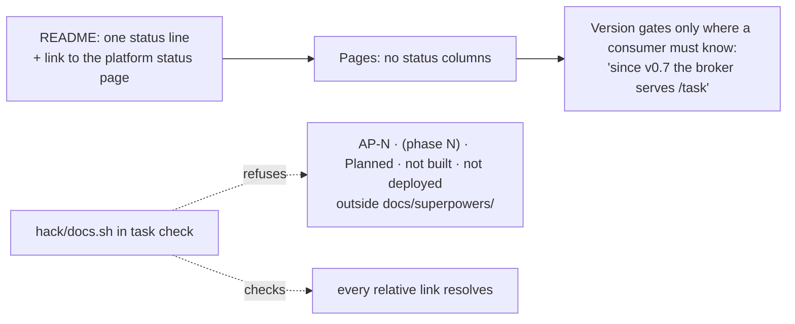

# Docs and positioning refresh: design

**Status:** design, approved by the owner on 2026-10-15; the brainstorming answers it rests on are
in the [project review](2026-10-15-project-review.md#what-the-owner-decided).
**Scope:** `README.md`, `docs/`, `CONTRIBUTING.md`, `AGENTS.md`, the factory chart's README. No
code changes beyond one docs lint. **Plan:** [2026-10-15-docs-positioning-plan.md](../plans/2026-10-15-docs-positioning-plan.md).

## Conclusion

The docs describe a phase-1, two-binary, undeployed room log. The code at v0.11.0 is a two-product
system in daily use: an agent factory that turns a labelled issue into a reviewed pull request, and
collaboration rooms that record, steer and approve its runs, from a web UI or `roomctl`. No page says
what the project does or for whom. The fix is structural, not a round of edits: state status **once**,
give the factory, `roomctl` and the web UI their own pages, and make a lint refuse the per-row status
tags that let every merged phase leave dozens of rows false.

| Signal today | Value |
|---|---|
| Pages whose opening paragraph is false | 8 of 11 under `docs/`, plus `README.md` |
| `AP-1` stamps across README and docs | 104 |
| Distinct ruling ids (`P18`, `OD-16`, `GP-18`, `ruling SAK`…), none resolvable in-repo | 88 |
| Binaries in `cmd/` versus "Two binaries" (`docs/architecture.md:3`) | 4 |
| Factory packages versus factory doc pages | 16 versus 0 |
| Release tags versus "No `v*` tag exists yet" (`docs/security.md:204`) | `v0.6.0` to `v0.11.0` |

## Who reads these docs

| Persona | Comes to find | Served today |
|---|---|---|
| A stranger (recruiter, contributor, the blog's reader) | What this is, for whom, why | No: the best sentence ships inside `roomctl` as an Agent Skill |
| The maintainer who labels an issue and gets a factory PR | What each label and issue comment means, why a task waits, how to approve | Fragments on three rooms pages |
| The developer who installs `roomctl` and the skill | Install, verify, configure, the commands, what the skill never does | A command block in README; troubleshooting inside the skill |
| The operator who deploys the chart | Values, secrets, prerequisites, metrics, alerts | `values.yaml` comments |
| The contributor or coding agent | Conventions, package map, the gate | Yes (`AGENTS.md`), except its pointer to a README that omits half the system |

## Decisions

Each rejects a named alternative. What remains the owner's is under "Open to the owner".

| # | Decision | Rejected | Why |
|---|---|---|---|
| D1 | **Status lives in one place.** README carries one status line and links the platform's status page; every per-row status, phase and PR column is deleted. A reader who must know when a thing arrived gets a version gate (`since v0.7`), as `docs/api.md:254` already does | Updating ~150 status cells now | Per-row status is why the docs drifted: every merge left rows false and nobody owns a cell. A version gate ages well; "planned" never does |
| D2 | **Three new reader pages:** `docs/factory.md` (the maintainer's view of the factory), `docs/roomctl.md` (the developer's CLI and skill), `docs/web-ui.md` (the room list and room page as a product). A short `charts/agent-factory/README.md` for the operator | Appending factory sections to rooms pages (today's `operations.md:179-232`) | The factory is half the repo and the daily entry point; a page per persona is what each persona searches for |
| D3 | **Ruling ids leave reader pages.** The *why* stays next to the code, as `AGENTS.md` already requires; `docs/README.md` keeps one "Design sources" line to the specs | Keeping the 88 ids as provenance in prose | A reader without the cloud-native-ref plan open cannot resolve `ruling SAK`; the ids are the author's trail, not the reader's |
| D4 | **The roadmap becomes one screen:** what shipped (the releases), what is open, where live state lives (the platform's status page). The phase tables and the merge-wave narrative go | Rewriting the phase tables to "merged" | A roadmap of done phases is a changelog; git and the releases page already hold it |
| D5 | **README leads with the problem and the user**, in plain words; its diagram shows all four binaries, the UI and the harness; programme codes (`SP2`, `SP3`) appear once, in a one-row glossary | Keeping the "collaboration rooms (SP2) of the Agent Factory built on cloud-native-ref" lead | Code names tell a stranger nothing; the factory is drawn today as a foreign "system caller" |
| D6 | **One glossary for both products** on `concepts.md`, without a status column; the Room CRD reference moves to the page's end and the Task CRD reference lands on `factory.md` | A second glossary page for the factory | The terms are used together (a task has a room; a room's summary shows the task's phase) |
| D7 | **A docs lint in `task check`:** relative links must resolve; the status vocabulary (`AP-\d`, `(phase \d`, `Planned`, `not built`, `not deployed`) is refused outside `docs/superpowers/` | Trusting review to catch drift | Review did not catch 104 stamps. The lint makes D1 hold |
| D8 | **`operations.md` stays the one runbook page**, reorganised into a rooms half and a factory half, with a full `agent_factory_*` metric and alert table | A separate factory ops page | An operator on call wants one page; the model lives on `factory.md`, the signals here |

## Target structure

| Page | Action | Purpose (one line) | Persona |
|---|---|---|---|
| `README.md` | Rewrite the lead, status, diagram and port table; keep binaries, releases, verify, develop | What it is and for whom; where each persona goes next | Everyone |
| `docs/README.md` | Rewrite | Page index, four reading paths, one design-sources line; no status legend | Everyone |
| `docs/concepts.md` | Rewrite | One glossary for rooms and factory; room phases diagram; Room CRD reference at the end | New reader |
| `docs/architecture.md` | Rewrite | Four binaries in one diagram; trust boundaries; **one task's life** (issue → Task → room → runs → PR → merge) replaces "one run's life" | New reader, operator |
| `docs/factory.md` | **New** | Triggers and labels, the Task lifecycle diagram, triage (tiers, templates, budgets), narration, the merge gate, escalation and stale, kill switch, `/factory retry`; then a reference: Task CRD fields, config keys, `POST /v1/runs`, `POST /intake/runlore` | Maintainer, operator |
| `docs/roomctl.md` | **New** | Install and verify, `configure`, `login`, `doctor`, every command, `skill install`, the never-steers rule, troubleshooting (lifted from the skill) | Developer |
| `docs/web-ui.md` | **New** | Room list and needs-you; the room page; controls, approvals, fork, invite and close, new room, CLI setup | Human user |
| `docs/api.md` | Keep; delete the Phase/PR columns; open with the listeners table | Broker API reference | Developer |
| `docs/event-envelope.md` | Keep; delete the four Status columns | C4 reference | Developer |
| `docs/room-log.md` | Keep; cut the history paragraph (`:77-83`), fix the migration table (8 files, not 6), drop "edit in place" | Schema, guarantees, migrations | Developer, operator |
| `docs/security.md` | Keep; fix the stale lines; add factory threat rows (untrusted issue text, trailer forgery versus push identity, the merger key) | Threat model for both products | Operator, reviewer |
| `docs/integration.md` | Rewrite the top; keep the contracts | What this repo ships (4 images, chart, `roomctl`, 2 CRDs, migrations); what each consumer pins | Operator |
| `docs/operations.md` | Reorganise (D8) | Runbooks, rooms then factory | Operator |
| `docs/development.md` | Keep | Store harness, migrations, web build | Contributor |
| `docs/roadmap.md` | Rewrite to one screen (D4) | Shipped, open, where live state lives | Everyone |
| `CONTRIBUTING.md` | Fix the gate (10 steps, not 5) and the releases table (every artefact) | Workflow | Contributor |
| `AGENTS.md` | Delete the "Added with first use" table; fix the package-map legend and the README pointer | Standard for agents and contributors | Agent |
| `charts/agent-factory/README.md` | **New**, short | Values, the five secrets, prerequisites; the `values.yaml` comments move here | Operator |

### Reading paths (`docs/README.md`)

| You are | Read |
|---|---|
| New here | README → Concepts → Architecture |
| A maintainer with a factory issue or PR | Factory → Web UI → Concepts |
| A developer who wants the CLI | roomctl → Web UI |
| Operating a cluster | Architecture → Integration → chart README → Operations → Security |
| Changing the code | `AGENTS.md` → Development → Event envelope → Room log → API |

## The README lead

> **agent-platform** runs coding agents under human oversight and keeps the record. Label a GitHub
> issue `factory/ready` and **agent-factory** triages it, starts sandboxed agent runs, opens the pull
> request, narrates each step on the issue and stops at its budget. Every run streams into a
> **collaboration room**: an append-only, redacted Postgres log that outlives the pod, which you
> watch, steer, approve and fork from the web UI or from `roomctl` in a terminal. Four binaries in
> one repo (`room-broker`, `room-bridge`, `agent-factory`, `roomctl`) plus the `agent-harness` image,
> released together and pinned by digest. Built for one maintainer's Kubernetes platform
> ([cloud-native-ref](https://github.com/Smana/cloud-native-ref)); the core carries no platform
> constants.

Then, before anything else, three lines of *why*, each linking the page that owns the argument:

| Why | One line | Owner page |
|---|---|---|
| A factory | Work you do not want to babysit, sandboxed, reviewed and budgeted, under its own identity | the platform's agents overview |
| A room | The transcript, handoffs and decisions outlive the sandbox and cannot be rewritten, by anyone | `docs/room-log.md` |
| Humans in the loop | Approvals, steering and the merge gate sit outside the sandbox; the agent is not a trusted component | `docs/security.md` |

## The status model (D1, D7)

The lint is one shell script, `hack/docs.sh`, with two checks and a `docs` step in `taskfile.yaml`
and `task check`. It reads `README.md`, `CONTRIBUTING.md`, `AGENTS.md`, `docs/**/*.md` outside
`docs/superpowers/`, `charts/**/README.md` and `images/**/README.md`. It never touches the specs and
plans, which legitimately speak of phases.

## Writing rules applied in the rewrite

From the review; each names where the pattern lives today.

| Rule | Replaces |
|---|---|
| Lead with the conclusion | `README.md:3-8` (code names first), `docs/api.md:3-5` (phase history first), `docs/room-log.md:77-83` (a changelog before the guarantees table) |
| Say a thing once, on the page that owns it | TLS on `:8443` said on five pages; the bridge lease on four; D7 on four; the branch-404 warning verbatim twice |
| Tables over paragraphs, and short cells | `docs/integration.md:162` (one 230-word cell), `docs/api.md:477`, `docs/security.md:27` |
| Plain words before code names | `SP2`, `SP3`, `App Wizard`, `AHP` undefined at first use |
| Delete dead qualifiers | "from phase 1", "the two replicas of phase 2", "until SP3 ships" |

## Out of scope

- The platform's public docs site (cloud-native-ref `website/`): it already positions the factory
  well; README links it rather than repeating it.
- Translating or restructuring `AGENTS.md`'s conventions: only its stale rows change.
- Code comments: rulings stay there.

## Verification

| Check | Proves |
|---|---|
| `task docs` exits 0 | No status vocabulary outside `docs/superpowers/`; every relative link resolves |
| `task check` exits 0 | The lint sits in the gate |
| `grep -rc 'AP-1' README.md docs --exclude-dir=superpowers` prints 0 everywhere | D1 held |
| A reader test: hand `README.md` alone to someone who has never seen the repo and ask "what does it do, for whom?" | The lead works |

## Open to the owner

| Question | Default taken here |
|---|---|
| Keep `docs/roadmap.md` at all, or point to the platform status page only? | Keep, one screen |
| Does the factory's reference (Task CRD, config, API) belong on `factory.md` or on a separate `factory-reference.md`? | On `factory.md`, under a `## Reference` heading, until it outgrows the page |
| Should the public docs site's "two minutes" glossary be copied into `concepts.md` or linked? | Linked for the ideas, copied only for the terms this repo defines |
