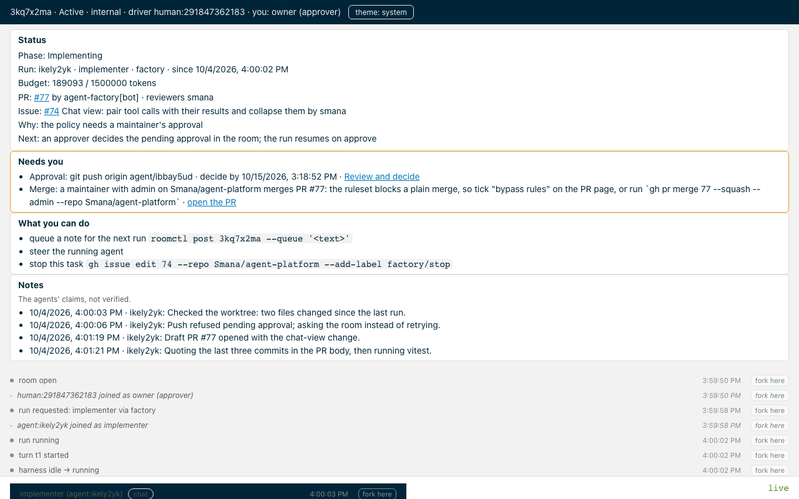

# agent-platform: project review, 2026-10-15

Repo at `b70a0e4` (v0.11.0, `main`, clean). Reviewed: code quality against `AGENTS.md`, positioning
and docs, the web UI and `roomctl` as a user experiences them. The findings feed three specs, each
with a plan.

## Verdict

**The code is in better shape than the docs, and the docs are in better shape than the room page.**
The Go is unusually disciplined: the invariants that matter (gapless append-only log, first decision
wins, fenced driver token, lease fencing) live in PostgreSQL triggers, grants and RLS and are proven
against the real server; the factory's state machine is replay-safe by construction; every forbidden
pattern grep comes back empty. No high-severity bug was found. The docs describe a phase-1,
two-binary, undeployed system while the repo ships four binaries, a web UI, a CLI and a chart in
daily use: eight of eleven pages open with a false sentence, and nothing says what the project does
or for whom. The room page holds every fact a maintainer needs, in the right order, but does not
read in five seconds: one CSS bug makes every message head a sticky navy bar, the lead is eight
key-value lines, the thing to approve is line 3 of a JSON blob, and a closed room still offers
`send`, `give` and `interrupt`.

| Dimension | Verdict | Spec |
|---|---|---|
| Code quality (broker, bridge, factory, roomctl, harness) | Strong. 54 findings, none high; 16 medium edges, the rest convention drift and dead code | [code health](2026-10-15-code-health-design.md) |
| Positioning and docs | Inverted and stale. The factory is the product; the docs call it a foreign "system caller" | [docs and positioning](2026-10-15-docs-positioning-design.md) |
| Room readability, web UI, CLI | Right facts, wrong hierarchy; one layout bug; AA contrast fails on 13 token pairs | [room readability](2026-10-15-room-readability-design.md) |

## What the owner decided

The brainstorming that followed the review, 2026-10-15, fixed four directions the specs build on.

| Question | Answer |
|---|---|
| How is a room page used when it works? | A 30-second check-in: open from the factory's comment or "anything waiting on me?", decide or steer, leave. The page is restructured in place; a two-pane layout waits for usage data |
| How do the docs frame the project? | The factory first; rooms are where every run is recorded, steered and approved |
| How much of the code review becomes work? | All of it: edges, seams, structure, tests, hygiene, one pull request per theme |
| Does a docs lint join `task check`? | Yes, status vocabulary and dead links (left to the reviewer's judgment) |

## Evidence

| Check | Result |
|---|---|
| `go build ./... && go vet ./...` | clean |
| `go test -race -count=1` on every package | all `ok`; `internal/store` 207 s (one Postgres container per test, finding B29), `internal/factory/reconciler` 93 s, `internal/bridge` 33 s |
| `cd web && npm run typecheck && npm test` | typecheck clean; vitest 14 files, 180 tests, all pass |
| Screenshots of the room page and room list, rendered offline through the real `chat.ts`, `summary.ts`, `controls.ts` with the recorded 27-event fixture | four kept under [`assets/2026-10-15-review/`](assets/2026-10-15-review/) |
| Not run | `task check` as a whole, `golangci-lint`, the harness image build, anything live |

Findings marked **✓** were verified by hand against the cited lines; the others were read by a
reviewer agent that cites lines it read. Severity: **M** medium, **L** low. No high.

## Positioning and docs

| # | Finding | Evidence |
|---|---|---|
| D1 ✓ | README says phase 1, nothing deployed, phases 2 to 6 planned; the same page ships `agent-factory`, `agent-harness`, `roomctl fork` | `README.md:10-12` versus `:52-71` |
| D2 ✓ | No page states the problem or the user; the best sentence ("work you do not want to babysit… sandboxed, reviewed and budgeted") ships inside the `roomctl` binary | `internal/roomctl/skill/factory-handoff/SKILL.md:13-14` |
| D3 ✓ | The factory has no page: 17-phase `Task` lifecycle, CRD, 20 config keys, six labels, merge gate, kill switch, narration, 26 metrics | `internal/factory/*` (16 packages) versus `docs/` (0 pages); fragments at `docs/operations.md:179-232` |
| D4 ✓ | The roadmap is dated 2026-09-30 and places `POST /v1/runs`, narration and budgets outside this repo | `docs/roadmap.md:3-8, 109-111` versus `internal/factory/api/server.go:128` |
| D5 | "Two binaries", "ships two images", "No `v*` tag exists yet" | `docs/architecture.md:3`, `docs/integration.md:3`, `docs/security.md:204` versus `cmd/` (4), `ci.yaml:65`, `git tag` |
| D6 | Status is stamped on ~150 table rows across nine pages (104 × `AP-1`), so every merged phase left dozens of rows false: the structural cause | `docs/concepts.md:9-38`, `docs/event-envelope.md` (four status columns), `docs/api.md` (five) |
| D7 | 88 distinct ruling ids (`P18`, `OD-16`, `ruling SAK`…), none resolvable in-repo | throughout |
| D8 | `CONTRIBUTING.md` says the gate has 5 steps and releases ship two images; it has 10 and ships four, a chart, `roomctl` and a CRD | `CONTRIBUTING.md:24-26, 67-78` versus `taskfile.yaml`, `release.yaml` |
| D9 | `roomctl`, the skill and the web UI have no page; the operator has `values.yaml` comments | `README.md:62-71`, `charts/agent-factory/values.yaml:9-39` |

## Room readability and UI

| # | Finding | Evidence |
|---|---|---|
| U1 ✓ | The bare `header` selector is sticky, navy and full width; `chat.ts` and `render.ts` create `<header class="msg-head">` and `<header class="ev-head">`, so every message head is a sticky navy bar with `#575757` text (2.2:1) that stacks under the page header and covers the footer notice | `web/src/app.css:111-116`, `web/src/chat.ts:39`, `web/src/render.ts:130`; [screenshot](assets/2026-10-15-review/room-scrolled-sticky-heads.png) |
| U2 ✓ | No task identity: the header is `3kq7x2ma · Active · internal · driver human:291847362183 · you: owner (approver)`; no `<h1>`; `document.title` is always "Rooms"; `Active` (room phase) sits 40 px above `Phase: Implementing` (task phase) | `web/src/room.ts:64`, `web/src/index.html` |
| U3 ✓ | Above the fold at 1280×800: the four lead cards (548 px) and seven grey markers; not one message, not the composer, not the approval card. "Now" (the running `git log`) is at y≈1400; the decide buttons at y≈2050 | screenshot above |
| U4 ✓ | A closed room shows "Nothing here beyond reading" and stale `Why`/`Next`, while `send`, `give`, `interrupt` and `hand to role` stay live | `internal/summary/summary.go:234` before the sealed return at `:242`; `web/src/controls.ts:271-273` hide only for watchers |
| U5 ✓ | The approval card leads with raw JSON; the command to approve is its third line although `describe()` already extracts it; `approve` and `deny` carry the same weight; no link to the call | `web/src/controls.ts:102-113`, `internal/summary/summary.go:210` |
| U6 ✓ | The room list is a wall of 130-character links: "2 need you" mid-line at the weight of "142 events"; no repository, no filters although the API and the CLI have them; the creation form comes first | `web/src/view.ts:44-78`; [screenshot](assets/2026-10-15-review/room-list.png) |
| U7 | Noise: 20 `fork here` buttons (on markers too), a `chat` chip on every agent message, `policy: allow` on every allowed call, 10 of 20 rows are plumbing | `web/src/chat.ts:295-306`, `web/src/render.ts:112` |
| U8 | Controls: ~15 inputs with placeholder-only labels in one undivided grid; `interrupt` beside `give` with no confirm; `close` confirms by a label swap with no cancel; `steer now` promotes a note into the running agent with one click | `web/src/controls.ts:183-245`; [screenshot](assets/2026-10-15-review/room-controls.png) |
| U9 | Contrast: 13 token pairs fail WCAG AA (11 px placeholder-grey meta text, `chip-ok`, `chip-running` at its pulse trough, the footer `live`, list links on the page grey) | `web/src/app.css` tokens; the table in the readability spec |
| U10 | The footer's most visible live status is a protocol self-check (`seq 27 · gaps 0 · dups 0`); the empty room offers "steer the running agent" with no run; loading is a blank navy bar | `web/src/room.ts:170`, `internal/summary/summary.go:270` |
| U11 | `roomctl status` tells the same story in the same order (good) but prints `budget: 189093/1500000` and leads with `phase:` rather than the task; `--needs-me` help names approvals only while the broker counts holds and merges | `internal/roomctl/status.go`, `internal/app/roomctl.go:148` |

## Code quality

### Broker side and roomctl

| # | S | File:line | Finding |
|---|---|---|---|
| B1 | M | `internal/policy/policy.go:96-108` | `Allowed` for a system actor falls to `default: return true`: unlisted actions are granted by omission (no wired caller reaches it today) |
| B2 ✓ | M | `internal/summary/summary.go:280`, `waiting.go:58` | The pure `summary` package logs through the global `slog.Warn`, bypassing the injected logger; the `slog.Default` grep misses this spelling |
| B3 | M | `internal/fanout/hub.go:145` | `make(chan envelope.Event, 4096)` per subscriber eagerly allocates ~0.9 MB; 200 viewers ≈ 180 MB; the documented 2 MiB `Budget` is not the binding cap |
| B4 | M | `internal/bridgeapi/server.go:95-131` | No required-dependency check: a nil `Watch` panics per request, where `humanapi.Server.Serve` refuses to start |
| B5 | M | `internal/humanapi/ws.go:190`, `server.go:217`, `acts.go:464` | No injectable clock, so the lifetime-cap and D7 recheck tests run on real timers under `-race` |
| B6 | M | `internal/app/approvals.go:99-110`, `internal/bridgeapi/approvals.go:57-62` | `RoomPolicy func(roomID)` drops the request context; the request path reaches for `context.Background()` |
| B7 | M | `internal/bridgeapi/approvals.go:112,114` | `time.Now()` despite `Server.Now`; `OriginSeq: UnixNano()` means a retried approval never replays its key |
| B8 | M | `internal/runwatch/watcher.go:119-122`, `bridgeapi/server.go:297-300` | `Live` conflates unknown with dead, so `hello` on a not-yet-synced replica can take a lease from a live holder |
| B9 | M | `internal/store/retention.go:60-61` | A 100k-event room is purged in one `DELETE` under the 15 s `statement_timeout`; a timeout leaves it never purged |
| B10 | M | `internal/bridgeapi/server_test.go:1058`, `fanout/hub_test.go:455,500` | Real sleeps stand in for synchronisation in five tests |
| B11 | L | `internal/store/bridges.go:48,80,89` | `bridge_seen_at` is written on every claim and read nowhere; `TouchBridge` exists to update it |
| B12 | L | `internal/metrics/metrics.go:95-96` | `rooms_participants` is registered and never incremented |
| B13 | L | `internal/store/testdb_test.go:22-31` | One Postgres container per test, 85 call sites: the store suite takes 207 s |
| B14 | L | `internal/humanapi/acts.go` (758 lines), `internal/bridgeapi/server.go` (612) | Dispatch, `start_run` and `fork` in one file; routes, limiter, events push and SSE stream in another |
| B15 | L | `internal/fanout/hub.go:309-326`, `internal/github/app.go:283-337` | `fetch` offers a 500-event page to every subscriber under `h.mu`; `installation` holds `a.mu` across three GitHub round trips |
| B16 | L | `internal/store/fork.go:86-104` | A fork copies queued messages as events but not their `queue` rows: the page shows them queued, the brief never sees them |
| B17 | L | `internal/summary/summary_test.go:20-43` | Five JSON goldens with no update flag, for values that could be asserted |

### Bridge, factory and harness

| # | S | File:line | Finding |
|---|---|---|---|
| F1 ✓ | M | `internal/factory/meter/meter.go:126-134`, `vm.go:104-119` | `cost()` derives fresh input as `Input − CacheRead − CacheWrite` while `RunUsage` adds only the `input` series to `Input`; the gateway's contract (does `input` include cache tokens?) is pinned by no test, and `docs/operations.md:197` asserts it in prose only |
| F2 ✓ | M | `internal/factory/meter/meter.go:397-399` | `Tick` returns on a failed ledger `settle` before any revocation is written: the always-enforced per-run cap stops firing while the ledger ConfigMap is unwritable |
| F3 | M | `internal/bridge/bridge.go:589-592, 602-604` | Once `MaxBuffer` is reached during a broker outage the confirmation loop never runs, so even Allow-class actions wait, contradicting "a broker outage never stops the sandbox" |
| F4 | M | `internal/factory/triage/c7.go:61-64,74`, `internal/app/factory.go:163` | The C7 classifier is wired without `HC`, so it uses a hand-rolled `&http.Client{}` past `internal/httpx`, with an unbounded body read |
| F5 | M | `internal/factory/rooms/client.go:189-206` | `EventsSince` can hold 10,000 × 80 KiB (~800 MiB) inside a 512 Mi pod; `roomTail` calls it up to ten times |
| F6 | M | `internal/factory/killswitch/killswitch.go:28-32` | Package-level `atomic.Bool`, set on the leader only: `Engaged` answers differently on followers; redundant with the published stop ConfigMap |
| F7 ✓ | M | `internal/factory/reconciler/merge.go:35,543`, `arm.go:90,100` | Logins compared with `==` while `IsMaintainer` uses `EqualFold`; a case mismatch on `mergerLogin` records the factory's own merge as `human_merged` and skips `Verifying`, so the revert watch never runs |
| F8 | M | `internal/bridge/classify.go:80-97` | The read-only MCP allowlist hard-codes platform gateway backends past `internal/bridge`'s declared seam |
| F9 ✓ | M | `charts/agent-factory/templates/rbac.yaml:19-29`, `tests/render.sh:50` | The unbounded `configmaps` rule subsumes the "name-bounded" stop-object rule the test asserts; the factory can rewrite any ConfigMap in its namespace, its own config included |
| F10 | M | `internal/bridge/classify.go` (1202 lines), `bridge.go` (992) | Tables, a shell lexer, the classifier and the policy matrix in one file; the loop file also carries batch encoding, backoff, the final read and the SSE consumer |
| F11 | L | `internal/bridge/classify.go:334,344` | A heredoc written to a file then executed hides a `git push` from the classifier; the battery test enshrines it as a residual |
| F12 | L | `internal/factory/intake/runlore.go:159` | A failure log prints `AlertName` and `ResourceRef` raw, fields the same file calls attacker-influenced |
| F13 | L | `internal/factory/forge/github.go:616-622` | GitHub 409/405 detected by `strings.Contains(err.Error(), "409")` on an error whose text embeds the response body |
| F14 | L | `images/agent-harness/**/__pycache__/*.pyc` (5 tracked) | Compiled Python caches are tracked; `.gitignore` lists only `web/` |
| F15 | L | `internal/app/factory.go:108`, `internal/factory/rooms/client.go:346-362` | The rooms client's spans are built on a nil `TracerProvider`: dead in production |
| F16 | L | `internal/factory/api/server.go:133-147`, `charts/agent-factory/templates/deployment.yaml:42` | The run-request API serves plaintext on a port named `8443`, which the rest of the repo reads as TLS |
| F17 | L | `internal/factory/forge/fake.go` (521 lines, non-test) | A producer-side `Fake` with GitHub's whole method set compiled into the binary; `watch_test.go:884` asserts its call order |
| F18 | L | `internal/factory/reconciler/watch.go:276-277` | A `/factory retry` comment within clock skew of the escalation is ignored forever |

### Strengths worth keeping

- Invariants in the schema, proven: `TestBrokerRoleIsAppendOnly` forges 60 rewrites against the real server.
- Fail-closed by reflex: unreadable actions denied, a classifier panic is `forge.other`, a missing merger is `forge.Absent`, every "no" in the merge gate fails towards a human.
- Replay safety as a design axis: deterministic run ids, outbox-then-post narration, idempotent reservations, two replicas making one claim.
- One status-mapping function per API; logs carry ids and SQLSTATEs, never payloads; redaction is unavoidable on every write path.
- The tool row in the chat view, the `Why`/`Next` prose, the "Needs you" link to the card, and the token discipline (one token set, reduced motion, focus rings, every input labelled, untrusted text as `textContent`).
- 43k lines of table-driven stdlib tests, behaviour-named, with hand-written fakes at every boundary.

## Not reviewed

The platform repos (cloud-native-ref, crossplane-configuration), the live clusters, the OpenHands harness itself, and the model gateway. The bridge's back-pressure behaviour (F3) and the gateway's token-series semantics (F1) need the owner's knowledge of the deployment to close.
