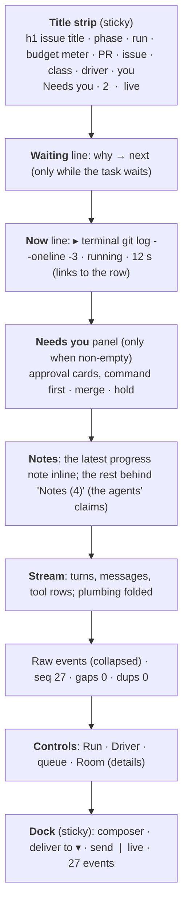

# Room readability: design

**Status:** design, approved by the owner on 2026-10-15; the brainstorming answers it rests on are
in the [project review](2026-10-15-project-review.md#what-the-owner-decided).
**Scope:** the room page and room list in `web/`, two behavioural fixes in `internal/summary`, one
field on `GET /api/rooms`, and `roomctl status` and `rooms` output. **Plan:**
[2026-10-15-room-readability-plan.md](../plans/2026-10-15-room-readability-plan.md).

## Conclusion

The room page holds every fact a maintainer needs, in the order the 2026-10-08 UX design asked for,
and still fails the five-second test. The page is restructured **in place**, keeping the owner's
decisions (vanilla TypeScript, no framework, strict CSP, a deterministic summary, approvals only in
the web UI): a title strip replaces the four lead cards, the needs-you panel holds the approval
cards and leads with the command, the composer docks at the bottom, the stream folds its plumbing,
the controls get names and groups, the room list becomes a table, and one CSS selector stops turning
every message head into a sticky navy bar. A two-pane layout is the named next milestone, decided
on phase-7 usage, not now.

## The five-second test

A maintainer opens a room from the factory's "started" comment or from "anything waiting on me?".
Five questions, answered without scrolling, at 1280×800 and on a phone:

| Question | Today | After |
|---|---|---|
| What is this task? | Line 6 of the Status card: `Issue: #74 Chat view…`, same weight as `Budget:`; the tab says "Rooms" | The `<h1>` and the tab title |
| What is the agent doing now? | Nowhere in the lead; the newest row is two screens down | One "Now" line under the title, linking to the row |
| Does anything need me? | A card among four equal cards; decide buttons 1.5 screens lower | A `Needs you · 2` pill in the strip; the cards, command first, directly under it |
| What can I do? | Three CLI strings in a web page; the composer is the last thing on the page | The docked composer; grouped, named controls |
| Is it live? | `seq 27 · gaps 0 · dups 0` in mono | `live · 27 events` in the dock; a banner when reconnecting |

## Decisions

Each rejects a named alternative. What remains the owner's is under "Open to the owner".

| # | Decision | Rejected | Why |
|---|---|---|---|
| D1 | **Vanilla TypeScript, no framework, strict CSP, unchanged** | Preact or Lit | The owner's client decision (OD-15, ADR-0049) and 2,200 lines of tested UI; every fix here is structure and CSS, not state management |
| D2 | **A title strip replaces the four lead cards**: `<h1>` = the issue title, `document.title` set, chips for phase, run, budget, PR, issue, class, driver and role, one "Now" line, one "Waiting" line (why → next), a `Needs you · N` pill | Keep the cards, reorder them | 548 px of cards pushes every message off the first screen; the same facts fit in 120 px |
| D3 | **Approval cards live in the needs-you panel**, in the lead, and lead with the command `describe()` already extracts; the JSON sits behind a toggle; Approve is primary, Deny secondary; a link reaches the tool-call row | Cards stay in the controls with a link from the lead | The need and the decision were 1,500 px apart; the one-decide-path rule holds, the path just moves to where the need is read |
| D4 | **The composer docks in a sticky bottom bar** with the connection status; `gaps`/`dups` move into the Raw events summary line | The composer at the end of the page | Talking to the room is the most frequent act and was the least reachable; the protocol self-check is not a maintainer's status |
| D5 | **Stream noise rules** (table below): markers fold per turn, `policy: allow` hides, the `chat` chip goes, `fork here` appears on hover on messages and handoffs only, via a toolbar beside the row rather than a button inside `
` | Filter toggles the reader must set | The owner's own words on 2026-10-07: "too much noise". Rules need no setting |
| D6 | **Controls regroup under names**: Run, Driver, Room (behind `
`), the queue; destructive acts (interrupt, take, close, steer now) get a distinct style and an inline confirm with a cancel; a sealed room hides Run, Driver and the composer | One grid of placeholder-labelled fields | A first-time maintainer cannot tell `give` from `interrupt`; a stale confirm label seals a room on a stray click |
| D7 | **The room list is a table** sorted needs-you first, then last activity; repository shown; filters mine, needs me, repo; "New room" behind a button; `GET /api/rooms` gains `lastEventAt` | One-line links | The CLI's `roomctl rooms` table already reads better than the page; the API has the filters; the store has `last_event_at` |
| D8 | **AA contrast everywhere, 12 px minimum**, enforced by a vitest that computes ratios from `app.css`'s tokens | Eyeballing | 13 pairs fail today; the tokens are shared with the app-wizard, so the fix is values, not a palette |
| D9 | **Two summary fixes, same `summary/v1`**: a sealed room carries no `reason`/`next`; `steer` is offered only when a run exists | A `summary/v2` | Both are corrections of the fold's own rule ("read-only: no needs, no actions"); no field changes shape |
| D10 | **A supported offline full-page preview** (`npm run preview`) renders the whole page from fixtures, both themes, three widths | Playwright in CI | The review's harness found every layout bug in an hour; CI screenshots would cost more than they catch at this size |

## The page after

| Region | Content | Source | Behaviour |
|---|---|---|---|
| Title strip | `<h1>`: `status.issue.title`, else `Room <id>`. `document.title`: `#74 Chat view… · Implementing`. Chips: task phase (room phase when no facts, with the other as `title`), run (`implementer · ikely2yk · 4 min`), budget meter (`189 k / 1.5 M · 13 %` and a bar), PR and issue links, data class, driver (`you` or the principal, shortened with the full id as `title`), your role and approver flag | summary/v1 `status`, the state frame's `you` and `driver` | Sticky at the top; wraps to two lines at 390 px; the theme button moves to the dock |
| Needs-you pill | `Needs you · N`, amber, N = pending approvals the viewer may decide + merge + hold | `RoomState.approvals()` (live) and summary `needsYou` | Click scrolls to the panel; absent when N is 0 |
| Waiting line | `Waiting: <reason> → <next>` | summary `status.reason`, `status.next` | Absent while the task works and when sealed (D9) |
| Now line | The newest `tool_call` without a result (`running`), else the newest message or result, with its chip and a relative time refreshed every second; `No run` with a hint to Run when nothing runs | the stream, tracked in `RoomState` | Click scrolls to the row and opens it |
| Needs-you panel | One card per pending approval: command (mono, the card's first line), then `class · run · expires HH:MM`, "see the call #13", the JSON behind `
`, a labelled reason field, Approve (primary), Deny (secondary). Merge: `what` and the PR link. Hold: `what` | `RoomState.approvals()` for cards; summary for merge and hold | Card id stays `approval-<id>` so `#<id>` deep links and `focusApproval()` keep working. Rendered for approvers and owners; a watcher sees the panel read-only |
| Notes | The latest progress note on one line, `ikely2yk · 2 min ago · Quoting the last three commits…`, labelled as the agent's claim; the full list behind a `Notes (4)` toggle. The "What you can do" CLI list goes: the controls are the actions; the `stop` instruction (label the issue `factory/stop`) moves into the Room group with the issue link | summary `notes`, `actions` | Absent when there are no notes |
| Stream | The chat view with the noise rules below | the socket | Unchanged mechanics: `ChatView.put`, 5,000-row cap |
| Raw events | As today, plus `seq · gaps · dups` on the summary line | the socket | Collapsed |
| Controls | Run (Start a run as: role, PR URL only for reviewer, egress under "advanced"), Driver (holder, request or give, take with reason, interrupt styled destructive with an inline confirm), the queue (`steer now` styled destructive with a confirm), Room (`
`: members list from the log's `participant` events, invite, close with an inline confirm and a cancel) | the state frame and the stream | Owner-only groups hide for others; a sealed room hides Run, Driver and the composer and shows `Closed <when> by <who>` in the strip |
| Dock | Textarea, a labelled `Deliver to` select with the three options and the notice beside it, Send, the theme button; right: `live · 27 events` or `reconnecting in 4 s` | the socket | Send disabled while not live or sealed; a banner under the strip while reconnecting |

### Stream noise rules

| Event | Today | After |
|---|---|---|
| `message` | Bubble with a `chat` chip on every agent message | Bubble; a chip only for `queued` and `steering` |
| `tool_call` + `tool_result` | One row; `policy: allow` on every allowed call | One row; the policy chip only when the decision is not `allow` or `decidedBy` is set |
| `state_changed`, `turn` | One grey line each (10 of 20 rows in the fixture) | Consecutive markers and syslines fold into one line, `· turn t1 · 3 changes`, open on click; `harness_error` and `limit` always stand alone, in the destructive colour |
| `participant`, `driver` | One italic line each | Folded with adjacent markers; a driver change to or from `you` stands alone |
| `handoff` | Line plus markdown | Unchanged |
| `fork here` | A button in every row's `
` or `<header>`, 20 per screen | A toolbar beside message bubbles and handoffs only, visible on hover and focus, with the seq in its accessible name |
| Actor | `implementer (agent:ikely2yk)`, `human:291847362183` | `implementer · ikely2yk`, `you`, or the shortened principal with the full id as `title`; a colour swatch per actor from a fixed palette keyed on the id |
| Time | `toLocaleTimeString()` text | `<time datetime>` with the same text |

### The room list after

| Column | Content | Order |
|---|---|---|
| Needs you | An amber pill with the count, empty otherwise | Rows with a count first |
| Task | `#74 Chat view: pair tool calls…` linking to the room; `Room 3kq7x2ma` when the room has no task | |
| Repository | `owner/name` | |
| Phase | The task phase, else the room phase | |
| PR | `#77` | |
| Last activity | Relative, from `lastEventAt`, with the absolute time as `title` | Then newest first |
| Room | The id, mono | |

Above the table: three filter toggles (`mine`, `needs me`, a repo select from the rows' repositories)
that call `GET /api/rooms` with its existing query parameters; a `New room` button that reveals
today's form; `CLI setup` stays a `
` below the table.

### States

| State | After |
|---|---|
| Loading | The strip reads `Room <id> · connecting…`; the dock reads `connecting…` |
| Empty room | `No run yet`; owners and drivers see `Start one under Run`; no `steer` action (D9) |
| Sealed | The strip reads `Closed <when> by <who>`; no Waiting line; Run, Driver and the composer hidden; the stream and fork remain |
| Reconnecting | A banner under the strip: `Reconnecting in 4 s: connection lost`; Send disabled |
| No such room | `Checking the room…` during the three tries, then today's message |
| Rooms unavailable | `The room list is unavailable (503). Retry.` |

### Contrast and accessibility rules

- Every text pair in both themes meets WCAG AA (4.5:1); UI borders that carry meaning meet 3:1.
- No text below 12 px.
- One `<h1>` per page; `document.title` carries the task.
- No interactive element inside `
`; every button's accessible name is unique (`fork here at #13`).
- The delivery notice is associated to the select with `aria-describedby`; the close confirm is announced.
- `<time>` carries `datetime`.

### `roomctl` alignment

| Output | Today | After |
|---|---|---|
| `status` first line | `phase: Implementing  run: …  budget: 189093/1500000` | `task: #74 "Chat view: pair tool calls…"` when known, then the phase line with `budget: 189 k / 1.5 M (13 %)` |
| `rooms --needs-me` help | "an approval you could decide" | "an approval you could decide, a task held on your room, or a PR waiting for your merge" |
| `watch` actor order | `id (role)` | `role (id)`, as the page |

### Later: two panes

Once the page reads in five seconds and phase-7 usage says people live in it, the next milestone
is a two-pane layout: a persistent task panel on the left (title strip, needs-you, members and
driver, room actions) and the stream on the right with the dock at its foot, becoming two tabs on
a phone. It needs a responsive grid and a split of `controls.ts` by concern, still without a
framework. It is not in this plan.

## Out of scope

- Display names for humans: the log carries ZITADEL subjects, and D7 resolves only the viewer's own
  GitHub login. Shortening with the full id as `title` is the limit here.
- Reviewing code in the room (D5 of the local-first design: reviews stay in GitHub).
- Approving from `roomctl` or the skill (D4, ADR-0049).
- New notification channels.

## Verification

| Check | Proves |
|---|---|
| `task ui:test` | Every new module has vitest coverage: title strip, now line, needs panel, fold rules, controls groups, list table, states; the contrast test over `app.css` tokens passes in both themes |
| `go test ./internal/summary/... ./internal/humanapi/... ./internal/roomctl/...` | D9's two fixes, `lastEventAt` on the list row, the `status` and `rooms` output |
| `task ui:check` | The committed bundle is what `web/` builds |
| `npm run preview` at 1280, 768 and 390 px, light and dark | The five questions answer above the fold; no horizontal scroll at 390 |
| `task check` | The gate |

## Open to the owner

| Question | Default taken here |
|---|---|
| Keep "fork here" on the page at all, or leave forking to `roomctl` and a single "Fork…" in Room? | Keep, on messages and handoffs only, on hover |
| Should the raw event view stay on the room page or move behind a `?raw` query? | Stay, collapsed, with the seq counters |
| Is a colour per actor welcome, or does the brand palette forbid it? | A six-colour swatch set derived from the tokens |
