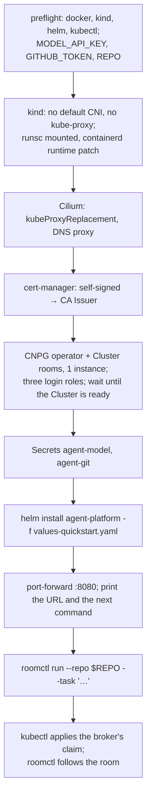

# Adoption, part 3b: install anywhere: design

**Status:** approved; the owner approved the design on 2026-10-18 in brainstorming and gave final
written-spec approval on 2026-10-27. Architectural review approved the amended design on 2026-10-27;
the owner selected subagent-driven execution.

**Scope:** three opt-in broker modes (local humans, TokenReview run issuer, `migrate`), the
`roomTools` listener switch, local discovery and `roomctl run`, the `agent-platform` umbrella
chart, the kind quickstart and its CI job, `docs/quickstart.md`.

**Programme:** part 3 of [the adoption story](2026-10-18-adoption-story-design.md), second half.
It depends on [3a, a portable run runtime](2026-10-18-portable-run-runtime-design.md).

## Conclusion

The success criterion is one sentence: **a platform engineer with a laptop, an API key and a
GitHub PAT watches a real run in a room, in under ten minutes, without cloud-native-ref.**

Four things stand in the way today, besides the runtime 3a replaces:

| Today | Needs |
|---|---|
| The broker requires a ZITADEL `human` block and an oauth2-proxy in front | ZITADEL, an IdP client, a public origin |
| Run tokens are checked against an https JWKS | An issuer URL the broker can fetch |
| The schema is migrated by the Atlas operator | Atlas operator + CRs |
| The first room, its claim and the follow are three separate acts, and only the factory creates an `AgentRun` | One command: the room, the claim, the follow |

The fix is three opt-in broker modes, one chart, one script and one CLI command. **Every mode
defaults to today's behaviour**, so cloud-native-ref's broker config does not change.

## Decisions

| # | Decision | Rejected | Why |
|---|---|---|---|
| I1 | **Local human mode, port-forward only**: one `human:local` user, `:8080` bound to loopback | Dex or Keycloak in the quickstart; a static token | An IdP doubles the quickstart. Loopback keeps `:8080` off the cluster network: nothing in the cluster can reach it, and `kubectl port-forward` over the user's kubeconfig is the only way in. The first spike proves that on kind/containerd; the fallback below is the only alternative, and it may not weaken the boundary |
| I2 | **TokenReview as a run-issuer mode** | Pointing the JWKS at the apiserver's discovery endpoint | Works on every distribution with no issuer reachability or anonymous-discovery RBAC. The `RunIssuer` seam already expects more issuers |
| I3 | **`room-broker migrate`, run as an init container** | The Atlas operator; a Helm hook Job | No CRDs to install; no hook ordering under Flux; an advisory lock makes replicas safe |
| I4 | **One umbrella chart: broker + run-controller, no factory dependency** | A chart per binary; a factory subchart now | Nothing installs the broker without a runtime, and the quickstart wants no factory. The chart keeps the name `agent-platform` for this milestone; a factory dependency arrives with the value that enables it, and the Maku rename is a later milestone |
| I5 | **The quickstart brings Cilium, cert-manager and CNPG; the chart does not** | Bundling them as subcharts | They are cluster-wide operators a platform team already chooses. The chart states them as prerequisites |
| I6 | **The production gap is a table, linked from the README's claims** | Softening the README | The README promises "a budget it cannot raise" and "short-lived credentials". The quickstart provides neither; saying so keeps A7's honesty |
| I7 | **`roomctl run` starts the quickstart's first run** | A kubectl snippet in the docs | One command keeps the room, the broker-rendered claim and the follow in step, and the broker still creates no `AgentRun`. It is quickstart-only and its help says so |
| I8 | **A top-level `roomTools` block names the `:8090` listener** | Telling it apart from `human.mcp` by name alone | The two MCP servers are different trust domains on different ports. A block of its own keeps today's default exactly: absent, `:8090` starts, and `ROOMS_MCP_KEY` decides who may call it |

## Broker: local human mode

```yaml
human:
  mode: local        # default oidc: today's block, unchanged
publicURL: http://localhost:8080   # local mode's default, and its public origin
```

| Concern | Behaviour |
|---|---|
| Identity | Every `:8080` request is `human:local`, in the admin and member groups |
| Reachability | `:8080` binds `127.0.0.1` in this mode; a non-loopback address is a startup error, with no override. The pod's IP therefore does not answer on `:8080`: the listener is off the cluster network, and `kubectl port-forward` is the only way in |
| CSRF | A **non-empty** `Origin` that differs from the broker's public origin is 403, on every request and on the WebSocket upgrade. In local mode the public origin is `publicURL`, default `http://localhost:8080`, and the broker answers as itself on `publicURL`'s port under `localhost`, `127.0.0.1` and `[::1]` (the same listener through the same port-forward); any other Host is 403, any other non-empty `Origin` is 403, and an absent `Origin` passes; in `oidc` mode it stays `human.origin`, unchanged. An **absent** `Origin` passes, as today: `roomctl` sends none, and a browser always sends one |
| Discovery | `GET /.well-known/roomctl` gains `humanMode`. In local mode `roomctl configure --url http://localhost:<port>` is accepted with no issuer, client id or project id, and `roomctl`'s config validation allows a plain-`http` URL only for a broker that reported `humanMode: local`; an `https` broker is discovered and validated exactly as today |
| roomctl | In local mode `login`, `token` and `doctor`'s login step are no-ops that report a local broker; `roomctl` dials without a bearer, since the local authenticator ignores one. Every other command is unchanged |
| `:8090` (MCP) | The room tools, a separate listener: the quickstart turns both off (`roomTools.enabled: false`, no `human.mcp`) |
| Validation | `mode: local` with any OIDC field set is refused |

**If the kind spike fails, the fallback may not move the boundary.** Binding the pod IP instead of
loopback would put an unauthenticated admin identity on the cluster network; a CiliumNetworkPolicy
in the `agents` namespace protects nothing in the broker's own namespace, and the port-forward's
traffic is not a pod, so such a policy would have to admit it deliberately rather than
incidentally. The only acceptable fallback is therefore: bind the pod IP, no Service, and a
default-deny CiliumNetworkPolicy **in the broker's namespace** scoped to `:8080` alone — it denies
pod-originated access to that port and admits only whatever identity the spike proves
`kubectl port-forward` arrives with. It is not a namespace-wide deny: `:8443` bridge traffic and
`:9090` metrics and probes keep the access they have today, unchanged. Whether Cilium can express
that rule, and admit `kubectl port-forward`, is a spike result. If it cannot — that is, if the
port-forward's identity cannot be expressed without cutting off existing bridge or ops traffic —
implementation stops for a design amendment: the quickstart does not drop the sandbox, the loopback
binding or the human-access boundary to keep moving.

## Broker: TokenReview run issuer

```yaml
runIssuers:
  - mode: tokenreview          # default jwks
    subPattern: '^system:serviceaccount:agents:run-([a-z2-7]{8})$'   # the default runs seam: the quickstart's names its own namespace and prefix
systemIssuer: null             # optional: without it, the system routes answer 401
```

- A second `Verifier` behind `RunIssuer`: `TokenReview{token, audiences:[the expected audience]}` must
  come back authenticated and with `status.audiences` holding **exactly** that one audience,
  `authn.AudienceRun` (`room-broker`) for a run and `authn.AudienceSystem` (`rooms-system`) for a
  system issuer — the same constants the JWKS path enforces, never a config field. The username
  then goes through `subPattern` and `envelope.ValidID` exactly like a JWT subject.
- Positive results are cached by SHA-256 of the token, never by the token itself: after a
  successful review the raw token's `exp` is decoded to bound the entry but is never used as
  proof — the review is the proof — and the entry lives `min(exp, 5m)`; an `exp` that does not
  decode caches 5 minutes. Refusals are not cached.
- A TokenReview verifier is not a JWKS verifier: it joins neither the JWKS refresh loop nor its
  key gauges, and adds no series of its own. The quickstart's config — TokenReview run issuer, no
  `systemIssuer`, local humans — builds no JWKS verifier at all, so no placeholder series appears
  where a key gauge would be.
- `systemIssuer` stays optional, because only the factory uses it and the factory is off in the
  quickstart; it accepts either mode. Absent, the broker still builds a non-nil `Systems` that
  never authenticates, so the system routes answer 401 rather than 404. `systemPrincipals` without
  `systemIssuer` is a validation error.
- The chart binds `system:auth-delegator` to the broker's ServiceAccount, and nothing more: that
  binding is what lets the TokenReview call succeed.

## Broker: the two MCP listeners

`:8090` always starts today, and `ROOMS_MCP_KEY` decides who may call it. A top-level block names
it, so it cannot be confused with `human.mcp`, the `:8080` server `roomctl mcp` relays:

```yaml
roomTools:
  enabled: true        # default: today's :8090 listener
```

- **Absent block means enabled.** cloud-native-ref's config, and every existing deployment with a
  `ROOMS_MCP_KEY`, keeps today's behaviour with no edit; an explicit `enabled: false` is the
  opt-out.
- The quickstart sets `roomTools.enabled: false` and enables no `human.mcp`: no room tools, no key
  to invent.
- `ROOMS_MCP_KEY` stays the only key, read from the environment as today: unset, the listener
  refuses every call.

## Broker: `migrate`

- `room-broker migrate` embeds the migration directory's `*.sql` files only, takes a Postgres
  advisory lock, applies pending files in order, and records each one's version and SHA-256 in
  `room_broker_revisions (version, checksum, applied_at)` — a table the command creates itself,
  never a migration file.
- It verifies its **own** revisions, not `atlas.sum`: an applied version whose embedded checksum
  differs, or a recorded version the binary does not ship, is refused. `atlas.sum` stays CI's
  (`atlas migrate validate`), because the Atlas operator still reads it on cloud-native-ref.
- A file runs in a transaction unless it starts with `-- atlas:txmode none` (five do today, for
  `CREATE INDEX CONCURRENTLY`).
- **Limit:** a txmode-none file failing half-way can leave an INVALID index. The next run refuses
  and names the index and the `DROP INDEX` to run. On an empty database the window is a few
  milliseconds.
- It connects as `rooms_owner`, the only role that may migrate; the `serve` process keeps
  `rooms_broker`, and the retention job `rooms_retention`.
- cloud-native-ref keeps the Atlas operator: `migrate.enabled: false`. `migrate` and the Atlas
  operator never share a database.

## The umbrella chart

```
charts/agent-platform/
  Chart.yaml       # no dependency: broker + run-controller
  crds/            # agents.ogenki.io AgentRun, the rooms CRD
  templates/
    broker/          # Deployment (+ migrate init container), Service, Certificate, config, SA,
                     # Role, RoleBinding, auth-delegator binding
    run-controller/  # Deployment, config, Role in the runs' namespace, RuntimeClass (optional)
    agents-ns.yaml   # the runs' namespace and its default-deny CNP
  values.yaml
  values-quickstart.yaml
  tests/render.sh
```

| Value | Quickstart | Production-shaped |
|---|---|---|
| `broker.human.mode` | `local` | `oidc` |
| `broker.runIssuers[0].mode` | `tokenreview` | `jwks` |
| `broker.roomTools.enabled` | `false` | `true` |
| `broker.database.secretRef` | the **serving** Secret, holding the `rooms_broker` DSN: CNPG's `rooms-app` | an existing DSN Secret, the `rooms_broker` role |
| `broker.migrate.secretRef` | the **migration** Secret, a separate one holding the `rooms_owner` DSN, never the serving Secret | unset: the Atlas operator migrates as `rooms_owner` |
| `broker.migrate.enabled` | `true` | `false` |
| `broker.runs` | `agents.ogenki.io`, the quickstart's runs namespace, prefix `run-` | the default seam: `cloud.ogenki.io`, `agents`, `xplane-run-` |
| `broker.tls.issuerRef` | the quickstart CA Issuer | e.g. `ClusterIssuer/openbao` |
| `runController.enabled` | `true` | `false` when Crossplane composes runs |

The broker's Role covers what it writes and what it watches: `rooms` in its own namespace,
`agentruns` in the runs namespace (the revoke annotation and the watch), and `leases` for the
manager's leader election. Its RoleBinding to the built-in `system:auth-delegator` ClusterRole is
what makes `TokenReview` legal. Nothing wider.

Published as `oci://ghcr.io/smana/charts/agent-platform` by `release.yaml`, cosign-signed like the
factory chart. cloud-native-ref is not moved onto it in this part.

## The kind quickstart

`task quickstart` runs `hack/quickstart/up.sh`; `task quickstart:down` deletes the cluster. The
script is idempotent and pins every version it installs.



**`roomctl run`.** `roomctl run --repo <owner/name> --task '<text>' [--role implementer]` creates
the room, sends `start_run` on the room's socket, applies the broker-rendered claim with the
user's own `kubectl` and kubeconfig, then follows the room. The broker creates no `AgentRun`:
in production only the factory does, and the quickstart has no factory — the claim is the
`runrequest` manifest rendered on the broker's `runs` seam, so the chart and the CLI cannot
disagree about the GVK, the namespace or the name prefix. The command is quickstart-only and its
help says so.

| Detail | Choice |
|---|---|
| gVisor | `runsc` and `containerd-shim-runsc-v1` downloaded on the host, bind-mounted into the node, registered by `containerdConfigPatches`; platform `systrap` (no KVM) |
| Model | Anthropic by default; `MODEL_BASE_URL` and `MODEL` select any OpenAI-compatible endpoint, whose host joins the egress profile |
| Repository | `REPO` is the one repository the PAT can write; the script refuses to start without it |
| Database | The CNPG `Cluster rooms` declares the `rooms_owner`, `rooms_broker` and `rooms_retention` login roles; `up.sh` waits for the Cluster to report ready, and the `migrate` init container retries until the server accepts it |
| Migration credentials | Two DSN Secrets: `broker.migrate.secretRef` holds the `rooms_owner` DSN the init container uses, `broker.database.secretRef` the `rooms_broker` DSN `serve` uses. `roomctl run` needs neither |
| Target | Under ten minutes from nothing to the run's first event |
| Docs | `docs/quickstart.md`; the README gets a "Try it" line under the demo link, and its status line names the quickstart |

**Two risks share the plan's first spike.** *gVisor inside kind:* it works on Linux with Docker;
macOS (Docker Desktop's VM), Podman and cgroup v1 are unproven. *Reaching a loopback listener:*
that `kubectl port-forward` from the host reaches a `:8080` bound to `127.0.0.1` in a kind pod,
on Linux and macOS, with kind's containerd and the API server's proxying in the path. Where either
fails, `up.sh` stops with the reason; gVisor failure offers `ALLOW_UNSANDBOXED=1`, and the
controller then sets the run's `Unsandboxed` condition while the room shows a banner. The sandbox
and the human-access boundary are never dropped silently: a reachability failure whose only fix
would expose `:8080` ends implementation until the spec is amended.

## What differs from production

This table goes in `docs/quickstart.md`, and the README's guarantee claims link to it.

| Production (cloud-native-ref) | Quickstart |
|---|---|
| Model calls through the gateway, with a per-run token budget the agent cannot raise | Your API key is in the sandbox. No budget or meter: only `maxMinutes` |
| GitHub through octo-sts: a token scoped to the run, valid up to an hour | Your fine-grained PAT, valid until you revoke it. Scope it to one repository |
| ZITADEL login, roles, approvals by member | One local user, port-forward only |
| The Atlas operator migrates as `rooms_owner`; TLS from OpenBao | The `migrate` init container, with a DSN of its own; a self-signed CA |
| The factory creates each `AgentRun`; agent `room_*` tools, warm sandboxes, suspend, Kueue | `roomctl run` applies the claim; `roomTools` off |
| The room, the bridge, gVisor, default-deny + FQDN egress | **Same** |

## Error handling

- Every broker mode is validated at startup with today's `Validate()`, which reports all problems
  at once and names the field and the allowed values: `human.mode: local` beside an OIDC field,
  `systemPrincipals` without `systemIssuer` and a malformed `roomTools` block included. The
  `roomTools` case needs no new check: strict decoding already rejects an unknown or malformed
  field, and `Validate()` reports the type and value errors it defines. There is no additional
  special validation of that block.
- `roomctl configure` accepts a plain-`http` URL only from a broker whose discovery reports
  `humanMode: local`; any other broker still needs `https` and the issuer and client ids, and the
  refusal says which one is missing.
- `roomctl run` stops at the first step that fails and names it — the room, `start_run` (with its
  reason: busy, not permitted), the claim, the follow — and passes `kubectl`'s own error through
  rather than summarising it.
- A `roomTools` listener that is off is never opened: no port, no rejected-call counter, and the
  broker starts without it.
- `migrate` exits non-zero on the first refused version or file and names it, so the init container
  fails the pod visibly instead of letting `serve` start against a schema that was not reached.
- `up.sh` fails fast on a missing tool or variable, prints the step that failed, and is safe to
  re-run.

## Testing

| Layer | Test |
|---|---|
| Local mode | Config tests for each refused combination; HTTP tests (no token → `human:local`; a foreign `Origin` → 403 on a request and on the upgrade; no `Origin` → admitted); the listener binds loopback only |
| Discovery | Local mode's `/.well-known/roomctl` carries `humanMode: local`; `configure` saves a local config with no issuer and refuses `http` from a broker that is not local; `login`, `token` and `doctor` report a local broker without calling an IdP |
| TokenReview | A fake client: authenticated, wrong audience, `status.audiences` with a second entry, unauthenticated, pattern miss, cache hit, cache expiry, an undecodable `exp` cached 5 minutes; refusals never cached; the verifier is never handed to the JWKS refreshers |
| Systems | `systemIssuer` absent: the system routes answer 401, not 404; `systemPrincipals` without it is a validation error |
| `roomTools` | Config tests for the absent block (enabled) and the opt-out; a disabled listener binds no port; `ROOMS_MCP_KEY` still gates the enabled one; a TokenReview-only config still serves no key gauges |
| `migrate` | Against the store's Postgres test container: empty → head, re-run is a no-op, a tampered embedded checksum refused, a recorded version the binary does not ship refused, two concurrent runs apply each file once, `room_broker_revisions` created by the command itself |
| Chart | `tests/render.sh` over both value sets, with structural assertions as the factory chart's: no factory workload or dependency, the two DSN Secrets and which container reads which, the broker's Role and its `system:auth-delegator` binding, `roomTools` off in the quickstart |
| Spikes | The plan's first task records, in the plan, what gVisor-in-kind and `port-forward`-to-a-loopback-listener do on Linux and macOS; a failure routes to the stated fallback or stops for a design amendment |
| End to end | CI job `quickstart-e2e` on ubuntu-latest: `up.sh` against a stub model server and a throwaway repository; passes when the room has events and the run is `Succeeded`. Runs on every tag and on PRs touching `charts/`, `hack/quickstart/`, `cmd/` or `internal/` |

## Out of scope

An IdP in the quickstart, a token meter, migrating cloud-native-ref onto the chart, other CNIs,
managed-cluster (EKS, GKE) install guides, and the Maku rename.
