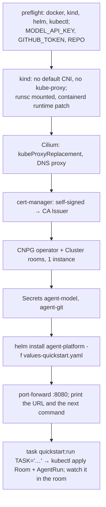

# Adoption, part 3b: install anywhere: design

**Status:** design, approved by the owner on 2026-10-18 in brainstorming; awaiting review of this
written spec.

**Scope:** three opt-in broker modes (local humans, TokenReview run issuer, `migrate`), the
`agent-platform` umbrella chart, the kind quickstart and its CI job, `docs/quickstart.md`.

**Programme:** part 3 of [the adoption story](2026-10-18-adoption-story-design.md), second half.
It depends on [3a, a portable run runtime](2026-10-18-portable-run-runtime-design.md).

## Conclusion

The success criterion is one sentence: **a platform engineer with a laptop, an API key and a
GitHub PAT watches a real run in a room, in under ten minutes, without cloud-native-ref.**

Three things stand in the way today, besides the runtime 3a replaces:

| Today | Needs |
|---|---|
| The broker requires a ZITADEL `human` block and an oauth2-proxy in front | ZITADEL, an IdP client, a public origin |
| Run tokens are checked against an https JWKS | An issuer URL the broker can fetch |
| The schema is migrated by the Atlas operator | Atlas operator + CRs |

The fix is three opt-in broker modes, one chart and one script. **Every mode defaults to today's
behaviour**, so cloud-native-ref's broker config does not change.

## Decisions

| # | Decision | Rejected | Why |
|---|---|---|---|
| I1 | **Local human mode, port-forward only**: one `human:local` user, `:8080` bound to loopback | Dex or Keycloak in the quickstart; a static token | An IdP doubles the quickstart. Loopback binding is enforced: `kubectl port-forward` reaches it, nothing else in the cluster can |
| I2 | **TokenReview as a run-issuer mode** | Pointing the JWKS at the apiserver's discovery endpoint | Works on every distribution with no issuer reachability or anonymous-discovery RBAC. The `RunIssuer` seam already expects more issuers |
| I3 | **`room-broker migrate`, run as an init container** | The Atlas operator; a Helm hook Job | No CRDs to install; no hook ordering under Flux; an advisory lock makes replicas safe |
| I4 | **One umbrella chart: broker + run-controller, factory as an optional dependency** | A chart per binary | Nothing installs the broker without a runtime. Split later if someone needs to |
| I5 | **The quickstart brings Cilium, cert-manager and CNPG; the chart does not** | Bundling them as subcharts | They are cluster-wide operators a platform team already chooses. The chart states them as prerequisites |
| I6 | **The production gap is a table, linked from the README's claims** | Softening the README | The README promises "a budget it cannot raise" and "short-lived credentials". The quickstart provides neither; saying so keeps A7's honesty |

## Broker: local human mode

```yaml
human:
  mode: local        # default oidc: today's block, unchanged
```

| Concern | Behaviour |
|---|---|
| Identity | Every `:8080` request is `human:local`, in the admin and member groups |
| Reachability | `:8080` binds `127.0.0.1` in this mode; a non-loopback address is a startup error, with no override |
| CSRF | A write whose `Origin` is not `publicURL` (default `http://localhost:8080`) is 403 |
| roomctl | Out of scope for 3b: it needs https and an IdP. The quickstart drives rooms and runs with `kubectl apply` and watches them in the web UI |
| `:8090` (MCP) | In local mode without `ROOMS_MCP_KEY`, not started. Elsewhere unchanged (today it starts and refuses every call without a key) |
| Validation | `mode: local` with OIDC fields set is refused |

## Broker: TokenReview run issuer

```yaml
runIssuers:
  - mode: tokenreview          # default jwks
    audience: room-broker
    subPattern: '^system:serviceaccount:agents:run-([a-z2-7]{8})$'
systemIssuer: null             # optional: without it, system routes answer 401
```

- A second `Verifier` behind `RunIssuer`: `TokenReview{token, audiences:[audience]}` must be
  authenticated and carry the audience; the username then goes through `subPattern` and
  `envelope.ValidID` exactly like a JWT subject.
- Positive results are cached by SHA-256 of the token until the earlier of its expiry and 5
  minutes. Refusals are not cached.
- The chart binds `system:auth-delegator` to the broker's ServiceAccount, and nothing more.
- `systemIssuer` becomes optional because only the factory uses it, and the factory is off in the
  quickstart. It accepts either mode.

## Broker: `migrate`

- `room-broker migrate` embeds `internal/store/migrations`, takes a Postgres advisory lock, and
  applies pending files in order, recording each in
  `room_broker_revisions (version, checksum, applied_at)`, the checksum being the file's SHA-256.
  `atlas.sum` stays CI's check (`task migrations`); re-implementing Atlas's hash chain at run time
  buys nothing the build does not already guarantee.
- It runs as the database owner. The migrations GRANT to the login roles `rooms_broker` and
  `rooms_retention`, which must exist first: the quickstart creates all three with CNPG managed
  roles, as cloud-native-ref does.
- A file runs in a transaction unless it starts with `-- atlas:txmode none` (three do, for
  `CREATE INDEX CONCURRENTLY`).
- A checksum mismatch, or a recorded version it does not ship, is refused.
- **Limit:** a txmode-none file failing half-way can leave an INVALID index. The next run refuses
  and names the index and the `DROP INDEX` to run. On an empty database the window is a few
  milliseconds.
- cloud-native-ref keeps the Atlas operator: `migrate.enabled: false`. The two never share a
  database.

## The umbrella chart

```
charts/agent-platform/
  Chart.yaml       # dependency agent-factory (charts/agent-factory), condition factory.enabled
  crds/            # agents.ogenki.io AgentRun, the rooms CRD
  templates/
    broker/          # Deployment (+ migrate init container), Service, Certificate, config, SA, auth-delegator binding
    run-controller/  # Deployment, config, Role in the runs' namespace, RuntimeClass (optional)
    agents-ns.yaml   # the runs' namespace and its default-deny CNP
  values.yaml
  values-quickstart.yaml
  tests/render.sh
```

| Value | Quickstart | Production-shaped |
|---|---|---|
| `broker.human.mode` | `local` | `oidc` |
| `broker.runIssuers[0].mode` | `tokenreview` | `jwks` |
| `broker.database.secretRef` | CNPG `rooms-app` | an existing DSN Secret |
| `broker.migrate.enabled` | `true` | `false` |
| `broker.tls.issuerRef` | the quickstart CA Issuer | e.g. `ClusterIssuer/openbao` |
| `runController.enabled` | `true` | `false` when Crossplane composes runs |
| `factory.enabled` | `false` | `false` (cloud-native-ref deploys it separately today) |

Published as `oci://ghcr.io/smana/charts/agent-platform` by `release.yaml`, cosign-signed like
the factory chart. cloud-native-ref is not moved onto it in this part.

## The kind quickstart

`task quickstart` runs `hack/quickstart/up.sh`; `task quickstart:down` deletes the cluster. The
script is idempotent and pins every version it installs.



| Detail | Choice |
|---|---|
| gVisor | `runsc` and `containerd-shim-runsc-v1` downloaded on the host, bind-mounted into the node, registered by `containerdConfigPatches`; platform `systrap` (no KVM) |
| Model | Anthropic by default; `MODEL_BASE_URL` and `MODEL` select any OpenAI-compatible endpoint, whose host joins the egress profile |
| Repository | `REPO` is the one repository the PAT can write; the script refuses to start without it |
| Target | Under ten minutes from nothing to the run's first event |
| Docs | `docs/quickstart.md`; the README gets a "Try it" line under the demo link, and its status line names the quickstart |

**Risk: gVisor inside kind.** It works on Linux with Docker; macOS (Docker Desktop's VM), Podman
and cgroup v1 are unproven. **The plan's first task is a spike on Linux and macOS.** Where it
fails, `up.sh` stops with the reason and offers `ALLOW_UNSANDBOXED=1`; the controller then sets
the run's `Unsandboxed` condition and the room shows a banner. The sandbox is never dropped
silently.

## What differs from production

This table goes in `docs/quickstart.md`, and the README's guarantee claims link to it.

| Production (cloud-native-ref) | Quickstart |
|---|---|
| Model calls through the gateway, with a per-run token budget the agent cannot raise | Your API key is in the sandbox. No budget or meter: only `maxMinutes` |
| GitHub through octo-sts: a token scoped to the run, valid up to an hour | Your fine-grained PAT, valid until you revoke it. Scope it to one repository |
| ZITADEL login, roles, approvals by member | One local user, port-forward only |
| The Atlas operator migrates; TLS from OpenBao | The `migrate` init container; a self-signed CA |
| Agent `room_*` tools, warm sandboxes, suspend, Kueue, the factory | Absent |
| Each role gets a token scoped to what it may do (a reviewer cannot push) | Every role gets the same PAT, readable by the agent: the rules ("push only to your branch", "read-only") are instructions, not enforcement |
| The room, the bridge, gVisor, default-deny + FQDN egress | **Same** |

## Error handling

- Every broker mode is validated at startup with today's `Validate()`, which reports all
  problems at once and names the field and the allowed values.
- `up.sh` fails fast on a missing tool or variable, prints the step that failed, and is safe to
  re-run.

## Testing

| Layer | Test |
|---|---|
| Local mode | Config tests for each refused combination; HTTP tests (no token → `human:local`, foreign `Origin` → 403); the listener binds loopback only |
| TokenReview | A fake client: authenticated, wrong audience, unauthenticated, pattern miss, cache hit, cache expiry |
| `migrate` | Against the store's Postgres test container: empty → head, re-run is a no-op, tampered checksum refused, two concurrent runs apply each file once |
| Chart | `tests/render.sh` over both value sets, with structural assertions as the factory chart's |
| End to end | CI job `quickstart-e2e` on ubuntu-latest: `up.sh` against a stub model server and a throwaway repository; passes when the room has events and the run is `Succeeded`. Runs on PRs touching `charts/`, `hack/quickstart/`, `cmd/run-controller/`, `internal/runwatch/`, and on every tag |

## Out of scope

An IdP in the quickstart, a token meter, migrating cloud-native-ref onto the chart, other
CNIs, and managed-cluster (EKS, GKE) install guides.
