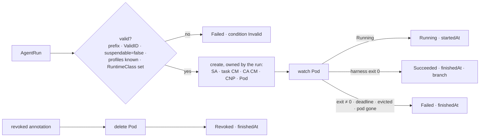

# Adoption, part 3a: a portable run runtime: design

**Status:** design, approved by the owner on 2026-10-18 in brainstorming; awaiting review of this
written spec.

**Scope:** a native `AgentRun` CRD, a new `run-controller` binary, a configurable seam in
`runwatch` (and the factory code that shares it), and two harness modes. No change to how
cloud-native-ref runs agents.

**Programme:** part 3 of [the adoption story](2026-10-18-adoption-story-design.md) is split in
two. This is **3a**. [3b, install anywhere](2026-10-18-install-anywhere-design.md), builds the
broker's quickstart mode, the umbrella chart and the kind quickstart on top of it.

## Conclusion

Today a run exists only as the Crossplane XR `cloud.ogenki.io/v1alpha1 AgentRun`, composed by
function-kcl in Smana/crossplane-configuration into a Sandbox behind an identity-proxy, octo-sts
and the agent gateway. A cluster without that stack cannot run an agent at all.

The fix is a second runtime that reads **the same run manifest**:

- **`agents.ogenki.io/v1alpha1 AgentRun`**, a plain CRD whose spec is the one `runrequest`
  already renders.
- **`run-controller`** reconciles it into a gVisor pod (harness + bridge), its ServiceAccount, two
  ConfigMaps and a default-deny CiliumNetworkPolicy, and writes the status `runwatch` reads.
- **`runwatch` takes its GVK, namespace and name prefix from config.** The defaults stay
  `cloud.ogenki.io`, `agents` and `xplane-run-`, so cloud-native-ref changes nothing.

## Decisions

| # | Decision | Rejected | Why |
|---|---|---|---|
| R1 | **A native CRD and controller** | A Helm-only "run Job" template; requiring Crossplane + function-kcl | A CRD keeps the broker's contract (watch a run, read its status, annotate to revoke). Crossplane is a heavy prerequisite for a quickstart |
| R2 | **The CRD's spec is the existing run spec, unchanged** | New `model`/`git` spec fields | `roomctl`, `runrequest` and the factory then render one manifest for either runtime; only the group differs |
| R3 | **Secrets and egress hosts live in the controller's config** | Per-run Secret references | A quickstart has one model key and one PAT. Per-run secrets are a later need, and an additive one |
| R4 | **The model key and the PAT go into the sandbox** | Shipping identity-proxy, octo-sts and a gateway | The owner's choice for adoption. The loss of guarantees is stated in 3b's "what differs from production" table, not hidden |
| R5 | **gVisor is required; `allowUnsandboxed` is an explicit, visible escape hatch** | runc by default | The project's promise is "without trusting them". Running unsandboxed must be a choice the room shows |
| R6 | **Suspend, Kueue, warm headroom are out of scope** | Porting them | They stay on cloud-native-ref's runtime. `spec.suspendable: true` is refused, not ignored |
| R7 | **`internal` runs are refused; `spec.model` is ignored** | Accepting both | `internal` promises the model gateway and no public egress; `spec.model` names gateway tiers. Without a gateway neither can be honoured, so the model comes from `modelSecret` |
| R8 | **The controller renders the rules itself**, a Go port of the composition's `_rulesFor` | A rules ConfigMap per role | The rules name the run, its branch and its base: they are per run, not per role. The port drops the lines about `room_*` tools and the gateway's 429, neither of which exists here |

## The CRD

`agents.ogenki.io/v1alpha1`, kind `AgentRun`, namespaced. Name `<namePrefix><runId>`, where
`runId` matches `envelope.ValidID`. Spec, as `runrequest.Manifest` renders it today:

| Field | Type | Notes |
|---|---|---|
| `role`, `repository`, `baseRef`, `branch`, `principal`, `dataClass`, `roomRef` | string | Required except `dataClass` |
| `task.text` / `task.url` | string | Exactly one (CEL) |
| `budget.maxMinutes` | int | Default 120 |
| `egress.profiles` | []string | The XRD's enum (`pypi`, `npm`, `golang`, `crates`); `github` is always on |
| `suspendable` | bool | Must be false here (CEL) |

Status:

| Field | Written when |
|---|---|
| `phase` | `Pending` → `Running` → `Succeeded` / `Failed` / `Revoked` / `BudgetExhausted` (the last only from a `budget-*` revoke value: there is no meter) |
| `reason` | As the composition writes it, since the factory reads it: `PodFailed`, `PodLost`, `Disrupted`, or the revoke value |
| `runId`, `conversationId` | The id from the name; the run's UID |
| `startedAt` | The pod is Running |
| `finishedAt` | Any terminal phase. Always set, so runwatch's Ready-condition fallback never fires |
| `branch` | `spec.branch`: the harness pushes there and reports nothing else |
| `conditions` | `Ready`; `Invalid` (with the reason); `Unsandboxed` when `allowUnsandboxed` placed the pod without a RuntimeClass |

Revocation stays the annotation `agents.ogenki.io/revoked`, written by the broker as today: a
`budget-run`/`budget-principal`/`budget-fleet` value ends the run `BudgetExhausted`, `manual`
ends it `Revoked`, any other value is ignored, as in the composition.

## The run-controller

Config, from the chart:

```yaml
namespace: agents
namePrefix: run-
runtimeClassName: gvisor          # empty → every run Failed/Invalid, unless allowUnsandboxed
allowUnsandboxed: false
modelSecret: agent-model          # keys: api_key, base_url, model
gitSecret: agent-git              # key: token (fine-grained PAT)
broker:
  url: https://room-broker.agent-platform.svc:8443
  namespace: agent-platform       # with labels: the CNP's toEndpoints for :8443
  labels: {app.kubernetes.io/name: room-broker}
  caSecret: room-broker-tls       # its ca.crt is copied into each run's CA ConfigMap
images:
  harness: ghcr.io/smana/agent-harness:<tag>@<digest>
  bridge: ghcr.io/smana/room-bridge:<tag>@<digest>
egressProfiles:                   # github is always on; the rest are the CRD's enum
  github: [github.com, api.github.com, codeload.github.com, objects.githubusercontent.com, raw.githubusercontent.com]
  pypi: [pypi.org, files.pythonhosted.org]
  npm: [registry.npmjs.org]
  golang: [proxy.golang.org, sum.golang.org]
  crates: [index.crates.io, static.crates.io]
# the model host and port are added from base_url
```



Objects, all with an owner reference to the run:

| Object | Shape |
|---|---|
| ServiceAccount | Named exactly like the run: the broker's run issuer maps `system:serviceaccount:<ns>:<prefix><id>` to the run. No RBAC, `automountServiceAccountToken: false` |
| ConfigMap `<run>-task` | `task.md` (the text, or "Work on <url>."), `rules.md` (rendered per run), `run.json`, as the composition writes them |
| ConfigMap `<run>-ca` | The broker CA |
| CiliumNetworkPolicy | Default-deny on the pod. Allows DNS to kube-dns with the L7 DNS rule, the broker on 8443, and `toFQDNs` on 443 for `github` plus the run's egress profiles, and the model host on its port |
| Pod | `runtimeClassName`, restricted security context, `restartPolicy: Never`, `activeDeadlineSeconds = maxMinutes × 60`, requests and limits. The bridge is a native sidecar with the only projected token (audience `room-broker`, 600 s). The harness gets the env the composition sets today (`TASK_FILE`, `RULES_FILE`, `REPOSITORY`, `BRANCH`, `BASE_REF`, `ROLE`, `DATA_CLASS`, `MODEL`, `LLM_BASE_URL`, `BRIDGE_URL`), the model key and PAT as files, and no `MCP_URL` |

Status mapping:

| Observed | Phase | The broker's end reason (unchanged `EndReason`) |
|---|---|---|
| Pod Running | `Running` | — |
| Harness container exit 0 | `Succeeded` | `agent_finished`, or the harness status the bridge mirrored |
| Exit ≠ 0 | `Failed` | `agent_error` / `agent_stuck` from the mirrored status |
| `DeadlineExceeded` | `Failed` | `deadline`, from `finishedAt − startedAt` |
| Pod deleted or evicted before a terminal phase | `Failed` | `pod_lost` |
| Revoked annotation | `Revoked` | `revoked` |

RBAC: a Role in its namespace on `agentruns`, `agentruns/status`, pods, serviceaccounts,
configmaps, ciliumnetworkpolicies; read on the two Secrets; get on the CA Secret in the broker's
namespace by name. No cluster scope.

## The runwatch seam

`runwatch.Namespace`, `ClaimPrefix` and the GVK in `watcher.go` become one `runwatch.Kind`
value, set once at startup by `runwatch.Configure` from config, and read through accessors by the
watcher, `FromUnstructured`, the factory's `runs` and meter, `suspend` and `runrequest`. Defaults equal today's constants. The broker and the factory each gain
an optional `runs: {group, namespace, namePrefix}` config block.

## Harness changes

| Change | Today | Added |
|---|---|---|
| Model key | `PLACEHOLDER_KEY`; identity-proxy injects the real one | `LLM_API_KEY_FILE`: when set, its content is the key |
| Git credentials | `git_credential_agent.py` exchanges through identity-proxy for an octo-sts token | `GIT_TOKEN_FILE`: when set, `get`/`token` print it; `revoke` is a no-op |
| Room tools | `MCP_URL` required (`env["MCP_URL"]`) | Optional: unset means no `room_*` tools; the bridge still mirrors every event |

## Error handling

- An invalid run is `Failed` with condition `Invalid` and a message naming the field, so the
  broker ends the room's run instead of waiting.
- A missing Secret is a requeue with a condition, not a failure: the
  quickstart may create them after the chart.
- The controller is idempotent: every object is created or patched by name; a restart reconciles
  every non-terminal run.

## Testing

| Layer | Test |
|---|---|
| Reconcile | envtest: valid run → objects + `Running`; exit codes → phases; deadline; pod deleted; revoke annotation; invalid specs; missing Secret requeues |
| Rendering | Golden files for the Pod and the CNP, from fixed configs |
| Contract | One `runrequest` manifest read by `FromUnstructured` under both `runwatch.Kind` values |
| Harness | pytest for `LLM_API_KEY_FILE`, `GIT_TOKEN_FILE`, and no `MCP_URL` |
| End to end | 3b's `quickstart-e2e` CI job |

## Out of scope

Suspend and resume, Kueue, warm sandboxes, per-run Secrets, a token meter, and moving
cloud-native-ref onto this runtime.
