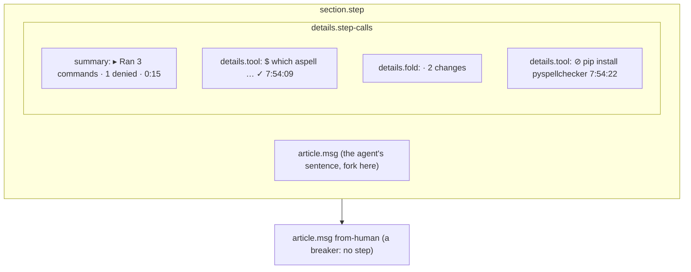

# Room UI polish: design

**Status:** design, approved by the owner on 2026-10-18 in brainstorming; awaiting review of this
written spec. **Scope:** `web/` only (the room page's stream, dock, controls and stylesheet), the
committed bundle in `internal/humanapi/ui/dist/` that `ui:check` rebuilds, and the preview fixtures.
No API, envelope or summary change. **Builds on:**
[2026-10-15-room-readability-design.md](2026-10-15-room-readability-design.md), whose decisions D1
(vanilla TypeScript, no framework, strict CSP), D3, D7 and D10 hold unchanged.

## Conclusion

The readability pass put every fact in the right place. Watching a real run (room `lr7e7kpk`,
2026-10-18, a typo-hunting implementer, 144 events) shows three problems it left:

1. **The composer is hard to find.** The textarea has no placeholder and blends into the dock.
   `send` is a 2 px × 10 px pill at the far right, and the sticky dock covers the rows under it
   (in the owner's screenshot it cuts through an expanded `grep`).
2. **Tool calls are hard to follow.** Forty near-identical rows (blue `terminal`, a truncated
   command, a green `ok`), a `· 2 changes` fold between almost every pair, and nothing ties an
   agent's sentence to the commands it then ran. An opened row prints the command twice.
3. **Dark mode is one flat navy.** The page (`--muted`) and the cards (`--card`) are both
   `#003552`: a contrast of exactly 1.00:1, so header, stream, cards, dock and controls blend
   together.

The fix keeps D1 and restructures in place:

- **Step blocks:** each agent message owns the tool calls after it, behind one summary line.
- **A real composer:** a prominent Send and a segmented delivery choice.
- **Dark surfaces retuned:** the brand hues stay.
- **Polish:** a `make-interfaces-feel-better` pass.

## Decisions

| # | Decision | Rejected | Why |
|---|---|---|---|
| P1 | **Step blocks**: an agent message and every row after it, until the next step breaker, form one step. The tool calls sit behind one `<details>` summary line under the message | A timeline rail with every call visible; a rail that auto-collapses old steps | The owner's choice. The rail keeps the stream long; collapsing a rail is the most work for the same reading |
| P2 | **A step opens itself while it needs reading.** Open while any call runs, and while any call is errored, rejected or denied. Collapsed once every call is ok. A reader's own toggle wins until the step's state changes | Always collapsed; always open | The live step is what the reader watches; a finished clean step is history. A failure is the one thing in history worth seeing |
| P3 | **`ok` is silent.** A call line shows ✓ in the muted colour; the green `ok` chip goes. ⊘ amber for rejected/denied, ✕ red for error, a spinner for running | Keep the chip | A status shown on 40 rows of 40 is noise; only an exception should draw the eye (D5's rule, extended) |
| P4 | **The composer is the dock's main element**: placeholder `Message the room…`, a visible input border, auto-grow from 2 to 8 rows. A full-height primary **Send** with a label and an arrow icon. Ctrl/⌘+Enter sends | Restyle the button only | Talking to the room is the most frequent act (D4). It has to look like an input |
| P5 | **Delivery is a segmented radio group**, `Room · Queue · Steer`, with the meaning of the checked one in a hint line under it. No radio is checked after a lost token or an ended run, exactly as the hidden "choose" option works today | Keep the `<select>` | A three-way choice made on every message should be visible, not hidden in a dropdown. The R09 rule (never silently re-route) is unchanged |
| P6 | **The dock never covers the stream.** A `ResizeObserver` writes the dock's height to `--dock-h` on `<html>`; `main` pads its bottom by it. The dock gets an elevation shadow | A non-sticky dock; `main` as the scroll container | One custom property keeps `scrollIntoView`, the page scroll and `focusRow` exactly as they are |
| P7 | **Run and Driver move into a `Session` disclosure in the dock**, collapsed by default, above the composer. The Room group and the queue go with them | They stay under the stream | Under 144 events they are three screens down and read as leftovers; the dock is where acts live |
| P8 | **Dark surfaces retuned, hues kept** (table below). `app.css` records the divergence from app-wizard in a comment; porting it back is a follow-up there | Retune both repos now; a new palette | The owner's choice. The bug is one equal pair of values, not the palette |
| P9 | **A skeleton stream while connecting.** Three grey message shapes in place of an empty navy screen, until the first frame or the first event | A spinner | The screencast spends 15 s on an empty screen that reads as broken |
| P10 | **Icons are inline SVG built with `createElementNS`**: one 1.5 px-stroke outline set, `currentColor`, about eight glyphs (send, check, x, ban, spinner, chevron, terminal, tool) | An icon font or a library | Strict CSP and no dependency (D1); one stroke weight per surface |

## The stream

### What a step is

The model stays what it is: `ChatView` holds rows in seq order, keyed by seq, with the O(1)
live-append path and the cap. A step is **layout layered on that order**, the same way folds are
today.

- **Step owner:** a `message` whose `actor.kind` is `agent`.
- **Step breakers:** a message from a human or the system, a `handoff`, a `harness_error` or
  `limit` marker, and the next step owner.
- **Members:** every row from the owner up to the next breaker. That is tool rows, plumbing
  rows, and the folds that plumbing forms.
- **Rows before the first owner** stay at the top level, as now.
- **When the cap drops a step's owner,** its remaining members form an ownerless step labelled
  `Earlier calls`.



A step with no member rows renders the message alone, with no empty `details`.

### The summary line

Format: `<verb> <n> <noun> · <exceptions> · <duration>`.

| Part | Rule |
|---|---|
| verb | `Running` while any call has no result, else `Ran` |
| n, noun | the count of tool calls; `command(s)` when every call is a terminal call, else `tool call(s)` |
| exceptions | `1 denied`, `2 failed`, joined by `·`, omitted when zero; amber/red text |
| duration | first call's ts to the last result's ts, `m:ss`, `tabular-nums`; omitted for one call |

Plumbing rows count toward nothing; they show inside as the existing `· N changes` fold.

### A call line

Collapsed:

- `$` then the command in mono, for a terminal call; the tool name in the link colour, for any
  other tool.
- Then the status icon (P3), then the time.
- A non-allow or human policy decision keeps its badge.

Opened:

- **Command:** shown once, in full, wrapped. `ARGUMENTS` appears only when the args carry fields
  beyond `command`, minus that one.
- **Output:** in a box capped at 16 em with its own scroll. A `show all` toggle lifts the cap.
- **Meta and redactions:** the meta line (callId, class, risk) and the redaction notes stay.

### Behaviour kept

- **`reveal` / `focusRow`:** already open every `<details>` ancestor, so a link from the Now line
  or an approval card lands inside a step. A test pins it.
- **`rowFor(callId)`:** still returns the tool row; needs.ts is untouched.
- **Fork here:** stays on messages and handoffs, in the row toolbar.
- **Untrusted text:** DOM nodes and `textContent` only, as render.ts requires.

## The dock

```text
┌──────────────────────────────────────────────────────────────────────┐
│ ▸ Session · driver: you · implementer idle                live · 144 │
├──────────────────────────────────────────────────────────────────────┤
│ ┌──────────────────────────────────────────────────────┐ ┌─────────┐ │
│ │ Message the room…                                    │ │ Send  ➤ │ │
│ │                                                      │ │         │ │
│ └──────────────────────────────────────────────────────┘ └─────────┘ │
│ ( Room | Queue | Steer )  Posted to the room; no agent is prompted.  │
│                                              Ctrl+Enter to send      │
└──────────────────────────────────────────────────────────────────────┘
```

- **Layout:** one column on a phone (≤ 640 px). Send goes full width under the text.
- **Hint text per delivery:**
  - Room: `Posted to the room; no agent is prompted.`
  - Queue: `Queued for the next run's brief.`
  - Steer: `Sent to the running agent now.`
- **Unchanged composer rules:** the delivery notice keeps its `role="status"` live region. Send
  is disabled while the socket is down, and the draft stays until its own ack accepts it. A
  watcher gets no composer; a sealed room hides it.
- **Session panel:** its summary line repeats the driver and the run state, so a collapsed
  panel still answers "who drives". Destructive acts keep their inline confirm (D6).
- **Theme and connection:** both stay on the right of the dock's top line.

## Colour and type

Dark tokens, before and after. Light mode keeps its values; its shadows already separate the layers.

| Token | Before | After | Pair checked | Ratio after |
|---|---|---|---|---|
| `--muted` (the page) | `#003552` | `#001b2b` | card on page | 1.23:1 (was 1.00) |
| `--card` | `#003552` | `#002d47` | `--muted-foreground` on card | 8.2:1 |
| `--surface-raised` (new: header, dock) | n/a | `#003a5c` | raised on page | 1.48:1 |
| `--border`, `--input` | `#004070` | `#13527d` | border on card | 1.73:1 |
| `--placeholder` | `#9db0bc` | unchanged | on raised | 5.3:1 |
| `--link` | `#4db3e8` | unchanged | on raised | 5.1:1 |

In light mode, `--surface-raised` is `--card` (`#ffffff`). The header keeps `--brand-navy` in
both schemes. In dark mode the header moves to `--surface-raised`, because brand navy on the new
page reads 1.11:1. `contrast.test.ts` gains the new pairs: text on raised; the composer border
on the dock at 3:1, since an input's boundary is meaningful (WCAG 1.4.11).

**Type:**

- **Text sizes:** message prose 14 px (unchanged body); stream meta 12 px, the D8 floor.
- **Numbers:** `tabular-nums` on times, durations and the event count.
- **Weights:** the step summary at 500, the owner's name at 600.

**Polish rules (from `make-interfaces-feel-better`):**

- **Hit areas:** buttons at least 40 px tall in the dock and the needs panel. Small inline
  buttons get a pseudo-element hit area.
- **Press feedback:** `scale(.96)` on press, off under `prefers-reduced-motion`.
- **Transitions:** properties named explicitly; no `transition: all`.
- **Radii:** concentric. Card 12, inner box 8, chip 999.
- **Elevation:** shadows for depth; borders only for structure and state.
- **Motion restraint:** the running spinner is the only repeating motion, and the icon also
  changes, so motion is never the only cue.

## Testing

TDD, stdlib vitest, the existing fakes and fixtures.

| Test | Proves |
|---|---|
| `chat.test.ts`: steps | an agent message owns the following calls; a human message, a handoff and a harness error break a step; rows before the first owner stay top level; the cap's ownerless step reads `Earlier calls` |
| `chat.test.ts`: summary | `Running`/`Ran`, the noun, the exception counts, the duration; a late result updates the line in place |
| `chat.test.ts`: open rule | a running or failing step is open; a clean finished one closes; a reader's toggle survives an unrelated event |
| `chat.test.ts`: replay | a replay out of order (an older event put after newer ones) lands in the right step; a resend never doubles a line |
| `chat.test.ts`: call line | no `ok` chip; the args section omits `command`; `show all` lifts the cap |
| `chat.test.ts`: reveal | `focusRow` on a call in a collapsed step opens the step |
| `controls.test.ts`: composer | Ctrl/⌘+Enter sends, plain Enter inserts a newline; the radio group follows R09 (no radio checked after a lost token, a notice, the draft kept); Send is disabled while not live |
| `room.test.ts` | the Session disclosure holds Run and Driver; `--dock-h` follows the dock's size |
| `contrast.test.ts` | every pair above, both schemes |

**Visual check:**

- **Screenshots:** `npm run preview`, then headless chromium on `/preview/full.html`. Light and
  dark, at 390, 1024 and 1280 px, before and after, attached to the PR.
- **Fixture:** `test/fixtures/live-session.jsonl` gains a denied call and a failed call, so a
  step with exceptions is in the preview.

**Gate:** `task check`, including `ui:check` for the rebuilt bundle.

## Out of scope

- The two-pane layout (still the named next milestone, decided on phase-7 usage).
- Porting the retuned dark tokens back to app-wizard.
- The room list page: it already reads well as a table, and it inherits only the token change.
- Syntax highlighting of commands or output.
